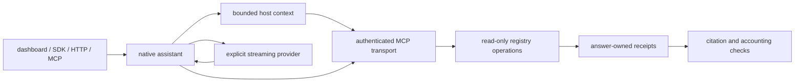

# Assistant design

Loom's native assistant answers namespace questions through bounded model turns and
read-only operations, under the caller's identity. It owns context selection, tool
execution, streaming, cancellation, citations and accounting in the web process.
It does not require a separate chat runtime or a conversation database.

## Surfaces

The dashboard Ask AI panel, `POST /v1/assistant/chat/completions`, `assistant.ask`,
its MCP tool and both SDKs use the same runtime. The chat route accepts OpenAI-shaped
user and assistant messages, with streaming or whole responses. The op accepts a question
and history. Callers provide history; Loom stores no conversation for these interfaces.
A system message, file, tool result or model supplied by a client cannot override the
server's runtime. The namespace header and existing op identity tuple keep their meaning.

## Each caller's own identity

Admission checks the caller's viewer role, narrowed reads, expiry, org model-call
switch, namespace budget share and concurrency. Org-wide callers and answer tokens
or their descendants cannot start an answer. A viewer token is delegated from the
asker's own subject, for this namespace and answer lifetime, ending with the caller's
session or revocation. No global service account authorizes a tool call.

The namespace's active mirrored-source registrations mark the answer before budget,
context or model work. Marked responses send the marker first and use private
accounting. The delegated token retains session protection and the answer's fixed
mirror-admission bit. Current source ACLs still decide each returned item. A source
becoming active later cannot widen an unmarked answer. Unknown admission refuses.

Every native tool request goes through `/mcp?toolset=assistant` in process, in a
child task with the answer's bearer and run id. It passes token verification,
revocation, namespace and row-reach checks, role gates, idempotency and operation
accounting. The existing assistant roster and forced arguments prevent writes,
reinforcement, arbitrary run ids and recursive assistant calls. The model sees a
bounded subset of schemas for relevant read operations, without provider overrides.
Tool results and history are untrusted data and confer no authority.

### Support

Citations are checked against structured results actually delivered during this answer,
not an eventually consistent analytics read. A memory citation needs its exact key and
version; a code citation needs a returned path and line span; a document citation needs
a returned source and section; a help citation requires text from `help.get` for the
page or section. An outline from a truncated or continuation read supplies no evidence
for unread sections.
A SQL block must match a successful `insights.query` statement. Unknown citations or
operation and setting names refuse completion. Arbitrary result text cannot supply
source identifiers for verification. A verified citation proves that evidence was
returned, not that every sentence is entailed by it. Each citation check records
whether that source was returned to this answer. Support for an uncited answer derives
from its tool receipts.

Prior-value questions read `memory.history` after locating the key. A historical
memory citation binds the requested key to the exact version and value returned in
that receipt; redacted rows cannot verify it. Current-value questions use current
reads. Population questions use `namespace.inventory`, keeping its read scope,
observed-agent and member distinction, totals, bounded top lists and incomplete
reasons. A complete count does not make a shorter top list exhaustive.

### Steps

Host context and model-selected tools have separate `origin` values in progress events.
Each tool has a run id and an existing request-ledger row. Model progress records the
logical turn, physical attempts, duration and usage status. Generations use existing
trace spans and customer attribution. Streaming text is provisional until `[DONE]`.
EOF, a failed tool, a malformed model frame, a provider refusal or an exhausted budget
cannot publish a completed answer. Required private cost delivery precedes `[DONE]`.
Source proofs retained from tools are renewed after final accounting and before the terminal
event, including tools whose nested transport runs in another task.
Disconnects close and join the model and tool work before final accounting.

### Starters and cards

The dashboard's existing namespace starters and draft cards use their existing
operations. A write remains the person's explicit action under their own role.

### Asking again

A retry is the caller's choice. Model requests are sent once per logical turn; an
uncertain stream is never replayed automatically. There is no fallback provider.

## The agent definition

`server/assistant/domain/instructions.py` holds the instructions. The host selects
bounded initial context before the first model request. Named code questions use a
symbol lookup; conceptual code questions use code search; Loom usage questions use
help search; counts use the analysis catalog; other questions use memory and document
search. Additional calls are adaptive, with a shared total bound and normalized
query deduplication. The model need not select its initial context.

## Loom's documentation

Help searches read the build's bundled documentation. A model must fetch a returned
section before citing it. The source's audience distinguishes operating Loom from
using it, and examples are not deployment facts.

## The analysis op

`insights.query` runs one read-only SQL statement over an allowlisted set of Loom
tables and returns its rows, capped. The agent uses it for questions no other read
answers, such as which agents wrote the most contradicted facts last week or what a
namespace holds by kind and age. Any token with `viewer` on the namespaces it names can
call it directly, on any transport, and it joins the
[assistant toolset](../reference/mcp.md#the-assistant-toolset). A token whose
`read_scope` is narrower than its namespaces is refused it, as every op outside
`SCOPED_OPS` and `NARROW_SAFE_OPS` is.

The event catalog has two views. Use `loom.analysis_ordinary_agent_events` for ordinary
requests and worker events, or `loom.analysis_agent_events` for the request ledger with
marked model, spend, work and outcome fields masked. Both views enforce the signed
organization and namespace before returning rows. Their definer reads the physical
event tables and the analyst holds column grants on the views. Both physical tables
and their storage metadata are outside those grants. The projections, signed
predicates and definer clauses are included in the entity version digest.

### The boundary is the database user

The statement runs as a dedicated ClickHouse user, `loom_analyst`, never as Loom's own
user or the reader user. Loom does not parse or rewrite the statement to scope it. It
sends the scope as settings and runs the statement, less one trailing `;`, as a
subquery, `SELECT * FROM (` and `)` on lines of their own, so a trailing `--` comment
ends at the newline. ClickHouse parses only a `SELECT` or `WITH` there and reports a
syntax error for anything else. The wrapper is not what isolates orgs; the user's
grants, settings profile and row policies are:

| What the statement tries                                            | What stops it                                                                                              |
| ------------------------------------------------------------------- | ---------------------------------------------------------------------------------------------------------- |
| a table or column outside the allowlist (tokens, secrets, keys)     | grants: `SELECT(col, …)` on each allowlisted table, nothing else                                           |
| another org or namespace, through a filter, `JOIN` or subquery      | a row policy on each physical table and the same signed predicate inside the masked event view             |
| a deleted or erased row, or a version a later one replaced          | the row policy carries the table's live predicate and applies after `FINAL` (below)                        |
| `system.*`, `information_schema`, `SHOW`, `DESCRIBE`, `KILL QUERY`  | no grant on `system` tables, `SHOW COLUMNS` or `system.processes`                                          |
| `EXPLAIN`, whose estimates count other orgs' rows                   | inside the subquery, `EXPLAIN` needs `CREATE TEMPORARY TABLE`, which the user lacks                        |
| `mergeTreeIndex()` and other index readers                          | ClickHouse refuses them on a table with a row policy                                                       |
| `url()`, `file()`, `s3()`, `remote()`, `cluster()`, `executable()`  | no `READ ON URL`, `FILE`, `S3`, `REMOTE` and no `CREATE TEMPORARY TABLE` grant                             |
| `aiGenerate()` and the other AI functions, which send rows out      | they take credentials only from a named collection, and the user has no `NAMED COLLECTION` grant           |
| a write, DDL or a temporary table                                   | `readonly = 2`, held `CONST` in the user's settings profile                                                |
| `SETTINGS` that widen time, memory, rows read or result size        | the profile's `MAX` constraints; `result_overflow_mode` and `read_overflow_mode` are `'throw'` and `CONST` |
| `SETTINGS use_query_cache = 1` or `use_query_condition_cache = 1`   | both `0`, `CONST`, so no cached result or granule map crosses from one scope to another                    |
| `SETTINGS send_logs_level = 'trace'`, whose log lines quote the key | `send_logs_level = 'none'`, `CONST`                                                                        |
| `SETTINGS max_threads = 256`, taking the host's CPU                 | `max_threads` pinned as `MAX`                                                                              |
| `SETTINGS` that rename the scope                                    | the row policy's signature check fails, so the statement reads no rows                                     |

**Signed row policies.** Loom sends four custom settings with each statement: the org
(`<prefix>loom_org`), the namespaces (`<prefix>loom_ns`), an expiry (`<prefix>loom_exp`)
and `<prefix>loom_sig`, the HMAC-SHA256 under a 256-bit key of one length-prefixed
string of the other three and the statement's query id: the request's
`<request_id>:<n>:<nonce>`, new for each statement, whose per-request random nonce keeps
two requests, of one tenant or two, from sharing an id (a probe outside a request takes
a random UUID). The client's retry of a statement resends the same id with
`replace_running_query = 1`, so it replaces its own attempt ClickHouse still runs. The
expiry covers every attempt the client's retry ladder can make at the time cap
(`scope_ttl_s` in `server/insights/app/analysis.py`). Each physical allowlisted table's policy,
`TO loom_analyst`, admits a row only when its `org` and `namespace` match the settings,
the expiry is in the future, and the signature matches the hash ClickHouse computes with
the key written into the policy. A statement may set custom settings itself (`readonly =
2` allows it), but without the key it cannot sign another scope, so a changed scope
reads nothing. A statement can read its own scope with `getSetting`, but the policy
signs the query id Loom sends with the statement (`initialQueryID()`, the same on every
server the statement fans out to), so a signature lifted from one statement reads
nothing when sent with another, by the same caller or any other. The policy reads every
setting through `toString`, so a statement that sets one to a number or an array cannot
make the policy raise an error, whose message would quote the policy and its key; and
Loom never passes on a ClickHouse message that names the scope settings.

**The settings prefix.** ClickHouse takes a custom setting only under a prefix its
`custom_settings_prefixes` names: `SQL_` in ClickHouse's default configuration,
`custom_` on ClickHouse Cloud. The first time it loads the secrets, Loom sends
`SELECT 1` with `<prefix>loom_probe` for `SQL_` and then `custom_`, and names the scope
settings and the profiles' stamps under the first one the server takes; a server that
takes neither refuses analysis with a message that names `custom_settings_prefixes`. The
prefix is the server's, not the version's: a server on ClickHouse's default
configuration keeps `SQL_` and the same entities, and the structure digest a version
pins is spelled with `SQL_`. On a `custom_` server each Loom process leaves one refused
`SQL_loom_probe` in the server's logs.

Each policy also carries its table's live predicate, the one the erasure census counts
(`tombstoned_at IS NULL` on `loom.memory`), and the profile holds `final = 1` and
`apply_row_policy_after_final = 1` `CONST`. A deletion or an erasure tombstones every
version of a row, and the row stays in the table until a merge or a purge, so `FINAL`
picks each key's latest version and the policy then drops it when that version is a
tombstone: a deleted or erased key is absent, and its earlier versions do not come back.
A second policy, `AS PERMISSIVE USING 1 TO ALL EXCEPT loom_analyst`, on every table the
analyst has a policy on (the canary and a retired table included), lets every other user,
Loom's own included, read every row of them, whatever the server's
`users_without_row_policies_can_read_rows` says. ClickHouse ORs the permissive policies on a
table, so this one would widen any permissive policy someone else put on one of these
tables: before every write Loom lists them in `system.row_policies` and, finding one, writes
nothing and reports it, naming it in the server log and in `loom ch-setup`'s refusal, for an
admin to drop or make restrictive. A restrictive policy is left alone, since it narrows
every user it names. The analyst user, its profiles and its policies' names are server-wide,
so analysis needs one Loom per ClickHouse service: a deployment that finds the analyst's
scope policy in another database writes nothing and reports it, naming that database in the
server log.

The key and the analyst's password are random and kept together, as one sealed value, in
one row of `loom.analysis_secrets`. The password holds a lower and an upper case letter, a
digit and a symbol, which ClickHouse Cloud requires of a user's password. The row is
sealed with `server/core/secrets_at_rest.py` in the shape `loom secrets reseal` rewrites
(`SEALED` in `server/cli/secrets.py`). The reseal reads under `own_write_reads`, skips
a row that is gone and holds the analysis lease; with [analysis key rotation](#analysis-key-rotation-limits) the CLI
rotation holds it too, so they never interleave, and the printed rotation, which takes
no lease, stores its row at a version from ClickHouse's clock at insert time in
nanoseconds, far above any reseal's `version + 1`. A row a reseal puts back during a
rotation is handled by the [order of a write](#provisioning). The first write draws them
under the lease below and every replica reads the same row. A root-secret rotation only
reseals them, so the policies never change key; when the key cannot be read,
[provisioning](#provisioning) says what happens. The analyst user cannot read the key:
it has no grant on `system.row_policies` or on `loom.analysis_secrets`, and it cannot
run `EXPLAIN`.
The masked view's signed predicate uses the same hidden-argument expressions. The
analyst profile pins `format_display_secrets_in_show_and_select = 0`, and the analyst
has no display-secrets privilege. Native isolation checks cover the view's metadata,
result predicates and raw-table denial as well as policy and query-log secrecy.

**What the query log holds.** Loom never turns query logging off: ClickHouse Cloud pins
`log_queries` for the service's users and refuses a statement or a settings profile that
changes it. It keeps the secrets out of what is logged instead:

- Every statement that carries the key or the password runs with
  `log_queries_cut_to_length = 1` and `log_formatted_queries = 0` (`LOG_TEXT_CUT` in
  `server/insights/domain/analysis.py`), which ClickHouse Cloud leaves unconstrained.
  ClickHouse then logs the statement, in `system.query_log`, in its server log and in
  `system.opentelemetry_span_log` (Cloud traces a share of statements), as only the
  number of characters it removed, and writes no `formatted_query`, which the cut does
  not reach. The printed SQL sets both first, for the session it runs in.
- ClickHouse itself leaves the password out of a logged `IDENTIFIED BY`.
- With `LOOM_CH_LOG_COMMENT_STATEMENT_DIGEST` on, `log_comment` carries a statement's
  shape and first 200 characters; a statement that carries a secret, or one run as the
  analyst, carries the literal-masked shape alone.
- An error raised inside a row policy quotes the policy, and ClickHouse logs that error
  in `system.query_log`'s `exception` column; the probe's unsigned read raises one on
  every table by design. So the key's two padded forms, the only places the key enters
  the HMAC, are written in the policy as `decrypt(encrypt(pad, key), key)` (AES-256-ECB),
  which ClickHouse evaluates to the pad and prints as `decrypt('aes-256-ecb', '[HIDDEN]')`
  in an error message and in `SHOW CREATE ROW POLICY`. The HMAC is the same, so a
  build N-1, which wrote the pads in clear, signs statements these policies accept.

The key is in ClickHouse's own access storage (on disk, or in Keeper when access is
replicated), in a backup of the access entities, in the distributed DDL queue of a
cluster that writes access `ON CLUSTER`, in `system.row_policies`, which shows the
policy's arguments in full, and in any server log line other than the statement line
the cut shortens. All of these are read only by whoever administers the ClickHouse host,
who can read every row anyway, and by Loom's own user where it has `SHOW ROW POLICIES`;
that user can already open the sealed row.

**Why the model receives no ClickHouse credentials.** A ClickHouse login in the agent would
read every org, skip the request ledger and the exposure records, and keep no link to
the asker's token. The analysis op runs inside Loom's request path: the token is
verified first, the namespaces are checked as on any read, and the call is ledgered.

### Provisioning

The analyst user, its settings profiles, grants and policies are written with SQL,
never in a ClickHouse config file, which would put the key in the repository. A server
whose ClickHouse user has access management (the bundled ClickHouse's `loom` user, a
self-managed admin) writes them itself, and draws the secrets row when there is none and
it sees no analyst user, in the order the rules below give (the order of a write), so a
first install cut short is a row without a user, which the next boot finishes with the
stored key. Elsewhere an admin uses one of two commands:

- `loom ch-setup`, run as a user with access management, writes the entities under the
  rules below (it holds the lease and writes unless the stored version is newer than its
  own), so it is also the repair on a server that cannot write them. It draws the row
  only when there is none and no analyst user exists; over a lost row with the user
  still there, it refuses: until the rotation of [analysis key rotation](#analysis-key-rotation-limits), the recovery is
  to drop the analyst user and run it again.
- `loom ch-setup --apply-analyst-sql`, run with explicitly configured existing
  access-management credentials, applies only the analyst entities under the same
  lease and lost-key rules. It reads the native policy definitions for Loom's
  database before writing the policies and grants. The setup creates the analyst
  login on first use and keeps its existing password on later writes.

`loom ch-setup --print-analyst-sql` refuses with a nonzero result and prints no
statements or secrets. The setup verifies the live policy definitions before it
writes. General `--print-sql` prints database and reader preparation with a password
placeholder. Entity writes cut their query-log text and disable local statement
capture so policy expressions and passwords stay out of both logs.

The allowlist lives in code with the column comments that become the agent's catalog, so
the grants, the policies, the event views and the catalog come from one definition. The rules a write
keeps:

- **One writer at a time.** A write holds the cluster lease `analysis.entities`
  (`server/core/leases.py`), waiting for it when another holds it, and reads what the
  entities hold once it has it. `loom secrets reseal` takes the same lease.
- **Never over a newer build.** The analyst's main settings profile carries the stored
  version; a version names exactly one set of grants and policies (a unit test pins it),
  so a change to either is a new version. A build writes when there is no stored version
  or its own is newer, and at its own version only to repair (below) or as
  `loom ch-setup`, so during a rolling upgrade a build N-1 never narrows N's grants or
  loosens N's policies. N-1 keeps answering on N's entities: its statements that name a
  column N dropped are refused until the roll forward.
- **The order of a write.** The version is the last of the entities. The main
  profile's pins come after every policy, the canary's included: on an upgrade the older
  profile's `log_queries = 0` stays in force until no policy holds the pads in clear.
  They come before every grant, so a new pin is in force before the grant it guards. A
  first draw by a boot or `loom ch-setup`, made while no analyst user exists, stores the
  secrets row before it creates the user. A rotation, by the CLI or the printed SQL
  (both with [analysis key rotation](#analysis-key-rotation-limits)), is a short maintenance step that keeps analysis
  unavailable while it runs:

  1. It deletes the secrets row, which only decides what a rotation cut short looks
     like: a lost row, which `loom doctor` maps to `--rotate-analysis-key`.
  2. It sets the new password, so a statement that reaches a server holding the new
     password cannot sign in with the old one, wherever its key came from.
  3. It ends every statement the analyst is running
     (`KILL QUERY WHERE user = 'loom_analyst' SYNC`, `ON CLUSTER` where there is a
     cluster). That needs the `KILL QUERY` grant beside access management; the CLI
     checks for it before the delete and refuses without it. A statement ended this way
     answers `ANALYSIS_UNAVAILABLE`.
  4. It writes the policies and the rest of the entities under the new key.
  5. It waits for the new policies to reach every server, ends the analyst's statements
     again (a statement a lagging server started under its old policy keeps that policy
     until it ends), and then stores the new row, with ClickHouse's clock at insert as
     its stored time, which `loom secrets reseal` carries over unchanged. Where the
     admin user can read `clusterAllReplicas(<cluster>, system.row_policies)`, the CLI
     waits until each server's policy carries the new key: once it does, a new statement
     with the old key reads nothing there, whatever password the server still holds.
     When a server is unreachable, or has not taken the new key after ten settle times,
     it exits without storing the row and names the server; analysis stays unavailable,
     and a rerun once the server is back rotates again. Elsewhere, and always in the
     printed SQL, which cannot wait on a condition, it waits a settle time instead
     (`ch_analysis_rotation_settle_s`, a catalog setting, default 30 seconds), which the
     operator sets above the lag the deployment's ClickHouse shows for access changes.

  On a single server, on a cluster that applies access statements `ON CLUSTER` with
  `distributed_ddl_output_mode = throw`, and wherever the CLI confirms every server's
  policies, no answer is ever empty during a rotation: it is right or
  `ANALYSIS_UNAVAILABLE`. Where it can only wait the settle time and access replicates
  asynchronously (through Keeper, as on ClickHouse Cloud), a server slower than that
  could, once the row is stored, still hold the old policies: until it applies them, a
  statement it serves under the new key reads no rows or fails to sign in (never
  another scope's rows), a probe that reaches it answers `ANALYSIS_UNAVAILABLE`, and,
  after a leak, whoever holds the old key and password can read any org's allowlisted
  rows through it.

  `loom doctor` judges a rotation by the time stored with the row, against ClickHouse's
  `now()`, and always by probes: a few dozen signed reads, each on a new connection so
  that a load balancer spreads them. A probe that signs in reports the server it reached
  (`hostName()`); one that fails to sign in runs nothing and names no server. Where
  Loom's user can list policies, doctor also reads which key each server's policy
  carries: through `clusterAllReplicas(<cluster>, system.row_policies)` on a cluster (it
  needs the `REMOTE` and `CREATE TEMPORARY TABLE` grants and `SHOW ROW POLICIES`), or
  from the local `system.row_policies` on a single server. Within three settle
  times of the stored time, any failure is a server still applying the rotation, and it
  names a longer settle time. Past that:

  - Some probes pass and others fail: some servers are not applying access changes, an
    admin's problem, which it names (with the servers, where the policy read shows
    them) instead of `--live`, since a new rotation would not reach them either.
  - Every probe fails and the policy read shows every server on one key, the row's or
    another: no server is behind the others, so the row itself is stale, a rotation
    stopped after the password change with a row a reseal put back, and it names
    `--live`.
  - Every probe fails and the servers disagree: some servers are not applying access
    changes, an admin's problem, which doctor names with both groups of servers, asking
    to be run again once they agree; the rule above then decides the row.
  - Every probe fails and there is no policy read (Loom's user cannot list the policies,
    or cannot list every server's): the two causes look the same, so it names both.

- **The caps apart.** The caps are deployment settings, kept in a second profile of
  their own: a write holding the lease (a boot, `loom ch-setup`) writes them when the
  stored ones differ from its settings, the printed SQL always writes them, and nothing
  else does, so they never touch the version. They are read at boot, not live; with
  [analysis key rotation](#analysis-key-rotation-limits), `loom doctor` reports a caps profile that differs from the
  server's settings.
- **No granted table without its policy.** By default ClickHouse lets a user with no
  policy on a table read every row of it, so each policy is replaced in place, every
  other user's before the analyst's, before any grant is given; then every grant and
  role outside the allowlist and the canary is revoked, and then the allowlist is
  granted, since a table's revoke also takes the column grants under it; and a policy is
  never dropped: a table that leaves the allowlist keeps one that reads
  nothing.
- **The key never changes by itself.** The secrets row is drawn once, and every read of
  it, the one under the lease included, runs with the read-your-writes setting Loom uses
  across replicas (`own_write_reads` in `server/core/ch.py`). A replica reads the key
  from the row at each probe (with [analysis key rotation](#analysis-key-rotation-limits), before each statement); a
  rotation's `KILL QUERY` (the order of a write) ends the statements already running. A
  row that does not open, or is gone while the analyst user exists, answers
  `ANALYSIS_UNAVAILABLE` and is a `loom doctor` problem. Until [analysis key rotation](#analysis-key-rotation-limits)
  the recovery is to drop the analyst user and run `loom ch-setup` again; with it, the
  recovery is `loom ch-setup --rotate-analysis-key`, which runs from a CLI at least as
  new as the stored version, first proves its `LOOM_JWT_SECRET` is the deployment's
  against the root's own record in `loom.signing_keys` (refusing where none is
  recorded), and refuses while the analysis row opens; then, holding the lease, it draws
  a new key and password and does a full write of its own version under them, in the
  order of a write, storing the row at the version it read plus one, or at ClickHouse's
  clock when there was no row. Until the row is stored no replica has a key to sign
  with, so every replica answers `ANALYSIS_UNAVAILABLE`, and a run cut short leaves that
  state for the next run to finish. A rotation on purpose, after a key may have leaked,
  is the same command with `--live`, which skips the refusal for a row that opens and
  drops the row once the version and root checks pass, so analysis is unavailable for
  the length of the run; a replica that still holds the old password gets an
  authentication failure, which answers `ANALYSIS_UNAVAILABLE` too.

A replica probes the analyst user at boot and then every `ch_analysis_probe_interval_s`
(a minute by default), in the background, as the analyst itself, so the probe needs no
access management:

A signed read of `loom.analysis_canary`, whose one row sits in a reserved scope (the
empty org and namespace, which `insights.query` refuses as a request's scope) under a
policy with the same key, must return that row: the policies accept the key.

After that check, a stored entity version newer than this build's skips the remaining
catalog and grant checks: the newer build checks its own entities. A current, older or
absent version continues with these checks:

- a signed read of each allowlisted table in that reserved scope must count no rows: no
  extra policy widens what the analyst reads (under the server default a table with no
  analyst policy counts rows too, which a write repairs; a write is never made over a
  permissive policy Loom did not write, which is named instead);
- a `system` table, and a column outside the allowlist (`memory.value`), must be refused;
- an unsigned read of each allowlisted table and of the canary must fail for want of
  the scope settings (the table has a policy that reads them), and the analyst's own
  `SHOW GRANTS` must name nothing but the allowlist and the canary.

A failed check answers `ANALYSIS_UNAVAILABLE`, which no client resends, and is a
`loom doctor` problem. Every ClickHouse answer that is not a clean probe is a finding, a
statement's own cap included (a count in the reserved scope that hits one was not
narrowed to nothing by a policy), and a repair that fails keeps the finding it was for:
a replica whose problem no write could fix answers `ANALYSIS_UNAVAILABLE` with the
problem in `loom doctor`. A probe that got no answer at all (a dropped connection, a
client-side wait that ran out, the pool or the lease held elsewhere, the analyst's
concurrency cap, a server short of memory) is no pass either: it keeps a finding, and
leaves a replica that was serving or starting answering `OVERLOADED`, which a client
resends after 5 s, as does a statement that finds ClickHouse short of memory. No replica
serves on a check that has not passed; past three probe intervals with no answer,
`/v1/health` and `loom doctor` name it while the replica keeps answering `OVERLOADED`.
`/v1/health` answers without a token, so the problem it shows is Loom's own text: a
ClickHouse error shows as its code and error name, with what it means for a cause Loom
knows (a password the server's rules refuse, a missing privilege); the password gets its
own fix, every other cause the default, and an error without a code shows its kind. The
driver's text and the names of policies and databases go to the server log, and the 503
a caller gets names no cause. Unless the stored version is newer than its own, a replica
that writes the entities itself writes them again under the lease after a check failed
with a definite answer that a write repairs: a table without its policy, a canary under
another key (with [analysis key rotation](#analysis-key-rotation-limits), checked again once three settle times have
passed since the row's stored time, as `loom doctor` does, since a server still applying
a rotation looks the same), a grant outside the allowlist. Elsewhere `loom doctor` names
`loom ch-setup` as the fix. A policy Loom did not write, which a write cannot remove, is
left to an admin: `loom doctor` reports it, and the server log names it where Loom's
user can list policies, or the table that admits rows in the reserved scope where it
cannot. The canary shows only that its own policy has the key; a single table's policy
under another key, which only a hand edit leaves, shows as empty answers from that
table.

Between a policy dropped by hand and the next probe, ClickHouse by default lets the
analyst read every row of that table. The ClickHouse that Loom configures itself (the
bundled ClickHouse in Compose and the chart's development ClickHouse) sets
`access_control_improvements.users_without_row_policies_can_read_rows` to false, under
which a user with no policy on a table that has policies reads nothing, while the
permissive `USING 1` policy keeps every other user reading. Every other server,
ClickHouse Cloud and a self-managed one included, keeps the default and has that window,
one probe long.

### What it can read

The allowlist covers metadata, not content: the identity tuple, keys, kinds, versions,
timestamps, counts, statuses, op names and latencies, from the memory, conflict, usage,
document and request-ledger tables. Memory values, document text, chunks, prompts,
search queries and ledger arguments are left out; a question about content goes through
`memory.search`, `memory.ask` or `knowledge.search`, which apply their own scope and
sensitivity rules. The allowlist admits a table only when what the
[erasure saga](memory-architecture.md#erasure-saga) removes from it is gone for the
analyst too: its policy carries the census live predicate of a table the saga tombstones
(`server/erasure/store/census.py`), the saga deletes or scrubs its rows in place (as
`agent_events.scrub` does), or the census lists it as holding no memory content. So a
statement after an erasure cannot read what it removed.

### The catalog

`insights.catalog` returns the allowlisted tables, their columns, types and
comments, and the notes a correct query needs: which tables hold one live row per key
and which one row per event. It is generated from the allowlist, so it never names a
column the user cannot read, and it leaves out the probe's canary.

### Limits, fairness and the ledger

A statement runs under the caps the profile pins as `MAX`: execution time, rows read,
memory and result rows, each a setting in the catalog. A statement over a cap fails with
the cap it hit and how to narrow the query. Every org's statements run as the one
analyst user, so fairness between orgs comes from Loom: `insights.query` and
`assistant.ask` each get their own rate-limit class (`server/core/ratelimit.py`; the
chat route draws from `assistant.ask`'s), so neither spends the budget of the ops filed
under `default`, and the profile's `max_concurrent_queries_for_user` bounds the analyst
user's share of ClickHouse. Each replica also runs at most a set number of statements
per org at once (a catalog setting, default 2). That limit is per replica, so one org
can hold that many times the replica count; with the defaults (8 for the user, 2 per
org) an org holds half the share on two replicas and all of it on four, and a deployment
with more replicas lowers the per-org setting or raises the user's.

Each call writes one `agent_events` row with its row count and latency (identifier keys
in `server/observability/event_args.py`) and the statement's digest and length. The
`sql` argument joins the ledger's text keys, which record a digest, never the text; a
restricted namespace drops text keys from the ledger, so the op also records the digest
as `sql_digest`, an identifier key. Citation verification matches SQL against the
arguments of a successful request-owned `insights.query` receipt. The analyst profile
holds `log_queries_cut_to_length = 1` and `log_formatted_queries = 0` as `CONST`, so
`system.query_log`, the span log and the server log record each statement the analyst
runs without its text: its user, timing, rows read and settings, the scope and its
signature among them. A signature reads rows only with the analyst's password, for its
own query id, until its expiry. A statement ClickHouse refuses is logged with its error
message, which can quote the whole statement (an unknown column's error quotes the query
it was looked up in, the caller's statement inside the wrapper), also for a restricted
namespace whose ledger drops the text; ClickHouse Cloud pins `log_queries_min_type`, so
the error rows cannot be left out. Each probe adds error rows to `system.query_log`: one
for each allowlisted table and the canary (the unsigned reads) and one for each read it
expects refused. The deploy delta leaves the analyst's statements out of its shapes. The
rows a statement returns are stored nowhere; an error can quote a value it failed on,
which ClickHouse's logs keep ([stored data](#stored-data-and-erasure)).

## Isolation proof

The operation transport and database analysis-user checks remain the authorization
boundaries. Native runtime fixtures must cover scope replacement, token revocation,
model-selected tools outside the roster, forged citations, interrupted streams and
required private delivery. Mocked tests do not establish a deployed provider or a
real database boundary; those integration checks require an isolated admitted stack.

## Analysis key rotation limits

The analysis-key rotation described in the analysis sections is a separate design,
not a capability added by the native model runtime. Existing recovery procedures and
maintenance limits continue to apply. The native runtime changes no database-user
provisioning or rotation algorithm and does not establish a rotation integration test.

## Deployment

The assistant runs in the Loom web image. `LOOM_ASSISTANT_ENABLED` enables it, and
`assistant.nativeEnabled` renders the setting in Helm. Paid answers require an explicit
native provider and model with a completion price. Provider credentials and gateway
transport use the existing Loom mechanisms. No additional service, ingress peer,
container image or database is rendered. See [operator steps](../operations/assistant.md).

## Stored data and erasure

Live answer state consists of request-owned tasks, bounded messages and receipts. It
is discarded when the request ends. A disconnected request is not resumable. No live
cancellable state is put in an analytical table. Existing request and cost ledgers,
audit and exposure records keep their current storage and erasure rules. This change
adds no content table, identity database or schema migration.

Caller-held dashboard history is still managed by its existing protected session
rules. External chat archives stay outside Loom; the offline history converter checks
owner bindings and retains stable conversation, message and parent identities. It
produces caller-held data for the existing history input, not a second server store.
Retained provisioning metadata and database volumes are not erased by a code upgrade.

## Model and cost

OpenAI and Anthropic use the shared guarded HTTP model pool; Bedrock uses a signed
Converse stream through that pool. The fake route is explicit and offline. Real
providers need configured credentials and a known price. `assistant_price_model`
names a price-table reference for an alias; its operator must verify that rate for
the selected route. Usage records preserve cache reads and both cache-write TTLs;
reasoning tokens remain unknown when the provider does not report them. No default
temperature or speculative 400 negotiation is sent.

Bounds cover total time, model steps, tool count, context bytes, tool result size,
answer size, per-turn output tokens, total tokens and model cost. Each model turn
reserves an upper estimate before sending. A failed request with incomplete usage
retains the reservation as an estimate, not fabricated tokens; its ledger arguments
mark `out_cost_estimated` and `out_model_usage_status`. Reported usage is charged once,
including failures after usage arrived.

Host context and model-selected tools share the answer's remaining cost allowance.
The shared model HTTP sender reserves a priced upper bound before every provider
send, including retries and redirects. Only text inputs use the serialized-byte
input bound; image, audio, document and provider-owned tool payloads refuse.
Serialized request bytes bound text input tokens;
the output cap and largest cache-write rate bound completion cost. Unpriced models,
unbounded output and protocols without a bounded price refuse before dispatch.
Prices are specific to embedding or completion protocols and to the provider route;
a completion rate cannot admit an embedding or a native provider alias. Offline
fake-model prices cannot authorize an HTTP inference send. Built-in
LLM reranking uses the completion reservation. External reranking and native
embedding routes without a configured price contract refuse before sending.
Authentication token exchange is separate from inference. A swallowed tool refusal
still refuses the answer.

Tool reservations remain charged to the answer allowance after failure or
cancellation. Reported charges remain on the tool's own ledger row; sends without
reported usage leave reservation estimates on the answer ledger, with no invented
token counts. Known charges are never reported a second time. Reservations are
conservative and can refuse further work before actual reported spend reaches the
ceiling. A zero cost ceiling refuses calls.

## Who can use it

Authentication and viewer access to the namespace are required. A model-call switch
or an unreadable budget refuses further work. The analysis user remains a separate
read-only database boundary; a model never receives database credentials.

## Rolling upgrades

No schema is changed. Historical additive migrations and retained metadata stay
readable by an older build. Runtime replacement is a capability cutover, not proof
that old and new assistant implementations can share every deployment setting.
Keep the assistant disabled during a mixed serving fleet until its native path is
verified. Keep mirrored-source creation unavailable until all serving builds and
consumers enforce its publication boundaries. Do not restart a retired runtime to
roll back: its durable queues may execute work. The [cutover procedure](../operations/assistant.md#retention-and-cutover)
requires an approved maintenance window and a separately reviewed rollback plan.

## Source entry points

- `server/assistant/app/runtime.py`: admission, mirror marking and publication.
- `server/assistant/app/agent.py`: bounded host and model orchestration.
- `server/assistant/app/tools.py`: registry schemas and authenticated MCP dispatch.
- `server/assistant/app/evidence.py`: citation receipts.
- `server/llm/agent.py`, `agent_http.py`, `agent_bedrock.py`: streaming model protocol.
- `server/assistant/app/routes.py`, `ask.py`: chat and op surfaces.

## Invariants

Each tool authorizes the asker's subject and fixed scope. A result cannot grant access.
Each answer has one run, finite work and one model usage capture per sent turn. Required
private delivery and source checks precede completion. No background model job or
resume queue is created. No operator data is deleted as part of runtime replacement.

## Related

- [Storage authority](storage-authority.md)
- [Rolling upgrades](rolling-upgrades.md)
- [LLM architecture](llm-architecture.md)
- [Assistant setup](../operations/assistant.md)
