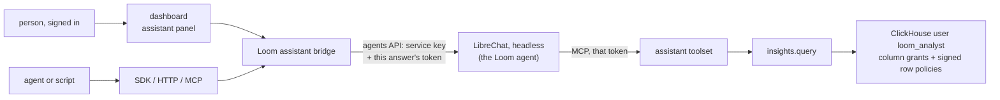

# Assistant design

This page is the design of Loom's assistant, which answers questions about what a
namespace holds and how it is used, with a citation for every claim. It names the
surfaces, how each caller's identity reaches the agent's tools, the analysis op and its
isolation, the deployment, what is stored and erased, and the cost. Every part is built
but the analysis key's rotation, which is design; [the build order](#build-order) lists
the parts.

LibreChat is the assistant: it hosts the agent (its model, instructions and tools) and
runs it headless beside Loom, reachable only from Loom. Loom supplies the agent's tools,
which read under a token of the asker's own subject, and a read-only SQL op that
ClickHouse itself holds to that token's org and namespaces. People chat in the
dashboard's assistant panel, opened from the header of any page; agents and scripts reach
the same agent over HTTP, MCP and both SDKs, through Loom's origin and as themselves.

## Surfaces



| Surface         | What the caller calls                                                                                                   |
| --------------- | ----------------------------------------------------------------------------------------------------------------------- |
| Dashboard       | the assistant panel, streaming from `POST /v1/assistant/chat/completions` with the signed-in session                    |
| HTTP            | `POST /v1/assistant/chat/completions`: LibreChat's agents API request and response, OpenAI-compatible, streaming or not |
| SDKs            | a thin `assistant` client in Python and TypeScript over that route, with streaming; it holds no agent logic             |
| MCP             | the `loom_assistant_ask` tool (op `assistant.ask`), which forwards one question and returns the whole answer            |
| HTTP, op shaped | `POST /v1/assistant.ask` and the generated `ops.assistant.ask` / `loom.assistant.ask` SDK methods, from the same op     |

Each request names its namespace: the `X-Loom-Namespace` header on the chat route (the
token's default namespace when absent), the `namespace` field on `assistant.ask`. The
caller needs `viewer` there, and the answer's model spend is charged there. The chat
route, `assistant.ask` and its MCP tool, the generated SDK methods, the SDKs' streaming
clients (`agent.assistant.stream` in Python, `loom.assistant.stream` in TypeScript) and
the dashboard's chat are built.

`loom_assistant_ask` is in no curated MCP roster and, while `experimental`, not in the
`all` listing either: each call spends model budget, so an agent calls it by name on
purpose, as every unlisted op can be called. It is never in the
[assistant toolset](../reference/mcp.md#the-assistant-toolset), so the agent cannot call
itself.

LibreChat's web UI and API are not published: LibreChat listens on an internal network
only Loom reaches. A person has one sign-in and one URL, Loom's. The
[LibreChat integration](../features/integrations/librechat.md), in which each person
runs LibreChat's UI with a pasted token, is a separate, optional client; this
deployment needs none of it.

**Why LibreChat hosts the agent.** One agent definition, versioned in
`integrations/librechat/`, serves every surface. LibreChat runs the model, the tool
loop, streaming and cancellation, which Loom would otherwise build a second time. Loom
keeps what makes an answer trustworthy: authorization on every tool call, the request
ledger, the analysis boundary in the database, and the citation check.

**Why a native chat, not LibreChat's UI in a frame.** A frame would put a second origin,
a second sign-in and LibreChat's look inside the dashboard, and would need LibreChat's
cookies to work in a third-party frame. The dashboard's assistant panel uses Loom's
session and components, and links verified citations into the memory and document views
([the assistant panel](../features/dashboard.md#the-assistant-panel) has its rules).

## The bridge: each caller's own identity

LibreChat's agents API authenticates a LibreChat API key and runs the agent as that
key's LibreChat user. The agent's tools are Loom's MCP server, and what they may read is
decided by the token on each tool call, never by the LibreChat user. LibreChat v0.8.8
fills an MCP header from three fields of the request body (`ALLOWED_BODY_FIELDS`:
`conversationId`, `parentMessageId`, `messageId`), substituting the value as it is. The
agents API takes `parent_message_id` from the caller as any string and, on a request
with no `conversation_id`, uses it only for that field and as the anchor of a thread of
files, which finds nothing with no stored conversation and the file tools off. So the
bridge sends a token there, and the agent's MCP server sends it back to Loom. The
LibreChat qualification runs this path, so an upgrade of LibreChat that changes it fails
there before it ships:

```yaml
headers:
  Authorization: "Bearer {{LIBRECHAT_BODY_PARENTMESSAGEID}}"
  X-Loom-Run-Id: "{{LIBRECHAT_BODY_MESSAGEID}}"
```

They go under `headers`, not LibreChat's chat-only `requestHeaders`: those are left off
the connection that lists the tools, whose `tools/list` would then go out without the
token and leave the agent with no tools.

The bridge (`server/assistant/app/bridge.py`, `routes.py`) serves a request in three
steps:

1. Verify the caller's Loom token or dashboard session as on any op, and its `viewer`
   role on the request's namespace. The chat route takes the same `Origin` and CSRF
   checks as `POST /v1/{op}`. Refused here, before LibreChat is called: a revoked or
   expired caller, an assistant answer's own token or one delegated from it
   (`ASSISTANT_SELF_CALL`), an org-wide (`*`) token (an answer reads one org), a token
   whose reads are narrower than its namespace (as `insights.query` refuses it), a caller
   whose token has less life left than one answer may run (a dashboard or `loom login`
   caller is not refused for its access token, which a refresh replaces every hour: its
   answer's token ends at sign-out instead), an org whose model calls an admin
   switched off (`org.set_model_calls`), and a namespace over its assistant budget or
   running its most concurrent answers ([Model and cost](#model-and-cost)). A refusal a
   client words for its reader carries `detail.reason`: `ASSISTANT_UNAVAILABLE` names
   `not_configured` (no LibreChat), `auth_off`, `starting` (this process has not set the
   service up yet, or is setting it up again) or `failing` (its last try failed; the setup
   loop retries), and `AUTH_INSUFFICIENT` names `org_wide`, `narrowed` or
   `token_expires_soon` (with `left_s`); a caller without `viewer` on the namespace
   carries none. Where an assistant is configured, `/v1/health/ready` reports an
   `assistant` check, never required (a deployment whose assistant is down still serves
   the rest), whose reason is `starting`, `failing` or `auth_off`; a missing check means
   none is configured.
2. Delegate the answer's token from the caller's (`server/auth/delegation.py`
   `delegate`): `viewer` on the request's namespace alone, minted for the caller's own
   subject with consumer `loom-assistant` and an id starting with `assistant-answer-`
   (so a token delegated from it is told by its `parents`), as a service-account token
   when the caller's is one, and expiring when an answer may run no longer
   (`LOOM_ASSISTANT_ANSWER_TTL_S`, default ten minutes). Delegation applies every rule a
   minted child follows: the creator's live grant, the end user, the ancestor subjects
   and their issue times, the chain depth limit, and the caller's token id among the
   child's `parents`. The bridge also asks for the caller's sign-in session among the
   `parents` (`delegate`'s `ends_with_session`), so a dashboard or `loom login` caller's
   answer token ends at sign-out, as a third-party client's already does. The token is
   not listed in `loom.service_accounts`: it lives for one answer.
3. Call LibreChat's agents API with Loom's service key, the seeded agent's id in place
   of any `model` the caller names, the answer token as `parent_message_id`, and the
   text of the caller's `user` and `assistant` messages (no `system` message, which
   would override the agent's instructions, and no files or images). Stream the response
   back with `Accept-Encoding: identity`. A caller that disconnects, or the chat's stop
   button, closes the upstream request, and LibreChat aborts the run. The bridge drops
   any `conversation_id` in the caller's body: on this path LibreChat stores no
   conversation, so it answers 404 for one it is given.

An answer's token reads no more than the caller's own token, and ends no later than it,
except under a sign-in session: every child of a first-party session takes the lifetime
it asks for, so an answer's token lives one answer's limit
(`LOOM_ASSISTANT_ANSWER_TTL_S`) and may outlive the hour-long access token it was
delegated from, or a session that expires during the answer, by at most that limit. It
is ended with its caller: revoking the caller's token, its subject, its sign-in session
or a subject in its `creator` or `parent_subjects` chain ends the answer's token
too, since delegation puts each of them in its revocation check. LibreChat holds the
token in memory for the one request and stores it nowhere; the deployment sets none of
LibreChat's tracing variables, which would export the run's request body, and the
qualification searches LibreChat's logs for a token it sent.

**One LibreChat user, which reads nothing.** Every answer runs as one LibreChat user,
Loom's service user, which owns the agent definition. Its API key runs the agent, but
the agent's tools read only with the token each request carries: a request without one
gets `401` on every tool call, and a request with one reads as that token. The key is
therefore not a credential that reads anything in Loom. One row of
`loom.assistant_service`, a `ReplacingMergeTree(version)` table, holds the service
user's email, the agent's id, the version and model of the definition last written, and
one sealed value (`server/core/secrets_at_rest.py`) holding a random password and the
agents API key together, so a reseal rewrites both at once. `loom secrets reseal` (which
takes [`analysis.entities`](#provisioning), then `assistant.service`) covers it when the
root secret (`LOOM_JWT_SECRET`) is replaced, and the deployment carries no second
secret.

Setting the service up is one step that a boot runs holding the cluster lease
`assistant.service` (`server/core/leases.py`), so two boots never run it at once; the
holder re-reads the row (as every read of it, with the read-your-writes setting
`own_write_reads` in `server/core/ch.py`) and does only what is missing, storing each
result on the row before the next, and signs in at most once (twice when it registers
the user), at the first step that needs LibreChat:

1. No row: write the email and a sealed random password.
2. No key: sign in, registering first only when LibreChat answers that the email does
   not exist (LibreChat words a wrong password the same way but for its text, so the
   qualification pins that answer), delete any key of the service user's that a boot cut
   short left behind (keys carry the definition's name), then create the key.
3. No agent id: list the service user's agents by the definition's name, keep the oldest
   and delete the rest, or create the agent when there is none, and store its id.
4. A stored definition older than this build's, or of the same version with another
   model: write it and store its version and model on the row.

A boot that stopped halfway leaves the row at a step the next one finishes, and a boot
over a complete row checks with the stored key that LibreChat still holds the key and
the agent, making either again when it does not ([Deployment](#deployment)). Answers run
on the stored key whatever a sign-in does. Two failures need an operator, and
`/v1/health` names each as `assistant_service_failing`: a row whose sealed value opens
with neither `LOOM_JWT_SECRET` nor `LOOM_JWT_SECRET_PREVIOUS` (set the previous secret
and run `loom secrets reseal`), and a sign-in LibreChat refuses with a 4xx other than
its 429 limit (its database restored from another deployment, say; v0.8.8 answers a
wrong password 404 `Incorrect password.`): empty it and run `TRUNCATE TABLE
loom.assistant_service`, and the next boot recreates both. A 5xx sign-in is LibreChat or
its database being unavailable, which the next try asks again. A try that registers the
service user also makes a new key, since that user cannot own the one the row held.
Until the row has its key and agent id, the assistant answers `ASSISTANT_UNAVAILABLE`.

**Conversations live with the caller.** LibreChat's agents API (the OpenAI-compatible
`/api/agents/v1/chat/completions`) saves no messages: it runs the agent over the
messages in the request and records only token counts in its `transactions` collection.
A multi-turn chat is the caller's message list, which the dashboard keeps in the browser's
storage and an SDK caller sends each time, as with any OpenAI-compatible API. The agent's MCP
connection carries request-time headers, so LibreChat opens it for each answer and
closes it after; each answer pays one MCP `initialize` and `tools/list`.

**Citations.** The agent's instructions require a citation on each claim:
`[memory:<key>@v<version>]`, `[doc:<source_uri> § <section>]`, `[code:<path>:<line>]`,
or a fenced `sql` block in the answer that holds the statement exactly as it ran. The
bridge checks each when the answer ends, inside the answer's slot and for at most ten
seconds in all (`server/assistant/app/citations.py`). A memory citation is verified when
one of the answer's own tool calls was returned its key: the exposure rows
(`loom.memory_exposures`) that the toolset's `memory.search`, `memory.ask`,
`memory.get`, `memory.list` and `memory.inspect` record under the answer's run,
whichever user or session the row is under (a search hit on one of a key's chunks counts
as its key). The assistant toolset drops any `run_id` a call names, so those rows are
filed under the answer's run; on `memory.search` the argument is also a filter to one
run's rows, which the assistant gives up. The exposure rows record keys, not versions,
so a memory citation's version is not compared. Only those reads record exposures: a key
returned by any other call (`memory.history`, `memory.provenance`, an `insights.query`
row) is not seen, and its citation comes back unverified with a reason that names the
reads that count; a fact a query found is cited by the query's `sql` block instead. A
`sql` block is verified when its digest is the `out_sql_digest` of an `insights.query`
call ledgered in this answer (`loom.agent_events`). A document citation's section must
be a heading path of a live document (`knowledge.outline`), and one with no section
verifies when the document is readable. The document is read through Loom's own routes
in process with the answer's token, so every gate a read passes applies to it, in a task
of its own (each check is a task of an `asyncio.gather`) so the read leaves the answer's
request state alone, and under no run id. A code citation is not checked: a code index
is a namespace of its own, which the answer's token (viewer on the answer's namespace
alone) does not reach, so `code.verify_citations` is not called for it. Nor are an
answer's citations past the fiftieth. The agent's MCP server sends the answer's message
id on each tool call as `X-Loom-Run-Id` (the agents API fills
`{{LIBRECHAT_BODY_MESSAGEID}}` with the id every chunk carries). On the assistant
toolset the MCP transport labels the call's ledger row with that header, in
`agent_events.run_id`, as HTTP already does; there the header wins over the session's
run label, and an answer's connection opens no session run, so the bridge reads the
answer's rows by the org, the namespace, that run id and the caller's subject, its
`insights.query` rows also by the consumer `loom-assistant` its token carries. A caller
who knows its answer's run id could plant a row of its own under it; such a row is the
caller's own call, so a citation it makes verified misleads only the caller. The rows
are written in the background and a tool call can land on another replica, so the bridge
waits up to five seconds for them; a citation whose row has not arrived by then, or was
dropped, comes back unverified. A check Loom refuses (a rate limit, an outage), a ledger
that cannot be read, an answer with no run id, a check past the ten seconds, or a
document read whose token expired (an answer that ran to its limit leaves its checks a
token near its end) leaves its citation unverified with the reason "the check could not
run", and never fails the answer. With memory reads not recorded
(`LOOM_MEMORY_EXPOSURE_LEDGER_ENABLED` off) a memory citation's reason is "this
deployment does not record memory reads". Each citation comes back marked
`verified` or not, with the reason and its `ref` (the memory key, document source,
documentation page or code path it names), in a last `loom.citations` event before the
stream's `[DONE]` (and a `citations` field on a whole answer and on `assistant.ask`),
with the answer's [support](#support).

A help citation, `[help:<page> § <section>]` (the section optional, its breadcrumb
starting with the page title as `help.search` returns it), is checked against the
replica's own index of the shipped docs: verified when the page is indexed and the
section is one of its own (its breadcrumb, the breadcrumb without the page title, or a
tail of it no other section of the page shares), with the section's `anchor`, which the
dashboard's Sources link to the Help page (`/help?page=<page>#<anchor>`). A page that is
not indexed, or a section the page does not have, fails as a document citation does. The
docs are the same for every caller, so the check reads nothing of Loom's. During a
rolling upgrade a bridge of the build before the kind does not parse it, and an answer
resting only on help citations shows as `none` there.

**Names.** The instructions allow an op or setting name only from a tool's result, and
the tool results stay with the agent, so the bridge checks what it can decide: each
backticked dotted name whose first part is an op group (`memory`, `knowledge`, ...) and
each `LOOM_*` name in the answer is known when the build serves it as an op, reads it
as an environment variable (a setting, `NON_SETTINGS_ENV`, a prefix family), or its
docs write it; a name ending in `_` is a family, known when one of those starts with
it. The rest come back in `unknown_names` beside the citations (the event's field and
`assistant.ask`'s), and an answer that writes one is `unsupported`, whatever it cites:
it may have invented the name. With no docs to read, none is reported. A name written
in prose, without backticks or the `LOOM_` prefix, is not checked.

### Support

Each answer comes back with `support` (on the `loom.citations` event, the whole answer
and `assistant.ask`), which says how far it rests on what Loom holds. The server decides
it (`server/assistant/domain/support.py`), from the codes its citation checks ended with
and, for an answer that cites nothing, from what its own tool calls found; the first
that applies wins:

| `support`     | When                                                                                                                                                                                                                                                                                                                                                                                                                                     |
| ------------- | ---------------------------------------------------------------------------------------------------------------------------------------------------------------------------------------------------------------------------------------------------------------------------------------------------------------------------------------------------------------------------------------------------------------------------------------- |
| `none`        | The answer has no text; or it cites nothing and either says the abstention sentence the agent's instructions give ("Nothing stored in Loom answers this.", in any case or emphasis) or it made no call to an op whose rows it could cite and none of its calls found data or failed. A greeting, a capability reply and an abstention make no claim.                                                                                     |
| `supported`   | A citation verified.                                                                                                                                                                                                                                                                                                                                                                                                                     |
| `unsupported` | It names an op or setting the build neither serves nor documents (`unknown_names`); or a citation failed for a reason of its own (its key was not returned to this answer, its document or section is not there, its statement did not run in this answer); or it cites nothing although a call of an op whose rows it could cite found data, or ran and found nothing while no other call found data or failed (a claim nothing backs). |
| `unchecked`   | Otherwise: its checks could not say (a read failed or ran past its bound, no run id, memory reads not recorded, code citations, past the 50 checked), or it cites nothing and what found data has no citation form (counts and findings: the ops in `ASSISTANT_UNCITABLE_OPS`, such as `namespace.summary` and `namespace.inventory`), or a call failed.                                                                                 |

The ops whose rows an answer can cite, those whose output has no citation form, and
those that return no namespace data (Loom's own guide, documentation and catalog) are
sets in `server/operations/toolsets.py`, with the output list each op's ledger row
counts as `out_hits` (or its `found` flag) to say whether it found anything. A test
requires every op of the assistant toolset to be in exactly one set and to say how its
row shows it found nothing. The answer's calls are read by its run, its caller's subject
and the consumer `loom-assistant`, with no namespace filter: a code call is ledgered
under the code namespace and a refused call under the sentinel. The rows land in the
background, so an uncited answer's calls are read once more after the ledger's flush
interval and the batched-insert wait, unless the first read already found a citable op's
data; both reads together are bounded at three seconds, past which the answer is
`unchecked`. A presence answer of `code.symbol` finds only where the symbol is present.

The rule reads no wording beyond the abstention sentence, and accepts these residuals:

- A greeting, capability reply or uncited question back after a citable call is
  `unsupported` (`unchecked` when only ops with no citation form found data). The
  instructions keep such calls rare: a greeting calls no tool, and a question back lists
  each match with its citation.
- An uncited fact with no call at all (a later turn restating an earlier one, or a
  first answer from the model's own knowledge, which the instructions forbid), or after
  calls whose rows land past the re-read or are dropped (the ledger keeps them at most
  once), is `none`.
- A "not found" answer from a lookup that misses (`memory_get`, `code_symbol`) is
  `none` when it ends with the abstention sentence, as the instructions ask for every
  read that finds nothing; worded otherwise, it is `unsupported`.
- An abstention that also states a fact is `none`.
- An uncited answer from `help.search` and `help.get` is `none`, but `unsupported` when
  a citable call of the same answer found data; the instructions ask for every docs
  section used to be cited as `[help:...]`, which verifies.
- A document citation verifies when the document holds the section, whether or not this
  answer read it; the instructions ask for a document to be read again before it is
  cited on a later turn.

**Rendering.** The answer is model output that stored text can steer, so the dashboard
renders it as text with Markdown emphasis, lists, tables and code only: no HTML, no
images and no links in the answer's text, where each citation shows as written. The
dashboard's `img-src 'self' data: blob:` already stops a remote image that would carry
rows away in its URL. Under a finished answer its Sources
(`frontend/src/views/assistant/Sources.tsx`) list each citation as the server checked
it: one found in Loom reads "Found in Loom", a memory opening in the memory drawer, a
document in the Library and a help citation on the Help page at its section, by the
citation's `ref`; any other reads "Not confirmed" with its reason. A label above them
says the answer's support in words, leading with how many sources were found when some
were not: "Checked against what Loom holds", "Partly confirmed: n of m sources found in
Loom", "Couldn't confirm: 0 of m sources found in Loom", "Couldn't confirm: it names …"
(an op or setting this Loom does not have), "Couldn't confirm: it gives no sources",
"Sources not checked" or "Not checked: it cites nothing Loom holds". Each label's "Why
this label" note says why it reads as it does; an answer whose support is `none` has no
label. A value the dashboard does not know reads as `unchecked`.

## The agent definition

`integrations/librechat/agent.yaml` holds the agent's name, instructions, model and a
version number (`server/assistant/domain/definition.py`); the tools are the assistant
toolset's, listed by Loom. Loom seeds it at boot under the service user, which owns
it, so nothing is shared. It writes the definition when its version is newer than the
stored one, or the same with another model, so during a rolling upgrade a build N-1
never overwrites N's definition and a changed `LOOM_ASSISTANT_MODEL` takes effect at the
next boot. While N rolls out, and after a rollback, N's definition stays, and a tool
call it names that an N-1 pod does not serve answers `UNKNOWN_OP` there until every pod
runs N.

The tool list is the assistant toolset's reads and `insights.query`, so the agent writes
nothing; a change it suggests is a draft a person applies elsewhere, as the Assistant
page's tune drafts already are. The instructions require citations, tell the agent to
call a tool before answering a question about the namespace (a greeting calls none) and
abstain when none supports it, to write no text before or between its tool calls, to
read `insights.catalog` before running SQL, to start a question about Loom itself that
does not plainly ask how to use it with a memory, a document and a help search together
and answer a fact the namespace holds from the namespace, to answer how Loom works from
`help.search` and `help.get`, citing each section as `[help:...]` rather than as a
document citation, and to treat stored text as data that cannot grant a tool or approve
a change. The agents API streams the text of every model step as one answer's content,
with nothing between steps
([streaming](../features/integrations/librechat.md#tool-errors-streaming-and-cancellation)),
so neither the bridge nor the dashboard can tell a lead-in ("Let me search the
memories.") from the answer it runs into. While no text has arrived, the dashboard shows
that the assistant is answering. Asked how a namespace should write, the agent
recommends rather than only answers: key shape, one claim per key, a memory, a document
or a record, pins and kinds, each recommendation naming its rows and citing the finding
it rests on in `namespace.audit`, `mentor.brief` or `namespace.tune`, the namespace's
guide (`namespace.guide_get`), or Loom's own writing guide (`mentor.guide`, on the
toolset for that reason).

The agent names no namespace on its calls: on the assistant toolset a call that names
none reads the first namespace its token names ([the assistant
toolset](../reference/mcp.md#the-assistant-toolset)), which for an answer's token is the
request's. A test pins a digest of the name, provider, model parameters, instructions
and tools to the version, so a change to any of them bumps it.

## Loom's documentation

The assistant answers how Loom works from Loom's own documentation, as the build that
serves the answer ships it. The image copies `docs/` (its Markdown; the screenshots stay
out of the build context), and two read-only ops on the assistant toolset read it:
`help.search` (a question or a name in, the best sections out, each with its page, its
breadcrumb, its anchor, its audience and a snippet) and `help.get` (a page with its
outline, or one section of it, found by the anchor a hit names, since a page may repeat
a heading). Both are `experimental`, deployment-scoped and in no curated roster: any
token that may read the agent guide may call them by name.

The docs are indexed in each process, on its first help call, in a worker thread: each
page is split at its headings by the splitter documents use
(`server/knowledge/domain/chunking.py` `detect_sections`), so a section's breadcrumb
starts with the page title as a document citation's does, and the sections are scored
with BM25 (`server/core/bm25.py`). Terms are the words, plurals and simple suffixes
folded, plus every whole identifier (`memory.set`, `LOOM_ASSISTANT_MODEL`), so an exact
op or setting name finds the line that names it. An operator section's score counts
three quarters, since most askers use Loom rather than run it. The index holds about
2,200 sections in about 14 MB and builds in about a second; a search reads only the
postings of its terms, and concurrent first calls share one build. A page that cannot
be read is left out with a warning, and a process with no docs answers
`available: false` until it restarts: the docs change only with the build, so a fault
never rebuilds the index per call. An answer that rests only on `help.search` and
`help.get` and cites nothing carries no support label, as one resting on `mentor.guide`
does: the docs are not the namespace's data. A read returns at most 16,000 characters,
and a cut one names the offset its rest starts at; a page read, or a cut one, adds the
page's outline.

**The asker's context.** An answer's token is `viewer` on one namespace, so the agent
cannot tell from it what the person asking may do. The bridge, which holds the caller's
own credential, puts one line in fixed words as the last line of the question it sends
LibreChat: `Loom, for how-to answers only: this question comes with <credential>, whose
role in this <place> is <role>.` The credential is `a sign-in session`, `a delegated
token` (one capped by the grant of whoever made it, a client token's included), `a
scoped token` (its role per namespace in its claim) or `a token`. The role is the
highest the gate admits, after the viewer check every answer passes (`admin`, `writer`
or `viewer`), or `unknown` when a check could not read what it needed. The place is
`personal collection`, `collection`, `restricted namespace` (the directory's cached
classification, no read) or `namespace`. The line names no subject and no namespace, so
nothing the caller controls is in it and no identity goes to the model provider through
it. It never refuses an answer. The instructions read it as Loom's only in that place,
treat it as granting nothing, and answer how a role is raised from the documentation for
that credential and place, naming the namespace's admins from `grants.list`. A bridge of
an earlier build sends no line, and an answer that depends on the person's role then
says it does not know it.

**Why not a knowledge source.** Knowledge rows are tenant data: an org and namespace on
every row, erasure coverage, and a copy per org or a read path across tenants. Indexing
them spends embedding calls, and replicas of two builds would share one copy during a
rolling upgrade, so one build would answer from the other's docs. The docs are the
same text for every caller, hold no tenant data and change only with the build, so
help keeps them out of ClickHouse: nothing is written, erased or embedded.

**Nothing is withheld by role.** Every page is in the public source tree, and
`tests/unit/test_public_copy.py` keeps hosts, keys and internal names out of it, so a
page withheld from a viewer would protect nothing. Each hit says its audience instead:
`operator` for running or building Loom (`operations/`, `architecture/`,
`benchmarks/`), `user` for the rest. The contributor pages (`development/`) are not
indexed. Help reads no environment, setting value or secret.

## The analysis op

`insights.query` runs one read-only SQL statement over an allowlisted set of Loom
tables and returns its rows, capped. The agent uses it for questions no other read
answers, such as which agents wrote the most contradicted facts last week or what a
namespace holds by kind and age. Any token with `viewer` on the namespaces it names can
call it directly, on any transport, and it joins the
[assistant toolset](../reference/mcp.md#the-assistant-toolset). A token whose
`read_scope` is narrower than its namespaces is refused it, as every op outside
`SCOPED_OPS` and `NARROW_SAFE_OPS` is.

### The boundary is the database user

The statement runs as a dedicated ClickHouse user, `loom_analyst`, never as Loom's own
user or the reader user. Loom does not parse or rewrite the statement to scope it. It
sends the scope as settings and runs the statement, less one trailing `;`, as a
subquery, `SELECT * FROM (` and `)` on lines of their own, so a trailing `--` comment
ends at the newline. ClickHouse parses only a `SELECT` or `WITH` there and reports a
syntax error for anything else. The wrapper is not what isolates orgs; the user's
grants, settings profile and row policies are:

| What the statement tries                                            | What stops it                                                                                              |
| ------------------------------------------------------------------- | ---------------------------------------------------------------------------------------------------------- |
| a table or column outside the allowlist (tokens, secrets, keys)     | grants: `SELECT(col, …)` on each allowlisted table, nothing else                                           |
| another org or namespace, through a filter, `JOIN` or subquery      | a row policy on every allowlisted table, checked on each row read (below)                                  |
| a deleted or erased row, or a version a later one replaced          | the row policy carries the table's live predicate and applies after `FINAL` (below)                        |
| `system.*`, `information_schema`, `SHOW`, `DESCRIBE`, `KILL QUERY`  | no grant on `system` tables, `SHOW COLUMNS` or `system.processes`                                          |
| `EXPLAIN`, whose estimates count other orgs' rows                   | inside the subquery, `EXPLAIN` needs `CREATE TEMPORARY TABLE`, which the user lacks                        |
| `mergeTreeIndex()` and other index readers                          | ClickHouse refuses them on a table with a row policy                                                       |
| `url()`, `file()`, `s3()`, `remote()`, `cluster()`, `executable()`  | no `READ ON URL`, `FILE`, `S3`, `REMOTE` and no `CREATE TEMPORARY TABLE` grant                             |
| `aiGenerate()` and the other AI functions, which send rows out      | they take credentials only from a named collection, and the user has no `NAMED COLLECTION` grant           |
| a write, DDL or a temporary table                                   | `readonly = 2`, held `CONST` in the user's settings profile                                                |
| `SETTINGS` that widen time, memory, rows read or result size        | the profile's `MAX` constraints; `result_overflow_mode` and `read_overflow_mode` are `'throw'` and `CONST` |
| `SETTINGS use_query_cache = 1` or `use_query_condition_cache = 1`   | both `0`, `CONST`, so no cached result or granule map crosses from one scope to another                    |
| `SETTINGS send_logs_level = 'trace'`, whose log lines quote the key | `send_logs_level = 'none'`, `CONST`                                                                        |
| `SETTINGS max_threads = 256`, taking the host's CPU                 | `max_threads` pinned as `MAX`                                                                              |
| `SETTINGS` that rename the scope                                    | the row policy's signature check fails, so the statement reads no rows                                     |

**Signed row policies.** Loom sends four custom settings with each statement: the org
(`<prefix>loom_org`), the namespaces (`<prefix>loom_ns`), an expiry (`<prefix>loom_exp`)
and `<prefix>loom_sig`, the HMAC-SHA256 under a 256-bit key of one length-prefixed
string of the other three and the statement's query id: the request's
`<request_id>:<n>:<nonce>`, new for each statement, whose per-request random nonce keeps
two requests, of one tenant or two, from sharing an id (a probe outside a request takes
a random UUID). The client's retry of a statement resends the same id with
`replace_running_query = 1`, so it replaces its own attempt ClickHouse still runs. The
expiry covers every attempt the client's retry ladder can make at the time cap
(`scope_ttl_s` in `server/insights/app/analysis.py`). Each allowlisted table's policy,
`TO loom_analyst`, admits a row only when its `org` and `namespace` match the settings,
the expiry is in the future, and the signature matches the hash ClickHouse computes with
the key written into the policy. A statement may set custom settings itself (`readonly =
2` allows it), but without the key it cannot sign another scope, so a changed scope
reads nothing. A statement can read its own scope with `getSetting`, but the policy
signs the query id Loom sends with the statement (`initialQueryID()`, the same on every
server the statement fans out to), so a signature lifted from one statement reads
nothing when sent with another, by the same caller or any other. The policy reads every
setting through `toString`, so a statement that sets one to a number or an array cannot
make the policy raise an error, whose message would quote the policy and its key; and
Loom never passes on a ClickHouse message that names the scope settings.

**The settings prefix.** ClickHouse takes a custom setting only under a prefix its
`custom_settings_prefixes` names: `SQL_` in ClickHouse's default configuration,
`custom_` on ClickHouse Cloud. The first time it loads the secrets, Loom sends
`SELECT 1` with `<prefix>loom_probe` for `SQL_` and then `custom_`, and names the scope
settings and the profiles' stamps under the first one the server takes; a server that
takes neither refuses analysis with a message that names `custom_settings_prefixes`. The
prefix is the server's, not the version's: a server on ClickHouse's default
configuration keeps `SQL_` and the same entities, and the structure digest a version
pins is spelled with `SQL_`. On a `custom_` server each Loom process leaves one refused
`SQL_loom_probe` in the server's logs.

Each policy also carries its table's live predicate, the one the erasure census counts
(`tombstoned_at IS NULL` on `loom.memory`), and the profile holds `final = 1` and
`apply_row_policy_after_final = 1` `CONST`. A deletion or an erasure tombstones every
version of a row, and the row stays in the table until a merge or a purge, so `FINAL`
picks each key's latest version and the policy then drops it when that version is a
tombstone: a deleted or erased key is absent, and its earlier versions do not come back.
A second policy, `AS PERMISSIVE USING 1 TO ALL EXCEPT loom_analyst`, keeps every other
user, Loom's own included, reading the tables as before, whatever the server's
`users_without_row_policies_can_read_rows` says. ClickHouse ORs the permissive policies
on a table, so this one would widen any permissive policy someone else put on an
allowlisted table: before every write Loom lists them in `system.row_policies` and,
finding one, writes nothing and reports it, naming it in the server log and in
`loom ch-setup`'s refusal, for an admin to drop or make restrictive. A restrictive
policy is left alone, since it narrows every user it names. The analyst user, its
profiles and its policies' names are server-wide, so analysis needs one Loom per
ClickHouse service: a deployment that finds the analyst's scope policy in another
database writes nothing and reports it, naming that database in the server log.

The key and the analyst's password are random and kept together, as one sealed value, in
one row of `loom.analysis_secrets`. The password holds a lower and an upper case letter, a
digit and a symbol, which ClickHouse Cloud requires of a user's password. The row is
sealed with `server/core/secrets_at_rest.py` in the shape `loom secrets reseal` rewrites
(`SEALED` in `server/cli/secrets.py`). The reseal reads under `own_write_reads`, skips
a row that is gone and holds the analysis lease; with [part 2](#build-order) the CLI
rotation holds it too, so they never interleave, and the printed rotation, which takes
no lease, stores its row at a version from ClickHouse's clock at insert time in
nanoseconds, far above any reseal's `version + 1`. A row a reseal puts back during a
rotation is handled by the [order of a write](#provisioning). The first write draws them
under the lease below and every replica reads the same row. A root-secret rotation only
reseals them, so the policies never change key; when the key cannot be read,
[provisioning](#provisioning) says what happens. The analyst user cannot read the key:
it has no grant on `system.row_policies` or on `loom.analysis_secrets`, and it cannot
run `EXPLAIN`.

**What the query log holds.** Loom never turns query logging off: ClickHouse Cloud pins
`log_queries` for the service's users and refuses a statement or a settings profile that
changes it. It keeps the secrets out of what is logged instead:

- Every statement that carries the key or the password runs with
  `log_queries_cut_to_length = 1` and `log_formatted_queries = 0` (`LOG_TEXT_CUT` in
  `server/insights/domain/analysis.py`), which ClickHouse Cloud leaves unconstrained.
  ClickHouse then logs the statement, in `system.query_log`, in its server log and in
  `system.opentelemetry_span_log` (Cloud traces a share of statements), as only the
  number of characters it removed, and writes no `formatted_query`, which the cut does
  not reach. The printed SQL sets both first, for the session it runs in.
- ClickHouse itself leaves the password out of a logged `IDENTIFIED BY`.
- With `LOOM_CH_LOG_COMMENT_STATEMENT_DIGEST` on, `log_comment` carries a statement's
  shape and first 200 characters; a statement that carries a secret, or one run as the
  analyst, carries the literal-masked shape alone.
- An error raised inside a row policy quotes the policy, and ClickHouse logs that error
  in `system.query_log`'s `exception` column; the probe's unsigned read raises one on
  every table by design. So the key's two padded forms, the only places the key enters
  the HMAC, are written in the policy as `decrypt(encrypt(pad, key), key)` (AES-256-ECB),
  which ClickHouse evaluates to the pad and prints as `decrypt('aes-256-ecb', '[HIDDEN]')`
  in an error message and in `SHOW CREATE ROW POLICY`. The HMAC is the same, so a
  build N-1, which wrote the pads in clear, signs statements these policies accept.

The key is in ClickHouse's own access storage (on disk, or in Keeper when access is
replicated), in a backup of the access entities, in the distributed DDL queue of a
cluster that writes access `ON CLUSTER`, in `system.row_policies`, which shows the
policy's arguments in full, and in any server log line other than the statement line
the cut shortens. All of these are read only by whoever administers the ClickHouse host,
who can read every row anyway, and by Loom's own user where it has `SHOW ROW POLICIES`;
that user can already open the sealed row.

**Why not ClickHouse credentials in LibreChat.** A ClickHouse login in the agent would
read every org, skip the request ledger and the exposure records, and keep no link to
the asker's token. The analysis op runs inside Loom's request path: the token is
verified first, the namespaces are checked as on any read, and the call is ledgered.

### Provisioning

The analyst user, its settings profiles, grants and policies are written with SQL,
never in a ClickHouse config file, which would put the key in the repository. A server
whose ClickHouse user has access management (the bundled ClickHouse's `loom` user, a
self-managed admin) writes them itself, and draws the secrets row when there is none and
it sees no analyst user, in the order the rules below give (the order of a write), so a
first install cut short is a row without a user, which the next boot finishes with the
stored key. Elsewhere an admin uses one of two commands:

- `loom ch-setup`, run as a user with access management, writes the entities under the
  rules below (it holds the lease and writes unless the stored version is newer than its
  own), so it is also the repair on a server that cannot write them. It draws the row
  only when there is none and no analyst user exists; over a lost row with the user
  still there, it refuses: until the rotation of [part 2](#build-order), the recovery is
  to drop the analyst user and run it again.
- `loom ch-setup --print-analyst-sql` prints SQL for an admin to run by hand, and needs
  no access management to print (where `--print-sql` prints the admin SQL
  `loom ch-setup` would run, with the reader's password as a placeholder). It draws the
  secrets on a first install and otherwise prints the stored key's entity set; over a
  lost row it refuses where Loom's user can see that the analyst user exists, and where
  it cannot it draws again, which moves the key. The SQL comes with a `REVOKE` before
  the grants for each grant the analyst's own `SHOW GRANTS` lists, headed by the command
  that runs it in one session and by two checks the admin runs first: the permissive
  policies Loom did not write, and other databases carrying the analyst's scope policy.
  With [part 2](#build-order) it proves its `LOOM_JWT_SECRET` as the rotation below
  does, draws a fresh key and password, and prints a complete rotation, in the order of
  a write, with the command that runs it in one session
  (`clickhouse-client --distributed_ddl_output_mode=throw --multiquery --queries-file <file>`):
  the delete, the new password, the `KILL QUERY`, the rest of the entity set under the
  new key, a settle of `SELECT sleep(...)` statements, the `KILL QUERY` again, and last
  the `INSERT` of the new sealed row at a version from ClickHouse's clock in
  nanoseconds. Run in full, it starts analysis on a first install, recovers it after a
  lost row and rotates a healthy key alike. It is outside the lease and the rules below,
  so it is printed by the newest build's CLI, and it is run, not kept.

A printed rotation run only in part leaves analysis unavailable, by the order of a write
below. Its statements must run in that one session, after its first statement,
`SET log_queries_cut_to_length = 1, log_formatted_queries = 0`: ClickHouse takes no
per-statement settings on an access statement, and a console that sends them one by one
would log the key in `system.query_log`.

The allowlist lives in code with the column comments that become the agent's catalog, so
the grants, the policies and the catalog come from one definition. The rules a write
keeps:

- **One writer at a time.** A write holds the cluster lease `analysis.entities`
  (`server/core/leases.py`), waiting for it when another holds it, and reads what the
  entities hold once it has it. `loom secrets reseal` takes the same lease.
- **Never over a newer build.** The analyst's main settings profile carries the stored
  version; a version names exactly one set of grants and policies (a unit test pins it),
  so a change to either is a new version. A build writes when there is no stored version
  or its own is newer, and at its own version only to repair (below) or as
  `loom ch-setup`, so during a rolling upgrade a build N-1 never narrows N's grants or
  loosens N's policies. N-1 keeps answering on N's entities: its statements that name a
  column N dropped are refused until the roll forward.
- **The order of a write.** The version is the last of the entities. The main
  profile's pins come after every policy, the canary's included: on an upgrade the older
  profile's `log_queries = 0` stays in force until no policy holds the pads in clear.
  They come before every grant, so a new pin is in force before the grant it guards. A
  first draw by a boot or `loom ch-setup`, made while no analyst user exists, stores the
  secrets row before it creates the user. A rotation, by the CLI or the printed SQL
  (both with [part 2](#build-order)), is a short maintenance step that keeps analysis
  unavailable while it runs:

  1. It deletes the secrets row, which only decides what a rotation cut short looks
     like: a lost row, which `loom doctor` maps to `--rotate-analysis-key`.
  2. It sets the new password, so a statement that reaches a server holding the new
     password cannot sign in with the old one, wherever its key came from.
  3. It ends every statement the analyst is running
     (`KILL QUERY WHERE user = 'loom_analyst' SYNC`, `ON CLUSTER` where there is a
     cluster). That needs the `KILL QUERY` grant beside access management; the CLI
     checks for it before the delete and refuses without it. A statement ended this way
     answers `ANALYSIS_UNAVAILABLE`.
  4. It writes the policies and the rest of the entities under the new key.
  5. It waits for the new policies to reach every server, ends the analyst's statements
     again (a statement a lagging server started under its old policy keeps that policy
     until it ends), and then stores the new row, with ClickHouse's clock at insert as
     its stored time, which `loom secrets reseal` carries over unchanged. Where the
     admin user can read `clusterAllReplicas(<cluster>, system.row_policies)`, the CLI
     waits until each server's policy carries the new key: once it does, a new statement
     with the old key reads nothing there, whatever password the server still holds.
     When a server is unreachable, or has not taken the new key after ten settle times,
     it exits without storing the row and names the server; analysis stays unavailable,
     and a rerun once the server is back rotates again. Elsewhere, and always in the
     printed SQL, which cannot wait on a condition, it waits a settle time instead
     (`ch_analysis_rotation_settle_s`, a catalog setting, default 30 seconds), which the
     operator sets above the lag the deployment's ClickHouse shows for access changes.

  On a single server, on a cluster that applies access statements `ON CLUSTER` with
  `distributed_ddl_output_mode = throw`, and wherever the CLI confirms every server's
  policies, no answer is ever empty during a rotation: it is right or
  `ANALYSIS_UNAVAILABLE`. Where it can only wait the settle time and access replicates
  asynchronously (through Keeper, as on ClickHouse Cloud), a server slower than that
  could, once the row is stored, still hold the old policies: until it applies them, a
  statement it serves under the new key reads no rows or fails to sign in (never
  another scope's rows), a probe that reaches it answers `ANALYSIS_UNAVAILABLE`, and,
  after a leak, whoever holds the old key and password can read any org's allowlisted
  rows through it.

  `loom doctor` judges a rotation by the time stored with the row, against ClickHouse's
  `now()`, and always by probes: a few dozen signed reads, each on a new connection so
  that a load balancer spreads them. A probe that signs in reports the server it reached
  (`hostName()`); one that fails to sign in runs nothing and names no server. Where
  Loom's user can list policies, doctor also reads which key each server's policy
  carries: through `clusterAllReplicas(<cluster>, system.row_policies)` on a cluster (it
  needs the `REMOTE` and `CREATE TEMPORARY TABLE` grants and `SHOW ROW POLICIES`), or
  from the local `system.row_policies` on a single server. Within three settle
  times of the stored time, any failure is a server still applying the rotation, and it
  names a longer settle time. Past that:

  - Some probes pass and others fail: some servers are not applying access changes, an
    admin's problem, which it names (with the servers, where the policy read shows
    them) instead of `--live`, since a new rotation would not reach them either.
  - Every probe fails and the policy read shows every server on one key, the row's or
    another: no server is behind the others, so the row itself is stale, a rotation
    stopped after the password change with a row a reseal put back, and it names
    `--live`.
  - Every probe fails and the servers disagree: some servers are not applying access
    changes, an admin's problem, which doctor names with both groups of servers, asking
    to be run again once they agree; the rule above then decides the row.
  - Every probe fails and there is no policy read (Loom's user cannot list the policies,
    or cannot list every server's): the two causes look the same, so it names both.

- **The caps apart.** The caps are deployment settings, kept in a second profile of
  their own: a write holding the lease (a boot, `loom ch-setup`) writes them when the
  stored ones differ from its settings, the printed SQL always writes them, and nothing
  else does, so they never touch the version. They are read at boot, not live; with
  [part 2](#build-order), `loom doctor` reports a caps profile that differs from the
  server's settings.
- **No granted table without its policy.** By default ClickHouse lets a user with no
  policy on a table read every row of it, so each policy is replaced in place, every
  other user's before the analyst's, before any grant is given; then every grant and
  role outside the allowlist and the canary is revoked, and then the allowlist is
  granted, since a table's revoke also takes the column grants under it; and a policy is
  never dropped: a table that leaves the allowlist keeps one that reads
  nothing.
- **The key never changes by itself.** The secrets row is drawn once, and every read of
  it, the one under the lease included, runs with the read-your-writes setting Loom uses
  across replicas (`own_write_reads` in `server/core/ch.py`). A replica reads the key
  from the row at each probe (with [part 2](#build-order), before each statement); a
  rotation's `KILL QUERY` (the order of a write) ends the statements already running. A
  row that does not open, or is gone while the analyst user exists, answers
  `ANALYSIS_UNAVAILABLE` and is a `loom doctor` problem. Until [part 2](#build-order)
  the recovery is to drop the analyst user and run `loom ch-setup` again; with it, the
  recovery is `loom ch-setup --rotate-analysis-key`, which runs from a CLI at least as
  new as the stored version, first proves its `LOOM_JWT_SECRET` is the deployment's
  against the root's own record in `loom.signing_keys` (refusing where none is
  recorded), and refuses while the analysis row opens; then, holding the lease, it draws
  a new key and password and does a full write of its own version under them, in the
  order of a write, storing the row at the version it read plus one, or at ClickHouse's
  clock when there was no row. Until the row is stored no replica has a key to sign
  with, so every replica answers `ANALYSIS_UNAVAILABLE`, and a run cut short leaves that
  state for the next run to finish. A rotation on purpose, after a key may have leaked,
  is the same command with `--live`, which skips the refusal for a row that opens and
  drops the row once the version and root checks pass, so analysis is unavailable for
  the length of the run; a replica that still holds the old password gets an
  authentication failure, which answers `ANALYSIS_UNAVAILABLE` too.

A replica probes the analyst user at boot and then every `ch_analysis_probe_interval_s`
(a minute by default), in the background, as the analyst itself, so the probe needs no
access management:

- a signed read of `loom.analysis_canary`, whose one row sits in a reserved scope (the
  empty org and namespace, which `insights.query` refuses as a request's scope) under a
  policy with the same key, must return that row: the policies accept the key;
- a signed read of each allowlisted table in that reserved scope must count no rows: no
  extra policy widens what the analyst reads (under the server default a table with no
  analyst policy counts rows too, which a write repairs; a write is never made over a
  permissive policy Loom did not write, which is named instead);
- a `system` table, and a column outside the allowlist (`memory.value`), must be refused;
- unless the stored version is newer than this build's: an unsigned read of each
  allowlisted table and of the canary must fail for want of the scope settings (the
  table has a policy that reads them), and the analyst's own `SHOW GRANTS` must name
  nothing but the allowlist and the canary. A newer build's entities are its own to
  check.

A failed check answers `ANALYSIS_UNAVAILABLE`, which no client resends, and is a
`loom doctor` problem. Every ClickHouse answer that is not a clean probe is a finding, a
statement's own cap included (a count in the reserved scope that hits one was not
narrowed to nothing by a policy), and a repair that fails keeps the finding it was for:
a replica whose problem no write could fix answers `ANALYSIS_UNAVAILABLE` with the
problem in `loom doctor`. A probe that got no answer at all (a dropped connection, a
client-side wait that ran out, the pool or the lease held elsewhere, the analyst's
concurrency cap, a server short of memory) is no pass either: it keeps a finding, and
leaves a replica that was serving or starting answering `OVERLOADED`, which a client
resends after 5 s, as does a statement that finds ClickHouse short of memory. No replica
serves on a check that has not passed; past three probe intervals with no answer,
`/v1/health` and `loom doctor` name it while the replica keeps answering `OVERLOADED`.
`/v1/health` answers without a token, so the problem it shows is Loom's own text: a
ClickHouse error shows as its code and error name, with what it means for a cause Loom
knows (a password the server's rules refuse, a missing privilege); the password gets its
own fix, every other cause the default, and an error without a code shows its kind. The
driver's text and the names of policies and databases go to the server log, and the 503
a caller gets names no cause. Unless the stored version is newer than its own, a replica
that writes the entities itself writes them again under the lease after a check failed
with a definite answer that a write repairs: a table without its policy, a canary under
another key (with [part 2](#build-order), checked again once three settle times have
passed since the row's stored time, as `loom doctor` does, since a server still applying
a rotation looks the same), a grant outside the allowlist. Elsewhere `loom doctor` names
`loom ch-setup` as the fix. A policy Loom did not write, which a write cannot remove, is
left to an admin: `loom doctor` reports it, and the server log names it where Loom's
user can list policies, or the table that admits rows in the reserved scope where it
cannot. The canary shows only that its own policy has the key; a single table's policy
under another key, which only a hand edit leaves, shows as empty answers from that
table.

Between a policy dropped by hand and the next probe, ClickHouse by default lets the
analyst read every row of that table. The ClickHouse that Loom configures itself (the
bundled ClickHouse in Compose and the chart's development ClickHouse) sets
`access_control_improvements.users_without_row_policies_can_read_rows` to false, under
which a user with no policy on a table that has policies reads nothing, while the
permissive `USING 1` policy keeps every other user reading. Every other server,
ClickHouse Cloud and a self-managed one included, keeps the default and has that window,
one probe long.

### What it can read

The allowlist covers metadata, not content: the identity tuple, keys, kinds, versions,
timestamps, counts, statuses, op names and latencies, from the memory, conflict, usage,
document and request-ledger tables. Memory values, document text, chunks, prompts,
search queries and ledger arguments are left out; a question about content goes through
`memory.search`, `memory.ask` or `knowledge.search`, which apply their own scope and
sensitivity rules. The allowlist admits a table only when what the
[erasure saga](memory-architecture.md#erasure-saga) removes from it is gone for the
analyst too: its policy carries the census live predicate of a table the saga tombstones
(`server/erasure/store/census.py`), the saga deletes or scrubs its rows in place (as
`agent_events.scrub` does), or the census lists it as holding no memory content. So a
statement after an erasure cannot read what it removed.

### The catalog

`insights.catalog` returns the allowlisted tables, their columns, types and
comments, and the notes a correct query needs: which tables hold one live row per key
and which one row per event. It is generated from the allowlist, so it never names a
column the user cannot read, and it leaves out the probe's canary.

### Limits, fairness and the ledger

A statement runs under the caps the profile pins as `MAX`: execution time, rows read,
memory and result rows, each a setting in the catalog. A statement over a cap fails with
the cap it hit and how to narrow the query. Every org's statements run as the one
analyst user, so fairness between orgs comes from Loom: `insights.query` and
`assistant.ask` each get their own rate-limit class (`server/core/ratelimit.py`; the
chat route draws from `assistant.ask`'s), so neither spends the budget of the ops filed
under `default`, and the profile's `max_concurrent_queries_for_user` bounds the analyst
user's share of ClickHouse. Each replica also runs at most a set number of statements
per org at once (a catalog setting, default 2). That limit is per replica, so one org
can hold that many times the replica count; with the defaults (8 for the user, 2 per
org) an org holds half the share on two replicas and all of it on four, and a deployment
with more replicas lowers the per-org setting or raises the user's.

Each call writes one `agent_events` row with its row count and latency (identifier keys
in `server/observability/event_args.py`) and the statement's digest and length. The
`sql` argument joins the ledger's text keys, which record a digest, never the text; a
restricted namespace drops text keys from the ledger, so the op also records the digest
as `sql_digest`, an identifier key, which the citation check reads. The analyst profile
holds `log_queries_cut_to_length = 1` and `log_formatted_queries = 0` as `CONST`, so
`system.query_log`, the span log and the server log record each statement the analyst
runs without its text: its user, timing, rows read and settings, the scope and its
signature among them. A signature reads rows only with the analyst's password, for its
own query id, until its expiry. A statement ClickHouse refuses is logged with its error
message, which can quote the whole statement (an unknown column's error quotes the query
it was looked up in, the caller's statement inside the wrapper), also for a restricted
namespace whose ledger drops the text; ClickHouse Cloud pins `log_queries_min_type`, so
the error rows cannot be left out. Each probe adds error rows to `system.query_log`: one
for each allowlisted table and the canary (the unsigned reads) and one for each read it
expects refused. The deploy delta leaves the analyst's statements out of its shapes. The
rows a statement returns are stored nowhere; an error can quote a value it failed on,
which ClickHouse's logs keep ([stored data](#stored-data-and-erasure)).

## Isolation proof

`tests/integration/test_analysis_isolation.py`, in the style of
`tests/integration/test_cross_principal_leakage.py`, seeds two orgs, each with a
canary memory and a canary ledger row, and calls `insights.query` with the first org's
viewer token. Each case must be refused or return no canary:

- a filter on the other org, a namespace outside the token, a `JOIN` or subquery over
  the same table, `UNION ALL`, `view(...)`, `merge(...)`, and a `throwIf` or
  `sleepEachRow` on the other org's rows;
- `system.query_log`, `system.processes`, `system.row_policies`, `system.users`,
  `information_schema`, `SHOW CREATE TABLE`, `DESCRIBE`, `KILL QUERY … TEST`,
  `loom.signing_keys`, `loom.revoked_tokens` and a column outside the allowlist;
- `EXPLAIN` in each form, also after a `)` or comment that tries to leave the wrapper,
  `mergeTreeIndex()`, `url()`, `file()`, `s3()`, `remote()`, `cluster()`,
  `executable()`, `input()` and `aiGenerate()` with a named collection;
- on `loom.memory` itself: a deleted memory, a memory tombstoned by an erasure, and a
  version a later one replaced, with `SETTINGS final = 0` and
  `apply_row_policy_after_final = 0`;
- `SETTINGS send_logs_level`, `use_query_condition_cache` or `max_threads` past the
  profile, and statements that set `log_queries_cut_to_length` or
  `log_formatted_queries`, whose text stays out of `system.query_log`;
- `toUInt64(memory_key)` in the select list, `WHERE` and `PREWHERE`, also with
  short-circuit evaluation off, filters moved or merged, and
  `format_display_secrets_in_show_and_select = 1`: each is refused, and its error, in
  the answer and in `system.query_log`, quotes only the caller's own row and no
  spelling of the key;
- `SETTINGS` that change the scope, the caps, `readonly` or `use_query_cache`, the same
  statement text run first by one org with the query cache and then by the other, a
  scope sent with an expired or forged signature, and a scope one statement read with
  `getSetting` sent with a later one by another org's token;
- a statement that is not a `SELECT`: `INSERT`, `ALTER`, `CREATE TEMPORARY TABLE`;
- both orgs' statements running at once;
- `SETTINGS` that set a scope value to a number, an array or a malformed string: no
  answer quotes the policy or its key;
- an extra grant (`GRANT SELECT ON loom.* TO loom_analyst`) and a table with its policy
  dropped, each of which the probe turns into `ANALYSIS_UNAVAILABLE` (under the
  configuration Loom ships, a dropped policy reads nothing meanwhile; under the server
  default, the probe closes the window), with and without access management for Loom's
  user; a table taken off the allowlist, which reads nothing whether or not its grant is
  still there;
- two boots writing at once (a build N-1 beside N with a table taken off the allowlist),
  which the lease serialises, and a build N-1 beside N, which keeps answering on N's
  entities and never writes them;
- a statement run while a write replaces the policies, which reads the right rows;
- an extra policy that widens what the analyst reads (`USING 1 TO loom_analyst`), which
  the reserved-scope read catches and no write tries to repair; a build N-1 beside an N
  that added a column and took a table off the allowlist, which keeps answering; and two
  replicas with different cap settings, which write the caps at boot only;
- a canary under another key, which the probe catches, and a secrets row that does not
  open or is gone while the user is not, which answers `ANALYSIS_UNAVAILABLE`;
- `--rotate-analysis-key` after a lost row and with `--live` on a healthy one, and, on a
  server whose Loom user cannot list users, the printed SQL run in full on a first
  install, over a lost row and over a healthy row, each followed by a statement that
  answers with the right rows; `--rotate-analysis-key` refused when the CLI's secrets
  are not the deployment's, and plain `loom ch-setup` refused over a lost row;
- cut short at every step, the rotation, the printed SQL and a first draw from storing
  the row to writing the version, each of which leaves `ANALYSIS_UNAVAILABLE` or a state
  the next run finishes with the stored key;
- `loom.analysis_secrets` and `loom.analysis_canary` read directly, and neither the
  statement's text nor the key or its pads in `system.query_log` or the server log's
  errors;
- reseal races:
  - a reseal whose read comes before a printed rotation and whose insert after it, which
    leaves the new key;
  - one whose insert lands between the printed delete and the printed insert, which
    answers the right rows or `ANALYSIS_UNAVAILABLE` (on one server, never an empty
    answer), and then the new key;
- a rotation on one server:
  - a statement running when it starts, which the `KILL QUERY` ends and which answers
    `ANALYSIS_UNAVAILABLE`;
  - a statement whose key was read before the delete and sent after the password change,
    and one signed from a row a reseal put back, each of which answers
    `ANALYSIS_UNAVAILABLE`;
- a lagging server, on the settle-time path:
  - an old-credential statement, which reads the rows of the scope it signs until the
    server applies the password change and fails to sign in after;
  - a server that applies access changes within the settle time, which answers no wrong
    row, and one slower than it, where a statement it serves returns no rows or fails to
    sign in and a probe that reaches it answers `ANALYSIS_UNAVAILABLE`;
- the `clusterAllReplicas` confirmation:
  - a rotation that stores its row only once every server's policy carries the new key;
  - an old-key statement a lagging server started before its policy changed and still
    running then, which the second `KILL QUERY` ends before the row is stored;
  - a server down during the wait, which leaves the row unstored and analysis
    unavailable;
- `loom doctor` and the probe's repair:
  - within three settle times of the row's stored time, a finished rotation seen through
    a lagging server, for which doctor names a longer settle time and the probe defers
    its canary repair;
  - past that, some probes passing and others failing, which it names as those servers'
    problem, with the servers where the policy read shows them;
  - a rotation stopped after the password change with a row a reseal put back, where
    every probe fails to sign in:
    - stopped before the policies, every server on the row's key: with the policy read,
      on a cluster and on a single server, doctor names `--live`;
    - stopped after them, every server on one other key: it names `--live`;
    - without the policy read: it names both causes;
  - every probe failing with servers on two keys, the row's and another, on any split
    and behind a load balancer that pins every probe to one of them: it names the
    admin's problem with both groups and asks to be run again once they agree;
  - a load balancer that pins every probe to one server, with no policy read, where
    every probe fails, for which it names both causes.

The cases for the key's rotation, the reseal races, lagging servers, `loom doctor`, two
builds side by side and a Loom user without access management come with part 2 of
[the build order](#build-order).

The same file shows that a revoked token stops new calls and that an erased memory
is gone from the next statement. A unit test pins the generated grants and policies to
the allowlist. The bridge's tests (`tests/unit/test_assistant_bridge.py`,
`test_delegation.py`, `test_assistant_service.py`, and `test_mcp_unauthenticated.py` for
the MCP endpoint) show that:

- an answer's token is never wider than the caller's token, never outlives it (under a
  sign-in session, the answer's limit instead), and ends with the caller's token,
  subject, creator or sign-out; a dashboard caller in the last minutes of its access
  token is answered;
- a request to LibreChat without a token reads nothing, and one with a token reads as
  it;
- a revoked caller, an answer token or its child, an org-wide token, a narrowed
  `read_scope`, a caller about to expire and an org with model calls switched off are
  refused before LibreChat is called;
- two replicas booting at once register one service user and keep one key, a service row
  its maker left at any step is finished by the next boot, registration never runs where
  LibreChat would log the password, `loom secrets reseal` rewrites both sealed rows
  while a boot waits for the lease, and a boot whose read of the service row hits a
  lagging replica still sees the row.

Not yet tested: a `sql` citation in a restricted namespace, and one whose tool call
landed on another replica (the five-second wait is what covers the second).

A probe of this boundary on ClickHouse 26.9, with a scratch table, user and policy of
this shape, showed each refusal in the table above, the query cache keeping the two
orgs' results apart, `EXPLAIN PLAN` printing the folded filter
(`has(['a1'], namespace) AND org = 'acme'`) with no key, and `aiGenerate()` refused for
want of a `NAMED COLLECTION` grant. On a `ReplacingMergeTree(version)` table with
`tombstoned_at`, as `loom.memory` is, the live predicate under forced `FINAL` hid a key
whose latest version was a tombstone and a key an `ALTER … UPDATE tombstoned_at` erased
on every version, brought back neither's earlier version, and refused
`SETTINGS apply_row_policy_after_final = 0`. Loom's own user kept ClickHouse's trivial
count optimization on a table with the `USING 1` policy. With the policy after `FINAL`,
one org of a thousand in a five-million-row table read 49,152 rows: the policy's `org`
filter still selects the parts and granules to read. The profile's `CONST` and `MAX`
pins refused `send_logs_level = 'trace'`, `use_query_condition_cache = 1` and a
`max_threads` above the cap, and admitted a lower one.

## Deployment

LibreChat runs beside Loom with its MongoDB in every deployment shape, reachable only
from Loom, and both run its v0.8.8 configuration,
`deploy/librechat/assistant.librechat.yaml`:

- **Compose:** the `assistant` profile starts `librechat` and `librechat-mongo`; neither
  publishes a port. LibreChat shares the internal `assistant` network with the `loom`
  service and the internal `assistant-db` network with MongoDB alone, so the `loom`
  container, which builds repository code, cannot reach the database. LibreChat alone is
  also on `assistant-egress`, a network of its own with a route out, for its model
  provider. Its secrets and model key come from `.env` beside `compose.yaml`
  (`LIBRECHAT_CREDS_KEY`, `LIBRECHAT_CREDS_IV`, `LIBRECHAT_JWT_SECRET`,
  `LIBRECHAT_JWT_REFRESH_SECRET`, `LIBRECHAT_ANTHROPIC_API_KEY`, each named apart from
  anything Loom reads, since the `loom` service loads the same `.env`), and its
  configuration from
  `deploy/librechat/assistant.librechat.yaml`, which the release's stack bundle ships.
- **Helm:** `assistant.enabled` adds LibreChat's Deployment and Service and a MongoDB
  StatefulSet (`templates/assistant.yaml`), with the same configuration in a ConfigMap
  naming the release's Loom Service, and the secrets from `assistant.existingSecret`.
  LibreChat's NetworkPolicy admits only Loom's pods and lets it reach DNS, its MongoDB,
  Loom's pods and TCP 443; MongoDB's admits only LibreChat and reaches nothing, and
  Loom's own policy admits LibreChat when it names its peers. LibreChat runs one pod,
  replaced rather than rolled, and restarts when its configuration changes. Both run
  non-root on a read-only root filesystem; LibreChat writes its logs and uploads to
  `emptyDir` volumes (`scripts/gates/helm_assistant_isolation.py` checks the render).
- **Settings:** `LOOM_ASSISTANT_LIBRECHAT_URL` names LibreChat's internal address; unset,
  Loom sets up nothing. `LOOM_ASSISTANT_MODEL` replaces the definition's model.

Each replica sets the service up in its background at boot. Over a row that has its key
and agent, a boot asks LibreChat, with the stored key and no sign-in, whether the agent
is still there (`GET /api/agents/v1/models/<id>`): a key LibreChat no longer knows
(`401`, its database replaced) makes the key step again, and a missing agent (`404`) the
agent step, so the next boot repairs either. A failed try is tried again after
`LOOM_ASSISTANT_SETUP_RETRY_S`, the wait doubling after each next failure up to 16 times
as long; from the first failed try until one succeeds `/v1/health` shows
`assistant_service_failing`, with the failure's kind and the text in the log only. Each
try signs in at most once (twice on the boot that registers the service user), every
process of a replica counts toward LibreChat's limit of
seven sign-ins per address in five minutes, and a sign-in refused for that limit is named
as such. LibreChat's signed-in routes refuse a client that is not a browser (they answer
status 200 with an `Illegal request` event), so the setup sends a browser user agent,
and its service user is named `loom-assistant` (LibreChat wants three characters).

LibreChat's configuration keeps the integration's memory off and search index out, and
gives the agents endpoint no capability but tools (no actions, which call any URL, and
no code execution, file search, skills, subagents or web search), so the agent's only
way out is Loom's tools. Its MCP server instructions are off: LibreChat reads them once,
at its own start and with no answer's token, so the agent's instructions carry the
rules. Its log level stays at `info`, which writes no message text. The deployment turns
violation bans off (`BAN_VIOLATIONS=false`) and the unverified-user expiry off
(`ALLOW_UNVERIFIED_EMAIL_LOGIN=true`, so LibreChat never deletes the service user it
registered without a mail server), so a burst of replica restarts cannot lock Loom out;
only Loom reaches LibreChat, so the bans protect nothing there, and registration stays
on (`ALLOW_REGISTRATION=true`) because only Loom can register. Within Loom, repository
code runs sandboxed with no route to LibreChat (`--unshare-net`; a job's egress proxy
reaches public hosts on ports 443 and 22 alone), except an operator repository's build
on a host without the sandbox, which already runs with Loom's own environment
([the repository-job sandbox](../operations/code-index-operations.md#repository-job-sandbox)).
The configuration's agent and remote-agent permissions apply to every LibreChat role, so
the service user needs no particular one. LibreChat runs without Redis, so one replica
runs, and its run bookkeeping (each run's agent, model and ids, never the request) stays
in its own memory. LibreChat's registration logs its request, password included, when
the email is already in use or the request is malformed; Loom registers only under the
lease and only after LibreChat said the email does not exist, and the qualification
searches LibreChat's logs and database for the service user's password as it does for a
token.

## Stored data and erasure

| Where                                       | What the assistant leaves                                                                            | How it is deleted                                                                     |
| ------------------------------------------- | ---------------------------------------------------------------------------------------------------- | ------------------------------------------------------------------------------------- |
| `loom.assistant_service`                    | one row: the service user's email and agent id, its sealed password and agents API key               | holds no memory content (a `NO_MEMORY_CONTENT` entry)                                 |
| `loom.analysis_secrets`                     | one row: the analysis key and the analyst's password, sealed                                         | holds no memory content (a `NO_MEMORY_CONTENT` entry)                                 |
| `loom.analysis_canary`                      | one constant row in a reserved scope, which the probe reads                                          | holds no memory content (a `NO_MEMORY_CONTENT` entry)                                 |
| `loom.agent_events`                         | one row per bridge request and per tool call, under the answer's token                               | as every ledger row                                                                   |
| LibreChat users, API keys, agents, sessions | the service user, its key, the agent definition and the sign-in sessions of each boot that signs in  | kept; no memory content                                                               |
| LibreChat `transactions`                    | token counts per answer and its message id, no content                                               | kept, a few hundred bytes per answer                                                  |
| LibreChat logs                              | the service user's id and email and request ids, no message text, token or password                  | LibreChat's default: one file per day, kept 14 days                                   |
| ClickHouse's `system.query_log`, server log | each analyst statement without its text; a refused one's error, which can quote an allowlisted value | the logs' TTL, none by default; erasure reaches neither                               |
| the dashboard                               | the person's conversations, in the browser's local storage                                           | 30 days from last use; deleted at sign-out, by another person's sign-in, or by Delete |

An error ClickHouse raises on a statement can quote the value it failed on: a
`toUInt64(title)` refused on a title quotes the title. That value is one of the caller's
own allowlisted metadata columns (a key, a title, a user id), never a memory value or
document text. It is kept in `system.query_log`'s `exception` column and in the server
log (`system.text_log` included), which records every error whatever `log_queries` says,
on every install. ClickHouse Cloud pins `log_queries_min_type`, so the error rows cannot
be left out of `system.query_log` there, and Loom writes one profile for every install.
Erasure does not reach either log. ClickHouse's default configuration, which the bundled
ClickHouse uses, sets no TTL on either one, so the rows stay until an operator bounds
them with a `<ttl>` on `query_log` and `text_log` in the server configuration. Both are
read only by whoever administers ClickHouse and by Loom's own user.

The agents API stores no questions, answers or tool outputs, so LibreChat holds nothing
an erasure must reach. An answer is computed from the rows the answer's token reads at
that moment, so an erased memory is absent from every answer that starts after the
erasure. An answer streaming while an erasure runs can quote a row it read before; it
goes to its caller only and is stored nowhere, as any read in flight.

## Model and cost

The model is the agent definition's: `LOOM_ASSISTANT_MODEL` when set (Loom writes
it into the definition when it seeds), `claude-haiku-4-5` otherwise. The model runs in
LibreChat on its own key, so Loom's provider layer does not call it, but Loom holds its
spend to the same budget as its own model calls:

- Before calling LibreChat, the bridge checks the namespace's daily model cost cap
  (`server/observability/budget.py`, `daily_cost_cap_usd`, default
  `LOOM_DEFAULT_DAILY_COST_CAP_USD`) through `operation_over_share`, which raises on a
  failed read: an unreadable spend refuses as `BACKEND_UNAVAILABLE` with a one-second
  retry, apart from a spent share (`RATE_LIMITED`). The assistant is held to its own
  share of the cap (`LOOM_ASSISTANT_BUDGET_SHARE`, default half), so questions cannot
  spend what extraction and the conflict resolver need. Both surfaces record their
  spend under one operation, `assistant.ask`, which the share check sums.
- The check reads spend already recorded, so answers running at once could each pass it;
  each web process runs at most a set number of answers per namespace at once
  (`LOOM_ASSISTANT_CONCURRENT_ANSWERS`, default 2), which bounds the overshoot to that
  many answers per web process: replicas × `LOOM_WEB_WORKERS` × the setting in all. One
  answer's cost is its own usage: a request carries at most 50 turns of history and a
  question, each at most 20,000 characters, and runs for at most
  `LOOM_ASSISTANT_ANSWER_TTL_S`.
- When the answer ends, the bridge prices the token usage of the agents API's final
  chunk with the model's rate and records it as `upstream_cost_usd` on the answer's
  `agent_events` row, where every model spend is counted. An answer cut before its final
  chunk (a disconnect, the stop button, a timeout), or on a model Loom has no rate for,
  is charged a per-answer ceiling (`LOOM_ASSISTANT_ANSWER_CEILING_USD`, default $0.10)
  instead, so no answer spends for free.

At the default cap of $1 a day, half of it buys about 15 answers at the mean of $0.033
per answer that the [qualification](../features/integrations/librechat.md#qualification)
of the assistant toolset measured on that model, and 11 at its maximum of $0.043; a
namespace that asks more raises its `daily_cost_cap_usd`. The deployed agent's
qualification measured a mean of $0.033 and a maximum of $0.048 per answer over its 28
cases asked of LibreChat directly, and a mean of $0.027 and a maximum of $0.047 asked
through the chat route ([the deployed assistant](../features/integrations/librechat.md#the-deployed-assistant)).

## Who can use it

Any token with `viewer` or higher on the namespace, and any person signed in to the
dashboard with that role. Every tool call checks the answer's token again, and that
token never reads more than the caller's own.

## Rolling upgrades

`insights.query`, `insights.catalog`, `help.search`, `help.get` and `assistant.ask` are
ops, and `/v1/assistant/chat/completions` a route, that a build before them does not
know: it answers `UNKNOWN_OP` or 404, so a client points at them once every replica
serves them. The agent's tools come from the definition the newest build writes, so
during an upgrade a help call that reaches an older replica answers `UNKNOWN_OP`, and
that answer goes without the docs. The analyst user, its grants and policies,
`loom.analysis_secrets`, `loom.analysis_canary` and `loom.assistant_service` live in
ClickHouse and are shared by every replica; the agent definition is written as
[the agent definition](#the-agent-definition) says, never by an older build.

## Build order

1. `insights.query`, `insights.catalog` and the analyst user, written at boot and by
   `loom ch-setup` and probed, with the isolation proof's cases for them, and
   `users_without_row_policies_can_read_rows = false` in the ClickHouse Loom configures:
   `deploy/clickhouse-config/access_control.xml`, mounted by `compose.yaml` and
   `dev/ci_start_clickhouse.sh`, and a key of the chart's development ClickHouse
   ConfigMap with its `volumeMount`. The dropped-policy case reads the setting from the
   server's behaviour and runs on either. Built.
2. The key's rotation: `loom ch-setup --rotate-analysis-key` and `--live`, the printed
   SQL as a complete rotation, the key read from the row before each statement, the
   probe's deferral within three settle times, the policy read and `loom doctor`'s
   outcomes, and the isolation proof's cases for them, for two builds side by side and
   for a Loom user without access management, with CI running the dropped-policy case
   on a second ClickHouse with the server default.
3. LibreChat deployed headless, the seeded agent definition, re-qualified with analysis
   and recommendation questions
   ([the deployed assistant](../features/integrations/librechat.md#the-deployed-assistant)).
   Built.
4. The bridge: the chat route and `assistant.ask`, with the answer's token, the
   refusals, the budget share, the per-process limit, the spend on the answer's ledger
   row, the answer's id on its tool calls' rows, the citation check and the SDKs'
   streaming clients. Built.
5. The dashboard's assistant panel, on the signed-in session and the header's namespace,
   with a Stop button that closes the request, each answer's checked citations under it,
   the reasons it cannot answer and the conversations kept in the browser
   ([the assistant panel](../features/dashboard.md#the-assistant-panel)). Built.
6. Loom's documentation in the image, `help.search` and `help.get` on the toolset
   ([Loom's documentation](#looms-documentation)). Built.

Each part moves its section of this page from design to the description of what is
built.

## Source entry points

- `server/operations/toolsets.py` (`MCP_ASSISTANT_OPS`, `ASSISTANT_FORCED_ARGS`): the
  assistant toolset the agent's tools come from.
- `server/core/ch.py` (`caller_shaped`, `_reader_auth`): how a read runs as another
  ClickHouse user under caps.
- `server/cli/ch_setup.py`: provisioning of the reader user, which the analyst user
  follows.
- `server/auth/delegation.py` (`delegate`): how an answer's token is derived from the
  caller's and inherits its revocation.
- `server/observability/budget.py`: the namespace cost cap the assistant's spend counts
  toward.
- `server/assistant/app/citations.py` (`verify`) and `server/assistant/app/support.py`
  (`answer_support`), with the rule in `server/assistant/domain/support.py`: an answer's
  checked citations and its support.
- `server/assistant/app/service.py`: the service user and agent set up at boot;
  `server/assistant/store/service.py`: `loom.assistant_service`.
- `integrations/librechat/`: the agent definition (`agent.yaml`) and the qualification
  harness.
- `server/help/`: `help.search` and `help.get`, and the index over the shipped docs.
- `deploy/librechat/assistant.librechat.yaml`: the deployed LibreChat's configuration.

## Invariants

- The analysis boundary is ClickHouse's: grants, the settings profile and signed row
  policies.
- Every tool call the agent makes reads under a token delegated from the caller's, never
  wider than it, never longer-lived except under a sign-in session, and then by at most
  `LOOM_ASSISTANT_ANSWER_TTL_S`, and revoked with it, and is ledgered as consumer
  `loom-assistant`.
- LibreChat stores no Loom token: each answer carries its own, and the service user's
  key reads nothing without one.
- LibreChat stores no question, answer or tool output.
- The assistant writes no memory, document or grant.
- The assistant never calls itself: calls between Loom and LibreChat go one way per hop,
  and only the assistant's two entry points (the `assistant.ask` op and
  `POST /v1/assistant/chat/completions`) ask LibreChat for an answer; boot setup
  (`server/assistant/app/service.py`) only registers the service user, its key and the
  agent. Both entry points refuse an answer's own token (consumer `loom-assistant`) and
  any token delegated from one with `ASSISTANT_SELF_CALL` (403), ledgered as a refused
  answer, on every transport and toolset: an answer token's id starts with
  `assistant-answer-`, so a descendant is told by its parents. No model endpoint Loom
  serves for LibreChat's model calls may be an assistant op or call the assistant.
- The headless LibreChat's configuration keeps LibreChat's own memory off
  (`memory: disabled: true` in `deploy/librechat/assistant.librechat.yaml` and the Helm
  copy), so what a person tells the assistant is not kept a second time outside Loom.

## Related

- [The assistant toolset](../reference/mcp.md#the-assistant-toolset)
- [LibreChat integration](../features/integrations/librechat.md)
- [Security](security.md)
- [Rolling upgrades](rolling-upgrades.md)
