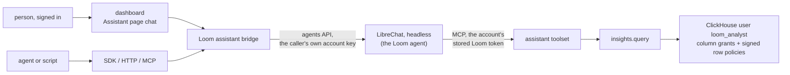

# Assistant design

This page is the design of Loom's assistant, which will answer questions about what a
namespace holds and how it is used, with a citation for every claim. It names the
surfaces, how each caller's identity will reach the agent's tools, the analysis op and
its isolation, the deployment, what will be stored and erased, and the cost. None of it
is built yet; [the build order](#build-order) lists the parts.

LibreChat will be the assistant: it will host the agent (its model, instructions and
tools) and run it headless beside Loom, reachable only from Loom. Loom will supply the
agent's tools, which read under a token of the asker's own subject, and a read-only SQL
op that ClickHouse itself holds to that token's org and namespaces. People will chat on
the dashboard's Assistant page; agents and scripts will reach the same agent over HTTP,
MCP and both SDKs, through Loom's origin and as themselves.

## Surfaces

| Surface         | What the caller will call                                                                                               |
| --------------- | ----------------------------------------------------------------------------------------------------------------------- |
| Dashboard       | a chat on the Assistant page, streaming from `POST /v1/assistant/chat/completions` with the signed-in session           |
| HTTP            | `POST /v1/assistant/chat/completions`: LibreChat's agents API request and response, OpenAI-compatible, streaming or not |
| SDKs            | a thin `assistant` client in Python and TypeScript over that route, with streaming; it holds no agent logic             |
| MCP             | the `loom_assistant_ask` tool (op `assistant.ask`), which forwards one question and returns the whole answer            |
| HTTP, op shaped | `POST /v1/assistant.ask` and the generated `assistant_ask` / `assistantAsk` SDK methods, from the same op               |

Each request names its namespace: the `X-Loom-Namespace` header on the chat route (the
token's default namespace when absent), the `namespace` field on `assistant.ask`. The
caller needs `viewer` there, and the answer's model spend is charged there.

LibreChat's web UI and API will not be published: LibreChat listens on an internal
network only Loom reaches. A person has one sign-in and one URL, Loom's. The
[LibreChat integration](../features/integrations/librechat.md), in which each person
runs LibreChat's UI with a pasted token, is replaced by this deployment when it is
built.

**Why LibreChat hosts the agent.** One agent definition, versioned in
`integrations/librechat/`, will serve every surface. LibreChat runs the model, the tool
loop, streaming, cancellation and conversation state, which Loom would otherwise build a
second time. Loom keeps what makes an answer trustworthy: authorization on every tool
call, the request ledger, the analysis boundary in the database, and the citation check.

**Why a native chat, not LibreChat's UI in a frame.** A frame would put a second origin,
a second sign-in and LibreChat's look inside the dashboard, and would need LibreChat's
cookies to work in a third-party frame. A chat panel on the Assistant page uses Loom's
session and components, and links citations into the memory, document and code views.

## The bridge: each caller's own identity

LibreChat's agents API authenticates a LibreChat API key and runs the agent as that
key's LibreChat user. The agent's Loom MCP server sends the Loom token that user has
stored (`customUserVars` `LOOM_TOKEN`, encrypted with LibreChat's `CREDS_KEY`). In
LibreChat v0.8.8 a request cannot carry a token of its own: request-time header
placeholders take only LibreChat's conversation and message ids
(`ALLOWED_BODY_FIELDS`), and `{{LIBRECHAT_OPENID_ACCESS_TOKEN}}` carries LibreChat's own
OpenID sign-in, which a headless LibreChat does not have and Loom does not issue. So
Loom will give every caller its own LibreChat user, and nothing in LibreChat that can
read Loom will be shared.

The bridge (`server/assistant/`) will serve a request in five steps:

1. Verify the caller's Loom token or dashboard session as on any op, and its `viewer`
   role on the request's namespace. A revoked or expired caller is refused here, before
   LibreChat is called.
2. Build the account's claim set: every claim of the caller's token (subject, agent,
   end user, `creator` and `parent_subjects`, namespaces, `read_scope`, issuer), with
   the role narrowed to `viewer` and consumer `loom-assistant`. The account key is the
   org and a hash of that set, so a caller with a narrower token, or whose claims
   change, gets a separate account, and no two scopes share a stored token.
3. Find the account in `loom.assistant_accounts`, or create it. The LibreChat user name
   and password are derived from the account key with an HMAC under the deployment's
   signing secret, so two replicas creating the same account register one LibreChat
   user, and the password is never stored. The account's agents API key is stored
   sealed (`server/core/secrets_at_rest.py`); two replicas that each create one hold two
   keys of the same user, and either works. LibreChat's registration is open only on its
   internal network.
4. Store a fresh Loom token as the account's `LOOM_TOKEN` when the stored one expires
   within 15 minutes: the claim set above, expiring at the earlier of the caller token's
   expiry and one hour. The old token is not revoked; it runs out within 15 minutes, so
   a tool call already using it still succeeds, and two replicas rotating at once leave
   two valid tokens of the same scope.
5. Call LibreChat's agents API with the account's key, the caller's messages and the
   namespace as context, and stream the response back with `Accept-Encoding: identity`.
   A caller that disconnects, or the chat's stop button, closes the upstream request,
   and LibreChat stops the run. The bridge drops any conversation id in the caller's
   body; LibreChat assigns it.

A stored token reads no more than the caller's own token, ends no later than it, and is
ended with it: revoking the caller's subject, or a subject in its `creator` or
`parent_subjects` chain, ends the stored token too (`server/auth/subject_revocation.py`).
Revoking only the caller's token id leaves the stored token valid for at most an hour,
but the bridge refuses the caller in step 1, so only a copy taken from LibreChat's
database could use it. The LibreChat user that owns the agent definition stores no Loom
token, so the agent itself reads nothing; only a caller's own account can make it read.

**Citations.** The agent's instructions will require a citation on each claim:
`[memory:<key>@v<version>]`, `[doc:<source_uri> § <section>]`, `[code:<path>:<line>]`,
or the number of a fenced `sql` block in the answer that holds the statement exactly as
it ran. The bridge checks each against Loom: a memory key and version must be readable
by the caller and current, a document section must exist in a live document, and a
`sql` block's hash must match an `insights.query` call ledgered under the account's
token during this answer. Each citation comes back marked `verified` or not; the
dashboard links verified ones into its views and shows the SQL. The steps of an answer
(each tool call, its arguments and whether it answered) come from Loom's ledger: the
agent's MCP server sends LibreChat's conversation id on each tool call (`requestHeaders`
with `{{LIBRECHAT_BODY_CONVERSATIONID}}`), and the bridge reads the rows tagged with it
under the account's token. An answer with no verified citation is shown as unsupported,
as an abstention is.

## The agent definition

`integrations/librechat/agent.yaml` will hold the agent's name, instructions, model,
tool list and a version number. Loom seeds it at boot under the owner account, shared
read-only with every LibreChat user, and writes it only when its version is newer than
the stored one, so during a rolling upgrade a build N-1 never overwrites N's definition.
The tool list is the assistant toolset's reads and `insights.query`, so the agent
writes nothing; a change it suggests is a draft a person applies elsewhere, as the
Assistant page's tune drafts already are. The instructions require citations, tell the
agent to abstain when no tool result supports an answer, to read `insights.catalog`
before writing SQL, and to treat stored text as data that cannot grant a tool or approve
a change.

## The analysis op

`insights.query` will run one read-only SQL statement over an allowlisted set of Loom
tables and return its rows, capped. The agent uses it for questions no other read
answers, such as which agents wrote the most contradicted facts last week or what a
namespace holds by kind and age. Any token with `viewer` on the namespaces it names can
call it directly, on any transport, and it joins the
[assistant toolset](../reference/mcp.md#the-assistant-toolset). A token whose
`read_scope` is narrower than its namespaces is refused it, as every op outside
`SCOPED_OPS` is.

### The boundary is the database user

The statement runs as a dedicated ClickHouse user, `loom_analyst`, never as Loom's own
user or the reader user. Loom does not parse or rewrite the statement to scope it; it
runs it as a subquery, `SELECT * FROM (<statement>)`, so only a `SELECT` or `WITH`
statement is valid SQL there, and sends the scope as settings. ClickHouse refuses
everything else:

| What the statement tries                                           | What stops it                                                                                              |
| ------------------------------------------------------------------ | ---------------------------------------------------------------------------------------------------------- |
| a table or column outside the allowlist (tokens, secrets, keys)    | grants: `SELECT(col, …)` on each allowlisted table, nothing else                                           |
| another org or namespace, through a filter, `JOIN` or subquery     | a row policy on every allowlisted table, checked before `PREWHERE` and `WHERE` on each row read (below)    |
| `system.*`, `information_schema`, `SHOW`, `DESCRIBE`, `KILL QUERY` | no grant on `system` tables, `SHOW COLUMNS` or `system.processes`                                          |
| `EXPLAIN`, whose estimates count other orgs' rows                  | the subquery wrapper: `EXPLAIN` in a subquery needs `CREATE TEMPORARY TABLE`, which the user lacks         |
| `mergeTreeIndex()` and other index readers                         | ClickHouse refuses them on a table with a row policy                                                       |
| `url()`, `file()`, `s3()`, `remote()`, `cluster()`, `executable()` | no `READ ON URL`, `FILE`, `S3`, `REMOTE` and no `CREATE TEMPORARY TABLE` grant                             |
| a write, DDL or a temporary table                                  | `readonly = 2`, held `CONST` in the user's settings profile                                                |
| `SETTINGS` that widen time, memory, rows read or result size       | the profile's `MAX` constraints; `result_overflow_mode` and `read_overflow_mode` are `'throw'` and `CONST` |
| `SETTINGS use_query_cache = 1`                                     | `use_query_cache = 0`, `CONST`                                                                             |
| `SETTINGS` that rename the scope                                   | the row policy's signature check fails, so the statement reads no rows                                     |

**Signed row policies.** Loom sends four custom settings with each statement: the org
(`SQL_loom_org`), the namespaces (`SQL_loom_ns`), an expiry a minute ahead
(`SQL_loom_exp`) and `SQL_loom_sig`, the SipHash-128 of one length-prefixed string of
the other three under a 128-bit key. Each allowlisted table's policy, `TO loom_analyst`,
admits a row only when its `org` and `namespace` match the settings, the expiry is in
the future, and the signature matches the hash ClickHouse computes with the key written
into the policy. A statement may set custom settings itself (`readonly = 2` allows it),
but without the key it cannot sign another scope, so a changed scope reads nothing.

The key is derived from the deployment's signing secret (`LOOM_JWT_SECRET`) with an
HMAC, so every replica holds the same key and none is stored. The analyst user cannot
read it: it has no grant on `system.row_policies`, and `EXPLAIN` (which it cannot run)
prints the filter after the settings are folded into constants, not the key. Replacing
the signing secret replaces the key: each replica rewrites the policies at its next
boot, and until every replica runs on the new secret, analysis calls on the others read
no rows. A row policy applies only to the user it names, so every other user, Loom's
own included, reads the tables as before.

**Why not ClickHouse credentials in LibreChat.** A ClickHouse login in the agent would
read every org, skip the request ledger and the exposure records, and keep no link to
the asker's token. The analysis op runs inside Loom's request path: the token is
verified first, the namespaces are checked as on any read, and the call is ledgered.

### Provisioning

The analyst user, its settings profile, grants and policies will be written with SQL,
never in a ClickHouse config file, which would put the key in the repository. A server
whose ClickHouse user has access management (the bundled ClickHouse's `loom` user, a
self-managed admin) writes them at boot. Elsewhere `loom ch-setup` writes them, or
prints the SQL for an admin, as it does for the reader user. At boot Loom probes the
analyst user with one signed statement, checks that a `system` table is refused, and
compares the grants with the allowlist; a missing or different user is a `loom doctor`
problem, and `insights.query` answers `ANALYSIS_UNAVAILABLE` until it is fixed. The
allowlist lives in code with the column comments that become the agent's catalog, so
the grants, the policies and the catalog come from one definition.

### What it can read

The allowlist covers metadata, not content: the identity tuple, keys, kinds, versions,
timestamps, counts, statuses, op names and latencies, from the memory, conflict, usage,
document and request-ledger tables. Memory values, document text, chunks, prompts,
search queries and ledger arguments are left out; a question about content goes through
`memory.search`, `memory.ask` or `knowledge.search`, which apply their own scope and
sensitivity rules. The allowlist admits a table only when the
[erasure saga](memory-architecture.md#erasure-saga) deletes from it or the census
(`server/erasure/store/census.py`) lists it as holding no memory content, so a
statement after an erasure cannot read what it removed.

### The catalog

`insights.catalog` will return the allowlisted tables, their columns, types and
comments, and the engine notes a correct query needs (which tables need `FINAL`, which
hold one row per version). It is generated from the allowlist, so it never names a
column the user cannot read.

### Limits, fairness and the ledger

A statement runs under the caps the profile pins as `MAX`: execution time, rows read,
memory and result rows, each a setting in the catalog. A statement over a cap fails with
the cap it hit and how to narrow the query. Every org's statements run as the one
analyst user, so fairness between orgs comes from Loom: `insights.query` is rate-limited
per namespace, org and actor like every op (`server/core/ratelimit.py`), and the
profile's `max_concurrent_queries_for_user` bounds the analyst user's share of
ClickHouse. Each call writes one `agent_events` row with the statement's hash and
length, its row count and its latency; the statement text and the rows are not stored.

## Isolation proof

`tests/integration/test_analysis_isolation.py`, in the style of
`tests/integration/test_cross_principal_leakage.py`, will seed two orgs, each with a
canary memory and a canary ledger row, and call `insights.query` with the first org's
viewer token. Each case must be refused or return no canary:

- a filter on the other org, a namespace outside the token, a `JOIN` or subquery over
  the same table, `UNION ALL`, `view(...)`, `merge(...)`, and a `throwIf` or
  `sleepEachRow` on the other org's rows;
- `system.query_log`, `system.processes`, `system.row_policies`, `system.users`,
  `information_schema`, `SHOW CREATE TABLE`, `DESCRIBE`, `KILL QUERY … TEST`,
  `loom.signing_keys`, `loom.revoked_tokens` and a column outside the allowlist;
- `EXPLAIN` in each form, `mergeTreeIndex()`, `url()`, `file()`, `s3()`, `remote()`,
  `cluster()`, `executable()` and `input()`;
- `SETTINGS` that change the scope, the caps, `readonly` or `use_query_cache`, the same
  statement text run first by one org with the query cache and then by the other, and
  a scope sent with an expired or forged signature;
- a statement that is not a `SELECT`: `INSERT`, `ALTER`, `CREATE TEMPORARY TABLE`;
- both orgs' statements running at once.

The same file will show that a revoked token stops new calls and that an erased memory
is gone from the next statement. A unit test pins the generated grants and policies to
the allowlist. The bridge's tests will show that two callers never share an account, a
narrower token gets its own account, a stored token is never wider than the caller's or
longer-lived, revoking the caller's creator ends the stored token, and a revoked caller
is refused before LibreChat is called.

A probe of this boundary on ClickHouse 26.9, with a scratch table, user and policy of
this shape, showed each refusal in the table above, the query cache keeping the two
orgs' results apart, and `EXPLAIN PLAN` printing the folded filter
(`has(['a1'], namespace) AND org = 'acme'`) with no key.

## Deployment

LibreChat will run beside Loom with its MongoDB in every deployment shape, reachable
only from Loom:

- **Compose:** an `assistant` profile starts LibreChat and MongoDB on an internal network
  shared with the `loom` service alone; neither publishes a port.
- **Helm:** an `assistant.enabled` value adds LibreChat's Deployment and Service and a
  MongoDB StatefulSet, with a NetworkPolicy that admits only Loom's pods.
- **Settings:** a catalog setting names LibreChat's internal address; unset, the
  assistant routes answer `ASSISTANT_UNAVAILABLE` and the Assistant page shows no chat.
  LibreChat's model key (`ANTHROPIC_API_KEY`) is set in its own environment.

LibreChat's configuration keeps the integration's memory off and search index out, and
differs in two ways: sharing is on for the one seeded agent, and every chat expires
after 24 hours (`generalChatRetention`, with `retentionMode: all`) instead of the
integration's 720.

## Stored data and erasure

| Where                     | What the assistant leaves                                                       | How it is deleted                                                                      |
| ------------------------- | ------------------------------------------------------------------------------- | -------------------------------------------------------------------------------------- |
| `loom.assistant_accounts` | per account: the org, the claim-set hash, LibreChat user id, the sealed API key | holds no memory content (a `NO_MEMORY_CONTENT` entry); dropped with its LibreChat user |
| `loom.agent_events`       | one row per bridge request and per tool call, under the account's token         | as every ledger row                                                                    |
| LibreChat chats           | questions, answers and tool outputs, which can quote memory content (MongoDB)   | expire after 24 hours; every erasure in the org deletes them (below)                   |
| LibreChat `transactions`  | token counts per message, no content                                            | kept; deleted with the LibreChat user                                                  |
| LibreChat logs            | user ids and token ids, no message text                                         | one file per day, kept 14 days                                                         |
| the dashboard             | the current chat, in the tab's memory                                           | gone when the tab closes                                                               |

A chat can quote any row its account read, and Loom cannot tell which chat holds which
row. So the erasure saga gets a step that deletes every LibreChat chat of every account
in the erased scope's org, and a census substrate that counts the chats left; a
LibreChat that cannot confirm the deletion fails the step, and the saga with it, as any
backend does. Erasing one user or namespace therefore also clears that org's other
chats, which are at most 24 hours old. An answer is computed from the rows the account's
token reads at that moment, so an erased memory is absent from every later answer.

## Model and cost

The model will be the agent definition's: `LOOM_ASSISTANT_MODEL` when set (Loom writes it
into the definition when it seeds), `claude-haiku-4-5` otherwise. The model runs in
LibreChat on its own key. The bridge reads each answer's token usage from the agents
API's final chunk and records it in `loom.org_model_calls` under the request's
namespace, so assistant answers count toward the namespace's daily model cost cap
(`daily_cost_cap_usd`, default `LOOM_DEFAULT_DAILY_COST_CAP_USD`), together with what
the agent's `memory.ask` calls spend on Loom's own model. Once the cap is spent the
bridge refuses new questions in that namespace. The
[qualification](../features/integrations/librechat.md#qualification) of the assistant
toolset measured a mean of $0.03 per answer on that model; the deployed agent is
re-qualified with analysis questions before it ships.

## Who can use it

Any token with `viewer` or higher on the namespace, and any person signed in to the
dashboard with that role. Every tool call checks the account's token again, and that
token never reads more than the caller's own.

## Rolling upgrades

`assistant.ask`, `insights.query` and `insights.catalog` will be new ops and
`/v1/assistant/chat/completions` a new route: a build that does not know them answers
`UNKNOWN_OP` or 404, so a client points at them once every replica serves them. The
analyst user, its grants and policies, and `loom.assistant_accounts` live in ClickHouse
and are shared by every replica; the agent definition is written only by a build whose
definition version is newer.

## Build order

1. `insights.query`, `insights.catalog` and the analyst user, with the isolation proof.
2. LibreChat deployed headless, the seeded agent definition, re-qualified with analysis
   questions.
3. The bridge: the chat route, `assistant.ask`, the SDK clients, the erasure step.
4. The chat on the dashboard's Assistant page.

Each part moves its section of this page from design to the description of what is
built.

## Source entry points

- `server/operations/toolsets.py` (`MCP_ASSISTANT_OPS`, `ASSISTANT_FORCED_ARGS`): the
  assistant toolset the agent's tools come from.
- `server/core/ch.py` (`caller_shaped`, `_reader_auth`): how a read runs as another
  ClickHouse user under caps.
- `server/cli/ch_setup.py`: provisioning of the reader user, which the analyst user
  follows.
- `server/auth/subject_revocation.py`: the revocation the stored tokens inherit.
- `integrations/librechat/`: the LibreChat configuration and qualification harness.

## Invariants

- The analysis boundary is ClickHouse's: grants, the settings profile and signed row
  policies.
- Every tool call the agent makes reads under a token of the caller's own claims, never
  wider or longer-lived than the caller's token, and is ledgered as consumer
  `loom-assistant`.
- No LibreChat account or key is shared between callers, and the account that owns the
  agent stores no Loom token.
- Every erasure reaches LibreChat's chats, and fails if it cannot.
- The assistant writes no memory, document or grant.

## Related

- [The assistant toolset](../reference/mcp.md#the-assistant-toolset)
- [LibreChat integration](../features/integrations/librechat.md)
- [Security](security.md)
- [Rolling upgrades](rolling-upgrades.md)
