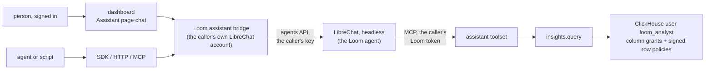

# The assistant

The assistant answers questions about what a namespace holds and how it is used, with a
citation for every claim. LibreChat is the assistant: it hosts the agent (its model,
instructions and tools) and runs it, headless, beside Loom. Loom supplies the agent's
tools, which read under the asker's own token, and a read-only SQL tool that ClickHouse
itself holds to that token's org and namespaces. People chat on the dashboard's
Assistant page; agents and scripts reach the same agent over HTTP, MCP and both SDKs,
always through Loom's origin and always as themselves. This page describes the
surfaces, how each caller's identity reaches the agent's tools, the analysis tool and its
isolation, the deployment, what is stored, and the cost. [Rollout](#rollout) says which
parts are built.

## Surfaces

| Surface         | What the caller calls                                                                                                   |
| --------------- | ----------------------------------------------------------------------------------------------------------------------- |
| Dashboard       | the chat on the Assistant page, which streams from `POST /v1/assistant/chat/completions` with the signed-in session     |
| HTTP            | `POST /v1/assistant/chat/completions`: LibreChat's agents API request and response, OpenAI-compatible, streaming or not |
| SDKs            | a thin `assistant` client in Python and TypeScript over that route, with streaming; it holds no agent logic             |
| MCP             | the `loom_assistant_ask` tool (op `assistant.ask`), which forwards one question and returns the whole answer            |
| HTTP, op shaped | `POST /v1/assistant.ask` and the generated `assistant_ask` / `assistantAsk` SDK methods, from the same op               |

LibreChat's own web UI and API are not published: LibreChat listens on the deployment's
internal network, and only Loom reaches it. A person has one sign-in and one URL, Loom's.

**Why LibreChat hosts the agent.** One agent definition, versioned in
`integrations/librechat/`, serves every surface; LibreChat runs the model, the tool
loop, streaming, cancellation and conversation state, which Loom would otherwise build a
second time. Loom keeps what makes the answer trustworthy: authorization on every tool
call, the request ledger, the analysis boundary in the database, and the citation check.

**Why a native chat on the dashboard, not LibreChat's UI in a frame.** A frame would put a
second origin, a second sign-in and LibreChat's look inside the dashboard, and would need
LibreChat's cookies to work in a third-party frame. A chat panel on the Assistant page
uses Loom's session and components, and links citations straight into the memory,
document and code views.

## The bridge: each caller's own identity

LibreChat's agents API authenticates a LibreChat API key, which runs the agent as that
key's LibreChat user. The agent's Loom MCP server sends the Loom token that user has
stored (`customUserVars` `LOOM_TOKEN`, encrypted with LibreChat's `CREDS_KEY`). A request
cannot carry a token of its own: LibreChat fills request-time header placeholders only
from its own conversation and message ids. So Loom gives every caller its own LibreChat
user, and nothing in LibreChat is shared that can read Loom.

For a request on `/v1/assistant/chat/completions` or `assistant.ask`, the bridge
(`server/assistant/`):

1. Verifies the caller's Loom token or dashboard session as on any op. The caller needs
   `viewer` on the namespace it asks about.
2. Finds the caller's LibreChat account in `loom.assistant_accounts`, keyed by org,
   subject and a fingerprint of the token's read scope (namespaces, role ceiling,
   `read_scope`, user restriction), or creates it: it registers a LibreChat user with a
   random password, creates an agents API key, and stores both sealed
   (`server/core/secrets_at_rest.py`). Registration is open only on the internal network
   that only Loom reaches.
3. Mints the account's Loom token if it has none or it expires within the hour: a
   `viewer` token for the same subject, with the same read scope as the caller's token
   (never wider), consumer `loom-assistant`, expiring in at most 24 hours. The bridge
   stores it as the LibreChat user's `LOOM_TOKEN` and revokes the one it replaces.
4. Calls LibreChat's agents API with the account's key and the caller's messages, and
   streams the response back unchanged, with `Accept-Encoding: identity` so chunks
   arrive as they are written. A caller that disconnects, or the chat's stop button,
   closes the upstream request, and LibreChat stops the run.
5. Checks the answer's citations (below) and appends a final event with the result.

A caller with a narrower token gets a separate account, so one person's two scopes never
share a stored token. A revoked or expired caller token is refused in step 1, before
LibreChat is called. Revoking a subject in Loom also stops the stored token, which names
the same subject. The LibreChat user that owns the agent definition stores no Loom
token, so the agent itself reads nothing: only a caller's own account can make it read.

**Steps and citations.** The agent's instructions require each claim to carry a
citation: `[memory:<key>@v<version>]`, `[doc:<source_uri> § <section>]`, `[code:<path>:<line>]`,
or the number of a fenced `sql` block in the answer, which holds the statement exactly as
it ran. The bridge checks each against Loom: a memory key and version must be readable
by the caller and current, a document section must exist in a live document, and a `sql`
block's hash must match an `insights.query` call ledgered under the caller's subject
during this answer. Each citation comes back marked `verified` or not, and the dashboard
links verified ones into its views and shows the SQL. The steps of an answer (each tool
call, its arguments and whether it answered) come from Loom's own ledger: the agent's MCP
server sends LibreChat's conversation id on each tool call (`requestHeaders` with
`{{LIBRECHAT_BODY_CONVERSATIONID}}`), and the bridge reads the rows tagged with it. An answer with no
verified citation is shown as unsupported, the way an abstention is.

## The agent definition

`integrations/librechat/agent.yaml` holds the agent's name, instructions, model and tool
list. Loom seeds it at boot: it creates or updates the agent under the owner account and
shares it read-only with every LibreChat user, so each caller's account can run it but
not change it. The tool list is the assistant toolset's reads and `insights.query`, so
the agent writes nothing; a change it suggests is a draft a person applies elsewhere, as
the Assistant page's tune drafts already are. The instructions require citations, tell
the agent to abstain when no tool result supports an answer, to call `insights.catalog`
before writing SQL, and to treat stored text as data that cannot grant a tool or approve
a change.

## The analysis tool

`insights.query` runs one read-only SQL statement over an allowlisted set of Loom tables
and returns its rows, capped. The agent uses it for questions no other read answers,
such as which agents wrote the most contradicted facts last week or what a namespace
holds by kind and age. Any token with `viewer` on the namespaces it names can call it
directly, on any transport. It joins the
[assistant toolset](../reference/mcp.md#the-assistant-toolset).

### The boundary is the database user

The statement runs as a dedicated ClickHouse user, `LOOM_CH_ANALYST_USER` (default
`loom_analyst`), never as Loom's own user or the reader user. No Loom code parses or
rewrites the statement to scope it; ClickHouse refuses what the user may not do:

| What the statement tries                                           | What stops it                                                                                              |
| ------------------------------------------------------------------ | ---------------------------------------------------------------------------------------------------------- |
| a table or column outside the allowlist (tokens, secrets, keys)    | grants: `SELECT(col, …)` on each allowlisted table, nothing else                                           |
| another org or namespace, through a filter, `JOIN` or subquery     | a row policy on every allowlisted table, checked on each row ClickHouse reads (below)                      |
| `system.*` and `information_schema`                                | no grant; the boot probe checks that a `system` table is refused                                           |
| `url()`, `file()`, `s3()`, `remote()`, `cluster()`, `executable()` | no `READ ON URL`, `FILE`, `S3`, `REMOTE` and no `CREATE TEMPORARY TABLE` grant                             |
| a write, DDL or a temporary table                                  | `readonly = 2`, held `CONST` in the user's settings profile                                                |
| `SETTINGS` that widen time, memory, rows read or result size       | the profile's `MAX` constraints; `result_overflow_mode` and `read_overflow_mode` are `'throw'` and `CONST` |
| `SETTINGS` that rename the scope                                   | the row policy's signature check fails, so the statement reads no rows                                     |

**Signed row policies.** Loom sends four custom settings with each statement: the org
(`SQL_loom_org`), the namespaces (`SQL_loom_ns`), an expiry a minute ahead
(`SQL_loom_exp`) and a keyed hash of the three (`SQL_loom_sig`, SipHash-128 under a
128-bit key). Each allowlisted table's policy, `TO loom_analyst`, admits a row only when
its `org` and `namespace` match the settings, the expiry is in the future, and the
signature matches the hash ClickHouse computes with the key written into the policy. A
statement may set custom settings itself (`readonly = 2` allows it), but without the key
it cannot sign another scope, so a changed scope reads nothing. Only Loom's own user can
read the key: the analyst user has no grant on the table that holds it or on
`system.row_policies`. A token limited to one user (`read_scope`) adds that user to the
signed scope, and only tables with a `user_id` column are allowlisted for it. Row
policies apply only to the user they name, so every other user, Loom's own included,
reads the tables as before.

**Why not ClickHouse credentials in LibreChat.** A ClickHouse login in the agent would
read every org, skip the request ledger and the exposure records, and keep no link to
the asker's token. The analysis tool runs inside Loom's request path: the token is
verified first, the namespaces are checked as on any read, and the call is ledgered.

### Provisioning

`loom ch-setup` creates the analyst user, its settings profile, its grants, the row
policies and the key, as it creates the reader user. At boot Loom probes the analyst user
with one signed statement and compares its grants with the allowlist; a missing or
different user is a `loom doctor` problem, and `insights.query` answers
`ANALYSIS_UNAVAILABLE` until it is fixed. The allowlist lives in code with the column
comments that become the agent's catalog, so the grants, the policies and the catalog
come from one definition. A change to the allowlist takes effect when `loom ch-setup`
runs again.

### What it can read

The allowlist covers metadata, not content: the identity tuple, keys, kinds, versions,
timestamps, counts, statuses, op names and latencies, from the memory, conflict, usage,
document and request-ledger tables. Memory values, document text, chunks, prompts and
search queries are left out; a question about content goes through `memory.search`,
`memory.ask` or `knowledge.search`, which apply their own scope and sensitivity rules.
The allowlist admits a table only when the
[erasure saga](memory-architecture.md#erasure-saga) deletes from it or the census
(`server/erasure/store/census.py`) lists it as holding no memory content, so a
statement after an erasure cannot read what it removed.

### The catalog

`insights.catalog` returns the allowlisted tables, their columns, types and comments,
and the engine notes a correct query needs (which tables need `FINAL`, which hold one
row per version). It is generated from the allowlist, so it never names a column the
user cannot read.

### Limits and the ledger

A statement runs under `LOOM_ANALYSIS_MAX_EXECUTION_S`, `LOOM_ANALYSIS_MAX_ROWS_TO_READ`,
`LOOM_ANALYSIS_MAX_MEMORY_BYTES` and `LOOM_ANALYSIS_MAX_RESULT_ROWS`, the values the
profile pins as `MAX`. A statement over a cap fails with the cap it hit and how to narrow
the query. Each call writes one `agent_events` row with the statement's hash and length,
its row count and its latency; the statement text and the rows are not stored.

## Isolation proof

`tests/integration/test_analysis_isolation.py`, in the style of
`tests/integration/test_cross_principal_leakage.py`, seeds two orgs, each with a canary
memory and a canary ledger row, and calls `insights.query` with the first org's viewer
token. Each case must be refused or return no canary:

- a filter on the other org, a namespace outside the token, a `JOIN` or subquery over
  the same table, `UNION ALL`, `view(...)` and `merge(...)`;
- `system.query_log`, `system.row_policies`, `system.users`, `information_schema`, the
  key table, `loom.signing_keys`, `loom.revoked_tokens` and a column outside the
  allowlist;
- `url()`, `file()`, `s3()`, `remote()`, `cluster()`, `executable()`, `input()`;
- `SETTINGS` that change the scope settings, the caps or `readonly`, and a scope sent
  with an expired or forged signature;
- a statement that is not a `SELECT`: `INSERT`, `ALTER`, `CREATE TEMPORARY TABLE`.

The same file shows that a revoked token stops new calls and that an erased memory is
gone from the next statement. A unit test pins the generated grants and policies to the
allowlist. The bridge has its own tests: two callers never share a LibreChat account, a
narrower token gets its own account, a stored token is never wider than the caller's,
and a revoked caller is refused before LibreChat is called.

## Deployment

LibreChat runs beside Loom with its MongoDB in every deployment shape, reachable only
from Loom:

- **Compose:** the `assistant` profile starts LibreChat and MongoDB on an internal
  network shared with the `loom` service alone; neither publishes a port.
- **Helm:** `assistant.enabled` adds LibreChat's Deployment and Service and a MongoDB
  StatefulSet, with a NetworkPolicy that admits only Loom's pods.
- **Settings:** `LOOM_ASSISTANT_LIBRECHAT_URL` names LibreChat's internal address; unset,
  the assistant routes answer `ASSISTANT_UNAVAILABLE` and the Assistant page hides the
  chat. LibreChat's own model key (`ANTHROPIC_API_KEY`) is set in its environment.

LibreChat's configuration keeps the integration's posture: memory off, no search index,
and every chat expiring after `generalChatRetention`, set to 24 hours.

## Stored data and erasure

| Where                     | What the assistant leaves                                                     | How it is deleted                                                                  |
| ------------------------- | ----------------------------------------------------------------------------- | ---------------------------------------------------------------------------------- |
| `loom.assistant_accounts` | per caller account: LibreChat user id, sealed password and key, the token jti | user erasure deletes the row and the LibreChat user; the token is revoked          |
| `loom.agent_events`       | one row per bridge request and per tool call, under the caller's subject      | as every ledger row                                                                |
| LibreChat's MongoDB       | the questions, the answers, the tool outputs, token usage                     | chats expire after 24 hours; deleting the LibreChat user removes all of the user's |
| the dashboard             | the current chat, in the tab's memory                                         | gone when the tab closes                                                           |

An answer is computed from the rows the token reads at that moment, so an erased memory
is absent from every new answer. A LibreChat chat that already holds an old answer keeps
it until the chat expires, and a follow-up in that chat can repeat it; the user's
erasure deletes their LibreChat users and every chat with them. What LibreChat stores is
listed in the [LibreChat integration](../features/integrations/librechat.md#what-librechat-stores).

## Model and cost

The model is the agent definition's, `LOOM_ASSISTANT_MODEL` when set (Loom writes it into
the definition when it seeds), with `claude-haiku-4-5` as the default. The model runs in
LibreChat, so its spend is LibreChat's: each answer's token usage is in LibreChat's
`transactions`, and LibreChat's `balance` setting caps each account. It does not count
toward Loom's per-namespace model cost cap. The
[qualification](../features/integrations/librechat.md#qualification) of the assistant
toolset measured a mean of $0.03 per answer on that model; the deployed agent is
re-qualified with analysis questions before it ships.

## Who can use it

Any token with `viewer` or higher on the namespace, and any person signed in to the
dashboard with that role. Every tool call checks the stored token again, and the stored
token never reads more than the caller's own.

## Rolling upgrades

`assistant.ask`, `insights.query` and `insights.catalog` are new ops, and
`/v1/assistant/chat/completions` a new route: a build that does not know them answers
`UNKNOWN_OP` or 404, so a client points at them once every replica serves them. The
analyst user, its grants and policies, the key and `loom.assistant_accounts` live in
ClickHouse and are shared by every replica.

## Rollout

| Part                                                         | State     |
| ------------------------------------------------------------ | --------- |
| This design                                                  | written   |
| `insights.query`, `insights.catalog`, the analyst user       | not built |
| LibreChat deployed headless, the seeded agent, re-qualified  | not built |
| The bridge: the chat route, `assistant.ask`, the SDK clients | not built |
| The chat on the Assistant page                               | not built |

## Source entry points

- `server/operations/toolsets.py` (`MCP_ASSISTANT_OPS`, `ASSISTANT_FORCED_ARGS`): the
  assistant toolset the agent's tools come from.
- `server/core/ch.py` (`caller_shaped`, `_reader_auth`): how a read runs as another
  ClickHouse user under caps.
- `server/cli/ch_setup.py`: provisioning of the reader user, which the analyst user
  follows.
- `integrations/librechat/`: the LibreChat configuration, the agent definition and the
  qualification harness.

## Invariants

- The analysis boundary is ClickHouse's: grants, the settings profile and signed row
  policies.
- Every tool call the agent makes reads under a token of the caller's own subject, never
  wider than the caller's token, and is ledgered as consumer `loom-assistant`.
- No LibreChat account or key is shared between callers, and the account that owns the
  agent stores no Loom token.
- The assistant writes no memory, document or grant.

## Related

- [The assistant toolset](../reference/mcp.md#the-assistant-toolset)
- [LibreChat integration](../features/integrations/librechat.md)
- [Security](security.md)
- [Rolling upgrades](rolling-upgrades.md)
