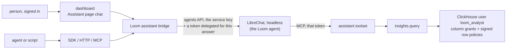

# Assistant design

This page is the design of Loom's assistant, which will answer questions about what a
namespace holds and how it is used, with a citation for every claim. It names the
surfaces, how each caller's identity will reach the agent's tools, the analysis op and
its isolation, the deployment, what will be stored and erased, and the cost. None of it
is built yet; [the build order](#build-order) lists the parts.

LibreChat will be the assistant: it will host the agent (its model, instructions and
tools) and run it headless beside Loom, reachable only from Loom. Loom will supply the
agent's tools, which read under a token of the asker's own subject, and a read-only SQL
op that ClickHouse itself holds to that token's org and namespaces. People will chat on
the dashboard's Assistant page; agents and scripts will reach the same agent over HTTP,
MCP and both SDKs, through Loom's origin and as themselves.

## Surfaces



| Surface         | What the caller will call                                                                                               |
| --------------- | ----------------------------------------------------------------------------------------------------------------------- |
| Dashboard       | a chat on the Assistant page, streaming from `POST /v1/assistant/chat/completions` with the signed-in session           |
| HTTP            | `POST /v1/assistant/chat/completions`: LibreChat's agents API request and response, OpenAI-compatible, streaming or not |
| SDKs            | a thin `assistant` client in Python and TypeScript over that route, with streaming; it holds no agent logic             |
| MCP             | the `loom_assistant_ask` tool (op `assistant.ask`), which forwards one question and returns the whole answer            |
| HTTP, op shaped | `POST /v1/assistant.ask` and the generated `assistant_ask` / `assistantAsk` SDK methods, from the same op               |

Each request names its namespace: the `X-Loom-Namespace` header on the chat route (the
token's default namespace when absent), the `namespace` field on `assistant.ask`. The
caller needs `viewer` there, and the answer's model spend is charged there.

`loom_assistant_ask` is in no curated MCP roster and, while `experimental`, not in the
`all` listing either: each call spends model budget, so an agent calls it by name on
purpose, as every unlisted op can be called. It is never in the
[assistant toolset](../reference/mcp.md#the-assistant-toolset), so the agent cannot call
itself.

LibreChat's web UI and API will not be published: LibreChat listens on an internal
network only Loom reaches. A person has one sign-in and one URL, Loom's. The
[LibreChat integration](../features/integrations/librechat.md), in which each person
runs LibreChat's UI with a pasted token, is replaced by this deployment when it is
built.

**Why LibreChat hosts the agent.** One agent definition, versioned in
`integrations/librechat/`, will serve every surface. LibreChat runs the model, the tool
loop, streaming and cancellation, which Loom would otherwise build a second time. Loom
keeps what makes an answer trustworthy: authorization on every tool call, the request
ledger, the analysis boundary in the database, and the citation check.

**Why a native chat, not LibreChat's UI in a frame.** A frame would put a second origin,
a second sign-in and LibreChat's look inside the dashboard, and would need LibreChat's
cookies to work in a third-party frame. A chat panel on the Assistant page uses Loom's
session and components, and links citations into the memory, document and code views.

## The bridge: each caller's own identity

LibreChat's agents API authenticates a LibreChat API key and runs the agent as that
key's LibreChat user. The agent's tools are Loom's MCP server, and what they may read is
decided by the token on each tool call, never by the LibreChat user. LibreChat v0.8.8
fills an MCP header from three fields of the request body (`ALLOWED_BODY_FIELDS`:
`conversationId`, `parentMessageId`, `messageId`), substituting the value as it is. The
agents API takes `parent_message_id` from the caller as any string and, on a request
with no `conversation_id`, uses it only for that field and as the anchor of a thread of
files, which finds nothing with no stored conversation and the file tools off. So the
bridge sends a token there, and the agent's MCP server sends it back to Loom. The
LibreChat qualification runs this path, so an upgrade of LibreChat that changes it fails
there before it ships:

```yaml
headers:
  Authorization: "Bearer {{LIBRECHAT_BODY_PARENTMESSAGEID}}"
  X-Loom-Run-Id: "{{LIBRECHAT_BODY_MESSAGEID}}"
```

They go under `headers`, not LibreChat's chat-only `requestHeaders`: those are left off
the connection that lists the tools, whose `tools/list` would then go out without the
token and leave the agent with no tools.

The bridge (`server/assistant/`) will serve a request in three steps:

1. Verify the caller's Loom token or dashboard session as on any op, and its `viewer`
   role on the request's namespace. The chat route takes the same `Origin` and CSRF
   checks as `POST /v1/{op}`. Refused here, before LibreChat is called: a revoked or
   expired caller, an org-wide (`*`) token (an answer reads one org), a token whose
   `read_scope` is narrower than its namespace (as `insights.query` refuses it), a
   caller whose token has less life left than one answer may run (for a dashboard or
   `loom login` caller, whose access token a refresh replaces every hour, its sign-in
   session's: the dashboard refreshes before it asks), an org whose model calls an admin
   switched off (`org.set_model_calls`), and a namespace over its assistant budget or
   running its most concurrent answers ([Model and cost](#model-and-cost)).
2. Delegate the answer's token from the caller's (`server/auth/delegation.py`
   `delegate`): `viewer` on the request's namespace alone, minted for the caller's own
   subject with consumer `loom-assistant`, as a service-account token when the caller's
   is one, and expiring when an answer may run no longer (a catalog setting, default ten
   minutes). Delegation applies every rule a minted child follows: the creator's live
   grant, the end user, the ancestor subjects and their issue times, the chain depth
   limit, and the caller's token id among the child's `parents`. The bridge also asks
   for the caller's sign-in session among the `parents` (a new `delegate` option), so a
   dashboard or `loom login` caller's answer token ends at sign-out, as a third-party
   client's already does. The token is not listed in `loom.service_accounts`: it lives
   for one answer.
3. Call LibreChat's agents API with Loom's service key, the seeded agent's id in place
   of any `model` the caller names, the answer token as `parent_message_id`, and the
   text of the caller's `user` and `assistant` messages (no `system` message, which
   would override the agent's instructions, and no files or images). Stream the response
   back with `Accept-Encoding: identity`. A caller that disconnects, or the chat's stop
   button, closes the upstream request, and LibreChat aborts the run. The bridge drops
   any `conversation_id` in the caller's body: on this path LibreChat stores no
   conversation, so it answers 404 for one it is given.

An answer's token reads no more than the caller's own token, ends no later than it (for
a sign-in session, no later than the session: the answer's token may outlive the
hour-long access token it was delegated from, as every child of a first-party session
does), and is ended with it: revoking the caller's token, its subject, its sign-in
session or a subject in its `creator` or `parent_subjects` chain ends the answer's token
too, since delegation puts each of them in its revocation check. LibreChat holds the
token in memory for the one request and stores it nowhere; the deployment sets none of
LibreChat's tracing variables, which would export the run's request body, and the
qualification searches LibreChat's logs for a token it sent.

**One LibreChat user, which reads nothing.** Every answer runs as one LibreChat user,
Loom's service user, which owns the agent definition. Its API key runs the agent, but
the agent's tools read only with the token each request carries: a request without one
gets `401` on every tool call, and a request with one reads as that token. The key is
therefore not a credential that reads anything in Loom. One row of
`loom.assistant_service`, a `ReplacingMergeTree(version)` table, holds the service
user's email, a random password, its agents API key, the agent's id and the version and
model of the definition last written, the two secrets sealed
(`server/core/secrets_at_rest.py`) like every stored credential, so
`loom secrets reseal` (which takes [`analysis.entities`](#provisioning), then
`assistant.service`) covers them when the signing secret is replaced and the deployment
carries no second secret.

Setting the service up is one step that a boot runs holding the cluster lease
`assistant.service` (`server/core/leases.py`), so two boots never run it at once; the
holder re-reads the row and does only what is missing, storing each result on the row
before the next, and signs in once, at the first step that needs LibreChat:

1. No row: write the email and a sealed random password.
2. No key: sign in, registering first only when LibreChat answers that the email does
   not exist (LibreChat words a wrong password the same way but for its text, so the
   qualification pins that answer), delete any key of the service user's that a boot cut
   short left behind (keys carry the definition's name), then create the key.
3. No agent id: list the service user's agents by the definition's name, keep the oldest
   and delete the rest, or create the agent when there is none, and store its id.
4. A stored definition older than this build's, or of the same version with another
   model: write it and store its version and model on the row.

A boot that stopped halfway leaves the row at a step the next one finishes. Answers run
on the stored key whatever a sign-in does. A row whose sealed values open with neither
secret, and a sign-in that fails (LibreChat's database restored from another deployment,
say), are `loom doctor` problems with one fix: empty LibreChat's database and drop the
row, which the next boot recreates. Until the row has its key and agent id, the
assistant answers `ASSISTANT_UNAVAILABLE`.

**Conversations live with the caller.** LibreChat's agents API (the OpenAI-compatible
`/api/agents/v1/chat/completions`) saves no messages: it runs the agent over the
messages in the request and records only token counts in its `transactions` collection.
A multi-turn chat is the caller's message list, which the dashboard keeps in the tab and
an SDK caller sends each time, as with any OpenAI-compatible API. The agent's MCP
connection carries request-time headers, so LibreChat opens it for each answer and
closes it after; each answer pays one MCP `initialize` and `tools/list`.

**Citations.** The agent's instructions will require a citation on each claim:
`[memory:<key>@v<version>]`, `[doc:<source_uri> § <section>]`, `[code:<path>:<line>]`,
or the number of a fenced `sql` block in the answer that holds the statement exactly as
it ran. The bridge checks each against Loom: a memory key and version must be readable
by the caller and current, a document section must exist in a live document, and a `sql`
block's digest must match an `insights.query` call ledgered in this answer. The agent's
MCP server sends the answer's message id on each tool call as `X-Loom-Run-Id` (the
agents API fills `{{LIBRECHAT_BODY_MESSAGEID}}` with the id every chunk carries). On the
assistant toolset the MCP transport labels the call's ledger row with that header, in
`agent_events.run_id`, as HTTP already does; there the header wins over the session's
run label, and an answer's connection opens no session run, so the bridge reads the
answer's rows, and its steps (each tool call, its arguments and whether it answered), by
the org, the namespace, that run id, the caller's subject and the consumer
`loom-assistant`. A caller who knows its answer's run id could plant a row of its own
under it; such a row is the caller's own call, so a citation it makes verified misleads
only the caller. Ledger rows are written in the background and a tool call can land on
another replica, so the bridge waits up to five seconds for the rows; a citation whose
row has not arrived by then, or was dropped, comes back unverified. Each citation comes
back marked `verified` or not, and an answer with no verified citation is shown as
unsupported, as an abstention is.

**Rendering.** The answer is model output that stored text can steer, so the dashboard
renders it as text with Markdown emphasis, lists, tables and code only: no HTML, no
images, and links only for verified citations, into the dashboard's memory, document and
code views. The dashboard's `img-src 'self' data: blob:` already stops a remote image
that would carry rows away in its URL.

## The agent definition

`integrations/librechat/agent.yaml` will hold the agent's name, instructions, model,
tool list and a version number. Loom seeds it at boot under the service user, which owns
it, so nothing is shared. It writes the definition when its version is newer than the
stored one, or the same with another model, so during a rolling upgrade a build N-1
never overwrites N's definition and a changed `LOOM_ASSISTANT_MODEL` takes effect at the
next boot. After a rollback N's definition stays, and a tool call it names that N-1 does
not serve answers `UNKNOWN_OP` until the roll forward.

The tool list is the assistant toolset's reads and `insights.query`, so the agent writes
nothing; a change it suggests is a draft a person applies elsewhere, as the Assistant
page's tune drafts already are. The instructions require citations, tell the agent to
abstain when no tool result supports an answer, to read `insights.catalog` before
writing SQL, and to treat stored text as data that cannot grant a tool or approve a
change.

## The analysis op

`insights.query` will run one read-only SQL statement over an allowlisted set of Loom
tables and return its rows, capped. The agent uses it for questions no other read
answers, such as which agents wrote the most contradicted facts last week or what a
namespace holds by kind and age. Any token with `viewer` on the namespaces it names can
call it directly, on any transport, and it joins the
[assistant toolset](../reference/mcp.md#the-assistant-toolset). A token whose
`read_scope` is narrower than its namespaces is refused it, as every op outside
`SCOPED_OPS` and `NARROW_SAFE_OPS` is.

### The boundary is the database user

The statement runs as a dedicated ClickHouse user, `loom_analyst`, never as Loom's own
user or the reader user. Loom does not parse or rewrite the statement to scope it. It
sends the scope as settings and runs the statement, less one trailing `;`, as a
subquery, `SELECT * FROM (` and `)` on lines of their own, so a trailing `--` comment
ends at the newline. ClickHouse parses only a `SELECT` or `WITH` there and reports a
syntax error for anything else. The wrapper is not what isolates orgs; the user's
grants, settings profile and row policies are:

| What the statement tries                                            | What stops it                                                                                              |
| ------------------------------------------------------------------- | ---------------------------------------------------------------------------------------------------------- |
| a table or column outside the allowlist (tokens, secrets, keys)     | grants: `SELECT(col, …)` on each allowlisted table, nothing else                                           |
| another org or namespace, through a filter, `JOIN` or subquery      | a row policy on every allowlisted table, checked on each row read (below)                                  |
| a deleted or erased row, or a version a later one replaced          | the row policy carries the table's live predicate and applies after `FINAL` (below)                        |
| `system.*`, `information_schema`, `SHOW`, `DESCRIBE`, `KILL QUERY`  | no grant on `system` tables, `SHOW COLUMNS` or `system.processes`                                          |
| `EXPLAIN`, whose estimates count other orgs' rows                   | inside the subquery, `EXPLAIN` needs `CREATE TEMPORARY TABLE`, which the user lacks                        |
| `mergeTreeIndex()` and other index readers                          | ClickHouse refuses them on a table with a row policy                                                       |
| `url()`, `file()`, `s3()`, `remote()`, `cluster()`, `executable()`  | no `READ ON URL`, `FILE`, `S3`, `REMOTE` and no `CREATE TEMPORARY TABLE` grant                             |
| `aiGenerate()` and the other AI functions, which send rows out      | they take credentials only from a named collection, and the user has no `NAMED COLLECTION` grant           |
| a write, DDL or a temporary table                                   | `readonly = 2`, held `CONST` in the user's settings profile                                                |
| `SETTINGS` that widen time, memory, rows read or result size        | the profile's `MAX` constraints; `result_overflow_mode` and `read_overflow_mode` are `'throw'` and `CONST` |
| `SETTINGS use_query_cache = 1` or `use_query_condition_cache = 1`   | both `0`, `CONST`, so no cached result or granule map crosses from one scope to another                    |
| `SETTINGS send_logs_level = 'trace'`, whose log lines quote the key | `send_logs_level = 'none'`, `CONST`                                                                        |
| `SETTINGS max_threads = 256`, taking the host's CPU                 | `max_threads` pinned as `MAX`                                                                              |
| `SETTINGS` that rename the scope                                    | the row policy's signature check fails, so the statement reads no rows                                     |

**Signed row policies.** Loom sends four custom settings with each statement: the org
(`SQL_loom_org`), the namespaces (`SQL_loom_ns`), an expiry a minute ahead
(`SQL_loom_exp`) and `SQL_loom_sig`, the HMAC-SHA256 of one length-prefixed string of
the other three under a 256-bit key. Each allowlisted table's policy, `TO loom_analyst`,
admits a row only when its `org` and `namespace` match the settings, the expiry is in
the future, and the signature matches the hash ClickHouse computes with the key written
into the policy. A statement may set custom settings itself (`readonly = 2` allows it),
but without the key it cannot sign another scope, so a changed scope reads nothing. The
policy reads every setting through `toString`, so a statement that sets one to a number
or an array cannot make the policy raise an error, whose message would quote the policy
and its key; and Loom never passes on a ClickHouse message that names the scope
settings.

Each policy also carries its table's live predicate, the one the erasure census counts
(`tombstoned_at IS NULL` on `loom.memory`), and the profile holds `final = 1` and
`apply_row_policy_after_final = 1` `CONST`. A deletion or an erasure tombstones every
version of a row, and the row stays in the table until a merge or a purge, so `FINAL`
picks each key's latest version and the policy then drops it when that version is a
tombstone: a deleted or erased key is absent, and its earlier versions do not come back.
A second policy, `AS PERMISSIVE USING 1 TO ALL EXCEPT loom_analyst`, keeps every other
user, Loom's own included, reading the tables as before, whatever the server's
`users_without_row_policies_can_read_rows` says.

The key and the analyst's password are random and kept in one row of
`loom.analysis_secrets`, sealed with `server/core/secrets_at_rest.py` in the shape
`loom secrets reseal` rewrites (`SEALED` in `server/cli/secrets.py`). The first write
draws them under the lease below and every replica reads the same row. A signing-secret
rotation only reseals them, so the policies never change key; when the key cannot be
read, [provisioning](#provisioning) says what happens. The analyst user cannot read the
key: it has no grant on `system.row_policies` or on `loom.analysis_secrets`, and it
cannot run `EXPLAIN`. Every statement that carries the key runs with `log_queries = 0`,
so the key is not in `system.query_log`. It is in ClickHouse's own access storage (on
disk, or in Keeper when access is replicated), in a backup of the access entities, in
the distributed DDL queue of a cluster that writes access `ON CLUSTER`, in
`system.row_policies` and in the server log at `debug` level: all read only by whoever
administers the ClickHouse host, who can read every row anyway.

**Why not ClickHouse credentials in LibreChat.** A ClickHouse login in the agent would
read every org, skip the request ledger and the exposure records, and keep no link to
the asker's token. The analysis op runs inside Loom's request path: the token is
verified first, the namespaces are checked as on any read, and the call is ledgered.

### Provisioning

The analyst user, its settings profiles, grants and policies will be written with SQL,
never in a ClickHouse config file, which would put the key in the repository. A server
whose ClickHouse user has access management (the bundled ClickHouse's `loom` user, a
self-managed admin) writes them itself. Elsewhere an admin runs `loom ch-setup`, which
writes them, or runs by hand the SQL that `loom ch-setup --print-analyst-sql` prints:
that SQL opens with `SET log_queries = 0`, carries the key and the password, is printed
by the newest build's CLI, is outside the rules below because plain SQL takes no lease
and checks no version, and is run, not kept. Only these draw the secrets row when there
is none, besides a server that can see no analyst user exists yet; a server that cannot
tell answers `ANALYSIS_UNAVAILABLE` until `loom ch-setup` runs. The allowlist lives in
code with the column comments that become the agent's catalog, so the grants, the
policies and the catalog come from one definition. The rules a write keeps:

- **One writer at a time.** A write holds the cluster lease `analysis.entities`
  (`server/core/leases.py`), waiting for it when another holds it, and reads what the
  entities hold once it has it. `loom secrets reseal` takes the same lease.
- **Never over a newer build.** The analyst's main settings profile carries the stored
  version, written last; a version names exactly one set of grants and policies (a unit
  test pins it), so a change to either is a new version. A build writes when there is no
  stored version or its own is newer, so during a rolling upgrade a build N-1 never
  narrows N's grants or loosens N's policies. N-1 keeps answering on N's entities: its
  statements that name a column N dropped are refused until the roll forward. The caps
  are deployment settings, kept in a second profile of their own: a boot holding the
  lease writes them when the stored ones differ from its settings, and nothing else
  writes them, so they never touch the version.
- **No granted table without its policy.** ClickHouse lets a user with no policy on a
  table read every row of it, so each policy is replaced in place before any grant is
  given, every grant outside the allowlist is revoked after, and a policy is never
  dropped: a table that leaves the allowlist keeps one that reads nothing.
- **The key never changes by itself.** The secrets row is drawn once, and every read of
  it, the one under the lease included, runs with the read-your-writes setting Loom uses
  across replicas (`own_write_reads` in `server/core/ch.py`). A replica reads the key
  from the row before each statement. A row that does not open, or is gone while the
  analyst user exists, answers `ANALYSIS_UNAVAILABLE` and is a `loom doctor` problem.
  `loom ch-setup --new-analysis-key` is the recovery: it draws a new key, stores it, and
  writes every policy under it, the canary's last; while it runs, which is when analysis
  is already unavailable, an answer can come back empty.

A replica probes the analyst user at boot and then a minute after each probe, in the
background, as the analyst itself, so the probe needs no access management:

- a signed read of `loom.analysis_canary`, whose one row sits in a reserved scope under
  a policy with the same key, must return that row: the policies accept the key;
- a signed read of each allowlisted table in that reserved scope must count no rows: no
  extra policy widens what the analyst reads;
- a `system` table must be refused;
- when the stored version is this build's: an unsigned read of each allowlisted table
  must fail for want of the scope settings (the table has a policy that reads them), and
  the analyst's own `SHOW GRANTS` must name nothing but the allowlist and the canary. A
  build older than the stored version skips these, since the entities are another
  build's.

A failed check answers `ANALYSIS_UNAVAILABLE` and is a `loom doctor` problem. When a
check failed with a definite answer, not a lost connection, and the stored version is
this build's, the replica writes the entities again under the lease.

### What it can read

The allowlist covers metadata, not content: the identity tuple, keys, kinds, versions,
timestamps, counts, statuses, op names and latencies, from the memory, conflict, usage,
document and request-ledger tables. Memory values, document text, chunks, prompts,
search queries and ledger arguments are left out; a question about content goes through
`memory.search`, `memory.ask` or `knowledge.search`, which apply their own scope and
sensitivity rules. The allowlist admits a table only when what the
[erasure saga](memory-architecture.md#erasure-saga) removes from it is gone for the
analyst too: its policy carries the census live predicate of a table the saga tombstones
(`server/erasure/store/census.py`), the saga deletes or scrubs its rows in place (as
`agent_events.scrub` does), or the census lists it as holding no memory content. So a
statement after an erasure cannot read what it removed.

### The catalog

`insights.catalog` will return the allowlisted tables, their columns, types and
comments, and the notes a correct query needs: which tables hold one live row per key
and which one row per event. It is generated from the allowlist, so it never names a
column the user cannot read, and it leaves out the probe's canary.

### Limits, fairness and the ledger

A statement runs under the caps the profile pins as `MAX`: execution time, rows read,
memory and result rows, each a setting in the catalog. A statement over a cap fails with
the cap it hit and how to narrow the query. Every org's statements run as the one
analyst user, so fairness between orgs comes from Loom: `insights.query` and
`assistant.ask` each get their own rate-limit class (`server/core/ratelimit.py`; the
chat route draws from `assistant.ask`'s), so neither spends the budget of the ops filed
under `default`, and the profile's `max_concurrent_queries_for_user` bounds the analyst
user's share of ClickHouse. Each replica also runs at most a set number of statements
per org at once (a catalog setting, default 2). That limit is per replica, so one org
can hold that many times the replica count; with the defaults (8 for the user, 2 per
org) an org holds half the share on two replicas and all of it on four, and a deployment
with more replicas lowers the per-org setting or raises the user's.

Each call writes one `agent_events` row with its row count and latency (identifier keys
in `server/observability/event_args.py`) and the statement's digest and length. The
`sql` argument joins the ledger's text keys, which record a digest, never the text; a
restricted namespace drops text keys from the ledger, so the op also records the digest
as `sql_digest`, an identifier key, which the citation check reads. The profile holds
`log_queries = 0` `CONST`, so the statement text is not in `system.query_log` either;
ClickHouse's server log records it at its `debug` level, as it records every statement.
The rows are stored nowhere.

## Isolation proof

`tests/integration/test_analysis_isolation.py`, in the style of
`tests/integration/test_cross_principal_leakage.py`, will seed two orgs, each with a
canary memory and a canary ledger row, and call `insights.query` with the first org's
viewer token. Each case must be refused or return no canary:

- a filter on the other org, a namespace outside the token, a `JOIN` or subquery over
  the same table, `UNION ALL`, `view(...)`, `merge(...)`, and a `throwIf` or
  `sleepEachRow` on the other org's rows;
- `system.query_log`, `system.processes`, `system.row_policies`, `system.users`,
  `information_schema`, `SHOW CREATE TABLE`, `DESCRIBE`, `KILL QUERY … TEST`,
  `loom.signing_keys`, `loom.revoked_tokens` and a column outside the allowlist;
- `EXPLAIN` in each form, also after a `)` or comment that tries to leave the wrapper,
  `mergeTreeIndex()`, `url()`, `file()`, `s3()`, `remote()`, `cluster()`,
  `executable()`, `input()` and `aiGenerate()` with a named collection;
- on `loom.memory` itself: a deleted memory, a memory tombstoned by an erasure, and a
  version a later one replaced, with `SETTINGS final = 0` and
  `apply_row_policy_after_final = 0`;
- `SETTINGS send_logs_level`, `use_query_condition_cache` or `max_threads` past the
  profile;
- `SETTINGS` that change the scope, the caps, `readonly` or `use_query_cache`, the same
  statement text run first by one org with the query cache and then by the other, and a
  scope sent with an expired or forged signature;
- a statement that is not a `SELECT`: `INSERT`, `ALTER`, `CREATE TEMPORARY TABLE`;
- both orgs' statements running at once;
- `SETTINGS` that set a scope value to a number, an array or a malformed string: no
  answer quotes the policy or its key;
- an extra grant (`GRANT SELECT ON loom.* TO loom_analyst`) and a table with its policy
  dropped, each of which the probe turns into `ANALYSIS_UNAVAILABLE` at once, with and
  without access management for Loom's user; a table taken off the allowlist, which
  reads nothing whether or not its grant is still there;
- two boots writing at once (a build N-1 beside N with a table taken off the allowlist),
  which the lease serialises, and a build N-1 beside N, which keeps answering on N's
  entities and never writes them;
- a statement run while a write replaces the policies, which reads the right rows;
- an extra policy that widens what the analyst reads (`USING 1 TO loom_analyst`), which
  the reserved-scope read catches; a build N-1 beside an N that added a column and took
  a table off the allowlist, which keeps answering; and two replicas with different cap
  settings, which write the caps at boot only;
- a policy under another key, which the canary catches, and a secrets row that does not
  open or is gone while the user is not, which answers `ANALYSIS_UNAVAILABLE`;
- `loom.analysis_secrets` and `loom.analysis_canary` read directly, and neither the
  statement's text nor the key in `system.query_log`.

The same file will show that a revoked token stops new calls and that an erased memory
is gone from the next statement. A unit test pins the generated grants and policies to
the allowlist. The bridge's tests will show that:

- an answer's token is never wider than the caller's token, never outlives it (a sign-in
  session's for a dashboard caller) or the answer's limit, and ends with the caller's
  token, subject, creator or sign-out; a dashboard caller in the last minutes of its
  access token is answered;
- a request to LibreChat without a token reads nothing, and one with a token reads as
  it;
- a revoked caller, an org-wide token, a narrowed `read_scope`, a caller about to expire
  and an org with model calls switched off are refused before LibreChat is called;
- two replicas booting at once register one service user and keep one key, a service row
  its maker left at any step is finished by the next boot, registration never runs where
  LibreChat would log the password, and `loom secrets reseal` rewrites both sealed rows
  while a boot waits for the lease;
- a `sql` citation verifies in a restricted namespace and when its tool call landed on
  another replica.

A probe of this boundary on ClickHouse 26.9, with a scratch table, user and policy of
this shape, showed each refusal in the table above, the query cache keeping the two
orgs' results apart, `EXPLAIN PLAN` printing the folded filter (`has(['a1'], namespace)
AND org = 'acme'`) with no key, and `aiGenerate()` refused for want of a
`NAMED COLLECTION` grant. On a `ReplacingMergeTree(version)` table with `tombstoned_at`,
as `loom.memory` is, the live predicate under forced `FINAL` hid a key whose latest
version was a tombstone and a key an `ALTER … UPDATE tombstoned_at` erased on every
version, brought back neither's earlier version, and refused
`SETTINGS apply_row_policy_after_final = 0`. Loom's own user kept ClickHouse's trivial
count optimization on a table with the `USING 1` policy. With the policy after `FINAL`,
one org of a thousand in a five-million-row table read 49,152 rows: the policy's `org`
filter still selects the parts and granules to read. The profile's `CONST` and `MAX`
pins refused `send_logs_level = 'trace'`, `use_query_condition_cache = 1` and a
`max_threads` above the cap, and admitted a lower one.

## Deployment

LibreChat will run beside Loom with its MongoDB in every deployment shape, reachable
only from Loom:

- **Compose:** an `assistant` profile starts LibreChat and MongoDB on an internal
  network shared with the `loom` service alone; neither publishes a port.
- **Helm:** an `assistant.enabled` value adds LibreChat's Deployment and Service and a
  MongoDB StatefulSet, with a NetworkPolicy that admits only Loom's pods.
- **Settings:** a catalog setting names LibreChat's internal address; unset, the
  assistant routes answer `ASSISTANT_UNAVAILABLE` and the Assistant page shows no chat.
  LibreChat's model key (`ANTHROPIC_API_KEY`) is set in its own environment.

LibreChat's configuration keeps the integration's memory off and search index out, and
gives the agents endpoint no capability but tools (no actions, which call any URL, and
no code execution, file search, skills, subagents or web search), so the agent's only
way out is Loom's tools. Its log level stays at `info`, which writes no message text.
Loom signs in at most once per replica boot, well under LibreChat's per-address sign-in
limit, and the deployment turns violation bans off (`BAN_VIOLATIONS=false`) and the
unverified-user expiry off (`ALLOW_UNVERIFIED_EMAIL_LOGIN=true`, so LibreChat never
deletes the service user it registered without a mail server), so a burst of replica
restarts cannot lock Loom out; nothing but Loom reaches LibreChat, so the bans protect
nothing there. Registration stays on (`ALLOW_REGISTRATION=true`) for the same reason,
and the service user, the first LibreChat registers, takes LibreChat's `ADMIN` role,
whose remote-agent permission the agents API key needs; it is an administrator of a
LibreChat that holds nothing of Loom's. LibreChat runs without Redis, so its run
bookkeeping (each run's agent, model and ids, never the request) stays in its own
memory, and the qualification lists the MongoDB collections one answer writes:
`transactions` alone. LibreChat's registration logs its request, password included, when
the email is already in use or the request is malformed; Loom registers only under the
lease and only after LibreChat said the email does not exist, and the qualification
searches LibreChat's logs for the service user's password as it does for a token.

## Stored data and erasure

| Where                                       | What the assistant leaves                                                              | How it is deleted                                     |
| ------------------------------------------- | -------------------------------------------------------------------------------------- | ----------------------------------------------------- |
| `loom.assistant_service`                    | one row: the service user's email and agent id, its sealed password and agents API key | holds no memory content (a `NO_MEMORY_CONTENT` entry) |
| `loom.analysis_secrets`                     | one row: the analysis key and the analyst's password, sealed                           | holds no memory content (a `NO_MEMORY_CONTENT` entry) |
| `loom.analysis_canary`                      | one constant row in a reserved scope, which the probe reads                            | holds no memory content (a `NO_MEMORY_CONTENT` entry) |
| `loom.agent_events`                         | one row per bridge request and per tool call, under the answer's token                 | as every ledger row                                   |
| LibreChat users, API keys, agents, sessions | the service user, its key, the agent definition and the sign-in sessions of each boot  | kept; no memory content                               |
| LibreChat `transactions`                    | token counts per answer and its message id, no content                                 | kept, a few hundred bytes per answer                  |
| LibreChat logs                              | the service user's id and email and request ids, no message text, token or password    | LibreChat's default: one file per day, kept 14 days   |
| the dashboard                               | the current chat, in the tab's memory                                                  | gone when the tab closes                              |

The agents API stores no questions, answers or tool outputs, so LibreChat holds nothing
an erasure must reach. An answer is computed from the rows the answer's token reads at
that moment, so an erased memory is absent from every answer that starts after the
erasure. An answer streaming while an erasure runs can quote a row it read before; it
goes to its caller only and is stored nowhere, as any read in flight.

## Model and cost

The model will be the agent definition's: `LOOM_ASSISTANT_MODEL` when set (Loom writes
it into the definition when it seeds), `claude-haiku-4-5` otherwise. The model runs in
LibreChat on its own key, so Loom's provider layer does not call it, but Loom holds its
spend to the same budget as its own model calls:

- Before calling LibreChat, the bridge checks the namespace's daily model cost cap
  (`server/observability/budget.py`, `daily_cost_cap_usd`, default
  `LOOM_DEFAULT_DAILY_COST_CAP_USD`) with `fail_open=False`, so a failed budget read
  refuses, and with the assistant held to its own share of the cap (a catalog setting,
  default half), so questions cannot spend what extraction and the conflict resolver
  need. Both surfaces record their spend under one operation, `assistant.ask`, which the
  share check sums.
- The check reads spend already recorded, so answers running at once could each pass it;
  each replica runs at most a set number of answers per namespace at once (a catalog
  setting, default 2), which bounds the overshoot to that many answers per replica, each
  at most the per-answer ceiling.
- When the answer ends, the bridge prices the token usage of the agents API's final
  chunk with the model's rate and records it as `upstream_cost_usd` on the answer's
  `agent_events` row, where every model spend is counted. An answer cut before its final
  chunk (a disconnect, the stop button, a timeout), or on a model Loom has no rate for,
  is charged a per-answer ceiling (a catalog setting) instead, so no answer spends for
  free.

At the default cap of $1 a day, half of it buys about 15 answers at the mean of $0.033
per answer that the [qualification](../features/integrations/librechat.md#qualification)
of the assistant toolset measured on that model, and 11 at its maximum of $0.043; a
namespace that asks more raises its `daily_cost_cap_usd`. The deployed agent is
re-qualified with analysis questions before it ships.

## Who can use it

Any token with `viewer` or higher on the namespace, and any person signed in to the
dashboard with that role. Every tool call checks the answer's token again, and that
token never reads more than the caller's own.

## Rolling upgrades

`assistant.ask`, `insights.query` and `insights.catalog` will be new ops and
`/v1/assistant/chat/completions` a new route: a build that does not know them answers
`UNKNOWN_OP` or 404, so a client points at them once every replica serves them. The
analyst user, its grants and policies, `loom.analysis_secrets`, `loom.analysis_canary`
and `loom.assistant_service` live in ClickHouse and are shared by every replica; the
agent definition is written as [the agent definition](#the-agent-definition) says, never
by an older build.

## Build order

1. `insights.query`, `insights.catalog` and the analyst user, with the isolation proof.
2. LibreChat deployed headless, the seeded agent definition, re-qualified with analysis
   questions.
3. The bridge: the chat route, `assistant.ask`, the SDK clients.
4. The chat on the dashboard's Assistant page.

Each part moves its section of this page from design to the description of what is
built.

## Source entry points

- `server/operations/toolsets.py` (`MCP_ASSISTANT_OPS`, `ASSISTANT_FORCED_ARGS`): the
  assistant toolset the agent's tools come from.
- `server/core/ch.py` (`caller_shaped`, `_reader_auth`): how a read runs as another
  ClickHouse user under caps.
- `server/cli/ch_setup.py`: provisioning of the reader user, which the analyst user
  follows.
- `server/auth/delegation.py` (`delegate`): how an answer's token is derived from the
  caller's and inherits its revocation.
- `server/observability/budget.py`: the namespace cost cap the assistant's spend counts
  toward.
- `integrations/librechat/`: the LibreChat configuration and qualification harness.

## Invariants

- The analysis boundary is ClickHouse's: grants, the settings profile and signed row
  policies.
- Every tool call the agent makes reads under a token delegated from the caller's, never
  wider or longer-lived than it and revoked with it, and is ledgered as consumer
  `loom-assistant`.
- LibreChat stores no Loom token: each answer carries its own, and the service user's
  key reads nothing without one.
- LibreChat stores no question, answer or tool output.
- The assistant writes no memory, document or grant.

## Related

- [The assistant toolset](../reference/mcp.md#the-assistant-toolset)
- [LibreChat integration](../features/integrations/librechat.md)
- [Security](security.md)
- [Rolling upgrades](rolling-upgrades.md)
