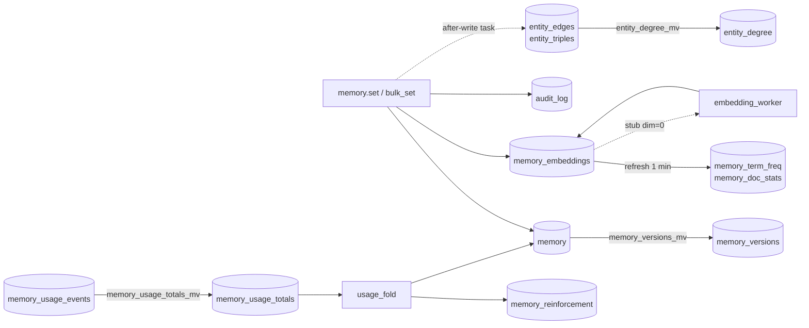

# ClickHouse

All durable Loom state lives in one ClickHouse database, `loom`. The canonical schema is
[`schemas/schema.sql`](../../schemas/schema.sql), dumped from a server with every
migration applied. The generated [schema reference](../reference/schema.md) lists every
table with its engine, keys, TTL and indexes. This page covers the table families, how
Loom uses engines, indexes and views, and how migrations run.

## Goals and non-goals

| Goals                                                                                     | Non-goals                                                                                   |
| ----------------------------------------------------------------------------------------- | ------------------------------------------------------------------------------------------- |
| One engine and one database for every plane, so a read never joins across stores.         | Cross-table transactions. A primary row lands first; derived rows follow.                   |
| Every row names its tenant, writer (`actor`) and content (`content_sha256`).              | Transaction-time history on every table. The version mirror covers `loom.memory`.           |
| Mutable state as append-only versions: a write is an INSERT, a read is deterministic.     | In-place updates on the request path. Updates are new versions or batched background folds. |
| Nothing that holds memory content expires unless its writer or the operator asked for it. | Default retention on facts, documents, conversations or the graph.                          |
| Every table classified for erasure.                                                       | A compliance guarantee.                                                                     |

## Table families

"Written by" names the code or [worker](../reference/workers.md) that inserts rows.
Retention is in [Partitioning and TTL](#partitioning-and-ttl).

| Family                       | Main tables                                                                                                                                                                                                                                      | Written by                                                                                                             |
| ---------------------------- | ------------------------------------------------------------------------------------------------------------------------------------------------------------------------------------------------------------------------------------------------ | ---------------------------------------------------------------------------------------------------------------------- |
| Memory facts                 | `memory`, `memory_versions`, `shared`, `working_memory`                                                                                                                                                                                          | `memory.set`, `memory.bulk_set`, lifecycle ops, `working_memory.*`; `memory_versions_mv` fills the history             |
| Memory embeddings            | `memory_embeddings`, `memory_reinforcement`, `memory_term_freq`, `memory_doc_stats`                                                                                                                                                              | The same write paths (`build_embedding_row`); `embedding_worker` fills stubs; `usage_fold`; refreshable views for BM25 |
| Evidence and chunks          | `memory_evidence`, `memory_chunks`, `memory_chunk_sources`, `memory_belief_sources`, `session_summaries`, `derived_facts`                                                                                                                        | `set_from_messages` projections, consolidation                                                                         |
| Records and taxonomy         | `memory_records`, `memory_record_versions`, `memory_record_fields`, `memory_record_conflicts`, `memory_schemas`, `memory_schema_fields`, `categories`, `memory_categories`                                                                       | `memory.record.*`, `namespace.*`, category assignment                                                                  |
| Write-path state             | `memory_extraction_queue`, `memory_projection_failures`, `memory_drops`, `blacklist`, `blacklist_version`, `conflict_allowlist`, `learnings_queue`, `consolidation_runs`, `memory_ask_precedents`                                                | Deferred extraction, fail-open projections, `blacklist.*`, `conflicts.resolve`, `memory.consolidate`, `memory.ask`     |
| Knowledge                    | `documents`, `chunks`, `chunk_supersessions`, `chunk_term_freq`                                                                                                                                                                                  | `knowledge.add`; `chunk_term_freq_mv`                                                                                  |
| Conversations                | `conversations`, `conversation_threads`, `conversation_embeddings`                                                                                                                                                                               | `conversation.*`; `conversation_titler`                                                                                |
| Entity graph                 | `entity_edges`, `entity_degree`, `entity_triples`, `entity_edge_memories`, `entity_triple_memories`, `entity_vectors`, `entity_summaries`, `entity_canonical_map`, `entity_communities`, `operator_edges`                                        | The `memory.set` after-write projection, `entity_extractor`, `entity_communities`; `entity_degree_mv`                  |
| Code index                   | `code_files`, `code_chunks`, `code_symbols`, `code_edges`, `code_pr_history` and the other `code_*` tables                                                                                                                                       | `code_ingest`, the `code_scip_*` workers, `code_pr_history`, `code_embed_recovery`, `code_summary`, `code_graph_stats` |
| Tracker                      | `qa_sources`, `qa_item_embeddings`, `qa_link_candidates`, `qa_test_daily`, `qa_rollup_days`, `qa_fail_hours`                                                                                                                                     | `tracker.source.add`, `tracker_embed`, `tracker_links`, `tracker_test_daily`                                           |
| Runs, tasks, briefs          | `agent_runs`, `agent_turn_usage`, `session_outcomes_by_user`, `procedure_runs`, `tasks`, `task_events`, `task_claims`, `task_leases`, `task_inboxes`, `session_briefs`, `context_blobs` and neighbours                                           | `run.*`, `task.*` / `inbox.*`, `session.brief_*`, `context.offload`, `reflection_distill`                              |
| Namespaces, auth, governance | `namespaces`, `namespace_grants`, `namespace_policies`, `namespace_types`, `namespace_snapshots`, `namespace_calibration_*`, `service_accounts`, `user_state`, `revoked_tokens`, `oauth_state`, `idempotency`, `policy_decisions` and neighbours | `namespace.*`, `grants.*`, sign-up and claim flows, `recalibration`, the idempotency cache                             |
| Telemetry, audit, cost       | `events`, `agent_events`, `agent_cost_rollup_daily`, `audit_log`, `audit_checkpoints`, `search_trace_log`, `memory_exposures`, `memory_usage_events`, `memory_usage_totals`, `code_search_trace`, `worker_status` and neighbours                 | The events stream, the op ledger, `observability/audit.py`, `audit_verifier`, the supervisor                           |
| Erasure                      | `erasure_requests`, `erasure_reversals`                                                                                                                                                                                                          | `erasure.request`, `erasure_recovery`, `memory.restore`                                                                |
| Provider caches              | `embedding_cache`, `llm_response_cache`                                                                                                                                                                                                          | The embedder and LLM client wrappers                                                                                   |

**State outside ClickHouse.** Two kinds of durable state live on the filesystem: uploaded
document originals, content-addressed by SHA-256 under `LOOM_BLOB_DIR`
(`server/storage/blob_store.py`), and the code plane's git mirrors under `var/code_repos`.
The mirrors can be re-cloned; the originals need the volume's own backup. Process caches
and file locks are listed in [system overview](system-overview.md#deployment-topology).

## Conventions every table follows

- **Identity prefix.** Tenant rows lead the sort key with the identity tuple, and every
  read filters on it, so the primary index prunes other tenants' granules first. A
  per-namespace erasure, snapshot or retention override is one key range, not a scan.

  | Column       | Meaning                               | Default |
  | ------------ | ------------------------------------- | ------- |
  | `org`        | Tenant boundary; required             | —       |
  | `namespace`  | Unit of sharing and grants; required  | —       |
  | `agent`      | Writer agent; required on memory rows | —       |
  | `user_id`    | End user the row is about             | `'-'`   |
  | `session_id` | Session the row came from             | `'-'`   |

  `'-'` means "not applicable" and is stored; `'*'` is a read-time wildcard, never
  stored. Tables that are not per agent (code index, tasks, namespace config) key on
  `(org, namespace, …)` or `(org, inbox, …)`. Memory tables add `run_id`. The server
  stamps `actor` and `source_class` on memory writes
  ([system overview](system-overview.md#the-identity-tuple)).

- **`LowCardinality(String)`** for `org`, `namespace`, `agent`, model names, statuses and
  event kinds.
- **Append, then collapse.** Mutable state is a `ReplacingMergeTree`; writers insert a new
  row with a higher version and reads use `FINAL`. Mutations stay off the request path.
- **Committed inserts.** A write that a later read depends on is sent with
  `async_insert = 0, wait_for_async_insert = 1`, the client's session default. Fire-and-forget
  telemetry (`async_insert = 1, wait_for_async_insert = 0`) adds `async_insert_deduplicate = 0`
  (`server/core/ch_writes.py`, `normalize_insert_settings`),
  because identical telemetry rows in one flush window are legitimate.
- **Retries never duplicate.** Every insert carries an `insert_deduplication_token` from
  the batch and a per-batch nonce (`insert_dedup_token`), so a retry after a dropped socket
  lands the batch once.

## Engines and why

| Engine                                             | Used for                                                                                                                                                                                                | Why                                                                                   |
| -------------------------------------------------- | ------------------------------------------------------------------------------------------------------------------------------------------------------------------------------------------------------- | ------------------------------------------------------------------------------------- |
| `ReplacingMergeTree(version)`                      | Mutable rows: `memory`, `memory_embeddings`, `shared`, `working_memory`, the `code_*` index, tasks, config                                                                                              | An update is an INSERT of a whole row; `FINAL` keeps the newest per key. No locks.    |
| `ReplacingMergeTree(created_at)` or `(updated_at)` | Rows written once per key: `memory_evidence`, `memory_chunks`, caches, `idempotency`, `namespaces`                                                                                                      | The same collapse, versioned by the row's own timestamp.                              |
| `ReplacingMergeTree` with no version               | `memory_versions`, `code_symbol_ids`, `code_symbol_names`                                                                                                                                               | `version` or the full identity is in the sort key, so only exact re-inserts collapse. |
| `MergeTree`                                        | Append-only logs: `events`, `agent_events`, `audit_log`, `conversations`, `task_events`, `entity_edges`, traces                                                                                         | Rows are facts about a moment.                                                        |
| `SummingMergeTree`                                 | Counters: `entity_degree`, `memory_usage_totals`, `code_unit_signal`                                                                                                                                    | A counter is an INSERT of a delta, never a read-modify-write.                         |
| `AggregatingMergeTree`                             | Non-additive rollups: `memory_term_freq`, `chunk_term_freq`, `code_term_freq`, `agent_cost_rollup_daily`, `memory_exposure_breadth_hourly`, `query_nodes`, `namespace_write_marks`, `subject_last_seen` | Partial aggregate states (a distinct count cannot be summed), finished with `-Merge`. |
| `KeeperMap`                                        | `task_leases` and the migration lock `loom._migration_lock`                                                                                                                                             | Linearizable compare-and-swap across processes.                                       |

**Why `ReplacingMergeTree` for mutable state.** `ALTER … UPDATE` rewrites whole parts
asynchronously with no read-your-write guarantee. Lightweight `UPDATE` writes patch parts
that every later read must apply, and switches off the quantized-codes read
([vector storage](#vector-storage)). A version row is one INSERT, visible to the next
`FINAL` read, with its history in the mirror. The price is the write rule below and the
`FINAL` cost, which the identity prefix keeps to one tenant's granules.

On the memory tables `version` is a wall-clock nanosecond stamp
(`server/memory/store/rows.py`, `next_version`), so two replicas' versions compare, at the cost
of bounded clock skew. Configuration tables version on `updated_at`, `created_at` or
`version`.

## The FINAL write rule

An update, tombstone, restore, touch, lock or promotion is an INSERT of a complete row
with a higher `version`. **A version row must carry every persisted column.** ClickHouse
fills an omitted column with its DDL default, and under `FINAL` that default replaces the
real value for every reader. Use the builders in `server/memory/store/rows.py`:

| Builder                                                 | Table                                   | Behaviour                                                                                                                          |
| ------------------------------------------------------- | --------------------------------------- | ---------------------------------------------------------------------------------------------------------------------------------- |
| `build_memory_version_row(existing, **changes)`         | `memory`                                | Copies every column in `MEMORY_PERSISTED_COLS`, applies the changes, keeps the stored `value` bytes.                               |
| `build_revision_row(existing, new)`                     | `memory`                                | A new value over the live row: carries usage, lineage, identity, lock and expiry; resets `REVISION_RESETS`; keeps the attestation. |
| `build_first_version_row(new, now=…)`                   | `memory`                                | Completes a first write with the DDL defaults (`FIRST_VERSION_DEFAULTS`), so every first version passes the insert funnel's check. |
| `insert_memory_versions(rows)` (`inserts.py`)           | `memory`                                | The only `loom.memory` insert: refuses a row missing a persisted column or naming an unknown one, then inserts committed.          |
| `build_embedding_row(**columns)`                        | `memory_embeddings`                     | Full row from `EMBEDDING_PERSISTED_COLS` defaults; an unknown column raises; fills `content_excerpt_lemma` and a fresh `version`.  |
| `build_session_summary_row`, `build_entity_summary_row` | `session_summaries`, `entity_summaries` | The same pattern.                                                                                                                  |

A new column goes into the builder's column set and every projection that feeds it, in
the same change. `MATERIALIZED` columns (`content_excerpt_lc`, `content_excerpt_stem`,
`value_preview`, `value_len`) must not appear in an insert. Other versioned tables
(`namespaces`, `code_summaries`) read the full row before re-inserting it.

Two query rules keep `FINAL` correct:

- Filter identity columns in `PREWHERE` or before `FINAL`; keep row-state predicates
  (`tombstoned_at`, `status`, expiry, validity) in `WHERE` after `FINAL`. A state
  predicate before the collapse drops the tombstone and brings back the version under it.
- Never alias an expression with the name of a column it filters on
  (`SELECT toString(memory_id) AS memory_id … WHERE memory_id IN …`). The `WHERE` resolves
  to the alias and silently matches nothing. `tests/unit/test_sql_alias_shadow.py` fails
  the build on this pattern.

## Content hashes

`content_sha256` on `loom.memory` is the SHA-256 of the value's canonical JSON. It is used
for:

- **Optimistic concurrency.** `memory.set` and `memory.update_by_id` accept
  `if_match_sha256`; a mismatch answers 409 `PRECONDITION_FAILED`. The hash rides
  `memory.get`, `memory.get_by_id` and `memory.set` responses.
- **Attestation binding.** `verified_sha256` records the bytes someone attested. A
  revision keeps `verified_by` and `verified_at`, but the hashes no longer match, so
  readers derive "stale" from the pair.
- **Audit.** Every write that creates or changes memory leaves one hash-only
  `audit_log` row (key, id, hash, actor, source class, verdict; never the value).

A code chunk's id is a UUIDv5 over its path, scope and content hash, so an unchanged chunk
re-ingests to the same row.

## Sort keys

After the identity prefix, a sort key serves the table's dominant read:

| Table               | `ORDER BY`                                                                         | Read it serves                                                                                      |
| ------------------- | ---------------------------------------------------------------------------------- | --------------------------------------------------------------------------------------------------- |
| `memory`            | `(org, namespace, agent, user_id, session_id, memory_key)`                         | Point reads by key; the collapse unit is one key per identity.                                      |
| `memory_embeddings` | `(org, namespace, agent, user_id, session_id, scope, embedding_model, memory_key)` | Vector legs for one identity and one model; two models' vectors are separate rows.                  |
| `memory_versions`   | `(org, namespace, agent, user_id, session_id, memory_key, version)`                | History of one key; `version` in the key keeps every row.                                           |
| `code_chunks`       | `(org, namespace, embedding_model, path, chunk_id)`                                | All chunks of a path, for re-ingest diffs and file reads.                                           |
| `code_edges`        | `(org, namespace, tier, to_symbol_id, edge_kind, from_symbol_id, path, line)`      | "Who calls X" is a key range. Projections `by_from` and `by_path` serve callees and per-file reads. |
| `code_symbols`      | `(org, namespace, tier, qualified_name, symbol_id)`                                | Definition by qualified name; `code_symbol_names_mv` and `code_symbol_ids_mv` re-key it.            |
| `entity_edges`      | `(org, namespace, entity_a, entity_b)`                                             | Neighbours of an entity.                                                                            |
| `task_events`       | `(org, inbox, seq)`                                                                | An inbox's events in order.                                                                         |

Sort and partition keys are `CREATE`-only. A migration that changes one declares
`-- loom: rebuild-if-empty <table>` above the full `CREATE TABLE`. The runner swaps an
empty table for its twin and refuses a table with rows, naming
`scripts/ops/table_rebuild.py` (twin, copy, `EXCHANGE TABLES`) (`server/core/schema/table_rebuild.py`).

## Partitioning and TTL

Most time-series tables are `PARTITION BY toYYYYMM(<time column>)`. Tenant directory tables
(`namespaces`, `namespace_grants`, `service_accounts`, `user_state`, …) are partitioned by
`org`; `working_memory` and `shared` by `(org, namespace)`. Small tables read whole
(`code_pr_history`, `code_pr_reviews`) have no partition key.

`code_chunks` is partitioned by `(org, namespace)`, so each repository index has its own
parts, the text-index posting lists cover one namespace, and a retired index leaves by
`DROP PARTITION`. The key is declared in the baseline's `CREATE`.

**No table deletes memory content by default.** Facts, embeddings, documents, chunks,
conversations and the graph have no TTL. They leave only by an explicit delete, a
writer-set expiry (`ttl_seconds`, applied by `memory_expiry_sweep` per the row's
`on_expire`) or erasure. Tables with a schema TTL hold telemetry, caches or runner state:

| Window     | Tables                                                                                                                                     |
| ---------- | ------------------------------------------------------------------------------------------------------------------------------------------ |
| 60 minutes | `code_search_memo`                                                                                                                         |
| 7 days     | `llm_response_cache`, `code_scip_parts`                                                                                                    |
| 30 days    | `events`, `embedding_cache`, `memory_drops`, `memory_extraction_queue`, `memory_ask_precedents`, `worker_status`, `code_scip_batches`      |
| 90 days    | `erasure_requests`, `oauth_state`, `policy_decisions`                                                                                      |
| 180 days   | `search_trace_log`, `memory_exposures`, `memory_exposure_breadth_hourly`, `consolidation_runs`, `code_search_trace`, `code_search_outcome` |
| 5 years    | `erasure_reversals`                                                                                                                        |
| other      | `idempotency` (at `expires_at`), `revoked_tokens` (10 days past token expiry), `context_blobs` (1 day past `expires_at`)                   |

Operators can add retention to `audit_log`, `agent_events`, `memory`, `memory_embeddings`,
`conversations`, `chunks` and `documents` with `LOOM_RETENTION_<TABLE>_DAYS`, and tiering
with `LOOM_TIERING_<TABLE>_WARM_DAYS` plus `LOOM_TIERING_WARM_VOLUME_NAME`. Per-namespace
`retention_days` or `warm_days` overrides become a `multiIf` in the same TTL expression
(`server/storage/retention_overrides.py`). The worker leader applies them at boot and
`retention_reconcile` keeps them in step, skipping unchanged tables because each
`MODIFY TTL` is a mutation. Every window defaults to 0 (off).

### Merges and skip indexes

A part count that keeps rising almost always means merges are failing. A skip index a
merge cannot build fails every merge of that table until inserts get `TOO_MANY_PARTS`.
Loom keeps such indexes out of merges with `exclude_materialize_skip_indexes_on_merge`
(the text index `content_text` on `chunks`, the vector-index name on `memory_embeddings`):
inserted parts still build the index, merged parts do without it. The `clickhouse_parts`
check of `ops.health` (`_clickhouse_parts_check`) reads `system.part_log` for failed
`MergeParts` events in the last quarter hour and reports the exception and this repair.
For the same reason memory-content tables carry no rows TTL. The runbook is in
[troubleshooting](../operations/troubleshooting.md).

## The write → derive loop

A write inserts its primary rows and returns. Everything else is derived afterwards, by one
of three mechanisms:

1. **Insert-time materialized views** run inside the source INSERT: `memory_versions_mv`
   copies every `memory` row into `memory_versions`, and `memory_usage_totals_mv` and
   `entity_degree_mv` fold their source rows into totals.
2. **Refreshable materialized views** (`REFRESH EVERY 1 MINUTE APPEND`) append rows newer
   than their high-water mark: BM25 statistics, the daily cost rollup, hourly exposure
   breadth, last seen per subject.
3. **Workers** poll for rows that need work and write new versions: stub embeddings
   (`embedding_worker`, `code_embed_recovery`), entities (`entity_extractor`), usage folds
   (`usage_fold`), deferred extraction (`extraction_queue`, `observe_extract`), failed
   projections (`projection_repair`), orphaned vectors (`orphan_vector_reconcile`), expiry
   (`memory_expiry_sweep`) and TTLs (`retention_reconcile`).

There is no queue service. A queue is a table whose rows carry their state:
`memory_extraction_queue` rows move `pending → done | failed` as versions; an embedding row
with `embedding_dim = 0` is a stub waiting for a vector; a `memory_projection_failures` row
is a projection to replay. Read paths filter unfinished rows out.



**Why derive.** A `memory.set` that awaited its graph projection, BM25 update and audit
fan-out would pay each round trip and fail when any failed. The response path keeps only
what the caller's next read needs: the `memory` row, its `memory_embeddings` row, the
same-key supersession and the audit receipt. Projections are fail-open
(`memory/app/after_write.py`), and a read of the same namespace in the same process waits
for them (`after_write.settle`). A derived table lags its source by seconds; the BM25 legs
merge that lag themselves.

## The memory_versions mirror

Merges discard superseded `memory` rows, so the RMT table is not a history.
`memory_versions_mv` copies every inserted `memory` row into `memory_versions`, which keeps
each version. `memory.history`, `memory.redact`, `namespace.rollback` and the usage fold
read it; the erasure saga deletes from it. A new `memory` column goes into
`memory_versions` and the view's `SELECT` in the same migration;
`tests/unit/test_memory_versions_schema.py` compares the column lists.

## Materialized views

| View                                                                                                         | Kind                            | From → to                                             |
| ------------------------------------------------------------------------------------------------------------ | ------------------------------- | ----------------------------------------------------- |
| `memory_versions_mv`                                                                                         | insert-time                     | `memory` → `memory_versions`                          |
| `memory_record_versions_mv`                                                                                  | insert-time                     | `memory_records` → `memory_record_versions`           |
| `memory_usage_totals_mv`                                                                                     | insert-time                     | `memory_usage_events` → `memory_usage_totals`         |
| `entity_degree_mv`                                                                                           | insert-time                     | `entity_edges` → `entity_degree`                      |
| `session_brief_revisions_mv`                                                                                 | insert-time                     | `session_briefs` → `session_brief_revisions`          |
| `chunk_term_freq_mv`, `code_term_freq_mv`, `code_doc_stats_mv`, `code_symbol_ids_mv`, `code_symbol_names_mv` | insert-time                     | Chunk and code-index statistics and lookups           |
| `memory_term_freq_refresh`, `memory_doc_stats_refresh`                                                       | `REFRESH EVERY 1 MINUTE APPEND` | `memory_embeddings` → BM25 statistics                 |
| `agent_cost_rollup_refresh`                                                                                  | `REFRESH EVERY 1 MINUTE APPEND` | `agent_events` → `agent_cost_rollup_daily`            |
| `memory_exposure_breadth_hourly_refresh`                                                                     | `REFRESH EVERY 1 MINUTE APPEND` | `memory_exposures` → `memory_exposure_breadth_hourly` |
| `subject_last_seen_refresh`                                                                                  | `REFRESH EVERY 1 MINUTE APPEND` | `agent_events` → `subject_last_seen`                  |

**Insert-time or refreshable.** An insert-time view writes one part per source insert. That
suits a low-rate source or a target read back in the same request (`memory_versions`). A
high-rate source uses a refreshable view that appends one part a minute. The BM25 rollups
keep their mark in a sentinel row (`org = ''`, `namespace = ''`, `term = ''`) carrying
`max(version)` and read only rows at least ten seconds old. They lag a write by about a
minute, and `memory.search` merges the newer source rows (`LOOM_MEMORY_SEARCH_BM25_LIVE_TAIL`,
on), so BM25 scores are exact.

**The events stream.** `loom.events` carries budget violations only:
`server/observability/events_stream.py` queues them and writes one committed insert per
flush. Every other telemetry writer (audit rows, exposures, search traces, query nodes,
code-search outcomes) inserts into its own table directly; no view fans `events` out. The
op ledger (`agent_events`) is batched the same way as the stream
(`server/observability/events.py`). A failed flush never fails a request; a crash loses the
queue.

## Vector storage

- Vector columns are `Array(BFloat16)`, mostly `CODEC(NONE)`;
  `entity_vectors.entity_embedding` keeps `LZ4` because its vectors repeat. Query vectors
  bind as `Array(Float32)`. A memory carries up to two vectors (value and key), so at 3072
  dimensions up to 12 KiB of vectors.
- **Exact search, no vector index.** Search is an exact `cosineDistance` scan over the
  rows the identity predicates leave, read through quantized codes where the server
  supports them (below). Read latency grows with namespace size, not corpus size. See
  [why exact search](#why-exact-search).
- **Quantized codes.** On ClickHouse 26.7+, a fresh install creates the vector columns of
  `CODED_TABLES` (`server/core/schema/vector_codec_ddl.py`) with `CODEC(Quantized('rabitq', <dim>, 0))`
  whenever the server supports it. The runner rewrites the `CREATE` at apply time. An
  existing table moves with `scripts/ops/vector_codec_rebuild.py`.
- **Codes-first reads.** When a column is coded and its table has no patch parts, reads
  send `vector_search_use_quantized_codes = 1` (`LOOM_VECTOR_SEARCH_QUANTIZED_CODES`): a
  pass over the codes keeps `LIMIT × LOOM_VECTOR_SEARCH_QUANTIZED_FETCH_MULTIPLIER`
  candidates and rescores them at full precision. Coding and patch parts are re-probed
  every `LOOM_VECTOR_CODES_STATE_PROBE_SECONDS`; a failed probe reads as "not patch-free".
  A replica that rejects the setting has it dropped and the read retried.
- **Fixed-length placeholders.** Rows awaiting an embedding store zero vectors with
  `embedding_dim = 0` (`server/core/vectors/placeholders.py`). Every vector leg filters
  `embedding_dim > 0`.
- **No in-place updates on vector tables.** Write, fold and tombstone paths write new
  versions; reinforcement lives in `memory_reinforcement`. One exception: `memory.reject`
  (and negative-outcome escalation) quarantines a row with a lightweight `UPDATE` on
  `memory` and `memory_embeddings` (`_quarantine_by_identity`); the patch-parts probe then
  keeps codes-first reads off for that table until the patch merges.
- **One model per row.** `embedding_model` is in the sort key, so a search compares only
  its own model's vectors. `loom reembed` regenerates vectors after a model change
  (`--in-database` uses `aiEmbed` on 26.7+).

### Why exact search

Every read filters on `(org, namespace)`, so a table-wide vector-similarity (HNSW) index
is almost never opened: ClickHouse pre-filters to the tenant's rows first. The index
still costs on every write. Measured on `memory_embeddings`, building it took most of the
table's merge time and stalled some inserts for seconds, while reads pruned under a tenth
of the data and ran no faster than the exact scan. Exact search also returns the true
nearest neighbours, so recall does not depend on index tuning.

This stays the design while a namespace's scan is cheap. The cost that grows is one large
namespace: the scan is linear in its vectors, and quantized codes shrink it but do not
change its shape. `loom.vectors.total` and search latency show the trend. If single
namespaces grow to where the scan dominates latency, the next step is an index over that
namespace's rows rather than a table-wide one, adopted only when a benchmark at that size
shows it beats the codes-first scan. The query shape below already suits both.

**Query shape.** ClickHouse pushes a top-k into the codes-first scan only for the plan
`Limit → Sorting → Expression → [Filter] → ReadFromMergeTree` with one ascending sort key
that is a bare distance call. `ORDER BY 1 - cosineDistance(…) DESC`, a second sort key,
`LIMIT n BY`, a window function or a `JOIN` fall back to a full scan silently. Vector
queries order by a bare distance alias and compute similarity in Python. The chunk leg
reads candidates with no `FINAL` or `JOIN`, then looks them up by primary key under
`FINAL`. `tests/unit/test_vector_search_query_shape.py` guards the shape.

## Text indexes and lexical search

| Table         | Index                        | Indexed expression | Tokenizer         |
| ------------- | ---------------------------- | ------------------ | ----------------- |
| `chunks`      | `content_text`               | `content_lc`       | `splitByNonAlpha` |
| `code_chunks` | `idx_code_chunks_content_ng` | `lower(content)`   | `ngrams(3)`       |
| `code_chunks` | `idx_code_chunks_lexemes`    | `lexemes`          | `splitByNonAlpha` |

All three use `GRANULARITY 100000000`: one granule per part, a per-part posting list.

`memory_embeddings` and `memory_evidence` carry no text index: `hasAnyTokens` and
`hasAllTokens` run on their lowercase columns after the key prefix narrows the read.
`memory_embeddings` also has `content_excerpt_stem` (`MATERIALIZED`, `stem(…, 'en')`) and
`content_excerpt_lemma`, filled by `build_embedding_row` with the query side's lemmatizer,
so no server-side dictionary is needed. The lexical legs match lowercase, stem and lemma
forms; `bm25_hybrid` computes Okapi BM25 in SQL from the statistics tables.

The `code_chunks` 3-gram index answers substring grep: it narrows granules and the exact
`position()` or `match()` predicate decides. The query must carry a
`lower(content) LIKE '%…%'` guard; a literal under three characters cannot use it.

Skip indexes prune the rest: `bloom_filter` on `tags`, `entities`, `files`, `concepts`,
`memory_id`, `content_sha256`; `ngrambf_v1` on `memory_key` and code symbol names; `minmax`
on `valid_to`, `invalid_at`, `version`; `set` on `status` and `memory_type`.

## Deletes and mutations

Loom deletes memory by writing a tombstone version (`tombstoned_at` set, every other column
carried). It is visible to the next `FINAL` read, keeps prior versions in
`memory_versions` and leaves `memory.restore` a window. Physical removal is for erasure
with `purge=true` and runner state.

- **Status flips and counter folds** on `loom.memory` (the usage fold's `evidence_count` /
  `recall_count`, quarantine) use batched lightweight `UPDATE`: one statement per chunk of
  targets, with per-row values as parallel arrays through `transform()`
  (`server/memory/workers/usage_fold.py`). On ClickHouse Cloud each statement is a patch part and
  a Keeper entry, so cost is per statement. A pass is skipped while the table has too many
  unfinished mutations. Only "lightweight update unsupported" errors fall back to
  `ALTER TABLE … UPDATE`; a transient error is retried next pass.
- **Erasure purges** remove rows. On `erasure/store/mutations.py::LIGHTWEIGHT_PURGE_TABLES` (vector,
  chunk, summary and evidence tables) a purge uses lightweight `DELETE FROM`, which writes
  only the row mask: rows vanish from every read at once and bytes leave at the next merge.
  Narrow tables keep `ALTER TABLE … DELETE`. The
  saga polls each mutation by an embedded tag, and a residue census checks the result.
- **Remaining `ALTER … UPDATE/DELETE` call sites** are listed in
  `tests/unit/test_clickhouse_mutation_inventory.py`, which fails on a new one until it is
  classified there.
- **Provider lock recovery** conditionally deletes one `loom._migration_lock`
  Keeper key under strict mode after a kernel-held process proof confirms the
  previous owner stopped and residual queries, mutations and asynchronous inserts
  have drained. This is a Keeper operation, not a MergeTree content mutation;
  elapsed TTL alone never permits provider-lock takeover.

**Classification for erasure.** `server/erasure/store/census.py` puts every table in
`schemas/schema.sql` in exactly one list, and `tests/unit/test_every_table_is_classified.py`
fails on a table in none:

| List                | Holds                                                                                                      |
| ------------------- | ---------------------------------------------------------------------------------------------------------- |
| `_CENSUS`           | One `Substrate(...)` per table that can hold content in scope: live predicate, user predicate, owner step. |
| `STEP_ONLY_TABLES`  | Tables a saga step clears but the census does not count, with the reason.                                  |
| `NO_MEMORY_CONTENT` | Every other table, with the reason it holds no memory content.                                             |

The saga is described in [memory architecture](memory-architecture.md#erasure-saga).

## Query attribution

Every statement carries a `log_comment` setting naming its origin, so `system.query_log`
groups by operation and joins Loom's ledger. It is a setting, not query text, so plans and
query hashes are unaffected.

| Origin              | `log_comment`                                         |
| ------------------- | ----------------------------------------------------- |
| HTTP or MCP request | `<op> <request_id>` (for example `memory.search 5f…`) |
| Worker pass         | `worker.<name>`                                       |
| `loom` command      | `cli.<command>[.<subcommand>]` (not `loom serve`)     |
| Anything else       | `untagged:<module>.<function>` of the caller          |

Request statements also send
`query_id = "<request_id>:<n>"`. `LOOM_CH_LOG_COMMENT_STATEMENT_DIGEST=true` appends a
statement-shape hash and the first 200 characters. A new background loop calls
`server.core.ch.set_query_tag(...)`; work scheduled from a request keeps the request's tag.

```sql
-- ClickHouse work per operation over the last hour
SELECT splitByChar(' ', log_comment)[1] AS op,
       count() AS queries,
       sum(read_bytes) AS read_bytes,
       sum(query_duration_ms) AS ms
FROM system.query_log
WHERE event_time > now() - INTERVAL 1 HOUR
  AND type = 'QueryFinish'
  AND current_database = 'loom'
GROUP BY op
ORDER BY read_bytes DESC;
```

On ClickHouse Cloud, use `clusterAllReplicas('default', system.query_log)`.

## Statement classes, deadlines and traffic classes

Each statement's class comes from its leading keyword (`server/core/ch.py`, `statement_class`):

| Class   | Statements                                                                    | Deadline setting          | Default |
| ------- | ----------------------------------------------------------------------------- | ------------------------- | ------- |
| `read`  | `SELECT`, `WITH` and anything not listed below                                | `LOOM_CH_TIMEOUT_READ_S`  | 30 s    |
| `write` | `INSERT`, lightweight `UPDATE`                                                | `LOOM_CH_TIMEOUT_WRITE_S` | 60 s    |
| `ddl`   | `ALTER`, `CREATE`, `DROP`, `OPTIMIZE`, `SYSTEM`, `EXCHANGE`, `DELETE FROM`, … | `LOOM_CH_TIMEOUT_DDL_S`   | 300 s   |

The deadline is applied as `max_execution_time` and as a client-side timeout, so the pool
slot is released even when the server never answers. `statement_timeout(seconds)` raises
it for one block. A statement that hit its deadline is not re-run; only transient network
errors get the one reconnect-retry. A statement that gets no pool slot within
`LOOM_CH_POOL_WAIT_MS` fails with 503 `OVERLOADED` (`LOOM_CH_POOL_MAXSIZE` slots per
process).

Reads also carry per-traffic-class settings from `LOOM_CH_SETTINGS_BY_TRAFFIC_CLASS`
(`production`, `interactive`, `bench`, `background`): `priority`, `max_threads`, and for
background work a filesystem-cache bypass. They apply only to `SELECT`/`WITH` and never
change the rows returned.

**Schema guard.** A server built from a branch can be migrations ahead of the database.
A statement naming a table a pending migration would
create is refused in the client with `SchemaPendingError`; the ledger row says which table
the request went without. The pending set is re-read at most once a minute.

## Read-your-writes

On a single self-hosted server a committed insert is visible to the next read. On
ClickHouse Cloud replicas may lag and the HTTP pool spreads requests over replicas, so Loom
adds `select_sequential_consistency = 1` where it matters:

- **Point reads after the caller's own write** (working memory, a document, a memory by
  key, a profile section) run inside `own_write_reads()`.
- **Searches of a namespace this process wrote recently** (within
  `LOOM_CH_READ_YOUR_WRITES_WINDOW_S`, 20 s) run under `sequential_reads()`; an empty pool
  re-runs the search that way (`LOOM_CH_READ_YOUR_WRITES`).

The scope is a context variable, so spawned tasks inherit it.

## Migrations

- Files are `schemas/migrations/NNN_<name>.sql`, applied in numeric order by
  `server/core/schema/migrate.py`. **A merged migration is never edited or deleted**: the ledger
  checksums every file.
- The ledger is `loom._migrations` (`filename`, SHA-256 `checksum`, `applied_at`,
  `applied_by`). A recorded file is skipped; a changed hash is reported as drift, and
  `--strict` makes drift or a ledger row with no file exit 1.
- A file headed `-- loom: baseline covers N` replaces every migration numbered N or lower
  that the repository no longer carries. A fresh database applies it; a database that
  already holds a superseded file records it without running.
- The server applies pending migrations at boot (`LOOM_BOOT_MIGRATE`). Set it to `false`
  for a branch server against a shared database. One host's processes serialise on a file
  lock (`LOOM_BOOT_MIGRATE_LOCK_PATH`); containers on the KeeperMap lock
  `loom._migration_lock`, or a lease row in `loom._migration_lease` without Keeper.
- Every `ALTER` is sent with `alter_sync`, a mutating one also with `mutations_sync`, where
  the user may change them. After a file the runner polls `system.mutations`; a failed
  mutation, or one still running after `LOOM_MIGRATE_MUTATION_WAIT_S`, fails the file.
- `-- loom: tolerate-error <code>` lets a statement that only some servers accept fail with
  that code (for example `KeeperMap` without Keeper, or `MODIFY SETTING index_granularity`
  on OSS `ReplacingMergeTree`, code 472).
- Fresh-install rewrites (vector codec, `code_chunks` partition key) happen in the runner,
  so the files stay byte-identical.
- `schemas/schema.sql` is regenerated by `scripts/ops/dump_schema.py`; CI checks it.

```bash
loom migrate                    # apply pending migrations (also: make migrate)
loom migrate --status           # applied and pending, no changes
loom migrate --dry-run          # what would apply, with hashes and drift
loom migrate --dry-run --strict # exit 1 on drift or ledger-only rows
loom migrate --target 008       # apply through one migration only
make schema-dump                # regenerate schemas/schema.sql after a migration change
make schema-check               # verify schema.sql matches the migrations
```

Writing a migration is covered in [migrations](../development/migrations.md) and
[adding a table](../development/adding-a-table.md).

## Gated ClickHouse settings

Some DDL needs a session setting that ClickHouse gates. The runner sends each flag only with
the statements that need it, because some servers reject an unrelated statement that
carries it (`server/core/schema/migrate.py`, `_stmt_experimental_settings`):

| Setting                                             | Sent with                                                                                                                                                            |
| --------------------------------------------------- | -------------------------------------------------------------------------------------------------------------------------------------------------------------------- |
| `allow_experimental_nlp_functions`                  | Statements calling `stem(` or `lemmatize(`, and any `ALTER` on `memory_embeddings`. Dropped where read-only, as on ClickHouse Cloud, which runs `stem()` without it. |
| `allow_experimental_vector_similarity_index`        | Statements naming a `vector_similarity` / HNSW index.                                                                                                                |
| `allow_experimental_statistics`                     | Statements with `STATISTICS`.                                                                                                                                        |
| `enable_quantized_codec`, `allow_suspicious_codecs` | A coded `CREATE` on 26.7+; `allow_suspicious_codecs` only when a codec is chained after `Quantized`.                                                                 |

Applying `schemas/schema.sql` by hand with `clickhouse-client --multiquery` needs the same
flags; the file's header lists them.

## Cloud and self-hosted differences

Supported server versions are in
[ClickHouse requirements](../operations/deployment.md#clickhouse-requirements).

| Area                               | Self-hosted (single node)                                                                 | ClickHouse Cloud                                                                                                                    |
| ---------------------------------- | ----------------------------------------------------------------------------------------- | ----------------------------------------------------------------------------------------------------------------------------------- |
| Connection                         | HTTP on 8123                                                                              | TLS on 8443 (`LOOM_CH_PORT=8443` or `LOOM_CH_SECURE=true`). Keep `LOOM_CH_KEEPALIVE_TIMEOUT` below the load balancer's idle cutoff. |
| Read-your-writes                   | A committed insert is visible to the next read.                                           | Replicas may lag; see [Read-your-writes](#read-your-writes).                                                                        |
| Rolling upgrades                   | One version.                                                                              | Replicas can differ for a while; setting support is probed per replica, and a rejected setting is dropped and the read retried.     |
| NLP functions                      | `stem()` available.                                                                       | `allow_experimental_nlp_functions` is read-only; migrations run without it. The lemma column is filled by the application on both.  |
| Codecs                             | `Quantized` needs 26.7+.                                                                  | `allow_suspicious_codecs` is read-only, so it is sent only for the `entity_vectors` LZ4 chain.                                      |
| `MODIFY SETTING index_granularity` | Rejected by OSS `ReplacingMergeTree` (code 472); tolerated.                               | Accepted.                                                                                                                           |
| Lightweight updates                | Supported on recent versions; `ALTER UPDATE` fallback otherwise.                          | Each `UPDATE` is a patch part plus a Keeper entry; statements are batched and back off while mutations are pending.                 |
| `OPTIMIZE … FINAL`                 | Returns after the merge.                                                                  | Returns before the merge completes; code compaction polls `system.merges` on every replica.                                         |
| Filesystem cache                   | No effect on a local disk.                                                                | The client sends `enable_filesystem_cache = 1` on every session.                                                                    |
| Task leases                        | `task_leases` needs Keeper; without it `LOOM_TASK_LEASE_BACKEND=auto` uses `task_claims`. | Keeper is available.                                                                                                                |
| Durability                         | A single node has no replication or backups unless you add them.                          | Replication and backups are managed by the service.                                                                                 |

Before 26.8, a vector-search read with a `WHERE` clause can record wrong entries in the
query condition cache, and a later plain `SELECT` with the same condition can return fewer
rows. Boot logs a warning on an older server with `use_query_condition_cache = 1`
(`warn_below_vector_floor`); upgrade, or set it to 0 on Loom's profile.

## Invariants

- Every tenant read filters on the identity prefix of the sort key; the exceptions are
  rows addressed by a global id (`erasure_requests`, `oauth_state`) and tables with no
  tenant columns (caches, `idempotency`, `revoked_tokens`, `task_claims`, `worker_status`).
- A `ReplacingMergeTree` version row carries every persisted column; row-state predicates
  run after `FINAL`.
- No expression is aliased with the name of a column its `WHERE` filters on.
- Vector statements order by a bare ascending distance with one sort key and no `JOIN`,
  window or `LIMIT BY`; every vector leg filters `embedding_dim > 0`.
- Vector tables are written as new versions, except the `memory.reject` quarantine flip.
- Every statement carries a `log_comment`, a class deadline and a pool slot.
- `memory_versions` receives every `memory` row, and the column lists match.
- No table that holds memory content has a schema TTL.
- Every `loom.*` table is in `_CENSUS`, `STEP_ONLY_TABLES` or `NO_MEMORY_CONTENT`.
- A derived row is never the only copy of a write: the source row lands first and the
  derivation can be replayed.
- A merged migration file is never edited.

## Source entry points

- `server/core/ch.py`: `set_query_tag`, `statement_class`, `statement_settings`,
  `sequential_reads`, `own_write_reads`; `server/core/ch_writes.py`: `normalize_insert_settings`,
  `insert_dedup_token`; `server/core/ch_schema_guard.py`: `pending_tables`.
- `server/core/schema/journal.py`: the journal as data (file order, baselines, statements, the
  objects each file creates or drops).
- `server/core/schema/migrate.py`, `server/core/schema/migrate_lease.py`: the runner, ledger, locks and gated
  settings.
- `server/core/schema/vector_codec_ddl.py`, `server/core/schema/table_rebuild.py`:
  apply-time rewrites and rebuilds.
- `server/core/vectors/codes_state.py`, `patch_parts.py`, `vector_floor.py`:
  vector read policy.
- `server/memory/store/rows.py`, `inserts.py`: the version-row builders.
- `server/erasure/store/census.py`: `_CENSUS`, `STEP_ONLY_TABLES`, `NO_MEMORY_CONTENT`;
  `server/erasure/store/mutations.py`: `LIGHTWEIGHT_PURGE_TABLES`.
- `server/memory/app/after_write.py`: fail-open projections.
- `server/observability/events_stream.py`, `server/observability/audit.py`: telemetry and
  audit rows.
- `server/storage/retention_overrides.py`, `server/storage/blob_store.py`: TTL composition
  and document originals.
- `server/insights/app/ops.py` (`_clickhouse_parts_check`): the parts and merges check.
- `scripts/ops/dump_schema.py`, `table_rebuild.py`, `vector_codec_rebuild.py`: operator
  tools.

## Related

- [Schema reference](../reference/schema.md): every table, generated.
- [Memory architecture](memory-architecture.md): the memory plane's write and read paths.
- [Code index architecture](code-index-architecture.md): the `code_*` tables.
- [Migrations](../development/migrations.md): writing and testing a migration.
- [Troubleshooting](../operations/troubleshooting.md): too many parts, slow inserts.
- [Performance tuning](../guides/performance-tuning.md): traffic classes, vector knobs.
