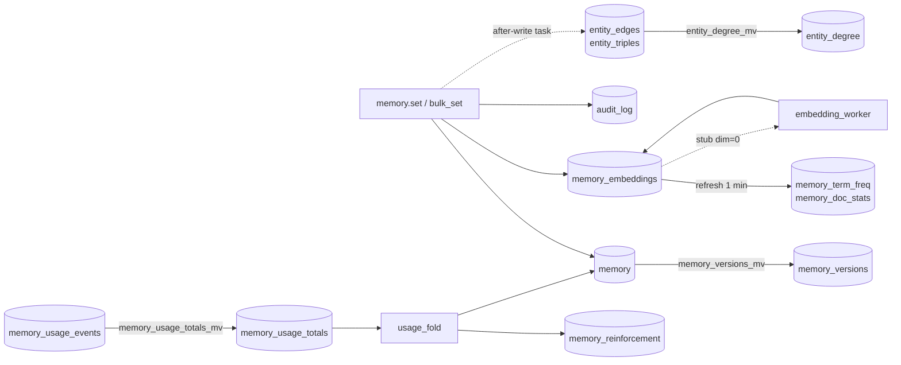

# ClickHouse

All durable Loom state lives in one ClickHouse database, `loom`. The canonical schema is
[`schemas/schema.sql`](../../schemas/schema.sql), dumped from a server with every
migration applied. The generated [schema reference](../reference/schema.md) lists every
table with its engine, keys, TTL and indexes. This page covers the table families, how
Loom uses engines, indexes and views, and how migrations run.

## Goals and non-goals

| Goals                                                                                     | Non-goals                                                                                   |
| ----------------------------------------------------------------------------------------- | ------------------------------------------------------------------------------------------- |
| One engine and one database for every plane, so a read never joins across stores.         | Cross-table transactions. A primary row lands first; derived rows follow.                   |
| Every row names its tenant, writer (`actor`) and content (`content_sha256`).              | Transaction-time history on every table. The version mirror covers `loom.memory`.           |
| Mutable state as append-only versions: a write is an INSERT, a read is deterministic.     | In-place updates on the request path. Updates are new versions or batched background folds. |
| Nothing that holds memory content expires unless its writer or the operator asked for it. | Default retention on facts, documents, conversations or the graph.                          |
| Every table classified for erasure.                                                       | A compliance guarantee.                                                                     |

## Table families

"Written by" names the code or [worker](../reference/workers.md) that inserts rows.
Retention is in [Partitioning and TTL](#partitioning-and-ttl).

| Family                       | Main tables                                                                                                                                                                                                                                                                                            | Written by                                                                                                             |
| ---------------------------- | ------------------------------------------------------------------------------------------------------------------------------------------------------------------------------------------------------------------------------------------------------------------------------------------------------ | ---------------------------------------------------------------------------------------------------------------------- |
| Memory facts                 | `memory`, `memory_versions`, `shared`, `working_memory`                                                                                                                                                                                                                                                | `memory.set`, `memory.bulk_set`, lifecycle ops, `working_memory.*`; `memory_versions_mv` fills the history             |
| Memory embeddings            | `memory_embeddings`, `memory_reinforcement`, `memory_term_freq`, `memory_doc_stats`                                                                                                                                                                                                                    | The same write paths (`build_embedding_row`); `embedding_worker` fills stubs; `usage_fold`; refreshable views for BM25 |
| Evidence and chunks          | `memory_evidence`, `memory_chunks`, `memory_chunk_sources`, `memory_belief_sources`, `session_summaries`, `derived_facts`                                                                                                                                                                              | `set_from_messages` projections, consolidation                                                                         |
| Records and taxonomy         | `memory_records`, `memory_record_versions`, `memory_record_fields`, `memory_record_conflicts`, `memory_schemas`, `memory_schema_fields`, `categories`, `memory_categories`                                                                                                                             | `memory.record.*`, `namespace.*`, category assignment                                                                  |
| Write-path state             | `memory_extraction_queue`, `memory_projection_failures`, `memory_drops`, `blacklist`, `blacklist_version`, `conflict_allowlist`, `learnings_queue`, `consolidation_runs`, `memory_ask_precedents`                                                                                                      | Deferred extraction, fail-open projections, `blacklist.*`, `conflicts.resolve`, `memory.consolidate`, `memory.ask`     |
| Knowledge                    | `documents`, `document_blobs` (uploaded originals), `chunks`, `chunk_supersessions`, `chunk_term_freq`                                                                                                                                                                                                 | `knowledge.add`; `chunk_term_freq_mv`, `chunk_context_term_freq_mv`                                                    |
| Conversations                | `conversations`, `conversation_threads`, `conversation_embeddings`                                                                                                                                                                                                                                     | `conversation.*`; `conversation_titler`                                                                                |
| Entity graph                 | `entity_edges`, `entity_degree`, `entity_triples`, `entity_edge_memories`, `entity_edge_rows`, `entity_triple_memories`, `entity_triple_rows`, `entity_vectors`, `entity_summaries`, `entity_canonical_map`, `entity_communities`, `operator_edges`                                                    | The `memory.set` after-write projection, `entity_extractor`, `entity_communities`; `entity_degree_mv`                  |
| Code index                   | `code_files`, `code_chunks`, `code_symbols`, `code_edges`, `code_pr_history` and the other `code_*` tables                                                                                                                                                                                             | `code_ingest`, the `code_scip_*` workers, `code_pr_history`, `code_embed_recovery`, `code_summary`, `code_graph_stats` |
| Tracker                      | `qa_sources`, `qa_item_embeddings`, `qa_link_candidates`, `qa_test_daily`, `qa_rollup_days`, `qa_fail_hours`                                                                                                                                                                                           | `tracker.source.add`, `tracker_embed`, `tracker_links`, `tracker_test_daily`                                           |
| Runs, tasks, briefs          | `agent_runs`, `agent_turn_usage`, `session_outcomes_by_user`, `procedure_runs`, `tasks`, `task_events`, `task_leases`, `agent_run_claims`, `task_inboxes`, `session_briefs`, `context_blobs` and neighbours                                                                                            | `run.*`, `task.*` / `inbox.*`, `session.brief_*`, `context.offload`, `reflection_distill`                              |
| Namespaces, auth, governance | `namespaces`, `namespace_grants`, `namespace_policies`, `namespace_types`, `namespace_snapshots`, `namespace_calibration_*`, `service_accounts`, `user_state`, `revoked_tokens`, `signing_keys`, `auth_attempts`, `runtime_overrides`, `oauth_state`, `idempotency`, `policy_decisions` and neighbours | `namespace.*`, `grants.*`, sign-up and claim flows, `recalibration`, the idempotency cache                             |
| Telemetry, audit, cost       | `events`, `agent_events`, `agent_cost_rollup_daily`, `audit_log`, `audit_checkpoints`, `search_trace_log`, `memory_exposures`, `memory_usage_events`, `memory_usage_totals`, `memory_served_daily`, `code_search_trace`, `worker_status` and neighbours                                                | The events stream, the op ledger, `observability/audit.py`, `audit_verifier`, the supervisor                           |
| Service levels               | `loom_telemetry.sli_minute` (its own database: telemetry Loom derives from its tables lives outside `loom`)                                                                                                                                                                                            | `sli_minute_refresh`, once a minute over the `agent_events` request rows with an SLO class                             |
| Erasure                      | `erasure_requests`, `erasure_reversals`                                                                                                                                                                                                                                                                | `erasure.request`, `erasure_recovery`, `memory.restore`                                                                |
| Provider caches              | `embedding_cache`, `llm_response_cache`                                                                                                                                                                                                                                                                | The embedder and LLM client wrappers                                                                                   |

**Why the SLI rollup has its own database.** `loom` holds what Loom serves; derived
operational telemetry stays outside it, so a dashboard or alert user gets `SELECT ON
loom_telemetry.*` without any grant on the database that holds memory, and the rollup can
be paused (`SYSTEM STOP VIEW` / `SYSTEM START VIEW` on its refresh), truncated and
refolded, or given its own retention without touching `loom`. A refold is `SYSTEM STOP
VIEW loom_telemetry.sli_minute_refresh`, `TRUNCATE TABLE loom_telemetry.sli_minute` (its
sentinel goes with it), then `SYSTEM START VIEW`; stopping first matters, since a refresh
that commits after the truncate writes a new sentinel and the refold never starts. It
reads the last 31 days of the ledger only, an hour per refresh, so it takes about 12 hours
and `loom.sli.rollup_lag_s` shows how far it is; a deployment that wants the longer
history backs `loom_telemetry` up too. Do not drop the view: migration 045 is journaled as
applied, so nothing recreates it. The cost is one more database: the setup SQL grants the
migrating user `CURRENT GRANTS ON loom_telemetry.*`, and preflight names that grant when
it is missing.

**State outside ClickHouse.** Uploaded document originals are rows of `document_blobs`,
addressed per namespace by SHA-256 (`server/knowledge/store/blobs.py`); with
`LOOM_DOCUMENT_OBJECT_STORE=s3` each row is the catalog entry of an object in an
S3-compatible bucket, which holds the bytes
([knowledge](../features/knowledge.md#where-originals-are-stored)). The token signing keys
(`signing_keys`), admin runtime overrides of rate limits, latency budgets and live
settings (`runtime_overrides`), sign-in attempt counts (`auth_attempts`), graph-walk marks
(`graph_projections`: the projections in flight and each namespace's last graph write),
each namespace's last write (`namespace_write_keys`) and the supervisor lease are in
ClickHouse too, so a new Loom pointed at this database, and the document bucket while rows
name objects in it, gets every feature back. On the filesystem: the code plane's git
mirrors under `var/code_repos`, a cache of the remotes ClickHouse records that a host
without them re-clones. The root secret `LOOM_JWT_SECRET`, which seals the signing keys
and stored credentials, is in the env. Process caches and file locks are listed in
[system overview](system-overview.md#deployment-topology).

## Conventions every table follows

- **Identity prefix.** Tenant rows lead the sort key with the identity tuple, and every
  read filters on it, so the primary index prunes other tenants' granules first. A
  per-namespace erasure, snapshot or retention override is one key range, not a scan.

  | Column       | Meaning                               | Default |
  | ------------ | ------------------------------------- | ------- |
  | `org`        | Tenant boundary; required             | —       |
  | `namespace`  | Unit of sharing and grants; required  | —       |
  | `agent`      | Writer agent; required on memory rows | —       |
  | `user_id`    | End user the row is about             | `'-'`   |
  | `session_id` | Session the row came from             | `'-'`   |

  `'-'` means "not applicable" and is stored; `'*'` is a read-time wildcard, never
  stored. Tables that are not per agent (code index, tasks, namespace config) key on
  `(org, namespace, …)` or `(org, inbox, …)`. Memory tables add `run_id`. The server
  stamps `actor` and `source_class` on memory writes
  ([system overview](system-overview.md#the-identity-tuple)).

- **`LowCardinality(String)`** for `org`, `namespace`, `agent`, model names, statuses and
  event kinds.
- **Append, then collapse.** Mutable state is a `ReplacingMergeTree`; writers insert a new
  row with a higher version and reads use `FINAL`. Mutations stay off the request path.
- **Waited inserts.** A write that a later read depends on is sent with
  `wait_for_async_insert = 1`, so it is written when the insert returns: committed
  (`async_insert = 0`, the client's session default) or batched
  ([batched inserts](#batched-inserts)). Fire-and-forget
  telemetry is sent with `async_insert = 1, wait_for_async_insert = 0`.
- **Times are UTC.** `DateTime` columns carry no zone of their own, so the server
  client and the migration runner pin `session_timezone = 'UTC'` and bind aware params
  in UTC: a server whose `<timezone>` is something else reads and writes the same
  instants.
- **Retries never duplicate.** Every insert carries an `insert_deduplication_token` from
  the batch and a per-batch nonce (`insert_dedup_token`), so a retry after a dropped socket
  lands the batch once. An async insert is deduplicated by that token only, never by
  content, so two identical rows in one flush window both land. A caller that passes its
  own token names the row's identity instead, so two writers of one row land it once:
  `conversation.save_message` writes a new transcript row this way.

### Batched inserts

A committed insert makes one part, so a table written on every request makes parts at
the request rate, and merges fall behind ("too many parts"). The rows written on every
request or by every process on a short interval are batched inserts, sent with
`async_insert = 1, wait_for_async_insert = 1` (`server/core/ch_writes.py`). They fall in
two groups:

- **Switched by `ch_batched_inserts`** (`batched_insert_settings`): `audit_log`, the
  `conversations` turns of `conversation.append` and `conversation.compact`'s summary
  turn, the turn `conversation.save_message` rewrites when deduplication dropped its
  first write, the `conversation_embeddings` rows (`conversation.append`,
  `conversation.save_message`, `conversation.compact`; under the width rule below), the
  `agent_events` flush, `memory_webhook_outbox`, `memory_evidence` and
  `memory_belief_sources`. `memory_webhook_attempts` stays committed: one worker writes it
  twice a pass, one insert after the other, so batching would save no parts.
- **Waited async inserts either way** (`async_insert_settings`): `auth_attempts`, the
  policy witness's `agent_events` and `memory_exposures` rows,
  `memory_projection_failures`, the graph Undo markers, the `namespace_write_marks`
  flush, the usage-event flush, the carry-acknowledgement publish and withdraw, every
  waited entity-graph insert (`memory.set`, `memory.bulk_set`; `graph_insert_settings`
  with `wait=True`), and a follow plan's successor inserts (`entity_triple_memories`,
  `entity_triple_rows`, `entity_triples`).

ClickHouse collects the concurrent inserts into one table in one part per partition and
answers each once those parts are written. On return the row is as durable and as
visible as a committed insert's, and a caller's next insert lands in a later part, so
the order of one caller's writes holds. The buffer is ClickHouse's, so a Loom process
that stops loses nothing it acknowledged. A flush that fails as a whole fails every
insert waiting on it; a retry of any of them lands once, under its own token. Each
insert waits between `ch_batched_insert_wait_min_ms` (writes are sparse) and
`ch_batched_insert_wait_max_ms` (under load) for others to join it, and holds its pooled
connection for the wait. The insert sends `async_insert_use_adaptive_busy_timeout = 1`
so these bounds hold whatever the server profile sets; with it off, every flush waits
the full maximum. Under steady load a table gets about 1000 /
`ch_batched_insert_wait_max_ms` parts a second per ClickHouse node, insert shape
(ClickHouse keeps one buffer per column list and settings) and partition written: more
when a buffer fills before the wait ends, at most one per insert when writes are sparse.
The insert also sends `async_insert_max_query_number = 10000`, so at high rates the
window, not ClickHouse's default of 450 statements, decides the flush.

Two windows: the usage-event flusher and shutdown drain and the write-mark flush wait up
to `ch_batched_insert_background_wait_max_ms` (200 ms, ClickHouse's own default), so they
collect more rows per part. Every other batched or waited async insert waits at most
`ch_batched_insert_wait_max_ms` (50 ms), the `agent_events` timer flush included
(`flush_now` waits for a flush in flight), and so does a usage-event flush a request
makes because the buffer is full. The two windows are two insert shapes, so they fill
separate buffers.

ClickHouse's own target is about one insert, one part, a second per table, with 1,000
rows or more per insert. These windows stay well short of it; they cut the part rate
from one per insert to the rate above. Batching trades latency for parts: each waited
insert adds up to its window, and holds its pooled connection meanwhile. A sustained
R_request request-path and R_background background batched inserts a second therefore
hold at least R_request × `ch_batched_insert_wait_max_ms` / 1000 + R_background ×
`ch_batched_insert_background_wait_max_ms` / 1000 connections: 100 `conversation.append`
a second, two batched inserts each, hold at least 100 × 2 × 50 / 1000 = 10. That is a
lower bound: a waiting insert holds its connection for the window and then the flush
and part write, which queue up and grow under load. A `memory.set` waits on six or
more: the audit row, the outbox row (webhook namespaces), the `entity_edges` and
`entity_edge_memories` inserts, the `entity_triples` and `entity_triple_memories`
inserts, plus `carry_acks` on a carried write; `memory.set_from_messages` waits on
about ten. The entity-graph inserts of both are waited async inserts, so
`ch_batched_inserts = false` leaves them holding connections: a process taking mostly
memory or bulk writes sizes its pool for them either way, or lowers
`ch_batched_insert_wait_max_ms`. One process taking 200 writes a second, two batched
inserts each (`bench/write_rate.py --target client`), refused 3,367 of 12,000 writes
with 503 `OVERLOADED` at `ch_pool_maxsize = 20`, the formula's bound, and none at 40 or
64; that is one run on one host, so read it as an order of magnitude. Size
`ch_pool_maxsize` at three times the bound or more, plus the process's other
statements: the default 64 holds three times the bound for about 300 request-path
batched inserts a second, with about 20 connections left for other statements. A
process above that rate either raises `ch_pool_maxsize` or sets
`ch_batched_inserts = false`; lowering `ch_batched_insert_wait_max_ms` also frees
connections ([troubleshooting](../operations/troubleshooting.md)).

`ch_batched_inserts` (live, on by default) switches batching off for the first group
above: off, those inserts are committed, one part each. The second group waits on the
same bounds either way, and fire-and-forget inserts are unchanged. Turn it off
(`LOOM_CH_BATCHED_INSERTS=false`) on a process whose write rate exhausts the pool as
above and whose pool cannot grow, or on a deployment with little traffic where latency
matters more than parts: with writes too sparse to share a part, each insert still waits
`ch_batched_insert_wait_min_ms`.

ClickHouse keys the async buffer by table, statement shape, settings and user, so one
flush can hold rows from several orgs, and one row that fails (a vector of the wrong
width, code 190) fails the flush for every caller in it. An embedding row is batched only
when its coded width equals `embedding_dim`, and a `conversation_embeddings` row whose
shared flush failed with code 190 is sent again, committed; the other batched tables
carry no coded vector.

These tables stay committed:

- **Version rows** of `memory`, `memory_embeddings`, `shared`, `session_summaries` and
  `entity_summaries`: their fenced `INSERT … SELECT FROM input()` ([rolling
  upgrades](rolling-upgrades.md)) cannot be buffered.
- **`entity_canonical_map`**: it is partitioned by `org`, so a shared flush that spans
  more than `max_partitions_per_insert_block` orgs would fail every insert waiting on it.
- **Rows with a `Quantized`-coded vector** (`entity_vectors`, `memory_chunks`): the codec
  refuses a vector of another width when the part is written (code 190), so one
  mis-sized row would fail every other insert in its flush.
- **A `conversation_embeddings` row that could be mis-sized**
  (`embedding_insert_settings`): the row is batched when the column is plain, or when it
  is coded at the served model's `embedding_dim` and the vector has that width (an empty
  vector is padded to it). Without a reading of the column, or while the width the
  column was coded at differs from `embedding_dim` (a model change before its rebuild,
  or a rebuild this process has not read yet), the row is committed. A batched row
  whose flush another process's stale-width row failed is sent again, committed.
- **A write whose token names the row's identity** (`conversation.save_message`): a
  replicated table keeps the tokens of committed and of buffered inserts apart, so every
  writer of one identity sends it the same way.

## Engines and why

| Engine                                             | Used for                                                                                                                                                                                                                             | Why                                                                                   |
| -------------------------------------------------- | ------------------------------------------------------------------------------------------------------------------------------------------------------------------------------------------------------------------------------------ | ------------------------------------------------------------------------------------- |
| `ReplacingMergeTree(version)`                      | Mutable rows: `memory`, `memory_embeddings`, `shared`, `working_memory`, the `code_*` index, tasks, config                                                                                                                           | An update is an INSERT of a whole row; `FINAL` keeps the newest per key. No locks.    |
| `ReplacingMergeTree(created_at)` or `(updated_at)` | Rows written once per key: `memory_evidence`, `memory_chunks`, caches, `idempotency`, `namespaces`                                                                                                                                   | The same collapse, versioned by the row's own timestamp.                              |
| `ReplacingMergeTree` with no version               | `memory_versions`, `code_symbol_ids`, `code_symbol_names`                                                                                                                                                                            | `version` or the full identity is in the sort key, so only exact re-inserts collapse. |
| `MergeTree`                                        | Append-only logs: `events`, `agent_events`, `audit_log`, `conversations`, `task_events`, `entity_edges`, traces                                                                                                                      | Rows are facts about a moment.                                                        |
| `SummingMergeTree`                                 | Counters: `entity_degree`, `memory_usage_totals`, `memory_served_daily`, `code_unit_signal`                                                                                                                                          | A counter is an INSERT of a delta, never a read-modify-write.                         |
| `AggregatingMergeTree`                             | Non-additive rollups: `memory_term_freq`, `chunk_term_freq`, `code_term_freq`, `agent_cost_rollup_daily`, `memory_exposure_breadth_hourly`, `query_nodes`, `namespace_write_marks`, `subject_last_seen`, `loom_telemetry.sli_minute` | Partial aggregate states (a distinct count cannot be summed), finished with `-Merge`. |
| `KeeperMap`                                        | `task_leases`, `agent_run_claims`, `oauth_signin_state` and the migration lock `loom._migration_lock` (also the `workers_supervisor` lease, the claims and the compiler-tier `scip_entry:*` keys)                                    | Linearizable compare-and-swap across processes.                                       |

**One `keeper_map_path_prefix` per deployment.** The KeeperMap paths are fixed in the
migrations (`/loom/migration_lock`, `/loom/instances`, `/loom/task_leases`,
`/loom/agent_run_claims`, `/loom/graph_projections`, `/loom/namespace_write_keys`), and
ClickHouse puts them under the server's `keeper_map_path_prefix`. Two deployments whose
ClickHouse servers share a Keeper and a prefix share these keys: one workers lease, one
migration lock and every claim between them. Give each deployment its own prefix.

**Why `ReplacingMergeTree` for mutable state.** `ALTER … UPDATE` rewrites whole parts
asynchronously with no read-your-write guarantee. Lightweight `UPDATE` writes patch parts
that every later read must apply, and switches off the quantized-codes read
([vector storage](#vector-storage)). A version row is one INSERT, visible to the next
`FINAL` read, with its history in the mirror. The price is the write rule below and the
`FINAL` cost, which the identity prefix keeps to one tenant's granules.

On the memory tables `version` is a wall-clock nanosecond stamp
(`server/memory/store/rows.py`, `next_version`), so two replicas' versions compare, at the cost
of bounded clock skew. Configuration tables version on `updated_at`, `created_at` or
`version`.

## The FINAL write rule

An update, tombstone, restore, touch, lock or promotion is an INSERT of a complete row
with a higher `version`. **A version row must carry every persisted column.** ClickHouse
fills an omitted column with its DDL default, and under `FINAL` that default replaces the
real value for every reader. Use the builders in `server/memory/store/rows.py`:

| Builder                                                 | Table                                   | Behaviour                                                                                                                          |
| ------------------------------------------------------- | --------------------------------------- | ---------------------------------------------------------------------------------------------------------------------------------- |
| `build_memory_version_row(existing, **changes)`         | `memory`                                | Copies every column in `MEMORY_PERSISTED_COLS`, applies the changes, keeps the stored `value` bytes.                               |
| `build_revision_row(existing, new)`                     | `memory`                                | A new value over the live row: carries usage, lineage, identity, lock and expiry; resets `REVISION_RESETS`; keeps the attestation. |
| `build_first_version_row(new, now=…)`                   | `memory`                                | Completes a first write with the DDL defaults (`FIRST_VERSION_DEFAULTS`), so every first version passes the insert funnel's check. |
| `insert_memory_versions(rows)` (`inserts.py`)           | `memory`                                | The only `loom.memory` insert: refuses a row missing a persisted column or naming an unknown one, then inserts committed.          |
| `build_embedding_row(**columns)`                        | `memory_embeddings`                     | Full row from `EMBEDDING_PERSISTED_COLS` defaults; an unknown column raises; fills `content_excerpt_lemma` and a fresh `version`.  |
| `build_session_summary_row`, `build_entity_summary_row` | `session_summaries`, `entity_summaries` | The same pattern.                                                                                                                  |

A new column goes into the builder's column set and every projection that feeds it, in
the same change. `MATERIALIZED` columns (`content_excerpt_lc`, `content_excerpt_stem`,
`value_preview`, `value_len`) must not appear in an insert. Other versioned tables
(`namespaces`, `code_summaries`) read the full row before re-inserting it.

Two query rules keep `FINAL` correct:

- Filter identity columns in `PREWHERE` or before `FINAL`; keep row-state predicates
  (`tombstoned_at`, `status`, expiry, validity) in `WHERE` after `FINAL`. A state
  predicate before the collapse drops the tombstone and brings back the version under it.
- Never alias an expression with the name of a column it filters on
  (`SELECT toString(memory_id) AS memory_id … WHERE memory_id IN …`). The `WHERE` resolves
  to the alias and silently matches nothing. `tests/unit/test_sql_alias_shadow.py` fails
  the build on this pattern.

## Content hashes

`content_sha256` on `loom.memory` is the SHA-256 of the value's canonical JSON. It is used
for:

- **Optimistic concurrency.** `memory.set` and `memory.update_by_id` accept
  `if_match_sha256`; a mismatch answers 409 `PRECONDITION_FAILED`. The hash rides
  `memory.get`, `memory.get_by_id` and `memory.set` responses.
- **Attestation binding.** `verified_sha256` records the bytes someone attested. A
  revision keeps `verified_by` and `verified_at`, but the hashes no longer match, so
  readers derive "stale" from the pair.
- **Audit.** Every write that creates or changes memory leaves one hash-only
  `audit_log` row (key, id, hash, actor, source class, verdict; never the value).

A code chunk's id is a UUIDv5 over its path, scope and content hash, so an unchanged chunk
re-ingests to the same row.

## Sort keys

After the identity prefix, a sort key serves the table's dominant read:

| Table               | `ORDER BY`                                                                         | Read it serves                                                                                      |
| ------------------- | ---------------------------------------------------------------------------------- | --------------------------------------------------------------------------------------------------- |
| `memory`            | `(org, namespace, agent, user_id, session_id, memory_key)`                         | Point reads by key; the collapse unit is one key per identity.                                      |
| `memory_embeddings` | `(org, namespace, agent, user_id, session_id, scope, embedding_model, memory_key)` | Vector legs for one identity and one model; two models' vectors are separate rows.                  |
| `memory_versions`   | `(org, namespace, agent, user_id, session_id, memory_key, version)`                | History of one key; `version` in the key keeps every row.                                           |
| `code_chunks`       | `(org, namespace, embedding_model, path, chunk_id)`                                | All chunks of a path, for re-ingest diffs and file reads.                                           |
| `code_edges`        | `(org, namespace, tier, to_symbol_id, edge_kind, from_symbol_id, path, line)`      | "Who calls X" is a key range. Projections `by_from` and `by_path` serve callees and per-file reads. |
| `code_symbols`      | `(org, namespace, tier, qualified_name, symbol_id)`                                | Definition by qualified name; `code_symbol_names_mv` and `code_symbol_ids_mv` re-key it.            |
| `entity_edges`      | `(org, namespace, entity_a, entity_b)`                                             | Neighbours of an entity.                                                                            |
| `task_events`       | `(org, inbox, seq)`                                                                | An inbox's events in order.                                                                         |

Sort and partition keys are `CREATE`-only. A migration that changes one declares
`-- loom: rebuild-if-empty <table>` above the full `CREATE TABLE`. The runner swaps an
empty table for its twin and refuses a table with rows, naming
`scripts/ops/table_rebuild.py` (twin, copy, `EXCHANGE TABLES`) (`server/core/schema/table_rebuild.py`).

## Partitioning and TTL

Most time-series tables are `PARTITION BY toYYYYMM(<time column>)`. Tenant directory tables
(`namespaces`, `namespace_grants`, `service_accounts`, `user_state`, …) are partitioned by
`org`; `working_memory` and `shared` by `(org, namespace)`. Small tables read whole
(`code_pr_history`, `code_pr_reviews`) have no partition key.

`code_chunks` is partitioned by `(org, namespace)`, so each repository index has its own
parts, the text-index posting lists cover one namespace, and a retired index leaves by
`DROP PARTITION`. The key is declared in the baseline's `CREATE`.

**No table deletes memory content by default.** Facts, embeddings, documents, chunks,
conversations and the graph have no TTL. They leave only by an explicit delete, a
writer-set expiry (`ttl_seconds`, applied by `memory_expiry_sweep` per the row's
`on_expire`) or erasure. Tables with a schema TTL hold telemetry, caches or runner state:

| Window     | Tables                                                                                                                                     |
| ---------- | ------------------------------------------------------------------------------------------------------------------------------------------ |
| 60 minutes | `code_search_memo`                                                                                                                         |
| 3 days     | `memory_webhook_outbox`, `memory_webhook_attempts`                                                                                         |
| 7 days     | `llm_response_cache`, `code_scip_parts`                                                                                                    |
| 30 days    | `events`, `embedding_cache`, `memory_drops`, `memory_extraction_queue`, `memory_ask_precedents`, `worker_status`, `code_scip_batches`      |
| 90 days    | `erasure_requests`, `oauth_state`, `policy_decisions`                                                                                      |
| 180 days   | `search_trace_log`, `memory_exposures`, `memory_exposure_breadth_hourly`, `consolidation_runs`, `code_search_trace`, `code_search_outcome` |
| 400 days   | `loom_telemetry.sli_minute`                                                                                                                |
| 5 years    | `erasure_reversals`                                                                                                                        |
| other      | `idempotency` (at `expires_at`), `revoked_tokens` (10 days past token expiry), `context_blobs` (1 day past `expires_at`)                   |

Operators can add retention to `audit_log`, `agent_events`, `memory`, `memory_embeddings`,
`conversations`, `chunks` and `documents` with `LOOM_RETENTION_<TABLE>_DAYS`, and tiering
with `LOOM_TIERING_<TABLE>_WARM_DAYS` plus `LOOM_TIERING_WARM_VOLUME_NAME`. Per-namespace
`retention_days` or `warm_days` overrides become a `multiIf` in the same TTL expression
(`server/storage/retention_overrides.py`). The worker leader applies them at boot and
`retention_reconcile` keeps them in step, skipping unchanged tables because each
`MODIFY TTL` is a mutation. When the last window on a table is cleared, the same pass
issues `ALTER TABLE … REMOVE TTL`; none of these tables has a schema TTL. Every window
defaults to 0 (off).

### Merges and skip indexes

A part count that keeps rising almost always means merges are failing. A skip index a
merge cannot build fails every merge of that table until inserts get `TOO_MANY_PARTS`.
Loom keeps such indexes out of merges with `exclude_materialize_skip_indexes_on_merge`
(the text indexes `content_text` and `context_text` on `chunks`): inserted parts still
build the index, merged parts do without it. The `clickhouse_parts` check of `ops.health`
(`_clickhouse_parts_check`) reads `system.part_log` for failed `MergeParts` events in the
last quarter hour and reports the error code and this repair; the exception's text
stays in `system.part_log`. For the same reason
memory-content tables carry no rows TTL. The runbook is in
[troubleshooting](../operations/troubleshooting.md).

`memory_embeddings` also names `embedding_hnsw_idx` in that setting, an index no migration
declares. The setting does nothing unless an operator adds a vector index of that name by
hand, and then keeps merges from rebuilding its graph, so no migration resets it.

## The write → derive loop

A write inserts its primary rows and returns. Everything else is derived afterwards, by one
of three mechanisms:

1. **Insert-time materialized views** run inside the source INSERT: `memory_versions_mv`
   copies every `memory` row into `memory_versions`, and `memory_usage_totals_mv` and
   `entity_degree_mv` fold their source rows into totals. `memory_served_daily` takes
   no view: an agent read inserts its counts there directly, apart from
   `memory_usage_events`, whose totals the usage fold turns into ranking, so a served read
   never moves the reinforcement signal.
2. **Refreshable materialized views** (`REFRESH EVERY 1 MINUTE APPEND`) append rows newer
   than their high-water mark: BM25 statistics, the daily cost rollup, hourly exposure
   breadth, last seen per subject, the request SLIs per minute. The SLI rollup's mark is
   `agent_events.ingested_at`, when ClickHouse took the row, so a delayed flush is not
   skipped.
3. **Workers** poll for rows that need work and write new versions: stub embeddings
   (`embedding_worker`, `code_embed_recovery`), entities (`entity_extractor`), usage folds
   (`usage_fold`), deferred extraction (`extraction_queue`, `observe_extract`), failed
   projections (`projection_repair`), orphaned vectors (`orphan_vector_reconcile`), expiry
   (`memory_expiry_sweep`) and TTLs (`retention_reconcile`).

There is no queue service. A queue is a table whose rows carry their state:
`memory_extraction_queue` rows move `pending → running → done | failed` (or `held` until a
model-call hold ends) as versions; an embedding row with `embedding_dim = 0` is a stub
waiting for a vector; a `memory_projection_failures` row is a projection to replay. Read
paths filter unfinished rows out.



**Why derive.** A `memory.set` that awaited its graph projection, BM25 update and audit
fan-out would pay each round trip and fail when any failed. The response path keeps only
what the caller's next read needs: the `memory` row, its `memory_embeddings` row, the
same-key supersession and the audit receipt. Projections are fail-open
(`memory/app/after_write.py`), and a read of the same namespace in the same process waits
for the graph projection (`after_write.settle`). A derived table lags its source by
seconds; the BM25 legs merge that lag themselves.

An embedding row may land under the refresh watermark when its version is more than 5 s
old once it is in (half the views' 10 s lag). A long embed or judge, or slow inserts, do
that. Its own write folds such a row into the BM25 tables after the response
(`after_write.index_late_rows`), so a slow write does not also wait on two more inserts.

## The memory_versions mirror

Merges discard superseded `memory` rows, so the RMT table is not a history.
`memory_versions_mv` copies every inserted `memory` row into `memory_versions`, which keeps
each version. `memory.history`, `memory.redact`, `namespace.rollback` and the usage fold
read it; the erasure saga deletes from it. A new `memory` column goes into
`memory_versions` and the view's `SELECT` in the same migration;
`tests/unit/test_memory_versions_schema.py` compares the column lists.

## Materialized views

| View                                                                                                                                       | Kind                            | From → to                                             |
| ------------------------------------------------------------------------------------------------------------------------------------------ | ------------------------------- | ----------------------------------------------------- |
| `memory_versions_mv`                                                                                                                       | insert-time                     | `memory` → `memory_versions`                          |
| `memory_record_versions_mv`                                                                                                                | insert-time                     | `memory_records` → `memory_record_versions`           |
| `memory_usage_totals_mv`                                                                                                                   | insert-time                     | `memory_usage_events` → `memory_usage_totals`         |
| `entity_degree_mv`                                                                                                                         | insert-time                     | `entity_edges` → `entity_degree`                      |
| `session_brief_revisions_mv`                                                                                                               | insert-time                     | `session_briefs` → `session_brief_revisions`          |
| `chunk_term_freq_mv`, `chunk_context_term_freq_mv`, `code_term_freq_mv`, `code_doc_stats_mv`, `code_symbol_ids_mv`, `code_symbol_names_mv` | insert-time                     | Chunk and code-index statistics and lookups           |
| `memory_term_freq_refresh`, `memory_doc_stats_refresh`                                                                                     | `REFRESH EVERY 1 MINUTE APPEND` | `memory_embeddings` → BM25 statistics                 |
| `agent_cost_rollup_refresh`                                                                                                                | `REFRESH EVERY 1 MINUTE APPEND` | `agent_events` → `agent_cost_rollup_daily`            |
| `memory_exposure_breadth_hourly_refresh`                                                                                                   | `REFRESH EVERY 1 MINUTE APPEND` | `memory_exposures` → `memory_exposure_breadth_hourly` |
| `subject_last_seen_refresh`                                                                                                                | `REFRESH EVERY 1 MINUTE APPEND` | `agent_events` → `subject_last_seen`                  |
| `loom_telemetry.sli_minute_refresh`                                                                                                        | `REFRESH EVERY 1 MINUTE APPEND` | `agent_events` → `loom_telemetry.sli_minute`          |

**Insert-time or refreshable.** An insert-time view writes one part per source insert. That
suits a low-rate source or a target read back in the same request (`memory_versions`). A
high-rate source uses a refreshable view that appends one part a minute. The BM25 rollups
keep their mark in a sentinel row (`org = ''`, `namespace = ''`, `term = ''`) carrying
`max(version)` and read only rows at least ten seconds old. They lag a write by about a
minute, and `memory.search` merges the newer source rows (`LOOM_MEMORY_SEARCH_BM25_LIVE_TAIL`,
on), so BM25 scores are exact.

**The events stream.** `loom.events` carries budget violations only:
`server/observability/events_stream.py` queues them and writes one committed insert per
flush. Every other telemetry writer (audit rows, exposures, search traces, query nodes,
code-search outcomes) inserts into its own table directly; no view fans `events` out. The
op ledger (`agent_events`) is queued the same way, and each flush is a batched insert
(`server/observability/events.py`), so the flushes of every process share parts. A failed
flush never fails a request; a crash loses the queue.

## Vector storage

- The vector columns of `CODED_TABLES` are `Array(BFloat16)`, coded with `Quantized` or
  plain depending on the install (the Quantized codes bullet below says which).
  Loom's migrations code no other vector column; a table named in `LOOM_CODE_VECTOR_TABLES`
  keeps the layout and width it was created with. `entity_vectors.entity_embedding` keeps
  `LZ4` because its vectors repeat. Coded, it keeps the `LZ4` after `Quantized` only where
  `allow_suspicious_codecs` can be on; where it is held at 0, as on a ClickHouse Cloud
  service by default, the column is stored without it. How to add the chain back is in
  [recommended settings](../operations/deployment.md#recommended-clickhouse-settings).
  Query vectors bind as `Array(Float32)`. A memory carries up to two vectors (value and
  key), so at 3072 dimensions up to 12 KiB of vectors.
- **No table has a vector-similarity (HNSW) index.** Search is an exact `cosineDistance`
  scan over the rows the identity predicates leave. The bytes a read scans therefore
  grow with namespace size, not corpus size.
  [Why there is no vector index](#why-there-is-no-vector-index) has the measurements.
- **Quantized codes.** On ClickHouse 26.8+, a fresh install creates the vector columns of
  `CODED_TABLES` (`server/core/schema/vector_codec_ddl.py`) with `CODEC(Quantized('rabitq', <dim>, 0))`
  where `enable_quantized_codec` is on, or Loom's ClickHouse user may turn it on. The runner
  rewrites the `CREATE` at apply time ([Gated ClickHouse settings](#gated-clickhouse-settings)).
  On a server that holds `enable_quantized_codec` at 0, a fresh install creates the plain
  layout, and `scripts/ops/vector_codec_rebuild.py` applies the codec once the setting is on.
  ClickHouse Cloud holds the setting read-only at its default 0 until the operator enables
  it for the service with a settings-profile override; it then reads 1, still read-only,
  and coded tables work. An existing table moves with the same tool.
- **Codes-first reads.** When a column is coded and its table has no patch parts, reads
  send `vector_search_use_quantized_codes = 1` (`LOOM_VECTOR_SEARCH_QUANTIZED_CODES`): a
  pass over the codes keeps `LIMIT × LOOM_VECTOR_SEARCH_QUANTIZED_FETCH_MULTIPLIER`
  candidates and rescores them at full precision. Coding and patch parts are re-probed
  every `LOOM_VECTOR_CODES_STATE_PROBE_SECONDS`; a failed probe reads as "not patch-free".
  A replica that rejects the setting has it dropped and the read retried.
- **Fixed-length placeholders.** Rows awaiting an embedding store zero vectors with
  `embedding_dim = 0` (`server/core/vectors/placeholders.py`). Every vector leg filters
  `embedding_dim > 0`.
- **No in-place updates on vector tables.** Write, fold, reject and tombstone paths write
  new versions; reinforcement lives in `memory_reinforcement`. A lightweight `UPDATE` on
  `memory_embeddings` would leave a patch part, and the patch-parts probe keeps
  codes-first reads off for the whole table until it merges.
- **One model per row.** `embedding_model` is in the sort key, so a search compares only
  its own model's vectors. `loom reembed` regenerates vectors after a model change
  (`--in-database` uses `aiEmbed` on 26.7+).

**Query shape.** ClickHouse pushes a top-k into the codes-first scan only for the plan
`Limit → Sorting → Expression → [Filter] → ReadFromMergeTree` with one ascending sort key
that is a bare distance call. `ORDER BY 1 - cosineDistance(…) DESC`, a second sort key,
`LIMIT n BY`, a window function or a `JOIN` fall back to a full scan silently. Vector
queries order by a bare distance alias and compute similarity in Python. The chunk leg
reads candidates with no `FINAL` or `JOIN`, then looks them up by primary key under
`FINAL`. `tests/unit/test_vector_search_query_shape.py` guards the shape.

### Why there is no vector index

A `vector_similarity` index is one HNSW graph per part. It does not fit Loom's reads, for
four reasons. Unless a paragraph says otherwise, the figures come from ClickHouse 26.9
with 1M synthetic 1536-dimension vectors in tables shaped like `memory_embeddings` (its
sort key, `ReplacingMergeTree`, `index_granularity = 256`, one merged part per
partition), an index built as
`vector_similarity('hnsw', 'cosineDistance', 1536, 'bf16', 16, 128)`, and 30 queries per
filter; the command is in `bench/vector_index_vs_exact.py`.

**A tenant read never uses it.** ClickHouse searches the graph only when the primary-key
condition keeps every granule of the part. Every Loom vector read filters on
`(org, namespace)`, the prefix of every vector table's sort key. In every vector table
but `code_chunks` a part holds many tenants (`memory_embeddings` is partitioned by
month), so the read takes the tenant's granules and sorts them exactly: no index search
runs (`ProfileEvents['USearchSearchCount'] = 0`) and the read costs what the plain table
costs.
MiB read and p50 per query, every read under `FINAL`:

| Tenant share | Rows | Exact scan        | With the index    | Codes-first, LIMIT 60 |
| ------------ | ---- | ----------------- | ----------------- | --------------------- |
| 50%          | 500k | 1,478 MiB, 141 ms | 1,478 MiB, 140 ms | 134 MiB, 55 ms        |
| 10%          | 100k | 295 MiB, 491 ms   | 295 MiB, 476 ms   | 49 MiB, 44 ms         |
| 1%           | 10k  | 30 MiB, 57 ms     | 30 MiB, 55 ms     | 21 MiB, 18 ms         |
| 0.1%         | 1k   | 3.2 MiB, 12 ms    | 3.2 MiB, 13 ms    | 3.4 MiB, 9 ms         |

Compare the bytes: the 10% tenant's read was slower than the 50% tenant's in both runs,
so the milliseconds do not rank by size. The `vector_search_filter_strategy`,
`vector_search_index_fetch_multiplier` and `hnsw_candidate_list_size_for_search`
settings change nothing here: the index is never opened. The codes-first column reads
the fact leg's 60 rows at codes multiplier 1 (the leg's default is 3); recall@10 of those
60 rows against the exact top 10 was 0.95-1.00.

**Where it does run, a selective filter loses recall.** With a predicate outside the sort
key the graph runs first and the predicate drops its candidates afterwards. recall@10
against the exact answer, by `vector_search_index_fetch_multiplier`:

| Rows the filter admits | x1    | x10   | x100  |
| ---------------------- | ----- | ----- | ----- |
| all                    | 0.783 | 0.783 | 0.783 |
| 10%                    | 0.200 | 0.820 | 0.933 |
| 1%                     | 0.080 | 0.163 | 0.723 |

The unfiltered row is this graph's own recall on this data at
`hnsw_candidate_list_size_for_search = 256` (0.847 at 1024). A partition per tenant
makes the index run for tenant reads: the 50% tenant's read under `FINAL` then takes
76 ms instead of 141 ms, at recall@10 0.757, and the 10% and 1% tenants get 0.747 and
0.843. `code_chunks` is partitioned by `(org, namespace)`, so an index there would run
and read this way; the recall loss and the stale versions below are what rule it out.
For `memory_embeddings`, a partition per namespace is not a layout a table with
thousands of namespaces can hold.

**Under `FINAL` it serves superseded versions.** The graph returns rows of every version
before `FINAL` collapses them, so a key's newest version or tombstone loses to an older
row. `bench/ann_final_staleness.py` (30k keys, 3 versions each, 18 parts, 128
dimensions, 5 queries) on 26.9: recall@10 0.38 with 6.2 of 10 rows stale, against 1.00
and none for the `prefilter` arm, which leaves the index unused. Its `reread` arm, which
takes candidate keys from the graph and reads them again under `FINAL` with skip indexes
off, removes the stale rows (recall 0.90-0.98) and takes twice as long as `prefilter`
(37-39 ms against 20 ms), so the index then costs more than the scan it replaces.

**It doubles storage and slows writes.** The graph took 2.27 GiB beside 2.25 GiB of table
data. Copying the 1M rows into the indexed table took 135-166 s over two runs, against
17-51 s into a coded table without an index. With
`exclude_materialize_skip_indexes_on_merge` naming the index, a merged part carries no
graph at all; without it every merge rebuilds the graph. A graph also has to stay
in the vector similarity index cache, or a read loads it from disk. On this server
(`vector_similarity_index_cache_size` 5 GiB, `SLRU`), once the partitioned table's
graphs had been loaded, all 30 reads of the single-part graph missed the cache
(`VectorSimilarityIndexCacheMisses`), reloaded it and took 4.8 s instead of 9 ms.

The codes-first read is what cuts a large namespace's scan instead: at 100k rows and
more it reads 6-11x fewer bytes than the exact scan, inside the tenant's granules and
under `FINAL`. An index becomes worth revisiting when ClickHouse searches it within the
primary-key ranges a read selects and resolves versions under `FINAL`.

## Text indexes and lexical search

| Table         | Index                        | Indexed expression | Tokenizer         |
| ------------- | ---------------------------- | ------------------ | ----------------- |
| `chunks`      | `content_text`               | `content_lc`       | `splitByNonAlpha` |
| `chunks`      | `context_text`               | `context_lc`       | `splitByNonAlpha` |
| `code_chunks` | `idx_code_chunks_content_ng` | `lower(content)`   | `ngrams(3)`       |
| `code_chunks` | `idx_code_chunks_lexemes`    | `lexemes`          | `splitByNonAlpha` |

All four use `GRANULARITY 100000000`: one granule per part, a per-part posting list.

`memory_embeddings` and `memory_evidence` carry no text index: `hasAnyTokens` and
`hasAllTokens` run on their lowercase columns after the key prefix narrows the read.
`memory_embeddings` also has `content_excerpt_stem` (`MATERIALIZED`, `stem(…, 'en')`) and
`content_excerpt_lemma`, filled by `build_embedding_row` with the query side's lemmatizer,
so no server-side dictionary is needed. The lexical legs match lowercase, stem and lemma
forms; `bm25_hybrid` computes Okapi BM25 in SQL from the statistics tables.

The `code_chunks` 3-gram index answers substring grep: it narrows granules and the exact
`position()` or `match()` predicate decides. The query must carry a
`lower(content) LIKE '%…%'` guard; a literal under three characters cannot use it.

Skip indexes prune the rest: `bloom_filter` on `tags`, `entities`, `files`, `concepts`,
`memory_id`, `content_sha256`; `ngrambf_v1` on `memory_key` and code symbol names; `minmax`
on `valid_to`, `invalid_at`, `version`; `set` on `status` and `memory_type`.

## Deletes and mutations

Loom deletes memory by writing a tombstone version (`tombstoned_at` set, every other column
carried). It is visible to the next `FINAL` read, keeps prior versions in
`memory_versions` and leaves `memory.restore` a window. Physical removal is for erasure
with `purge=true`, runner state, and the supersession rows `knowledge.restore` removes.

- **`knowledge.restore`** runs a lightweight `DELETE FROM loom.chunk_supersessions` for the
  rows one delete wrote: the document's `source_uri`, the ingestions of its revision and
  the `superseded_at` the delete stamped on its row (`server/knowledge/store/restore.py`).
  The chunks then read as live through `LIVE_CHUNK_SQL`, on builds N-1 and N alike. No
  materialized view writes the table, and a row another retirement wrote stays. When it
  takes itself back under a purge that may cover the document, it also deletes the one
  `loom.documents` row it wrote (by its `version`), so the purge leaves no copy of the
  content.

- **Counter folds** on `loom.memory` (the usage fold's `evidence_count` /
  `recall_count`) use batched lightweight `UPDATE`: one statement per chunk of
  targets, with per-row values as parallel arrays through `transform()`
  (`server/memory/workers/usage_fold.py`). On ClickHouse Cloud each statement is a patch part and
  a Keeper entry, so cost is per statement. A pass is skipped while the table has too many
  unfinished mutations. Only "lightweight update unsupported" errors fall back to
  `ALTER TABLE … UPDATE`; a transient error is retried next pass.
- **Erasure purges** remove rows. On `erasure/store/mutations.py::LIGHTWEIGHT_PURGE_TABLES` (vector,
  chunk, summary and evidence tables) a purge uses lightweight `DELETE FROM`, which writes
  only the row mask: rows vanish from every read at once and bytes leave at the next merge.
  Narrow tables keep `ALTER TABLE … DELETE`. The
  saga polls each mutation by an embedded tag, and a residue census checks the result.
- **Remaining `ALTER … UPDATE/DELETE` call sites** are listed in
  `tests/unit/test_clickhouse_mutation_inventory.py`, which fails on a new one until it is
  classified there.
- **Extraction retries** (`memory.extraction_retry_mine`) update failed queue rows in
  place, asynchronously. The update targets the exact identity and version observed, with
  the caller's namespace, principal and read scope. Copying the transcript into a new
  version could restore it after a concurrent erasure; this mutation changes no payload or
  version and cannot create a row. The request returns when the mutation is accepted, and
  a retry asked again while its mutation is unfinished in `system.mutations` submits none.
- **Provider lock recovery** takes over one `loom._migration_lock` Keeper key with a
  conditional `UPDATE` under strict mode, once the key expired and the previous
  owner's participant counts as stopped (retired, or no heartbeat for its
  `stale_after_s` and no query tagged with its id in `system.processes`).
  `loom provider-lock clear` deletes the key the same way. Both are Keeper
  operations, not MergeTree content mutations; an elapsed TTL alone never permits
  provider-lock takeover.
- **Run id claims** (`loom.agent_run_claims`, KeeperMap) live only inside one
  `run.begin`: claim, read the run row, write it, drop the claim. A later begin that
  takes the free claim reads the row and goes to a fresh id. `run.complete` and the
  erasure saga's `agent_runs.delete` step also drop claims, for a key a process that
  died mid-begin left behind. All are Keeper key drops, not MergeTree mutations.
- **Sign-in state** (`loom.oauth_signin_state`, KeeperMap) holds each code, device
  grant, finished IdP round trip and session's current refresh token. A value changes
  only by a strict-mode compare-and-set: an `INSERT` for a new key, otherwise an
  `ALTER … UPDATE` conditioned on the value the writer read. Keys carry their
  credential's expiry, and a sweep every five minutes drops the expired ones with one
  `ALTER … DELETE`; all are Keeper key operations, not MergeTree mutations.
- **Grant change and account claims** are leases (`server.core.leases`): keys of
  `loom._migration_lock`. A grant change holds the grant's claim from its read to its
  write, so a concurrent change of the same grant waits for it. Its reads are sequentially
  consistent, and it is cut off after 20 s (each statement after 10 s), well before its
  60 s claim may be taken over. A repository maintainer's change across branches (a
  revoke's fan-out, a sync's mirrors) first holds one claim per (repository, subject),
  `repo:<owner/name>`, then its branches' claims in namespace order, and writes the
  branches in one insert inside that bound. A change that may remove an admin first holds
  the namespace's admins claim (the key with no subject) and counts the admins under it.
  A change that rewrites an account's registry row (`loom.namespaces`), from any plane,
  holds that account's claim the same way, before any admins claim.
  `task_claims`, `oauth_claims` and `grant_claims` exist in the schema and no code path
  writes or reads them.
- **Graph projections and graph writes** (`loom.graph_projections`, KeeperMap where the
  server has a Keeper): a projection holds one of 32 slot keys of its namespace and its
  end drops it (a begin whose insert failed uncertainly leaves its slot to go stale); a
  begin that finds a slot older than 15 s (its process died) drops that one first; a
  graph write raises the namespace's write key with a version-checked UPDATE, one in
  flight per namespace per process. All are Keeper key operations. On a server without a
  Keeper the table is a MergeTree and every begin, end and write is a row under a 1-day
  TTL.
- **Dead lease and slot keys.** The leader's hourly `keeper_sweep` worker deletes the
  `loom._migration_lock` keys (leases and claims) an hour past their expiry and the
  `loom.graph_projections` slot keys a day old: keys whose holder died before its own
  delete. One strict-mode Keeper delete per table; a key written meanwhile fails it and
  the next sweep retries.
- **Namespace write keys** (`loom.namespace_write_keys`, KeeperMap, only where the server
  has a Keeper): a write to a memory plane overwrites its namespace's key in the request
  tail. One Keeper write, no part, no mutation.

**Classification for erasure.** `server/erasure/store/census.py` puts every table in
`schemas/schema.sql` in exactly one list, and `tests/unit/test_every_table_is_classified.py`
fails on a table in none:

| List                | Holds                                                                                                      |
| ------------------- | ---------------------------------------------------------------------------------------------------------- |
| `_CENSUS`           | One `Substrate(...)` per table that can hold content in scope: live predicate, user predicate, owner step. |
| `STEP_ONLY_TABLES`  | Tables a saga step clears but the census does not count, with the reason.                                  |
| `NO_MEMORY_CONTENT` | Every other table, with the reason it holds no memory content.                                             |

The saga is described in [memory architecture](memory-architecture.md#erasure-saga).

## Query attribution

Every statement carries a `log_comment` setting naming its origin, so `system.query_log`
groups by operation and joins Loom's ledger. It is a setting, not query text, so plans and
query hashes are unaffected.

| Origin              | `log_comment`                                         |
| ------------------- | ----------------------------------------------------- |
| HTTP or MCP request | `<op> <request_id>` (for example `memory.search 5f…`) |
| Worker pass         | `worker.<name>`                                       |
| `loom` command      | `cli.<command>[.<subcommand>]` (not `loom serve`)     |
| Anything else       | `untagged:<module>.<function>` of the caller          |

Request statements also send
`query_id = "<request_id>:<n>:<nonce>"`. `n` counts the request's statements and the
nonce is drawn once per request, so two requests that carry the same caller id never
send the same `query_id`. A carried insert prefixes it with `loom-carry/<process>/`.
`LOOM_CH_LOG_COMMENT_STATEMENT_DIGEST=true` appends a
statement-shape hash and the first 200 characters. A new background loop calls
`server.core.ch.set_query_tag(...)`; work scheduled from a request keeps the request's tag.

```sql
-- ClickHouse work per operation over the last hour
SELECT splitByChar(' ', log_comment)[1] AS op,
       count() AS queries,
       sum(read_bytes) AS read_bytes,
       sum(query_duration_ms) AS ms
FROM system.query_log
WHERE event_time > now() - INTERVAL 1 HOUR
  AND type = 'QueryFinish'
  AND current_database = 'loom'
GROUP BY op
ORDER BY read_bytes DESC;
```

On ClickHouse Cloud, use `clusterAllReplicas('default', system.query_log)`.

## Statement classes, deadlines and traffic classes

Each statement's class comes from its leading keyword (`server/core/ch.py`, `statement_class`):

| Class   | Statements                                                                    | Deadline setting          | Default |
| ------- | ----------------------------------------------------------------------------- | ------------------------- | ------- |
| `read`  | `SELECT`, `WITH` and anything not listed below                                | `LOOM_CH_TIMEOUT_READ_S`  | 30 s    |
| `write` | `INSERT`, lightweight `UPDATE`                                                | `LOOM_CH_TIMEOUT_WRITE_S` | 60 s    |
| `ddl`   | `ALTER`, `CREATE`, `DROP`, `OPTIMIZE`, `SYSTEM`, `EXCHANGE`, `DELETE FROM`, … | `LOOM_CH_TIMEOUT_DDL_S`   | 300 s   |

The deadline is applied as `max_execution_time` and as a client-side timeout, so the pool
slot is released even when the server never answers. `statement_timeout(seconds)` raises
it for one block. A statement that hit its deadline is not re-run; only transient network
errors get the one reconnect-retry. A statement that gets no pool slot within
`LOOM_CH_POOL_WAIT_MS` fails with 503 `OVERLOADED` (`LOOM_CH_POOL_MAXSIZE` slots per
process).

Reads also carry per-traffic-class settings from `LOOM_CH_SETTINGS_BY_TRAFFIC_CLASS`
(`production`, `interactive`, `bench`, `background`): `priority`, `max_threads`, and for
background work a filesystem-cache bypass. They apply only to `SELECT`/`WITH` and never
change the rows returned.

**Schema guard.** A server built from a branch can be migrations ahead of the database.
A statement naming a table a pending migration would
create is refused in the client with `SchemaPendingError`; the ledger row says which table
the request went without. The pending set is re-read at most once a minute.

## Read-your-writes

On a single self-hosted server a committed or batched insert is visible to the next read. On
ClickHouse Cloud replicas may lag and the HTTP pool spreads requests over replicas, so Loom
adds `select_sequential_consistency = 1` where it matters:

- **Point reads after the caller's own write** (working memory, a document, a memory by
  key, a profile section) run inside `own_write_reads()`.
- **Searches of a namespace written recently** (within
  `LOOM_CH_READ_YOUR_WRITES_WINDOW_S`, 20 s) run under `sequential_reads()`; an empty pool
  re-runs the search that way (`LOOM_CH_READ_YOUR_WRITES`). A write by this process is
  known in-process; one by another process through `loom.namespace_write_keys`, one Keeper
  key per namespace that a write sets, stamped by the server's clock, before it answers.

The scope is a context variable, so spawned tasks inherit it.

**What sequential consistency covers.** On SharedMergeTree (ClickHouse Cloud) a
sequentially consistent read sees every insert acknowledged before it began. On a
self-hosted ReplicatedMergeTree it waits only for inserts written with `insert_quorum`
and `insert_quorum_parallel = 0`, which ClickHouse refuses for async inserts (and which
serializes every insert into a table), so a read on one replica can still miss a row
another replica acknowledged a moment ago. The guarantees built on it, the sign-in attempt
recounts, the single signing-key retire, `task.create`'s idempotency key (a retry finds
the task the first call stored), the single `code.coverage.ready` event, and the document
bucket's walk and user erasure among them, hold exactly on Cloud and a single server. A
self-hosted replicated cluster must send every Loom process to one replica; `loom
doctor`'s `replica_consistency` line warns while `loom.auth_attempts`,
`loom.signing_keys`, `loom.tasks`, `loom.task_events`, `loom.document_blobs` or
`loom.blob_uploads` has more than one.

**Keeper reads.** The Keeper keys that carry state between replicas (the namespace write
keys, graph projections and writes, claims and leases) are read through each replica's own
Keeper session. A Keeper node answers reads from its local state, which can trail the
leader for a moment, so a key one replica just wrote can be missing from another's read.
Writes, and the version checks of compare-and-swap, always go through the leader. For
read-after-write across replicas on a self-hosted Keeper ensemble, set
`<coordination_settings><quorum_reads>true</quorum_reads></coordination_settings>` in
`keeper_server`: every read then goes through the leader too, at a round trip each. A
single Keeper node, as in `deploy/clickhouse-config/keeper.xml`, needs nothing.

## Migrations

- Files are `schemas/migrations/NNN_<name>.sql`, applied in numeric order by
  `server/core/schema/migrate.py`. **A merged migration is never edited or deleted**: the ledger
  checksums every file.
- The ledger is `loom._migrations` (`filename`, SHA-256 `checksum`, `applied_at`,
  `applied_by`). A recorded file is skipped; a changed hash is reported as drift, and
  `--strict` makes drift or a ledger row with no file exit 1.
- A file headed `-- loom: baseline covers N` replaces every migration numbered N or lower
  that the repository no longer carries. A fresh database applies it; a database that
  already holds a superseded file records it without running.
- The server applies pending migrations at boot (`LOOM_BOOT_MIGRATE`). Set it to `false`
  for a branch server against a shared database. Every process serialises on the KeeperMap
  lock `loom._migration_lock`; a server without a Keeper is refused.
- Every `ALTER` is sent with `alter_sync`, a mutating one also with `mutations_sync`, where
  the user may change them. After a file the runner polls `system.mutations`; a failed
  mutation, or one still running after `LOOM_MIGRATE_MUTATION_WAIT_S`, fails the file.
- `-- loom: tolerate-error <code>` lets a statement that only some servers accept fail with
  that code (for example `MODIFY SETTING index_granularity` on OSS `ReplacingMergeTree`,
  code 472).
- Fresh-install rewrites (vector codec, `code_chunks` partition key) happen in the runner,
  so the files stay byte-identical.
- `schemas/schema.sql` is regenerated by `scripts/ops/dump_schema.py`; CI checks it.

```bash
loom migrate                    # apply pending migrations (also: make migrate)
loom migrate --status           # applied and pending, no changes
loom migrate --dry-run          # what would apply, with hashes and drift
loom migrate --dry-run --strict # exit 1 on drift or ledger-only rows
loom migrate --target 008       # apply through one migration only
make schema-dump                # regenerate schemas/schema.sql after a migration change
make schema-check               # verify schema.sql matches the migrations
```

Writing a migration is covered in [migrations](../development/migrations.md) and
[adding a table](../development/adding-a-table.md).

## Gated ClickHouse settings

Some DDL needs a session setting that ClickHouse gates. The runner sends each flag only with
the statements that need it, because some servers reject an unrelated statement that
carries it (`server/core/schema/migrate.py`, `_stmt_experimental_settings`):

| Setting                                             | Sent with                                                                                                                                                            |
| --------------------------------------------------- | -------------------------------------------------------------------------------------------------------------------------------------------------------------------- |
| `allow_experimental_nlp_functions`                  | Statements calling `stem(` or `lemmatize(`, and any `ALTER` on `memory_embeddings`. Dropped where read-only, as on ClickHouse Cloud, which runs `stem()` without it. |
| `allow_experimental_vector_similarity_index`        | Statements naming a `vector_similarity` / HNSW index.                                                                                                                |
| `allow_experimental_statistics`                     | Statements with `STATISTICS`.                                                                                                                                        |
| `enable_quantized_codec`, `allow_suspicious_codecs` | A coded `CREATE` on 26.8+, where the user may set it to 1 (below); `allow_suspicious_codecs` only when a codec is chained after `Quantized`.                         |

The two codec settings decide the vector layout, so the runner reads their `value`,
`readonly`, `min`, `max` and `disallowed_values` from `system.settings` before it sends
either (`CodecSettings` in `server/core/schema/vector_codec_ddl.py`). A setting is held
when this user may not set it to 1: `readonly = 1` (a `<readonly/>` constraint), or a
`<max>0</max>` or `<disallowed>1</disallowed>` constraint, which `system.settings` shows
with `readonly = 0`. A held setting is never sent: at 1 it needs no change, and at 0 the
server refuses it (code 452).

| State in `system.settings` | `enable_quantized_codec`                           | `allow_suspicious_codecs`                                                                              |
| -------------------------- | -------------------------------------------------- | ------------------------------------------------------------------------------------------------------ |
| settable                   | vector tables coded; sent with each coded `CREATE` | `entity_vectors` keeps its `LZ4` chain; sent with that `CREATE`                                        |
| held at 1                  | vector tables coded; not sent                      | `entity_vectors` keeps its `LZ4` chain; not sent                                                       |
| held at 0, or absent       | vector tables plain                                | `entity_vectors` coded with `Quantized` alone, since the server refuses the chain without it (code 36) |

The provider rebuild's candidate table and `dev/restore_loom.py` follow the same table,
but refuse a coded table where the codec cannot be on instead of creating it plain: the
restore before it writes anything, the provider rebuild before the candidate's `CREATE`
(an owned stale candidate is dropped first). On 26.7 the provider rebuild takes
`allow_experimental_codecs` in place of `enable_quantized_codec`.
`scripts/ops/vector_codec_rebuild.py` refuses to run where the codec cannot be on, and
refuses `--chain` where `allow_suspicious_codecs` cannot be; run with `--chain LZ4` once it
can, it adds the chain back.

`schemas/schema.sql` is a reference dump, not an install path (its header says to install
with `loom migrate`): applied by hand with `clickhouse-client --multiquery`, it needs these
flags set in the session first.

## Cloud and self-hosted differences

Supported server versions are in
[ClickHouse requirements](../operations/deployment.md#clickhouse-requirements).

| Area                               | Self-hosted (single node)                                                                 | ClickHouse Cloud                                                                                                                                                                                                                       |
| ---------------------------------- | ----------------------------------------------------------------------------------------- | -------------------------------------------------------------------------------------------------------------------------------------------------------------------------------------------------------------------------------------- |
| Connection                         | HTTP on 8123                                                                              | TLS on 8443 (`LOOM_CH_PORT=8443` or `LOOM_CH_SECURE=true`). Keep `LOOM_CH_KEEPALIVE_TIMEOUT` below the load balancer's idle cutoff.                                                                                                    |
| Read-your-writes                   | A waited insert is visible to the next read.                                              | Replicas may lag; see [Read-your-writes](#read-your-writes).                                                                                                                                                                           |
| Rolling upgrades                   | One version.                                                                              | Replicas can differ for a while; setting support is probed per replica, and a rejected setting is dropped and the read retried.                                                                                                        |
| NLP functions                      | `stem()` available.                                                                       | `allow_experimental_nlp_functions` is read-only; migrations run without it. The lemma column is filled by the application on both.                                                                                                     |
| Codecs                             | `Quantized` needs 26.8+; both codec settings are writable.                                | Read-only: `enable_quantized_codec` at its default 0 until the operator enables it (plain install), then 1 (coded); `allow_suspicious_codecs` at 0 until enabled for Loom's user (then the LZ4 chain on a fresh install or a rebuild). |
| `MODIFY SETTING index_granularity` | Rejected by OSS `ReplacingMergeTree` (code 472); tolerated.                               | Accepted.                                                                                                                                                                                                                              |
| Lightweight updates                | Supported on recent versions; `ALTER UPDATE` fallback otherwise.                          | Each `UPDATE` is a patch part plus a Keeper entry; statements are batched and back off while mutations are pending.                                                                                                                    |
| `OPTIMIZE … FINAL`                 | Returns after the merge.                                                                  | Returns before the merge completes; code compaction polls `system.merges` on every replica.                                                                                                                                            |
| Filesystem cache                   | No effect on a local disk.                                                                | The client sends `enable_filesystem_cache = 1` on every session.                                                                                                                                                                       |
| Keeper                             | Required: the bundled stack runs an embedded one (`deploy/clickhouse-config/keeper.xml`). | Keeper is available.                                                                                                                                                                                                                   |
| Durability                         | A single node has no replication or backups unless you add them.                          | Replication and backups are managed by the service.                                                                                                                                                                                    |

Before 26.8, a vector-search read with a `WHERE` clause can record wrong entries in the
query condition cache, and a later plain `SELECT` with the same condition can return fewer
rows. When any replica is older, every Loom session turns the cache off when it connects
(`server/core/ch.py`, `condition_cache_unsafe`).

## Invariants

- Every tenant read filters on the identity prefix of the sort key; the exceptions are
  rows addressed by a global id (`erasure_requests`, `oauth_state`) and tables with no
  tenant columns (caches, `idempotency`, `revoked_tokens`, `worker_status`).
- A `ReplacingMergeTree` version row carries every persisted column; row-state predicates
  run after `FINAL`.
- No expression is aliased with the name of a column its `WHERE` filters on.
- Vector statements order by a bare ascending distance with one sort key and no `JOIN`,
  window or `LIMIT BY`; every vector leg filters `embedding_dim > 0`.
- Vector tables are written as new versions.
- Every statement carries a `log_comment`, a class deadline and a pool slot.
- `memory_versions` receives every `memory` row, and the column lists match.
- No table that holds memory content has a schema TTL.
- Every `loom.*` table is in `_CENSUS`, `STEP_ONLY_TABLES` or `NO_MEMORY_CONTENT`.
- A derived row is never the only copy of a write: the source row lands first and the
  derivation can be replayed.
- A merged migration file is never edited.

## Source entry points

- `server/core/ch.py`: `set_query_tag`, `statement_class`, `statement_settings`,
  `sequential_reads`, `own_write_reads`; `server/core/ch_writes.py`: `batched_insert_settings`,
  `async_insert_settings`, `committed_insert_settings`, `dedup_settings`, `insert_dedup_token`;
  `server/core/ch_schema_guard.py`: `pending_tables`.
- `server/core/schema/journal.py`: the journal as data (file order, baselines, statements, the
  objects each file creates or drops).
- `server/core/schema/migrate.py`, `server/core/schema/migrate_lease.py`: the runner, ledger, locks and gated
  settings.
- `server/core/schema/vector_codec_ddl.py`, `server/core/schema/table_rebuild.py`:
  apply-time rewrites and rebuilds.
- `server/core/vectors/codes_state.py`, `patch_parts.py`:
  vector read policy.
- `server/memory/store/rows.py`, `inserts.py`: the version-row builders.
- `server/erasure/store/census.py`: `_CENSUS`, `STEP_ONLY_TABLES`, `NO_MEMORY_CONTENT`;
  `server/erasure/store/mutations.py`: `LIGHTWEIGHT_PURGE_TABLES`.
- `server/memory/app/after_write.py`: fail-open projections.
- `server/observability/events_stream.py`, `server/observability/audit.py`: telemetry and
  audit rows.
- `server/storage/retention_overrides.py`: TTL composition;
  `server/knowledge/store/blobs.py`: document originals.
- `server/insights/app/ops.py` (`_clickhouse_parts_check`): the parts and merges check.
- `scripts/ops/dump_schema.py`, `table_rebuild.py`, `vector_codec_rebuild.py`: operator
  tools.

## Related

- [Schema reference](../reference/schema.md): every table, generated.
- [Memory architecture](memory-architecture.md): the memory plane's write and read paths.
- [Code index architecture](code-index-architecture.md): the `code_*` tables.
- [Migrations](../development/migrations.md): writing and testing a migration.
- [Troubleshooting](../operations/troubleshooting.md): too many parts, slow inserts.
- [Performance tuning](../guides/performance-tuning.md): traffic classes, vector knobs.
