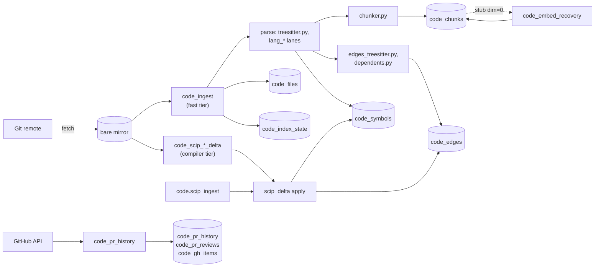

# Code index architecture

This page is the inside view of the code index: how files become chunks, symbols and
edges, and how the two tiers stay current. What each op answers, the languages and their
depth, and how to read `as_of` are in the
[code index overview](../features/code-index/overview.md) and
[freshness](../features/code-index/freshness.md). Running it (clones, backfills, the compiler tiers)
is in [code index operations](../operations/code-index-operations.md).

## Goals and non-goals

| Goals                                                                                                    | Non-goals                                                                                            |
| -------------------------------------------------------------------------------------------------------- | ---------------------------------------------------------------------------------------------------- |
| Per-merge freshness of the fast tier from a poll of a local bare mirror; no inbound webhook.             | Indexing a working tree. Uncommitted and unpushed changes are never in the index.                    |
| Exact call, override and inheritance edges where a compiler indexer exists; graded heuristics elsewhere. | Running a compiler in the server process. SCIP producers run in subprocesses of the workers process. |
| Idempotent ingest: unchanged bytes yield the same rows and cost no embedding.                            | A general-purpose code host. The index is read-only reference data keyed by namespace.               |
| Every answer names the commit and tier it read, and says why an empty answer is empty.                   | Hiding staleness. A lagging tier is reported.                                                        |
| A new language lands without re-indexing the others.                                                     | Equal depth for every language ([languages](../features/code-index/overview.md)).                    |

## One namespace, one branch

A code namespace is one repository branch at one commit. It has `kind='code'` in
`loom.namespaces` (`code/app/index/registry.py`, `ensure_registered`), holds no
memories, and keys every `code_*` row by `(org, namespace)`. Loom keeps one bare git
mirror per repository, a cache of the remote recorded in ClickHouse: `code_ingest` clones
a missing one (or `loom code init` does, ahead of time) and fetches it on every pass.
`server/code/app/index/gitrepo.py` shells out to `git`; it has no working tree and writes
nothing except `fetch`. Branches of one repository share the mirror.

A history read (`blame_range`, bisect, `first_build`, a lesson's code check) on a host
without the mirror clones it once in the background
(`server/code/app/index/mirrors.py`, `history_dir`). A read that names its op waits up
to 10 s for the clone it started, or what is left of the op's latency budget, whichever
is less; the others answer `no_git_mirror` until it lands. After the clone, the ledger's merge
commits the clone lacks are fetched by sha and pinned: a merge made on a staging branch
upstream has since deleted is in the worker's mirror (never pruned) but not in a fresh
clone. A present mirror answers as it is; one that lacks the indexed head fetches the
branch in the background. A head that is not the branch's (a PR head) is not fetched.

This puts a full copy of every mirror on every serving host asked about it, which is
the point (any host answers history reads after a move or a scale-out) and the cost
(disk per host: a repository's size each). `LOOM_CODE_HISTORY_CLONE_ON_READ=false`
turns it off: only the worker's host clones, and a history read anywhere else answers
`no_git_mirror`.

Repository entries come from two sources, merged:

| Source            | Read by                           | Notes                                                                                                      |
| ----------------- | --------------------------------- | ---------------------------------------------------------------------------------------------------------- |
| Environment       | `code/domain/index/repos.py`      | `LOOM_CODE_REPOS_JSON`, or the scalar `LOOM_CODE_*` settings.                                              |
| `loom.code_repos` | `code/app/index/repo_registry.py` | Self-service rows, by `row_kind` (below). A private remote's token is stored encrypted and never returned. |

A `loom.code_repos` row's `row_kind` says what it is:

- `page`: a branch added from the page. It keeps an operator entry off its namespace,
  removed or not.
- `access`: an operator entry's classification and join policy.
- `''`: a row written before the column, read as the access row of an operator entry's
  namespace and as a branch added from the page elsewhere.

`configured_repos()` reads an in-process snapshot refreshed at boot, on every ingest
pass and after an add. Until the snapshot's first read it raises `RegistryUnread`
(self-service on), since the entries a page namespace skips are not known yet; the
modules that decide access read `config_entries()`, which lists the entries before that
read with none org-readable (`tests/unit/test_repo_snapshot_contract.py`). An op that
needs the full list answers 503 in that window; memory reads, search and
`memory.for_file` answer without code links. A code call naming no namespace defaults to
`LOOM_CODE_NAMESPACE` only when no member added that namespace from the page. Retiring
an entry (`code/app/index/retire.py`) deactivates its rows, runs an erasure saga over
every `code_*` table for the namespace, and removes the mirror when no other entry uses
it on the host that served the call; every other host's sweep removes its own copy.

## Git mirrors on every replica

Every serving process can answer a history read (blame, bisect, citations, PR
overlays, commit coverage), so every host keeps its own bare mirrors
(`code/app/index/mirrors.py`). A mirror is a cache of its remote: ClickHouse names the
remote, and any host can rebuild the mirror from it.

- **Warm-up.** At boot each process clones the mirrors of the indexed entries it lacks,
  `LOOM_CODE_MIRROR_WARMUP_CONCURRENCY` at a time, each after a random wait of up to
  30 s, so N replicas starting together do not all clone from GitHub at once. Clones
  run in the background: readiness does not wait for them.
- **The cost of a new disk.** A host with an empty `LOOM_CODE_REPOS_ROOT` makes a full
  bare clone of every indexed repository (several GB for a large one) before its
  history reads answer. Warm-up stays on by default because a new replica must build
  its caches without an operator; put `LOOM_CODE_REPOS_ROOT` on a volume that outlives
  a rollout to pay it once per volume, not once per pod. The clones are full, not
  `--filter=blob:none`: a partial clone fetches each missing blob from the remote while
  `git blame` runs, which makes a history read a network read and would reach the
  remote outside the repository-job sandbox.
- **The gate.** Every history read goes through `mirrors.history_dir`, which returns
  the mirror or why there is none. Until the mirror
  is there the read answers `no_git_mirror: cloning <entry>` (or why it will not be
  cloned here) instead of a git error, and starts the clone if none is running.
  `LOOM_GIT_HISTORY=none` turns history off on a host: those reads answer
  `no_git_history`.
- **The host loop.** Only the leader asks the remote what changed (`ls-remote` of the
  extra branches and the PR heads). What its pass fetched is in ClickHouse: each
  entry's branch tip (`clone_head`), the open PRs' heads (`code_gh_items.head_sha`) and
  the ledger's merges. Every `LOOM_CODE_MIRROR_FETCH_INTERVAL_S` each host reads those
  and fetches, by name, only the branches and PR heads its mirror holds at another sha,
  plus a page of ledger merges it lacks; a host that is current makes no network call.
  Extra branches are not followed on other hosts: a fresh clone carries every branch
  the remote had, and the merges on them come through the ledger. One process per host
  does each mirror's round, and every fetch into a mirror (the pass's, the host loop's,
  a read's) holds the mirror's `.fetch-lock`; the pass's fetch also counts as the host's
  round for the interval. The same loop runs `git gc --no-prune` when due and sweeps
  `LOOM_CODE_REPOS_ROOT`: mirrors, `checkout-*` trees and mirror lock files no active
  entry names (restricted entries included) and half-done clones. It sweeps nothing
  when the registry cannot be read.
- **Sandbox.** A host without the repository-job sandbox never clones or fetches a
  viewer-added entry with a network remote, on the read path as in the worker
  (`compiler_tier.unsandboxed_skip`).
- **Merges the remote lost.** A ledger merge the remote no longer serves ("not our
  ref" in two calls, so one transient refusal does not count) is recorded in the
  mirror (`loom-unpinned-merges`), never asked for again, and
  counted in `/v1/health?include=mirrors` (`mirrors.unpinned_merges`) and `loom doctor`.
- **The leader** clones a missing mirror in the background too, so one long clone
  does not hold up the other entries of its pass; an indexed entry keeps its
  Repositories-card stage while its mirror is cloned again on a new host.
- **Erasure.** Mirrors and checkouts hold repository content, not memory content: the
  erasure census does not count them. A removed repository's copies go with the sweep
  on each host.

`/v1/health?include=mirrors` carries `mirrors`: how many of this host's mirrors are `ready`
and `cloning`, and `failed` and `absent` counted by reason. It answers without a token, so
it names no entry. Disk use is the size of every mirror on every host: N replicas hold N copies.

## Components

## Fast tier: `code_ingest`

`server/code/workers/ingest.py` polls every `LOOM_CODE_INGEST_INTERVAL_SECONDS`;
`code.refresh` triggers a pass from CI. Per entry, each pass:

1. **Fetches** the mirror and walks first-parent commits from the `git_head` watermark
   in `code_index_state` to the tip, oldest first, at most
   `LOOM_CODE_INGEST_MAX_COMMITS_PER_PASS`.
2. **Re-indexes exactly the changed files** of each commit (`ingest_file` in
   `code/app/index/ingest.py`): parse, chunk, symbols, edges, call guards, the file
   row, and a context pack and review brief for the merged PR the commit names. Then it
   advances `git_head`. A crash re-runs from the last complete commit.
3. **Walks** with the share `LOOM_CODE_INGEST_WALK_BUDGET_SHARE` leaves: reconciliation
   heals and extractor re-chunks (below).

| Bound                                   | Effect                                                                                        |
| --------------------------------------- | --------------------------------------------------------------------------------------------- |
| `LOOM_CODE_INGEST_MAX_PASS_SECONDS`     | Pass length.                                                                                  |
| `LOOM_CODE_INGEST_PASS_BUDGET_FRACTION` | After this share the pass starts no new units, saves cursors and returns `partial: true`.     |
| `LOOM_CODE_INGEST_SECONDS_PER_FILE`     | Predicts a commit's cost; a commit predicted to overrun starts only as the pass's first.      |
| `LOOM_CODE_INGEST_SLICE_SHARE`          | The most of the commit phase one oversized commit may take before it is sliced across passes. |
| `LOOM_CODE_INGEST_LANES`                | Entries ingested side by side (default 1, up to 8). One entry's commits stay sequential.      |
| `LOOM_CODE_INGEST_ROUND_FILES`          | Files per round inside a commit; reads prefetched in two statements, writes batched.          |

Lanes help because a lane waits on ClickHouse round trips, not CPU.

**Admission.** A file is refused before parsing when it matches the denylist
(`code/app/index/denylist.py`, `LOOM_CODE_INGEST_EXCLUDE`,
`LOOM_CODE_INGEST_IGNORE_FILE`), is binary, or exceeds `LOOM_CODE_INGEST_MAX_FILE_BYTES`.
So `coverage_floor: true` on a grep means every admitted chunk, not every byte.

### Choosing a parser

`ingest_parse.parse_for_ingest` tries these in order. The order keeps new file kinds out of
the extractor stamp:

1. `treesitter.lang_for_path`: the stamped core (C/C++ with `.h` through the C++ grammar,
   Python, shell, SQL, doc, config). `ingest_parse._lane_language` then re-files CMake
   files and TLC configs.
2. Helm and Kubernetes manifests among config files (`lang_gotemplate`, `lang_k8s`).
3. `lang_detect.detect_by_extension` (`LANG_BY_EXTENSION`).
4. A shebang, then shell detection by Linguist names and ShellCheck directives
   (`lang_detect.detect_shell`).
5. Host files (Dockerfile, Makefile, Jenkinsfile, CI YAML) with `LOOM_CODE_HOST_ISLANDS`
   (`lang_hosts`).
6. Expected-output fixtures, one unembedded chunk per file (`lang_reference`).
7. Any other text, chunked without symbols (`lang_text`).

The parser comes from `ingest_parse._PARSERS`. A failure of that parse, including a missing
grammar or a tree-sitter parse past `code_parse_timeout_s` or `code_parse_memory_mb`
(`bounded_parse`, one parse at a time), degrades to a chunk-only file with
`code_files.index_error` set; `code.index_errors` reports it; a TLA+ spec instead falls
back to its regex reader. A parse past its limits anywhere else takes its caller's
fallback and records no error. A parse that could not run here now (`ParseUnavailable`:
its process silent or killed from outside, or its caller's wait for the lock run out)
is no fact of the file: no cache keeps it, ingest records it as an error and keeps the
file's live edges, and a PR overlay counts the file as not reached.
Tree-sitter modules import lazily, so a server with the code workers off boots without the
`code` extras.

### Chunks

`server/code/domain/extract/chunker.py` cuts semantic units, never fixed windows:

| Chunk            | Contents                                                                                                    |
| ---------------- | ----------------------------------------------------------------------------------------------------------- |
| `function`       | One function body. An oversized one splits at top-level statements, each piece prefixed with the signature. |
| `class_skeleton` | A class with method bodies elided.                                                                          |
| `file_header`    | Leading comments and includes.                                                                              |
| `other`          | The rest, grouped.                                                                                          |

Files without a tree fall back to whole-line windows; lanes without a grammar cut on
their symbol spans (`lane_units.span_chunks`). A chunk id is
`uuid5("loom://code/{namespace}/{path}#{scope}@{sha16}")`. It is content-addressed, so
an unchanged chunk keeps its id and hash and the embed step skips it without a lookup.
Identical chunks in one file get an ordinal suffix.

### Symbols and edges

A symbol id is `treesitter.symbol_id(qualified_name, signature)`: the first 128 bits of
SHA-256 over the name and a normalized signature (whitespace collapsed, defaults
stripped, so overloads differ). The fast tier, the SCIP converter and the read path all
call it, so both tiers land a shared symbol under one id. Python and shell qualify names
by module path, so the many `main()` functions in a test tree stay distinct.

Fast-tier edges (`edges_treesitter.py`, `tier='treesitter'`) are resolved by name and
graded:

| Confidence | Rule                                                                    |
| ---------- | ----------------------------------------------------------------------- |
| 1.0        | Unique definition in the same file                                      |
| 0.8        | Method of the enclosing class                                           |
| 0.6        | Unique match in the repository-wide symbol name table                   |
| none       | Ambiguous or unknown: no edge; recorded in `code_call_sites_unresolved` |

A wrong edge is worse than a missing one, so `code.callers` reports how many sites its
count leaves out. Constructor calls (`T x(...)`, `new T`, `make_unique<T>`) are calls to
`T::T`. Receiver-type modules (`cpp_receivers.py`, `py_receivers.py`, `ts_receivers.py`,
`go_receivers.py`) bind member calls. Edge kinds are `calls`, `includes`, `inherits`,
`overrides`, `uses_type`, `fixture_use`, `reads` and `writes`.

**Dependents.** Edges resolve against a repository-wide name table, so a commit that
adds, removes or re-signs a symbol changes the edges of untouched files that name it.
`code/app/index/dependents.py` re-extracts only those files' edges at the same
commit, up to `LOOM_CODE_INGEST_DEPENDENTS_MAX_FILES`. The overflow waits in
`code_index_state` (`dependents_pending`) and drains through reconciliation.

### Embeddings and vector tables

`code_ingest` embeds new chunks inline, memoized by content hash (`embed_reuse.py`),
with bounded text (`embed_text.py`). With `LOOM_CODE_CONTEXT_DESCRIPTION_ENABLED` (on by
default) a chunk gets a one-line LLM description prepended to its embedded text,
best-effort and budget-gated. A provider failure leaves an `embedding_dim = 0` stub that
`code_embed_recovery` fills, with per-text fallback and poisoning after
`LOOM_CODE_EMBED_MAX_ATTEMPTS`. Until `LOOM_CODE_READY_EMBED_COVERAGE` of a namespace's
chunks have vectors, `code.search` answers from its lexical legs and says so.

| Table                                     | Filled by                                          | Use                                                                                                   |
| ----------------------------------------- | -------------------------------------------------- | ----------------------------------------------------------------------------------------------------- |
| `code_summaries`                          | `code_summary` (weekly, off by default)            | File and module cards for `code.map`, gated by an inputs hash, with PageRank from `code_graph_stats`. |
| second-model tables, `code_chunks_prefix` | `LOOM_CODE_VECTOR_TABLES`; `loom code vector-twin` | The vector leg shortlists on the smaller twin and rescores on served vectors (`prefix_twin.py`).      |
| `code_answers`                            | `code.ask`                                         | Answer cache keyed by question embedding; served only if every cited file's hash is current.          |

Bulk passes leave extra copies per key until a merge. `code/app/index/compaction.py`
runs `OPTIMIZE … FINAL` on the twin tables after a bulk pass. `code_chunks` is compacted
only by `loom code compact --table code_chunks --apply`.

## Compiler tier: SCIP

The compiler tier holds `tier='scip'` symbols and edges. The server never parses
protobuf: a producer converts SCIP output to a versioned JSON delta
(`scripts/scip_harness/scip_to_delta.py`) and `code/app/index/scip_delta.py`
applies it. Per touched file the apply upserts what the delta emits and tombstones the
file's `scip` rows it no longer emits; a deleted file is tombstoned whole. Re-applying a
delta gives the same live set.

| Producer          | Language                | Watermark        | Workers                                                | How it runs                                                                                                                           |
| ----------------- | ----------------------- | ---------------- | ------------------------------------------------------ | ------------------------------------------------------------------------------------------------------------------------------------- |
| `scip-clang`      | C++                     | `scip_commit`    | `code_scip_full`, `code_scip_delta`, `code_scip_apply` | Changed TUs (and TUs including changed headers, capped) via `run_delta.sh`; `code_scip_full` seeds the tier and re-indexes it weekly. |
| `scip-typescript` | TypeScript / JavaScript | `scip_commit_ts` | `code_scip_ts_delta`                                   | Whole-workspace index per pass, bounded to the window's files by the converter.                                                       |
| `scip-go`         | Go                      | `scip_commit_go` | `code_scip_go_delta`                                   | One build per module (`run_go_monorepo_delta.sh`).                                                                                    |
| `scip-python`     | Python                  | `scip_commit_py` | `code_scip_py_delta`, `code_scip_apply`                | Per-merge delta (`run_python_delta.sh`); a first run indexes the tree.                                                                |

`code/domain/index/compiler_tiers.py` (`TIERS`) is the one table of watermark, label
and workers per producer; status handlers and the dashboard read it. A delta worker
compares its watermark with `git_head`, moves the checkout (fetching from the local
mirror, not the network), runs the producer in a subprocess and applies the delta
through the same path `code.scip_ingest` uses. One pass covers every merge since the
watermark.

An external producer such as a CI job can upload a delta in parts with
`code.scip_ingest`; parts are staged in `code_scip_batches` / `code_scip_parts` and
applied by `code_scip_apply`. Every compiler-tier pass takes a per-entry lock file in
`LOOM_CODE_SCIP_LOCK_DIR` and a ClickHouse lease, so a full re-index and a delta never
run on one entry at once. `loom code scip-full` rebuilds
the C++ tier; `loom code scip-delta` runs one delta pass.

Where both tiers hold the same row, reads prefer the compiler row, and every answer
names the tier it read (`scip` or `treesitter`).

## The extractor stamp

Content-addressed chunks and hashed symbol ids key on the input, not on the code that
produced the rows, so a chunker fix would never reach an existing row.
`server/code/domain/extract/extractor_stamp.py` closes the gap. It hashes the code tokens of
every extractor module (`logic_tokens`: no comments, blank lines or docstrings, and an
import reduced to the names it binds, so moving a module between packages moves no
stamp) plus the installed versions of the stamped grammars (`STAMPED_GRAMMARS`: the base library, C++,
Python, bash).

The stamp is split two ways so a change re-derives as little as possible:

- **By stage** (`STAGES`: `chunk`, `symbol`, `edge`, `guard`; `STAGE_MODULES`). A
  stage's stamp covers its modules and those of the stages it reads (`STAGE_INPUTS`).

  | Module changed                    | Stages moved                  |
  | --------------------------------- | ----------------------------- |
  | `chunker.py`                      | `chunk`                       |
  | `edges_treesitter.py`             | `edge`, `chunk`, `guard`      |
  | `treesitter.py`, `lang_python.py` | all (`symbol` feeds the rest) |
  | `call_guards.py`                  | `guard`                       |

- **By language family** (`LANGUAGE_FAMILIES`: `python`, `shell`, `typescript`, `cpp`,
  `other`; `MODULE_LANGUAGES`). A Python-only change heals `.py` files and leaves C++
  alone. The TypeScript edge modules (`ts_receivers.py`, `ts_reexports.py`,
  `ts_config.py`, `ts_workspace.py`) move only `typescript`. A stamped module missing
  from `MODULE_LANGUAGES` moves every family.

Each pass compares the running stamps with those in `code_index_state`. A moved stage is
re-derived for every file of that family in every indexed namespace, in paced batches
(`LOOM_CODE_EXTRACTOR_RECHUNK_PER_PASS`, switch `LOOM_CODE_EXTRACTOR_RECHUNK_ENABLED`).
An empty recorded stamp is recorded, never acted on. So:

- a code change to a module in `EXTRACTOR_MODULES` re-indexes every repository in the
  affected families, which takes hours on a large deployment; comments and docstrings
  can be edited freely;
- those files are excluded from the formatters (`pyproject.toml`), and
  `tests/unit/test_code_extractor_stamp.py` keeps the exclusion list and the module
  inventory in step: a module in `server/code/domain/extract/` in no stage must be
  listed in the test's `NON_EXTRACTOR_MODULES` with its reason;
- change them only when the extraction changes, and expect the re-derive after deploy.

**Lane modules are outside the stamp.** The lane parsers (`lang_typescript.py`,
`lang_rust.py`, `lang_go.py`, `lane_units.py`, …), their grammars and the file-selection
modules (`lang_detect.py`, `denylist.py`) do not move it; the TypeScript edge modules
above are the exception. A lane fix is applied with `loom code backfill --paths-file`
over that language's files.

## Reconciliation

Watermarks say which commits were walked, not whether every row is current.
`code/app/index/reconcile.py` measures drift. A `code_files` row carries `blob_sha`
and `indexed_commit`. One `git ls-tree -r <head>` marks a path stale when its blob
differs and gone when it is absent. Rows without a blob fall back to one
`git diff --name-only` per distinct commit, up to `LOOM_CODE_RECONCILE_MAX_COMMITS`.

The hourly check in `code_ingest` (`LOOM_CODE_RECONCILE_ENABLED`,
`LOOM_CODE_RECONCILE_INTERVAL_SECONDS`) re-ingests up to
`LOOM_CODE_RECONCILE_HEAL_PER_PASS` stale paths through `ingest_file`; only new content
is embedded. By hand: `loom code reconcile --heal`. The `loom.code.stale_files` gauge
reports the count.

## Watermarks and coverage

`code_index_state` (`ReplacingMergeTree(version)`, keyed `(org, namespace, state_key)`)
holds `git_head`, the per-producer SCIP watermarks, the extractor stamps, cursors and
`dependents_pending`. The `as_of` block on every answer and
`loom.code.tier_lag_seconds{tier}` are computed from these rows and the mirror, not from
a producer's log. Per-commit coverage (`code/app/index/commit_coverage.py`) is one
`git merge-base --is-ancestor` per tier on the mirror, never a watermark comparison.
What callers see is in [freshness](../features/code-index/freshness.md).

## PR history, backports and tracker links

| Table                                                  | Writer                                                      | Holds                                                                                              |
| ------------------------------------------------------ | ----------------------------------------------------------- | -------------------------------------------------------------------------------------------------- |
| `code_pr_history`, `code_pr_reviews`, `code_gh_items`  | `code_pr_history` (GitHub REST, cursor on `updated_at`)     | Merged PRs with files, review comments, issues. A rate limit or 5xx leaves the cursor unmoved.     |
| `code_context_packs`, `code_review_briefs`             | `code_ingest` at the merge commit, or on demand             | Per-PR context pack and reviewer's brief.                                                          |
| `code_backport_gaps`                                   | `code_backport_gaps` (nightly; needs `code_pr_history`)     | Per backport-labelled trunk PR, one row per release-branch namespace: covered, owed, not affected. |
| `code_test_map`, `code_symbol_stats`, `code_unit_risk` | `code_graph_stats` (weekly), `loom code crossref`           | Test↔source map, symbol fan-in, per-unit risk.                                                     |
| `code_coverage_files`                                  | `code_coverage_import` (daily), `loom code coverage-import` | Per source file, the line ranges a per-test coverage run executed.                                 |
| `qa_link_candidates`                                   | `tracker_links` (daily)                                     | Top merged PRs per recent issue, ranked by BM25F, stack frames in the diff and closing mentions.   |
| `qa_item_embeddings`                                   | `tracker_embed`                                             | Vectors of tracker issues and PRs in the embedding window; keys and filter facts, no text.         |

`code.repo.set_source` links a repository to its trackers, in order; the first is the
primary, whose numbers are the repository's issue and PR numbers. The links are the
`qa_binding` row of `code_index_state` and are read by `(org, namespace)`: a code namespace
name is derived from the repository and branch, so two orgs can hold the same one. The
operator's `LOOM_TRACKER_CODE_NAMESPACE_BINDINGS_JSON` applies only to the operator's own
repositories (`LOOM_CODE_REPOS_JSON` or `LOOM_CODE_REPO`), never to a self-service one
whose name matches a glob. Tracker workers read each namespace through its own source, so
a restricted namespace's rows never land under a standard one. The record contract is in
[tracker record contract](../features/tracker/record-contract.md).

`code.repo.add_branch` writes the new branch's `qa_branch_of` row naming the root
repository (the source, or the source's own root when the source is a branch) when that
root is an operator repository, so a self-service root's branch never starts reading the
map if the operator later configures the root's name. A
registered branch whose root is an operator repository follows that repository's links at
read time, the glob included; a `qa_branch_of` row with no self-service entry beside it is
not followed. A source that is not an operator repository has its own `qa_binding` row
copied to the branch, a cleared one included. An operator source is its own root. Both
rows are written with the source's rows read first and `qa_branch_of` last, so a failure
leaves the branch following nothing.

`code.repo.remove` empties whichever of the two rows holds a value before the namespace's
detached purge. Registering a namespace empties any row a removed one of the same name
left and drops the name from its own process's snapshot, so the new namespace follows
neither. An emptied `qa_binding` reads as cleared until an admin of the tracker links it.
A namespace that had no `qa_binding` row gets none, so the operator's map still reaches an
operator entry configured under the same name. An operator entry configured under a
removed name gets no such cleanup: until the purge runs, it reads the removed namespace's
`qa_binding` row when there is one, the old links after a removal on build N-1 and none
after one on N. Other processes keep the rows they read for up to
`LOOM_CODE_REPOS_REFRESH_SECONDS`.

## Storage

| Table                                                          | Engine and key                                                                                         | Notes                                                                                         |
| -------------------------------------------------------------- | ------------------------------------------------------------------------------------------------------ | --------------------------------------------------------------------------------------------- |
| `code_files`                                                   | RMT(`version`), `(org, namespace, path)`                                                               | Last parse per path: language, `blob_sha`, `indexed_commit`, `index_error`.                   |
| `code_chunks`                                                  | RMT(`version`), `(org, namespace, embedding_model, path, chunk_id)`, partitioned by `(org, namespace)` | Content, `lexemes`, vector. Text indexes: 3-gram on `lower(content)`, tokens on `lexemes`.    |
| `code_symbols`                                                 | RMT(`version`), `(org, namespace, tier, qualified_name, symbol_id)`                                    | Definitions with signature, span, doc comment, `scip_symbol`; ngram skip indexes on the name. |
| `code_symbol_names`, `code_symbol_ids`                         | RMT, filled by `code_symbol_names_mv` / `code_symbol_ids_mv`                                           | The symbols re-keyed by short name and by id.                                                 |
| `code_edges`                                                   | RMT(`version`), `(org, namespace, tier, to_symbol_id, edge_kind, from_symbol_id, path, line)`          | Callers are a key range; projections `by_from` (callees) and `by_path`.                       |
| `code_call_sites_unresolved`, `code_caller_guards`             | RMT(`version`)                                                                                         | Declined call sites by callee name; guards around each caller's call sites.                   |
| `code_term_freq`, `code_doc_stats`                             | AMT, RMT; filled by `code_term_freq_mv`, `code_doc_stats_mv`                                           | BM25 statistics for the lexical leg.                                                          |
| `code_unit_signal`                                             | `SummingMergeTree((positive, negative))`                                                               | Outcome counters per unit from `code.outcome`.                                                |
| `code_search_trace`, `code_search_outcome`, `code_search_memo` | MT with 180-day TTL; RMT with 60-minute TTL                                                            | Per-query traces and outcomes; a short-lived memo of served `code.search` responses.          |

Every column is in the generated [schema reference](../reference/schema.md).

## Query patterns

| Op                               | Path                          | How                                                                                                                                                                                                                                                                                                                                                                              |
| -------------------------------- | ----------------------------- | -------------------------------------------------------------------------------------------------------------------------------------------------------------------------------------------------------------------------------------------------------------------------------------------------------------------------------------------------------------------------------- |
| `code.search`                    | `code/app/search/pipeline.py` | Routes first (pattern, path, history question), then runs legs under the deadline (`gather.py`): lexical (idf-weighted token count), vector (exact scan or twin shortlist), PR history, fuzzy symbol vote. `fusion.py` fuses by reciprocal rank (k = 60); `serve.py` pages into the token budget or abstains. A repeat within the memo window is one read of `code_search_memo`. |
| `code.grep`                      | `code/store/index/grep.py`    | The 3-gram index narrows granules; `position()` or `match()` decides; each hit joins its enclosing unit. `mode=presence` spans up to eight branch namespaces.                                                                                                                                                                                                                    |
| `code.symbol`                    | `code/app/symbol/`            | A qualified name is a key-prefix read of `code_symbols`; a short name goes through `code_symbol_names`; several definitions rank by `near_paths` or the PR under review.                                                                                                                                                                                                         |
| `code.callers`, `code.impact`    | `code/store/index/edges.py`   | Callers are the `to_symbol_id` range of `code_edges`, compiler rows preferred, with the unresolved count. `code.impact` maps diff hunks to seed symbols and walks outward; an empty walk answers `no_indexed_paths`, `no_seeds_in_hunks` or `no_static_callers`.                                                                                                                 |
| `code.outline`, `code.enclosing` | —                             | Per-path reads of `code_symbols` and `code_chunks` spans.                                                                                                                                                                                                                                                                                                                        |

## Invariants

- A code namespace is one branch; every `code_*` row is keyed by `(org, namespace)`.
- `git_head` advances only after every file of the commit is written.
- `treesitter.symbol_id` is the only symbol-id function, used by both tiers and the read
  path.
- Chunk ids are content-addressed; an unchanged chunk is not re-embedded.
- A stamped module's code change re-derives its stages for its language family in every
  namespace; comments and docstrings never do.
- A delta apply is idempotent and tombstones what the producer stopped emitting.
- The server never parses SCIP protobuf.
- Per-commit coverage is an ancestry check on the mirror, never a watermark.
- Retrieval filters `embedding_dim > 0`; a stub chunk is searchable lexically only.

## Source entry points

| Path                                                                                                                               | What                                                                                          |
| ---------------------------------------------------------------------------------------------------------------------------------- | --------------------------------------------------------------------------------------------- |
| `server/code/app/index/ingest_pass.py`                                                                                             | The fast-tier pass.                                                                           |
| `server/code/app/index/ingest.py`                                                                                                  | `ingest_file`, the per-file stages.                                                           |
| `server/code/app/index/ingest_parse.py`, `ingest_chunks.py`, `ingest_edges.py`, `ingest_resolve.py`, `ingest_reconcile.py`         | `parse_for_ingest` and `_PARSERS`, chunks, edges, edge-resolution reads, the key-diff writes. |
| `server/code/domain/extract/treesitter.py`, `lang_detect.py`, `lang_*.py`, `lane_units.py`                                         | Languages.                                                                                    |
| `server/code/domain/extract/chunker.py`, `edges_treesitter.py`, `call_guards.py`; `server/code/app/index/dependents.py`            | Chunks and edges.                                                                             |
| `server/code/domain/extract/extractor_stamp.py`                                                                                    | The stamp.                                                                                    |
| `server/code/app/index/reconcile.py`, `commit_coverage.py`, `scip_delta.py`; `server/code/domain/index/compiler_tiers.py`          | Drift, coverage, tiers.                                                                       |
| `server/code/workers/scip_*.py`, `scripts/scip_harness/`                                                                           | Compiler tier.                                                                                |
| `server/code/workers/embed_recovery.py`, `summary.py`, `graph_stats.py`, `pr_history.py`, `backport_gaps.py`, `coverage_notify.py` | Background workers.                                                                           |
| `server/code/domain/index/repos.py`; `server/code/app/index/repo_registry.py`, `registry.py`, `retire.py`, `gitrepo.py`            | Entries, mirrors, namespaces.                                                                 |
| `server/code/app/search/`, `server/code/store/index/`                                                                              | Reads and writes.                                                                             |

## Related

- [Code index overview](../features/code-index/overview.md) (languages and tiers),
  [freshness](../features/code-index/freshness.md),
  [history and PRs](../features/code-index/history-and-prs.md).
- [Code index operations](../operations/code-index-operations.md).
- [Adding language support](../development/adding-language-support.md).
- [ClickHouse](clickhouse.md), [operations reference](../reference/operations.md#code).
