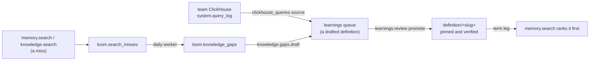

# Curation loop

The curation loop turns what people ask into definitions an organization stands behind.
Searches that find nothing become knowledge gaps. A gap, or a query a team runs often on
its own ClickHouse, becomes a drafted definition in the learnings queue. A definition a
person promotes is governed: `memory.search` ranks it first when a query names its term.
This page is the design of the loop: the data model, the operations, the ranking change,
and what erasure, rolling upgrades and cost limits mean for each part.

## Governed definitions

A definition is a memory row with `memory_type = 'definition'` under the key
`definition/<slug>`, where the slug is the term in lower case with runs of other characters
replaced by `-`. Its `value` is the definition's text. Its `value_json` holds the rest:

| Field      | Meaning                                                             |
| ---------- | ------------------------------------------------------------------- |
| `term`     | The name as people write it.                                        |
| `aliases`  | Other names for the same thing (an abbreviation, an older name).    |
| `owner`    | Who answers for the definition: a person or a team.                 |
| `rests_on` | What it is based on: knowledge document `source_uri`s and SQL text. |

A definition is **governed** when it is pinned and its attestation covers its current text:
`pinned = 1` and `verified_sha256 = content_sha256`. Both columns exist; no new state
records governance. A change to the text leaves the attestation behind, so a revised
definition is ungoverned until someone verifies it again (`memory.verify`).

`definition` joins `KEY_IDENTIFIED_TYPES`, as `decision` is: two definitions under
different keys are two definitions however alike they read, so a governed definition does
not refuse another term's definition as a close pinned peer. Any other row close to a
governed definition meets the existing pinned-peer check and conflict surfacing
([conflicts and refusal](../features/memory/conflicts-and-refusal.md)): a learned fact
that disagrees is refused with `PINNED_CONFLICT` or marked conflicted, as for any pinned
row. Nothing new decides disagreement.

### The term leg

`memory.search` gains one leg. It reads the namespace's definition rows (a `memory_type`
filter on the `(org, namespace)` key prefix, with a `LIMIT`), matches the query against
each governed definition's term and aliases, and places the matched rows at the top of the
served list with `governed = true` on the hit. Matching is on whole words after case
folding and collapsing punctuation to spaces, so `ARR` matches "what is our ARR" and not
"arrow". The leg runs beside the others under the same time budget and read filters; an
ungoverned definition is ranked like any other row.

The leg covers memory only. Knowledge has its own exact-key leg for identifiers a document
defines (`server/knowledge/domain/exact_keys.py`), and a definition's `rests_on` already
points at the documents behind it. `loom_search` serves the leg through its memory section
with no transport change.

**Ranking-neutral rule:** when no governed term matches, the leg adds nothing and the
served list is exactly what it was before. The PR that adds the leg shows this on the
offline harnesses, comparing served keys and order for every query that names no term, and
reports the gain on a small set of term queries. No paid benchmark is run for it.

## Knowledge gaps

### Recording misses

A miss is a search that found nothing a caller could use:

- `memory.search` that abstained, or answered with `retrieval_risk = 'high'`;
- `knowledge.search` with no hit, or whose best hit scored under
  `settings.knowledge_gaps_weak_score`.

Each miss writes one row to `loom.search_misses`: the identity tuple, `actor`, the plane,
the query, its normalised form and the keys or document URIs it came closest to. The
`query` column holds user text, so the row is written only when the namespace's capture
consent allows query text, the same answer that gates `loom.search_trace_log.query`
([namespaces and sharing](../features/namespaces-and-sharing.md)). A namespace without that
consent records no misses and shows no gaps. The table has a 30-day TTL: it is a trace, not
memory. `search_trace_log` is not reused: it is off by default, records every query rather
than misses, and has no `user_id` to count askers or erase by.

### Grouping

The `knowledge_gaps` worker runs once a day per namespace that has misses. It reads the
last `settings.knowledge_gaps_window_days` (default 7) of misses, groups them by normalised
query, embeds the largest `settings.knowledge_gaps_max_groups` groups and merges groups
whose vectors are at least `settings.knowledge_gaps_merge_similarity` alike. It then replaces
the namespace's rows in `loom.knowledge_gaps`:

| Column            | Meaning                                                        |
| ----------------- | -------------------------------------------------------------- |
| `gap_id`          | Stable id: a hash of the namespace and the group's head query. |
| `head`            | The group's most asked normalised query.                       |
| `samples`         | Up to five queries as asked.                                   |
| `askers`          | The distinct `(actor, user_id)` pairs that asked.              |
| `asks`, `last_at` | How often, and the latest time.                                |
| `nearest`         | The keys and document URIs the misses came closest to.         |

**Privacy threshold:** a group with fewer than `settings.knowledge_gaps_min_askers`
distinct askers (default 3) is never written. A single person's question is not shown to an
admin as a gap, however often they ask it.

### Ops and dashboard

| Op                     | Role  | What it does                                                                                                                                                  |
| ---------------------- | ----- | ------------------------------------------------------------------------------------------------------------------------------------------------------------- |
| `knowledge.gaps.list`  | admin | The namespace's gaps, most askers first.                                                                                                                      |
| `knowledge.gaps.draft` | admin | Drafts a definition for one gap with the LLM, from its samples and nearest documents, and queues it in the learnings queue (`source_kind = 'knowledge_gap'`). |

The Library page shows a gaps tile for a namespace the viewer administers, with a **Draft
definition** action per gap.

## Definitions from query history

A `clickhouse_queries` document source reads `system.query_log` from a team's ClickHouse.
It is opt-in per namespace and uses the tracker's connection pattern: a read-only user, the
credential stored encrypted, a time budget and a breaker on every read
([tracker plane](../features/tracker/overview.md)). Each sync turn:

1. reads finished `SELECT` queries of the source's window, grouped by
   `normalized_query_hash`, ranked by distinct users and then by recency;
2. skips groups already drafted (the draft's id derives from the source and the hash);
3. asks the LLM to draft a metric definition (name, SQL, tables, columns) for the top
   groups, and queues each in the learnings queue (`source_kind = 'query_history'`).

The source writes no knowledge documents and serves nothing. A draft reaches search only
through promotion.

## Promotion

`learnings.review` with `promote` on a `knowledge_gap` or `query_history` candidate writes
the definition through `memory.set`, so the blacklist, the pinned-peer check and conflict
surfacing run as for any write ([learnings review queue](../features/memory/procedures-and-learnings.md#learnings-review-queue)).
The same call pins the row and records the attestation with the reviewer's
server-stamped actor: a person promoting a definition is the person standing behind it. A
rejected draft leaves nothing behind but its queue row.

## Erasure and audit

- Definitions are memory rows and take every path memory takes: tombstone, user and
  namespace erasure, history, audit.
- `loom.search_misses` gets a user step (`user_id`) and a namespace step, and a census row.
- `loom.knowledge_gaps` gets a namespace step and a user step that deletes every gap whose
  `askers` holds the user; the next daily run rebuilds the namespace without them.
- Queued drafts are learnings rows, already covered.
- `memory.verify` writes its audit row, so the attestation of every governed definition
  names who gave it. `knowledge.gaps.draft` writes an audit row naming the gap.

## Cost bounds

- Recording a miss is one asynchronous insert; a hit records nothing.
- The gaps worker embeds at most `knowledge_gaps_max_groups` texts per namespace per day.
- `knowledge.gaps.draft` and the query-history turn make at most one LLM call per draft.
  Both run inside the namespace's daily cost cap (`server/observability/budget.py`): over
  the cap, a draft is refused and a turn ends early, and the next turn resumes.
- The term leg is one bounded read of definition rows per search.

## Rolling upgrades

The tables are new and additive ([rolling upgrades](rolling-upgrades.md#the-rules)). During
a rollout, N-1:

- records no misses and serves no gap op; N's worker reads what N's replicas record;
- runs a user or namespace erasure without the new steps, so it leaves rows in both new
  tables; an erasure that ran during the rollout is run again once N-1 stops serving;
- serves a `definition` row as a plain memory row with no term leg, and lets a close
  write to another definition be refused as a pinned peer;
- refuses to add a `clickhouse_queries` source and treats one it syncs as rule 28 says;
- promotes a `knowledge_gap` or `query_history` candidate as an unpinned row, which an
  admin pins and verifies once N serves.

## Source entry points

- `server/memory/domain/memory_types.py` (`KEY_IDENTIFIED_TYPES`)
- `server/memory/app/search/handler.py` (the legs of `memory.search`)
- `server/memory/app/learnings.py` (`handle_learnings_review`)
- `server/knowledge/domain/sources.py` (`KINDS`)
- `server/observability/budget.py` (`namespaces_over_cap`)

## Related

- [Memory architecture](memory-architecture.md)
- [Learnings review queue](../features/memory/procedures-and-learnings.md#learnings-review-queue)
- [Conflicts and refusal](../features/memory/conflicts-and-refusal.md)
- [Tracker plane](../features/tracker/overview.md)
