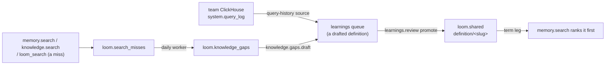

# Curation loop

The curation loop turns what people ask into definitions an organization stands behind.
Searches that find nothing become knowledge gaps. A gap, or a query a team runs often on
its own ClickHouse, becomes a drafted definition in the learnings queue. A definition an
admin promotes into the shared layer is governed: `memory.search` ranks it first when a
query names its term. This page is the design of the loop. The parts land in this order:
knowledge gaps (recording, grouping and the list), governed definitions (the shared-layer
changes and the term leg), then `knowledge.gaps.draft` and query history, which queue
definition drafts and so need the review path the second part builds. None of its ops,
tables or settings are served until the pull request that builds each part lands; that
pull request rewrites its section to describe what it built.

## Governed definitions

A definition is a memory row with `memory_type = 'definition'` under the key
`definition/<slug>`, where the slug is the case-folded term with runs of characters other
than letters and digits replaced by `-`, followed by a short hash of the case-folded term,
so `C++` and `C#` get two keys. Its value is a JSON object, which `memory.set` stores
whole in `value` and in `value_json` (the embedding reads its excerpt, as for any row):

| Field      | Meaning                                                             |
| ---------- | ------------------------------------------------------------------- |
| `term`     | The name as people write it.                                        |
| `aliases`  | Other names for the same thing (an abbreviation, an older name).    |
| `body`     | The definition's text.                                              |
| `owner`    | Who answers for the definition: a person or a team.                 |
| `rests_on` | What it is based on: knowledge document `source_uri`s and SQL text. |

A definition is **governed** while three things hold, checked when the term leg reads it:
a live `loom.shared` row of type `definition` under a `definition/` key exists; its
provenance (`promoted_from`) names exactly one source, the namespace-wide row under that
key (`user_id`, `agent` and `session_id` all `'-'`); and that source is live (`status =
'active'`, not tombstoned, superseded or past its `expires_at`), not `sensitivity =
'high'`, and holds the same text as the shared copy. The source is read from the memory
authority (Postgres when it holds live memory, [storage authority](storage-authority.md)),
and a source whose head cannot be read fails closed: the definition is not served. A
read-time check covers every path into that state that it can see, rows promoted before
this design and through N-1 included; what it cannot see is named under rolling upgrades.
The shared layer already is the namespace's admin-approved copy of a fact ([the shared
layer](../concepts/identities-and-namespaces.md#agent-written-rows-and-the-shared-layer)):
`memory.promote` and `memory.demote` need `admin`, the shared row records the candidate it
came from (`promoted_from_candidate_id`), `memory.lineage` walks it back, and every build
knows it. So governance needs no table or state of its own. An edit, a relabel to `high`,
a redact or a tombstone of the source, by any writer or worker on any build, ends
governance until an admin promotes the source again; a copy that keeps the text (the
entity pass, a touch) keeps it. `memory.demote` ends governance. Only `memory.promote`
promotes into `loom.shared` (the op and `learnings.review`'s path through it; demote and
erasure only retire rows there); no worker promotes on its own. An admin read lists the
namespace's shared definitions with the read-time check's verdict on each and the reason a
lapsed one lapsed (its text changed, it is `high`, gone, expired, or no longer `active`).
A changed text is promoted again; a source that is no longer `active` is first restored
(Undo in `memory.auto_retirements`, whose reasons include `same_key_newest_wins` for a
later write of the same key under `newest_wins`) or cleared (`conflicts.resolve` for a
`conflicted` or `duplicate` mark), then promoted again.

The shared layer needs seven changes for this, each in the pull request that adds the term
leg, because the term leg serves shared rows to every reader:

- **Namespace erasure** gains a step and a census row for `loom.shared`. Today only user
  erasure reaches it, by provenance, and a definition promoted from the namespace-wide row
  names no user.
- **A redact** of a definition reaches its shared row and that row's embedding, which a
  redact of the source does not reach today, and blanks the text of every `knowledge_gap`
  and `query_history` candidate drafted for its key, promoted or not, which
  `learnings.list` shows to viewers.
- **A promotion of a definition carries the content hash it approves**, the hash of the
  candidate's drafted value on the review path, or one the caller passes to
  `memory.promote`, and is refused when the source's text no longer has it, so a writer's
  change between the write and the promotion is never signed off as the admin's.
- **`promoted_by`** is stamped from the token's actor on every promotion of a definition,
  `memory.promote` or `learnings.review`, and so are the queue row's `decided_by` and the
  audit subject for these candidate kinds, never taken from the body's `approver`.
- **`check_against_shared`**, the promotion's conflict check, skips `definition` (only),
  so promoting `MRR` is not refused as a conflict with `ARR`; decisions keep the check.
- **`memory.promote` refuses a definition whose term or alias** is already another
  governed definition's, compared as below, on every promotion path.
- **`memory.promote` refuses a definition** (type `definition` or a `definition/` target
  key) whose source is not the namespace-wide row or whose key is not the slug of its
  `term`, so a revision of a term always lands on the governed row's key. The read-time
  check above is what the term leg relies on; this refusal keeps such rows from being
  made.

No two governed definitions share a term or an alias, compared case-folded (the form the
key's hash reads), so `SAT` and `Sat` are one name: promoting a definition whose term or
alias is already another governed definition's is refused, by `memory.promote` itself (the
change above). Should two shared rows still match one name (two promotions racing, or one
promoted through a build without the check), the term leg serves the one promoted last.

A caller may already write rows of type `definition`; they are governed only once an admin
promotes them, but their write-time verdicts change with this design: `definition` joins
`KEY_IDENTIFIED_TYPES`, as `decision` is, so two definitions under different keys are two
definitions however alike they read. Unlike a decision, a definition is never judged
against a close definition under another key: the write-time check neither marks nor
supersedes it (no merge, duplicate, refinement or pinned-peer refusal, and no supersession
by the value-update pass of `memory.bulk_set`), and the conflict resolver ([conflicts and
refusal](../features/memory/conflicts-and-refusal.md#the-conflict-resolver)) neither flags
nor retires it, since its key is its term and `MRR` is not a revision of `ARR`. This
narrows the rule that a pinned row blocks a close write from any user ([read scope inside
a namespace](../concepts/identities-and-namespaces.md#read-scope-inside-a-namespace)), for
definitions against definitions only; the implementing pull request updates that page. N-1
still gives the old verdicts during a rollout. Conflict surfacing compares a row only with
rows of its own `memory_type`, so a learned fact that contradicts a definition is not
refused by it. The term leg serves the governed definition above such a fact; a cross-type
check would add a candidate read to every write, and is not part of this design.

### The term leg

`memory.search` gains one leg. It reads the addressed namespace's live `loom.shared` rows
of type `definition` under a `definition/` key (only that namespace, whatever
`namespace_scope` fans out over), matches the query against each one's term and aliases,
and places the matched rows at the top of the served list with `governed = true` on the
hit, removing any other hit under the same key, so an edited private copy is not served
beside the governed text. A term or alias matches where it appears in the query with no
letter, digit, `+` or `#` next to it. One written all in capitals, or with a capital after
its first letter, matches only as written, so `IT` does not match "what is it" and
`GitHub` stays exact; any other matches case-folded, so `Churn rate` matches "what is our
churn rate".

Governed definitions are served through this leg under any read scope: an admin published
them for every reader of the namespace, and a user-bounded reader who could not see one
would read the term as undefined. This narrows the read-scope rule that a bounded read
serves no namespace-wide row ([read scope inside a
namespace](../concepts/identities-and-namespaces.md#read-scope-inside-a-namespace)), for
governed definitions through this leg only. The leg runs only on a search's first page
(the governed keys it served there stay out of every later page of that search), and is
off when a field asks for other rows (any `memory_type`, whose filter cannot name
`definition`; `tags`; `category`; an explicit `agent`, `run_id` or `session_ids`; `as_of`;
a body `user_id` or `session_id` under a whole-namespace read; `entity_filter`;
`min_body_chars`). A `user_id` or `session_id` the read scope pins, `scope`,
`exclude_keys` and `min_similarity` keep it on; it drops any key in `exclude_keys`. It
serves no definition whose source is `sensitivity = 'high'` (the read-time check above).
Its read is bounded by a setting; past the bound, the most recently promoted definitions
are read and the response says the leg was cut. It runs beside the others under the same
time budget, and its latency is measured against the op's budget (`OP_BUDGETS_P99_MS` in
`server/settings/catalog.py`) in the pull request that adds it. `governed` is an added
output field: the SDKs and the MCP schema carry it.

The leg covers memory only. Knowledge has its own exact-key leg for identifiers a document
defines (`server/knowledge/domain/exact_keys.py`), and a definition's `rests_on` already
points at the documents behind it. `loom_search` serves the leg through its memory
section, and two of its later stages change with it: the repository-decision merge and the
answer-first rules (precision floor, home margin) never move, withhold or outrank a hit
marked `governed`.

**Ranking-neutral rule:** when no governed term matches, the leg adds nothing and the
served list is exactly what it was before. The memory-plane rule asks for a paired
benchmark when a similarity gate or a rank weight moves; this leg moves neither. It
inserts rows only on a term match. So the pull request that adds it shows, on the offline
harnesses, that served keys and order are identical for every query naming no term, and
reports the gain on a small set of term queries.

## Knowledge gaps

### Recording misses

Recording is an operator opt-in (`knowledge_gaps_enabled`, off by default), as
`search_trace_log_enabled` is: a miss stores query text. A namespace that refused capture
(`capture_generation_io = false`, read through `server/observability/capture_consent.py`)
records no misses, and an unreadable consent counts as a refusal; the setting's other
values leave recording to the operator's opt-in, so turning gaps on never needs prompt
capture. No miss is recorded while a replica below N serves (the rollout gate below). A
miss is a search that found nothing a caller could use, recorded by the op the caller
invoked, never by a search another op runs on its behalf:

- `memory.search` that abstained, or answered with `retrieval_risk` `high` or `abstain`,
  and served no governed definition, when it read the namespace-wide rows under a read
  scope of the whole namespace and no field removed candidates (for example a user,
  session, run, agent, type, tag, entity, category, scope, time, body length,
  `exclude_keys` or `min_similarity` away from its default);
- `knowledge.search` with no hit as close as the noise filter's threshold (`_close` in
  `server/knowledge/app/knowledge_search.py`), no exact-key hit and, in `lexical` mode, no
  hit at all, when no field removed candidates (for example `namespaces`, `tags`,
  `uri_prefix`, `since_seconds`, `session_ids`, `source_classes`, `formats` or
  `block_types` away from its default); documents are the namespace's under any read
  scope;
- `loom_search` (`search.query`) whose every section (memory, knowledge, profile,
  conversations) came back empty, with no leg failed, no hit withheld (`withheld`), no
  tracker verdict, no namespace skipped (`namespaces_skipped`) and no `tags`, under a read
  scope of the whole namespace. Its own memory and knowledge searches record nothing, so a
  question that knowledge answers is not a gap because memory abstained.

Only a search's first page can record a miss (a call with a `page` handle never does), and
a search that could not answer for another reason is not a miss: an expired page handle
(`abstain_code = 'page_expired'`), a degraded answer whose provider fell back, one with
writes still waiting for extraction (`pending_extraction > 0`), one whose fan-out stopped
short (`namespaces_skipped`), or one whose hits the memory authority dropped
(`stale_dropped > 0`).

The **asker** is the person the token stands for, never a body field: the end user of an
end-user token; else the token's `creator` claim, the person at the root of a delegated
token or service account ([tokens and grants](../guides/tokens-and-grants.md)); else, for
a service account's token minted without the claim, its creator as the registry records it
(`sa_creator` in `server/auth/service_accounts.py`); else the token's subject. An agent of
a machine trust (`sa:<trust>:<agent>`) stands for no person and records no miss. Tokens a
person mints for themselves therefore count as that person. An asker that cannot be
resolved (the registry unreadable, or a service account with no creator) records no miss:
an unknown principal is never counted as a separate person. The asker is stored in the
form a user erasure names: an end user as their id, without the `user:` prefix. Each miss
writes one row to `loom.search_misses` under the namespace the search was addressed to:
the identity tuple, the asker, `actor`, the plane and the query's normalised form
(case-folded, with every run of characters other than letters, digits, `+` and `#` made
one space, so `C++` and `C#` stay apart as the term leg keeps them). That form is still
the query's words, kept as the trace of a question under the namespace's consent; only the
threshold below decides what an admin sees. No memory key or document URI is kept: one
naming another user's row or document would outlive that user's erasure, or the document's
delete, in someone else's miss. The table has a 16-day TTL: it is a trace, not memory. A
pass reads the last 7 days and a build lives 7 days from its write, with two days to
spare, so a miss outlives every build that counted it and a user erasure always finds the
namespaces it must clear.

Neither existing log is reused. `loom.search_trace_log` records every query rather than
misses and has no `user_id` to count askers or erase by. `loom.query_nodes` keeps one row
per query text with its sessions, not its people, and only for memory searches.

### Grouping

The `knowledge_gaps` worker runs once a day for each namespace with misses or a live
build. It re-reads the namespace's capture consent, failing closed, and for one that now
refuses capture writes an empty build and deletes the namespace's stored misses, so a
later consent does not count them again; otherwise it reads the namespace's misses of the
last 7 days and groups them by normalised query. **Privacy threshold:** a group with fewer
than `knowledge_gaps_min_askers` distinct askers (default three, never below three, one
value for the deployment) is dropped before anything else, so every query a gap shows was
asked in that form by at least that many askers. The threshold is as strong as the
principals behind it: it does not bind whoever holds the signing key (`loom mint-token`
mints any subject), an end-user issuer or a trusted caller (each names its own users), or
a deployment where principals can be self-created (`LOOM_SELF_SIGNUP=open`, unclaimed
agent sign-ups), where an admin could ask from accounts of their own. There it limits what
one ordinary caller reveals, not what an admin can learn. On any deployment, an admin who
compares two daily builds can tell that one more asker reached a query that day, and in a
small namespace that may say who; the threshold bounds what one build shows, not what a
series of builds implies. The worker embeds the remaining groups' queries (at most
`knowledge_gaps_max_groups`), merges groups whose vectors are at least
`knowledge_gaps_merge_similarity` alike, and writes the result as a new build of the
namespace in `loom.knowledge_gaps`:

| Column            | Meaning                                                         |
| ----------------- | --------------------------------------------------------------- |
| `gap_id`          | A hash of the namespace and the gap's most asked query.         |
| `head`, `samples` | The most asked normalised query, and the others merged into it. |
| `askers`, `asks`  | How many distinct askers, and how many times.                   |
| `last_at`         | The day it was last asked.                                      |

Every build writes its gaps, then a marker row, and readers take the latest build that has
its marker, so a build with no gap left, or one whose gaps an erasure deleted, still
replaces the last one. Builds expire after 7 days, and a namespace left with no misses in
the window gets an empty build, so an old one is never served past its window. A pass
whose read raced an erasure's delete could write erased rows back, so after writing its
gaps, and before the marker, the worker deletes them and writes no marker when an erasure
that may reach what it read (the namespace's, or a user's whose misses the pass read) was
unfinished when the pass read or has finished since (`ledger_reads.unfinished_reaching`,
as the [erasure saga](memory-architecture.md#erasure-saga) fences other writers); an
erasure that begins after that check deletes the gaps itself. A failed erasure keeps that
fence until it completes: `knowledge.gaps.list` then says the list is held and names the
erasure to finish by its id, which `erasure.status` authorizes per row, never by its user.

### Ops and dashboard

| Op                     | Role  | What it does                                                                                                                                                  |
| ---------------------- | ----- | ------------------------------------------------------------------------------------------------------------------------------------------------------------- |
| `knowledge.gaps.list`  | admin | The namespace's gaps, most askers first.                                                                                                                      |
| `knowledge.gaps.draft` | admin | Drafts a definition for one gap with the LLM from its queries alone, with the drafting admin as its `owner`, and queues it (`source_kind = 'knowledge_gap'`). |

Both list what users asked, so neither honours a read-narrowed token: the check that
admits the `knowledge.` group to such a token (`honours_read_scope` in
`server/identity/domain/read_scope.py`) refuses `knowledge.gaps.` first. A draft queued
from a gap holds the drafted definition and the gap's id. The LLM writes it from the gap's
queries, so it carries only text from queries at least `knowledge_gaps_min_askers` askers
asked in that form: that threshold is why it may be shown to the namespace's viewers in
`learnings.list`, as every learning is, and why it outlives a user erasure. The Library
page shows a gaps tile for a namespace the viewer administers, with a **Draft definition**
action per gap.

## Definitions from query history

A query-history source reads `system.query_log` from a team's ClickHouse into one
namespace's learnings queue. It is registered on that namespace by its admin, in a
registration of its own: not a document source, whose config never holds a host and which
writes documents, and not a tracker source, which needs the record contract and the
tracker org. It reuses the tracker's connection checks: the host vetting, a read-only user
(granted `SELECT` on `system.query_log`), the credential encrypted, a time budget and a
breaker on every read ([tracker plane](../features/tracker/overview.md)). The registration
names the team that owns its definitions. Each turn:

1. reads finished `SELECT` queries of the source's window, from every replica when the
   registration names the cluster (`clusterAllReplicas`, a table function: a cluster
   registration accepts the `REMOTE` grant it needs beside the tracker's read-only list
   (which already allows `CREATE TEMPORARY TABLE`), and the read runs under `readonly =
2`, as the tracker's `remoteSecure` reads do) and from the node it connects to
   otherwise, grouped by `normalized_query_hash`, counting initial queries only
   (`is_initial_query = 1`) by `initial_user`, ranked by distinct users and then by
   recency, and drops a group that fewer than `knowledge_gaps_min_askers` distinct users
   ran. Only the normalised text is read (`normalizeQuery`, which replaces literals), so
   no user's literal values reach the LLM or the draft;
2. skips groups already drafted (a draft's id derives from the source and the hash);
3. asks the LLM to draft a metric definition for at most a setting's number of groups, and
   queues each (`source_kind = 'query_history'`): the metric's name is the `term`, its
   meaning the `body`, the normalised SQL and the tables and columns it reads go in
   `rests_on`, and the registration's team is the `owner`.

Nothing reaches search until an admin promotes a draft.

## Promotion

`learnings.review` with `promote` on a `knowledge_gap` or `query_history` candidate first
checks the term and aliases against the other governed definitions and the draft for a
credential-shaped value (`value_reads_high`), and the rollout gate, so a promotion these
refuse writes nothing. Then it writes the definition through `memory.set` for the whole
namespace, declaring `source_class = derived`, the downgrade a caller may declare (an LLM
drafted it; the admin's promotion is the approval, not its authorship, and the `learning:`
trace would mark it `extracted`, lifted from a conversation, which it is not), so the
blacklist and the pinned-key check run as for any write, and promotes that row into the
shared layer through `memory.promote`, with the reviewer's server-stamped actor as
`promoted_by` and the candidate's id ([learnings review
queue](../features/memory/procedures-and-learnings.md#learnings-review-queue)). The admin
promoting a definition is the person standing behind it. A draft for a term already
governed revises that definition: the promotion replaces its shared row. A definition
promotes to memory only; a `destination` of `knowledge` or `both` is refused for these
candidates. A rejected draft leaves nothing behind but its queue row. A promotion refused
after the write (a racing edit, a racing term, or `memory.set` answering
`PUBLICATION_PENDING`, which today's review path swallows) leaves the candidate pending
and the namespace-wide row written, which no term leg serves until its text is promoted;
for a revision, the old definition lapses meanwhile and the admin read lists it. A retried
review, idempotent by key, completes it; rejecting the draft instead leaves the written
row, which the admin restores from the row's history or promotes.

## Erasure and audit

- Definitions are memory and shared-layer rows and take every path those take, with the
  shared layer's namespace erasure and redact added above: tombstone, demote, redact,
  namespace erasure, history, audit. A user erasure tombstones a shared row whose
  provenance names the user (`shared.tombstone`); a definition promoted from the
  namespace-wide row names none, so erasing the admin who promoted it leaves it governed,
  and an admin's name in its `owner`, like `promoted_by` on the shared row today, stays
  until an admin edits the definition.
- A redact of a definition reaches its memory and shared rows and every `knowledge_gap`
  and `query_history` candidate drafted for its key (the change above), not the gap it
  came from, which holds only normalised queries enough askers asked and expires after 7
  days.
- `loom.search_misses`: a namespace step, a user step deleting every miss whose asker or
  `user_id` is the user (a token subject spelled as the user's id goes too, which costs
  only a trace row), and a census row; an end user's asker is stored as their id, the form
  the erasure names.
- `loom.knowledge_gaps` keeps counts, not askers, so no op or page can say who asked: a
  namespace step, and a user step that reads the namespaces the user has misses in, before
  the miss step deletes them, and deletes those namespaces' builds (derived rows the next
  daily pass rebuilds without the user's misses; the cost is a day without gaps there). A
  gap names no user, so the census counts the table in the namespace scope only, and the
  user step is a step without a census row (`STEP_ONLY_TABLES`), as for other derived
  rows; the pass's fence keeps a raced build from coming back.
- A query-history registration holds a host and a sealed credential: a namespace step and
  a census row.
- A direct `memory.promote` writes its audit row; a promotion through `learnings.review`
  writes the review's row, which names the candidate, and the implementing pull request
  adds the promotion's own row there. `knowledge.gaps.draft` writes one naming the gap.

## Cost bounds

- Recording a miss is one asynchronous insert; a hit records nothing.
- The gaps worker's grouping and its threshold run in ClickHouse (`GROUP BY` the
  normalised query, `HAVING` enough distinct askers), so at most
  `knowledge_gaps_max_groups` groups leave the store, and it embeds at most that many
  texts per namespace per day.
- `knowledge.gaps.draft` and a query-history turn make one LLM call per draft, a turn at
  most its setting's number. They and the gaps worker's embeddings run inside the
  namespace's daily cost cap (`server/observability/budget.py`), read fail-closed
  (`fail_open=False`) as the conflict resolver reads it: over the cap, or with the cap
  unreadable, a draft is refused and a pass or turn ends early, and the next one resumes.
- A query-history turn's read of `system.query_log` is bounded by its own window (at most
  a setting's number of days) and time limit, separate from the tracker's live-read
  budget, and a timeout counts against the source's breaker like any tracker read.
- The term leg is one bounded read of the namespace's shared definitions per search, and
  one read of the matched definitions' source rows.

## Rolling upgrades

The tables are additive ([rolling upgrades](rolling-upgrades.md#the-rules)). N-1's erasure
saga does not know `loom.search_misses`, `loom.knowledge_gaps` or the query-history
registration, so none of them may hold rows while an N-1 replica serves. Every op the
design adds (`knowledge.gaps.*`, the query-history registration's ops) and a
`learnings.review` promotion of a `knowledge_gap` or `query_history` candidate answer 503
while any live replica's schema is below N, as `namespace.guide_set` does (rule 24); the
gaps pass and the query-history turn write nothing then, and no miss is recorded. The
operator turns `knowledge_gaps_enabled` on only once no N-1 replica serves, as rule 23
does for assistant-turn learnings. Governed definitions are memory and shared rows, which
N-1 knows: it serves them as plain rows with no term leg. What N-1 does to them is caught
by the read-time check: a promotion from another source, or an edit, relabel or redact of
the source, leaves a row the term leg does not serve, and the term leg's last-promoted
rule covers a promotion that skipped the term check. A promotion on N-1 also skips the
approved-hash check and takes `promoted_by` from the body, which no read-time check can
tell; once no N-1 replica serves, an admin promotes again the definitions promoted during
the rollout (`loom.shared` rows of type `definition` by promotion time). N-1, which does
not know `definition` as key-identified, can merge, supersede or retire one definition's
source while writing another; the rows it retired are listed by `memory.auto_retirements`
(reasons `conflict_resolver`, `newest_wins_contradiction`, `value_update` and
`same_key_newest_wins`), restored with its Undo, and promoted again; a source it marked
`conflicted` or `duplicate` is cleared with `conflicts.resolve` and promoted again; a
write it merged was never stored and is written again. N-1's redact and namespace erasure
do not reach the shared row's text, as today: one run during the rollout or after a
rollback is run again once N serves.

A rollback to N-1 meets what N wrote. Before it, the operator turns
`knowledge_gaps_enabled` off and deletes the rows of `loom.search_misses` and
`loom.knowledge_gaps`, and every `knowledge_gap` and `query_history` row of
`loom.learnings_queue` whatever its status, as rule 23 does for assistant-turn rules. The
first N-1 replica to serve closes the gate, so no op or turn of this design writes after
it; the operator runs the same delete once more then, for what N wrote in between.

Registrations stay through a rollback, and N-1's namespace erasure does not reach them: a
namespace erasure run after the rollback is run again once N serves.

## Invariants

- A gap shows only queries that at least `knowledge_gaps_min_askers` askers asked in that
  form; a query-history draft only the normalised text of queries that many users ran.
- A miss is recorded only when the operator opted in and the namespace did not refuse
  capture; its asker comes from the token, never the body.
- A definition is governed only while an admin's promotion of its namespace-wide row into
  the shared layer is live and the source still holds that text, active, live and
  unlabelled `high`; the term leg serves at most one definition per name, the last one
  promoted; only governed definitions are placed above the served list.
- A query naming no governed term is served exactly as without the term leg.

## Source entry points

- `server/memory/domain/memory_types.py` (`KEY_IDENTIFIED_TYPES`)
- `server/memory/app/search/handler.py` (the legs of `memory.search`)
- `server/memory/app/promote.py` (`handle_memory_promote`)
- `server/memory/app/learnings.py` (`handle_learnings_review`)
- `server/identity/domain/read_scope.py` (`honours_read_scope`)
- `server/observability/budget.py` (`namespaces_over_cap`)

## Related

- [Memory architecture](memory-architecture.md)
- [Learnings review
  queue](../features/memory/procedures-and-learnings.md#learnings-review-queue)
- [Conflicts and refusal](../features/memory/conflicts-and-refusal.md)
- [Tracker plane](../features/tracker/overview.md)
