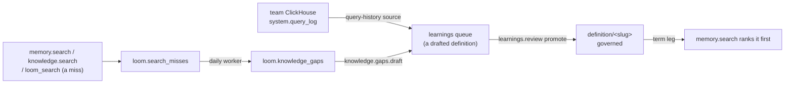

# Curation loop

The curation loop turns what people ask into definitions an organization stands behind.
Searches that find nothing become knowledge gaps. A gap, or a query a team runs often on
its own ClickHouse, becomes a drafted definition in the learnings queue. A definition an
admin promotes is governed: `memory.search` ranks it first when a query names its term.
This page is the design of the loop. None of its ops, tables or settings are served until
the pull request that builds each part lands; that pull request rewrites its section to
describe what it built.

## Governed definitions

A definition is a memory row with `memory_type = 'definition'` under the key
`definition/<slug>`, where the slug is the case-folded term with runs of other characters
replaced by `-`, followed by a short hash of the case-folded term, so `C++` and `C#` get
two keys. Its value is a JSON object, which `memory.set` stores whole in `value` and in
`value_json`, so the embedding and the content hash cover all of it:

| Field      | Meaning                                                             |
| ---------- | ------------------------------------------------------------------- |
| `term`     | The name as people write it.                                        |
| `aliases`  | Other names for the same thing (an abbreviation, an older name).    |
| `body`     | The definition's text.                                              |
| `owner`    | Who answers for the definition: a person or a team.                 |
| `rests_on` | What it is based on: knowledge document `source_uri`s and SQL text. |

A definition is **governed** while an admin stands behind its current text. That is
recorded apart from the memory row, in `loom.governed_definitions`: one row per
`definition/` key holding the term, its aliases, the `content_sha256` the admin approved,
who governed it and when. Only an admin op writes it: promotion (below) and an admin's
explicit govern or ungovern of a namespace-wide definition. No memory write reaches it, so
`memory.set`, `memory.pin`, `memory.verify`, `memory.update` and the bulk and import paths
cannot make a row governed. A definition is governed exactly while its record exists and
the hash of the row's current value (computed from the value, as `verification_state` in
`server/memory/domain/trust.py` computes it) equals the approved one; any change to the
text ends that, and the admin governs it again. Only namespace-wide rows (`user_id = '-'`,
`agent = '-'`) of type `definition` under the `definition/` key can be governed.

No two governed definitions share a term or an alias: governing one whose term or alias
is already another governed definition's is refused, and that check runs on every
govern, a renewed one included. Should two records still match one name (two governs
racing), the term leg serves the one governed last.

`definition` joins `KEY_IDENTIFIED_TYPES`, as `decision` is: two definitions under
different keys are two definitions however alike they read. Unlike a decision, a
definition is not marked conflicting with a close definition under another key, by the
write-time check or by the conflict resolver ([conflicts and
refusal](../features/memory/conflicts-and-refusal.md#the-conflict-resolver)), since its
key is its term and `MRR` is not a revision of `ARR`. Conflict surfacing compares a row
only with rows of its own `memory_type`, so a learned fact that contradicts a definition
is not refused by it. The term leg serves the governed definition above such a fact; a
cross-type check would add a candidate read to every write, and is not part of this
design.

### The term leg

`memory.search` gains one leg. It reads the namespace's `loom.governed_definitions` on the
`(org, namespace)` key prefix, matches the query against each record's term and aliases,
reads the matched definitions whose text is still the approved one, and places them at the
top of the served list with `governed = true` on the hit.
A term or alias matches where it appears in the query with no letter, digit, `+` or `#`
next to it. One written with a capital letter matches only as written, so `IT` does not
match "what is it"; any other matches case-folded, so `churn rate` matches "Churn rate".

Governed definitions are served through this leg under any read scope: an admin published
them for every reader of the namespace, and a user-bounded reader who could not see one
would read the term as undefined. This narrows the read-scope rule that a bounded read
serves no row stamped `'-'` ([read scope inside a
namespace](../concepts/identities-and-namespaces.md#read-scope-inside-a-namespace)), for
governed definitions through this leg only; every other namespace-wide row keeps it. The
leg honours the request's filters (`memory_type`, `tags`, `as_of`) and never serves a
`sensitivity = 'high'` row, as no other leg does. Its read is bounded by a setting; past
the bound, the most recently updated definitions are read and the response says the leg
was cut. It runs beside the others under the same time budget, and its latency is measured
against the op's budget (`OP_BUDGETS_P99_MS` in `server/settings/catalog.py`) in the pull
request that adds it. `governed` is an added output field: the SDKs and the MCP schema
carry it.

The leg covers memory only. Knowledge has its own exact-key leg for identifiers a document
defines (`server/knowledge/domain/exact_keys.py`), and a definition's `rests_on` already
points at the documents behind it. `loom_search` serves the leg through its memory section.

**Ranking-neutral rule:** when no governed term matches, the leg adds nothing and the
served list is exactly what it was before. The memory-plane rule asks for a paired
benchmark when a similarity gate or a rank weight moves; this leg moves neither. It inserts
rows only on a term match. So the pull request that adds it shows, on the offline harnesses,
that served keys and order are identical for every query naming no term, and reports the
gain on a small set of term queries.

## Knowledge gaps

### Recording misses

Recording is an operator opt-in (`knowledge_gaps_enabled`, off by default), as
`search_trace_log_enabled` is: a miss stores query text. A miss is a search that found
nothing a caller could use, recorded by the op the caller invoked, never by a search
another op runs on its behalf:

- `memory.search` that abstained, or answered with `retrieval_risk` `high` or `abstain`,
  and served no governed definition;
- `knowledge.search` with no hit as close as the noise filter's threshold (`_close` in
  `server/knowledge/app/knowledge_search.py`) and no exact-key hit;
- `loom_search` (`search.query`) whose memory and knowledge sections both came back empty,
  with no leg failed. Its own memory and knowledge searches record nothing, so a question
  that knowledge answers is not a gap because memory abstained.

A miss is recorded only for a request that names its end user (`user_id`, or an end-user
token), since a user erasure finds a person by `user_id` and a miss it could not find is a
copy of their words nothing erases but the namespace. Each miss writes one row to
`loom.search_misses` under the namespace the search was addressed to: the identity tuple,
`actor`, the plane, the query, its normalised form, and the memory keys or document URIs
of that namespace it came closest to. The table has a 30-day TTL: it is a trace, not
memory.

Neither existing log is reused. `loom.search_trace_log` records every query rather than
misses and has no `user_id` to count askers or erase by. `loom.query_nodes` keeps one row
per query text with its sessions, not its people, and only for memory searches.

### Grouping

The `knowledge_gaps` worker runs once a day for each namespace with misses. It reads the
last `knowledge_gaps_window_days` (default 7) of misses and groups them by normalised
query. **Privacy threshold:** a group with fewer than `knowledge_gaps_min_askers` distinct
users (default three) is dropped before anything else, so every query a gap shows was
asked in that form under at least that many `user_id` values. Those values are what the
callers name: a caller that names many users for one person defeats the count, which is
why `writers` is shown beside it. The worker embeds the remaining groups'
queries (at most `knowledge_gaps_max_groups`), merges groups whose vectors are at least
`knowledge_gaps_merge_similarity` alike, and writes the result as a new build of the
namespace in `loom.knowledge_gaps`:

| Column              | Meaning                                                         |
| ------------------- | --------------------------------------------------------------- |
| `gap_id`            | A hash of the namespace and the gap's most asked query.         |
| `head`, `samples`   | The most asked normalised query, and the others merged into it. |
| `user_ids`          | The users behind it, for erasure.                               |
| `askers`, `writers` | Distinct users, and distinct token actors that named them.      |
| `asks`, `last_at`   | How many times, and when it was last asked.                     |
| `nearest`           | The keys and document URIs the misses came closest to.          |

Every build writes a marker row beside its gaps, and readers take the latest build, so a
build with no gap left, or one whose gaps an erasure deleted, still replaces the last one.
Builds expire after 14 days. A pass whose read raced an erasure's delete could write
erased rows back, so after writing a build the worker deletes it when an erasure that may
reach the namespace (any user's, or the namespace's) was unfinished when the pass read or
has finished since (`ledger_reads.unfinished_reaching`,
[memory architecture](memory-architecture.md)). A failed erasure keeps that fence until it
completes, and the namespace shows no new build meanwhile.

### Ops and dashboard

| Op                     | Role  | What it does                                                                                  |
| ---------------------- | ----- | --------------------------------------------------------------------------------------------- |
| `knowledge.gaps.list`  | admin | The namespace's gaps, most askers first.                                                      |
| `knowledge.gaps.draft` | admin | Drafts a definition for one gap with the LLM and queues it (`source_kind = 'knowledge_gap'`). |

Both list what users asked, so neither honours a read-narrowed token: the check that
admits the `knowledge.` group to such a token (`honours_read_scope` in
`server/identity/domain/read_scope.py`) refuses `knowledge.gaps.` first. A draft queued
from a gap holds the drafted definition and the gap's id, never the queries asked: it is
shown to the namespace's viewers in `learnings.list`, as every learning is. The Library
page shows a gaps tile for a namespace the viewer administers, with a **Draft definition**
action per gap.

## Definitions from query history

A query-history source reads `system.query_log` from a team's ClickHouse into one
namespace's learnings queue. It is registered on that namespace by its admin, in a
registration of its own: not a document source, whose config never holds a host and which
writes documents, and not a tracker source, which needs the record contract and the
tracker org. It reuses the tracker's connection checks: the host vetting, a read-only
user (granted `SELECT` on `system.query_log`), the credential encrypted, a time budget and
a breaker on every read ([tracker plane](../features/tracker/overview.md)). The
registration names the team that owns its definitions. Each turn:

1. reads finished `SELECT` queries of the source's window, grouped by
   `normalized_query_hash`, ranked by distinct users and then by recency, and drops a group
   that fewer than `knowledge_gaps_min_askers` distinct users ran. Only the normalised text
   is read (`normalizeQuery`, which replaces literals), so no user's literal values reach
   the LLM or the draft;
2. skips groups already drafted (a draft's id derives from the source and the hash);
3. asks the LLM to draft a metric definition for at most a setting's number of groups, and
   queues each (`source_kind = 'query_history'`): the metric's name is the `term`, its
   meaning the `body`, the normalised SQL and the tables and columns it reads go in
   `rests_on`, and the registration's team is the `owner`.

Nothing reaches search until an admin promotes a draft.

## Promotion

`learnings.review` with `promote` on a `knowledge_gap` or `query_history` candidate writes
the definition through `memory.set` for the whole namespace, so the blacklist, the
pinned-key check and conflict surfacing run as for any write ([learnings review
queue](../features/memory/procedures-and-learnings.md#learnings-review-queue)). Then the
same call governs it as the reviewer's server-stamped actor: the admin promoting a
definition is the person standing behind it. A draft for a term already governed revises
that definition, and the promotion is the approval of its new text. A definition promotes
to memory only; a `destination` of `knowledge` or `both` is refused for these candidates.
A rejected draft leaves nothing behind but its queue row.

## Erasure and audit

- Definitions are memory rows and take every path memory takes: tombstone, namespace
  erasure, history, audit.
- `loom.search_misses`: a user step (`user_id`), a namespace step and a census row.
- `loom.knowledge_gaps`: a namespace step, a user step that deletes every gap whose
  `user_ids` holds the user, and a census row counting those.
- `loom.governed_definitions` holds terms and aliases, which are definition content: a
  namespace step and a census row.
- A draft holds no query asked (above), so it is erased with its namespace.
- `learnings.review` writes the audit row of each promotion, the governing included; the
  admin's govern and ungovern write their own, and `knowledge.gaps.draft` writes one
  naming the gap.

## Cost bounds

- Recording a miss is one asynchronous insert; a hit records nothing.
- The gaps worker embeds at most `knowledge_gaps_max_groups` texts per namespace per day.
- `knowledge.gaps.draft` and a query-history turn make one LLM call per draft, a turn at
  most its setting's number. Both run inside the namespace's daily cost cap
  (`server/observability/budget.py`): over the cap, a draft is refused and a turn ends
  early, and the next turn resumes.
- The term leg is one bounded read of the namespace's governed records per search, and a
  read of the matched definitions.

## Rolling upgrades

The tables are additive ([rolling upgrades](rolling-upgrades.md#the-rules)). While N-1
serves:

- it records no misses and serves no gap op; N's worker groups what N's replicas record;
- a user or namespace erasure it runs leaves rows in the tables this design adds; an
  erasure that ran during the rollout is run again once N-1 stops serving;
- it serves a `definition` row as a plain memory row with no term leg, and refuses a close
  write to another definition as a pinned peer;
- it marks close definitions conflicting, at write time and in its conflict resolver, and
  N does not clear those marks: an admin clears them with `conflicts.resolve` (`allow`);
- it never writes `loom.governed_definitions`, so nothing N-1 does makes a row governed;
- it promotes a `knowledge_gap` or `query_history` candidate as a row under the approver,
  which is never governed, or, with `destination` `knowledge` or `both`, as a
  `learning://<candidate_id>` document. The admin deletes that document
  (`knowledge.delete`) and writes the definition again on N, then governs it, since the
  candidate is already promoted.

## Invariants

- A gap shows only queries that at least `knowledge_gaps_min_askers` users asked in that
  form; a query-history draft only the normalised text of queries that many users ran.
- A miss is recorded only when the operator opted in, and only for a request that names
  its end user.
- A definition is governed only while an admin's record approves its current text, and no
  two governed definitions share a term or an alias; only governed definitions are placed
  above the served list.
- A query naming no governed term is served exactly as without the term leg.

## Source entry points

- `server/memory/domain/memory_types.py` (`KEY_IDENTIFIED_TYPES`)
- `server/memory/app/search/handler.py` (the legs of `memory.search`)
- `server/memory/app/learnings.py` (`handle_learnings_review`)
- `server/identity/domain/read_scope.py` (`honours_read_scope`)
- `server/observability/budget.py` (`namespaces_over_cap`)

## Related

- [Memory architecture](memory-architecture.md)
- [Learnings review
  queue](../features/memory/procedures-and-learnings.md#learnings-review-queue)
- [Conflicts and refusal](../features/memory/conflicts-and-refusal.md)
- [Tracker plane](../features/tracker/overview.md)
