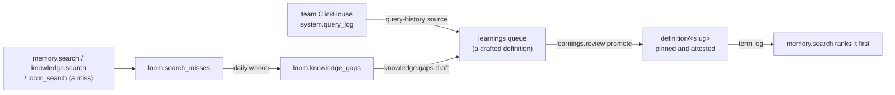

# Curation loop

The curation loop turns what people ask into definitions an organization stands behind.
Searches that find nothing become knowledge gaps. A gap, or a query a team runs often on
its own ClickHouse, becomes a drafted definition in the learnings queue. A definition an
admin promotes is governed: `memory.search` ranks it first when a query names its term.
This page is the design of the loop. None of its ops, tables or settings are served until
the pull request that builds each part lands; that pull request rewrites its section to
describe what it built.

## Governed definitions

A definition is a memory row with `memory_type = 'definition'` under the key
`definition/<slug>`, where the slug is the case-folded term with runs of other characters
replaced by `-`, followed by a short hash of the case-folded term, so `C++` and `C#` get
two keys. Its value is a JSON object, which `memory.set` stores whole in `value` and
in `value_json`, so the embedding and the attestation hash cover all of it:

| Field      | Meaning                                                             |
| ---------- | ------------------------------------------------------------------- |
| `term`     | The name as people write it.                                        |
| `aliases`  | Other names for the same thing (an abbreviation, an older name).    |
| `body`     | The definition's text.                                              |
| `owner`    | Who answers for the definition: a person or a team.                 |
| `rests_on` | What it is based on: knowledge document `source_uri`s and SQL text. |

A definition is written for the whole namespace (`user_id = '-'`, `agent = '-'`), like a
knowledge document, and is served under any read scope: an admin published it for every
reader of the namespace, and a user-bounded reader who could not see it would read the
term as undefined. Erasing the person who promoted it does not remove it; erasing the
namespace does.

A definition is **governed** when it is a namespace-wide `definition/` row, pinned, and its
attestation is current (`server/memory/domain/trust.py`, `verification_state`). Governance
has no column of its own, and a row under a user or an agent is never governed. A change
to the text leaves the attestation behind, so a revised definition is ungoverned until an
admin attests it again. Pinning or attesting a `definition` row takes
`admin` on its namespace, where any other row takes `writer`: a governed definition ranks
first for every reader, so only the role that promotes it may make it governed.

`definition` joins `KEY_IDENTIFIED_TYPES`, as `decision` is: two definitions under
different keys are two definitions however alike they read, so a governed definition does
not refuse another term's definition as a close pinned peer. A draft for a term that already
has a governed definition writes the same key with a changed value, which the existing
pinned-key check refuses with `PINNED_CONFLICT`
([conflicts and refusal](../features/memory/conflicts-and-refusal.md)); to revise it, an
admin unpins it, writes the changed text and attests it again. Conflict surfacing compares
a row only with rows of its own `memory_type`, so a learned fact that contradicts a
definition is not refused by it. The term leg serves the governed definition above such a
fact; a cross-type check would add a candidate read to every write, and is not part of
this design.

### The term leg

`memory.search` gains one leg. It reads the namespace's governed definitions on the
`(org, namespace)` key prefix, matches the query against each one's term and aliases, and
places the matched rows at the top of the served list with `governed = true` on the hit. A
term matches when its case-folded form appears in the case-folded query with no letter or
digit on either side, so `ARR` matches "what is our ARR" and not "arrow", and `C++` matches
"C++ style" and not "C". The
read is bounded by a setting; past the bound, the most recently updated definitions are
read and the response says the leg was cut. The leg runs beside the others under the same
time budget; its latency is measured against the op's budget (`OP_BUDGETS_P99_MS` in
`server/settings/catalog.py`) in the pull request that adds it. `governed` is an added
output field: the SDKs and the MCP schema carry it.

The leg covers memory only. Knowledge has its own exact-key leg for identifiers a document
defines (`server/knowledge/domain/exact_keys.py`), and a definition's `rests_on` already
points at the documents behind it. `loom_search` serves the leg through its memory section.

**Ranking-neutral rule:** when no governed term matches, the leg adds nothing and the
served list is exactly what it was before. The memory-plane rule asks for a paired
benchmark when a similarity gate or a rank weight moves; this leg moves neither. It inserts
rows only on a term match. So the pull request that adds it shows, on the offline harnesses,
that served keys and order are identical for every query naming no term, and reports the
gain on a small set of term queries.

## Knowledge gaps

### Recording misses

A miss is a search that found nothing a caller could use, recorded by the op the caller
invoked, never by a search another op runs on its behalf:

- `memory.search` that abstained, or answered with `retrieval_risk` `high` or `abstain`;
- `knowledge.search` with no hit as close as the noise filter's threshold (`_close` in
  `server/knowledge/app/knowledge_search.py`);
- `loom_search` (`search.query`) whose memory and knowledge sections both came back empty,
  with no leg failed. Its own memory and knowledge searches record nothing, so a question
  that knowledge answers is not a gap because memory abstained.

Each miss writes one row to `loom.search_misses` under the namespace the search was
addressed to: the identity tuple, `actor`, the plane, the query, its normalised form, and
the memory keys or document URIs of that namespace it came closest to. The `query` column
holds user text, so the row is written only when the request's capture consent allows
query text, the answer that gates `loom.search_trace_log.query`
([namespaces and sharing](../features/namespaces-and-sharing.md)). A namespace without that
consent records no misses and shows no gaps. The table has a 30-day TTL: it is a trace, not
memory.

Neither existing log is reused. `loom.search_trace_log` is off by default, records every
query rather than misses, and has no `user_id` to count askers or erase by.
`loom.query_nodes` keeps one row per query text with its sessions, not its people, and only
for memory searches.

### Grouping

The `knowledge_gaps` worker runs once a day for each namespace with misses. It reads the
last `knowledge_gaps_window_days` (default 7) of misses and groups them by normalised
query. **Privacy threshold:** a group with fewer than `knowledge_gaps_min_askers` (default 3) distinct askers is dropped before anything else, so every query a gap shows was asked
by at least that many askers in that form. An asker is the end user (`user_id`) when the
request names one, else the token's `actor`. The worker embeds the remaining groups'
queries (at most `knowledge_gaps_max_groups`), merges groups whose vectors are at least
`knowledge_gaps_merge_similarity` alike, and writes the result as a new build of the
namespace in `loom.knowledge_gaps`:

| Column            | Meaning                                                            |
| ----------------- | ------------------------------------------------------------------ |
| `gap_id`          | Stable id: a hash of the namespace and the gap's most asked query. |
| `head`, `samples` | The most asked normalised query, and the others merged into it.    |
| `user_ids`        | The end users behind it, for erasure.                              |
| `askers`, `asks`  | How many distinct askers, how many times.                          |
| `last_at`         | When it was last asked.                                            |
| `nearest`         | The keys and document URIs the misses came closest to.             |

Every build writes a marker row beside its gaps, and readers take the latest build, so a
build with no gap left, or one whose gaps an erasure deleted, still replaces the last one.
Builds expire after 14 days.

### Ops and dashboard

| Op                     | Role  | What it does                                                                                                                           |
| ---------------------- | ----- | -------------------------------------------------------------------------------------------------------------------------------------- |
| `knowledge.gaps.list`  | admin | The namespace's gaps, most askers first.                                                                                               |
| `knowledge.gaps.draft` | admin | Drafts a definition for one gap with the LLM, from its queries and nearest documents, and queues it (`source_kind = 'knowledge_gap'`). |

Both serve other people's questions, so neither honours a read-narrowed token: the check
that admits the `knowledge.` group to such a token (`honours_read_scope` in
`server/identity/domain/read_scope.py`) refuses `knowledge.gaps.` first. The Library page
shows a gaps tile for a namespace the viewer administers, with a **Draft definition**
action per gap.

## Definitions from query history

A query-history source reads `system.query_log` from a team's ClickHouse. It does not add a
document-source kind: a document source's config never holds a host, and this one writes no
documents. It names a connection registered in the tracker's source registry
(`loom.qa_sources`: an admin-supplied host checked as the tracker checks its hosts, a
read-only user granted `SELECT` on `system.query_log`, the credential encrypted, a time
budget and a breaker on every read; [tracker plane](../features/tracker/overview.md)) and
the namespace whose learnings queue receives the drafts. Each turn:

1. reads finished `SELECT` queries of the source's window, grouped by
   `normalized_query_hash`, ranked by distinct users and then by recency, and drops a group
   that fewer than `knowledge_gaps_min_askers` distinct users ran. Only the normalised text
   is read (`normalizeQuery`, which replaces literals), so no user's literal values reach
   the LLM or the draft;
2. skips groups already drafted (a draft's id derives from the source and the hash);
3. asks the LLM to draft a metric definition (name, SQL, tables, columns) for at most a
   setting's number of groups, and queues each (`source_kind = 'query_history'`).

Nothing reaches search until an admin promotes a draft.

## Promotion

`learnings.review` with `promote` on a `knowledge_gap` or `query_history` candidate writes
the definition, unpinned, through `memory.set` for the whole namespace, so the blacklist,
the pinned-key check and conflict surfacing run as for any write
([learnings review queue](../features/memory/procedures-and-learnings.md#learnings-review-queue)).
Then the same call pins the row and attests it as the reviewer's server-stamped actor: the
admin promoting a definition is the person standing behind it. A definition promotes to
memory only; a `destination` of `knowledge` or `both` is refused for these candidates. A
rejected draft leaves nothing behind but its queue row.

## Erasure and audit

- Definitions are memory rows and take every path memory takes: tombstone, namespace
  erasure, history, audit.
- `loom.search_misses`: a user step (`user_id`), a namespace step and a census row.
- `loom.knowledge_gaps`: a namespace step, a user step that deletes every gap whose
  `user_ids` holds the user, and a census row counting those. A worker pass that read the
  misses before the erasure deleted them can write such a gap back; the census then finds
  it, the saga fails closed, and the resumed saga deletes it again. The next build drops the
  user, whose misses are gone.
- A drafted definition holds only queries at least `knowledge_gaps_min_askers` askers
  asked in that form and the namespace's documents, never one person's words, so it is
  erased with its namespace, not per user.
- `learnings.review` writes the audit row of each promotion, attestation included, and
  `knowledge.gaps.draft` writes one naming the gap.

## Cost bounds

- Recording a miss is one asynchronous insert; a hit records nothing.
- The gaps worker embeds at most `knowledge_gaps_max_groups` texts per namespace per day.
- `knowledge.gaps.draft` and a query-history turn make one LLM call per draft, a turn at
  most its setting's number. Both run inside the namespace's daily cost cap
  (`server/observability/budget.py`): over the cap, a draft is refused and a turn ends
  early, and the next turn resumes.
- The term leg is one bounded read of governed definitions per search.

## Rolling upgrades

The tables are additive ([rolling upgrades](rolling-upgrades.md#the-rules)). While N-1
serves:

- it records no misses and serves no gap op; N's worker groups what N's replicas record;
- a user or namespace erasure it runs leaves rows in both tables; an erasure that ran during
  the rollout is run again once N-1 stops serving;
- it serves a `definition` row as a plain memory row with no term leg, and refuses a close
  write to another definition as a pinned peer;
- it lets a writer pin and attest a `definition` row, which N then serves as governed; once
  N-1 stops serving, an admin reviews the namespace's pinned definitions
  (`memory.list` with `memory_type = 'definition'`) and unpins any no admin stands behind;
- it promotes a `knowledge_gap` or `query_history` candidate as a row under the approver,
  which is never governed; the admin writes that definition again on N (`memory.set` for
  the whole namespace, then pin and attest), since the candidate is already promoted.

## Invariants

- A gap shows only queries that at least `knowledge_gaps_min_askers` askers asked in that
  form; a query-history draft only the normalised text of queries that many users ran.
- A miss is recorded only under the request's consent to store query text.
- A governed definition is namespace-wide, pinned and attested by an admin; only governed
  definitions are placed above the served list.
- A query naming no governed term is served exactly as without the term leg.

## Source entry points

- `server/memory/domain/memory_types.py` (`KEY_IDENTIFIED_TYPES`)
- `server/memory/app/search/handler.py` (the legs of `memory.search`)
- `server/memory/app/learnings.py` (`handle_learnings_review`)
- `server/identity/domain/read_scope.py` (`honours_read_scope`)
- `server/observability/budget.py` (`namespaces_over_cap`)

## Related

- [Memory architecture](memory-architecture.md)
- [Learnings review queue](../features/memory/procedures-and-learnings.md#learnings-review-queue)
- [Conflicts and refusal](../features/memory/conflicts-and-refusal.md)
- [Tracker plane](../features/tracker/overview.md)
