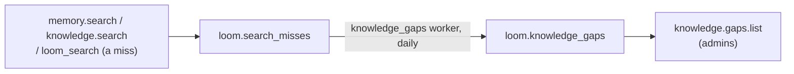

# Knowledge gaps

Loom records the searches that found nothing a caller could use and groups them, once a
day, into knowledge gaps: the questions several people asked that the namespace's memory
and documents do not answer. An admin reads them with `knowledge.gaps.list` and on the
Library page. Gaps are the first part of the curation loop; drafting a definition for a
gap and governed definitions are designed in the [curation loop
design](../development/curation-loop-design.md).

## Recording misses

Recording is an operator opt-in (`knowledge_gaps_enabled`, off by default). A miss stores
query text, so it also needs the consent `loom.search_trace_log` reads for its query
column: the request's capture level (`current_capture_level()` in
`server/observability/genai.py`) must not be `off`, and an unreadable consent reads as
`off`. The transport resolves that level from the namespace's `capture_generation_io`,
else the operator's `langfuse_capture_io_level`, narrowed to the most restrictive
namespace a fan-out reads. A namespace's `capture_generation_io` is a boolean that wins,
`true` meaning `all`, so a namespace that opts in that way also captures every LLM prompt
and completion; the operator's `langfuse_capture_io_level = query` is the only way to the
`query` level.

No miss is recorded:

- while a replica older than this build serves (see [rolling
  upgrades](#rolling-upgrades));
- on a deployment with one identity for every caller (`effective_identity_provider()` is
  `single-user`), or for a request without a token, since a gap needs several askers;
- by a search another op runs on a caller's behalf: only the op the caller invoked records
  one;
- for an agent sign-up's service account (registry `kind = 'agent'`), which stands for no
  person;
- for a later page (a call with a `page` handle);
- for a query that reads or grades as `medium` or `high` (`reads_high` and the grader in
  `server/memory/domain/sensitivity.py`), so a pasted credential or an email never becomes
  a gap;
- for a query that is not valid Unicode;
- for a query longer than 500 characters (`_MAX_QUERY_CHARS`), a pasted page rather than
  a question, which is never cut.

A miss is one of these, with no field set that narrows the search to part of the namespace
(`_HARD_FILTERS` beside the `memory.search` and `knowledge.search` handlers; for
`loom_search`, its `tags`; a value a namespace's retrieval defaults filled, and soft tags
such as a `role`'s, do not count):

- `memory.search` that abstained or answered with `retrieval_risk` `high` or `abstain`,
  under a token that reads the whole namespace, and not degraded, not with writes waiting
  for extraction (`pending_extraction`), a namespace skipped or hits the memory authority
  dropped (`stale_dropped`) (`server/memory/app/search/output.py`);
- `knowledge.search` with no hit as close as the close-hit threshold (`_close` in
  `server/knowledge/app/knowledge_search.py`), no exact-key hit and, in `lexical` mode, no
  hit at all, with no namespace skipped and no hit the memory authority dropped;
- `loom_search` (`search.query`) whose memory section missed (it abstained or answered at
  high retrieval risk as `memory.search` does, its flagged hits kept, or every memory hit
  fell below loom_search's precision floor, and it holds no decision merged from the code
  scope's repository namespace) and whose other sections (knowledge, profile,
  conversations) came back empty, with no memory, knowledge or conversations leg failed (a
  failed profile or tracker leg reads as empty), no tracker verdict, no namespace skipped,
  no `tags` and nothing withheld because an answer led (`withheld` reason
  `home_fact_leads` or `tracker_verdict_leads`), no section degraded, waiting on
  extraction or with hits dropped, under a token that reads the whole namespace. Its own
  memory and knowledge searches record nothing, so a question knowledge answers is not a
  gap because memory abstained.

**The asker** is the person the token stands for, never a body field
(`server/knowledge/app/gaps.py`): the end user of an end-user token; else the token's
`creator` claim; else, for a service account's token minted without the claim, the first
subject in its creator chain that is not a service account; else the token's subject. So
the tokens a person mints for themselves count as that person. An asker that cannot be
resolved (the registry unreadable, a chain with no person) records no miss: an unknown
principal is never counted as a separate person. The asker is stored in the form a user
erasure names, lower-cased: an end user as their id, an email folded onto the login
handle the directory ties it to (`login_handle` in `server/auth/aliases.py`), so one
person's two spellings count once. A spelling tied to two accounts, or a tie that cannot
be read, records no miss.

**The stored row.** Each miss writes one row to `loom.search_misses` under the namespace
the search was addressed to: its org, namespace and `user_id` (the end user), the asker
and the query's normalised form (`normalize_query` in `server/knowledge/domain/gaps.py`);
no agent or session, since a gap is the namespace's. That form drops format characters,
goes through `canonical_document_text`, is case-folded, and turns every run of characters
other than letters, numbers (with the marks on them), `_`, `+` and `#` into one space, so
`C++`, `C#` and `arr_v2` stay apart. No memory key or document URI is kept: one naming
another user's row or document would outlive that user's erasure in someone else's miss.
The recordings in flight per process are bounded by `knowledge_gaps_max_in_flight`; past
it a miss is dropped and counted.

**The erasure fence.** A miss is inserted after the response, so a user erasure could run
between the search and the insert. The recording reads `ledger_reads.unfinished_reaching`
before the insert and records nothing when an erasure that reaches the miss (the
namespace's, or a user's one of whose spellings is the asker or `user_id`) was unfinished
when the search answered, less the ledger's clock margin, or has finished since. It
inserts the miss under its own id, then reads the ledger again and deletes the row when an
erasure now reaches it. An unreadable ledger or directory counts as reaching.

**Lifetime.** `loom.search_misses` has a 16-day TTL: it is a trace, not memory. A pass
reads the last 7 days and a build lives 7 days, so a miss outlives every build that
counted it and a user erasure always finds the namespaces it must clear.

## Grouping

The `knowledge_gaps` worker (`server/knowledge/workers/knowledge_gaps.py`) runs once a day
for up to `knowledge_gaps_max_namespaces` namespaces with misses in the window or a live
build that still holds a gap; a namespace left with neither gets one empty build and then
drops out. A restart runs a pass at once only when no build is newer than
`knowledge_gaps_interval_seconds`.

**Consent first.** It re-reads the namespace's capture level uncached
(`capture_consent.level_uncached`). A level that cannot be read skips the namespace, with
no build and no delete. A level that is now `off` deletes the namespace's earlier builds
and stored misses and writes an empty build, so a later consent does not count them again;
the builds go with the misses because a user erasure finds a namespace through the user's
misses.

**Privacy threshold.** In ClickHouse, a group of one normalised query with fewer than
`knowledge_gaps_min_askers` distinct askers (default three, never below three) is dropped
before anything else, so every query a gap shows was asked in that form by at least that
many askers. The threshold is as strong as the principals behind it. It does not bind
whoever holds the signing key, an end-user issuer or a trusted caller (each names its own
users), or a deployment where principals can be self-created (`LOOM_SELF_SIGNUP=open`).
An admin who compares two daily builds can tell that one more asker reached a query, and
the reading admin's own asks count toward the threshold; in a small namespace either may
narrow who asked.

**Merging.** The worker reads at most `knowledge_gaps_max_groups` groups (the most
distinct askers first, then asks, then the latest ask), each with at most
`knowledge_gaps_max_askers_per_group` of its askers (never fewer than
`knowledge_gaps_min_askers`), held in memory for the pass and never stored. It embeds
their queries in one batch, as a call made for the org (its switch for model calls and the
inference attribution apply, and the spend lands in its cost events), inside the
namespace's daily cost cap read fail-closed (over the cap, unreadable, or with model calls
off, the namespace keeps its last build), and merges groups whose vectors are at least
`knowledge_gaps_merge_similarity` alike, counting a merged gap's askers as the union of
its groups'. It writes the result as a new build in `loom.knowledge_gaps`:

| Column              | Meaning                                                                     |
| ------------------- | --------------------------------------------------------------------------- |
| `org`, `namespace`  | The namespace the misses were recorded under (no user: a gap is counts).    |
| `build`, `built_at` | The pass that wrote it; a row with an empty `gap_id` is the build's marker. |
| `gap_id`            | A hash of the org, the namespace and the gap's most asked query.            |
| `head`, `samples`   | The most asked normalised query, and others merged into it.                 |
| `askers`, `asks`    | How many distinct askers, and how many times.                               |
| `last_at`           | The day it was last asked.                                                  |

**Builds.** Every build writes its gaps, then a marker row, and readers take the latest
build that has its marker, so a build with no gap left still replaces the last one. Builds
expire after 7 days, and `knowledge.gaps.list` ignores a build whose marker is older, so
an old one is never served when passes stop. The interval (at most 3 days) and the pass
deadline (at most 6 hours) are capped so that two of each, the wait a restart can add,
fit in a build's life. A namespace whose build fails (past the ClickHouse client's and the
embedder's own retries), or that a pass cut short never reached, keeps its last build
until a later pass, and its list is empty if that build expires first; the pass does not
try it again, since a retry would embed every head again.

**The pass's erasure fence.** A pass whose read raced an erasure's delete could write
erased rows back. After writing its gaps and before the marker, the worker reads the
erasure ledger; when the namespace's erasure, or any user's in the org, was unfinished
when the pass read or has finished since, it deletes the build, waiting for the delete,
and writes no marker, so the list serves the previous build. A namespace erasure whose
verify census runs between the pass's insert and that delete counts the build's rows and
fails, and its resume clears them; a user erasure's census does not count this table. Any
user's counts because a group holds at most `knowledge_gaps_max_askers_per_group` of its
askers, so the pass cannot tell whether the erased user was among the rest. An admin who
sees a namespace's gaps go when a user's erasure deletes its builds learns that the user
asked there in the last 7 days; the threshold does not hide that.

## The list and the dashboard

`knowledge.gaps.list` (admin) returns the namespace's gaps of its latest finished build,
most askers first, with the build's time; with `knowledge_gaps_enabled` off it answers an
empty list and `capturing` null. While capture is off for the namespace (its consent, or
the deployment's capture level when the namespace has not chosen) it answers an empty
list with `capturing` false and no build time, and the tile says recording searches is
off. It lists what users asked, so it does not honour a read-narrowed token
(`honours_read_scope` in `server/identity/domain/read_scope.py` refuses the
`knowledge.gaps.` prefix). The Library page shows a gaps tile for a namespace the viewer
administers, on a deployment that records misses.

## Cost

- On the request's path, a miss costs the rollout gate's cached read of the live replicas
  and the normalising and sensitivity check of a query the 500-character bound keeps
  small. The rest runs after the response: a registry read per hop of a service account's
  creator chain, a directory read for an email-shaped subject, a read of the erasure
  ledger before and after the insert (while any user erasure is open, each also reads the
  directory once for the asker and, when it differs, once for the end user), and the
  insert. A hit records nothing.
- The worker's grouping and its threshold run in ClickHouse (`GROUP BY` the normalised
  query, `HAVING` enough distinct askers), so at most `knowledge_gaps_max_groups` groups
  leave the store, and it embeds at most that many texts per namespace per day.

| Setting                               | Default      |
| ------------------------------------- | ------------ |
| `knowledge_gaps_enabled`              | off          |
| `knowledge_gaps_min_askers`           | 3, never < 3 |
| `knowledge_gaps_max_groups`           | 200          |
| `knowledge_gaps_merge_similarity`     | 0.85         |
| `knowledge_gaps_max_askers_per_group` | 10000        |
| `knowledge_gaps_max_in_flight`        | 256          |
| `knowledge_gaps_max_namespaces`       | 500          |
| `knowledge_gaps_interval_seconds`     | 86400, ≤ 3 d |
| `knowledge_gaps_max_pass_seconds`     | 3600, ≤ 6 h  |

## Erasure

- `loom.search_misses` has a namespace step and a user step. The user step deletes every
  miss whose asker or `user_id` is one of the spellings the directory ties to the named
  subject (`spellings` in `server/auth/aliases.py`), all compared lower-cased (the asker
  is stored that way, `user_id` is lower-cased with `lowerUTF8`), and fails closed when
  the directory cannot be read. Its census row counts the same predicate over the same
  spellings, so a miss the step left fails the saga's verify.
- `loom.knowledge_gaps` keeps counts, not askers, so no op or page names who asked. It has
  a namespace step, and the user's miss step, before it deletes the misses, deletes the
  builds of every namespace the user has misses in; the next daily pass rebuilds them
  without the user. The census counts it in the namespace scope only.

## Rolling upgrades

An older build's erasure saga does not know `loom.search_misses` or `loom.knowledge_gaps`,
so neither may gain rows while such a replica serves. While any live replica's schema is
below the migration that adds them, or no heartbeat in `loom.instances` can be read, no
miss is recorded, the worker writes nothing and `knowledge.gaps.list` answers 503
(`every_replica_erases_gaps` in `server/knowledge/app/gaps.py`), as `namespace.guide_set`
does ([rolling upgrades](rolling-upgrades.md)). The operator turns
`knowledge_gaps_enabled` on only once every replica runs this build.

Before a rollback to an older build, the operator turns `knowledge_gaps_enabled` off and
deletes the rows of `loom.search_misses` and `loom.knowledge_gaps`, and runs the same
delete once more after the first older replica serves, for what this build wrote in
between.

## Invariants

- A gap shows only queries that at least `knowledge_gaps_min_askers` askers asked in that
  form.
- A miss is recorded only when the operator opted in and the request's capture level is
  not `off`; its asker comes from the token, never the body.

## Source entry points

- `server/knowledge/app/gaps.py` (`record_miss`, `handle_knowledge_gaps_list`)
- `server/knowledge/domain/gaps.py` (`normalize_query`, `merge_groups`)
- `server/knowledge/store/gaps.py`
- `server/knowledge/workers/knowledge_gaps.py`

## Related

- [Curation loop design](../development/curation-loop-design.md)
- [Rolling upgrades](rolling-upgrades.md)
- [Memory architecture: erasure saga](memory-architecture.md#erasure-saga)
