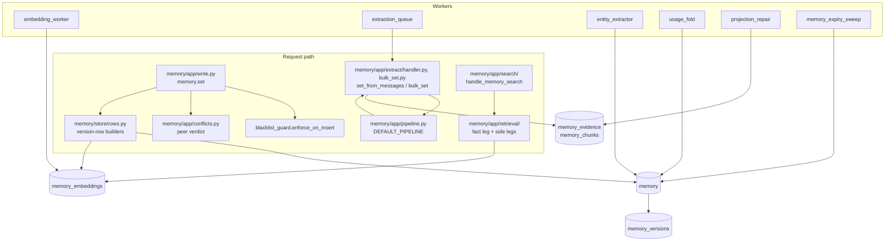

# Memory architecture

The memory plane stores facts in `loom.memory`, makes them searchable through
`loom.memory_embeddings`, and derives evidence, chunks, graph rows and statistics from
them. It retires a fact only when a writer or an owner asks. This page is the inside
view. Caller behaviour is in [writing memories](../features/memory/writing.md),
[search and ask](../features/memory/search-and-ask.md) and
[extraction](../features/memory/extraction.md); the model is in
[memory](../concepts/memory.md). Table families and the ClickHouse rules every write
obeys are in [ClickHouse](clickhouse.md).

## Goals and non-goals

| Goals                                                                                          | Non-goals                                                                                                |
| ---------------------------------------------------------------------------------------------- | -------------------------------------------------------------------------------------------------------- |
| A writer reads its own point write on the next call, search included.                          | Atomic multi-row writes. `memory.bulk_set` and promotion are not transactional.                          |
| Every write is judged against its peers (merge, duplicate, conflict, refines, rejected).       | Loom deciding truth. Verdicts flag and link rows; the owner or caller resolves.                          |
| Derived work (entities, chunks, summaries, statistics) never fails or slows the primary write. | Derived rows current at every instant. They converge within a worker interval.                           |
| Every version is recoverable (`memory_versions`); every write leaves a hash receipt.           | Transaction-time queries. Validity (`valid_at`, `valid_to`, `invalid_at`) is valid-time only.            |
| Search explains itself: per-component scores, an abstain code, a retrieval risk.               | One ranking formula for all corpora. Modes, recipes and namespace defaults exist because corpora differ. |

## Components

| Layer                        | Owns                                                                                                          |
| ---------------------------- | ------------------------------------------------------------------------------------------------------------- |
| `server/memory/api/`         | The wire: `memory.*` models and `Operation` declarations.                                                     |
| `server/memory/app/`         | Validation, verdicts, response shape; retrieval, extraction, the conflict judge.                              |
| `server/memory/domain/`      | Pure rules: provenance, sensitivity, search SQL shapes, synthesis policy.                                     |
| `server/memory/store/`       | Row shapes and the SQL over `loom.memory` and `loom.memory_embeddings`.                                       |
| `server/workers/registry.py` | One `_WORKERS` row per worker; switches and cadences are in the [workers reference](../reference/workers.md). |

## `memory.set`

`_handle_memory_set` in `server/memory/app/write.py` runs the write as named
phases over one request state (`_SetWrite`); the phases from embedding on live in
`server/memory/app/set_commit.py`. `handle_memory_set` wraps it to count each
outcome (refusal, 4xx `rejected`, or `error`) and to attach value-shape advisories.

1. **Resolve the type** (`_set_resolve_type`). The namespace's type configuration may
   retype the row; the response names `retyped_from`.
2. **Fetch the live row** (`_set_fetch_existing`) and the namespace's write
   configuration.
3. **Guard the existing row** (`_guard_existing_row`). A byte-identical value is a
   restatement: the new version carries `reinforcement_count + 1`. A changed value meets
   the lock (423), then the pin (409 `PINNED_CONFLICT` unless the write pins too).
4. **Expiry** (`_set_expiry`). `ttl_seconds`, `valid_to` and type or namespace retention
   become `expires_at`.
5. **Prepare the value** (`_set_prepare_value`): canonical JSON, `content_sha256`, the
   `char_limit` check (422 `CHAR_LIMIT_EXCEEDED`), the blacklist (422 `BLACKLISTED`,
   `server/memory/app/blacklist_guard.py`), the sensitivity tier (`memory/domain/sensitivity.py`) and its
   retention.
6. **Proposals and preconditions.** `proposed=true` may not overwrite an established
   fact (`_refuse_proposal_over_fact`). `if_match_sha256` must match the live hash (409
   `PRECONDITION_FAILED`).
7. **Build the version row** (`_set_build_memory_row`). Over a live row,
   `build_revision_row` carries the other columns forward and resets those that describe
   the old value (`REVISION_RESETS` in `memory/store/rows.py`). `actor` comes from the
   token; `source_class` is set by the server (`memory/domain/provenance.py`), and the body
   may only request a downgrade.
8. **Non-embedded rows stop here.** A type in `NON_SEARCHABLE_TYPES` (`episodic`,
   `profile`) or a `high`-sensitivity row gets one insert and no embedding row
   (`server/memory/domain/memory_types.py`, `is_embedded`). No embedding row means no search leg sees
   it.
9. **Embed** (`_set_embed`) the value and, when the key carries words, the key, in one
   batched call where the embedder supports it.
10. **Conflict verdict** (`_set_conflict_verdict`, `memory/app/conflicts.py`
    `check_on_commit`). Peers are active rows of the same type under other keys whose
    cosine reaches the conflict threshold: the type's `dedup_threshold`, else the
    namespace's `conflict_threshold`, else the embedder calibration, else
    `LOOM_CONFLICT_THRESHOLD`. An `append_only` policy and allowlisted pairs skip the
    check. In order:
    - canonical-form match: `merge`, no insert (`_set_merge`);
    - pinned peer: `rejected` (409);
    - peer at or above `LOOM_DUPLICATE_THRESHOLD` with the same content words:
      `duplicate`;
    - any other close peer: `conflict`.

    Under a token bounded to one user (`read_user_id`), peers outside that user's rows are
    treated as absent, with two exceptions that hold across the whole namespace by design: a
    close pinned peer still rejects the write (409 `PINNED_CONFLICT`), and `proposed=true`
    still may not land on a key that holds any user's established fact (409
    `KEY_HOLDS_FACT`). A pin protects the namespace's fact from every writer, and a proposal
    must not retire anyone's fact. The refusal names no row, id or value, so the narrowed
    token learns only that its write was refused.

    With `LOOM_MEMORY_CONFLICT_JUDGE` on (off by default), an LLM judge
    (`memory/app/conflict_judge.py`) labels close peers, and peers down to
    `LOOM_MEMORY_CONFLICT_JUDGE_MIN_SIMILARITY`, as `conflict`, `refines`, `merge` or
    `clear`. It runs after the insert (`memory/app/conflict_deferred.py`): the row lands `active` with
    `conflict_verdict: pending`, and the verdict is folded on later.
    `await_verdict=true` and `dry_run=true` judge inline.

11. **Dry run** returns the verdict with version 0 and writes nothing, not even an audit
    row.
12. **Dual write** (`_set_dual_write`). The `memory` row and its `build_embedding_row`
    row are inserted concurrently. The embedding row carries the columns search filters
    on (type, status, tags, entities, validity, `source_class`, `verified`), so no leg
    joins back to `memory`. Conflict marks then go on the peers, or `refines`
    supersedes them.
13. **After the write** (`_set_after_write`, `_set_post_insert`). Same-key supersession
    under `newest_wins` (`memory/app/key_supersession.py`; under `auto_reinforce` a bulk
    write judges same-key rows before its insert, see below) and the hash-only audit row are
    awaited in one round trip. The entity-graph projection is scheduled beside the
    response (`memory/app/after_write.py`) and repaired by `entity_extractor` if lost. A
    long value is also split into `memory_chunks`, fail-open.

**Embedding stubs.** `memory.set` embeds before it inserts, so an embed failure fails
the call and writes nothing. Other writers (`memory.promote` on an embed failure,
`namespace.rollback`) write a stub: `embedding_dim = 0` and a zero vector. Imports and
observation writers may write no embedding row at all. `embedding_worker` fills both at
the stub's version plus one, so a later real write still wins. A row that keeps failing
accrues `embed_attempts` and is marked `embed_failed_at` so it cannot stall the batch.
Every vector leg filters `embedding_dim > 0`.

**Why the judge is deferred.** The cosine check is cheap and runs on every searchable
write. The judge costs a model call for each write in its band. Deferring it keeps write
latency at the insert's. The deterministic verdicts stay inline because they decide
whether a row is written. The cost is a window where a row is `active` with a pending
verdict.

## `memory.bulk_set` and `memory.set_from_messages`

`memory.bulk_set` (`handle_memory_bulk_set` in `memory/app/bulk_set.py`) is the
batch form of the point write:

- one existing-row lookup and hash-based duplicate detection;
- entity resolution, row building and one embedding batch;
- the same four verdicts plus intra-batch pairs (`_bulk_verdicts`, `apply_bulk_verdicts`);
- one insert per table, then links, projections and follow-row supersessions.

Versions are nanosecond stamps, so last-writer-wins holds per key inside a batch. A
blacklisted entry is skipped, not raised; pinned and locked keys come back in
`skipped_pinned` and `skipped_locked`. One hash-only `memory.bulk_set` audit row records
the write.

`memory.set_from_messages` runs a step pipeline over a `WorkflowState`
(`memory/app/pipeline.py`, `DEFAULT_PIPELINE`) and writes through the bulk path:

| Step                              | What it does                                                                |
| --------------------------------- | --------------------------------------------------------------------------- |
| `loom.fetch_namespace_categories` | Loads the namespace's tag taxonomy.                                         |
| `loom.fetch_existing_memories`    | Shows the extractor the nearest stored memories so it does not repeat them. |
| `loom.llm_extract`                | The extraction call; long transcripts are split and merged.                 |
| `loom.drop_recall_echoes`         | Drops facts that restate memories the session was served (`recalled_keys`). |
| `loom.drop_session_echoes`        | Drops facts that restate what the session's own Loom calls wrote or read.   |
| `loom.drop_activity_narration`    | Drops narration of tool activity with no durable outcome.                   |
| `loom.drop_non_durable`           | Coding sessions: drops status snapshots, housekeeping and plans.            |
| `loom.verify_durable`             | Coding sessions: a verifier pass over the rest. Fails open.                 |
| `loom.hash_dedup`                 | Drops facts whose canonical hash is already stored.                         |
| `loom.bulk_write`                 | Writes through `memory.bulk_set`.                                           |

A request may reorder or skip steps, or name steps an operator registered
(`register_step`); see the [extraction pipeline guide](../guides/extraction-pipeline.md).
The prompt names keys by subject and attribute, never by value
(`memory/domain/extraction_prompts.py`), so a later statement of the same attribute
supersedes the earlier row. A "forget this" request in the transcript retires the
matching rows (`_retire_forgotten`).

**Same key, another session.** The storage identity includes the session, so a key
that a later session states again is a second live row, and the conflict check skips
same-key peers. Under `newest_wins` the newer write retires the older row. Under
`auto_reinforce` a shared key alone is not evidence of one attribute: extraction reuses
generic keys (`assistant_recommended_3`, `user_attended`) for different items, and in a
sample of 60 same-key pairs from chat-history namespaces 58 were different facts.

So, before its insert, a bulk write asks the conflict judge about the newest live rows of
each key it writes for the same subject: the same `user_id`, or for the anonymous user
`-` the same agent (`key_supersession.judge_same_key_rows`). The writer's own identity is
never a peer: its stored row is the one the write revises.

- **What gets judged.** Entries of one bulk share an identity, so for a key written
  twice only the highest version, the one `FINAL` keeps, is judged.
- **The cap.** At most `LOOM_MEMORY_CONFLICT_JUDGE_MAX_PEERS` (3) stored rows per key
  and subject are read, newest first. An older row past them stays live until a later
  write of the key reaches it.
- **Which row is older.** Only the older row of a pair ever retires, so two writers that
  judge each other never retire both. Rows rank by one total key, in Python and in the
  SQL that picks the newest peers. The key's first part is the row's valid time, else
  when it was written (`updated_at`, since a revision carries `created_at` forward from
  the key's first version). It is capped at the write time, because a fact dated in the
  future was still stated when it was written. Then come the write time and the id.
  Times are compared in UTC to the second; a valid time outside ClickHouse's `DateTime`
  range counts as none. Rows that tie on both times are separated by id (as text),
  which is arbitrary but fixed.
  - **A late old session:** its rows carry their session date, so it doesn't bury a
    later value, whether that value is dated or undated.
  - **An undated late row:** it counts as stated when it was written, so it is the later
    statement.
- **Amounts.** The older row retires only if the newer row keeps every amount it states
  (`preserves_quantities`, the guard the flag path's refines and `newest_wins` apply).

Then by label:

- **`contradiction`.** When the stored row is the later one, the new row lands
  `superseded` behind it (`invalid_at` = the write time, as for any retirement). Its
  entry's result answers `conflict_verdict: superseded` with `superseded_by` and no
  peers, and the row leaves the write's conflict marks, refines and value-update
  linking. Otherwise the stored row retires after the insert.
- **`elaboration` by the newer row.** The older row retires.
- **Anything else.** `restatement`, `related`, `unrelated` and a peer the judge left
  unlabelled all keep both rows. The flag path reads an unlabelled peer as a
  contradiction; a retirement does not.

A stored row retires after the insert only if it isn't locked, and wasn't pinned,
retired or revised since the judge read it (the retirement reads it read-your-writes).
It also leaves the write's other conflict marks and refines, so no other verdict of the
write re-emits it; an entry left with no peer answers `clear`. `superseded_by` names the
row that was the later statement when the retirement happened. That row can itself
retire later, so a reader follows the chain. A row labelled `sensitivity='high'` is
never judged or read as a peer, so its value never reaches the LLM. The read is bounded
by the writer's read scope, like every same-key retirement.

This costs one judge call per new row that has such peers, on top of the bulk conflict
check's own calls. The calls are bounded by the same settings
(`LOOM_BULK_CONFLICT_CHECK_MAX_ENTRIES`, `LOOM_BULK_CONFLICT_CHECK_CONCURRENCY`), and
they add at least one LLM round trip to a bulk write that has any (one per
`LOOM_BULK_CONFLICT_CHECK_CONCURRENCY` rows judged). The policy is the namespace's, as
for the write's conflict verdicts.

Without this, "User is Asian American" (05-23) and "The user has mixed Irish and Italian
ethnicity" (05-30) both stayed live under `user_ethnicity`, and a reader shown both
merged them into one answer. The point write keeps the documented `auto_reinforce`
behaviour and its latency: it doesn't call the judge for same-key rows. The judge is off
by default (`LOOM_MEMORY_CONFLICT_JUDGE`); with it off, same-key rows stay live as
before.

The extraction also writes its inputs:

| Table                                   | Holds                                                                  |
| --------------------------------------- | ---------------------------------------------------------------------- |
| `memory_evidence`                       | The turns it read (`memory/app/evidence.py`; read by `memory.recall`). |
| `memory_chunks`, `memory_chunk_sources` | Verbatim chunks and their lineage.                                     |
| `memory_belief_sources`                 | Evidence links.                                                        |
| `session_summaries`                     | A session digest.                                                      |
| graph tables                            | Entity vectors, edges and triples (through the bulk path).             |

These are projections. A failure is recorded in `loom.memory_projection_failures` and
replayed by `projection_repair`; it never reaches the caller.

### Deferred and ambient extraction

| Path                                                                           | Writes first                                                            | Finished by                                                                                                                                                                                                              |
| ------------------------------------------------------------------------------ | ----------------------------------------------------------------------- | ------------------------------------------------------------------------------------------------------------------------------------------------------------------------------------------------------------------------ |
| `set_from_messages(defer=true)`, or an agent in `LOOM_EXTRACTION_DEFER_AGENTS` | A `loom.memory_extraction_queue` row; returns `queue_id`                | `extraction_queue` claims the oldest `pending` rows and runs the inline handler: `pending → running → done`, or back to `pending` with `attempts + 1` until `failed`. A `running` row past `lease_until` is reclaimable. |
| `observe.record` / `observe.crystallize`                                       | Tool-trace observations as episodic rows, marked ready by `crystallize` | `observe_extract` (off by default, needs an LLM) replays each ready session through `set_from_messages`.                                                                                                                 |

Until a queued request is done, `memory.search` and `memory.ask` report
`pending_extraction` for the scope, and `memory.extraction_status` reads the row. The
canonical-hash dedup makes a double claim harmless. With `extraction_queue` off, deferred
saves stay `pending`.

## `memory.search`

`handle_memory_search` (`server/memory/app/search/handler.py`) runs phases, one
module each. The SQL is in `server/memory/app/retrieval/` and
`server/memory/domain/search_sql.py`.

1. **Settle the request** (`request.py`): recipe and namespace `retrieval_defaults`, read
   scope, the `top_k` ceiling. A parked `page` handle is served directly.
2. **Read-your-writes** (`consistency.py`): a namespace this process just wrote re-reads
   under sequential consistency ([ClickHouse](clickhouse.md#read-your-writes)).
3. **Plan** (`plan.py`, `memory/domain/query_planner.py`): dates, recency, preference
   attribute, entities and sub-queries choose the mode, HyDE and the planes, and size
   the pool.
4. **Embed the query** (`embed.py`) within the request's `SearchBudget`.
5. **Run the legs** (`graph.py`, `vector_legs.py`). Graph mode first expands the query's
   entities one hop over `entity_edges` and `entity_triples`. The summary legs
   (`summaries.py`, over `session_summaries` and `entity_summaries`) start as side
   tasks. Each namespace then runs `vector_search` (`search.py`), which gathers its legs
   concurrently. Across several unordered namespaces, private ones are searched first
   and public ones only when no private hit clears the relevance floor.

   | Leg              | Module                       | Reads                                                                                                                                                                                                     |
   | ---------------- | ---------------------------- | --------------------------------------------------------------------------------------------------------------------------------------------------------------------------------------------------------- |
   | fact             | `fact_sql.py`                | One statement per namespace over `memory_embeddings FINAL`: identity columns in `PREWHERE`, row state in `WHERE`, an exact `cosineDistance` order (no table has a vector index), rank computed beside it. |
   | lexical and BM25 | `lexical.py`, `side_legs.py` | `hasAnyTokens` over the lowercase, stem and lemma columns; Okapi BM25 from `memory_term_freq` / `memory_doc_stats` plus rows newer than the refresh mark.                                                 |
   | verbatim chunks  | `chunks.py`                  | `memory_chunks`: a stage-1 candidate read, then one keyed stage 2 with neighbour windows.                                                                                                                 |
   | records          | `side_legs.py`               | `memory_records`.                                                                                                                                                                                         |

   Additive pools follow: sub-queries, set expansion, the entity and date anchor pool
   (`anchor_pool.py`) and the key-match arm (`key_match.py`). The assembler folds in the
   side legs and digest descent (`digest_descent.py`), which adds the best facts of the
   top digests' sessions.

6. **Fuse and rank** (`fusion.py`, `ranking.py`). The per-mode rank expression
   (`fact_rank.py`, `_fact_mode_rank_score`) adds the capped prior group (confidence,
   soft tags, categories) and the correctness tail (demotions, reinforcement,
   provenance trust) from `_fact_rank_tail`. `rrf` mode fuses the lexical and semantic
   orders by reciprocal rank instead. Reinforcement is read from `memory_reinforcement`
   after the fetch. A configured reranker reorders the pool and fails open.
7. **Verdict** (`verdict.py`, `_finalize_abstain`): empty is `no_match`, a weak top hit
   is `below_threshold`, then the calibrator's `low_calibrated_confidence`. A query
   naming an identifier absent from every hit abstains too
   (`LOOM_MEMORY_SEARCH_IDENTIFIER_GROUNDING`).
8. **Assemble and record** (`assemble.py`, `output.py`, `telemetry.py`). The window is
   cut to budget; with `paging=true` a larger pool is parked in `loom.context_blobs`.
   Trace, exposure and query-node rows go to the events stream, fire-and-forget.

With `LOOM_ADAPTIVE_THRESHOLDS` on, the similarity gates come from the embedder's own
cosine distribution (`memory/app/embedder_calibration.py`); the scalar settings are the
fallback. `memory.search_trace` runs the same SQL with extra columns. The caller's view
of ranking is in [retrieval and ranking](../concepts/retrieval-and-ranking.md).

**Why the priors are capped.** Real embedders produce a narrow cosine band. A confidence
term plus a tag boost can exceed the gap between a good and a mediocre match.
`LOOM_MEMORY_PRIOR_CAP` bounds the group, so a prior only reorders near-ties.

## Background passes

| Worker                    | Reads                                                        | Writes                                                                             | LLM |
| ------------------------- | ------------------------------------------------------------ | ---------------------------------------------------------------------------------- | --- |
| `embedding_worker`        | Stubs and memories without an embedding row                  | Embedding rows at stub version + 1                                                 | No  |
| `usage_fold`              | `memory_usage_totals`, `memory_exposures`, `memory_versions` | `memory_reinforcement`, and absolute `evidence_count` / `recall_count` on `memory` | No  |
| `entity_extractor`        | Memories with empty `entities`                               | Entities on `memory` and `memory_embeddings`; missed graph rows                    | Yes |
| `projection_repair`       | `memory_projection_failures`                                 | The failed chunk, evidence and graph projections                                   | No  |
| `orphan_vector_reconcile` | Live embedding rows whose memory is tombstoned or gone       | Tombstones on `memory_embeddings` and `entity_vectors` (no mutation)               | No  |
| `memory_expiry_sweep`     | Rows past `expires_at`                                       | The `on_expire` action                                                             | No  |
| `sensitivity_sweep`       | Recent rows from paths that skip detection                   | A labelled version; `high` rows' embedding rows tombstoned                         | No  |
| `profile_consolidation`\* | A user's preference and decision memories (namespace opt-in) | One non-searchable `profile` section, loaded by `profile.render` / `context.pack`  | Yes |
| `reflection_distill`\*    | Recent sessions without an outcome                           | Outcome labels, then `reflection` memories hidden from unfiltered recall           | Yes |
| `entity_communities`\*    | The co-occurrence graph                                      | `entity_communities`                                                               | No  |
| `recalibration`           | The embedder's score distribution                            | Calibration thresholds                                                             | No  |

\* Off by default (`LOOM_PROFILE_CONSOLIDATION_ENABLED`,
`LOOM_REFLECTION_DISTILL_ENABLED`, `LOOM_ENTITY_COMMUNITIES_ENABLED`).

`memory.consolidate` is an op, not a worker. It clusters similar active memories by
cosine and entity overlap and asks the LLM to merge each cluster into one row. It writes
`memory_belief_sources` lineage (`support_type='derived_from'`), tombstones the merged
keys and logs to `loom.consolidation_runs`. A suppression memory never merges with a
positive one.

A worker leg that catches its own failure calls `pass_context.note_failure`, so the
supervisor counts it. A worker that declares `owned_tables` runs its first pass at boot
when one of them is empty for a namespace in scope (`workers/first_pass.py`).

## Lifecycle

Every lifecycle change is a new version built with `build_memory_version_row`:
tombstone, restore, lock, promote, demote, supersession (`status='superseded'`,
`superseded_by`, `invalid_at`). Prior versions stay in `memory_versions`. `memory.redact`
is the one op that edits a stored version. Status flips over many rows (the usage fold,
`memory.reject` quarantine) are batched lightweight updates; see
[ClickHouse](clickhouse.md#deletes-and-mutations).

Expiry is the writer's choice. `ttl_seconds`, `valid_to`, a type's or namespace's
`retention_days`, or `LOOM_MEMORY_SENSITIVE_RETENTION_DAYS` set `expires_at` and
`on_expire`. Reads hide an expired row at once. `memory_expiry_sweep` (or
`memory.sweep_expired`) then applies `on_expire` (`memory/app/expiry.py`):

| `on_expire`           | Effect                                                                        |
| --------------------- | ----------------------------------------------------------------------------- |
| `tombstone` (default) | Tombstones the row.                                                           |
| `demote`              | Clears expiry and scales confidence down.                                     |
| `anonymize`           | Replaces the value with a marker, tombstones embeddings, keeps the shell row. |

Table-level retention and tiering are operator TTLs, off by default
([ClickHouse](clickhouse.md#partitioning-and-ttl)).

## History, snapshot, restore and rollback

| Operation            | Reads                                           | Writes                                                                                                                                 |
| -------------------- | ----------------------------------------------- | -------------------------------------------------------------------------------------------------------------------------------------- |
| `memory.history`     | `memory_versions` for one key                   | Nothing.                                                                                                                               |
| `memory.redact`      | `memory_versions`, by org-wide `memory_id`      | Scrubs one historical version in place. Refuses the live head (delete it first).                                                       |
| `namespace.snapshot` | Live `memory` rows, type configs, curated rows  | A portable payload with `version`, `content_sha256` and the attestation columns, plus a `loom.namespace_snapshots` audit row.          |
| `namespace.restore`  | A snapshot payload                              | Rows into a target namespace (created if missing; the caller becomes admin). Idempotent per `snapshot_id`. Never strips `verified_by`. |
| `namespace.rollback` | `memory` heads and `memory_versions` at `as_of` | Each changed key's older version as a new head; keys absent at `as_of` tombstoned; embedding stubs for the worker. Dry run by default. |

Rollback restores heads, not exact state. `version` is a wall-clock stamp, so the head
at T is the largest version at or before T. Triples, records, summaries and aggregates
are rebuilt by their workers (`memory/domain/rollback.py` plans the rollback,
`memory/app/namespace_rollback.py` applies it, `identity/app/namespace_rollback.py` is the handler).

## Erasure saga

`erasure.request` (`erasure/app/handlers.py`) starts a saga (`erasure/app/saga.py`)
over a `user_id`, `namespace` or `namespace_list`. Each step is idempotent and
checkpointed as a new version of the `erasure_requests` row (`steps_completed`), so a
restart resumes. `erasure_recovery` replays sagas stuck `in_progress`; after
`max_attempts` it marks the request `failed` and emits `erasure.abandoned`. Configured
external backends (Langfuse traces and ClickStack rows) are steps
too and fail the saga closed.

The last step is a residue census over every table the read paths touch. The registry
is in `server/erasure/store/census.py`:

| List                | Holds                                                                                                                                                 |
| ------------------- | ----------------------------------------------------------------------------------------------------------------------------------------------------- |
| `_CENSUS`           | One `Substrate(table, live, user_pred, ns_step, user_step, final)` per table that can hold content in scope. Any live row in scope fails the saga.    |
| `STEP_ONLY_TABLES`  | Tables a step clears that the census does not count (shared and consolidated tombstones, term aggregates, session outcomes, the code index purge, …). |
| `NO_MEMORY_CONTENT` | Every other table, each with the reason it holds no content in scope.                                                                                 |

The terminal row carries `residue_count`, `residue` (per table) and `verified_at`. A
resumed saga re-runs the owning step of any table the last census found rows in.
`purge=true` hard-deletes: lightweight `DELETE FROM` on the tables in
`LIGHTWEIGHT_PURGE_TABLES`, `ALTER TABLE … DELETE` on the rest, each mutation tagged and
polled to completion. `tests/unit/test_every_table_is_classified.py` fails on a table in
none of the three lists.

## Audit rows

Every write that creates or changes memory leaves one hash-only row in `loom.audit_log`
(`server/observability/audit.py`): no value, only identity, actor, key, id, content
hash, source class and verdict. The row hash and the checkpoint chain are described in
[audit](../features/observability/audit.md).

## Invariants

- Every new `memory` or `memory_embeddings` version carries every persisted column
  (`MEMORY_PERSISTED_COLS` and `build_embedding_row` in `rows.py`).
  `insert_memory_versions` (`check_memory_rows`) refuses a partial row or an unknown
  column.
- A new `loom.memory` column goes into `memory_versions` and `memory_versions_mv` in the
  same migration.
- `actor` and `source_class` are stamped by the server on every write path
  (`server/memory/app/provenance.py` `writer_actor`, `server/memory/domain/provenance.py`
  `source_class_for`). A request may only
  downgrade to `derived`, `external` or `imported`.
- A `high`-sensitivity row and a non-searchable type have no embedding row.
- Every vector leg filters `embedding_dim > 0`.
- Merge, duplicate and pinned rejection are decided before the insert; only the LLM
  judge may run after it.
- Ops addressed by an org-wide id (`memory.get_by_id`, `memory.update_by_id`,
  `memory.redact`) check `authz.row_in_scope` after the fetch and answer `found=false`
  on refusal, never a 403.
- A projection failure never fails the primary write.
- Writes are not transactional across tables; bulk writes and cross-namespace promotion
  are not atomic.
- A table that can hold memory content is in `_CENSUS`, or in `STEP_ONLY_TABLES` with its
  reason.

## Source entry points

| Path                                                                                                                                                            | What                                                                                                |
| --------------------------------------------------------------------------------------------------------------------------------------------------------------- | --------------------------------------------------------------------------------------------------- |
| `server/memory/api/models_*.py`, `server/memory/api/ops_*.py`                                                                                                   | Wire models; op declarations.                                                                       |
| `server/memory/app/write.py`, `server/memory/app/set_commit.py`                                                                                                 | `handle_memory_set` and its `_set_*` phases.                                                        |
| `server/memory/app/update.py`                                                                                                                                   | `memory.update`, `memory.update_by_id`.                                                             |
| `server/memory/app/extract/handler.py`                                                                                                                          | `set_from_messages`.                                                                                |
| `server/memory/app/bulk_set.py`, `server/memory/app/bulk_rows.py`, `server/memory/app/bulk_verdicts.py`                                                         | `bulk_set`, its rows, `apply_bulk_verdicts`.                                                        |
| `server/memory/app/pipeline.py`                                                                                                                                 | `DEFAULT_PIPELINE`, `register_step`, `run_pipeline`; its text rules are in `server/memory/domain/`. |
| `server/memory/app/{conflicts,conflict_judge,conflict_deferred,key_supersession}.py`                                                                            | Verdicts and supersession.                                                                          |
| `server/memory/app/search/`, `server/memory/app/retrieval/`, `server/memory/domain/search_sql.py`                                                               | Search phases and leg SQL.                                                                          |
| `server/memory/store/`                                                                                                                                          | `rows.py`, `inserts.py`, `reads.py`, `lifecycle.py`, `history.py`.                                  |
| `server/memory/app/{after_write,projections,projection_failures}.py`                                                                                            | Fail-open projections.                                                                              |
| `server/erasure/app/saga.py`, `server/erasure/store/`, `server/erasure/workers/recovery.py`                                                                     | Erasure.                                                                                            |
| `server/memory/domain/rollback.py`, `server/memory/app/{namespace_rollback,snapshot_rows}.py`, `server/identity/app/{namespace_rollback,namespace_snapshot}.py` | Rollback, snapshot, restore.                                                                        |
| `server/observability/audit.py`, `server/insights/domain/audit_checkpoints.py`, `server/insights/workers/audit_verifier.py`                                     | Audit.                                                                                              |

## Related

- [Memory](../concepts/memory.md), [writing memories](../features/memory/writing.md),
  [conflicts and refusal](../features/memory/conflicts-and-refusal.md),
  [retention and erasure](../features/memory/retention-and-erasure.md),
  [history and provenance](../features/memory/history-and-provenance.md).
- [ClickHouse](clickhouse.md), [LLM architecture](llm-architecture.md).
- [Operations reference](../reference/operations.md#memory).
