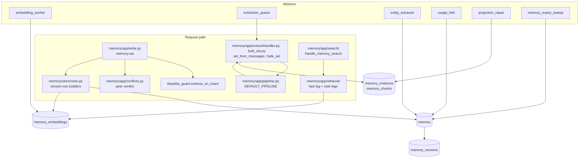

# Memory architecture

The memory plane stores facts in `loom.memory`, makes them searchable through
`loom.memory_embeddings`, and derives evidence, chunks, graph rows and statistics from
them. It retires a fact only when a writer or an owner asks. This page is the inside
view. Caller behaviour is in [writing memories](../features/memory/writing.md),
[search and ask](../features/memory/search-and-ask.md) and
[extraction](../features/memory/extraction.md); the model is in
[memory](../concepts/memory.md). Table families and the ClickHouse rules every write
obeys are in [ClickHouse](clickhouse.md).

## Goals and non-goals

| Goals                                                                                          | Non-goals                                                                                                |
| ---------------------------------------------------------------------------------------------- | -------------------------------------------------------------------------------------------------------- |
| A writer reads its own point write on the next call, search included.                          | Atomic multi-row writes. `memory.bulk_set` and promotion are not transactional.                          |
| Every write is judged against its peers (merge, duplicate, conflict, refines, rejected).       | Loom deciding truth. Verdicts flag and link rows; the owner or caller resolves.                          |
| Derived work (entities, chunks, summaries, statistics) never fails or slows the primary write. | Derived rows current at every instant. They converge within a worker interval.                           |
| Every version is recoverable (`memory_versions`); every write leaves a hash receipt.           | Transaction-time queries. Validity (`valid_at`, `valid_to`, `invalid_at`) is valid-time only.            |
| Search explains itself: per-component scores, an abstain code, a retrieval risk.               | One ranking formula for all corpora. Modes, recipes and namespace defaults exist because corpora differ. |

## Components

| Layer                        | Owns                                                                                                          |
| ---------------------------- | ------------------------------------------------------------------------------------------------------------- |
| `server/memory/api/`         | The wire: `memory.*` models and `Operation` declarations.                                                     |
| `server/memory/app/`         | Validation, verdicts, response shape; retrieval, extraction, the conflict resolver.                           |
| `server/memory/domain/`      | Pure rules: provenance, sensitivity, search SQL shapes, synthesis policy.                                     |
| `server/memory/store/`       | Row shapes and the SQL over `loom.memory` and `loom.memory_embeddings`.                                       |
| `server/workers/registry.py` | One `_WORKERS` row per worker; switches and cadences are in the [workers reference](../reference/workers.md). |

## `memory.set`

`_handle_memory_set` in `server/memory/app/write.py` runs the write as named
phases over one request state (`_SetWrite`); the phases from embedding on live in
`server/memory/app/set_commit.py`. `handle_memory_set` wraps it to count each
outcome (refusal, 4xx `rejected`, or `error`) and to attach value-shape advisories.

1. **Resolve the type** (`_set_resolve_type`). The namespace's type configuration may
   retype the row; the response names `retyped_from`.
2. **Fetch the live row** (`_set_fetch_existing`) and the namespace's write
   configuration.
3. **Guard the existing row** (`_guard_existing_row`). A byte-identical value is a
   restatement: the new version carries `reinforcement_count + 1`. A changed value meets
   the lock (423), then the pin (409 `PINNED_CONFLICT` unless the write pins too).
4. **Expiry** (`_set_expiry`). `ttl_seconds`, `valid_to` and type or namespace retention
   become `expires_at`.
5. **Prepare the value** (`_set_prepare_value`): canonical JSON, `content_sha256`, the
   `char_limit` check (422 `CHAR_LIMIT_EXCEEDED`), the blacklist (422 `BLACKLISTED`,
   `server/memory/app/blacklist_guard.py`), the sensitivity tier (`memory/domain/sensitivity.py`) and its
   retention. A retention window that would move a `read_only` row's expiry is refused
   (423, `refused_action` `expire`), as in `memory.bulk_set`.
6. **Proposals and preconditions.** `proposed=true` may not overwrite an established
   fact (`_refuse_proposal_over_fact`). `if_match_sha256` must match the live hash (409
   `PRECONDITION_FAILED`).
7. **Build the version row** (`_set_build_memory_row`). Over a live row,
   `build_revision_row` carries the other columns forward and resets those that describe
   the old value (`REVISION_RESETS` in `memory/store/rows.py`). `actor` comes from the
   token; a worker that sets `pipeline_actor` writes as it (the structured profile worker
   writes `worker:structured-profile`); other workers with no auth context write an empty
   actor.
   `source_class` is set by the server (`memory/domain/provenance.py`), and the body may
   only request a downgrade.
8. **Non-embedded rows stop here.** A type in `NON_SEARCHABLE_TYPES` (`episodic`,
   `profile`) or a `high`-sensitivity row gets one insert and no embedding row
   (`server/memory/domain/memory_types.py`, `is_embedded`). No embedding row means no search leg sees
   it.
9. **Embed** (`_set_embed`) the value and, when the key carries words, the key, in one
   batched call where the embedder supports it.
10. **Conflict verdict** (`_set_conflict_verdict`, `memory/app/conflicts.py`
    `check_on_commit`). Peers are active rows of the same type under other keys whose
    cosine reaches the conflict threshold: the type's `dedup_threshold`, else the
    namespace's `conflict_threshold`, else the embedder calibration, else
    `LOOM_CONFLICT_THRESHOLD`. An `append_only` policy and allowlisted pairs skip the
    check. In order:
    - canonical-form match: `merge`, no insert (`_set_merge`);
    - pinned peer: `rejected` (409);
    - peer at or above `LOOM_DUPLICATE_THRESHOLD` with the same content words and no
      value the other lacks on each side (`values_differ`): `duplicate`;
    - any other close peer: `conflict`.

    A `decision` row (`KEY_IDENTIFIED_TYPES`) is identified by its key: a close peer in
    the writer's read scope answers `conflict`, pinned or not, and no pinned peer refuses
    it.

    Under a token bounded to one user (`read_user_id`), peers outside that user's rows are
    treated as absent, with two exceptions that hold across the whole namespace by design: a
    close pinned peer still rejects the write (409 `PINNED_CONFLICT`; a decision excepted),
    and `proposed=true` still may not land on a key that holds any user's established fact
    (409 `KEY_HOLDS_FACT`). A pin protects the namespace's fact from every writer, and a
    proposal must not retire anyone's fact. The refusal names no row, id or value, so the
    narrowed token learns only that its write was refused.

    No verdict on the write calls an LLM. With the conflict resolver on, the peer read
    reaches down to `LOOM_MEMORY_CONFLICT_RESOLVER_MIN_SIMILARITY` (0.60), and a write
    that has a peer in that band, or answers `conflict`, is marked for the resolver
    (see [The conflict resolver](#the-conflict-resolver)). A peer below the conflict
    threshold never flags a write.

11. **Dry run** returns the verdict with version 0 and writes nothing, not even an audit
    row.
12. **Dual write** (`_set_dual_write`). The `memory` row and its `build_embedding_row`
    row are inserted concurrently. The embedding row carries the columns search filters
    on (type, status, tags, entities, validity, `source_class`, `verified`), so no leg
    joins back to `memory`; its `conflict_checked_at` carries the resolver's mark.
    Conflict marks then go on the peers, or `refines` supersedes them.
13. **After the write** (`_set_after_write`, `_set_post_insert`). Same-key supersession
    under `newest_wins` (`memory/app/key_supersession.py`; under `auto_reinforce` and
    `manual_review` the conflict resolver judges same-key rows, see below, and under
    `append_only` nothing is marked) and the hash-only audit row are
    awaited in one round trip. The entity-graph projection is scheduled beside the
    response (`memory/app/after_write.py`) and repaired by `entity_extractor` if lost. A
    long value is also split into `memory_chunks`, fail-open.

**Embedding stubs.** `memory.set` embeds before it inserts, so an embed failure fails
the call and writes nothing. Other writers (`memory.promote` on an embed failure,
`namespace.rollback`) write a stub: `embedding_dim = 0` and a zero vector. Imports and
observation writers may write no embedding row at all. `embedding_worker` fills both at
the stub's version plus one, so a later real write still wins. A row that keeps failing
accrues `embed_attempts` and is marked `embed_failed_at` so it cannot stall the batch.
Every vector leg filters `embedding_dim > 0`.

## The conflict resolver

A cosine hit says two rows are about the same thing, not whether one replaces the other.
Deciding that takes a strong model (`LOOM_CONFLICT_RESOLVER_MODEL`, `gpt-6.1-sol`, one
call per row with all its peers), and a call takes seconds, so it runs on the leader,
after the write (`memory/workers/conflict_resolver.py`, `memory/app/conflict_resolver.py`).

What the resolver keeps, whatever runs beside it
(`tests/integration/test_conflict_resolver_invariants_ch.py` checks each under concurrent
memory.set, memory.pin, memory.delete, Undo and erasure requests):

- No user write or pin is lost: every resolver write re-reads its row under the row's key
  lock and lands at the read version + 1, so a write that started after the read is newer.
  A pin (`memory.pin`) and an unpin hold the key's lock from their read to their insert,
  as an Undo and a conditional write do, so a pin racing a retirement lands after it,
  and its row and vector are both served. Like an Undo, a pin answers 409 while another
  write holds the key and 503 while the lease store (Keeper) does not answer; retry it.
- Every retirement has a `memory.auto_supersede` record and can be undone.
- With the default thresholds, nothing is retired below 0.98, flagged below 0.95, or
  cleared below 0.90.
- No other user's or tenant's text reaches a prompt. A row's peers are its subject: the
  same org, namespace and `user_id`, whichever agent or session wrote them; for the
  anonymous user `-` (or a `user_id` sent empty, stored as sent), the same agent too.
- Nothing is written in an org under erasure, even one requested while a row's call is in
  flight: the erasure is read again right before each write.
- A row is judged once per written version: after a paid call the row is stamped judged,
  or the pass stops (a provider or lock outage) with the row owed.

**The queue** is `loom.memory_embeddings.conflict_checked_at`, which every write already
emits (`memory/store/conflict_resolver.py`):

| Value                 | Meaning                                                                                                                                                                        |
| --------------------- | ------------------------------------------------------------------------------------------------------------------------------------------------------------------------------ |
| NULL                  | Nothing owed: no peer at the resolver floor when written.                                                                                                                      |
| `1970-01-01 00:00:01` | Owed: a peer at the floor, a `conflict` verdict, or (outside `newest_wins`) a key another session of the same subject holds, or an earlier row of its bulk batch at the floor. |
| `1970-01-01 00:00:02` | Judged.                                                                                                                                                                        |
| `1970-01-01 00:00:00` | A judgement an older build deferred and lost: owed after 60 s.                                                                                                                 |
| any real time         | Stamped by an older build: owed again only while the row is `conflicted`.                                                                                                      |

A mark belongs to the write that set it: a revision emits a new vector row with its own.
Each pass reads `LOOM_MEMORY_CONFLICT_RESOLVER_BATCH` (40) owed rows and, when it is due,
`LOOM_MEMORY_CONFLICT_RESOLVER_RECHECK_BATCH` (8) rows already `conflicted` that no
resolver judged, so a flag the cosine check raised is judged once too. That second
read scans every `conflicted` row (no index prunes its predicate), so once it comes back
short of a full batch it is not due again for five minutes. Both reads find their namespaces
first without `FINAL`, where the mark's minmax index prunes, and run `FINAL` over those
namespaces alone. Both reads take rows in turns across (org, namespace), so one
namespace's bulk import does not hold back a row written elsewhere: the owed read takes
each namespace's newest rows first (a namespace busier than its share of the cost cap
never drains, and its latest writes are the ones reads need judged), the re-check its
oldest. A row still owed after `LOOM_MEMORY_CONFLICT_RESOLVER_MAX_OWED_AGE_DAYS` (30) days
is no longer judged; it stays as it was written. The age is its vector row's, the write
time of the revision owed. Neither reads a namespace that
`namespace.delete` soft-deleted; its rows are judged if it is registered again.

**The cluster.** A row is judged against up to `LOOM_MEMORY_CONFLICT_RESOLVER_MAX_PEERS`
(8) live peers of its `memory_type`, nearest first, at cosine
`LOOM_MEMORY_CONFLICT_RESOLVER_MIN_SIMILARITY` (0.60) or more, in its subject: the same
`user_id`, or for the anonymous user (`-` or a user_id sent empty) the same agent. Any
session counts, so a row of the same key written by another session is a peer; the row's
own identity is not. Peers join their rows by the full identity, never by key alone,
since keys repeat across sessions. The type, liveness and expiry are applied in the vector read itself, before
its limit, so closer rows of another type cannot take every place. The row's current
flags (by id) and the nearest rows of its key in other sessions are read whatever the
cutoff and the floor. The places go to the flags first, then to those same-key rows (at
most half the places, so a key held in many sessions leaves room), then to the nearest
peers: a row owed because another session holds its key is judged against that row. Both stay inside the subject, since a cosine flag can name
another user's row. A `sensitivity='high'` row is never a peer, so its value never reaches the LLM. The label is outside the content hash, so the
judged row is re-read strongly and the cluster's labels checked again right before the
prompt is built: a row relabelled `high` since it was read is not sent.

**The call.** The prompt names each peer `p1`..`p8` with its key, its cosine, when its
statement holds (the order a retirement checks, `_assertion_order`; a date when the
writer gave the fact's date) and whether it comes from the judged row's session, another
session of its agent, or another agent; the judged row shows its own time. The rubric
asks for an update only when the judged row is the later statement, and reads a value tied
to one session's task (a task id, a deadline, a build) stated in another session as a
different entity. Values are cut to 700 characters, and the answer is a strict JSON schema:
per peer a reason, `same_entity`, `same_attribute`, a verdict (`update`, `contradiction`,
`elaboration`, `restatement`, `related`, `unrelated`) and a confidence; an entry with a
field missing or mistyped is dropped and its peer left unresolved. An answer may name a
peer as `p2`, `[p2]`, its id, or its key (`key <key>`) when no other peer shares it. The
model is `LOOM_CONFLICT_RESOLVER_MODEL`, asked at reasoning effort `low`, where the
thresholds below were measured, whatever `LOOM_LLM_OPENAI_REASONING_EFFORT` pins for other
calls; `LOOM_LLM_FALLBACK_MODEL` never answers for it, so rows stay owed while the model is
down.

**The fold** (`memory/domain/conflict_resolution.py`), precision first:

| Verdict                                                          | Confidence   | Action                                           |
| ---------------------------------------------------------------- | ------------ | ------------------------------------------------ |
| `update` or `contradiction` with a different entity or attribute | any          | nothing (the answer contradicts itself)          |
| `update` or `contradiction` from another session, for user `-`   | any          | nothing (an agent's sessions are separate tasks) |
| any                                                              | below 0.90   | nothing                                          |
| `update` or `contradiction`                                      | below 0.95   | nothing                                          |
| `update`, namespace `auto_reinforce` or `newest_wins`            | 0.98 or more | retire the peer if stated first                  |
| `update` (0.95 to 0.98, or `manual_review`), `contradiction`     | 0.95 or more | flag both rows `conflicted` for review           |
| `elaboration`, `restatement`, `related`, `unrelated`             | 0.90 or more | clear a flag between the pair                    |

The three thresholds are `LOOM_MEMORY_CONFLICT_RESOLVER_RETIRE_CONFIDENCE` (0.98),
`LOOM_MEMORY_CONFLICT_RESOLVER_FLAG_CONFIDENCE` (0.95) and
`LOOM_MEMORY_CONFLICT_RESOLVER_CLEAR_CONFIDENCE` (0.90), in that order (the settings
refuse any other): an update retires only at the first; a contradiction at the second or
above, and an update between the second and the first, go to review; below the second
neither changes anything; and a compatible verdict clears at the third. On a drained
chat-memory run, flags between 0.90 and 0.95 were right 11 times in 26. An update
between two rows whose writers both dated the fact (`valid_at`) on the same day goes to
review too: the prompt shows both as that day, and two facts from one conversation day
have no order. A peer the answer leaves out, or an answer that cannot be parsed, changes
nothing. The default `auto_reinforce` retires as `newest_wins` does: in agent use nobody
works the Review queue, so a flagged update would leave search serving the stale value,
while a retirement is recorded, undoable, and its history stays readable with
`include_superseded` and `as_of`. Under `manual_review` an update only flags, and an
`append_only` row is never judged.

**Acting.** An update says the judged row (NEW) makes the peer stale, so only the peer
retires, and only when it was asserted strictly first: each row is ordered by the
first `loom.memory_versions` version (wall-clock ns) holding its current content hash
since the last version that held another, so the order is finer than the second, a
metadata write (touch, pin, tags) does not move it, and a value that came back is
ordered from its return; an explicit `valid_at` earlier than that moves it back. Equal keys, or a peer
asserted later, flag the pair for review instead. A row is always judged as itself:
a newer peer comes to its own turn from its own mark. A retirement goes through `apply_refines`: the older row is superseded behind the
newer (its `superseded_by`), one `memory.auto_supersede` record names it
(reason `conflict_resolver`, so `memory.restore` undoes it), and the triple plane follows
(`follow_row_supersessions`). A flag the newer row held against the retired one is removed
as a clear removes it, and the audit row's pair says `flag_cleared`, so the winner does
not stay on the review queue against a retired row. The follow and the record are owed
before the supersede commits: one waited-for `triples_follow_owed` projection-failure row
holds the pair and the record's entry, and is resolved once both land, so a failure or a
crash in between leaves them for the projection repair, which follows a pair, writes its
record when none exists and clears the winner's flag against the loser, only while its
loser is retired behind its winner. The repair leaves an intent under ten minutes old
(`FOLLOW_OWED_GRACE_S`) to its writer, which records and follows the retirement itself, so
the two never write a record side by side. A point write's retirement (same-key, a
contradiction, a refine) owes its record and follow the same way: the intent goes before
the supersede and the record names it. Once the record and the follow beside the response
both landed, the process resolves it in a batched flush (every ten seconds and at
shutdown, one chunked mark per org), so the request path writes no mutation; an intent it
did not resolve (a lost answer, a crash, a failed follow) stays for the repair, which
follows the pairs, writes a record still missing and resolves it after the grace. A
resolved failure row leaves 30 days after its resolve (the table's TTL); an abandoned one stays for an operator. The acting of a judged row (its pairs, records,
follows and audit row) is shielded from cancellation, and a cancelled pass ends only once
it has finished. A flag is
`mark_peers_conflicted`; a clear removes the pair from each side's `conflict_with`, and a
row left with no flag is `active` again, on its vector row too. One hash-only
`memory.conflict_resolver` audit row per judged row that changed memory lists the pairs,
actions, verdicts and confidences, never the text.

**Invariants.**

- Both rows are re-read read-your-writes before any action, and acted on only while both
  are live, unexpired, with `valid_to` open, and still hold the content judged; the queued
  row is held to the same rule before its call. A row revised meanwhile is left to its new
  mark; every resolver write (supersede, flag, clear) lands at the read version + 1, so
  a write that started after the read, locked or not, stays newest, and a retirement it
  overtook records nothing.
- Only `auto_reinforce` and `newest_wins` retire; `manual_review` only flags, and
  `append_only` is never judged.
- A pinned row is never retired, flagged or cleared, and is no peer (no call is paid for a
  pair no verdict may change); a lock that refuses retirement holds.
- The resolver dates an undone row from its first assertion: the version an Undo
  writes, named in its `memory.unsupersede` record, continues the row's statement. A
  version after a retirement that no Undo wrote is judged afresh, as a restatement.
- An Undo writes that record under the key's lock before it restores the row, and
  answers 503 with nothing restored when the record cannot be written. It leaves both
  rows unowed: the next pass does not judge the pair again.
  Should the winner be judged again anyway (still owed), the pair is left alone, neither
  retired nor flagged from either side, while the Undo's `memory.unsupersede` record names
  that retirement, the restored row still holds the value it had at the Undo, and both
  rows' values were stated before it. A later write of either row carries its own mark
  and is judged afresh; a writer restating a retired value makes a new statement, dated
  when it was restated. The Undo holds while its audit record does: past
  `LOOM_RETENTION_AUDIT_LOG_DAYS` the pair may be judged and retired again.
- A row is stamped judged only after its actions. A pass cut short judges it again, and
  acting twice changes nothing: a retired row is no longer live, an existing flag is left
  as it is, and a cleared flag has nothing left to clear.
- A pass judges `LOOM_MEMORY_CONFLICT_RESOLVER_CONCURRENCY` (8) rows at once. A pair is
  re-read and written under both rows' key write locks, taken in lock-name order, as a
  conditional revision holds its key from its read to its insert: a resolver write never
  lands over a revision, and when two rows judged at once both call the same peer stale,
  the second re-reads it retired and leaves it. A writer takes one key, so nothing
  deadlocks; a key held past the lock's wait leaves the row's remaining pairs, and the
  row stays owed: that write may change only metadata, or fail, and bring no new mark.
  The record and the follow of a retirement run after the locks are released. A pair
  whose two rows are both owed in one pass may be judged twice, once from each side.
- The queue reads leave out a namespace whose resolver spend has reached its share of the
  daily LLM cost cap (`observability.budget`), an org whose model calls are switched off,
  and an org with an erasure queued, running or failed and due a retry (an abandoned saga
  does not count), so their rows stay owed without taking places in a pass. The erasure
  is read again right before each write (under the pair's locks, and before each stamp):
  an org whose erasure was requested meanwhile gets no write, and its row stays owed. The
  cap is read again before each call, so at most the calls already in flight cross it.
  Each call names its org and bills its namespace (`worker.conflict_resolver`); a call
  the model-call switch holds sends nothing, and the row stays owed with no attempt.
- A provider that refuses the model or the key (401, 403, 404) stops the pass with no
  further call; the rows stay owed, and the worker warns once per change, not per pass.
  A transient failure (408, 409, 429, 5xx, a timeout, no connection) leaves the row owed,
  with no attempt counted; the same one three rows in a row is an outage, which stops the
  pass. Any other 4xx
  refuses this row's request, and asking again gets the same answer: the row is stamped
  judged and counted `errored`. An answer with nothing usable (cut at the output cap,
  `length` or `max_tokens`, or malformed), or with no verdict for some peer, is asked once
  more with twice the room, and the answer that covers more peers is kept; nothing usable
  again, the row is stamped judged and counted `errored`. A row flagged against a peer
  neither answer judged stays owed, so the flag is judged later, three times at most
  before it is stamped `errored`. A refused row is stamped when its pass ends. The same
  refusal (its kind and HTTP status) three rows of one namespace in a row with no answer
  between is the request's fault, not the rows': that namespace stops for the pass and waits
  five minutes, every row of it, the refused ones too, staying owed; the other namespaces
  go on. A refused request (a 4xx, not billed) counts no attempt; an answer with nothing
  usable was paid for and counts one, so such a row ends after three. The keys' write locks unavailable (Keeper down) stop
  the pass after that call; the rows stay owed. A pass stopped by the model, the locks or
  an outage pauses the whole worker for five minutes: the next passes would pay for the
  same answer.

**Cost.** About $0.005 per judged row on `gpt-6.1-sol`, judged once per written
version, and only rows with a peer at cosine 0.60 or more, or a flag, are judged. The
resolver may spend a quarter of the namespace's daily cost cap
(`LOOM_MEMORY_CONFLICT_RESOLVER_CAP_SHARE`, 0.25, of `daily_cost_cap_usd`, else
`LOOM_DEFAULT_DAILY_COST_CAP_USD`, $1), counted over its own calls, and never takes the
rest: the requests (`memory.ask`, extraction) read the whole spend against the whole cap,
so a backlog the resolver drains never leaves them capped; and once the requests have spent
the whole cap, the resolver stops too. That is about 50 judged rows a
day per namespace at the default cap: raise `LOOM_DEFAULT_DAILY_COST_CAP_USD` (or the
namespace's `daily_cost_cap_usd`) or `LOOM_MEMORY_CONFLICT_RESOLVER_CAP_SHARE` for a busier
one.
The share is read before each call, after the costs of the calls finished so far are
flushed, so a pass goes past it by at most the calls already in flight
(`LOOM_MEMORY_CONFLICT_RESOLVER_CONCURRENCY`). A full batch with no errors (at least one
row judged, the model and the locks available) is followed at once by the next, for up to
five minutes of a pass, instead of waiting the interval.
`LOOM_MEMORY_CONFLICT_RESOLVER_ENABLED` resolves at load: off when `LOOM_LLM_PROVIDER` or
the provider of `LOOM_CONFLICT_RESOLVER_MODEL` is `fake`, else on; an explicit value wins.
Without the model's key (one boot warning), writes are still marked, and the judge never
takes the fake client that stands in for the key: the pass reads nothing, the worker
warns once (and logs once when the key is back), and the rows stay owed, so they are
judged once the key is set, in the environment or the dashboard.

## `memory.bulk_set` and `memory.set_from_messages`

`memory.bulk_set` (`handle_memory_bulk_set` in `memory/app/bulk_set.py`) is the
batch form of the point write:

- one existing-row lookup and hash-based duplicate detection;
- entity resolution, row building and one embedding batch;
- the same four verdicts plus intra-batch pairs (`_bulk_verdicts`, `apply_bulk_verdicts`);
- one insert per table, then links, projections and follow-row supersessions.

Versions are nanosecond stamps, so last-writer-wins holds per key inside a batch. A
blacklisted entry is skipped, not raised; pinned and locked keys come back in
`skipped_pinned` and `skipped_locked`. One hash-only `memory.bulk_set` audit row records
the write.

`memory.import` (`handle_memory_import` in `memory/app/memory_import.py`) writes through
`handle_memory_bulk_set`, so an imported item meets every check above. The bulk write's
live-row lookup reads the caller's session only and skips tombstones, so first the import
reads each key's newest version across the sessions of the identity inside the request's
read scope (`key_heads_across_sessions`; an `own_session` token reads only its own session).
A key whose newest version is a tombstone, or superseded, rejected or proposed, is left as
it is; a live one is `unchanged` when it holds the item's text (`sensitivity_kept` when the
entry names another sensitivity; the stored level stands) and `revised` when it holds other
text. Only a key with no version goes to the bulk write. That read and the write are not
atomic: a delete that lands between them is written over. A bulk result with no version that
no check refused, no merge took and no other key holds is the skip gate's or identity
dedup's answer for the key itself, so the entry is `unchanged`.

Each item's key is `import:` and 24 hex characters of the SHA-256 of its text (`import_key`
in `memory/domain/import_keys.py`), and each entry declares `source_class=imported`. A key
of exactly that shape (`is_import_key`) gets no `(#key)` suffix from `build_excerpt` and no
text from `key_axis_text`, whichever write stores it, so the row is embedded and lexically
indexed by its value alone; a row written before (an older build, or a write under such a
key) keeps its stored excerpt through `loom reembed` until its next write. The key is a
digest of the text, so a guessable text can be confirmed from its key wherever keys are
shown. The key axis's automatic probe of key reuse (`key_axis_auto`) leaves import keys out,
so a large import does not turn the axis off for the namespace's own keys.

The import passes three options to the bulk write. `detect_updates=False`: the value-update
linker never retires a live memory on its behalf. `conflict_check_cap` set to the number of
entries it writes: the conflict check reaches every entry whatever
`bulk_conflict_check_max_entries` says. `reinforce=False`: no restatement, merge or identity
duplicate records an `evidence` event, so a re-run reinforces nothing. Its dry run passes
`dry_run=True`, and the bulk write returns once the verdicts are in: every check has run,
and nothing is written but a blacklist pattern's hit count and the vectors it embedded,
which land in `loom.embedding_cache`, as on a `memory.set` dry run. Category links go
through `memory/store/categories.py`, the statements `memory.assign_category` runs. The
import reads the links of its keys before the write and adds only pairs never stored, so a
link the owner rescinded stays rescinded (a rescind that lands between that read and the
insert is written over, as a delete is), and the new links leave one `memory.import` audit
row of keys and category names. It sends its entries to the bulk write oldest first (by
`valid_at`, an undated one counting as now, then request order), because under `newest_wins`
the later of two statements of one attribute in a batch retires the earlier.

`memory.set_from_messages` runs a step pipeline over a `WorkflowState`
(`memory/app/pipeline.py`, `DEFAULT_PIPELINE`) and writes through the bulk path:

| Step                              | What it does                                                                            |
| --------------------------------- | --------------------------------------------------------------------------------------- |
| `loom.fetch_namespace_categories` | Loads the namespace's tag taxonomy.                                                     |
| `loom.fetch_existing_memories`    | Shows the extractor the nearest stored memories so it does not repeat them.             |
| `loom.llm_extract`                | The extraction call; long transcripts are split and merged.                             |
| `loom.drop_recall_echoes`         | Drops facts that restate memories the session was served (`recalled_keys`).             |
| `loom.drop_session_echoes`        | Drops facts that restate what the session's own Loom calls wrote or read.               |
| `loom.drop_activity_narration`    | Drops narration of tool activity with no durable outcome.                               |
| `loom.drop_non_durable`           | Coding sessions: drops status snapshots, housekeeping and plans.                        |
| `loom.verify_durable`             | Coding sessions: a verifier pass over the rest. Fails open.                             |
| `loom.hash_dedup`                 | Drops facts whose canonical hash is already stored.                                     |
| `loom.bulk_write`                 | Files bot rules to the learnings queue, then writes the rest through `memory.bulk_set`. |

A request may reorder or skip steps, or name steps an operator registered
(`register_step`); see the [extraction pipeline guide](../guides/extraction-pipeline.md).
The prompt names keys by subject and attribute, never by value
(`memory/domain/extraction_prompts.py`), so a later statement of the same attribute
supersedes the earlier row. A "forget this" request in the transcript retires the
matching rows (`_retire_forgotten`).

### Same key, another session

The storage identity includes the session, so a key that a later session states again is
a second live row, and the conflict check skips same-key peers. Under `newest_wins` the
newer write retires the older row. Under `auto_reinforce` a shared key alone is not
evidence of one attribute: extraction reuses generic keys (`assistant_recommended_3`,
`user_attended`) for different items, and in a labelled sample of 60 same-key pairs from
chat-history namespaces 52 were different facts, 7 were restatements and 1 was an update.

Those rows are judged by the conflict resolver like any other peers: under `auto_reinforce`
and `manual_review`, a point write (`conflicts.same_key_mark`) and a bulk write mark each
row whose key a live row of the same `user_id` from another session holds
(`key_supersession.keys_held_elsewhere`). The anonymous user (`-`, or a `user_id` sent
empty) is never marked so: its sessions are separate tasks, where a verdict could only
clear a flag. Under `append_only` nothing is marked. The writer's own identity is never
a peer: its stored row is the one the write revises.

**Which row is older.** Only the older statement of a pair ever retires, so two rows
judged from either side never retire both (`conflict_resolver._assertion_order`, read
under the pair's key locks). A row's place is when its value was first asserted: the first
version of the current run of history rows holding its `content_sha256`, in nanoseconds,
so a touch, a pin or a tag change, which keep the hash, do not move it. An explicit
`valid_at` earlier than that moves it back, since the fact held then; a later one (a fact
dated ahead) does not. A row the history does not hold yet counts from its current
version. When the order does not show the judged row as the newer statement, an update
verdict flags the pair for a person instead of retiring.

- **A late old session:** its rows carry their session date, so it doesn't bury a later
  value, whether that value is dated or undated.
- **An undated late row:** it counts from when it was asserted, so it is the later
  statement.

### Following a retirement in the graph

When a write or the conflict resolver retires a stored row, the triple plane closes the loser's triples that the live
end of the winner's chain does not state (`triples_follow_rows`), following
`superseded_by` up to 8 links (a repair reads to the end, up to 1,024). A row's stated
triples are the ones `entity_triple_rows` links to its id and current `content_sha256`,
so a canonicalised subject ("I live in Paris" is `(user, lives_in, paris)`) closes too,
and a winner that names an old value under another relation ("... and the user visited
Paris") does not keep it, while one it says in a clause the update left unchanged stays
open ("work in London" of "I live in London and work in London" → "I live in Rome and
work in London"), and keeps a later end it stated ("I live in London until December" is
not ended now). A row written before those links existed is matched by the subject and
object its prose names.

Each successor the follow writes, one already open included, is linked to its winner as
`inferred`: an inferred link adds to what a row is read by, so a winner whose extractor
stated nothing is still matched by its text too. The link stays the row's after a
revision while the new value says the fact in the same words, and is kept until the row
is erased. A successor then goes through the
interval repair, as a write of it does: an older value of its single-valued relation
that another live row still states closes when the newer successor starts (see Which
value is newer).

A write follows up to 1,024 pairs itself and records the rest, or all of them if the
follow fails, for `projection_repair` to follow; a replay dates an undated winner by its
last write. Other same-key retirements (a `newest_wins` policy, a point write's
supersession) are not followed: their losers' triples stay open, a known gap.

A facet edge (the agent's file, concept or topic) is no row's: it is never linked, and
no retirement closes it.

A triple another live row's links still state stays open, unless a newer successor's
repair closes it (above). A row whose current value has no link its extractor stated
keeps open a triple its key is linked to (`entity_triple_memories`) while its value
still names it, when that key link counts: the value was first written before rows were
linked to triples (by the row-links migration's applied time, read from
`loom.memory_versions`, so a pin, a lock or an Undo of the same value keeps it one), or
since by a build that links only keys, the previous one still serving during a rolling
deploy. That build links the key just after it writes the row, so its key link is no
older than the value, and no row of the key links the triple. A value this build wrote
that stated nothing holds none, unless its key was linked in that same second (links
are stored to the second) or since by a row of the previous build: then the fact stays
open, it never closes early. An Undo of such a row opens again the
triples it holds by that rule. A successor written for such a row, or a link
of another of its values, does not make it a linked row.

A cycle or a longer chain leaves the loser's triples open and logs a warning, and a
write records the pair for `projection_repair`; a pair even the repair cannot read
abandons its row (status `abandoned`, with `unfollowable_chain: N pair(s)` in
`error_message`). An end that holds no facts states nothing, so the loser's triples
close with no successor, and a triple another pair's live end still states stays open.

A closed triple ends when its own row was replaced (the latest such date, if several
rows close it), never before it started; all of a write's closes are one mutation,
issued after its successors are in, so a replay of a follow that failed midway still
finds the loser's triples open. A row written while the follow runs may state a triple
it closes, and the close takes that write's triple too: every writer inserts a triple's
row links before the triple, so once the close is queued the follow reads which closed
triples a live row holds and undoes the close for those, with a second mutation matched
on the close's `invalid_at` and each triple's `valid_to` (mutations run in order, and no
row is copied). The links are a few rows a write, inserted synchronously as the client
inserts by default, so a write still waits on one async-insert flush, its triples'. The
re-check is one more read (two or three when a holding row was revised) on every follow
that closes anything. If that re-check fails, the closed triples and the close's time
are recorded (`triples_reopen`) for `projection_repair`.

### Revisions

A row revised in place (`memory.set` on a live key, `memory.bulk_set`,
`memory.update_by_id`) keeps its id but not its hash. What its extractor stated for the
current hash holds. A successor the follow wrote for the row, and a triple its extractor
stated for a value it was revised from, is read by its id, with the hash of the value it
was written or stated for (`carried`):

- **Written for the current value:** it holds; the follow judged it against that value.
- **Written or stated for an older value:** it holds only while the new value says
  nothing that value did not and still states it (`restates`). Its sentences are the old
  one's (read from `loom.memory_versions`), in order, each whole or cut to a statement
  of the triple, and no statement is dropped. A statement is a sentence naming the
  object that does not ask, cut after the clause naming the object or the first with the
  relation's words, whichever comes later; a sentence without the relation's words
  counts only whole, and a question states nothing. Clauses end at a comma or colon and
  at "and" or "but", and sentences at `.;?!`, never inside a name of the triple ("Marks
  and Spencer", "Austin, Texas"). So "I live in London, not Paris" is kept by "I live in
  London" and "I live in London, not Paris.", and closed by "I live in London, near the
  river", "I live in London and work at Acme", "Still, I live in London", "I live in
  London?", "I lived in London" and "I live in Rome and visited London".
- **When in doubt it closes:** words alone cannot tell detail from a retraction ("...,
  until May", "... Just kidding."). A closed triple comes back with the next write that
  states it; a wrongly open one never leaves.
- **What the extractor stated for the new value:** a single-valued relation (the
  namespace's declared cardinality first) holding another object gainsays the successor;
  another relation to the same object ("works in London") is another fact and does not.
  A triple it states again holds as stated.
- **Named facts:** a point write (`memory.set`, `memory.update`, `memory.update_by_id`)
  states the facts its caller names in `relations` (at most eight), written and linked
  as a bulk entry's are. A revision that adds detail keeps a fact by naming it; one
  naming none is judged by its words alone. As for a bulk entry, a named single-valued
  fact closes the older one it replaces and, under `newest_wins`, retires the rows
  behind it, only among rows inside the writer's read scope. Only the triples replay
  needs that scope: it runs under the scope the failed write recorded, and one recorded
  refused or incomplete is never replayed (abandoned as `refused_read_scope` or
  `incomplete_read_scope`). A write that merges into the writer's own row links its
  facts to that row; one merged into any other row links none and says so in `next`. A
  row that may not hold facts (below: `high`, expired, or past its `valid_to`) states
  none: a `high` row's content stays out of the shared graph.
- **Words:** pair texts and old values are read decoded (stored JSON escapes non-ASCII).
  Words are read in any script written with spaces, a vowel sign or virama staying in
  its word; a script written without spaces, such as Japanese, is one word per run. Any
  other mark (an emoji, a quote, a sign) counts as a word, and a curly apostrophe is the
  straight one. A comma or dot inside the triple's subject or object ("Austin, Texas",
  "St. Louis", "1,000") is the name's, never a clause or sentence break, so an unchanged
  value still states it. The templated-substitution rule behind `newest_wins` pairs two
  statements only when they share their beginning and differ in the span that ends them.
  Two statements about different subjects share their ending instead ("Basketball was
  created in the country of Soviet Union" / "Club Nouveau was created in …"), or differ
  in a span that carries the copula ("The capital of Soviet Union is Moscow" / "The
  capital of Italy is Rome"), and never pair: a looser rule would retire the update row
  itself and close its triple, and multi-hop questions would lose their chain. A shared
  ending of two words or more after a beginning that does not end in a preposition,
  copula or article is taken for a predicate's object in any language, and never pairs
  ("lives in London" / "works in London", "живёт в Москве" / "работает в Москве",
  "habite à Paris" / "travaille à Paris"): a missed update is safer than a wrong
  supersession. One shared word is the head of the object ("prefers dark mode" / "…
  light mode" pairs), and so are more after "a", "an" or "the" ("drives a red sports
  car" / "… a blue sports car" pairs). Otherwise a shared ending from a preposition on
  is a detail both keep ("I work at Acme in London" / "… at Globex in London" pairs Acme
  with Globex). After a bare name and a copula or "have" verb of a major language, the
  two spans are two attributes unless both are numbers ("Wang Xiaoming est âgé de 28
  ans" / "… est ingénieur logiciel" and "У меня есть собака" / "… кошка" never pair; "I
  live in Москва" / "… in Berlin" does). A possessive with a noun after it names an
  attribute ("Italy's capital is Rome" / "… Milan" pairs); as the last word before the
  copula it is a name ("User thinks Macy's is expensive" / "… crowded" never pairs).
- **Erased values:** an old value since erased or redacted holds nothing (another
  unredacted version with the same hash still counts). The links stay until the row is
  erased; each carries its row's `user_id`, so a user's erasure finds them after the row
  is gone.

### Rows that hold facts

One rule decides whether a row's value may hold graph facts (`GRAPH_HOLDER_SQL`): live,
not deleted, not expired, its `valid_to` not passed, and not `high`; a proposal is not
live, so its `relations` are never graphed. The follow's live end, the check for a live
row still stating a fact, a revision, an Undo and a replay all read it; a point write
checks the same rule on the row it just wrote.

Edges fence on a weaker rule (`HOLDS_VALUE_SQL`) that counts a proposal, so a proposal's
co-occurrence edges are written when it is proposed. Its triples are not, and accepting
it (`memory.proposal_decide`) writes none: they are graphed once a later write states
them. A rejection, by `memory.proposal_decide` or `memory.reject` (of any row), only
flips the status: it ends none of the row's edges or triples.

A `high` row holds the edges of the entities on the row and nothing else of the graph.
Its value is never mined: `memory.set` and `memory.bulk_set` project only the edges of
the entities a `high` row's writer declared, and the edge rules (`edge_holder_sql`) count
a high row as an edge's holder only while it names every entity of the edge, while mined
edges fence on `HOLDS_VALUE_SQL`, which never counts it. A row made `high` (by
`memory.set`, `memory.bulk_set`, a by-id update or `loom sensitivity-sweep`), or a high
row re-set naming fewer entities, drops its links to any other pair (a write, after its
response, with one intent for the whole write), and those edges end, when that write
landed, unless another row names them; a failed drop is left to `projection_repair`. The
drop, and its replay, reads the row as it is then: a row no longer `high` is skipped (a
later plain write's links are its own), and one still `high` keeps only the edges of the
entities on it, whatever later write (a pin, a lock, a relabel) kept it high. A write of
the row that lands during the drop keeps its links and edges: after its DELETE the drop
reads the rows again, writes back the links a row still holds and undoes the ends its
own close stamped on their edges, so a stated end or a weight stays. A failed restore
is recorded as `entity_edges_restore`, which `projection_repair` replays against the rows
as they are then; a row made `high` again since gets its links back and its drop runs
again. A close recorded
for a high row names no value: its repair ends each of the row's values with an open
edge that the row no longer holds, and keeps the edges between entities the row names.
It reads only values with a pair that can close (no other live row holds it), 20 pages
of 100 a pass, its own queued closes read as applied, and ends each page's pairs with
one close, each pair at the earliest end of the values linking it. Every value it reads
closes, so a pass that runs out leaves the failure active and the next pass reads what
is left. Its triples close as for a row that holds none.

A revision (`memory.set`, `memory.bulk_set`, `memory.update_by_id`) of a row that
existed before the write closes the facts its row held that no row holds any longer, and
an Undo of a retirement or of a delete opens again those the restored row's current value
holds by the same rule (another row's claim keeps a fact from closing, but never reopens
one); either, when it fails, is recorded for `projection_repair` as `triples_reconcile`.
A delete closes none of its row's facts, so the only facts a delete's Undo opens again
are ones another row's revision or retirement closed while the row was gone.

A dropped fact still valid later ("until Dec 1") ends now, and so does one a retired row
stated until later, or it ends when a winner dated ahead starts, as an open one closes
(a later end the follow's close gave stays).

Its edge ends with its triples, at their latest end, unless a live row still holds
another fact valid now between the same two entities, or a live row's current value
names both: `entity_edge_rows` links each pair to the row and the `content_sha256` of
the value that named it, so the revised or retired rows count too, and a revision whose
new value still names both keeps its edge. No row text is read: a row whose entities
came from extraction or resolution ("NYC" is `new york city`) keeps it as well. A row
whose current value has no edge link keeps the edge while its key is linked to the pair
(`entity_edge_memories`) and that link counts, by the same rule as triples. A row naming
the pair while the close runs lands its links before its edges, and the close checks
again after its UPDATE and opens the pair again when one is found: the UPDATE stamps the
rows it ends with the close's own id (`closed_by`), and only those open again, so an
edge row alike in every other column that ended before stays ended. The close also ends
an edge row that landed after its read when no row holds the pair, at
`greatest(end, valid_from)`. The edge keeps no `invalid_at`: a walk at an earlier time
still finds it.

A revision writes its new value's edges before that close: `memory.set` waits for its
entity projection when it revises a row (a first write projects beside the response).
Those edges come from the new value alone, not the row's stored `entities`, which
describe the value it replaced.
Either way it projects only while its row still holds that value: if a revision or
retirement lands while it runs, whose close may run before these edges exist, it ends
the edges it wrote that no live row names, at the moment the row stopped holding that
value (read from `loom.memory_versions`: a tombstone's stamp, else a retirement's
`invalid_at` when it differs from the one the value was held with, back-dated or not,
else the next write), not when the cleanup runs. When that cleanup fails, the row, value
and that moment are recorded (`entity_edges_close`) for `projection_repair`.
`memory.bulk_set` does the same for the rows it revised that wrote an edge, with one
read for all of them, and `memory.update_by_id` and `memory.update` project a changed
value's edges the same way (a failure is recorded for `projection_repair` as
`entity_edges`). The follow reads the retired rows' facts again after its plan, so a
replay of a follow whose close landed still ends the rest.

### One value current

When a revision, or a retirement the follow closes, leaves a single-valued relation of
the row with no value valid now (a value a close ended later counts only while an open
value starts by that end: Paris holds until the move to Berlin it was closed for), the
newest value a live row still holds and a close ended is stated again from the
relation's last close, as an Undo states it and through the Undo's own check of the rows
found holding it, each value's newest eight (a row revised or retired meanwhile is left
to that change), but labelled `row-fallback`: triple and edge markers, then the interval
repair, so a newer value written meanwhile wins. Its id is derived from the closes it
answers, so a replay finds the markers. When the repair of a fallback's or an Undo's
markers fails, the failure records their id and the closes it had made, as a write's
failed repair does; the replay finishes those closes and their edges first (or repairs
the markers still open, when none was made), then reconciles as before.

London undone over Paris and then revised or retired away leaves Paris current from then
on, and its earlier interval stays as history. A value that ended on its own stays
ended.

### Undo

A retirement writes no operator edge: its lineage is the row's `superseded_by` and its
record, so the Undo leaves the namespace's `memory.link` edges as they are. Undo makes the restored value current in the graph: every fact the restored row holds,
open or closed, gets a new observation (a `row-restore` marker) seen from the restore's
instant on, to the microsecond (a closed interval before it stays as history, and every
later repair reads the fact as stated then), as does its edge when the graph has one, so
both planes show the restored value current. A marker starts at the restore, or, for a
closed fact whose latest row starts later, at that start ("I live in Rome. Moving to
Berlin on Dec 1." is undone with Rome current until Dec 1 and Berlin from then); a fact
still open is another row's, so its start is not taken. The markers are a microsecond
apart, in the order of their facts' latest stored rows, as one write stores its triples:
a row that said "I lived in Rome. I now live in Berlin." is undone with Berlin current.
A marker keeps the end its fact's latest row stated when that end is still to come
("London until December" is undone until December, not for ever); when that row's end
was set by a supersession close (it stamps `invalid_at`), the fact stated none, so the
marker has none, even when an older row stated one.

These observations state nothing new: one carries `co_occur` 0 only when a single
weighted row of its fact (or edge), not stamped `invalid_at`, spans the marker's whole
interval (starting by the marker's start and ending no earlier than its end, or open
when the marker is), so Undoing back and forth adds no weight; and 1 otherwise (the
usual Undo of a closed value), so the graph's readers still count it after a shorter row
ends. Rows that only together span the marker do not count: at worst one weight too
many, never a fact lost. A marker the interval repair closes as it starts is never
current, so it weighs 0 too: another marker of the same Undo (same subject, same
single-valued relation) starts no later and is newer than the value's newest row, the
marker or its fact's newest open row by start day. Rome's total stays the same however
often that row is undone.

A close is an `ALTER UPDATE`, so the retirement's closes may still be pending when the
Undo weighs its facts: it reads with `apply_mutations_on_fly`, which applies them (their
expressions are deterministic), rather than waiting on `system.mutations`. ClickHouse
refuses that read for the whole table while any pending mutation on it has a subquery
(Loom's own mutations bind their values instead). The Undo then writes nothing to the
graph: the memory row is restored at once, the refusal is recorded as a
`triples_reconcile` failure dated at the restore, and `projection_repair` replays it once
that mutation has landed and the read works again (until then each pass fails it again and
it stays active). A follow's repair of its successors and the repair of the values an Undo
states again read the same way: the follow's own closes are queued just before, and a
value they close read as still open would be taken for a newer one ("I live in London",
undated, over Berlin from May 1), closing the successor as it starts.

Its facts then go through the interval repair by the usual rule, as values seen at their
markers: the retirement it undoes arrived earlier, so its value closes and its row stays
live; a value asserted after the Undo, or starting on a later day, stays current. An
Undo never retires a row. A replayed Undo reuses the restore's instant from the failure,
not the replay's clock, so it keeps its place in the order: a value asserted after the
Undo, even in its second, stays current.

Each Undo has an id (`restore_id`), stored on every triple and edge marker it writes and
recorded in its failure: a marker is this Undo's when it carries that id, open or closed
since, so a replay adds none and restates each as stored, from its own start ("Berlin on
Dec 1" still closes Rome on Dec 1), while a fact held only since gets its marker after
those stored, and another Undo, even a microsecond apart, never takes them for its own.
An edge marker keeps its triple markers' end, open while any of them is, never the end
of another relation's row of the same two entities; it is written before its triple
marker, so a replay after a failed triple insert finds the edge by the id and does not
repeat it.

The failure records each restored row's `content_sha256`; a replay skips a row revised
since, whose revision reconciles its facts, so the revised value is never dated at the
Undo. A row counts as holding only while it has that hash and may still hold graph facts
(live, not deleted, not ended, not `high`): a retirement keeps the hash, and is left to
its own close too. A row revised or retired while the Undo ran may have reconciled
before the markers landed, so the Undo, and every replay of it, closes what such a row
no longer holds.

### Replay

A replay of a failed triple, edge or entity-vector write writes only for the entries
whose row still has the value the entry wrote (its id and `content_sha256`, the version
the triple links carry) and still holds it (not deleted, retired or `high`: a proposal
or a fact dated in the past still projects, as the write did), so a revision since stays
current; with none left the failure resolves with nothing to do. `memory.set` and
`memory.bulk_set` project only the edges of a `high` row's declared entities, and a
failure of that write records nothing: a failure payload never holds a `high` value, so
a high row's failed declared-edge write is not replayed.

A failed triple write records when it arrived: a replay of a failed insert inserts the
triples seen at that arrival, not at its own clock, so an older value replayed after a
newer one lands behind it instead of closing it. Some of its triples may have landed
before the insert failed, so it also records what the write resolved its names to (none
is recorded too), and the replay names them so. A failed interval repair records the
triple write for replay too; when the triples landed before the repair failed, it is
recorded as `entity_triples_repair` (a replay that inserted them and then failed to
repair records that they landed in its own failure, in the one mutation that also
records the closes it made), the replay does not insert them again, never repairs
as of the replay's own clock, and names their entities as the write resolved them (the
failure records those resolutions), not as they resolve by the replay. When the repair had issued closes before it failed, the
failure records them and the replay finishes them: it issues again a close that never
landed, closes their edges and, under `newest_wins`, retires the rows behind them.

Each recorded close names the newest value that closed its value (a write closing London
with Paris and then Madrid records Madrid). The replay first skips a closed value a
later write has stated again (open beside a row the close took, or in a row that came
after the close). Otherwise it judges every row the close took that came after it (a
restatement that landed while the close ran). When any of them is the newer, the close
is undone, as the write's own re-check would have, and the value is first repaired as of
the newest such restatement by start (an undated one starts when seen) against the
values written since, which found it closed: a newer one closes it again and, under
`newest_wins`, retires the rows behind it, as that value's own write would have. A
restatement counts, here and in the write's own re-check, only when the interval repair,
judging it as a new value against the value that closed it, finds it the newer: "back to
London" dated by its session day still beats an undated Rome written earlier that day. A
row "came after the close" when it was seen after the newest value that closed it (or
after the write's own last row of it, when that is later), so a restatement in the
write's own second counts, even one another write stored between the write's triples; or
when it is newer than that value by the key below, as one dated on a later day is. A row
seen before that value on its day cannot beat it, so it closes again.

When it had closed none, the replay repairs only the write's triples that are still open
(one a newer write closed was handled by that write's repair), dated at the write. A
replay that fails in turn records the closes it made on the same failure, for the next
one to finish.

### Which value is newer

Of two values of a single-valued relation, the newer stays current and the older closes
when the newer starts. Every triple row is placed by one key,
`(start day, seen_at, object)`: its start is its `valid_from`, or, undated, its
`seen_at`, the arrival of the write that stored it to the microsecond, plus one
microsecond per triple stated before it in that write (`last_seen`, `invalid_at`,
`valid_from` and `valid_to` stay whole seconds, the arrival's for the first two).

Values on different days order by day: Rome from July, imported after London was stated
undated in October, closes when London was seen, and London undated on Oct 5 closes when
Berlin from Dec 1 begins, never Berlin before it begins. On one day the later arrival is
newer, whether either is dated: a fact dated by its session's day beats an undated value
seen earlier that day, and an undated update later that day beats a dated value. Within
one write the later-stated triple is stored later, so on one start day the later-stated
value is the newer, and any other writer reads that order back; a later start day still
wins whatever the order ("I move to Berlin" next month, then an undated "I live in
Paris": Paris closes when Berlin begins).

Within one write, an undated value whose own verb is a past form of a state (`lived_in`,
`worked_at`, `was_based_in`, as the extractor copied it from the text) is older than a
dated value of its relation, whichever is stated first: it is seen a microsecond before
the earliest start of another value in the write, when that start is earlier ("user
lived_in london" and "user live_in paris" from Oct 1, written Oct 15: London closes on
Oct 1, Paris stays current). Statement order alone moves nothing, because extraction
emits facts in any order ("I live in Paris" next to "I moved to London in 2019" keeps
Paris), and only the triple's own verb counts, not its sentence ("worked at Acme before
joining Globex" leaves Globex current).

Two writers racing, even in one second, so agree on one current value: the later
arrival. A value can have several open rows, one per observation, so values compare at
their newest open row, the new value's open stored rows counted with the new one
("London from Oct 15, Paris from Oct 14, London from Oct 13" in one write leaves London
current). Every start of the older value closes, each with its own edge, when the
earliest row of the newer value that beats it starts (an edge, as a triple, never closes
before it starts). One value stays current, never neither. Only an open-ended value is
closed: one stated with its own end ("London until December") is left as it is, so it
stays current beside the newer value until that end. Two values with one start day, one
`seen_at` and two writers are left to their object text: writes whose offsets overlap
may tie.

_Why one key._ The rule it replaces compared pairs: by date, by arrival when two values
shared a start, and by arrival again when a dated and an undated value sat within two
days of each other. Pairwise rules that switch between dates and arrivals are not
transitive: A dated Oct 13 noon, B undated and C dated Oct 14, arriving C, B, A, gave A
over B, B over C and C over A, and three writers that each read all three closed all
three. A key read back from stored columns is a total order, the same for a write, an
Undo and a replay of either, so every repair closes the same values, and a replay that
reuses its write's instant sits where the write did. An Undo needs no rule of its own:
its values are seen at the restore. The price is the time of day of a dated value: two
values dated on one day order by arrival, not by the hour they state. And a session
crossing midnight UTC: London undated, seen at 00:05 on Oct 15, is newer than Paris
dated to the session's Oct 14 and arriving at 00:10, where the old two-day window
ordered them by arrival. The day decides, which keeps the order total.

The extraction also writes its inputs:

| Table                                   | Holds                                                                  |
| --------------------------------------- | ---------------------------------------------------------------------- |
| `memory_evidence`                       | The turns it read (`memory/app/evidence.py`; read by `memory.recall`). |
| `memory_chunks`, `memory_chunk_sources` | Verbatim chunks and their lineage.                                     |
| `memory_belief_sources`                 | Evidence links.                                                        |
| `session_summaries`                     | A session digest.                                                      |
| graph tables                            | Entity vectors, edges and triples (through the bulk path).             |

These are projections. A failure is recorded in `loom.memory_projection_failures` and
replayed by `projection_repair`; it never reaches the caller.

### Deferred and ambient extraction

| Path                                                                           | Writes first                                                            | Finished by                                                                                                                                                                                                                                                                                                                                       |
| ------------------------------------------------------------------------------ | ----------------------------------------------------------------------- | ------------------------------------------------------------------------------------------------------------------------------------------------------------------------------------------------------------------------------------------------------------------------------------------------------------------------------------------------- |
| `set_from_messages(defer=true)`, or an agent in `LOOM_EXTRACTION_DEFER_AGENTS` | A `loom.memory_extraction_queue` row; returns `queue_id`                | `extraction_queue` claims the oldest `pending` rows and runs the inline handler: `pending → running → done`, or back to `pending` with `attempts + 1` and a backoff until `failed`; an unreachable provider spends no attempt, and a held model call makes the row `held` until the hold ends. A `running` row past `lease_until` is reclaimable. |
| `observe.record` / `observe.crystallize`                                       | Tool-trace observations as episodic rows, marked ready by `crystallize` | `observe_extract` (off by default, needs an LLM) replays each ready session through `set_from_messages`.                                                                                                                                                                                                                                          |

Until a queued request is done, `memory.search` and `memory.ask` report
`pending_extraction` for the scope. `memory.extraction_status` reads the namespace's
rows, and `memory.extraction_status_mine` the caller's own by `queue_id`: the rows whose
enqueuer matches its principal, inside its read scope.
`memory.extraction_retry_mine` accepts the caller's own `failed` batches for one more
attempt, unless the org's model calls are switched off. It submits an asynchronous
in-place update of the exact versions read; status eventually becomes `pending`.
The update preserves the payload, identity and version, so a newer worker result stays
current and a delayed command cannot restore a transcript that erasure deleted.
Both operations read with sequential consistency. The canonical-hash dedup makes a
double claim harmless. With `extraction_queue` off, deferred saves stay `pending`.

## `memory.search`

`handle_memory_search` (`server/memory/app/search/handler.py`) runs phases, one
module each. The SQL is in `server/memory/app/retrieval/` and
`server/memory/domain/search_sql.py`.

1. **Settle the request** (`request.py`): recipe and namespace `retrieval_defaults`, read
   scope, the `top_k` ceiling. A parked `page` handle is served directly.
2. **Read-your-writes** (`consistency.py`): a namespace this process just wrote re-reads
   under sequential consistency ([ClickHouse](clickhouse.md#read-your-writes)).
3. **Plan** (`plan.py`, `memory/domain/query_planner.py`): dates, recency, preference
   attribute, entities and sub-queries choose the mode, HyDE and the planes, and size
   the pool.
4. **Embed the query** (`embed.py`) within the request's `SearchBudget`.
5. **Run the legs** (`graph.py`, `vector_legs.py`). Graph mode first expands the query's
   entities one hop over `entity_edges` and `entity_triples`. The summary legs
   (`summaries.py`, over `session_summaries` and `entity_summaries`) start as side
   tasks. Each namespace then runs `vector_search` (`search.py`), which gathers its legs
   concurrently. Across several unordered namespaces, private ones are searched first
   and public ones only when no private hit clears the relevance floor.

   | Leg              | Module                       | Reads                                                                                                                                                                                                     |
   | ---------------- | ---------------------------- | --------------------------------------------------------------------------------------------------------------------------------------------------------------------------------------------------------- |
   | fact             | `fact_sql.py`                | One statement per namespace over `memory_embeddings FINAL`: identity columns in `PREWHERE`, row state in `WHERE`, an exact `cosineDistance` order (no table has a vector index), rank computed beside it. |
   | lexical and BM25 | `lexical.py`, `side_legs.py` | `hasAnyTokens` over the lowercase, stem and lemma columns; Okapi BM25 from `memory_term_freq` / `memory_doc_stats` plus rows newer than the refresh mark.                                                 |
   | verbatim chunks  | `chunks.py`                  | `memory_chunks`: a stage-1 candidate read, then one keyed stage 2 with neighbour windows.                                                                                                                 |
   | records          | `side_legs.py`               | `memory_records`.                                                                                                                                                                                         |

   Additive pools follow: sub-queries, set expansion, the entity and date anchor pool
   (`anchor_pool.py`) and the key-match arm (`key_match.py`). The assembler folds in the
   side legs and digest descent (`digest_descent.py`), which adds the best facts of the
   top digests' sessions.

6. **Fuse and rank** (`fusion.py`, `ranking.py`). The per-mode rank expression
   (`fact_rank.py`, `_fact_mode_rank_score`) adds the capped prior group (confidence,
   soft tags, categories) and the correctness tail (demotions, reinforcement,
   provenance trust) from `_fact_rank_tail`. `rrf` mode fuses the lexical and semantic
   orders by reciprocal rank instead. Reinforcement is read from `memory_reinforcement`
   after the fetch. A configured reranker reorders the pool and fails open:
   identifier-pinned rows keep their slots and are not sent to it, and a changed order
   hands out the pool's own scores in the new order.
7. **Verdict** (`verdict.py`, `_finalize_abstain`): empty is `no_match`, a weak top hit
   is `below_threshold`, then the calibrator's `low_calibrated_confidence`. After a
   reranker, these gates read the served rows in fused order (`gate_order`), not the
   reranker's order. A query naming an identifier absent from every hit abstains too
   (`LOOM_MEMORY_SEARCH_IDENTIFIER_GROUNDING`).
8. **Assemble and record** (`assemble.py`, `output.py`, `telemetry.py`). The window is
   cut to budget; with `paging=true` a larger pool is parked in `loom.context_blobs`.
   Trace, exposure and query-node rows go to the events stream, fire-and-forget.

With `LOOM_ADAPTIVE_THRESHOLDS` on, the similarity gates come from the embedder's own
cosine distribution (`memory/app/embedder_calibration.py`); the scalar settings are the
fallback. `memory.search_trace` runs the vector leg's SQL with extra columns (no fusion,
assembly or reranker). The caller's view of ranking is in [retrieval and
ranking](../concepts/retrieval-and-ranking.md).

**Why the priors are capped.** Real embedders produce a narrow cosine band. A confidence
term plus a tag boost can exceed the gap between a good and a mediocre match.
`LOOM_MEMORY_PRIOR_CAP` bounds the group, so a prior only reorders near-ties.

## Background passes

| Worker                    | Reads                                                        | Writes                                                                             | LLM |
| ------------------------- | ------------------------------------------------------------ | ---------------------------------------------------------------------------------- | --- |
| `embedding_worker`        | Stubs and memories without an embedding row                  | Embedding rows at stub version + 1                                                 | No  |
| `usage_fold`              | `memory_usage_totals`, `memory_exposures`, `memory_versions` | `memory_reinforcement`, and absolute `evidence_count` / `recall_count` on `memory` | No  |
| `entity_extractor`        | Memories with empty `entities`                               | Entities on `memory` and `memory_embeddings`; missed graph rows                    | Yes |
| `projection_repair`       | `memory_projection_failures`                                 | The failed chunk, evidence and graph projections, and triple follow-up left over   | No  |
| `orphan_vector_reconcile` | Live embedding rows whose memory is tombstoned or gone       | Tombstones on `memory_embeddings` and `entity_vectors` (no mutation)               | No  |
| `memory_expiry_sweep`     | Rows past `expires_at`                                       | The `on_expire` action                                                             | No  |
| `sensitivity_sweep`       | Recent rows from paths that skip detection                   | A labelled version; `high` rows' embedding rows tombstoned                         | No  |
| `profile_consolidation`\* | A user's preference and decision memories (namespace opt-in) | One non-searchable `profile` section, loaded by `profile.render` / `context.pack`  | Yes |
| `structured_profile`      | Users' facts in namespaces with a profile schema             | A new version of each user's `structured_profile` row, held to the schema          | Yes |
| `reflection_distill`\*    | Recent sessions without an outcome                           | Outcome labels, then `reflection` memories hidden from unfiltered recall           | Yes |
| `entity_communities`\*    | The co-occurrence graph                                      | `entity_communities`                                                               | No  |
| `recalibration`           | The embedder's score distribution                            | Calibration thresholds                                                             | No  |

\* Off by default (`LOOM_PROFILE_CONSOLIDATION_ENABLED`,
`LOOM_REFLECTION_DISTILL_ENABLED`, `LOOM_ENTITY_COMMUNITIES_ENABLED`).

`structured_profile` reads only namespaces with a row in `loom.profile_schemas`
(`profile_schema.set`, one ReplacingMergeTree row per namespace, holding no memory
content). A profile is a `profile` memory row, so its history, erasure and read scope are
memory's own. It carries three tags: the hash of the schema's properties, a digest of its
sources (an XOR of a hash of each one's id, content hash, confidence and `valid_at`
else `updated_at`, fixed in size), and their count. The worker finds the users
behind in one aggregate over `loom.memory FINAL` that digests every user's current facts,
so the answer is exact: an edit, a revert, a restore, a deletion, an expiry or a passed
`valid_to` changes a digest, a restatement (a new `updated_at`) costs one rebuild after
the cooldown, and a recall or a backfill does not. Its cost follows the namespace's live
rows, not their history, and it runs under `LOOM_STRUCTURED_PROFILE_SCAN_TIMEOUT_SECONDS`
and `LOOM_STRUCTURED_PROFILE_SCAN_MAX_MEMORY_BYTES`. Each scan lists up to ten times the
namespace's share of a pass, kept in the worker's process; later passes take from that
list until it is drained, the schema hash changes or it is
`LOOM_STRUCTURED_PROFILE_SCAN_MAX_AGE_SECONDS` old, and a complete list that drained is
not rescanned before then, so a namespace is read at most once per that age in the
steady state. A namespace whose scan fails backs off. A build
skips a user whose profile is already current. `profile.structured` recomputes one user's
digest to answer `stale` without a model call ([structured
profiles](../features/memory/working-memory-and-profiles.md#structured-profiles)).

`memory.consolidate` is an op, not a worker. It clusters similar active memories by
cosine and entity overlap and asks the LLM to merge each cluster into one row. It writes
`memory_belief_sources` lineage (`support_type='derived_from'`), tombstones the merged
keys and logs to `loom.consolidation_runs`. A suppression memory never merges with a
positive one.

A worker leg that catches its own failure calls `pass_context.note_failure`, so the
supervisor counts it. A worker that declares `owned_tables` runs its first pass at boot
when one of them is empty for a namespace in scope (`workers/first_pass.py`).

## Lifecycle

Every lifecycle change is a new version built with `build_memory_version_row`:
tombstone, restore, lock, promote, demote, supersession (`status='superseded'`,
`superseded_by`, `invalid_at`). Prior versions stay in `memory_versions`. `memory.redact`
is the one op that edits a stored version. Status flips over many rows (the usage fold,
`memory.reject` quarantine) are batched lightweight updates; see
[ClickHouse](clickhouse.md#deletes-and-mutations).

A caller that must know whether its new version took effect (`write_versions_by_ids`
with `on_written`) re-reads each key's head under FINAL after the insert. The version is
confirmed when it is the head; a higher head (a write that raced in after the read)
means it did not take effect, and its status is not mirrored onto
`memory_embeddings`. A key the re-read cannot see or holds at an older version, or a
re-read that fails twice, leaves it unconfirmed: `on_unconfirmed` hears it and the
mirror leaves it alone, for the caller to reconcile once the head is seen; with no
`on_unconfirmed` it is mirrored, since it most likely landed. `on_written` runs before
the mirror, so a caller knows what changed even when the mirror then raises.

A version is a wall-clock nanosecond, and `memory.set` and `memory.bulk_set` draw it
before their slow work (the embed). A delete of the key that commits in that window draws
a higher version, and its tombstone would hide the write that finished after it. Right
before the insert, when every committed version of the key above the write's version is a
delete's tombstone (read from `memory_versions`, which a merge does not thin), the write's
rows below the newest move just above it, in their own order and without any row moving
down, and so do their embedding rows (`memory/app/write_fence.py`). A write whose version
is above the tombstone's by more than about a microsecond stays above them, and a write
the key had moved past before the delete (a later version came and went) stays deleted.
Two writes lifted over one delete rarely share a version (each is offset by a hash of its
row). When two writes race one delete, lifted or not, which of them wins is not defined. A
`memory.delete` that commits after the fence read wins, as it does between any two writes.
A `memory.set` with `if_match_sha256` draws its version after the check, under the key
lock, so a delete above it landed after the check: it answers 409 instead. A blacklist
sweep's tombstone is not a delete: a write it caught stays under it. Only that tombstone
carries the sweep's `expire_reason` marker; every other version drops it (a
`namespace.rollback` to a time the tombstone held writes it back as it was), and no caller
may write it. `memory.update` and `memory.update_by_id` revise a row and are not lifted: a
revision that races a delete stays deleted. If the fence's read fails, the write keeps its
version; `memory.set`'s answer names the degradation.

`memory.delete_version` removes one version a caller read (`memory.get` and the list ops
return it as `version` and, exact for a JavaScript caller, as the decimal string
`version_text`) and nothing when the row has moved on; the key lock orders it against
`if_match_sha256` writes. A plain `memory.set` or `memory.bulk_set` takes no lock, so both
sides check again after their insert, and a write after the named version stays whichever
lands first. The delete stamps the version it removed in its tombstone's `source_trace`
(`memory.delete_version:<v>`). Only that tombstone carries the marker; every other version
drops it (restore, move, the cross-namespace copies), a `namespace.rollback` keeps it only
on a tombstone, and no caller may write it (`memory.set`, `memory.bulk_set` and
`profile.set` answer 422). The delete then reads the key's newest version other than its
own tombstone after writing it. A live row means the key moved on (`version_changed`); one
below the tombstone, a plain write between the check and the tombstone, is written back
above it, at a version above the tombstone whatever the writing host's clock reads.
Another remover's tombstone (a delete, a sweep, a dedup or a conflict resolution) means it
removed the key (`found=false`); one below this tombstone is written back above it,
stamped as this delete's own tombstone, unless this delete's tombstone already carries
every column of that row a copy would carry, the remover's own stamps aside (that remover
took the very row it checked), so a restore brings back the row it removed and a write
after it lifts over the copy as over this tombstone.

Only when the key did not move on does the delete stand and retire the removed version's
vectors and chunks: the chunks whose index and content hash its own value writes, so a
newer value's chunks of the key stay. A newer value that repeats one of those chunks at
the same index shares its row; the delete reads the key's newest value after the retire
and puts the shared chunks back when search serves that value (live, and not `sensitivity:
high`), reading the key again afterwards to retire them once more if a delete or a write
landed in between. A `memory.delete` whose insert lands after that read can still answer
`tombstoned` alongside it, as two racing `memory.delete` calls can. Between the tombstone
and a write back, the key reads as deleted, and a `memory.delete` in that window answers
`found=false`. A delete of a decision row, by either op, also tombstones the key's
decision record unless the record's writer still has a live decision row under the key.

Before its tombstone the delete records the check it owes in `loom.delete_version_checks`,
and marks it done once the check has run; if its insert fails, the call answers the same
503 as below: nothing is deleted unless the insert committed anyway, and then a retry or
the worker finishes the delete. If the tombstone's insert or the read after it fails, the
delete answers 503 and retires nothing. The transport audits only a call that succeeds, so
a 503 writes the op's audit row itself, outcome `deferred`, after the key lock is released
and best effort like every audit row; the worker that finishes the delete writes none, and
a retry is its own call with its own row.

A check whose tombstone is not in the key's history (its insert failed) runs against a
retry's tombstone of the same version when one committed, or writes one first when nothing
came after the removed version, at a new version so the namespace's watermark moves, and
then runs as after any tombstone: the delete finishes. When the key moved on, it writes
nothing and answers `version_changed` (a live row) or `found=false` (another remover's
tombstone). An insert that timed out can still commit late: every tombstone aimed at the
same version (a late or retried insert, or a copy written back) is this same delete, so
the check judges the newest version other than those, writes a live one back above all of
them, and copies another remover's tombstone on top unless the newest of them already
carries that row in the same sense. A retry of the same delete runs the owed check and
answers as the delete would have (when the tombstone's insert is what failed, the retry
finds the row live and deletes it again); otherwise the `delete_version_check` worker runs
it under the key lock (`memory/workers/delete_version_check.py`), by default within about
six minutes (a 60-second grace, then a pass at most 300 seconds later). Until the check
runs, `memory.get` and the list ops read the key as deleted (as live, when the tombstone's
insert failed), search can still return the removed value from its vectors and chunks, and
a write the tombstone hid is not served; it comes back when the check runs. A write that
lands under such a tombstone, aimed at an older version, writes itself again above it.

Expiry is the writer's choice. `ttl_seconds`, `valid_to`, a type's or namespace's
`retention_days`, or `LOOM_MEMORY_SENSITIVE_RETENTION_DAYS` set `expires_at` and
`on_expire`. Reads hide an expired row at once. `memory_expiry_sweep` (or
`memory.sweep_expired`) then applies `on_expire` (`memory/app/expiry.py`):

| `on_expire`           | Effect                                                                        |
| --------------------- | ----------------------------------------------------------------------------- |
| `tombstone` (default) | Tombstones the row.                                                           |
| `demote`              | Clears expiry and scales confidence down.                                     |
| `anonymize`           | Replaces the value with a marker, tombstones embeddings, keeps the shell row. |

Table-level retention and tiering are operator TTLs, off by default
([ClickHouse](clickhouse.md#partitioning-and-ttl)).

## History, snapshot, restore and rollback

| Operation            | Reads                                           | Writes                                                                                                                                                                     |
| -------------------- | ----------------------------------------------- | -------------------------------------------------------------------------------------------------------------------------------------------------------------------------- |
| `memory.history`     | `memory_versions` for one key                   | Nothing.                                                                                                                                                                   |
| `memory.redact`      | `memory_versions`, by org-wide `memory_id`      | Scrubs one historical version in place, and every profile version whose trace names the memory, live heads included. Refuses the memory's own live head (delete it first). |
| `namespace.snapshot` | Live `memory` rows, type configs, curated rows  | A portable payload with `version`, `content_sha256` and the attestation columns, plus a `loom.namespace_snapshots` audit row.                                              |
| `namespace.restore`  | A snapshot payload                              | Rows into a target namespace (created if missing; the caller becomes admin). Idempotent per `snapshot_id`. Never strips `verified_by`.                                     |
| `namespace.rollback` | `memory` heads and `memory_versions` at `as_of` | Each changed key's older version as a new head; keys absent at `as_of` tombstoned; embedding stubs for the worker. Dry run by default.                                     |

Rollback restores heads, not exact state. `version` is a wall-clock stamp, so the head
at T is the largest version at or before T. Triples, records, summaries and aggregates
are rebuilt by their workers (`memory/domain/rollback.py` plans the rollback,
`memory/app/namespace_rollback.py` applies it, `identity/app/namespace_rollback.py` is the handler).

## Erasure saga

`erasure.request` (`erasure/app/handlers.py`) starts a saga (`erasure/app/saga.py`)
over a `user_id`, `namespace` or `namespace_list`. Each step is idempotent and
checkpointed as a new version of the `erasure_requests` row (`steps_completed`), so a
restart resumes. `erasure_recovery` replays sagas stuck `in_progress`; after
`max_attempts` it marks the request `failed` and emits `erasure.abandoned`. Configured
external backends (Langfuse traces and ClickStack rows) are steps
too and fail the saga closed.

The last step is a residue census over every table the read paths touch. The registry
is in `server/erasure/store/census.py`:

| List                | Holds                                                                                                                                                 |
| ------------------- | ----------------------------------------------------------------------------------------------------------------------------------------------------- |
| `_CENSUS`           | One `Substrate(table, live, user_pred, ns_step, user_step, final)` per table that can hold content in scope. Any live row in scope fails the saga.    |
| `STEP_ONLY_TABLES`  | Tables a step clears that the census does not count (shared and consolidated tombstones, term aggregates, session outcomes, the code index purge, …). |
| `NO_MEMORY_CONTENT` | Every other table, each with the reason it holds no content in scope.                                                                                 |

The row links (`entity_triple_rows`, `entity_edge_rows`) carry the row's writer as
`user_id`, so a user's erasure finds them after the row itself is gone.

The terminal row carries `residue_count`, `residue` (per table) and `verified_at`. A
resumed saga re-runs the owning step of any table the last census found rows in.
`purge=true` hard-deletes: lightweight `DELETE FROM` on the tables in
`LIGHTWEIGHT_PURGE_TABLES`, `ALTER TABLE … DELETE` on the rest, each mutation tagged and
polled to completion. `tests/unit/test_every_table_is_classified.py` fails on a table in
none of the three lists.

A user-scope step reaches a table with no `user_id` column through a predicate that holds
a subquery: the user's memory keys, record ids or shared keys, or the graph keys and
entities only the user's memories link (`server/erasure/store/predicates.py`). The census
counts with that predicate as written. A replicated table refuses a mutation with a
subquery or with `now()`, so the step reads the subquery first and mutates by what it
returned, bound as an array a slice at a time (`server/erasure/store/scope_reads.py`), and
binds the time it stamps. A key that holds stored free text (a triple, an edge, a
community's entity or label, a document's `source_uri`) is bound as its `cityHash64`,
computed by ClickHouse on both sides: nothing bounds a stored name, and one name can be
longer than the form field a bound value travels in. A slice's mutation tag hashes its
bound values but not the stamp, so each slice waits for its own mutation, and a step
re-run after a crash reads the same slices again and waits for the ones still pending.

An erasure in an org, at any scope, deletes the whole org's cached query vectors in
`loom.embedding_cache`, not only the erased scope's: the rows carry the org but no
namespace or user, and hold vectors, never text. It is a derived cache, so deleting more
than the scope costs only cache misses. The table is step-only (`idempotency.delete`), not
counted: any search in the org refills it before the census could run. Each replica's
process tier expires within `LOOM_EMBEDDING_CACHE_TTL_S`.

A bot's rule (`about="agent"`) is never written as a memory: `loom.bulk_write` files it
to `loom.learnings_queue` as a candidate and adds a row with the user's quotes to
`loom.learnings_supporters`. A supporter row carries the identity tuple, its `agent` the
bot the rule was said to, so it names that bot without its candidate. A user erasure's
`learnings_queue.delete` step deletes the user's supporter rows, then each
`assistant_turn` candidate left with no supporter. A pending one is deleted. A decided
one keeps its decision on a new version with the rule blanked, so a rejected rule never
comes back as pending. Both deletes are bounded to the rows the step read, so a review
that lands meanwhile survives, and the census reopens the step for whatever still holds
the rule. A pending candidate's supporters are re-read right before its delete, so only a
supporter that lands between that read and the delete can lose its candidate. A candidate carries no `user_id`, and once a user's
supporter rows are gone nothing ties an unsupported candidate to that user, so the
census counts every unsupported candidate that still holds its rule in the org,
whichever erasure left it.

## Audit rows

Every write that creates or changes memory leaves one hash-only row in `loom.audit_log`
(`server/observability/audit.py`): no value, only identity, actor, key, id, content
hash, source class and verdict. The row hash and the checkpoint chain are described in
[audit](../features/observability/audit.md).

## Change webhooks

After a write path's rows are in, it calls `announce` (`server/memory/app/webhooks.py`)
with the event (`memory.written`, `memory.revised`, `memory.tombstoned`,
`memory.restored`, `memory.redacted`; the erasure saga sends `memory.erased` after its
census, which does not count those rows as residue). For each webhook of the namespace
that takes the event it inserts one `loom.memory_webhook_outbox` row holding ids and the
identity tuple, never content, and nothing rewrites it. Which namespaces have webhooks is
a per-process copy of `loom.memory_webhooks`, read again every
`LOOM_MEMORY_WEBHOOK_REFRESH_SECONDS`: a namespace with no webhook pays no insert, and the
first write after each interval waits for one registry read
(`server/core/polled_copy.py`). A failed read keeps the last copy. A write on a cold copy
waits for the first read; if that read fails, writes announce nothing (noted as a
degradation) until a read lands. `memory.clear` tombstones with one mutation per table
(when a lock keeps some rows, the embeddings one names the hashes of the locked identities
it read; past 2,500 of them the scope is split into hash buckets, one mutation each, so a
mutation's command stays small in Keeper) and, only when a webhook of the namespace takes
`memory.tombstoned`, reads back the rows that mutation stamped in one streamed read in
sort-key order, so the scope is scanned once, with one outbox insert per 1000 rows.

The `memory_webhook_deliver` worker reads the registry, marks dead in one statement each
the events of webhooks removed in the last `memory_webhook_removal_window_leases` lease
lengths (an event of a removed webhook is never due, so later passes skip it), those that
waited 2.5 days for a secret, and those a receiver has not taken in 2.75 days ("not
delivered in time"), then reads the due events of the webhooks it can send to (registered,
a usable secret, not cooling down) through the outbox's sort key (`org, namespace,
webhook_id, occurred_at`): the events whose newest row in `loom.memory_webhook_attempts`
is not settled or waiting, in turns (each webhook's oldest first, `row_number()` per
webhook), at most `memory_webhook_posts_per_webhook` per webhook and
`memory_webhook_max_posts_per_pass` in all. It appends a lease (an attempt row whose
`next_attempt_at` is the lease's end), then POSTs the signed bodies
(`server/core/webhooks.py`, one `memory_webhook_ack_timeout_seconds` deadline per POST)
`memory_webhook_deliver_concurrency` at a time and one at a time per webhook, checking
before each POST the webhook's cooldown, that it was not removed since the pass began, and
the key's history in `loom.memory_versions` (the event of a removed webhook or an erased
key is marked dead), and appends every outcome in one insert: `delivered`, `pending` with
its next attempt, or `dead`. Attempt rows hold event ids and counters only, so an erasure
that deletes an event while a pass is in flight leaves nothing a later pass can send. An
outbox insert that fails never fails the write. During a rolling upgrade an N-1 replica
writes no outbox rows ([rule 22](rolling-upgrades.md#the-rules)).
[Change webhooks](../features/memory/writing.md#change-webhooks) has the caller's view.

## Invariants

- Every new `memory` or `memory_embeddings` version carries every persisted column
  (`MEMORY_PERSISTED_COLS` and `build_embedding_row` in `rows.py`).
  `insert_memory_versions` (`check_memory_rows`) refuses a partial row or an unknown
  column.
- A new `loom.memory` column goes into `memory_versions` and `memory_versions_mv` in the
  same migration.
- `actor` and `source_class` are stamped by the server on every write path
  (`server/memory/app/provenance.py` `writer_actor`, `server/memory/domain/provenance.py`
  `source_class_for`). A request may only
  downgrade to `derived`, `external` or `imported`.
- A worker with no auth context writes as its pipeline actor (`pipeline_actor` in
  `server/memory/domain/provenance.py`). `worker:<name>` is a kind no token maps to:
  `trust.actor_for` yields only `human:` or `process:`. `profile.structured` and the
  worker's `users_behind` trust a profile row only when its `actor` is
  `worker:structured-profile`, so a caller who writes the profile key with `memory.set`
  cannot forge a served profile or mark a user current.
- A `high`-sensitivity row and a non-searchable type have no embedding row.
- Every vector leg filters `embedding_dim > 0`.
- Merge, duplicate and pinned rejection are decided before the insert; only the LLM
  judge may run after it.
- Ops addressed by an org-wide id (`memory.get_by_id`, `memory.update_by_id`,
  `memory.redact`) check `authz.row_in_scope` after the fetch and answer `found=false`
  on refusal, never a 403.
- A projection failure never fails the primary write.
- Writes are not transactional across tables; bulk writes and cross-namespace promotion
  are not atomic.
- A table that can hold memory content is in `_CENSUS`, or in `STEP_ONLY_TABLES` with its
  reason.

## Source entry points

| Path                                                                                                                                                            | What                                                                                                |
| --------------------------------------------------------------------------------------------------------------------------------------------------------------- | --------------------------------------------------------------------------------------------------- |
| `server/memory/api/models_*.py`, `server/memory/api/ops_*.py`                                                                                                   | Wire models; op declarations.                                                                       |
| `server/memory/app/write.py`, `server/memory/app/set_commit.py`                                                                                                 | `handle_memory_set` and its `_set_*` phases.                                                        |
| `server/memory/app/update.py`                                                                                                                                   | `memory.update`, `memory.update_by_id`.                                                             |
| `server/memory/app/extract/handler.py`                                                                                                                          | `set_from_messages`.                                                                                |
| `server/memory/app/bulk_set.py`, `server/memory/app/bulk_rows.py`, `server/memory/app/bulk_verdicts.py`                                                         | `bulk_set`, its rows, `apply_bulk_verdicts`.                                                        |
| `server/memory/app/memory_import.py`, `server/memory/domain/memory_import.py`, `server/memory/store/categories.py`                                              | `memory.import`, its keys and outcomes, and the category links it shares with `assign_category`.    |
| `server/memory/app/pipeline.py`                                                                                                                                 | `DEFAULT_PIPELINE`, `register_step`, `run_pipeline`; its text rules are in `server/memory/domain/`. |
| `server/memory/app/{conflicts,conflict_resolver,key_supersession}.py`, `server/memory/workers/conflict_resolver.py`                                             | Verdicts, the conflict resolver and supersession.                                                   |
| `server/memory/app/search/`, `server/memory/app/retrieval/`, `server/memory/domain/search_sql.py`                                                               | Search phases and leg SQL.                                                                          |
| `server/memory/store/`                                                                                                                                          | `rows.py`, `inserts.py`, `reads.py`, `lifecycle.py`, `history.py`.                                  |
| `server/memory/app/{after_write,projections,projection_failures}.py`                                                                                            | Fail-open projections.                                                                              |
| `server/memory/app/{set_entities,edge_links,edge_repair,graph_holders,triple_projections,triple_follow}.py`                                                     | A point write's entities, edges and triples, the holder reads they fence on, and the triple follow. |
| `server/erasure/app/saga.py`, `server/erasure/store/`, `server/erasure/workers/recovery.py`                                                                     | Erasure.                                                                                            |
| `server/memory/domain/rollback.py`, `server/memory/app/{namespace_rollback,snapshot_rows}.py`, `server/identity/app/{namespace_rollback,namespace_snapshot}.py` | Rollback, snapshot, restore.                                                                        |
| `server/observability/audit.py`, `server/insights/domain/audit_checkpoints.py`, `server/insights/workers/audit_verifier.py`                                     | Audit.                                                                                              |

## Related

- [Memory](../concepts/memory.md), [writing memories](../features/memory/writing.md),
  [conflicts and refusal](../features/memory/conflicts-and-refusal.md),
  [retention and erasure](../features/memory/retention-and-erasure.md),
  [history and provenance](../features/memory/history-and-provenance.md).
- [ClickHouse](clickhouse.md), [LLM architecture](llm-architecture.md).
- [Operations reference](../reference/operations.md#memory).
