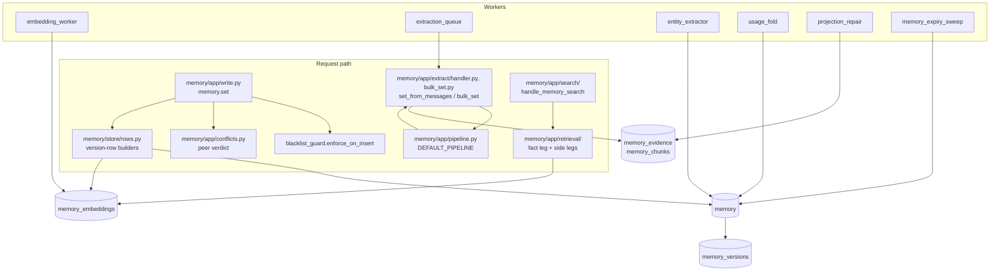

# Memory architecture

The memory plane stores facts in `loom.memory`, makes them searchable through
`loom.memory_embeddings`, and derives evidence, chunks, graph rows and statistics from
them. It retires a fact only when a writer or an owner asks. This page is the inside
view. Caller behaviour is in [writing memories](../features/memory/writing.md),
[search and ask](../features/memory/search-and-ask.md) and
[extraction](../features/memory/extraction.md); the model is in
[memory](../concepts/memory.md). Table families and the ClickHouse rules every write
obeys are in [ClickHouse](clickhouse.md).

## Goals and non-goals

| Goals                                                                                          | Non-goals                                                                                                |
| ---------------------------------------------------------------------------------------------- | -------------------------------------------------------------------------------------------------------- |
| A writer reads its own point write on the next call, search included.                          | Atomic multi-row writes. `memory.bulk_set` and promotion are not transactional.                          |
| Every write is judged against its peers (merge, duplicate, conflict, refines, rejected).       | Loom deciding truth. Verdicts flag and link rows; the owner or caller resolves.                          |
| Derived work (entities, chunks, summaries, statistics) never fails or slows the primary write. | Derived rows current at every instant. They converge within a worker interval.                           |
| Every version is recoverable (`memory_versions`); every write leaves a hash receipt.           | Transaction-time queries. Validity (`valid_at`, `valid_to`, `invalid_at`) is valid-time only.            |
| Search explains itself: per-component scores, an abstain code, a retrieval risk.               | One ranking formula for all corpora. Modes, recipes and namespace defaults exist because corpora differ. |

## Components

| Layer                        | Owns                                                                                                          |
| ---------------------------- | ------------------------------------------------------------------------------------------------------------- |
| `server/memory/api/`         | The wire: `memory.*` models and `Operation` declarations.                                                     |
| `server/memory/app/`         | Validation, verdicts, response shape; retrieval, extraction, the conflict judge.                              |
| `server/memory/domain/`      | Pure rules: provenance, sensitivity, search SQL shapes, synthesis policy.                                     |
| `server/memory/store/`       | Row shapes and the SQL over `loom.memory` and `loom.memory_embeddings`.                                       |
| `server/workers/registry.py` | One `_WORKERS` row per worker; switches and cadences are in the [workers reference](../reference/workers.md). |

## `memory.set`

`_handle_memory_set` in `server/memory/app/write.py` runs the write as named
phases over one request state (`_SetWrite`); the phases from embedding on live in
`server/memory/app/set_commit.py`. `handle_memory_set` wraps it to count each
outcome (refusal, 4xx `rejected`, or `error`) and to attach value-shape advisories.

1. **Resolve the type** (`_set_resolve_type`). The namespace's type configuration may
   retype the row; the response names `retyped_from`.
2. **Fetch the live row** (`_set_fetch_existing`) and the namespace's write
   configuration.
3. **Guard the existing row** (`_guard_existing_row`). A byte-identical value is a
   restatement: the new version carries `reinforcement_count + 1`. A changed value meets
   the lock (423), then the pin (409 `PINNED_CONFLICT` unless the write pins too).
4. **Expiry** (`_set_expiry`). `ttl_seconds`, `valid_to` and type or namespace retention
   become `expires_at`.
5. **Prepare the value** (`_set_prepare_value`): canonical JSON, `content_sha256`, the
   `char_limit` check (422 `CHAR_LIMIT_EXCEEDED`), the blacklist (422 `BLACKLISTED`,
   `server/memory/app/blacklist_guard.py`), the sensitivity tier (`memory/domain/sensitivity.py`) and its
   retention.
6. **Proposals and preconditions.** `proposed=true` may not overwrite an established
   fact (`_refuse_proposal_over_fact`). `if_match_sha256` must match the live hash (409
   `PRECONDITION_FAILED`).
7. **Build the version row** (`_set_build_memory_row`). Over a live row,
   `build_revision_row` carries the other columns forward and resets those that describe
   the old value (`REVISION_RESETS` in `memory/store/rows.py`). `actor` comes from the
   token; `source_class` is set by the server (`memory/domain/provenance.py`), and the body
   may only request a downgrade.
8. **Non-embedded rows stop here.** A type in `NON_SEARCHABLE_TYPES` (`episodic`,
   `profile`) or a `high`-sensitivity row gets one insert and no embedding row
   (`server/memory/domain/memory_types.py`, `is_embedded`). No embedding row means no search leg sees
   it.
9. **Embed** (`_set_embed`) the value and, when the key carries words, the key, in one
   batched call where the embedder supports it.
10. **Conflict verdict** (`_set_conflict_verdict`, `memory/app/conflicts.py`
    `check_on_commit`). Peers are active rows of the same type under other keys whose
    cosine reaches the conflict threshold: the type's `dedup_threshold`, else the
    namespace's `conflict_threshold`, else the embedder calibration, else
    `LOOM_CONFLICT_THRESHOLD`. An `append_only` policy and allowlisted pairs skip the
    check. In order:
    - canonical-form match: `merge`, no insert (`_set_merge`);
    - pinned peer: `rejected` (409);
    - peer at or above `LOOM_DUPLICATE_THRESHOLD` with the same content words:
      `duplicate`;
    - any other close peer: `conflict`.

    Under a token bounded to one user (`read_user_id`), peers outside that user's rows are
    treated as absent, with two exceptions that hold across the whole namespace by design: a
    close pinned peer still rejects the write (409 `PINNED_CONFLICT`), and `proposed=true`
    still may not land on a key that holds any user's established fact (409
    `KEY_HOLDS_FACT`). A pin protects the namespace's fact from every writer, and a proposal
    must not retire anyone's fact. The refusal names no row, id or value, so the narrowed
    token learns only that its write was refused.

    With `LOOM_MEMORY_CONFLICT_JUDGE` on (off by default), an LLM judge
    (`memory/app/conflict_judge.py`) labels close peers, and peers down to
    `LOOM_MEMORY_CONFLICT_JUDGE_MIN_SIMILARITY`, as `conflict`, `refines`, `merge` or
    `clear`. It runs after the insert (`memory/app/conflict_deferred.py`): the row lands `active` with
    `conflict_verdict: pending`, and the verdict is folded on later.
    `await_verdict=true` and `dry_run=true` judge inline.

11. **Dry run** returns the verdict with version 0 and writes nothing, not even an audit
    row.
12. **Dual write** (`_set_dual_write`). The `memory` row and its `build_embedding_row`
    row are inserted concurrently. The embedding row carries the columns search filters
    on (type, status, tags, entities, validity, `source_class`, `verified`), so no leg
    joins back to `memory`. Conflict marks then go on the peers, or `refines`
    supersedes them.
13. **After the write** (`_set_after_write`, `_set_post_insert`). Same-key supersession
    under `newest_wins` (`memory/app/key_supersession.py`) and the hash-only audit row are
    awaited in one round trip. The entity-graph projection is scheduled beside the
    response (`memory/app/after_write.py`) and repaired by `entity_extractor` if lost. A
    long value is also split into `memory_chunks`, fail-open.

**Embedding stubs.** `memory.set` embeds before it inserts, so an embed failure fails
the call and writes nothing. Other writers (`memory.promote` on an embed failure,
`namespace.rollback`) write a stub: `embedding_dim = 0` and a zero vector. Imports and
observation writers may write no embedding row at all. `embedding_worker` fills both at
the stub's version plus one, so a later real write still wins. A row that keeps failing
accrues `embed_attempts` and is marked `embed_failed_at` so it cannot stall the batch.
Every vector leg filters `embedding_dim > 0`.

**Why the judge is deferred.** The cosine check is cheap and runs on every searchable
write. The judge costs a model call for each write in its band. Deferring it keeps write
latency at the insert's. The deterministic verdicts stay inline because they decide
whether a row is written. The cost is a window where a row is `active` with a pending
verdict.

**How a deferred verdict settles** (`memory/app/conflict_deferred.py`). The row is
inserted `active` and the response says `conflict_verdict: pending`, `verdict_at:
deferred`. A task in the request's context then runs the judge-and-fold the inline path
runs (`conflicts.settle_deferred_judgement`): `conflict` writes the conflict marks,
`refines` supersedes and links the peers, `merge` and `duplicate` make this row
`status=duplicate, duplicate_of=<peer>` (a merge cannot un-insert), and `clear` writes
nothing. `memory.get` shows the settled status and a derived `conflict_verdict`, which
is `pending` while the row's embedding carries the pending mark.

- `await_verdict: true` keeps the inline behaviour; `dry_run` always judges inline.
- Each settle writes one `memory_drops` row (`stage=conflict.deferred`,
  `reason=<verdict>`), and the process drains in-flight judges on shutdown.
- The embedding is written with `conflict_checked_at` at the pending mark
  (`store.conflict_marks`) and the settle stamps it, so every replica reads the same
  state. A judge lost to a crash leaves the mark, and the leader's conflict sweep
  (`workers.conflict_sweep`) re-judges the row. A judge whose model call the org's
  model-call switch holds settles as `held`: nothing is stamped, and the sweep
  re-judges the row once the org is back on.

## `memory.bulk_set` and `memory.set_from_messages`

`memory.bulk_set` (`handle_memory_bulk_set` in `memory/app/bulk_set.py`) is the
batch form of the point write:

- one existing-row lookup and hash-based duplicate detection;
- entity resolution, row building and one embedding batch;
- the same four verdicts plus intra-batch pairs (`_bulk_verdicts`, `apply_bulk_verdicts`);
- one insert per table, then links, projections and follow-row supersessions.

Versions are nanosecond stamps, so last-writer-wins holds per key inside a batch. A
blacklisted entry is skipped, not raised; pinned and locked keys come back in
`skipped_pinned` and `skipped_locked`. One hash-only `memory.bulk_set` audit row records
the write.

`memory.set_from_messages` runs a step pipeline over a `WorkflowState`
(`memory/app/pipeline.py`, `DEFAULT_PIPELINE`) and writes through the bulk path:

| Step                              | What it does                                                                |
| --------------------------------- | --------------------------------------------------------------------------- |
| `loom.fetch_namespace_categories` | Loads the namespace's tag taxonomy.                                         |
| `loom.fetch_existing_memories`    | Shows the extractor the nearest stored memories so it does not repeat them. |
| `loom.llm_extract`                | The extraction call; long transcripts are split and merged.                 |
| `loom.drop_recall_echoes`         | Drops facts that restate memories the session was served (`recalled_keys`). |
| `loom.drop_session_echoes`        | Drops facts that restate what the session's own Loom calls wrote or read.   |
| `loom.drop_activity_narration`    | Drops narration of tool activity with no durable outcome.                   |
| `loom.drop_non_durable`           | Coding sessions: drops status snapshots, housekeeping and plans.            |
| `loom.verify_durable`             | Coding sessions: a verifier pass over the rest. Fails open.                 |
| `loom.hash_dedup`                 | Drops facts whose canonical hash is already stored.                         |
| `loom.bulk_write`                 | Writes through `memory.bulk_set`.                                           |

A request may reorder or skip steps, or name steps an operator registered
(`register_step`); see the [extraction pipeline guide](../guides/extraction-pipeline.md).
The prompt names keys by subject and attribute, never by value
(`memory/domain/extraction_prompts.py`), so a later statement of the same attribute
supersedes the earlier row. A "forget this" request in the transcript retires the
matching rows (`_retire_forgotten`).

The extraction also writes its inputs:

| Table                                   | Holds                                                                  |
| --------------------------------------- | ---------------------------------------------------------------------- |
| `memory_evidence`                       | The turns it read (`memory/app/evidence.py`; read by `memory.recall`). |
| `memory_chunks`, `memory_chunk_sources` | Verbatim chunks and their lineage.                                     |
| `memory_belief_sources`                 | Evidence links.                                                        |
| `session_summaries`                     | A session digest.                                                      |
| graph tables                            | Entity vectors, edges and triples (through the bulk path).             |

These are projections. A failure is recorded in `loom.memory_projection_failures` and
replayed by `projection_repair`; it never reaches the caller.

### Deferred and ambient extraction

| Path                                                                           | Writes first                                                            | Finished by                                                                                                                                                                                                              |
| ------------------------------------------------------------------------------ | ----------------------------------------------------------------------- | ------------------------------------------------------------------------------------------------------------------------------------------------------------------------------------------------------------------------ |
| `set_from_messages(defer=true)`, or an agent in `LOOM_EXTRACTION_DEFER_AGENTS` | A `loom.memory_extraction_queue` row; returns `queue_id`                | `extraction_queue` claims the oldest `pending` rows and runs the inline handler: `pending → running → done`, or back to `pending` with `attempts + 1` until `failed`. A `running` row past `lease_until` is reclaimable. |
| `observe.record` / `observe.crystallize`                                       | Tool-trace observations as episodic rows, marked ready by `crystallize` | `observe_extract` (off by default, needs an LLM) replays each ready session through `set_from_messages`.                                                                                                                 |

Until a queued request is done, `memory.search` and `memory.ask` report
`pending_extraction` for the scope, and `memory.extraction_status` reads the row. The
canonical-hash dedup makes a double claim harmless. With `extraction_queue` off, deferred
saves stay `pending`.

## `memory.search`

`handle_memory_search` (`server/memory/app/search/handler.py`) runs phases, one
module each. The SQL is in `server/memory/app/retrieval/` and
`server/memory/domain/search_sql.py`.

1. **Settle the request** (`request.py`): recipe and namespace `retrieval_defaults`, read
   scope, the `top_k` ceiling. A parked `page` handle is served directly.
2. **Read-your-writes** (`consistency.py`): a namespace this process just wrote re-reads
   under sequential consistency ([ClickHouse](clickhouse.md#read-your-writes)).
3. **Plan** (`plan.py`, `memory/domain/query_planner.py`): dates, recency, preference
   attribute, entities and sub-queries choose the mode, HyDE and the planes, and size
   the pool.
4. **Embed the query** (`embed.py`) within the request's `SearchBudget`.
5. **Run the legs** (`graph.py`, `vector_legs.py`). Graph mode first expands the query's
   entities one hop over `entity_edges` and `entity_triples`. The summary legs
   (`summaries.py`, over `session_summaries` and `entity_summaries`) start as side
   tasks. Each namespace then runs `vector_search` (`search.py`), which gathers its legs
   concurrently. Across several unordered namespaces, private ones are searched first
   and public ones only when no private hit clears the relevance floor.

   | Leg              | Module                       | Reads                                                                                                                                                                                                     |
   | ---------------- | ---------------------------- | --------------------------------------------------------------------------------------------------------------------------------------------------------------------------------------------------------- |
   | fact             | `fact_sql.py`                | One statement per namespace over `memory_embeddings FINAL`: identity columns in `PREWHERE`, row state in `WHERE`, an exact `cosineDistance` order (no table has a vector index), rank computed beside it. |
   | lexical and BM25 | `lexical.py`, `side_legs.py` | `hasAnyTokens` over the lowercase, stem and lemma columns; Okapi BM25 from `memory_term_freq` / `memory_doc_stats` plus rows newer than the refresh mark.                                                 |
   | verbatim chunks  | `chunks.py`                  | `memory_chunks`: a stage-1 candidate read, then one keyed stage 2 with neighbour windows.                                                                                                                 |
   | records          | `side_legs.py`               | `memory_records`.                                                                                                                                                                                         |

   Additive pools follow: sub-queries, set expansion, the entity and date anchor pool
   (`anchor_pool.py`) and the key-match arm (`key_match.py`). The assembler folds in the
   side legs and digest descent (`digest_descent.py`), which adds the best facts of the
   top digests' sessions.

6. **Fuse and rank** (`fusion.py`, `ranking.py`). The per-mode rank expression
   (`fact_rank.py`, `_fact_mode_rank_score`) adds the capped prior group (confidence,
   soft tags, categories) and the correctness tail (demotions, reinforcement,
   provenance trust) from `_fact_rank_tail`. `rrf` mode fuses the lexical and semantic
   orders by reciprocal rank instead. Reinforcement is read from `memory_reinforcement`
   after the fetch. A configured reranker reorders the pool and fails open:
   identifier-pinned rows keep their slots and are not sent to it, and a changed order
   hands out the pool's own scores in the new order.
7. **Verdict** (`verdict.py`, `_finalize_abstain`): empty is `no_match`, a weak top hit
   is `below_threshold`, then the calibrator's `low_calibrated_confidence`. After a
   reranker, these gates read the served rows in fused order (`gate_order`), not the
   reranker's order. A query naming an identifier absent from every hit abstains too
   (`LOOM_MEMORY_SEARCH_IDENTIFIER_GROUNDING`).
8. **Assemble and record** (`assemble.py`, `output.py`, `telemetry.py`). The window is
   cut to budget; with `paging=true` a larger pool is parked in `loom.context_blobs`.
   Trace, exposure and query-node rows go to the events stream, fire-and-forget.

With `LOOM_ADAPTIVE_THRESHOLDS` on, the similarity gates come from the embedder's own
cosine distribution (`memory/app/embedder_calibration.py`); the scalar settings are the
fallback. `memory.search_trace` runs the vector leg's SQL with extra columns (no fusion,
assembly or reranker). The caller's view of ranking is in [retrieval and
ranking](../concepts/retrieval-and-ranking.md).

**Why the priors are capped.** Real embedders produce a narrow cosine band. A confidence
term plus a tag boost can exceed the gap between a good and a mediocre match.
`LOOM_MEMORY_PRIOR_CAP` bounds the group, so a prior only reorders near-ties.

## Background passes

| Worker                    | Reads                                                        | Writes                                                                             | LLM |
| ------------------------- | ------------------------------------------------------------ | ---------------------------------------------------------------------------------- | --- |
| `embedding_worker`        | Stubs and memories without an embedding row                  | Embedding rows at stub version + 1                                                 | No  |
| `usage_fold`              | `memory_usage_totals`, `memory_exposures`, `memory_versions` | `memory_reinforcement`, and absolute `evidence_count` / `recall_count` on `memory` | No  |
| `entity_extractor`        | Memories with empty `entities`                               | Entities on `memory` and `memory_embeddings`; missed graph rows                    | Yes |
| `projection_repair`       | `memory_projection_failures`                                 | The failed chunk, evidence and graph projections                                   | No  |
| `orphan_vector_reconcile` | Live embedding rows whose memory is tombstoned or gone       | Tombstones on `memory_embeddings` and `entity_vectors` (no mutation)               | No  |
| `memory_expiry_sweep`     | Rows past `expires_at`                                       | The `on_expire` action                                                             | No  |
| `sensitivity_sweep`       | Recent rows from paths that skip detection                   | A labelled version; `high` rows' embedding rows tombstoned                         | No  |
| `profile_consolidation`\* | A user's preference and decision memories (namespace opt-in) | One non-searchable `profile` section, loaded by `profile.render` / `context.pack`  | Yes |
| `structured_profile`      | Users' facts in namespaces with a profile schema             | A new version of each user's `structured_profile` row, held to the schema          | Yes |
| `reflection_distill`\*    | Recent sessions without an outcome                           | Outcome labels, then `reflection` memories hidden from unfiltered recall           | Yes |
| `entity_communities`\*    | The co-occurrence graph                                      | `entity_communities`                                                               | No  |
| `recalibration`           | The embedder's score distribution                            | Calibration thresholds                                                             | No  |

\* Off by default (`LOOM_PROFILE_CONSOLIDATION_ENABLED`,
`LOOM_REFLECTION_DISTILL_ENABLED`, `LOOM_ENTITY_COMMUNITIES_ENABLED`).

`structured_profile` reads only namespaces with a row in `loom.profile_schemas`
(`profile_schema.set`, one ReplacingMergeTree row per namespace, holding no memory
content). A profile is a `profile` memory row, so its history, erasure and read scope are
memory's own. It carries three tags: the hash of the schema's properties, a digest of its
sources (an XOR of a hash of each one's id, content hash, confidence and `valid_at`
else `updated_at`, fixed in size), and their count. The worker finds the users
behind in one aggregate over `loom.memory FINAL` that digests every user's current facts,
so the answer is exact: an edit, a revert, a restore, a deletion, an expiry or a passed
`valid_to` changes a digest, a restatement (a new `updated_at`) costs one rebuild after
the cooldown, and a recall or a backfill does not. Its cost follows the namespace's live
rows, not their history, and it runs under `LOOM_STRUCTURED_PROFILE_SCAN_TIMEOUT_SECONDS`
and `LOOM_STRUCTURED_PROFILE_SCAN_MAX_MEMORY_BYTES`. Each scan lists up to ten times the
namespace's share of a pass, kept in the worker's process; later passes take from that
list until it is drained, the schema hash changes or it is
`LOOM_STRUCTURED_PROFILE_SCAN_MAX_AGE_SECONDS` old, and a complete list that drained is
not rescanned before then, so a namespace is read at most once per that age in the
steady state. A namespace whose scan fails backs off. A build
skips a user whose profile is already current. `profile.structured` recomputes one user's
digest to answer `stale` without a model call ([structured
profiles](../features/memory/working-memory-and-profiles.md#structured-profiles)).

`memory.consolidate` is an op, not a worker. It clusters similar active memories by
cosine and entity overlap and asks the LLM to merge each cluster into one row. It writes
`memory_belief_sources` lineage (`support_type='derived_from'`), tombstones the merged
keys and logs to `loom.consolidation_runs`. A suppression memory never merges with a
positive one.

A worker leg that catches its own failure calls `pass_context.note_failure`, so the
supervisor counts it. A worker that declares `owned_tables` runs its first pass at boot
when one of them is empty for a namespace in scope (`workers/first_pass.py`).

## Lifecycle

Every lifecycle change is a new version built with `build_memory_version_row`:
tombstone, restore, lock, promote, demote, supersession (`status='superseded'`,
`superseded_by`, `invalid_at`). Prior versions stay in `memory_versions`. `memory.redact`
is the one op that edits a stored version. Status flips over many rows (the usage fold,
`memory.reject` quarantine) are batched lightweight updates; see
[ClickHouse](clickhouse.md#deletes-and-mutations).

A version is a wall-clock nanosecond, and `memory.set` and `memory.bulk_set` draw it
before their slow work (the embed). A delete of the key that commits in that window draws
a higher version, and its tombstone would hide the write that finished after it. Right
before the insert, when every committed version of the key above the write's version is a
delete's tombstone (read from `memory_versions`, which a merge does not thin), the write's
rows below the newest move just above it, in their own order and without any row moving
down, and so do their embedding rows (`memory/app/write_fence.py`). A write whose version
is above the tombstone's by more than about a microsecond stays above them, and a write
the key had moved past before the delete (a later version came and went) stays deleted.
Two writes lifted over one delete rarely share a version (each is offset by a hash of its
row). When two writes race one delete, lifted or not, which of them wins is not defined. A
`memory.delete` that commits after the fence read wins, as it does between any two writes.
A `memory.set` with `if_match_sha256` draws its version after the check, under the key
lock, so a delete above it landed after the check: it answers 409 instead. A blacklist
sweep's tombstone is not a delete: a write it caught stays under it. Only that tombstone
carries the sweep's `expire_reason` marker; every other version drops it (a
`namespace.rollback` to a time the tombstone held writes it back as it was), and no caller
may write it. `memory.update` and `memory.update_by_id` revise a row and are not lifted: a
revision that races a delete stays deleted. If the fence's read fails, the write keeps its
version; `memory.set`'s answer names the degradation.

`memory.delete_version` removes one version a caller read (`memory.get` and the list ops
return it as `version` and, exact for a JavaScript caller, as the decimal string
`version_text`) and nothing when the row has moved on; the key lock orders it against
`if_match_sha256` writes. A plain `memory.set` or `memory.bulk_set` takes no lock, so both
sides check again after their insert, and a write after the named version stays whichever
lands first. The delete stamps the version it removed in its tombstone's `source_trace`
(`memory.delete_version:<v>`). Only that tombstone carries the marker; every other version
drops it (restore, move, the cross-namespace copies), a `namespace.rollback` keeps it only
on a tombstone, and no caller may write it (`memory.set`, `memory.bulk_set` and
`profile.set` answer 422). The delete then reads the key's newest version other than its
own tombstone after writing it. A live row means the key moved on (`version_changed`); one
below the tombstone, a plain write between the check and the tombstone, is written back
above it, at a version above the tombstone whatever the writing host's clock reads.
Another remover's tombstone (a delete, a sweep, a dedup or a conflict resolution) means it
removed the key (`found=false`); one below this tombstone is written back above it,
stamped as this delete's own tombstone, unless this delete's tombstone already carries
every column of that row a copy would carry, the remover's own stamps aside (that remover
took the very row it checked), so a restore brings back the row it removed and a write
after it lifts over the copy as over this tombstone.

Only when the key did not move on does the delete stand and retire the removed version's
vectors and chunks: the chunks whose index and content hash its own value writes, so a
newer value's chunks of the key stay. A newer value that repeats one of those chunks at
the same index shares its row; the delete reads the key's newest value after the retire
and puts the shared chunks back when search serves that value (live, and not `sensitivity:
high`), reading the key again afterwards to retire them once more if a delete or a write
landed in between. A `memory.delete` whose insert lands after that read can still answer
`tombstoned` alongside it, as two racing `memory.delete` calls can. Between the tombstone
and a write back, the key reads as deleted, and a `memory.delete` in that window answers
`found=false`.

Before its tombstone the delete records the check it owes in `loom.delete_version_checks`,
and marks it done once the check has run; if its insert fails, the call answers the same
503 as below: nothing is deleted unless the insert committed anyway, and then a retry or
the worker finishes the delete. If the tombstone's insert or the read after it fails, the
delete answers 503 and retires nothing. The transport audits only a call that succeeds, so
a 503 writes the op's audit row itself, outcome `deferred`, after the key lock is released
and best effort like every audit row; the worker that finishes the delete writes none, and
a retry is its own call with its own row.

A check whose tombstone is not in the key's history (its insert failed) runs against a
retry's tombstone of the same version when one committed, or writes one first when nothing
came after the removed version, at a new version so the namespace's watermark moves, and
then runs as after any tombstone: the delete finishes. When the key moved on, it writes
nothing and answers `version_changed` (a live row) or `found=false` (another remover's
tombstone). An insert that timed out can still commit late: every tombstone aimed at the
same version (a late or retried insert, or a copy written back) is this same delete, so
the check judges the newest version other than those, writes a live one back above all of
them, and copies another remover's tombstone on top unless the newest of them already
carries that row in the same sense. A retry of the same delete runs the owed check and
answers as the delete would have (when the tombstone's insert is what failed, the retry
finds the row live and deletes it again); otherwise the `delete_version_check` worker runs
it under the key lock (`memory/workers/delete_version_check.py`), by default within about
six minutes (a 60-second grace, then a pass at most 300 seconds later). Until the check
runs, `memory.get` and the list ops read the key as deleted (as live, when the tombstone's
insert failed), search can still return the removed value from its vectors and chunks, and
a write the tombstone hid is not served; it comes back when the check runs. A write that
lands under such a tombstone, aimed at an older version, writes itself again above it.

Expiry is the writer's choice. `ttl_seconds`, `valid_to`, a type's or namespace's
`retention_days`, or `LOOM_MEMORY_SENSITIVE_RETENTION_DAYS` set `expires_at` and
`on_expire`. Reads hide an expired row at once. `memory_expiry_sweep` (or
`memory.sweep_expired`) then applies `on_expire` (`memory/app/expiry.py`):

| `on_expire`           | Effect                                                                        |
| --------------------- | ----------------------------------------------------------------------------- |
| `tombstone` (default) | Tombstones the row.                                                           |
| `demote`              | Clears expiry and scales confidence down.                                     |
| `anonymize`           | Replaces the value with a marker, tombstones embeddings, keeps the shell row. |

Table-level retention and tiering are operator TTLs, off by default
([ClickHouse](clickhouse.md#partitioning-and-ttl)).

## History, snapshot, restore and rollback

| Operation            | Reads                                           | Writes                                                                                                                                 |
| -------------------- | ----------------------------------------------- | -------------------------------------------------------------------------------------------------------------------------------------- |
| `memory.history`     | `memory_versions` for one key                   | Nothing.                                                                                                                               |
| `memory.redact`      | `memory_versions`, by org-wide `memory_id`      | Scrubs one historical version in place. Refuses the live head (delete it first).                                                       |
| `namespace.snapshot` | Live `memory` rows, type configs, curated rows  | A portable payload with `version`, `content_sha256` and the attestation columns, plus a `loom.namespace_snapshots` audit row.          |
| `namespace.restore`  | A snapshot payload                              | Rows into a target namespace (created if missing; the caller becomes admin). Idempotent per `snapshot_id`. Never strips `verified_by`. |
| `namespace.rollback` | `memory` heads and `memory_versions` at `as_of` | Each changed key's older version as a new head; keys absent at `as_of` tombstoned; embedding stubs for the worker. Dry run by default. |

Rollback restores heads, not exact state. `version` is a wall-clock stamp, so the head
at T is the largest version at or before T. Triples, records, summaries and aggregates
are rebuilt by their workers (`memory/domain/rollback.py` plans the rollback,
`memory/app/namespace_rollback.py` applies it, `identity/app/namespace_rollback.py` is the handler).

## Erasure saga

`erasure.request` (`erasure/app/handlers.py`) starts a saga (`erasure/app/saga.py`)
over a `user_id`, `namespace` or `namespace_list`. Each step is idempotent and
checkpointed as a new version of the `erasure_requests` row (`steps_completed`), so a
restart resumes. `erasure_recovery` replays sagas stuck `in_progress`; after
`max_attempts` it marks the request `failed` and emits `erasure.abandoned`. Configured
external backends (Langfuse traces and ClickStack rows) are steps
too and fail the saga closed.

The last step is a residue census over every table the read paths touch. The registry
is in `server/erasure/store/census.py`:

| List                | Holds                                                                                                                                                 |
| ------------------- | ----------------------------------------------------------------------------------------------------------------------------------------------------- |
| `_CENSUS`           | One `Substrate(table, live, user_pred, ns_step, user_step, final)` per table that can hold content in scope. Any live row in scope fails the saga.    |
| `STEP_ONLY_TABLES`  | Tables a step clears that the census does not count (shared and consolidated tombstones, term aggregates, session outcomes, the code index purge, …). |
| `NO_MEMORY_CONTENT` | Every other table, each with the reason it holds no content in scope.                                                                                 |

The terminal row carries `residue_count`, `residue` (per table) and `verified_at`. A
resumed saga re-runs the owning step of any table the last census found rows in.
`purge=true` hard-deletes: lightweight `DELETE FROM` on the tables in
`LIGHTWEIGHT_PURGE_TABLES`, `ALTER TABLE … DELETE` on the rest, each mutation tagged and
polled to completion. `tests/unit/test_every_table_is_classified.py` fails on a table in
none of the three lists.

An erasure in an org, at any scope, deletes the whole org's cached query vectors in
`loom.embedding_cache`, not only the erased scope's: the rows carry the org but no
namespace or user, and hold vectors, never text. It is a derived cache, so deleting more
than the scope costs only cache misses. The table is step-only (`idempotency.delete`), not
counted: any search in the org refills it before the census could run. Each replica's
process tier expires within `LOOM_EMBEDDING_CACHE_TTL_S`.

## Audit rows

Every write that creates or changes memory leaves one hash-only row in `loom.audit_log`
(`server/observability/audit.py`): no value, only identity, actor, key, id, content
hash, source class and verdict. The row hash and the checkpoint chain are described in
[audit](../features/observability/audit.md).

## Invariants

- Every new `memory` or `memory_embeddings` version carries every persisted column
  (`MEMORY_PERSISTED_COLS` and `build_embedding_row` in `rows.py`).
  `insert_memory_versions` (`check_memory_rows`) refuses a partial row or an unknown
  column.
- A new `loom.memory` column goes into `memory_versions` and `memory_versions_mv` in the
  same migration.
- `actor` and `source_class` are stamped by the server on every write path
  (`server/memory/app/provenance.py` `writer_actor`, `server/memory/domain/provenance.py`
  `source_class_for`). A request may only
  downgrade to `derived`, `external` or `imported`.
- A `high`-sensitivity row and a non-searchable type have no embedding row.
- Every vector leg filters `embedding_dim > 0`.
- Merge, duplicate and pinned rejection are decided before the insert; only the LLM
  judge may run after it.
- Ops addressed by an org-wide id (`memory.get_by_id`, `memory.update_by_id`,
  `memory.redact`) check `authz.row_in_scope` after the fetch and answer `found=false`
  on refusal, never a 403.
- A projection failure never fails the primary write.
- Writes are not transactional across tables; bulk writes and cross-namespace promotion
  are not atomic.
- A table that can hold memory content is in `_CENSUS`, or in `STEP_ONLY_TABLES` with its
  reason.

## Source entry points

| Path                                                                                                                                                            | What                                                                                                |
| --------------------------------------------------------------------------------------------------------------------------------------------------------------- | --------------------------------------------------------------------------------------------------- |
| `server/memory/api/models_*.py`, `server/memory/api/ops_*.py`                                                                                                   | Wire models; op declarations.                                                                       |
| `server/memory/app/write.py`, `server/memory/app/set_commit.py`                                                                                                 | `handle_memory_set` and its `_set_*` phases.                                                        |
| `server/memory/app/update.py`                                                                                                                                   | `memory.update`, `memory.update_by_id`.                                                             |
| `server/memory/app/extract/handler.py`                                                                                                                          | `set_from_messages`.                                                                                |
| `server/memory/app/bulk_set.py`, `server/memory/app/bulk_rows.py`, `server/memory/app/bulk_verdicts.py`                                                         | `bulk_set`, its rows, `apply_bulk_verdicts`.                                                        |
| `server/memory/app/pipeline.py`                                                                                                                                 | `DEFAULT_PIPELINE`, `register_step`, `run_pipeline`; its text rules are in `server/memory/domain/`. |
| `server/memory/app/{conflicts,conflict_judge,conflict_deferred,key_supersession}.py`                                                                            | Verdicts and supersession.                                                                          |
| `server/memory/app/search/`, `server/memory/app/retrieval/`, `server/memory/domain/search_sql.py`                                                               | Search phases and leg SQL.                                                                          |
| `server/memory/store/`                                                                                                                                          | `rows.py`, `inserts.py`, `reads.py`, `lifecycle.py`, `history.py`.                                  |
| `server/memory/app/{after_write,projections,projection_failures}.py`                                                                                            | Fail-open projections.                                                                              |
| `server/erasure/app/saga.py`, `server/erasure/store/`, `server/erasure/workers/recovery.py`                                                                     | Erasure.                                                                                            |
| `server/memory/domain/rollback.py`, `server/memory/app/{namespace_rollback,snapshot_rows}.py`, `server/identity/app/{namespace_rollback,namespace_snapshot}.py` | Rollback, snapshot, restore.                                                                        |
| `server/observability/audit.py`, `server/insights/domain/audit_checkpoints.py`, `server/insights/workers/audit_verifier.py`                                     | Audit.                                                                                              |

## Related

- [Memory](../concepts/memory.md), [writing memories](../features/memory/writing.md),
  [conflicts and refusal](../features/memory/conflicts-and-refusal.md),
  [retention and erasure](../features/memory/retention-and-erasure.md),
  [history and provenance](../features/memory/history-and-provenance.md).
- [ClickHouse](clickhouse.md), [LLM architecture](llm-architecture.md).
- [Operations reference](../reference/operations.md#memory).
