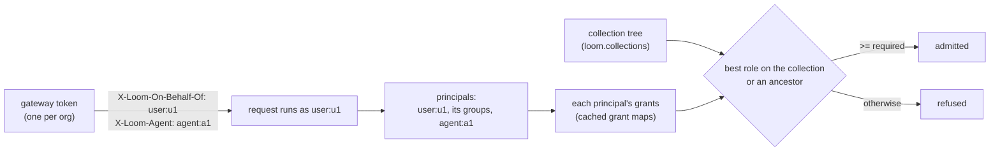

# Sharing knowledge

A collection is a namespace that only grants open. A grant can name a person signed in
to Loom, or an end user, group or agent of a service in front of Loom. A collection
inherits the grants of the collection it sits in. This page describes that model, why it
has this shape, and what it costs.

## The model

- **Collections.** A collection is a namespace with `kind = 'collection'` and a row in
  `loom.collections` naming its parent. `collection.create` makes one (the creator holds
  `admin`), `collection.move` puts it under another collection or detaches it,
  `collection.list` lists the ones the caller can read, and `collection.delete` takes one
  out of the directory and the tree (its children become top-level). A deleted
  collection's name is never used again, and its documents stay until an org admin's
  erasure of the namespace removes them: no grant reaches it any more. A document lives in
  one collection and follows its grants from the moment it is written.
- **Only grants open a collection**, and only one in the tree: a `col-` name that was
  deleted, or never created, admits no one but a platform admin. A collection is known by
  its name (`col-…`; the prefix is reserved), so `check_authorized` hands it to
  `server/auth/sharing.py` before any other rule, with no read. A token's namespace claim,
  an org admin role and the code-namespace rules reach no collection; a scoped or
  delegated token reaches one no further than its own claim names it, and a delegated one
  no further than its creator's role there. A platform admin passes, for operator erasure
  and export.
- **Principals.** A request holds its subject, every group whose members include it, and
  the agent a gateway asserted. A grant names any of them: a login handle or email, an
  `sa:` service account, `user:<id>`, `group:<id>` or `agent:<id>`. Groups and agents hold
  grants on collections only.
- **Inheritance.** A collection's role for a request is the best role any of its
  principals holds on the collection or on one of its ancestors, at most eight up. A child
  only adds to what its parents give. To make a child narrower, detach it: it then keeps
  its own grants only.
- **Personal collections.** Each end user has one, `col-me-<hash of org and user>`; a
  request names it `namespace: "@me"`, which only the server maps. Its name says whose it
  is: it admits that user (as admin) and no one else, takes no grant, sits in no tree, and
  needs no setup (its directory row appears with its first write). A chat service's saved
  messages are documents there, at
  `chat/<conversation>/<message>`: `knowledge.upsert` saves one, `knowledge.delete`
  removes it, `knowledge.search` and `knowledge.list` (with `uri_prefix`) find them.

## Identity

A service in front of Loom holds one gateway token per org (`loom mint-token --gateway`)
and names, on every HTTP request, the end user it acts for. `server/auth/gateway.py`
turns that into the request's identity: subject `user:<id>`, the token's org, the
`viewer` role of an org member with no claim, and reads pinned to that user's rows
(`read_scope = own_user`). Nothing of the token's own carries over, and a gateway
request that names no user is refused, so no row, collection or grant is ever addressed
to the gateway's own account.

| The gateway can claim                        | It cannot claim                         |
| -------------------------------------------- | --------------------------------------- |
| any user id and agent id, inside its own org | another org                             |
|                                              | a group (Loom reads membership itself)  |
|                                              | a role, a namespace or admin            |
|                                              | a Loom login handle or `sa:` subject    |
|                                              | another user's personal collection      |
|                                              | directory self-service (register, join) |

Ids are lowercase (`server/core/principals.py`), so two spellings never name one user; a
SCIM member is the gateway's own lowercase user id, not an identity provider's. Of the
org-level ops (those that name no namespace to gate), an end user may call only
`collection.create`, `collection.list`, `namespace.list_mine` and `grants.pending_for_me`.
A trusted caller (`LOOM_TRUSTED_CALLERS`) acts for Loom subjects only and cannot assert a
`user:`, `group:` or `agent:` principal. Revoking the gateway token cuts off all its
users; one user is cut off by revoking their grants and removing them from groups, or by
erasing them.

The gateway authenticates its users and already holds their data, so Loom cannot make it
less trusted than that; what Loom enforces is the org boundary and the shape of the
claim. The MCP transport refuses a gateway token (MCP names no end user). A token
exchange of the user's own identity-provider token would let Loom verify the user too;
it would mint the same `user:` subject.

**Groups** come from one place: SCIM `/scim/v2/Groups`, written with the org's gateway
token. The group lands in that token's org; a member is a user id, held as `user:<id>`.
Membership is read by Loom on every request, never claimed by a token, so removing a
member takes effect within the consistency window below.

## Consistency

Every change to a grant, a group or the tree writes a row to `loom.acl_versions` for its
org and kind (`grants`, `groups`, `collections`; `grant_cache.changed`) before it returns.
Each process polls the watermark every `LOOM_ACL_WATERMARK_POLL_SECONDS` (1 s), one
sequential statement for every change count (`sum(changes)` per org and kind; a sum only
grows, whatever merges or clocks do), and drops what that kind of change makes stale when
its count moves: the org's cached grant maps, its groups, or its tree. Grant churn in a
tenant therefore re-reads only grant maps, one statement per subject that asks, never the
tree or the group table. The poll reads at most three rows per org once merged: 3,000 rows
in 2 ms at 1,000 orgs and 30,000 rows in 10 ms at 10,000 orgs (p50 of 9), per process per
interval. So a revoke, a removed member, a
move or a detach is enforced on every replica within about one poll interval, and at once
on the replica that made it.

A process whose last poll is older than `LOOM_ACL_WATERMARK_MAX_STALE_SECONDS` (10 s)
serves no cached grant and reads per request; a failed read then falls back only to an
entry read at the last watermark it saw. The 10 s grant-cache TTL stays as a backstop
for a watermark row that was never written, and for grant changes made by a build that
predates the table during a rolling upgrade.

A collection's name, not a lookup, decides that it is one, so a namespace that already
used the `col-` prefix admits only a platform admin after the upgrade; the server logs the
active ones at boot.

## Read cost

`namespace` follows `org` in every knowledge sort key, so a search over the collections
a request may read is one statement per leg with `namespace IN {readable}`, pruned on the
primary key. Rows read are bounded by the readable rows plus one granule per readable
collection, whatever the tenant's size.

Measured on ClickHouse 26.9 with `loom.chunks`' own DDL (3,072-dimension vectors), 12
chunks per collection, the readable set scattered through the sort order (p50 of 5):

| Readable collections | Tenant of 12,000 collections: rows read | p50   | Tenant of 48,000 collections: rows read | p50    |
| -------------------- | --------------------------------------- | ----- | --------------------------------------- | ------ |
| 1                    | 3,352                                   | 11 ms | 3,352                                   | 11 ms  |
| 10                   | 16,948                                  | 20 ms | 16,948                                  | 20 ms  |
| 1,000                | 145,676 (all)                           | 38 ms | 442,877                                 | 54 ms  |
| 10,000               | 145,676 (all)                           | 78 ms | 577,676                                 | 110 ms |

`LOOM_KNOWLEDGE_SEARCH_MAX_NAMESPACES` (10,000) caps one search; the rest come back in
`namespaces_skipped`. Smaller granules read fewer rows for a handful of collections but
were 6–8 times slower at 1,000, so the default granule stays.

A watermark move re-reads only what its kind made stale, in each process, once per value
and on its next use. On the 48,000-collection tenant (5,000 users, 200 groups of 25,
84,000 grant rows; p50 of 7):

| Change   | Re-read                                        | Rows read | p50   |
| -------- | ---------------------------------------------- | --------- | ----- |
| a grant  | one subject's grant map, per subject that asks | 84,000    | 12 ms |
| a group  | the org's groups                               | 200       | 2 ms  |
| the tree | the org's tree                                 | 48,000    | 8 ms  |

A grant map read scans the org's grants: `loom.namespace_grants` is ordered by namespace,
not by subject, and a skip index on the subject prunes nothing at this granule size.

## Erasure

Every document carries who wrote it (`agent`, `user_id`, `actor`, `source_class`), for
provenance and for erasure; access never reads these columns. A user erasure (`scope_type
= user_id`) supersedes the documents and chunks that user wrote in any namespace of the
org (a gateway's end user, or a token minted with `--read-user-id`, stamps its `user_id`;
it supersedes and never purges, so no version another writer replaced reads as live
again), deletes their uploaded originals that no other writer's document shares, revokes
every grant naming `user:<id>`, blanks their id as the issuer of the grants they gave
others (those grants stay), removes them from every group, and retires their personal
collection's directory row (`namespace.delete` and `collection.delete` refuse a personal
collection: it goes only with its user's erasure). Deleting a SCIM group revokes the
grants that named it, so a group made later under the same id starts with none. Collections that hold other writers'
documents stay: Loom deletes only what its writer asked to delete. A user-scope
`erasure.export` returns the chunks that user wrote in the collections its caller may
read: an org admin may erase a collection's rows without reading them, and a platform
admin sees every collection.

## Alternatives not taken

- **An owner column on documents.** Every read path would add a row predicate, one miss
  would leak, and the column would not prune (it is not in the sort key), so a user's
  search would still read the whole tenant.
- **A saved-items table with `user_id` in the sort key.** It fixes the cost of one
  feature by building a second document store: chunking, lexical statistics, embedding
  retries and erasure twice, and saved items that can never join a collection.
- **One namespace per tenant with row-level ACLs.** Every read filters rows one by one and
  prunes nothing, and a move or a revoke rewrites every affected chunk row.
- **An ACL key in the sort order.** A request's readable set is a union over its
  principals and differs per user; no one sort order clusters every user's union.
- **Group membership in a token claim.** A claim is fixed until the token expires, so a
  removed member keeps access for the token's life.
- **Inheritance resolved at write time.** Moving a collection would rewrite the grants of
  every descendant; resolving at check time from a cached tree costs a walk of at most
  eight parents.

## Related

- [Security](security.md): tokens, the gate, restricted namespaces.
- [Identities and namespaces](../concepts/identities-and-namespaces.md).
- [Tokens and grants](../guides/tokens-and-grants.md).
