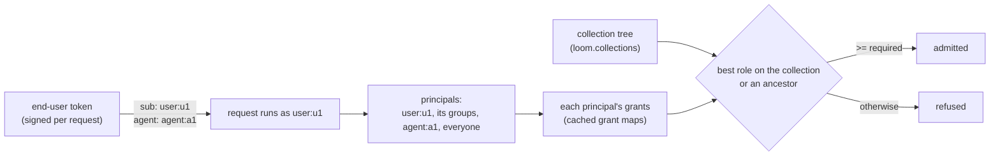

# Sharing knowledge

A collection is a namespace that only grants open. A grant can name a person signed in
to Loom, or an end user, group or agent of a service in front of Loom. A collection
inherits the grants of the collection it sits in. This page describes that model, why it
has this shape, and what it costs.

## The model

- **Collections.** A collection is a namespace with `kind = 'collection'` and a row in
  `loom.collections` naming its parent. `collection.create` makes one (the creator holds
  `admin`), `collection.move` puts it under another collection or detaches it,
  `collection.list` lists the ones the caller can read, and `collection.delete` takes one
  out of the directory and the tree (its children become top-level) once a purging erasure
  of it has taken what it holds off disk (`namespace.delete` refuses a collection). A
  deleted collection's name is never used again, and no grant reaches it any more. A
  document lives in one collection and follows its grants from the moment it is written.
- **Only grants open a collection**, and only one in the tree: a `col-` name that was
  deleted, or never created, admits no one but a platform admin. A collection is known by
  its name (`col-…`; the prefix is reserved: `namespace.register` and `namespace.restore`
  refuse it), so `check_authorized` hands it to `server/auth/sharing.py` before any other
  rule, with no read. A token's namespace claim, an org admin role and the code-namespace
  rules reach no collection; a scoped or delegated token reaches one no further than its
  own claim names it, and a delegated one no further than its creator's role there. A
  token with an `ns_write` claim writes no collection outside it (it holds `viewer` there
  at most), as on any namespace. A platform admin passes, for operator erasure and export.
- **Principals.** A request holds its subject, every group whose members include it, the
  agent its end-user token signs in, and `everyone`. A grant names any of them: a login
  handle or email, an `sa:` service account, `user:<id>`, `group:<id>`, `agent:<id>` or
  `everyone`. Groups, agents and `everyone` hold grants on collections only.
- **Inheritance.** A collection's role for a request is the best role any of its
  principals holds on the collection or on one of its ancestors, at most eight up. A child
  only adds to what its parents give. To make a child narrower, detach it: it then keeps
  its own grants only.
- **Personal collections.** Each end user has one, `col-me-<hash of org and user>`; a
  request names it `namespace: "@me"`, which only the server maps. Its name says whose it
  is: it admits that user (as admin) and no one else (an org admin's export of that user
  reads it, see below), takes no grant, sits in no tree, and needs no setup (its
  directory row appears with its first write). It holds the user's own documents (their
  files, a chat's attachments), chunked and embedded whatever their text holds, and the
  memories a chat writes for them. A message the user saves from a chat is not a
  document there; see [Saved messages](#saved-messages).

## Saved messages

A chat's saved message is a conversation turn flagged for its user:
`conversation.save_message` saves one, `conversation.unsave_message` withdraws it,
`conversation.list_saved_messages`, `conversation.saved_status` and
`conversation.search_saved_messages` read them
([Saving single messages](../features/conversations-and-sessions.md#saving-single-messages)).
The same five ops serve both ways a chat runs in front of Loom:

- **A chat that records its conversations** in its own namespace writes the transcript
  with a namespace-scoped writer token and calls these ops with a token pinned to the
  user (`read_user_id`). Saving a turn the transcript holds flags it in place, so the
  message is stored and embedded once; the transcript row decides its owner, so two
  users never both save one turn, and compaction keeps a saved turn.
- **A chat that signs end-user tokens** calls them with `namespace: "@me"`. The other
  conversation ops refuse an end-user token (it is pinned to one user, and a thread has
  no user axis to bound), so no transcript lives in a personal collection: a save there
  stores the text the request sends as a saved-only row, and unsaving it removes the row.
  As under the pinned token above, a body naming another user is refused with 403.

A save that is not indexed answers `indexed: false` with a `reason` (listed on the
feature page). A client draws a conversation's saved state with one
`conversation.saved_status` call, and a user erasure takes the user's conversation rows,
saved ones included.

## Identity

A service in front of Loom (a chat app) signs a short-lived token for each request it
makes for one of its users, with a key registered for it as an end-user issuer
(`LOOM_JWT_END_USER_ISSUERS_JSON`: issuer → the orgs it may sign for, and its RS256 keys,
fetched from its `jwks_url` or listed by kid). The token names the user (`sub:
user:<id>`), one of those orgs, its own id (`jti`), and, when the request runs inside one
of its agents, that agent (`agent: agent:<id>`). `server.auth.jwt` verifies it into the
request's identity: subject `user:<id>`, the `viewer` role of an org member with no claim,
and reads pinned to that user's rows (`read_scope = own_user`). There is no long-lived
secret per customer, and no header can name a different user.

| An end-user token may name              | It may not                                                   |
| --------------------------------------- | ------------------------------------------------------------ |
| one user and one agent, in a listed org | name an org its issuer does not list, or none                |
|                                         | carry namespaces, roles or a read scope                      |
|                                         | lack a `jti`                                                 |
|                                         | live longer than `LOOM_JWT_END_USER_MAX_TTL_SECONDS` (5 min) |
|                                         | be signed by a key of another issuer                         |

An end-user key verifies only its own issuer's tokens, and only as an end user: it can
never sign a Loom-shaped token (another `sub`, roles, Loom's own issuer). The agent is a
signed claim because an agent's grants widen what the request reaches; the service
decides who may use which agent before it signs one in, so Loom keeps no copy of that.

An issuer's `orgs` are exact names or `prefix*` patterns, never `*`: one issuer serves the
orgs of its own deployment, and a stolen key reaches no other. A `jwks_url` is fetched by
every process at boot and every `LOOM_JWT_END_USER_JWKS_REFRESH_SECONDS` (5 min); a failed
fetch keeps the last keys, and until the first fetch lands the issuer's tokens are
answered 503, never admitted, and its fetch is retried every 2 s. A key is never both an
end user's and a federated one (`LOOM_JWT_PUBLIC_KEYS_JSON`), compared by key, not kid: a
federated key verifies Loom-shaped tokens. An issuer rotates by publishing the new key one
refresh before it signs with it.

Ids are lowercase (`server/core/principals.py`), so two spellings never name one user; a
SCIM member is the service's own lowercase user id, not an identity provider's. Of the
org-level ops (those that name no namespace to gate), an end user may call only
`collection.create`, `collection.list`, `namespace.list_mine`, `grants.pending_for_me` and
`mentor.guide` (the static agent guide).
An end-user token is served by the op endpoint and `knowledge.download`; MCP, `/v1/me/*`,
the admin routes and the task watch refuse it (403). A trusted caller
(`LOOM_TRUSTED_CALLERS`) acts for Loom subjects only and cannot assert a subject spelled
like a grant principal (`user:`, `group:`, `agent:`, `everyone`, in any case, bare or
after a `/`). One user is cut off by revoking their tokens (`loom revoke-token --subject
<org>/user:<id>`, the org named: `user:<id>` names one person per org, so a bare id
revokes no end user's token) and grants, or by erasing them. `/oauth/revoke` revokes
nothing for an end-user token: its `jti` is its issuer's to choose, and the revocation
list spans the deployment, so revoking it there could name another org's token or subject.

**Everyone** is a built-in principal every request acting in the org holds: a grant to
`everyone` on a collection opens it to the whole org (a chat app's "public"), with no
group to keep in step with the org's users. No token is ever `everyone`.

**An agent's files** go in a collection of its own (say `col-agent-<id>`) granted to
`agent:<id>`: whoever the service signs in with that agent reads them. An agent's search
names its collections explicitly (`knowledge.search` with `namespaces`), each checked as a
read of its own, so it never reaches another agent's files; a chat's attachments go in
the user's `@me` with the conversation as their `session_id`.

**Groups** come from one place: SCIM `/scim/v2/Groups`, written with a token of the org's
admin. The group lands in that org; a member is a user id, held as `user:<id>`.
Membership is read by Loom on every request, never claimed by a token, so removing a
member takes effect within the consistency window below.

## Consistency

Every change to a grant, a group or the tree writes a row to `loom.acl_versions` for its
org and kind (`grants`, `groups`, `collections`; `grant_cache.changed`) before it returns.
Each process polls the watermark every `LOOM_ACL_WATERMARK_POLL_SECONDS` (1 s), one
sequential statement for every change count (`sum(changes)` per org and kind; a sum only
grows, whatever merges or clocks do), and drops what that kind of change makes stale when
its count moves: the org's cached grant maps, its groups, or its tree. Grant churn in a
tenant therefore re-reads only grant maps, one statement per subject that asks, never the
tree or the group table. The poll reads at most three rows per org once merged: 3,000 rows
in 2 ms at 1,000 orgs and 30,000 rows in 10 ms at 10,000 orgs (p50 of 9), per process per
interval. So a revoke, a removed member, a move or a detach is enforced in every process,
on that server or another, within about one poll interval, and at once in the process that
made it.

A process whose last poll is older than `LOOM_ACL_WATERMARK_MAX_STALE_SECONDS` (10 s)
serves no cached grant and reads per request; a failed read then falls back only to an
entry read at the last watermark it saw. The 10 s grant-cache TTL stays as a backstop
for a watermark row that was never written, and for grant changes made by a build that
predates the table during a rolling upgrade.

A collection's name, not a lookup, decides that it is one, so a namespace that already
used the `col-` prefix admits only a platform admin after the upgrade; the server logs the
active ones at boot.

## Read cost

`namespace` follows `org` in every knowledge sort key, so a search over the collections
a request may read is one statement per leg with `namespace IN {readable}`, pruned on the
primary key. Rows read are bounded by the readable rows plus one granule per readable
collection, whatever the tenant's size.

Measured on ClickHouse 26.9 with `loom.chunks`' own DDL (3,072-dimension vectors), 12
chunks per collection, the readable set scattered through the sort order (p50 of 5):

| Readable collections | Tenant of 12,000 collections: rows read | p50   | Tenant of 48,000 collections: rows read | p50    |
| -------------------- | --------------------------------------- | ----- | --------------------------------------- | ------ |
| 1                    | 3,352                                   | 11 ms | 3,352                                   | 11 ms  |
| 10                   | 16,948                                  | 20 ms | 16,948                                  | 20 ms  |
| 1,000                | 145,676 (all)                           | 38 ms | 442,877                                 | 54 ms  |
| 10,000               | 145,676 (all)                           | 78 ms | 577,676                                 | 110 ms |

`LOOM_KNOWLEDGE_SEARCH_MAX_NAMESPACES` (10,000) caps one search; the rest come back in
`namespaces_skipped`. Smaller granules read fewer rows for a handful of collections but
were 6–8 times slower at 1,000, so the default granule stays.

A lexical or hybrid search first reads the BM25 statistics (chunk count and mean length) of
the namespaces its process has not cached yet, in one statement; each process keeps them
for a few minutes. Cold, on a tenant of 10,000 collections and 320,000 chunks (p50 of 5):

| Readable collections | Rows read | Read    | Memory  | p50   |
| -------------------- | --------- | ------- | ------- | ----- |
| 1                    | 1,675     | 0.1 MB  | 5.8 MB  | 5 ms  |
| 10                   | 16,731    | 0.7 MB  | 5.6 MB  | 8 ms  |
| 1,000                | 319,866   | 19.1 MB | 26.8 MB | 12 ms |
| 10,000               | 320,000   | 19.1 MB | 41.9 MB | 35 ms |

A watermark move re-reads only what its kind made stale, in each process, once per value
and on its next use. On the 48,000-collection tenant (5,000 users, 200 groups of 25,
84,000 grant rows; p50 of 7):

| Change   | Re-read                                        | Rows read | p50   |
| -------- | ---------------------------------------------- | --------- | ----- |
| a grant  | one subject's grant map, per subject that asks | 84,000    | 12 ms |
| a group  | the org's groups                               | 200       | 2 ms  |
| the tree | the org's tree                                 | 48,000    | 8 ms  |

A grant map read scans the org's grants: `loom.namespace_grants` is ordered by namespace,
not by subject, and a skip index on the subject prunes nothing at this granule size.

## Erasure

Every document and chunk carries who wrote it and what it is: the agent, the end user,
the session it was written in (a chat, an agent run), the token's principal and the
content's class. Access never reads them; a write declares the agent, the session and a
downgraded class (`derived`, `external`, `imported`), the end user comes from the token,
and `knowledge.search` returns all of them on each hit and filters on the session and the
class. A rewrite of the same text keeps them; new text, or a new original, takes the
writer's.

A user erasure (`scope_type = user_id`) supersedes the documents and chunks that user
wrote in any namespace of the org (an end-user token, or a token minted with
`--read-user-id`, stamps its `user_id`), or, with `purge` (a GDPR deletion), deletes every
version of them from disk, after superseding another writer's versions that one of theirs
replaced, so none reads as live again. It deletes their uploaded originals that no other
writer's live document shares (each upload by an end user is recorded in
`loom.blob_uploads`, because the document version that named it may have been replaced and
merged away since), revokes and then deletes every grant naming `user:<id>`, blanks their
id as the issuer of the grants they gave others (those grants stay), removes them from
every group, blanks their id as the creator of the collections they made (the collections
stay), and retires their personal collection's directory row (`namespace.delete` and
`collection.delete` refuse a personal collection: it goes only with its user's erasure).
The request ledger keeps the user's calls for cost with their `user:<id>` subject
scrubbed, and the user's newest-call row is deleted. Deleting a SCIM group revokes the
grants that named it, so a group made later under the same id starts with none.
Collections that hold other writers' documents stay: Loom deletes only what its writer
asked to delete. `collection.delete` purges what its collection held (a namespace erasure
that takes the rows off disk) before the collection leaves the tree. A user-scope
`erasure.export` returns the chunks and the conversation rows (transcript turns, saved
messages and threads) that user owns in the collections its caller may read, and in the
user's own personal collection. An org admin may erase a collection's rows without
reading them; a platform admin sees every collection. Each section's read leaves out what
the caller may not see before its limit, so a hidden row never takes a visible row's place
on the page.

## Namespace guides

A shared namespace is usable only when a newcomer knows its conventions: which key
prefixes mean what, what a tag marks, which rows to ignore. The rows do not say. Each
namespace therefore has a guide (`namespace.guide_*`, [namespaces and
sharing](../features/namespaces-and-sharing.md#a-namespaces-guide)): Markdown text and a
one-line summary that its writers keep current and every reader is shown.

`loom.namespace_guides` holds one row per revision, ordered by `(org, namespace,
revision)`; the highest revision is the guide, and the older ones are its history. A
save is optimistic: it names the revision it was read at, and under a deployment-wide
lease on the namespace's guide (`server.core.leases.holding`) the server compares that
with the current revision and inserts the next one only on a match. Without the lease,
two replicas inside ClickHouse's visibility lag could both find revision N current and
both write N+1. A mismatch writes nothing and returns the current guide: the agent that
lost merges its edit into that text, which it does better than a text merge on the
server would.

A save's audit row records the revision it was made from and the text's length and
SHA-256, never the text, summary or note (`Operation.audit_subject`): `loom.audit_log`
outlives an erasure. The directory's search matches a guide's summary, the one part the
org sees; matching the text would let someone who may not read the guide rebuild it a
character at a time. An end user's personal collection (`col-me-…`) takes no guide,
since only their erasure removes it and that scope does not reach the table.

A guide is the namespace's, not its writer's: it describes how the namespace's data is
laid out, as a category description or a profile schema does, and carries no `user_id`.
So a namespace erasure deletes it, and a user erasure, which follows the `user_id` of
memory rows, leaves it, with the writer's actor on the revisions they wrote. The guide
is not a place for facts about anyone: the docs and the skill send those to memory,
where the user's erasure reaches them.

The guide is shown where an agent already looks: the session-start pack, the
`namespace.browse` directory (a public row's guide summary to everyone, a private code
row's, which is listed to people who may not read it, to its members only, and a
restricted row's to no one) and `namespace.get`.
One text serves agents and people, so there is no second copy to drift.

### Alternatives not taken for guides

- **A memory row at a reserved key.** The conflict resolver, extraction, dedup and
  search would all treat a README as a fact, and a memory write has no compare-and-set.
- **Separate guides for agents and people.** Both need the same facts, and two texts
  drift apart.
- **Sections with a revision each.** Two agents editing different sections at once
  would both land, at the cost of a section API; a whole-text revision keeps the API to
  one text, and a conflict costs one merge and one retry.
- **Merging concurrent edits on the server.** A three-way merge of prose either
  conflicts on most real edits or silently produces text neither writer wrote.

## Alternatives not taken

- **An owner column on documents.** Every read path would add a row predicate, one miss
  would leak, and the column would not prune (it is not in the sort key), so a user's
  search would still read the whole tenant.
- **A personal-documents table with `user_id` in the sort key.** It fixes the cost of
  a user's own documents by building a second document store: chunking, lexical
  statistics, embedding retries and erasure twice, and documents that can never join a
  collection.
- **Saved messages as documents in the personal collection**
  (`chat/<conversation>/<message>` through `knowledge.upsert`). It needs no op of its
  own, but it serves only a chat that signs end-user tokens, so a chat that records its
  conversations would need the conversation ops anyway: two ways to save one message. A
  document gets no role or sensitivity check, and a client finds a conversation's saved
  state by listing a URI prefix. A saved message is a conversation row in both setups.
- **One namespace per tenant with row-level ACLs.** Every read filters rows one by one and
  prunes nothing, and a move or a revoke rewrites every affected chunk row.
- **An ACL key in the sort order.** A request's readable set is a union over its
  principals and differs per user; no one sort order clusters every user's union.
- **Group membership in a token claim.** A claim is fixed until the token expires, so a
  removed member keeps access for the token's life.
- **Inheritance resolved at write time.** Moving a collection would rewrite the grants of
  every descendant; resolving at check time from a cached tree costs a walk of at most
  eight parents.

## Related

- [Security](security.md): tokens, the gate, restricted namespaces.
- [Identities and namespaces](../concepts/identities-and-namespaces.md).
- [Tokens and grants](../guides/tokens-and-grants.md).
