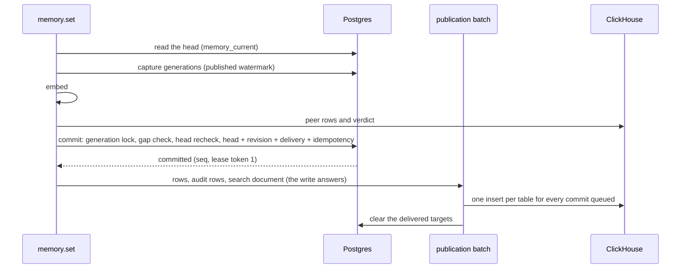

# Storage authority: Postgres for live memory, ClickHouse for search

Loom runs with one of two memory authorities, chosen per deployment by
`LOOM_STORAGE_AUTHORITY`. Under `clickhouse` (the default) ClickHouse holds
everything, as described in [memory architecture](memory-architecture.md). Under
`postgres`, Postgres holds the current content of every memory key, every committed
revision and what each revision still owes ClickHouse, and the head of every knowledge
document ([knowledge documents](#knowledge-documents)); ClickHouse keeps every vector,
every search leg, the history and the analytics. This page describes the Postgres
authority: its tables, the write and read paths, admission under concurrency,
idempotency, erasure, failure, and the two Postgres deployment profiles.

## Why two stores

A memory write needs ordered versions, compare-and-set, locks and pin checks. A
ClickHouse insert is a part, and a part costs a merge: committed one at a time, the
memory tables pay that per write, and two concurrent writers cannot see each other's
row before they decide their verdicts. Postgres gives a short transaction with row
locks; ClickHouse keeps doing what it is good at, scanning vectors and text.

| State                                                            | Store                                                                                 |
| ---------------------------------------------------------------- | ------------------------------------------------------------------------------------- |
| Current memory content, versions, locks, pins, compare-and-set   | Postgres `loom.memory_current`                                                        |
| Revision journal and its delivery jobs                           | Postgres `loom.memory_revisions`, `loom.memory_deliveries`                            |
| Idempotency keys and replay answers                              | Postgres `loom.idempotency`                                                           |
| Scope generations (admission)                                    | Postgres `loom.scope_generations`                                                     |
| Knowledge document heads, their delivery jobs, deletion evidence | Postgres `loom.knowledge_heads`, `loom.knowledge_deliveries`, `loom.erased_documents` |
| Vectors, lexical and vector search, the searchable memory rows   | ClickHouse `loom.memory_embeddings`, `loom.memory`                                    |
| Revision history, the audit trail, usage                         | ClickHouse `loom.memory_versions`, `loom.audit_log`, usage tables                     |

Postgres stores no vector. ClickHouse's `loom.memory` and `loom.memory_embeddings` are
projections published from committed revisions.

A copy writer (a lock, a touch, a status mark, a delete's tombstone, an expiry) draws its
version after its read and above that head's (`rows.version_over`), so a head written on
a replica whose clock is ahead does not overtake it. The sensitivity sweep's relabel goes
above the head it scanned and only over that head, read strong by its key: one written
since holds text its detector did not read, or its writer's own label, and is left for
its next pass, or, when its delivery is parked, until the delivery is retried
([sensitivity sweep](security.md#sensitivity)). A head that moves after that read refuses
the commit under Postgres, and a `high` relabel's fence follows its commit, so a refused
one leaves no fence above that head; on ClickHouse one inserted below the relabel's
version is overtaken, as for any copy writer. The entity pass and a restore draw their
version before the read and lift it above the head read, so a write drawing a version
above theirs outranks them. A value written over a head (`memory.set`, `memory.bulk_set`,
`memory.update_by_id`) goes above that head as well, since under Postgres the commit
keeps the newer of the two. The consolidated summaries
of a deleted source are found and judged on the authority (their heads and their live
sources), and each tombstone or downgrade goes over a head that still cites the sources
judged, a copy since included, while a summary rebuilt from other sources is left. Their
vectors are written at each row's version, under Postgres within the commit's lease: a
tombstone retires them with no text, and a downgrade copies only those of its head's own
hash (none for a head written before hashes), so neither carries text a redaction of
another version may be purging. Under Postgres a downgrade owes its search document until
ClickHouse holds it, else the delivery worker builds it; on ClickHouse a vector row the
copy left keeps its old status until `loom reconcile-status` mirrors it. A
supersession draws before its read and is not lifted: any head above that version keeps
the key, a write drawn later or one from a replica whose clock is ahead. A judged
supersession goes one above the version it read; its vector rows take a version the
status mirror draws (`mirror_status_to_embeddings(judged=True)`). Under the ClickHouse
authority a copy is a plain insert: a write with a lower version whose row lands between
the read and the insert (a value, a delete, a relabel to `high`) is overtaken by it, and
nothing reports it. Under Postgres the copy commits only
over the head it read (`heads_unchanged(exact=True)`), and a head written since refuses
it.

## The tables

The schema is `schemas/pg_migrations/` ([migrations](#migrations)). Every primary key
and every tenant index leads with `org`.

| Table                       | Key                                                        | Holds                                                                                                                                                                                                                 |
| --------------------------- | ---------------------------------------------------------- | --------------------------------------------------------------------------------------------------------------------------------------------------------------------------------------------------------------------- |
| `loom.authority`            | singleton                                                  | the recorded authority, its epoch and the deployment id                                                                                                                                                               |
| `loom.scope_generations`    | `(org, scope)`                                             | the last revision number of a namespace, or a policy generation (`scope = '*'`, org `''` for the global one)                                                                                                          |
| `loom.memory_current`       | `(org, namespace, agent, user_id, session_id, memory_key)` | the head of each key: the complete `loom.memory` row as JSON, with `memory_id`, `version`, `seq`, `content_sha256` beside it                                                                                          |
| `loom.memory_revisions`     | `(org, namespace, seq)`                                    | every committed row, append-only (a redaction scrubs one in place), with its hash-only audit row and its metadata in typed columns ([revision metadata](#revision-metadata))                                          |
| `loom.memory_deliveries`    | `(org, namespace, seq)`                                    | the targets a revision still owes ClickHouse (bits: 1 memory row, 2 search document, 4 audit row, 8 a deleted decision's record, 16 the old vectors), its lease and fencing token; deleted when the last target lands |
| `loom.idempotency`          | `(org, key_hash)`                                          | an op's request digest, its state (`running`, `committed`, `done`), the revisions it committed, its answer, a lease and its token                                                                                     |
| `loom.erased_memories`      | `(org, namespace, memory_id)`                              | deletion evidence: the namespace and id of each memory an erasure removed, when, and when its publishers are quiet; no content, kept `LOOM_PG_ERASURE_EVIDENCE_HOURS`                                                 |
| `loom.idempotency_fences`   | `org`                                                      | when an erasure last removed the org's replay answers: the bound of its residue census                                                                                                                                |
| `loom.audit_outbox`         | `(org, namespace, row_hash)`                               | the audit rows an erasure removed before ClickHouse had them, and those a claim deferred because the holder it replaced may still insert them, until the delivery pass publishes them; keys and ids, no values        |
| `loom.knowledge_heads`      | `(org, namespace, source_uri)`                             | the head of each knowledge source: the complete `loom.documents` row ([knowledge documents](#knowledge-documents))                                                                                                    |
| `loom.knowledge_deliveries` | `(org, namespace, source_uri, version)`                    | what a document commit still owes ClickHouse (bits: 1 the document row, always set, 2 the older chunks' retirement; published whole), its row, lease and token                                                        |
| `loom.erased_documents`     | `(org, namespace, doc_id)`                                 | deletion evidence: the `doc_id` of every version of each document an erasure removed, ClickHouse's included, refused at a commit; no content, kept `LOOM_PG_ERASURE_EVIDENCE_HOURS`                                   |

A head is the row `loom.memory FINAL` would serve: a commit replaces it only when its
version is not older, as `ReplacingMergeTree(version)` decides. Holding the whole row
keeps every one of the write paths that build `loom.memory` rows unchanged
(`server/memory/store/rows.py`): they all reach the commit through the one insert
funnel, `insert_memory_versions`. The row keeps ClickHouse's precision (whole-second
naive UTC datetimes, Float32 confidence), so a read from Postgres returns what a read
from ClickHouse would.

A stored row (a head, or a revision's payload) may leave out a field at its
`loom.memory` default, the ones a first version may leave unset
(`rows.FIRST_VERSION_DEFAULTS`, `pg_memory.SPARSE_DEFAULTS`): every reader takes a
missing field as that default, `decode_row` in Python and `coalesce` (or a test that
holds for NULL) in SQL. The identity, the value, the type, the version and the stamps
have no default and are always stored. This build stores every field.

A memory id is not unique within an org: a namespace restored from another's snapshot
keeps the memory ids under newer versions. Every head read by id therefore names its
namespace (`reads.get_by_id`), and an op addressed by the id alone (`memory.get_by_id`,
`memory.update_by_id`, `memory.verify`) first finds the one namespace holding a live
head of it that the caller can reach (`id_namespace.namespace_for_id`). It answers not
found when the caller reaches more than one, counted by namespace access, so also when
its own-user read scope hides one of the copies, and when the grant of any holder could
not be read (the request is then the server's failure). A namespace restored into itself
under another agent holds the id under a second key; an op by id then acts on the newest
head holding it, so such a copy is addressed by its key. `memory.redact` names a
version, which only one row holds, and acts on that row's key.

Mutable delivery progress lives in `loom.memory_deliveries`, apart from the revision
payloads, so clearing a target never rewrites a revision's content.

### Revision metadata

A revision keeps its key (`agent`, `session_id`, `memory_key`), `status`, and its
redaction's time and reason in typed columns beside its payload (`row`). A trigger sets
them from `row` whenever a writer of any build sets it, each falling back to the
`loom.memory` column's default for a field `row` leaves out, and keeps them when `row`
is cleared, filling any still NULL from the payload being cleared. A revision written
before the columns existed has them NULL and its payload in place, so a reader takes
each from the column or, when it is NULL, from `row` (`pg_memory._meta`); the migration
rewrites no revision. Every reader of the journal but the profile reach (below) matches
on that metadata and reads `row` only for a revision's content, which may be NULL:

- an old version (`namespace.rollback`'s reinstated rows, `revisions_at`) is then
  ClickHouse's `memory_versions` row of the same key, served scrubbed when the columns
  say it is redacted, so a redaction ClickHouse's scrub has not reached yet is never
  served; a revision the journal no longer holds (erased) is not served;
- an admission's gap with such a revision is not cleared from the journal: the write
  reaches its verdict again on peers read anew;
- a redaction marks such a revision's columns, and ClickHouse's scrub reaches its text.

A profile revision keeps its payload for good: a redaction's reach into the profiles
folded from the memory matches on `row`, which the partial index
`memory_revisions_profile` serves.

Every commit sets a revision's payload; nothing clears it.

Eight maintenance indexes do not lead with `org`: `memory_deliveries (lease_until)` and
`knowledge_deliveries (lease_until)` `WHERE NOT settled` (the delivery workers' queues
across tenants), the same two `WHERE settled`, `audit_outbox (due_at)`,
`idempotency (expires_at)`, `erased_memories (erased_at)` and
`erased_documents (erased_at)` (the sweeps). All eight are local to a Postgres database;
a tenant's rows are still found by their primary keys.

### Rejected layouts

- **A typed table of every `loom.memory` column.** Each new column would be written
  twice and the two schemas would drift; the JSON row is the row the funnel already
  checks (`check_memory_rows`).
- **Postgres heads with content in ClickHouse.** Every point read would need a second
  lookup, and ClickHouse would stay on the write path.
- **A lock per namespace held across the conflict check.** It would hold a database
  connection, or a transaction, across inference and a ClickHouse query.

### A database per tenant

Tenants share one schema in one database per Postgres placement unit, every key and
tenant index led by `org`; a tenant that needs isolation gets its own placement unit
(a cluster), not its own database. A database per tenant was weighed by what each
of its costs grows with:

| Cost                  | One database per tenant                                                                                                                                                                                                      | Shared schema                                      |
| --------------------- | ---------------------------------------------------------------------------------------------------------------------------------------------------------------------------------------------------------------------------- | -------------------------------------------------- |
| Connections           | a connection reaches one database ([Postgres](https://www.postgresql.org/docs/16/manage-ag-overview.html)); a pool per tenant per process: tenants × processes × 20 server connections at a pooler's usual default pool size | one pool per unit                                  |
| Change capture        | a logical slot decodes one database ([Postgres](https://www.postgresql.org/docs/16/logicaldecoding-explanation.html)): a slot and a walsender per tenant, each reading all of the WAL                                        | one per unit                                       |
| Vacuum and wraparound | 3 autovacuum workers by default for the whole cluster, a launch per database per naptime, a `datfrozenxid` horizon per database ([Postgres](https://www.postgresql.org/docs/16/routine-vacuuming.html))                      | one set of tables                                  |
| Migrations            | applied once per database; a boot's advisory lock covers one database, a partial run leaves tenants on different schemas                                                                                                     | one transaction per file                           |
| Isolation             | none: the WAL, buffers, IO, checkpoints and vacuum workers are the cluster's ([Postgres](https://www.postgresql.org/docs/16/manage-ag-overview.html))                                                                        | the same; a separate unit isolates                 |
| Moving a tenant       | one `pg_dump` of its database                                                                                                                                                                                                | the tenant's rows by `org`, then the route's epoch |
| Erasure               | `DROP DATABASE`, fast, but not in a transaction and refused while a slot uses the database ([Postgres](https://www.postgresql.org/docs/16/sql-dropdatabase.html)); backups and archived WAL keep the data either way         | delete by `org` under the scope's generation locks |

Its one advantage, moving a tenant with one dump, does not pay for the rest, and it
isolates nothing a shared database does not. A schema per tenant has the same
migration and catalog costs, and a transaction pooler refuses the `search_path` it
needs per connection. A dedicated database on a shared cluster for a regulated tenant
shares that cluster's WAL, IO and backups; a dedicated placement unit does not.

### Postgres branching

Copy-on-write branches (a snapshot of the volume, a new Postgres on it in seconds)
were weighed for each place a copy of the authority is made:

| Use                                                      | Verdict                                                                                                                                                                                         |
| -------------------------------------------------------- | ----------------------------------------------------------------------------------------------------------------------------------------------------------------------------------------------- |
| The authority itself                                     | not a dependency: Loom runs on any Postgres 16+, and a new branch has one primary and no standby                                                                                                |
| Integration tests                                        | `postgres:16` and `postgres:18` containers with a synchronous standby, started per run, needs no account or network and tests the standby a branch lacks                                        |
| Restore in quarantine                                    | a copy at a recovery point that erasures are applied to before it serves: a Managed Postgres fork or a recovery cluster under the HA manager does it; a branch is a faster way to make the copy |
| Rehearsing a cutover or a migration on production's data | the strongest use: a full-size copy in seconds; it holds production data that later erasures do not reach, so it lives only for the rehearsal; a point-in-time fork is the same on any Postgres |
| A preview per pull request                               | not on production data: a copy per change multiplies what an erasure must reach                                                                                                                 |

So a branch is an optional way to make the copies these procedures need, never a
condition of them.

## The write path

1. **Read.** The handler reads the key's head from Postgres
   (`memory_repo.get_by_key`, `get_by_id` and `memory_rows_by_identity_keys` read
   Postgres under this authority; an `as_of` replay reads ClickHouse's history).
   Guards (lock, pin, blacklist, char limit) run as on the ClickHouse authority.
2. **Capture.** The admission captures the policy generations and the namespace's
   published watermark: the last revision number below which every revision's memory
   row and search document are in ClickHouse, a parked revision's left out and a stub's
   document counted as in (`pg_memory.capture`). Nothing waits here.
3. **Verdict.** The embedding and the conflict check run outside any transaction.
   Under this authority `memory.set` fetches its peer rows itself
   (`conflicts.peer_rows`: the writer's peers in its read scope and every pinned one)
   and passes them to `check_on_commit`, so a later round can add to them.
4. **Commit.** One transaction (`pg_memory.commit_versions`), locks taken in one order
   (the policy scopes' advisory locks, shared and sorted; then generation rows by
   `(org, scope)`; then heads by key; then deliveries by seq), each lock waited for at
   most `LOOM_PG_COMMIT_LOCK_TIMEOUT_MS`:
   - the policy scopes are held shared to the commit (a blacklist or access change
     takes them exclusively, after the commits holding them and before the ones queued
     behind it), then their generations are read, in a statement of their own, and
     compared: a change since the capture sends the write back to its check;
   - the namespace generation is advanced by the number of rows, which locks it; when
     it had moved past the captured one, the rows committed in the gap are read in
     this transaction and the admission's gap check runs on them
     ([admission](#admission-under-concurrency));
   - each written key's head is locked and rechecked against the row the write read:
     never a delete, a pin, a lock, a status or a redaction the write did not see;
     with `if_match_sha256` also that very version (compare-and-set), otherwise it may
     carry a newer value (two unconditional writes of a key: the newer version wins,
     as in ClickHouse); else the write starts over;
   - the heads are upserted, the revisions and their deliveries inserted, and the
     idempotency key, if any, marked `committed` with the revisions, under its lease
     token.
5. **Publish.** The writer hands the committed rows, their audit rows and the search
   document it built to its process's publication batch ([publication](#publication)),
   which inserts them into `loom.memory` (whose materialized view keeps
   `loom.memory_versions`), `loom.audit_log` and `loom.memory_embeddings` together with
   every other commit queued, and clears those targets under each commit's lease token.
   A `memory.set` of a key with no live head (a new key, or one deleted since) that
   states no relations and is not `high` answers once the commit returns
   ([publication](#publication)); every other writer, `memory.bulk_set` included, waits
   for its flush, so what follows it reads its rows in ClickHouse, and answers 503
   `PUBLICATION_PENDING` with `committed: true` when the flush fails or its lease
   (`LOOM_PG_REQUEST_LEASE_SECONDS`, less `LOOM_PG_LEASE_MARGIN_SECONDS`) runs out
   first.

The transaction does no inference and no ClickHouse query. A write that failed before
its commit wrote nothing; one cut off after it is durable and its delivery is finished
by someone else ([delivery](#delivery)).

`memory.bulk_set` follows the same steps for a batch: it captures before its existing
lookup, commits every row in one transaction with each key's head rechecked, and gives
only the rows with a vector the search-document target.

### Publication

A ClickHouse insert of a version row is a fenced `INSERT … SELECT FROM input()`, which
ClickHouse cannot buffer ([batched inserts](clickhouse.md#batched-inserts)), so one
insert per write is one part per write. Each process therefore batches its commits'
publication itself (`server/memory/store/pg_batch.py`). A flush sends every commit
queued since the last one, whatever its namespace and org: one insert into each of
`loom.memory` and `loom.memory_embeddings`, split into blocks of at most 100 months of
`created_at` (the tables' partition key; ClickHouse Cloud pins
`max_partitions_per_insert_block` at 100), and one batched insert of the audit rows into
`loom.audit_log`, then one Postgres transaction clearing what landed. Flushes start at
most 1000 / `LOOM_PG_PUBLISH_INTERVAL_MS` (250, so 4; capped at half
`LOOM_PG_PROJECTION_WAIT_MS`) a second on average, up to a second's worth (at least one)
at once: a process that writes now and then sends each write at once, and a busy one
sends at most that many inserts a second into each table. An insert makes a part for
each partition its rows span, so the memory tables get from writes 4 parts a second for
each serving process (every web worker of every replica, and the workers' process) and
month of `created_at` written, at the default, whatever the write rate; a flush's
retirement of old vectors (`OLD_VECTORS`) and a refused flush sent again commit by
commit add their own.

The search document is built, and its vector computed, by the writer before its commit,
as on the ClickHouse authority; until its flush it is held in the writer's process, and
Postgres stores no vector. A process that stops before its flush loses the document, not
the write: the delivery worker takes the delivery once its lease runs out and embeds the
revision's text again ([delivery](#delivery)). The shutdown drain sends what is queued
first. A flush sends a document only while its key's head still serves it: the revision
it was built from, or a newer copy of it with the same content (a pin, a touch, a
conflict mark) whose own delivery owes no document, onto which the flush carries the
writer's vectors with the copy's columns and version, so the text is not embedded again.
One deleted, rewritten or redacted since has its own retirement or document, which this
one would land live above. The flush ends its writer's lease on such a delivery at once
(`pg_memory.hand_over`), and on every delivery of a commit ClickHouse refused, so the
delivery worker, or a search waiting at its barrier, builds the document from the head
or settles it without waiting out the lease. A flush that got no answer ends no lease:
an insert of it may still be running.

Only a write of a key with no live head answers before its flush, since its follow-ups
need nothing of ClickHouse: no head of its own to revise, no relations to fence, and its
entity projection runs beside the answer. A later write of the key in another session
finds it all the same: the same-key reads (`newest_wins` supersession, the resolver's
owed mark for a key held elsewhere, the guard that refuses a proposal over an accepted
fact, and `memory.delete_version`'s check of the chunks the key's values serve, the
deleter's own newer head included) take the authority's heads
(`pg_memory.live_key_heads`). A revision fences its edges on its new row, a write with
relations its facts, and a `high` row's fence (`fence_high`) rechecks the head in
ClickHouse: each of those waits for its own flush.

Every commit in a flush is sent under its own lease and token, as its writer would send
it alone, so the guarantees below hold unchanged: the flush runs under the earliest
lease among its commits and sends nothing for a commit whose lease ran out in the queue;
an erasure waits out those leases; a redaction's fence ends them; a target is cleared
only under the commit's token. A flush ClickHouse refuses is sent again commit by
commit, so a row it keeps refusing holds back only its own commit; one ClickHouse does
not answer is left whole to the delivery worker. During a rolling upgrade a build N-1
that publishes each write alone serves beside N: both send the same rows under the same
leases. N-1's reads of ClickHouse that wait at the barrier in N (below) do not wait, so
until the rollout ends a key's first `memory.set` answered by N can be missing from them
on an N-1 replica for up to one flush.

Read-your-writes: `memory.get` and the other point reads answer from Postgres, current
at the commit. A search waits at the barrier ([search](#search)) for the flush, at most
a flush's wait and an insert after the write, and so do `memory.list`, `memory.history`,
a `memory.get` or `memory.get_by_id` `as_of` replay and `namespace.rollback`'s plan. The
graph's fences project a write's edges and facts only while `loom.memory` shows it holds
its value (`graph_holders`): a first write's entity projection, which runs beside the
answer, first waits for that write's flush, up to its lease
(`pg_batch.own_write_published`); when the flush does not land, it finds no row to hold
the value, as on a write whose publication is pending, and the entity extractor projects
the row once it is in. A fence reads any other write's row as ClickHouse holds it. A
write whose verdict writes copies of other heads (a conflict's marks, a supersession, a
refinement) waits for each copy's flush, which waits for the write's to end and, on a
busy process, for the pace. A read of ClickHouse alone (`memory.keys` and the others
[erasure](#erasure) names) shows the write once its flush lands.

Every other writer of `loom.memory` commits through `insert_memory_versions`: a new head
when its version is not older, a revision, a delivery, the audit row. A copy of a head it
read commits through `lifecycle.insert_versions_over_heads`, only over the version it
read; the writers that recheck no head are listed under [Redaction](#redaction). A
copy that writes a live row's search document (a rollback, a restore, an Undo) writes it
under its commit's lease and owes it until then, so the delivery worker builds one the
lease or a failure cut off. A period digest's row, which rechecks no head, writes its
document the same way (`lifecycle.insert_documented_versions`), and links its lineage only
when the row and its document reached ClickHouse at its commit, where a user erasure
reaches the lineage through it; a row left pending, or whose document was refused, goes
without its lineage until a rewrite.
`memory.reject` and `memory.clear` write their changes as revisions, and their vectors
are re-emitted at the revision's version (a search document a writer still owes, at an
older version, lands under them). The table TTL a retention setting puts on
`loom.memory` and `loom.memory_embeddings` (`LOOM_RETENTION_MEMORY_DAYS`,
`LOOM_RETENTION_MEMORY_EMBEDDINGS_DAYS`, a namespace's `retention_days`) would delete
ClickHouse's copies alone, so it is not applied to either table under this authority,
and the boot refuses the two settings.

### Audit

Every committed row's hash-only audit row (`memory.revision`: key, id, version, content
hash, source class, status, pin, tombstone, request id, and as actor the token's
principal, else the pipeline stage's actor, else `-` inside a request and `process:loom`
for Loom's own jobs, never the earlier writer a copy carries) is built once, stored
beside the revision in the same transaction, and delivered to `loom.audit_log`. It is
durable before the write answers. A delivery that retries skips audit rows already stored
by their hash. A write op that leaves its own row (`memory.set`, `memory.update`,
`memory.update_by_id`, `memory.bulk_set`) still does, with its verdict, beside this one.

## Admission under concurrency

A verdict reached in ClickHouse can be wrong by the time the write commits: a peer
created while the check ran is not among the rows it read. Checking only the returned
candidates' versions misses that peer, and a Postgres isolation level does not track a
predicate evaluated in ClickHouse. Loom tracks it with generations:

- every commit in a namespace advances the namespace's generation, in the same
  transaction, and numbers its revisions with it;
- a blacklist change advances the policy generation of its scope; an admission
  compares both at commit.

When the namespace generation moved, the gap (the revisions committed after the
captured one) is examined inside the commit, which holds the generation lock, so no
commit can join it meanwhile. A seq missing from the gap was erased, or was an
erasure's own advance of the generation, and has nothing left to be a peer; a verdict
that links the written row to a memory an erasure removed (its canonical, a conflict)
is refused at commit and reached again on peers read anew, whatever the gap:

- a row that cannot be a peer is ruled out: another memory type, the writer's own key
  (rechecked under its head lock), a vector farther than the check reaches, and for
  `memory.set` also a row not live or not active, or outside the writer's read scope and
  not pinned (`memory.bulk_set` judges such a row by its vector too);
- vectors are measured on this process's copy of the vectors it committed, and only a
  row clearly out of reach (by a margin over ClickHouse's lower stored precision) is
  ruled out that way;
- `memory.set` also refuses to clear a gap that changed one of its verdict's peers.

A cleared gap commits at the new generation. A gap that does not clear on the local
vectors sends the write back to its verdict outside the transaction: `memory.set` waits
for the gap's rows to be published, measures them on ClickHouse's copy, adds the ones
within reach to its peer rows (`pg_admission.absorb`) and reaches its verdict again on
them, without reading its peers anew; `memory.bulk_set` measures the gap the same way
and starts over if a row is within an entry's reach, or if a row of an entry's type and
another key holds no live vector of the embedder's model to measure (deleted, or not
embedded yet under it).

Writes that are each other's peers therefore commit one at a time, each seeing the
ones before it. A namespace whose admissions cannot keep up answers 503
`ADMISSION_CONTENDED` once a write has re-checked for `LOOM_PG_ADMISSION_DEADLINE_MS`:
excess work is refused, never queued without bound. A head that kept changing answers
the same after `LOOM_PG_ADMISSION_ROUNDS` starts. One namespace therefore commits no
faster than the deployment writes: once concurrent writers into it queue longer than
the deadline, the excess answers 503 with `retry_after_s`, where the ClickHouse
authority would answer it later. A longer deadline trades those refusals for latency;
more namespaces, or more replicas, raise the rate.

Time-based state is not tracked by a generation: a lock's or an expiry's passing is
judged at commit, on the head as it is then.

## Search

ClickHouse retrieves and ranks; Postgres says what is current
(`server/memory/app/search/pg_validation.py`).

- **Barrier.** A search captures, for each namespace it reads, the namespace's current
  generation, and retrieves once every revision through it is published. Usually none is
  pending, since a flush follows each write at once, or at the publication's pace on a
  busy process ([publication](#publication)), and the barrier is one query. Otherwise
  the search publishes what a stopped writer left, within `LOOM_PG_PROJECTION_WAIT_MS`
  for all its namespaces together, then answers 503 `PROJECTION_BEHIND`; a search that
  waited reads ClickHouse with sequential consistency. Writes committed after the
  capture do not move the barrier: it promises coverage through it, not a snapshot
  across the two stores.
- **Validation.** A memory hit is served only when the head of its own key (org,
  namespace, agent, user_id, session_id, memory_key) is live, of the hit's type, neither
  rejected, `high` nor redacted, and the revision its document was built from, the
  newest at or below the document's version, has the head's content hash. A change of
  tags, confidence or expiry keeps the document; a hit on other content, on a deleted or
  expired memory, or whose identity the leg did not read is dropped. A hit showing a
  chunk's passage (a chunk made into its row's hit, judged by that row under any type,
  or a row lifting a chunk's excerpt) is served only when a live head of the chunk's
  writer and the parent key, under any session, still cuts its value into that chunk, as
  this build cuts it (a change of the chunker or of `LOOM_MEMORY_SET_CHUNK_MAX_CHUNKS`
  drops a passage until its key is written again); one whose row the leg did not name
  is judged by its passage alone. The recent-first and anchor-first tier rows are
  checked the same way, even under an `as_of` replay (they are current reads), and are
  not refilled; a tier does not count again a version the page's check dropped, and
  counts the rows it read, before its window. Promoted rows (`loom.shared`), standalone
  chunk hits (`source=chunk`), summaries, records, entity summaries, the current-state
  observation leg and `memory.timeline` are not checked, nor is the rest of an `as_of`
  replay, which reads ClickHouse's history. `memory.search_trace` waits at the same
  barrier and, outside an `as_of` replay, leaves out the candidates the authority no
  longer serves and counts them in its `stale_dropped`, with no refill. `memory.ask`
  judges its finished pool by the same rule, outside an `as_of` replay, and drops what
  fails with no refill and no count: its own legs (identifier injection, bridge and facet
  completion) read ClickHouse after the search's page was checked, and a row they add
  carries the identity and version it was read at. Its precedent fast path, which would
  answer before retrieval from ClickHouse's write marks, is off; a precedent is reused
  only against the checked pool.
- **Refill.** Dropped hits are replaced from the ranked remainder, one round of at most
  a page, without the assembler's per-key, per-session and token caps; the response's
  `stale_dropped` counts them, so a short page says why. A parked page is checked the
  same way and reads on past its stale rows, up to four for each hit still missing; the
  rest is the next page's. Its total stays the parked list's.

## Delivery

A delivery row is created with the commit, leased to the writer for
`LOOM_PG_REQUEST_LEASE_SECONDS` under token 1. A delivery whose lease ran out is taken
under the next token by:

- the `pg_delivery` worker, each pass (`LOOM_PG_DELIVERY_*`), oldest lease first, with
  `FOR UPDATE SKIP LOCKED`;
- an admission that needs the namespace's backlog published
  (`pg_admission.wait_searchable`), for its own namespace.

Either publishes from the committed revision: the memory row, the audit row and, for a
searchable write, the search document, embedded there from the revision's text unless
ClickHouse already holds the document its writer built at that version. A document built
here is embedded from the revision's own text: a `memory.bulk_set` entry whose writer
embedded it with a contextual prefix gets the plain text's vector instead, the one
`memory.set` would have given it. Claims are published a namespace at a time, and one by
one when a namespace's batch fails, so a revision ClickHouse keeps refusing holds back
only itself. At `LOOM_PG_DELIVERY_MAX_ATTEMPTS` failed publishes (a refused row, a
refused Postgres statement, a lease that ran out during the publish) a delivery owing its
search document and not its memory row publishes a stub the embedding worker fills; any
other is parked: no longer claimed, left out of the published watermark, and counted by
`GET /v1/health?include=postgres` (`postgres.parked_deliveries`). A publish that ends the
worker process counts too: a claim is marked started just before its own publish and the
mark cleared with its outcome, so the next pass counts one still marked as an attempt,
publishes it alone, and parks it at the limit (a delivery owing only its search document
gets its stub instead, and is parked if that stub stops the process too). The worker
stops a pass between namespaces, and between claims it publishes one by one or stubs past
their attempts, once a lease has gone by, so its deadline cuts only a publish slow on its
own. A pass that ends without an outcome for a claim clears its mark and counts nothing:
one cancelled (the worker's deadline, a shutdown) before that claim's publish started, or
cut by a Postgres outage. A publish the worker was running when its pass was cancelled
keeps its mark and counts (each claim of a batch then counts one attempt and goes alone),
as does one its lease ran out on; an admission helping with a namespace's backlog
releases everything it claimed. ClickHouse refused nothing when it answers with a state
that clears on its own (a merge backlog, a read-only table, Keeper lost, too many
queries, an insert of unknown status, the server out of memory as a whole), when every
pooled connection is busy, or when a publish fails at the connection and ClickHouse then
does not answer a probe: the pass stops. A connection failure while ClickHouse answers, a
timeout, and an insert block spanning too many partitions are the rows' own and count, so
a batch that always fails that way is tried row by row and a row that keeps failing is
parked. A second copy of a row is harmless: both ClickHouse tables are
`ReplacingMergeTree(version)` and every row keeps its revision's version, so a copy
collapses into the first and a late one never outranks a newer write. Only the current
token's holder clears a target, so an overtaken publisher cannot mark a newer claim's
work done.

## Idempotency

Under this authority an `Idempotency-Key` is a row of `loom.idempotency`, keyed by
`(org, sha256(v3, org, subject, op, key))` as on the ClickHouse authority, and it fails
closed (Postgres down is 503).

| The key's row                               | A request with the key gets                                                                                                                                                                                                                                  |
| ------------------------------------------- | ------------------------------------------------------------------------------------------------------------------------------------------------------------------------------------------------------------------------------------------------------------ |
| none, or expired                            | it runs, holding the row (`running`, a 60 s lease, a token)                                                                                                                                                                                                  |
| another request digest                      | 409 `IDEMPOTENT_CONFLICT`                                                                                                                                                                                                                                    |
| `done`                                      | the stored answer                                                                                                                                                                                                                                            |
| `running` or `committed` under a live lease | 503 `IDEMPOTENT_IN_PROGRESS`, retryable                                                                                                                                                                                                                      |
| `committed`, lease over                     | 200 with the committed revisions' identity (`memory_id`, `version`, `content_sha256`, `memory_key`) and `idempotent_replay: committed`; for `memory.bulk_set`, `written` names the rows the batch committed, in their commit order, not one result per entry |
| `committed`, an erasure removed a revision  | 404 `RESOURCE_NOT_FOUND`, for the whole request                                                                                                                                                                                                              |
| `running`, lease over                       | it runs, under the next token                                                                                                                                                                                                                                |

The commit marks the key `committed` in the same transaction as the revisions, and only
under the token its request holds: a request a retry took over can no longer commit
under the key, and answers 503 `IDEMPOTENT_TAKEN_OVER`. A request that answers without
committing deletes its claim, so a retry runs at once. Keys are kept for 24 hours; a
retry after that is a new request.

## Erasure

The first step of every erasure saga is `pg_memory.delete`
(`server/erasure/store/steps_pg.py`). In one transaction it advances every affected
namespace's generation (which locks it, so the scope's commits wait, and a verdict in
flight that links a memory it removed is reached again), moves the audit rows ClickHouse
does not have yet to `loom.audit_outbox`, deletes the scope's revisions (and with them
their deliveries) and heads, and reads the latest lease among the deliveries it removed.
It then waits until every publisher that held one has stopped: a publisher sends nothing
past its lease, every insert it sent starts on the server within a transit allowance of
the lease's end (a later one is refused, carried table or not), and it runs for at most
the write limit (the ClickHouse write timeout, or 60 s when it is 0). What the wait
covers is what the authority publishes: the memory rows, search documents, audit rows,
decision records and old vectors' retirements its deliveries owe. A write's own
ClickHouse copies of search rows after its publish (a delete's or expiry's vector
retirement, a fence, a lift, a status or expiry mirror) and
what is derived from it (the graph projection, conflict judging, the background
workers) are writes like any other: one racing an erasure of its scope is the race it
is under the ClickHouse authority, and the erasure's ClickHouse steps and residue census
cover what lands before the census. A delivery another holder took over and finished is
kept settled until that bound has passed after both its lease and its `fenced_until`,
since the publisher it replaced may still be sending, so the erasure waits for it too;
a parked delivery is waited for by its `fenced_until`, the last moment a holder that no
longer holds it may send (the lease of its last holder when a claim parks it, or the
time of a failed publish). The ClickHouse steps run after that wait, which is part of
`erasure.request`'s answer when it runs the saga: about 80 s past the latest such lease
with the default settings. Each removed id's evidence in `loom.erased_memories` keeps
`quiet_at`, when no publisher of what that run removed can still land a row: a run
that finds the rows already gone (an earlier one deleted them and stopped before its
wait) waits until then: for a namespace scope, that namespace's evidence; for a user's,
the org's, which names no user, so another erasure's wait in the org is waited out too.
The idempotency step fences the org's claims in flight (a new token: none of them
stores an answer) and records when in `loom.idempotency_fences`, holding the org's claim
lock for those two statements only; a request that meets the lock answers
`IDEMPOTENT_IN_PROGRESS` and retries. It then deletes the answers claimed before that
time, which the census also counts; a retry that takes over a fenced claim restarts its
`created_at`, so its answer is not residue.

The audit trail outlives the memory, and the erasure does not wait for ClickHouse to
take it: the delivery pass publishes the outbox once no publisher of those rows can
still land them, one namespace at a time, skipping a row already in `loom.audit_log`,
and deletes what it published. A refused row is counted and retried, and parked after
`LOOM_PG_DELIVERY_MAX_ATTEMPTS` (`postgres.parked_audits` in
`/v1/health?include=postgres`); an unavailable ClickHouse, or a claim that ran out,
counts nothing. The outbox holds keys and ids, never values, as `loom.audit_log`. A
delivery claimed within the insert bound of the lease (or fence) it replaced sends its
audit row the same way, due once that holder can no longer land it, so the claim's
read of `loom.audit_log` cannot miss a copy still in flight and write the row twice.

The same transaction keeps the namespace and id of every memory it removed in
`loom.erased_memories`; by namespace, since a namespace restored from another's snapshot
keeps its memory ids. A write built from a head read before the erasure (a touch, a pin,
a worker) is refused at its commit with 404, after the generation lock the erasure held,
so it cannot bring the memory back. The evidence lasts `LOOM_PG_ERASURE_EVIDENCE_HOURS`,
judged by its age where it is read; the delivery worker sweeps expired rows to reclaim
them, and a refusal never waits on that sweep. An erasure of an id whose evidence has
expired starts it again. A `namespace.restore` into the namespace leaves out the
snapshot's memories whose evidence is kept (their rows cannot be told from a stale
writer's), restores the rest, and counts the ones left out in `counts.erased_skipped`. A
replay of that `snapshot_id` writes nothing, so it does not bring them back (two
restores of one snapshot at once both write, and the evidence leaves the memories out of
each); a snapshot first restored after their evidence expires writes them, as every
restore does under the ClickHouse authority, which keeps no evidence. Deletion evidence
protects only the namespaces the erasure removed the memory from, and only while it is
kept: a snapshot taken before an erasure brings its memories back into any other
namespace, on either authority; re-run the erasure after such a restore. A restore
commits in batches of `LOOM_PG_RESTORE_BATCH_ROWS`, each within a request's lease; once
one batch's publication is pending, the rest are only committed, claimable by the
delivery worker at once, and the restore completes with `publication_pending`: until the
worker has published them, a search or a semantic write in the namespace answers
`PROJECTION_BEHIND` past its wait. An erasure that lands between the restore's check and
a batch refuses that batch with 409 `PRECONDITION_FAILED`: the batches before it stay,
and the retry writes every memory again, without those. A memory the erasure did not
remove (one deleted before it ran) that a restore writes while the erasure is still
running is residue of the scope's own rows that fails the saga, which is run again.

The residue census counts `pg:loom.memory_current`, `pg:loom.memory_revisions` and
`pg:loom.idempotency` beside the ClickHouse tables, over the scope's own rows: an erased
id cannot come back while its evidence is kept, since its commit is refused. A user's
consolidated dependents (the summaries a `src:` tag pairs with a key the user wrote in
the row's namespace) are counted in ClickHouse, with their history, chunks, entity vectors
and graph links ([erasure saga](memory-architecture.md#erasure-saga)), and not in
Postgres. A Postgres table that holds no memory content is listed with its reason
(`PG_NO_MEMORY_CONTENT`). Under the ClickHouse authority the saga has no Postgres step
and the census no Postgres rows.

Under the Postgres authority `namespace.snapshot` reads the heads the authority holds,
so a delete ClickHouse has not published, or never will (a parked delivery), is not
snapshotted. `namespace.inventory`'s memory counts read ClickHouse once it holds every
revision committed so far, at the same barrier as a search (503 `PROJECTION_BEHIND` past
its wait), and then read it sequentially; a parked delivery is not waited for. The
diagnostic reports (`namespace.audit`, `namespace.validate`, `namespace.tune`,
`memory.inspect`, and `knowledge.inspect`'s decision counts and memory findings) start
at the same barrier, but a wait that runs out, or a Postgres that does not answer, does
not fail them: they read what ClickHouse holds and name `projection` in `skipped`, and
audit and validate also in `coverage`, which then is not `complete`. As a search's does,
the wait may publish another writer's lapsed deliveries. A finding cites a sampled row
only while it is its key's live head at the version ClickHouse read, in the same
redaction state, with the hash of the value `memory.get` serves there; a row rewritten,
deleted or redacted since is not cited. A `memory.set` of a key with no live head, a
copy of a head its writer read (`lifecycle.insert_versions_over_heads`: a tombstone, a
status, a pin, a touch, the supersessions and cascades of any write), `memory.reject`,
`memory.clear` and a period digest's row are done once committed, even when their
publication is pending: the delivery worker publishes them, a search serves a hit only
while the authority's head shows its content, and a point read answers from the
authority. The write goes on as on the ClickHouse authority, where a row once inserted
stands: what it derived retires, its webhook is sent, and a ClickHouse follow-up that
fails answers its own error. A by-id write is confirmed by its commit, which keeps the
newer version: a row older than the head it was read from is overtaken. Every other
write answers 503 `PUBLICATION_PENDING`. `memory.bulk_get` (and the OKF export, which
reads values through it) answers from the authority's heads, as `memory.get` does, and
so does `erasure.export`'s memory section. `memory.list`, in either order, starts once
ClickHouse holds every memory row the namespace committed, at a search's barrier (503
`PROJECTION_BEHIND` past its wait; an `as_of` replay too, since the history it reads
holds a write only once flushed), so a write is listed once it answered. It serves a
ClickHouse row only while it is the authority's live head at that version, redacted or
not alike (`lifecycle.served_rows`), so a delete, a rewrite or a redaction ClickHouse
has not published is not read back.

The background reads whose rows go to a model, or onto a plain derived row, keep to the
same rule; two of them also keep ClickHouse's row while the authority's head is only a
copy of it. A period row takes a source's entities, as ClickHouse read them, only when
the authority's head is the row read or a copy of it with the same id and text, active
and not `high`; a period row written while a source is left out goes without that
source's entities until the period is rewritten, since a later pass skips a period
already written unless asked to rewrite it. Under Postgres a period counts as written
once the authority holds its head, before ClickHouse has the row. A pass that cannot read
a period's sources writes no period, and a later pass writes it. The observation
extractor's session context keeps ClickHouse's row, its dates included, while the head is
still an observation its statement selects (so not `high`) with the same id and text,
such as one an earlier pass marked DONE; the batch it distils is read from the
authority's heads, as a copy writer's is ([Redaction](#redaction)). The conflict resolver
sets aside a row with a flagged peer whose delivery ClickHouse has not published, with no
model call and no attempt counted, for `LOOM_PG_DELIVERY_LEASE_SECONDS` at a time. A
structured profile built short of the facts it counted reads as `stale` and is built
again after the cooldown, a model call each time while a fact stays behind. A structured
build that was served none of the facts it counted makes no model call: it replaces a
served profile with the all-`null` one, written again after each cooldown, and writes
nothing for a user with no profile served.

Until a parked delivery lands (`postgres.parked_deliveries` in
`/v1/health?include=postgres` counts them), the rows these rules leave out stay out of
the background reads, and so does a resolver row whose flagged peer is in that delivery.
A user with no profile served whose facts are all behind sorts with the other users that
have no profile under the schema, ahead of the rest, and a pass reads such a user's facts
once per scan of the namespace, with no model call. While those facts' deliveries are
parked, such users can fill that namespace's share of
`LOOM_STRUCTURED_PROFILE_MAX_USERS_PER_PASS`, and what the pass has left, on each pass
until the scan list moves past them; while they fill a whole scan, the namespace's other
users wait for the deliveries.

A recovery listing (`include_tombstoned`) checks deleted rows too, and lists a row the
authority has since only deleted (nothing it filters on changed: the columns it reads, a
trace or status filter; never under `as_of`) as that deleted head, with ClickHouse's
preview of the text (`lifecycle.recovered_rows`); a row restored, or changed otherwise,
since ClickHouse's copy joins either listing once ClickHouse holds it. Open against the
isolation gate: reads of ClickHouse alone, among them `memory.keys`, `memory.statuses`,
`memory.related`, the graph walk's recent seeds and
`memory.aggregate`, show a write the authority holds once it is published. A decision
record's writer counts as live only if the authority holds its
decision head; whether a live decision is still proposed is read from ClickHouse alone.

The blacklist sweep waits until ClickHouse holds the memory rows committed in the
pattern's scope (503 `PROJECTION_BEHIND` past its wait), matches there with a sequential
read, then pages through the live heads whose memory row ClickHouse keeps refusing (a
parked delivery) in the deliveries' key order, so a sweep takes longer with the parked
backlog `GET /v1/health?include=postgres` reports. It judges each head the authority
holds with the same RE2 match before it tombstones it, and leaves a head whose version is
above the tombstone's. Its `matched` counts what ClickHouse matched and the parked heads
it tombstoned. A failed match query is answered in `error`. A failure while tombstoning
is the call's error until a row may have landed, and after that the sweep answers what
landed, with `error` set; `blacklist.add` reports either in `sweep_error` with the pattern
kept. A commit whose answer was lost may have landed: its tombstones are in the
authority, each with its audit row, and the answer does not count them; their
`memory.tombstoned` events and `memory_drops` count are not sent.

A deleted decision's record is retired once its tombstone is committed, as a target of
its delivery of its own (`DECISION_RECORD`, apart from the memory row a search waits on):
the request's publish or the delivery worker retires it
(`pg_publish.retire_decision_records`), so a commit whose answer was lost loses its record
too. The retirement keeps a record whose writer the authority holds live and copies only
records below a version it draws just before reading the live writers (within the hosts'
clock skew, as every version is), so a decision recorded again since keeps its record. Its
ClickHouse copy starts by a deadline the server checks on its own clock, within the
transit allowance of the lease's end as every insert under a lease does, so it never
lands after an erasure has waited out its publisher. One that fails stays owed, is
counted and parks on its own at `LOOM_PG_DELIVERY_MAX_ATTEMPTS`. Under the ClickHouse
authority a delete retires the record itself, and `memory.clear`'s in-place update
retires none.

A commit whose row is not embedded (made 'high', or of a type that is not searchable)
over a head that was owes the retirement of that head's vectors the same way
(`OLD_VECTORS`), on every write path: the commit decides it from the head it locks,
whatever version the write read. The publish retires them once the rows are in and
clears the target; when that fails the answer is `PublicationPending`, and the delivery
worker retires them under its lease. Either way a redaction of the key may be purging
those rows while the retirement is in flight, so its tombstones keep only each row's sort
key and partition, with no text or vector, and running it twice changes nothing. A
`memory.restore` of such a key's deleted row mirrors a row with no text or vector, and an
`as_of` replay from before the retirement does not find the key's vector.
On the ClickHouse authority a retirement copies the retired rows as tombstones, so a
restore and a replay keep their vectors.

The delivery worker builds a search document while the key's head is the revision, or a
newer live, embedded and unredacted copy of the same content (a pin, a touch, a status),
which owes no document of its own: the document is then built from that head's row, its
status and tags with it. Under any other newer head it builds none, since one would land
live above that head's retirement.

`memory.import` decides what to skip from the authority's heads.

## Redaction

`memory.redact` scrubs the version's text in the heads and the revision journal in one
transaction (`pg_memory.redact`). The same transaction locks the deliveries of the
scrubbed revisions, reads how long their leases have left, and fences them: a new token
and an ended lease, so a publisher still holding one can neither renew nor complete it,
and the next claim publishes the scrubbed revision. The ended lease is kept
(`fenced_until`): its holder may still be sending the old text until then. A retry,
which also reads the deliveries of the copies the first call scrubbed, waits it out, as
does an erasure of the scope. The sweep keeps a settled delivery until its
`fenced_until` and the insert bound have passed. A parked delivery stays parked; its
`fenced_until`, the last moment its last holder may send, is what the wait covers, and
the ClickHouse scrub covers what ClickHouse already has. That scrub runs once every
holder is waited out, as an erasure waits (`pg.wait_out`): `memory.redact` answers after
that wait, which with the default settings reaches about 80 s past the lease of a
publisher that held a delivery of the key, the 30 s delivery lease included when the
delivery worker held it.

A redaction takes the namespace's generation lock first, as a commit does, so no commit
lands between its statements, and acts on the key of the version it names (a namespace
restored from another, or into itself under another agent, keeps the memory's id under
other keys and fresh versions). It checks the key's live head again inside its
transaction, under the head's row lock, with the locks it checks: a head written or
restored since answers 503. A write that rechecks the head it read treats a redaction
since as a moved head: `memory.set`, `memory.bulk_set` and `memory.clear` start over
from the scrubbed head, and `memory.update_by_id` answers 503 `ADMISSION_CONTENDED`, its
retry reading the scrubbed head. A scrubbed head keeps its content hash, and search does
not serve it until it is written again; a new value written over it is not redacted.

A delete, a restore and every copy writer copy the head they read, so the versions of
the key right after the redacted one carry its text until the key holds other text (a
restatement of the same value is a copy too) or its live head is reached: they are
scrubbed with it (`redaction_lineage`), and a restore of a key so deleted answers
`redacted: true` and writes nothing. Text written anew later is reached by redacting
that later version. The named version takes the latest redaction's time and reason; a
copy keeps its first. A retry names every copy again, so it reaches a store a failed
call left, and `memory.redacted` is announced again for each. The copy writers (a lock,
a touch, an unpin, a verify, a move, an expiry, a delete's tombstone, a status mark, a
supersession, a cascade tombstone, a label or demote by `memory.apply`, a proposal's
decision, an entity or crystallize tag, a restore) are built from the head the authority
holds (`lifecycle.current_heads` where the read was ClickHouse's, leaving out a row
whose head moved on since unless the newer head still qualifies) and commit only over
that very version: a value, a delete, a pin, a lock, a status or a redaction since
answers 503 `ADMISSION_CONTENDED`, for the whole call, and the retry reads the newer
head. `namespace.rollback` commits a batch at a time over the heads read just before it,
so a head that moved answers 503 with the earlier batches written, which its audit row
counts. A retry plans again from the heads as they are: a key an earlier batch already
returned to its old content is written again, as a new version of the same content.
Under Postgres it plans from ClickHouse's history once ClickHouse holds every memory row
the namespace committed (503 `PROJECTION_BEHIND` past the wait), so a key written just
before is planned too, and it reads each version it reinstates from the authority's
revisions, which a redaction scrubs before ClickHouse's copies, and its commit refuses
(503) one a redaction scrubbed since it read it. A version held redacted comes back
redacted, with no search document. A reinstated version is a new version of the key: a
later redaction of the old one does not reach it, so delete the key, then redact that
version.

A `memory.restore` that undoes a retirement starts from the status of the key's newest
earlier version that is not `superseded` (`memory_repo.status_before`), matched by the
key as well as the memory id. It brings back `conflicted` only while a peer is still
conflicted and lists the row, and `duplicate` only while the original it repeats is
still served. Under Postgres that status is read from the authority's revisions:
ClickHouse's history may still lack one whose publication is owed.

A `high` row (`memory.set`, `memory.bulk_set`, `memory.update`, `memory.update_by_id`,
`memory.restore`, `namespace.rollback`, a consolidation's summary, the sensitivity
sweep's relabel) is fenced whenever its commit may have landed: its answer received,
lost, or the write cancelled from its COMMIT on. One whose answer was lost is judged by
its key's head read with `FOR SHARE` (`pg_memory.settled_head_versions`): a COMMIT still
waiting on the synchronous standby holds the head's row and is not yet visible to a plain
read, so the read waits for it, each head's lock within `LOOM_PG_COMMIT_LOCK_TIMEOUT_MS`,
in the commit's key order, and is rolled back, so it never waits on the standby itself.
The row is fenced when it is the head, or when the key has no head (a first write still
in flight, which no read can wait for); a head below it did not take the write, and one
above it belongs to a later write. When the heads cannot be read every row is fenced and
recorded as a `fenced_outcome_unknown` drop: one that did not land leaves its key's
previous head out of search until the key is written again. A restore whose answer was
lost reads its head back the same way: a head below it settles that it did not land
(heads only move up), answered as a retryable 503; a head above it or none leaves the
outcome unknown, answered as one with `outcome_unknown`. A sweep relabel whose commit may
have landed unanswered, its answer lost or its pass cancelled from its COMMIT on, is
fenced the same way. The fence runs to its end when the request is cancelled. A fence
that fails then answers as the commit does: its old vectors still retire with its
publication, or through the delivery worker when that fails (`OLD_VECTORS`), and a copy
still in flight goes unfenced until a later write to the key fences it; the drop ledger
records `fence_failed` with the key, or `fence_failed_outcome_unknown` when the commit's
own answer was lost. On the ClickHouse authority a failed fence is the write's error,
except a consolidation's summary, whose failed fence is recorded the same way.

The graph is judged from ClickHouse's rows, and no later scan reads a labelled row, so
the sensitivity sweep owes a 'high' relabel's facts (the triples and the edges its text
gave the graph) right before it commits, as `sensitivity_facts_owed` for the projection
repair. Once the relabel is in and ClickHouse holds it, the sweep closes them and
resolves the debt; otherwise (its publication pending, its answer lost, its pass
cancelled, its close failed) the repair closes them once ClickHouse's head of the key
reaches the relabel's version, a delete since included, and owes nothing when the
authority's head settled below it or the key holds no row. The repair leaves a debt
younger than ten minutes alone, as it does a follow intent; one whose close by the sweep
failed waits out those minutes, and one whose close by the repair failed is retried on
its next pass. The sweep and the repair read the authority's head with `FOR SHARE`
(`pg_memory.settled_head_versions`), so a COMMIT still waiting on the synchronous standby
is waited for rather than read as missing; a wait past `LOOM_PG_COMMIT_LOCK_TIMEOUT_MS`
leaves the debt for the next pass. The edge drop and the triple close each run whatever
the other does, and a fallback restate whose interval repair fails is owed on its own
(`triples_reconcile`, with the closes it made), as a reconcile owes it. A relabel that is
in and then fails or is cancelled is still announced; one whose answer was lost is not. A
`medium` relabel cancelled after its commit leaves its vectors untagged.

A writer that rechecks no head commits what it read, as on the ClickHouse authority: the
period digest (`loom period-digest`), `observe.record`, `namespace.restore`, the lesson
import, `memory.delete_version`'s write-back above its tombstone and the write fence's
lift. One racing a redaction can write the text back as a new version; delete the key,
then redact that version. A copy under another memory (`memory.copy`,
`memory.cross_promote`, a promotion to `loom.shared`) or under another key (a namespace
restored from this one, or into itself under another agent) is not reached by a redaction
of its source: redact it too. A `namespace.restore` or a lesson import writes the text
its payload carries, so a payload taken before a redaction brings the old text back.
`memory.consolidate` merges only the rows the authority serves, and commits its summary
over the head of the summary's key, with the merged rows as its sources, each still its
key's live head at the version read: a merged row deleted, written again, pinned, locked,
redacted or erased since the read refuses the cluster. Merged rows that keep moving
through `LOOM_PG_ADMISSION_ROUNDS` reads while they are retired stay live beside the
summary (`retire_contended` in the drop ledger), as does one held since the read
(`merged_row_left_live`). The summary's vector is written under the commit's lease, and
left owed to the delivery worker when it fails. A redaction of a merged source after the
merge does not reach the summary: redact it too.

The key's search rows that do not hold the live head's text are scrubbed after the
versions, from a read of the head; a redacted head counts as no live head. An embedding
row with a real content hash (64 lowercase hex) is judged by it against the live head's,
read from the authority, so under Postgres an older row ClickHouse still serves as the
key's live one goes; one with none or the placeholder `'0'` cannot be matched to a write
and is judged by its excerpt, whenever it landed. A hashed embedding row stamped after
the redaction began (a version stamp taken before it read the head, from that replica's
clock) is a newer write's and stays, unless it carries the redacted version's content
hash, as a restore's mirror of the old excerpt does; a write of the redacted text racing
the redaction therefore loses its search row until it is written again. A profile head
the redaction dropped bounds nothing: every profile row of the key is judged, and a fold
racing the redaction loses its search row until the next fold. Chunk rows carry no
version. Under Postgres the chunks of a long `memory.set` value are judged by the chunks
the key's live heads write, in any session, read from the authority: an older value's
chunks go though ClickHouse still holds them as live, and a write landing meanwhile
loses its chunks until it is written again. Any other chunk of the key (a conversation
chunk an extraction linked to it), and every chunk on the ClickHouse authority, is
judged by the chunks ClickHouse holds as live. On the ClickHouse authority a
`memory.set` chunk of the redacted value that a later write failed to retire still reads
as live and stays; deleting the key before the redaction removes it. An embedding writer
that holds no delivery lease (the embedding worker, a re-embed, the chunks of a long
value still being embedded) and read the text before the redaction can land its row
after the scrub, as can a copy of a key's live vector rows that read an older version's
row before the purge (a status mirror, a touch, a verify, a tag, the re-check after a
'high' write's fence). A later write hides that row from search, but only a retry of the
redaction removes its text: a chunk's tombstone keeps the content it retires.
Under Postgres the kept chunks are planned by the chunker of the build that redacts, and
a key written under a higher chunk cap keeps all its chunks. A fence row (no excerpt,
terms or vector) holds no text and stays. A restore racing a redaction ends by
authority: under Postgres the redaction answers 503 and its retry leaves the restored
head live, to be deleted and redacted again; on the ClickHouse authority, which holds no
lock on the key, a restore that lands before the redaction reads the copies is scrubbed
with them, and one that lands after keeps the text.

Under Postgres a reject copies only the vector rows of the head's own content hash, none
of a redacted, unhashed, 'high' or unsearchable head, and retires every other row below
its version with no text. It reads each key once (sequentially consistent on ClickHouse
Cloud), under its commit's lease and before its publish, so a redaction waits the copies
out; the copies sit at the reject's version, below any later 'high' write's fence, and
the key's entity vectors stay as they are. Until the publish lands, `memory_embeddings`
reads the key as rejected while `loom.memory` does not. `loom reconcile-status` holds
back a row whose key's head in Postgres is newer than `loom.memory`'s row, or gone (an
erasure not yet in ClickHouse), and counts it. Held-back rows count against its
`--limit`, so a namespace whose deliveries are parked can fill it. A reject that commits
after a pass reads the heads, and whose copies land before the pass's mirror re-reads
the vectors, can still be reverted by that pass; a later `loom reconcile-status`, run
after the publish, mirrors it back. A reject whose copy fails leaves the old rows live,
which search outside an `as_of` replay drops as stale until a later write retires them.

Outside the scrub, the redacted text stays where Postgres keeps old row images: the dead
tuples a scrub's `UPDATE` leaves until vacuum, the WAL, its archive and base backups. A
stored idempotency answer (`loom.idempotency`, kept 24 hours) may quote an excerpt until
it expires.

## Knowledge documents

`loom.knowledge_heads` holds the head of every knowledge source, keyed by
`(org, namespace, source_uri)`: the complete `loom.documents` row a read serves, with its
version, revision and whether it is deleted. `loom.knowledge_deliveries`, keyed by
`(org, namespace, source_uri, version)`, holds what a commit still owes ClickHouse (bits:
1 the `loom.documents` row, 2 the retirement of the source's older chunk versions), its
own copy of the row, a lease and its token
(`schemas/pg_migrations/002_knowledge_documents.sql`).

Every document write reaches Postgres through one funnel,
`documents.insert_one` / `insert_many` (`server/knowledge/store/documents.py`), which
takes the version its writer read (`over`, 0 for none):

1. The writer refuses a row whose source URI or writer's id holds text Postgres cannot
   store (422 `VALIDATION_FAILED`; other text is kept exactly, in base64 inside the
   stored row), then inserts the new version's chunks into ClickHouse. Search reads
   chunks without consulting documents, so they are found beside the version they
   replace from the moment they land, as an ingest's always were. A write whose document
   does not land retires them (deletes them when an erasure removed what it was built
   from).
2. The commit locks the sources' heads in key order and replaces each only when it is
   not newer than the version the writer read (one behind it is adopted) and the new row
   is above both. Every writer stamps its version past the one it read, so a host whose
   clock runs behind still writes above the head. A head that moved refuses the whole
   commit (`HeadMoved`, 409 `PRECONDITION_FAILED`): the writer retires its own chunk
   version and the caller starts over from a fresh read. Two writes of one source
   therefore never both publish, and each revision number is taken once; a bulk add
   that names a source twice is refused (422) before anything is written.
3. Under its lease the writer inserts the `loom.documents` row and, for an upsert, an
   ingest or a delete, retires the older chunk versions (an add and a bulk add keep
   them, as under the ClickHouse authority), then deletes the delivery under
   its token. A writer stopped after the commit answers 503 `PUBLICATION_PENDING`; the
   `knowledge_pg_delivery` worker takes the delivery once its lease ran out and
   publishes it from the stored row, parking it after `LOOM_PG_DELIVERY_MAX_ATTEMPTS`
   refusals (`postgres.parked_knowledge_deliveries` in `GET /v1/health?include=postgres`);
   ClickHouse unavailable counts no attempt.
   A second copy collapses into the first (`ReplacingMergeTree(version)`), and a
   repeated retirement retires nothing more.

A delete is a head whose row carries `superseded_at`; its delivery retires every older
chunk version, so a delete that loses the head to another write leaves that write's
chunks alone. A tombstone's retirement runs before its row is published, so once a
delete is visible its chunks are retired already, and `knowledge.restore`, which reads
the delete under the source's claim, answers a retryable 503 while a publication of the
source may still land (one owed, or one the worker took over and settled within the
insert bound of its lease): the delete's retirement could otherwise land after the
restore brought the chunks back.

`knowledge.get` and the writers' reads (`get_one`, `get_many_by_uris`) read each
source's head and its latest `loom.documents` row, and serve the newer version: the head
serves a commit ClickHouse does not have yet, and ClickHouse a row a build that commits
no heads wrote (one written before the namespace had heads, or by an older replica
during a [rolling upgrade](rolling-upgrades.md)). At one version ClickHouse's copy
answers: it differs from the head only by a stamp made in place, such as an older
build's erasure tombstone or an erased original. The source's next commit inserts or
replaces the head over that row: a commit is refused only by a head newer than what its
writer read, and of two concurrent first commits the second is refused. A head that owes
ClickHouse nothing while ClickHouse holds no row at its version (a purge can leave older
writers' rows), confirmed by a sequentially consistent read (exact on ClickHouse Cloud
and a single server; a replicated cluster sends every Loom process to one replica,
[ClickHouse](clickhouse.md)), was purged by such a build; the read deletes it instead of
serving it. The retention TTL on `loom.documents` (`LOOM_RETENTION_DOCUMENTS_DAYS`, a
namespace's `retention_days`) would delete ClickHouse's copy alone and leave the text in
the head, so it is not applied under this authority, and the boot refuses the setting.
A namespace's `retention_days` leaves the document's chunks in `loom.chunks` as well, so
search still finds a document that stays.
A document whose source URI or writer's id holds text a Postgres key column cannot store
has no head: it is read from ClickHouse, and any write of it (a delete, a metadata edit,
a restore) is refused (422), so only an erasure removes it.

`knowledge.inspect`'s document sections (the totals by format and scheme, the chunks,
the listed documents) read ClickHouse, so they can miss a commit it does not have yet.
The report reads the namespace's unsettled deliveries once (a delivery whose row landed
but whose older chunk versions are not retired yet counts). Any owed or parked delivery
is counted in `skipped` (`documents.projection: …`); a Postgres that does not answer is
named there instead (`documents.projection: POSTGRES_UNAVAILABLE: …`, covering the
memory sections too, which then do not wait) and not asked again in the call. Either
makes `listed_complete` false. A listed row is kept only while `get_many_by_uris` serves
it at the version ClickHouse listed, live; a document rewritten or deleted in Postgres
since leaves the listing, counted in `skipped` (`listed.heads: …`).

An erasure's `pg_knowledge.delete` step, after `pg_memory.delete`, runs on a connection
of its own in one transaction:

1. It takes each namespace's document lock (`pg.KNOWLEDGE_LOCK_KEY`) alone, which every
   commit holds shared, so no commit lands in a locked namespace between its read and
   its delete. A user's scope locks every namespace holding the user's heads or
   deliveries, reading again until no namespace more holds one. The user's namespaces
   that hold only ClickHouse rows are read for evidence without a lock: a commit there
   during the step makes a head carrying the user's id, which the residue census
   finds, so the saga fails and runs again. Until the transaction ends, a knowledge
   write in the locked namespaces, any user's, waits `LOOM_PG_COMMIT_LOCK_TIMEOUT_MS`
   and answers 503, so a scope with a long ClickHouse history holds them for its whole
   evidence read.
2. It locks the scope's heads in a commit's key order, deletes the deliveries and the
   heads, and keeps the `doc_id` of every version of the scope's documents, those
   ClickHouse holds included, in `loom.erased_documents` for
   `LOOM_PG_ERASURE_EVIDENCE_HOURS`. A row built from a read of a document keeps its
   `doc_id` (a delete's tombstone, a metadata edit), and a write that carries a live
   document's original or author names it (`built_from`), so a commit built from a
   removed one is refused (`DocumentErased`, 404), read after the heads' locks the
   erasure holds. A write built from a version a later write replaced before the
   erasure keeps that version's id and is refused too; one that reads after the
   erasure carries none (a new version takes a fresh id, and a deleted document lends
   none) and commits. A version a merge folded away before the erasure leaves no id.
3. It waits out the leases of the deliveries it removed, and of an earlier run's
   (`quiet_at`). A parked delivery has no lease of its own: the wait covers the send
   that parked it, from its `fenced_until`. A delivery the worker took over
   and finished is kept settled, its lease ending then, until the insert bound has
   passed (the request it replaced may still have an insert in flight), so the wait
   covers it too, by its own `user_id` for a user's scope, as for memory.

The ClickHouse steps then remove the documents and chunks. A source written before its
namespace had heads has no head to lock: a write of it racing the erasure is the race it
is under the ClickHouse authority. The delivery pass sweeps expired evidence.

## Failure

| Failure                                              | Effect                                                                                                                                                                                                                                                      |
| ---------------------------------------------------- | ----------------------------------------------------------------------------------------------------------------------------------------------------------------------------------------------------------------------------------------------------------- |
| Postgres unreachable                                 | writes, point reads, idempotent replays and the reads of ClickHouse that wait at the barrier (`memory.list`, `memory.history`, the `as_of` replays, `namespace.rollback`'s plan) answer 503 `POSTGRES_UNAVAILABLE`; nothing falls back to ClickHouse's copy |
| A commit's answer lost                               | 503 `POSTGRES_UNAVAILABLE` with `outcome_unknown: true`; a retry with the same idempotency key replays what committed                                                                                                                                       |
| ClickHouse unreachable after a commit                | the write is durable; its delivery is published once ClickHouse answers; semantic admissions, searches and the reads that wait at the barrier in the namespace answer 503 `PROJECTION_BEHIND` until then                                                    |
| A writer dies after its commit                       | its lease runs out within `LOOM_PG_REQUEST_LEASE_SECONDS`; the next admission in the namespace, or the worker, publishes the revision                                                                                                                       |
| Two publishers of one delivery                       | both copies collapse; only the current token clears the target                                                                                                                                                                                              |
| A row ClickHouse keeps refusing                      | parked after `LOOM_PG_DELIVERY_MAX_ATTEMPTS` failed publishes; the namespace's other revisions publish                                                                                                                                                      |
| A write built from an erased memory                  | 404 `RESOURCE_NOT_FOUND`, nothing committed: the erasure's deletion evidence refuses it at the commit                                                                                                                                                       |
| A string holding a NUL character or a lone surrogate | 422 `VALIDATION_FAILED` before the commit: Postgres text and jsonb cannot store it (a knowledge document keeps such text in base64, and refuses it only in a source URI or a writer's id)                                                                   |
| An erasure's idempotency fence                       | a request with an `Idempotency-Key` in that org answers 503 `IDEMPOTENT_IN_PROGRESS` while the fence's two statements run, and retries                                                                                                                      |

## Recorded authority

At first boot a deployment records its authority, under the deployment-wide lease
`storage_authority`: in ClickHouse (`loom.storage_authority`, read by every replica of
either profile) and, for Postgres, in `loom.authority` with the same deployment id and
epoch. A replica refuses to start when:

- it is configured for ClickHouse and the record says Postgres, or the reverse;
- it is configured for Postgres and this ClickHouse already holds memory under the
  ClickHouse authority;
- its Postgres records another deployment, or none while ClickHouse records Postgres.

A process with `LOOM_BOOT_MIGRATE=0` applies no migration of either store and writes no
record: it checks the record there is. A ClickHouse one serves without the table when
it is not migrated yet; a Postgres one refuses to start until a boot with migrations on
has recorded the authority. The Postgres files it skips are logged and listed in
`/v1/health` `pending_migrations` with a `pg:` prefix (a ledger it cannot read as
`pg:<ledger unreadable>`), and keep `/v1/health/ready` not ready: a skipped file until
the process restarts after it is applied, as a skipped ClickHouse file does, and an
unreadable ledger until a readiness probe reads it; a ledger that disagrees with the
build refuses the boot.

A CLI command compares its configured authority with ClickHouse's record before it runs
and refuses on a mismatch (exit 2), or when it is configured for Postgres and ClickHouse
records none; under Postgres, its first connection, pooled or the dedicated one an
erasure step opens, also checks that the database `LOOM_PG_DSN` names records this
deployment, before any statement. An erasure or an import run from a shell configured
for another store would leave or write that store's rows. A command that never touches
memory, such as a token revocation, opens no connection, so it runs while Postgres is
down.

An outage never moves writes between authorities, and neither does a setting: a
ClickHouse deployment that holds memory keeps the ClickHouse authority.

## Migrations

`schemas/pg_migrations/NNN_*.sql` follows the [ClickHouse journal's rules](../development/migrations.md):
numbered, additive, never edited once merged. The boot applies the pending files under
a Postgres session advisory lock, each in one transaction with its row in
`loom.pg_migrations` (the file's SHA-256). An applied file that changed, or a ledger
row for a file this build lacks below its last number, refuses the boot; a newer
build's files are served with a warning, so builds N-1 and N run on N's schema.

The migrations run on a connection of their own with no statement timeout, so a long
DDL runs to its end, and with `lock_timeout = 5s`: a file that cannot take its lock is
retried rather than holding every read and write of the table behind it. A boot that
finds another migrating waits on the advisory lock for as long as that takes.

## Deployment profiles

The Postgres connection is one DSN (`LOOM_PG_DSN`) and the pool sizes
(`LOOM_PG_POOL_MIN_SIZE`, `LOOM_PG_POOL_MAX_SIZE`). Postgres 16 or newer, core
features only; no extension is required. Every connection sets
`synchronous_commit = on`. At boot Loom reads `synchronous_standby_names` and
`pg_stat_replication`:

| `LOOM_PG_DURABILITY`    | No synchronous standby configured | A standby configured, none attached |
| ----------------------- | --------------------------------- | ----------------------------------- |
| `synchronous` (default) | refuses to start                  | warns (commits wait for one)        |
| `local`                 | warns                             | warns                               |

The server's own `synchronous_commit` default does not matter: Loom's sessions set it.

|                               | ClickHouse Managed Postgres                   | Self-hosted Postgres                                                                                                               |
| ----------------------------- | --------------------------------------------- | ---------------------------------------------------------------------------------------------------------------------------------- |
| Acknowledged-write durability | two HA standbys (one standby is asynchronous) | a synchronous standby in another failure domain: `synchronous_standby_names`, set by the HA manager in its strict synchronous mode |
| Promotion                     | the service's failover                        | the HA manager, fencing the old primary                                                                                            |
| What Loom checks              | the same boot check                           | the same boot check                                                                                                                |

Both are the operator's configuration, not code ([Postgres operations](../operations/postgres.md)).

## Release gates

Each gate's threshold is fixed here before it is measured; the deployment profile for
local qualification is one host, ClickHouse latest in Docker, `postgres:16` with one
synchronous standby, the fake embedder, concurrency 5, 30 s per op
(`scripts/ops/benchmark.py`). Control: the ClickHouse authority on the same build.

| Gate                      | Threshold                                                                                                                                                                                          |
| ------------------------- | -------------------------------------------------------------------------------------------------------------------------------------------------------------------------------------------------- |
| Isolation and correctness | no disclosure, lost acknowledged write, skipped protection, duplicate logical effect or resurrected erased content in the suites                                                                   |
| Semantic admission        | concurrent writes of one fact under different keys: exactly one new fact                                                                                                                           |
| `memory.get` latency      | p99 at most the control's, p50 at most 15 ms                                                                                                                                                       |
| `memory.set` latency      | p99 below the control's                                                                                                                                                                            |
| `memory.bulk_set` latency | p99 at most 1.10 × the control's                                                                                                                                                                   |
| Parts                     | new parts of `loom.memory` and `loom.memory_embeddings` while `memory.set` runs: at most 1000 / `LOOM_PG_PUBLISH_INTERVAL_MS` a second each, per serving process and month of `created_at` written |
| `memory.search` latency   | p99 at most 1.15 × the control's                                                                                                                                                                   |
| Errors                    | no 5xx but explicit overload answers                                                                                                                                                               |
