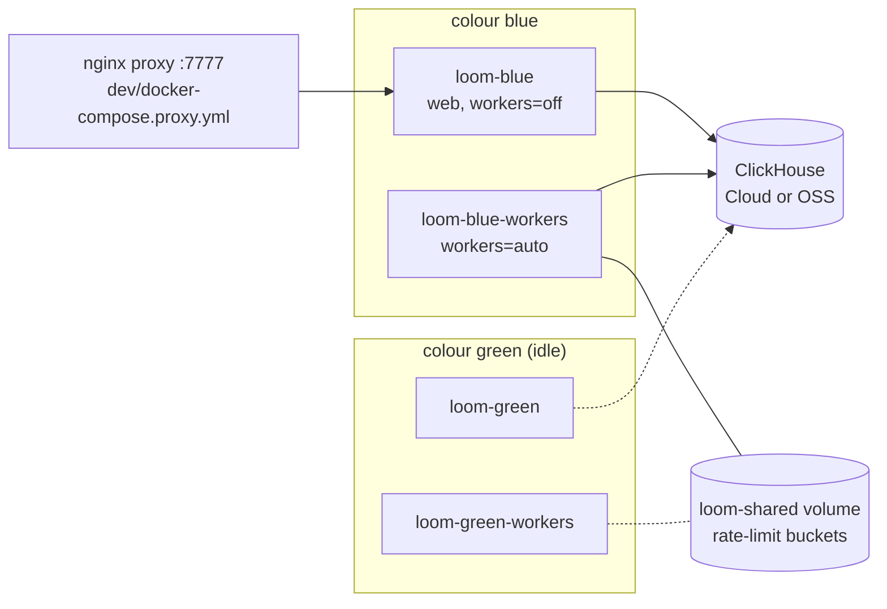

# System overview

Loom is a Python server (a FastAPI application plus a supervisor of background workers)
and ClickHouse, with Postgres as an option for live memory. Under
`LOOM_STORAGE_AUTHORITY=postgres`, Postgres holds live memory and the head of every
knowledge document ([storage authority](storage-authority.md)). Loom is
stateful: everything it knows is stored there, including facts and their vectors,
documents, conversations, the entity graph, the code index, tasks, audit, cost and
erasure progress. The server processes keep no durable state of their own, so any number
of them can serve the same stores and a request can land on any of them. The few pieces
of state kept outside those stores are listed under
[Deployment topology](#deployment-topology).

The storage layout is in [ClickHouse](clickhouse.md).

## Goals and non-goals

| Goals                                                                                                  | Non-goals                                                                                         |
| ------------------------------------------------------------------------------------------------------ | ------------------------------------------------------------------------------------------------- |
| One engine for every kind of state: vectors, full text, graph edges, time series and ledgers.          | File formats in the server: `knowledge.add` takes `content: str`; parsing is the CLI's job.       |
| One wire surface, declared once, served the same over HTTP and MCP.                                    | Cross-table transactions. Derived rows catch up after the primary write.                          |
| Server processes hold no durable state: add web capacity by running more of them.                      | Bi-temporal history. Validity is valid-time only; transaction-time history is the version mirror. |
| Every row attributable to a tenant (identity tuple), a writer (`actor`) and a request (`log_comment`). | A GDPR-compliance guarantee. Erasure and audit hashing are engineering primitives.                |
| A keyless install that boots and answers, with fake providers reported.                                |                                                                                                   |

## Components

```mermaid
flowchart TB
  clients["Clients<br/>MCP · HTTP · SDKs · dashboard"]
  subgraph cp["Control-plane process (FastAPI)"]
    transports["Transports<br/>server/transport"]
    auth["Auth<br/>server/auth"]
    registry["Operation registry<br/>server/operations"]
    app["Domain handlers<br/>server/&lt;domain&gt;/app"]
    domain["Domain logic<br/>server/&lt;domain&gt;/domain"]
    store["Domain stores + client<br/>server/&lt;domain&gt;/store · server/core/ch.py"]
    workers["WorkerSupervisor<br/>server/workers · server/&lt;domain&gt;/workers"]
    obs["Observability<br/>server/observability"]
  end
  providers["Providers<br/>server/embedding · server/llm"]
  ch[("ClickHouse<br/>database loom")]
  clients --> transports
  transports --> auth
  transports --> registry --> app --> store --> ch
  app --> domain
  store --> domain
  workers --> app
  app --> providers
  transports --> obs
  obs --> ch
```



| Component          | Code                                                  | Role                                                                                                                                                                                                                                                                                                                                             |
| ------------------ | ----------------------------------------------------- | ------------------------------------------------------------------------------------------------------------------------------------------------------------------------------------------------------------------------------------------------------------------------------------------------------------------------------------------------ |
| Transports         | `server/transport/http.py`, `server/transport/mcp.py` | Turn a request into an operation call. Both are generated from the registry: every op is `POST /v1/<name>` and the MCP tool `loom_<name>` (dots become underscores). Shared admission is `server/transport/gates.py`.                                                                                                                            |
| Operation registry | `server/operations/`                                  | One `Operation` per op (`base.py`): name, input and output models, handler, `required_role`, `idempotent`, `audit`, `maturity` and scoping flags; its `budget_p99_ms` comes from the budgets table in `server/settings/catalog.py`. `registry.py`'s `ALL_OPERATIONS` joins every group's `OPERATIONS`.                                           |
| Domain packages    | `server/<domain>/`                                    | One package per plane (`memory`, `code`, `tracker`, `knowledge`, `erasure`, `tasks`, `identity`, `insights`), each with `api/` (wire models and `Operation` declarations), `app/` (handlers and orchestration), `domain/` (pure logic), `store/` (ClickHouse statements and row builders) and `workers/`. See [server layout](server-layout.md). |
| ClickHouse client  | `server/core/ch.py`                                   | The one client: pooling, deadlines, retries, query attribution. `server/memory/store/rows.py` holds the version-row builders.                                                                                                                                                                                                                    |
| Workers            | `server/workers/`                                     | Background loops declared as rows in `registry.py` (`_WORKERS`), each a module in its domain's `workers/`, run by `supervisor.py`.                                                                                                                                                                                                               |
| Auth               | `server/auth/`                                        | JWT verification, revocation, role and namespace authorization, OIDC, the OAuth server and self-signup. See [security](security.md).                                                                                                                                                                                                             |
| Providers          | `server/embedding/`, `server/llm/`                    | Pluggable embedder and LLM clients, each with a deterministic fake. See [LLM architecture](llm-architecture.md).                                                                                                                                                                                                                                 |
| Observability      | `server/observability/`                               | The per-op ledger (`loom.agent_events`), the batched events stream, audit rows, provider health, OpenTelemetry and Langfuse export.                                                                                                                                                                                                              |
| Dashboard          | `frontend/` (served from `frontend/dist/` at `/`)     | React UI over the same HTTP ops. An unbuilt checkout answers its pages with 503.                                                                                                                                                                                                                                                                 |
| CLI                | `server/cli/`                                         | The `loom` command: operator actions (migrate, tokens, re-embed, doctor) and a client for the ops. See the [CLI reference](../reference/cli.md).                                                                                                                                                                                                 |

The registry is the whole wire surface. `GET /v1/operations` lists every op with its
budget and role, and the [operations reference](../reference/operations.md) is generated
from it. To add an op, define the models, write the handler, declare the `Operation` and
append it to its group's `OPERATIONS` list
([adding an operation](../development/adding-an-operation.md)). Both transports pick it up.

A few HTTP routes are not registry ops: `/v1/health`, `/v1/whoami`, `/v1/operations`,
`/v1/.well-known/jwks.json`, `/v1/.well-known/openid-configuration`, `/v1/knowledge.download`, `/v1/auth/login`, the dashboard's
`/v1/me/*` and `/v1/admin/*` helpers, and the OAuth and OIDC endpoints. The
[HTTP API reference](../reference/http-api.md) lists them.

### Dependency direction

```text
transports → operations → <domain>/api → <domain>/app → <domain>/store → server/core/ch.py
                                              ↘ <domain>/domain ↙
```

Workers sit beside the transports and call their domain's `app` and `store`. Handlers
call providers. Nothing below the transports imports a transport module. Which package
may import which, and the layers inside a domain, are in [server layout](server-layout.md);
`tests/unit/test_package_contracts.py` enforces them.

`tests/unit/test_transport_layering.py` enforces the transport rule: it fails when
anything outside `server/transport/`, `server/cli/` and `server/main.py` imports
`server.transport`. So the pieces lower layers need live below the transport: the MCP
toolset rosters (`server/operations/toolsets.py`), the bearer check of non-registry routes
(`server/auth/bearer.py`), the code-scope context variable (`server/code/domain/scope.py`),
the ledger row builder (`server/observability/ledger.py`), latency budgets
(`server/observability/budgets.py`) and the plane defaults (`server/code/app/common.py`).

**Why:** only the transport knows about protocols (status codes, JSON-RPC frames,
headers). A handler can then be called by HTTP, MCP, a worker or a test with the same
input model.

## Request path

Both transports run the same admission decisions, made once in `server/transport/gates.py`.
They differ in how they read credentials and arguments and how they render a refusal:
HTTP answers with a status and a `detail` body, MCP with a result that carries `isError`.

### HTTP

`build_router()` in `server/transport/http.py` adds one `POST /v1/<op>` route per op.
`BodyLimitMiddleware` first refuses a body over `LOOM_MAX_REQUEST_BYTES` (32 MiB) with 413;
0 disables the cap. Each request then passes these phases in order (`_make_endpoint`). A
refusal ends the request.

| Phase                | Code                                   | Refusal                                                                                                                                                                      |
| -------------------- | -------------------------------------- | ---------------------------------------------------------------------------------------------------------------------------------------------------------------------------- |
| Begin                | `_begin_request`                       | None. Sets `X-Request-Id` (the caller's when it is 1 to 64 letters, digits, `.`, `_` or `-`, else a fresh UUID), `X-Schema-Version` and the query tag `"<op> <request_id>"`. |
| Verify token         | `_extract_auth`                        | 401 `AUTH_INVALID` (missing when auth is on, foreign scheme, failing token); 503 `AUTH_UNAVAILABLE` until the revocation list is loaded.                                     |
| Read body            | `_read_body`                           | 400 `VALIDATION_FAILED` on invalid JSON; 422 `UNKNOWN_ARGUMENT` when a write op's unknown key is close to one of its fields.                                                 |
| Validate             | `_validate_payload`                    | 422 `VALIDATION_FAILED` naming the fields.                                                                                                                                   |
| Authorize            | `_authorize` → `gates.authorize`       | 400 `IDENTITY_INCOMPLETE` (no namespace or org), 403 `AUTH_INSUFFICIENT`.                                                                                                    |
| Bind context, policy | `_bind_context_and_policy`             | Sets the auth context and the ledger run (`X-Loom-Run-Id`); 403 `POLICY_FORBIDDEN` when a history policy denies in `enforce` mode.                                           |
| Rate limit           | `_rate_limit` → `gates.rate_limit`     | 429 `RATE_LIMITED` with `Retry-After`; `X-RateLimit-*` headers on every limited call.                                                                                        |
| Idempotency          | `_idempotency_gate`                    | Replays a stored answer (`X-Idempotent-Replay: true`), or 409 `IDEMPOTENT_CONFLICT` when the key is reused with a different body.                                            |
| Handler              | `_run_handler`                         | The handler's `HTTPException`, a `LoomServerError`'s code and status, or 500 `INTERNAL_ERROR`.                                                                               |
| After success        | `_finish_success`, `post_handler_rows` | None. Ledger row, metrics, the body with `ignored_args`, then budget-violation, audit and idempotency rows.                                                                  |

Why this order:

- **Token before body.** An anonymous request the deployment refuses gets its 401 before
  its body is read. It leaves no ledger row, learns no field errors and touches no
  tenant's rate-limit bucket.
- **Authorize before limiting.** The limiter draws from the verified token's org
  (`gates._rate_limit_org`), never from a body value alone.
- **Idempotency after admission.** The replay key is scoped to the caller's org, subject
  and op (`server/core/idempotency.py`, `scoped_key`). A replay never reaches an anonymous
  caller, another tenant or another op.

**Fail-open gates.** Traffic classification and the rate limiter are availability
controls. When either raises, the call is admitted and the failure is counted and logged
at most once a minute (`gates._fail_open`). Authentication and authorization fail closed.

**Unknown arguments.** Input models ignore unknown keys, so `server/transport/arg_check.py`
names them: the response carries `ignored_args` (and `did_you_mean` for a close field
name), and HTTP sets `X-Loom-Ignored-Args`. Both list first any field the op read but
declined to apply, then the unread keys. A write op refuses a close match with 422
`UNKNOWN_ARGUMENT`. Identity keys and keys the transport reads itself (`consumer`,
`traffic_class`, `explain`, the idempotency key) are never reported.

**After the handler.** The ledger row carries latency and the embedding and LLM spend of
the call. The budget-violation row (over `budget_p99_ms` × `LOOM_LATENCY_BUDGET_MULTIPLIER`),
the audit row (when `op.audit`) and the idempotency row go in one round trip
(`gather_best_effort`). Each is best effort. Every ClickHouse statement of the request
carries `log_comment = "<op> <request_id>"` ([query attribution](clickhouse.md#query-attribution)).

### MCP

`POST /mcp` is JSON-RPC 2.0 (`server/transport/mcp.py`, `_handle_request`). It serves the
protocol revisions in `MCP_SUPPORTED_PROTOCOL_VERSIONS` (`mcp_config.py`); `initialize`
echoes the client's version when supported and the latest otherwise. There are no
server-initiated events.

| Method                             | What it does                                                                                                                                                                                        |
| ---------------------------------- | --------------------------------------------------------------------------------------------------------------------------------------------------------------------------------------------------- |
| `initialize`                       | Negotiates the version and returns `instructions`: the primer, with the caller's profile sections. The same primer is the `loom://primer` resource, the `loom` prompt and the `loom_activate` tool. |
| `tools/list`                       | The roster for the connection's toolset (depends on the URL, never the caller).                                                                                                                     |
| `tools/call`                       | One op call through the same gates as HTTP.                                                                                                                                                         |
| `prompts/*`, `resources/*`, `ping` | The primer surfaces and liveness.                                                                                                                                                                   |

`LOOM_MCP_AUTH_MODE` decides which methods need a bearer: `required` (default, every method
but notifications), `discovery_only` (only `tools/call`) or `open`. A refusal carries a
`WWW-Authenticate` challenge pointing at the protected-resource metadata, so a native
connector can find the OAuth server (`mcp_auth.py`).

`tools/list` shows the roster chosen by `LOOM_MCP_TOOLSET` (default `core`) or `?toolset=`
(`server/operations/toolsets.py`). A roster is visibility only: every op stays callable by
name, except the ops in `_MCP_HIDDEN_OPS`, which MCP neither lists nor calls (HTTP still
serves them). The toolsets are in the [MCP reference](../reference/mcp.md). Three tools
have hand-written descriptors: `loom_search` (the `search.query` op, rendered as a text
summary plus the lean sections), `loom_op` (calls any op by name through the same path;
`op: "help"` lists them, `server/transport/mcp_op.py`) and `loom_activate` (the primer,
the one tool that is not a registry op).

`_call_tool` (`mcp_call.py`; the telemetry, response and failure answer in
`mcp_outcome.py`) runs these phases in order:

1. **Resolve the tool** (`_resolve_tool`). An unknown or hidden tool is an `isError`
   result saying what to use instead.
2. **Bind the caller** (`_bind_caller_identity`). Mint the request id, set the query tag,
   and fill omitted namespace and agent from the token and the caller's saved default.
   Explicit arguments win. `code.*` ops default to the deployment's code namespace. The
   reads in `_MCP_CROSS_AGENT_READS` default `agent` to `*`.
3. **Session run.** One implicit run per (org, token subject, `Mcp-Session-Id`), filed in the
   caller's default namespace: a write that names no run gets the session's `run_id`,
   except `run.*`, which names its own run, `code.*`, which acts as the deployment's
   code identity, and `working_memory.*` and `conversation.update`, where `run_id` scopes
   or binds the row.
4. **Idempotency key.** An idempotent tool takes `_idempotency_key` (or `idempotency_key`)
   in its arguments, popped before validation.
5. **Arguments** (`_validated_input`). The misspelled-argument refusal, then validation. A
   failure is an `isError` result with the field errors, the likely intended field for
   each unknown key, the op's arguments and an example call (`arg_feedback.py`).
6. **Authorize** (`_authorize_call`), the shared gate.
7. **Admission** (`_admission_refusal`): traffic class, history policy, rate limit. On a 429
   with a short hint the transport waits once and re-checks (at most
   `LOOM_MCP_RATELIMIT_RETRY_MAX_WAIT_S`).
8. **Idempotency replay**, for an admitted caller only.
9. **Handler.**
10. **Response.** `structuredContent` drops ranking and accounting detail
    (`lean_results.py`; `explain=true` keeps it) and carries `ignored_args`.

**Refusals are results, failures are errors.** A 4xx other than 401 (`LOCKED`,
`PINNED_CONFLICT`, `BLACKLISTED`, `RESOURCE_NOT_FOUND`, a task-state code, `RATE_LIMITED`)
comes back as `isError: true` with the structured body (`mcp_refusals.py`), so the client
sees the guidance. A 401 and a 5xx (`OVERLOADED`, `BACKEND_TIMEOUT`, `SCHEMA_PENDING`) stay
JSON-RPC errors with HTTP's body and retry hint.

The walkthroughs of one write (`memory.set`) and one read (`memory.search`) are in
[memory architecture](memory-architecture.md).

## Roles and process modes

### Roles

`Role` (`server/operations/base.py`) is ordered `VIEWER < WRITER < ADMIN < ORG_ADMIN <
PLATFORM_ADMIN`. Each op declares its `required_role`. A flat token's roles apply to every
namespace it reads, and `loom.namespace_grants` can raise that role on a namespace, never
lower it. A scoped token's `ns_roles` are authoritative for the namespaces they name.
Grants and `ns_roles` carry only `viewer`, `writer` or `admin`; `ORG_ADMIN` and
`PLATFORM_ADMIN` exist only in a flat token's `roles`. See
[security](security.md#authorization) and
[identities and namespaces](../concepts/identities-and-namespaces.md).

### Process modes

One image serves every role. Settings decide what a process does:

| Mode                | Settings                                                                         | What runs                                                                               |
| ------------------- | -------------------------------------------------------------------------------- | --------------------------------------------------------------------------------------- |
| All-in-one          | `LOOM_BACKGROUND_WORKERS=auto` (default)                                         | Web tier, and the workers in the process that holds the deployment's ClickHouse lease.  |
| Web replica         | `LOOM_BACKGROUND_WORKERS=off`                                                    | HTTP, MCP and the dashboard. Refreshes its own revocation snapshot and signing keyring. |
| Workers             | `LOOM_BACKGROUND_WORKERS=auto`, `LOOM_DEPLOYMENT=1`, `LOOM_SERVES_TRAFFIC=false` | The supervisor and its workers; `/v1/health` still answers.                             |
| Branch / A-B server | `LOOM_BOOT_MIGRATE=false`, `LOOM_INSTANCE_LABEL=<who>:<what>:<port>`             | Serves a shared ClickHouse without applying migrations; `auto` runs no workers there.   |

`LOOM_WEB_WORKERS` sets uvicorn processes per container (unset, the image starts one per
CPU the container may use, at most one per GiB of memory and at most 8). Each runs the full
lifespan; under `auto` the deployment's lease picks the one that runs the workers. `on`
takes no lease: each process runs its own copy of the workers, and unless an `auto` process
holds the lease the others report `workers_lease_absent`. A workers container runs `auto`.

**Leader election.** `server/workers/leader.py` (`decide_supervisor`, `keep_lease`) elects
one supervisor per deployment through ClickHouse: key `workers_supervisor` in the Keeper
lock table `loom._migration_lock` (strict KeeperMap, so of two contenders one write
lands). Expiry is
judged on the ClickHouse server's clock. The holder renews every
`LOOM_SUPERVISOR_LEASE_TTL_S / 6` and stops its workers half the TTL after its last
renewal, or when a renewal finds another holder; when the holder dies, another `auto`
process takes the lease after `LOOM_SUPERVISOR_LEASE_TTL_S` (default 30 s). The timings
are in [failure and recovery](failure-and-recovery.md#background-workers). A graceful stop releases it at once, which is
how the new colour of a blue/green pair takes over.

**Why ClickHouse:** the processes that may run the workers span containers and hosts,
and ClickHouse is the one thing they all share. Several hosts can run `auto`; one runs the
workers ([capacity](failure-and-recovery.md#background-workers)).

## Boot

The `lifespan` in `server/main.py` runs in every process, in this order (its steps live in
`server/boot.py`):

1. **Launch rule.** A process is the deployment (`LOOM_DEPLOYMENT=1`, set by the compose
   files) or carries a non-empty `LOOM_INSTANCE_LABEL`; otherwise it refuses to start. A
   deployment that requires auth with the checked-in dev `LOOM_JWT_SECRET` refuses too
   (`require_real_signing_secret`); only `LOOM_INSTANCE_LABEL=deploy:dev` is exempt.
2. **Connect** to ClickHouse.
3. **Migrate** (`LOOM_BOOT_MIGRATE`, on by default). Every process takes the
   deployment's migration lock before applying: a KeeperMap key in `loom._migration_lock`
   (`server/core/schema/migrate_lease.py`). A server without a Keeper, or a failed
   migration, stops the boot. With `LOOM_BOOT_MIGRATE=false` the process logs pending files and
   reports them on `/v1/health`.
4. **Start the `agent_events` emitter.**
5. **Default namespace.** With auth off, give the configured namespace its
   `loom.namespaces` row.
6. **Elect the worker leader.**
7. **Leader duties.** Apply retention TTL overrides where they differ, and register the
   configured tracker namespaces.
8. **Token state and overrides.** Load the revoked-token snapshot
   (`server/auth/revocation.py`) and the signing keyring (`server/auth/keyring.py`); every
   process refreshes both on its own timer. Start adopting the admin runtime overrides
   (`loom.runtime_overrides`: rate limits, latency budgets and live settings) every
   `LOOM_RUNTIME_OVERRIDES_REFRESH_SECONDS`; the workers child process adopts them too. A
   live setting's override is laid over the process's own `settings`, so code reads it as
   `settings.<field>` ([runtime settings](../operations/runtime-settings.md)).
9. **Start the workers** in the leader, and the lease loop in `auto`.
10. **Provider report.** Log the resolved LLM provider and probe the embedder's dimension.
11. **Vector features.** Probe the quantized-codes read setting, patch parts and whether
    inserts can skip the vector-index build.
12. **Calibrate** similarity thresholds from the embedder (`LOOM_ADAPTIVE_THRESHOLDS`). A
    failure never fails boot; the scalar settings apply.

Shutdown reverses this: stop the loops, drain the workers (10 s), release the lease, drain
the Langfuse queue, the event emitter and the deferred writes (exposure rows,
after-write projections, the events stream). The ClickHouse client disconnects last.

`/v1/health` reports ClickHouse reachability and a `problems` list (for example a fake
provider). It answers 503 only when ClickHouse is down;
`?include=workers,langfuse,otel,embedding_cache` adds per-subsystem checks.

## Background processing

`WorkerSupervisor` runs one asyncio task per enabled worker, in the lease holder only.
Each worker is a `_Worker` row in `server/workers/registry.py` with an enable flag and an
interval (`LOOM_<NAME>_ENABLED`, `LOOM_<NAME>_INTERVAL_SECONDS` in most cases). The
supervisor staggers first passes, cancels a pass past its deadline, retries with backoff,
tags every query `worker.<name>` under the `background` traffic class, and records pass
state in `loom.worker_status` (`GET /v1/admin/workers.status`). See
[failure and recovery](failure-and-recovery.md#worker-supervision) and the generated
[workers reference](../reference/workers.md).

## Deployment topology



- **Server processes hold no durable state.** Cross-replica state (revocations, signing
  keys, runtime overrides, sign-in attempt counts, graph write marks, the supervisor lease,
  erasure checkpoints, the blacklist version, the idempotency cache) and uploaded document
  originals live in ClickHouse, the bytes of those written with
  `LOOM_DOCUMENT_OBJECT_STORE=s3` in an S3-compatible bucket instead. Under the Postgres
  authority, the idempotency cache lives in Postgres instead. A new Loom with the same ClickHouse
  (and Postgres, under that authority), env config and `LOOM_JWT_SECRET`, and that bucket
  while rows name objects in it, gets every feature back.
- **State outside ClickHouse and Postgres.** The code plane's git mirrors under
  `var/code_repos` (a cache: a host without them re-clones) and the rate-limit buckets on the `loom-shared`
  volume, neither the system of record; and, while any catalog row names an object in it,
  `LOOM_DOCUMENT_S3_BUCKET`, holding the bytes of those originals.
- **Two containers, one image.** `dev/docker-compose.cloud.yml` runs `loom-server`
  (`LOOM_BACKGROUND_WORKERS=off`) and `loom-workers` (`auto`: it runs the workers while it
  holds the lease), so a long worker pass never shares an event loop with requests.
- **Blue/green pair.** `dev/docker-compose.colour.yml` runs two colours behind the proxy;
  `./redeploy.sh` starts the idle colour, waits for health, switches the upstream and
  stops the old one. Rollback needs no schema step because every migration is additive.
  See [deployment](../operations/deployment.md) and [upgrades](../operations/upgrades.md).
- **ClickHouse.** ClickHouse Cloud or a self-managed OSS server. A single OSS node is not
  highly available.

## Foundational shapes

Four shapes are load-bearing. Changing one is a design change, argued in the pull request
and on this page.

### One engine: ClickHouse

Every plane (facts and vectors, BM25 and token indexes, the entity graph walked with
`WITH RECURSIVE`, the code index, ledgers and cost) is a set of tables in one database.

**Why:** one backup, one access boundary, one query language for retrieval and analytics,
and joins between memory and its telemetry without a sync job. Hybrid retrieval runs as
SQL next to the data. A separate vector store would add a second consistency domain,
dual writes and fusion across network hops.

Under the Postgres memory authority, Postgres holds live memory, knowledge document heads
and their revision journal, and a delivery worker brings each revision into ClickHouse,
which keeps the vectors, the search legs, the history and the analytics. A backup then
covers both stores ([storage authority](storage-authority.md#why-two-stores)).

**Cost:** no transactional row updates. Mutable tables are `ReplacingMergeTree` read with
`FINAL`, so every write path carries every column forward
([the FINAL write rule](clickhouse.md#the-final-write-rule)), and cross-table writes are
not atomic ([failure and recovery](failure-and-recovery.md)).

### The identity tuple

Every memory row carries `(org, namespace, agent, user_id, session_id)`: the first three
required, the rest default `'-'`. Every other tenant table carries at least
`(org, namespace)`. On memory writes the server stamps `actor` (`human:<subject>` /
`process:<subject>`, `server.memory.app.provenance.writer_actor`) and `source_class`
(`server.memory.domain.provenance.source_class_for`), never taken from the body except a declared downgrade to `derived`,
`external` or `imported`.

**Why:** tenancy, authorship and provenance are columns, so every read filters on the sort
key and every row says whose it is and where it came from without a join. **Cost:** a new
write path that forgets `actor` or `source_class` makes an unattributable row.

### Per-row content-hash audit

Every audited write leaves a `loom.audit_log` row whose `row_hash` is SHA-256 over its
canonical JSON (`server/observability/audit.py`). Hourly checkpoints
(`loom.audit_checkpoints`) seal each closed window's row count and a digest of its hashes,
each linked to the previous checkpoint.

**Why per-row:** a chain from row to row forks under concurrent writers, and Loom runs
many server processes. Per-row hashes detect content tampering; the checkpoint chain,
sealed by one worker, detects deleted, modified and late rows in sealed windows. **Cost:**
a row removed before its window is sealed leaves no trace. See
[security](security.md#audit-log).

### Five belief-revision operations

The memory lifecycle is five operations: Expand (`memory.set`), Revise
(`memory.update_by_id`), Contract (`memory.delete`), Reinforce (`memory.pin`) and Refuse
(`blacklist.add`). It is a design lens, not a code enum: anything in the memory plane that
does not map to one of them is suspect. Merge, move and redact are expressed as
combinations of these. See [memory](../concepts/memory.md).

## Invariants

- An op exists on HTTP and MCP if and only if it is in `ALL_OPERATIONS` (MCP may hide it;
  HTTP still serves it).
- Nothing outside `server/transport/`, `server/cli/` and `server/main.py` imports
  `server.transport`.
- No gate runs after a refusal. An anonymous request never reaches the body parser, the
  ledger, the limiter or the replay cache when auth is on.
- The rate limiter keys on the verified token's org. A replay is served only to the
  caller, org and op that produced it.
- Authentication and authorization fail closed; traffic classification and rate limiting
  fail open, counted.
- Over MCP, a refusal is a result with `isError: true`; only 401 and 5xx are JSON-RPC
  errors.
- A process is the deployment or carries a `LOOM_INSTANCE_LABEL`. A failed boot migration
  stops it before any worker starts.
- At most one process of the deployment holds the supervisor lease under `auto`.
- ClickHouse is the system of record for every memory-plane row.
- The server, not the caller, stamps `actor` and `source_class` on memory writes.

## Source entry points

| What                      | Where                                                                                                                |
| ------------------------- | -------------------------------------------------------------------------------------------------------------------- |
| App, lifespan, health     | `server/main.py`; the lifespan's boot and shutdown steps in `server/boot.py`; `GET /v1/health` in `server/health.py` |
| Operation declaration     | `server/operations/base.py` (`Operation`, `Role`); registry in `server/operations/registry.py`                       |
| HTTP route and phases     | `server/transport/http.py` (`build_router`, `_make_endpoint`); `server/transport/post_rows.py` (`post_handler_rows`) |
| Shared admission          | `server/transport/gates.py`                                                                                          |
| Unknown arguments         | `server/transport/arg_check.py`, `server/transport/arg_feedback.py`                                                  |
| Idempotency cache         | `server/core/idempotency.py`                                                                                         |
| MCP dispatch and refusals | `server/transport/mcp.py`, `mcp_call.py` (`_call_tool`), `mcp_op.py`, `mcp_refusals.py`                              |
| ClickHouse client         | `server/core/ch.py` (`get_client`, `set_query_tag`)                                                                  |
| Workers and leader        | `server/workers/registry.py`, `supervisor.py`, `leader.py`                                                           |
| Migration lease           | `server/core/schema/migrate.py`, `server/core/schema/migrate_lease.py`                                               |
| Layering gate             | `tests/unit/test_transport_layering.py`                                                                              |

## Related

- [ClickHouse](clickhouse.md): tables, engines, indexes and migrations.
- [Memory architecture](memory-architecture.md): the write and read paths.
- [Failure and recovery](failure-and-recovery.md): retries, repair and capacity.
- [Security](security.md): what the token and authorization gates check.
- [Deployment](../operations/deployment.md): the procedures behind the topology.
