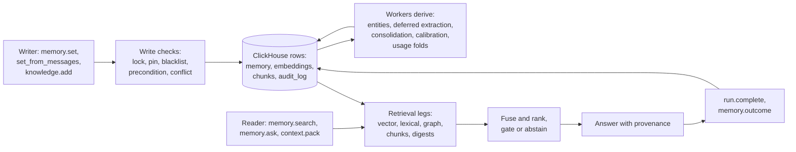
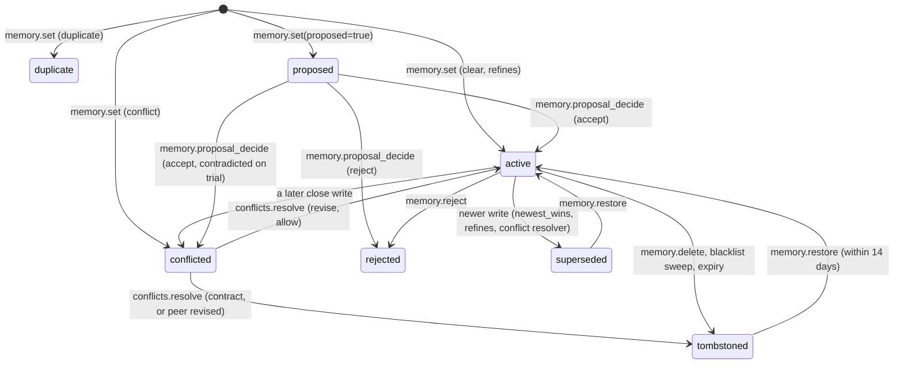

# Memory

A memory is one claim an agent should find again: "deploys happen on Tuesdays", "the
payments team owns the billing service". Loom stores each claim as a row in
`loom.memory`, under a readable key, with who wrote it, when it was true, where it came
from and whether anyone vouched for it. This page covers the row, how a write is judged
against what is stored, and how rows change over time.
[Retrieval and ranking](retrieval-and-ranking.md) covers how rows are found.

## Rows in ClickHouse

Memories, document chunks, conversation turns, entity edges, code symbols, runs, audit
entries and erasure requests are all rows in one ClickHouse database, created by
numbered migrations the server applies on boot. Uploaded document originals are rows
too (`loom.document_blobs`), unless the deployment keeps their bytes in an S3-compatible
bucket. Outside ClickHouse and that bucket, Loom keeps the code index's git mirrors, a
cache of the remotes ClickHouse records, and the rate-limit buckets on a shared volume.

- **The identity tuple leads the sort keys.** `loom.memory` is ordered by
  `(org, namespace, agent, user_id, session_id, memory_key)`, so scoping a read to a
  namespace, user or session is a primary-key range.
  [Identities and namespaces](identities-and-namespaces.md) covers the tuple.
- **One engine.** Vector search, lexical search, the graph walk, filters, audit and
  erasure are SQL over the same rows. There is no second store to keep in step. The cost
  is that every read is a query, not a key-value hit.
- **A write is a new version.** The memory tables are `ReplacingMergeTree(version)` read
  with `FINAL`. A revision, tombstone, pin or restore inserts a new version row.

## The write, derive, read loop



1. **Write.** `memory.set` runs its checks ([below](#how-a-write-is-judged)), embeds the
   value inline, and inserts the memory row, its embedding row, verbatim chunks for long
   values and a hash-only audit row. If the inline embed fails, a stub is written and the
   `embedding_worker` fills it later; search does not see the row until then.
   `memory.set_from_messages` has the LLM pick the durable facts in a transcript and
   writes through the same bulk path.
2. **Derive.** Workers add what is too slow for the write path: entity tags
   (`entity_extractor`), deferred extraction (`extraction_queue`), consolidated facts,
   gate recalibration, and usage folded into ranking signals (`usage_fold`). Derived rows
   carry `source_class=derived`.
3. **Read.** `memory.search` runs several legs (vector, lexical, entity graph, verbatim
   chunks, session digests), fuses them, ranks, and returns hits or abstains.
   `memory.ask` writes a grounded answer; `context.pack` builds a budgeted prompt block.
4. **Feed back.** A run that names the memories it relied on (`run.complete`
   `memories_used`, or `memory.outcome`) credits them; a bad outcome records harm. This
   becomes a bounded, decaying ranking term. It never deletes a row or ranks it below
   its relevance.

The loop is eventually consistent. A read right after a write finds the fact through its
inline embedding; entities and extracted facts arrive after the worker's next pass.

## The `loom.memory` row

One row is one version of one memory.

| Group      | Columns                                                                         | Decides                                                       |
| ---------- | ------------------------------------------------------------------------------- | ------------------------------------------------------------- |
| Identity   | `org`, `namespace`, `agent`, `user_id`, `session_id`, `run_id`                  | Who may read it and who wrote it                              |
| Address    | `memory_key`, `memory_id`                                                       | How a caller names it (key) and how Loom names one row (id)   |
| Content    | `value`, `memory_type`, `tags`, `entities`, `files`, `confidence`               | What it says and how it is classified                         |
| Lifecycle  | `status`, `pinned`, `conflict_with`, `duplicate_of`, `superseded_by`, `version` | Whether it is served, and what replaced it                    |
| Time       | `created_at`, `updated_at`, `valid_at`, `valid_to`, `invalid_at`, `expires_at`  | When it was written, when it was true, when it left service   |
| Provenance | `actor`, `source_class`, `content_sha256`, `verified_by`, `verified_sha256`     | Who wrote it, how Loom learned it, whether anyone attested it |
| Guards     | `lock_mode`, `lock_until`, `sensitivity`, `on_expire`                           | Which writes it refuses and how it is read                    |

The full column list is in the [schema reference](../reference/schema.md). A searchable
memory also has a row in `loom.memory_embeddings`: vectors for the value and the key,
lowercased, stemmed and lemmatised copies of the excerpt for lexical matching, and the
`source_class` and `verified` flags the ranker reads.

## Keys

A key names one attribute of one subject, as a readable path `<scope>/<kind>/<id>`:

```
sre/case/1234/evidence/dns-sidecar
project/loom/deploy-window
user/preferences/editor
```

- **One fact per key.** Conflict checks, supersession and history work per key. A key
  holding a list of unrelated facts cannot be partly revised.
- **A revision rewrites the same key.** Loom keeps every version, so a numbered copy
  (`…-v2`) or a key made from a hash of the value only hides the revision. Hash-made
  keys are the `hash_keys` finding of `namespace.audit`.
- **Facets go in `tags` and `entities`,** not in the key.

The storage identity is `(org, namespace, agent, user_id, session_id, memory_key)`: the
same key written by two agents or in two sessions is two rows. Under the namespace
policy `newest_wins`, the newest write for a key retires every older live row with that
key in the namespace, whoever wrote it. Extraction mints keys from the subject and
attribute, never from the value, so a later session that states the same attribute lands
on the same key. Under `auto_reinforce` and `manual_review`, the conflict resolver judges
the rows of one key that two sessions of the same user (not the anonymous user `-` or a
user_id sent empty, whose sessions are separate tasks) wrote, from a point write or a bulk
write, as it judges any close pair: it retires the older row of an update it is sure of
(except under `manual_review`), flags a contradiction for review and leaves two different
facts under a reused key live. Under `append_only` nothing is judged.

## Memory types

`memory_type` is a free string, default `semantic`. A few values change how the row is
stored and found (`server/memory/domain/memory_types.py`):

| Type                   | Embedded | In unfiltered search | Use for                                                  |
| ---------------------- | -------- | -------------------- | -------------------------------------------------------- |
| `semantic` (default)   | yes      | yes                  | Durable facts.                                           |
| `preference`           | yes      | yes                  | Preferences that should rank in recall.                  |
| `procedural`           | yes      | yes                  | Procedures (`procedure.*`).                              |
| `reflection`           | yes      | no                   | Lessons from runs; read with `memory_type="reflection"`. |
| `episodic`             | no       | no                   | Session events replayed by recency.                      |
| `profile`              | no       | no                   | Always-loaded context fetched by label (`profile.*`).    |
| any other (`decision`) | yes      | yes                  | Domain types are searchable by default.                  |

- **Reflections are hidden** from unfiltered search and `memory.ask`: a lesson about a
  process is not a claim about the world.
- **A `procedural` write** whose value is not a procedure body (a non-empty `situation`
  and at least two `steps`) is stored as `semantic`, tagged `retyped_from:procedural`,
  and the response says so in `retyped_from`.
- **Sensitivity.** A row with `sensitivity="high"` is never embedded, so no search leg
  finds it. It is readable by key only, and that read is audited. With `sensitivity`
  unset the server detects credential shapes, card numbers, US Social Security
  numbers and stated PINs (`high`), and email, phone and IBAN shapes (`medium`)
  (`LOOM_MEMORY_SENSITIVITY_AUTODETECT`).

## Status

| Status       | Meaning                                                                    | Served by default         |
| ------------ | -------------------------------------------------------------------------- | ------------------------- |
| `active`     | The live belief.                                                           | yes                       |
| `conflicted` | Close to a peer but saying something different; linked by `conflict_with`. | yes                       |
| `duplicate`  | Near-identical to a canonical row (`duplicate_of`), which answers for it.  | no (`include_duplicates`) |
| `superseded` | A later row replaced it (`superseded_by`, retired at `invalid_at`).        | no (`include_superseded`) |
| `proposed`   | A fact on trial, decided with `memory.proposal_decide`.                    | no (`include_proposed`)   |
| `rejected`   | Marked wrong (`memory.reject`, or a rejected proposal).                    | no                        |
| `tombstoned` | Deleted by its writer (`memory.delete`).                                   | no                        |

The served set is defined once, in `server/memory/domain/temporal_sql.py` (`SERVED_STATUSES`). A
conflicted row stays served: hiding one side of a contradiction would let the store
answer confidently with a fact it has reason to doubt.

## How a write is judged

Five operations cover the memory lifecycle:

| Lens      | Operation             | Effect                                                                     |
| --------- | --------------------- | -------------------------------------------------------------------------- |
| Expand    | `memory.set`          | Learn a fact under a key.                                                  |
| Revise    | `memory.update_by_id` | Correct one row by id (`memory.update` does the same by key).              |
| Contract  | `memory.delete`       | Tombstone a key. `memory.restore` revives it within 14 days of the delete. |
| Reinforce | `memory.pin`          | Store and pin: no later write that does not itself pin replaces it.        |
| Refuse    | `blacklist.add`       | Refuse every future write matching a substring or regex.                   |

A searchable `memory.set` runs these checks in order:

1. **Lock and pin guards** on the row under the key. `memory.lock` (`read_only` or
   `no_delete`) answers 423 `LOCKED`. A changed value under a pinned key is 409
   `PINNED_CONFLICT`. A byte-identical restatement passes every guard.
2. **Blacklist.** A value matching a registered pattern is 422 `BLACKLISTED`; in a bulk
   write the entry is skipped. Replicas cache patterns and poll a one-row version table
   (`loom.blacklist_version`), so a new pattern reaches every replica within seconds.
3. **Precondition.** `if_match_sha256` makes the write land only if the live row's hash
   still matches; otherwise 409 `PRECONDITION_FAILED`. The current hash rides every
   `memory.get`, `memory.get_by_id` and `memory.set` response (`content_sha256`).
4. **Restatement.** A value byte-identical to the live row bumps `reinforcement_count`
   instead of writing a version. The bulk path (`memory.bulk_set`, used by
   `set_from_messages`) treats any live row with the same hash in
   `(org, namespace, agent, user_id)` as the fact (`LOOM_MEMORY_BULK_DEDUP_SCOPE=identity`).
5. **Peer search and verdict.** Active rows of the same `memory_type` whose embedding is
   close to the new value are **peers**, compared closest first:
   - same canonical form (lowercased, punctuation stripped, whitespace collapsed) →
     `merge`: nothing written, the peer is reinforced, `merged_into_key` names it;
   - cosine at or above the duplicate threshold with the same content words and no
     differing value (a number, time, amount or unit; "27:10" / "26:30") →
     `duplicate`;
   - cosine at or above the conflict threshold but different → `conflict`, both rows
     `conflicted`;
   - a close pinned peer → `rejected`, 409 `PINNED_CONFLICT`;
   - otherwise `clear`.
6. **Insert** into `loom.memory` and `loom.memory_embeddings`, supersession, entity
   projection and one hash-only row in `loom.audit_log`.

A non-searchable type or a `high`-sensitivity row skips the peer search: it has no
embedding to compare. `dry_run=true` runs every check and writes nothing, which answers
"new fact, restatement or contradiction?" before you commit to a key. The response
carries `conflict_verdict`, up to five `peers`, and a `next` hint.

- **Thresholds.** With `LOOM_ADAPTIVE_THRESHOLDS` on and a real embedder, the conflict
  and duplicate thresholds come from the embedder's own similarity distribution at boot
  (`server/memory/app/embedder_calibration.py`). The scalars `LOOM_CONFLICT_THRESHOLD`
  (0.85) and `LOOM_DUPLICATE_THRESHOLD` (0.97) are the fallback. A namespace or memory
  type can pin its own; `calibration.get` reports which is in force.
- **The conflict resolver.** Cosine says two statements are about the same thing, not
  whether they agree. A leader-only worker judges each write with a close peer after it
  lands, one LLM call per row: it retires the older row of an update it is sure of under
  the default `auto_reinforce` and under `newest_wins` (the old value stays readable
  with `include_superseded` and `as_of`), flags a contradiction, and clears a false flag
  ([conflicts](../features/memory/conflicts-and-refusal.md#the-conflict-resolver)). No
  verdict on the write itself calls an LLM.
- **Run scope.** A write under a `run_id` whose canonical match belongs to another run is
  stored as a `duplicate`, not merged, so a run-scoped read still finds it.
- **Namespace policy.** `default_conflict_policy` decides what a contradiction does
  (`auto_reinforce`, `manual_review`, `newest_wins`, `append_only`).

`memory.update`, `memory.update_by_id` and `memory.bulk_set` run the same check. Verdict
details, the policies, the Review queue and `conflicts.resolve` are in
[conflicts and refusal](../features/memory/conflicts-and-refusal.md).

**Pins protect what the user said.** A pinned row is never replaced by a write that does
not itself pin, by key or by a close value under another key. To change it, use
`memory.update` (keeps the pin) or `memory.pin` (re-pins). `memory.for_file` lists
pinned rows first; no other read orders by the pin.

**Consolidation keeps lineage.** `memory.consolidate` (and the consolidation worker, when
a namespace opts in) merges fragments about one subject into canonical rows with
`source_class='derived'`, and writes one `loom.memory_belief_sources` row per source
(`support_type='derived_from'`). Deleting a source retires a consolidated row when none
of its sources survive, and downgrades it to `conflicted` when some do
(`dependents_tombstoned`, `dependents_downgraded` in the `memory.delete` response).

### A memory's lifecycle



Every arrow is a new version; the old one stays in `loom.memory_versions`.

## Tags, entities and files

- `tags` are free labels (`case:1234`, `kind:evidence`). A search filters on them
  (`tags`), boosts with them (`tags_soft`), or sinks them (`demote_tags`). A namespace's
  `tag_registry` can attach retention, dedup and conflict policy to a tag. Tags keep the
  case they were written in: `memory.list` and `knowledge.list` match them in any case,
  and every other tag filter, `memory.search` and `memory.apply` included, matches them
  exactly.
- `entities` are the named things the value mentions, stored in the canonical form search
  reads them in (lowercased; articles, possessives and punctuation dropped; the head noun
  singular), so `Billing Services` and `billing service` are one entity. A writer may pass
  them; otherwise the `entity_extractor` worker fills them. They drive the entity boost
  and the [entity graph](../features/entity-graph.md).
- `files` are repository paths the memory is about; `memory.for_file` serves them before
  an edit of those files.

`memory.for_file` renders one line per memory. A decision or a constraint prints whole,
up to the ceiling below, and does not count against the request's `token_budget` (300
tokens by default); the other rows are held to it, cut to one line of 220 characters. A
row that does not fit is left out whole while the rows after it still get their turn,
and a closing `- … <n> more` line, which counts against the budget too, says how many
were left out and how to list them. The header and the removal footer are always
printed, and the `… more` line whenever a row is left out, so a budget smaller than those
can be exceeded.

Decisions and constraints share one ceiling, `memory_for_file_whole_tokens` (1,500
tokens, about 6,000 characters), so a file governed by dozens of them cannot flood the
prompt. They print in the block's order; one that would pass the ceiling is left out,
and the ones after it that still fit print. A closing line counts those left out and
names the first five keys, each read with `memory.get` (in the namespace it names, for a
team row) or found with `loom_search`. A row left out with the newer row that supersedes
it is counted on the `… more` line instead, never named as one to read. The default
keeps the whole block under the 10,000 characters a coding-agent host passes from a hook
to the model as it is.

Each line:

- A memory from an extra namespace (the repository's code namespace) is headed
  `Team rule (by <author>, <age>)`, or `Decision (by <author>, <age>)` for a decision
  (`memory_type` `decision` or the tag `decision`).
- A line lists its `constraint`, `gotcha` and `decision` kinds in one bracket
  (`[constraint, decision]`; a line headed `Decision` leaves out `decision`).
- `(pinned)` marks a pinned row. A pin is the row's own flag: a member of a code namespace
  can set it on a row they write there, so `(pinned)` on a team row says someone froze it,
  not that a maintainer did.
- A decision nobody pinned, such as one `loom decisions extract` wrote, carries no pin
  mark: it is served as it is.
- `(outcome: failed)` marks any decision whose recorded outcome failed, pinned or not.
- A decision tagged `source-changed` (its source document no longer says it; see
  [extracting decisions](../features/tasks-and-decisions.md#extract-decisions-from-a-document))
  reads `(source changed)`, pinned or not.
- A note says when its linked code changed or went.
- A string value is printed as text, not as the JSON it is stored as, and a row other
  than a decision or constraint ends in `…` when the read or the line cut it; a cut
  object or list prints as stored.
- A decision with a source carries ` — source: <source_resource_id>` after its value,
  whole, so a `knowledge:` citation keeps its `#section` and resolves through
  `knowledge.get`.
- A newer row the conflict check linked to an older one of its type is placed above it,
  and a team line says which it supersedes (`supersedes decision` when the older is tagged
  `decision`). Two typed decisions the check linked each keep their place in the block,
  with no such note, since each decision key is its own decision. When the budget or the
  ceiling leaves out any row that supersedes others, in any namespace, every row it
  supersedes is left out with it, so an older row never reads as current.

## Memories linked to code

A memory about code is linked to the definitions and files it names, and the links
follow the code. The `memory_code_links` worker links each memory tagged `repo:<id>`
(the coding plugins tag their sessions) or written in a repository's code namespace
against that repository's trunk:

- each backticked name, `A::b` and `a.b()` call that resolves to exactly one definition;
  the memory's `files` pick between namesakes, and a name defined more than once is not
  linked;
- a bare camelCase or snake_case word of the prose only to a definition in the memory's
  `files`;
- each file the memory names that holds none of those definitions.

A qualified name trunk does not define yet waits for `memory_code_links_pending_days`
(14), so a memory about unmerged code links once it merges.

A link records the definition's fingerprint: all its overloads and the conditions that
select them, as tokens, so whitespace, comments (not a Go `//go:` directive or a Python
`# type:` comment) and most of what formatters change (trailing commas and other optional
separators, a JavaScript `;`, quote style and the escapes it needs, the case of a number
literal, a Python docstring's indentation, parentheses in Python, JavaScript and
TypeScript) leave it as it was. Joining adjacent string literals, and any other edit, does
not.
What a file defines is read from the file at the repository's indexed head in its bare
git mirror. On every indexed commit the worker follows the commit's renames and edits:

| Link state   | When                                                                                                               |
| ------------ | ------------------------------------------------------------------------------------------------------------------ |
| `fresh`      | The definition is where it was, with the text the memory was written against.                                      |
| `moved`      | Its file moved, or it was renamed with nothing else changed, or it moved to another file.                          |
| `changed`    | Its text changed after the memory was written (`changed_since` names the commit), renamed or not.                  |
| `unresolved` | Its name is gone and a new definition in its place may be it, but none certainly is. Served, with a review signal. |
| `missing`    | The code is gone: nothing new took its place. The link keeps its place, so a revert finds it again.                |

A link follows its definition through file moves, renames (with an edit, when the new
name is related to the old), and its class's rename within the file. A namesake in
another class or namespace never inherits a link, and a `missing` link comes back only
when its own name does. A file the parser fails on keeps its links as they were until it
parses. When the fingerprint rules change, every link is re-hashed from the commits its
hashes were taken at. When its old text is gone from git, a link that matched it takes the
text the next check finds and a changed one stays `changed`; one whose old text no longer
parses keeps its last state, and the worker reports it.

Loom never writes the memory. The namespace's `code_change_policy`
(`namespace.register`) decides what reads make of a change:

| Policy                     | Removed code                                                                                                                                                                                                                           | Changed code                                                                                                                                                          |
| -------------------------- | -------------------------------------------------------------------------------------------------------------------------------------------------------------------------------------------------------------------------------------- | --------------------------------------------------------------------------------------------------------------------------------------------------------------------- |
| `retire_removed` (default) | When every link of a memory is `missing` (a pending or `unresolved` one counts as not), search (and `memory.ask`, `context.pack`) leaves it out before it picks its results; `memory.get` still shows it. It is back when the code is. | Flagged.                                                                                                                                                              |
| `flag`                     | Flagged.                                                                                                                                                                                                                               | Flagged.                                                                                                                                                              |
| `revise`                   | As `retire_removed`.                                                                                                                                                                                                                   | The claim is re-checked against the old and new code by the LLM: one that holds is re-anchored, a contradicted one gets a corrected claim as the link's `suggestion`. |

`revise` judges a changed link once per edit, within a per-pass budget
(`memory_code_links_revise_per_pass`). A memory labelled `high` sensitivity is never sent
to the model. A memory a person pinned, locked (until the lock lapses) or verified, and
one naming more code than the link cap, is only flagged. Links made for an earlier value
of a memory (its text, files, repository or user) are ignored by every read until it is
relinked.

Links are kept against the trunk. On another branch, a lesson compares the branch's own
definition, under any of the link's last 16 names, with the text the memory was written
against: a release branch that still has the old text reads `fresh` after trunk changed
it, and one that has code trunk removed still gets its lesson. Where the branch's files
cannot be read (a host with `LOOM_GIT_HISTORY=none` has no git mirror), a lesson carries
trunk's last state.

The links are read where the code is:

- `code.symbol` attaches the linked memories as `lessons`, each with its `code_state`.
  They come from the repository's team namespace and the `lesson_namespaces` the call
  names (over MCP the caller's memory home when it names none), never from every
  namespace the caller can read.
- `memory.for_file` serves memories linked to code in the file beside those whose
  `files` name it.
- `memory.get` returns the links as `code` (with any `suggestion`); `memory.search` hits
  read from a memory's own row carry its worst link as `code_state` (a chunk, record or
  summary hit carries none and is never left out); `memory.ask` notes the memories whose
  code moved, changed or went.
- `namespace.validate` lists memories whose code changed, was not found again or is
  gone, in the repositories the caller may read.

## Time

| Column            | Axis   | Meaning                                                                                 |
| ----------------- | ------ | --------------------------------------------------------------------------------------- |
| `valid_at`        | world  | When the fact became true, as the writer stated it. `NULL` = unknown.                   |
| `valid_to`        | world  | When the fact stopped being true. A read drops a row past its `valid_to`.               |
| `temporal_anchor` | world  | The date the fact is about (an event date), set by extraction.                          |
| `created_at`      | record | When Loom wrote the row.                                                                |
| `invalid_at`      | record | When Loom retired the row (supersession).                                               |
| `tombstoned_at`   | record | When the writer deleted it.                                                             |
| `expires_at`      | record | When the row leaves the served set, if its writer or the namespace owner set an expiry. |

An `as_of` read replays one axis. `as_of_basis="valid_time"` (the default) asks what was
true at T: rows whose best world date (`valid_at`, else `temporal_anchor`, else
`created_at`) is at or before T. `as_of_basis="knowledge_time"` asks what Loom had
learned by T: rows written by T and not retired, deleted or invalidated by T.

Under `newest_wins`, a templated substitution retires the peer only if the peer's
`valid_at` is not later than the new row's, so a backfill of old facts does not retire
current ones. This is valid time plus a retirement stamp, not a bi-temporal model:
supersession, not exclusion by date, decides which of two rows is current. A full
interval model would need every writer to state when each fact ended, which agents
rarely know.

## Versions and history

Every change (value edit, tombstone, restore, lock, status flip) is a new row with a
higher nanosecond `version` and every other column carried forward. Merges drop old
versions, so `loom.memory` is the current state, not a history.

The history is `loom.memory_versions`, an append-only mirror filled by a materialized
view on every insert. `memory.history` reads every version of a key;
`namespace.rollback` returns every head in a namespace to its version at a point in time;
`memory.redact` scrubs a historical value and keeps its audit entry. `content_sha256` on
each version is what `if_match_sha256` compares and what an attestation binds to.

## Provenance

The server stamps two columns on every write and never takes them from the body:

- `actor`: `human:<subject>` or `process:<subject>` (a service account), from the token.
- `source_class`: how Loom came to hold the content, from the operation and the token.

| `source_class` | Means                                                                         |
| -------------- | ----------------------------------------------------------------------------- |
| `asserted`     | A caller stated it directly (`memory.set`).                                   |
| `extracted`    | The extraction pipeline inferred it from a transcript.                        |
| `observed`     | Loom recorded it from activity it saw.                                        |
| `derived`      | Computed from other memories (consolidation output, session digests).         |
| `imported`     | Loaded from another system by an importer.                                    |
| `external`     | Declared by the writer as outside content: a tool result, a page, a document. |

A request may only declare a downgrade (`derived`, `external` or `imported`); anything
else is a 422. Text an agent copies from its environment is what an attacker controls,
so `memory.ask` keeps unattested `external` rows out of its synthesis
(`LOOM_MEMORY_ASK_EXCLUDE_UNVERIFIED_EXTERNAL`, default on), and
`LOOM_MEMORY_SEARCH_TRUST_WEIGHT` can lift asserted and attested rows in ranking.

- **Lineage.** Consolidation writes `loom.memory_belief_sources` rows; a session digest
  lists the keys it summarised in `session_summaries.derived_from`. `memory.provenance`
  says where a row came from, `memory.evidence` returns the conversation turns an
  extracted fact was drawn from, and `memory.lineage` walks how a shared memory was
  promoted.
- **Attestation.** `memory.verify` records who vouched for the content, bound to its
  hash. Reads report `verification`: `human` or `process` while the content is unchanged,
  `stale` once it changes, `none` if never attested. An edit keeps the attestation and
  reads as `stale`; it never transfers trust to new content.

## What goes where

| It is…                                                     | Plane                                               | Why not memory                                                                                      |
| ---------------------------------------------------------- | --------------------------------------------------- | --------------------------------------------------------------------------------------------------- |
| A fact still true next week that another session needs     | **Durable memory**, `memory.set`                    | It is memory.                                                                                       |
| A transcript the user wants remembered                     | `memory.set_from_messages` (extraction)             | One large row is findable only as a whole; extraction writes one short fact per key.                |
| The current plan, a lease, a cursor, "where was I"         | **Working memory**, `working_memory.*`              | Coordination state changes every step; ranking it pollutes recall.                                  |
| A large tool result you may re-read                        | `context.offload` / `context.fetch`                 | It is a blob to fetch by key, not a claim to rank.                                                  |
| The resumable state of one line of work                    | **Session briefs**, `session.brief_*`               | A brief is restored by choice, never ranked into another task's answer.                             |
| A document, spec or runbook; anything over a few kilobytes | **Knowledge**, `knowledge.add` / `knowledge.upsert` | Documents are chunked by heading; a memory is embedded from an excerpt of at most 1,200 characters. |
| A chat turn log                                            | **Conversations**, `conversation.*`                 | Turns are evidence, not beliefs; `memory.recall` reads the turns an extraction used.                |
| Data with identity and exact fields (a PR, a ticket)       | **Records**, `memory.record.*`                      | Records fold field by field and filter exactly.                                                     |
| Always-loaded persona or preferences                       | **Profile**, `profile.*`                            | Fetched by label every time; ranking it against questions wastes the slot.                          |

For documents: store the document in knowledge and write one short memory under a
readable key that says what it is and points at it. `context.pack` loads working memory
ahead of the durable sections, so an agent sees its own state first.

## Retention

Loom deletes only what its writer asked for. No memory table has a default TTL and no
sweep retires rows by age. A row leaves the served set when its writer deletes or
supersedes it, when its writer gave it an expiry (`ttl_seconds`, `valid_to`), or when the
namespace owner or operator configured a retention window. `memory.restore` revives a
tombstone within 14 days.
[Retention and erasure](../features/memory/retention-and-erasure.md) covers the settings
and the erasure saga.

## One fact over time

In March a user says "I live in Delhi"; in June, "I moved to Berlin."

- **June write.** Extraction mints the key from the subject and attribute, so both
  statements land on the same key. The June row does not overwrite March: the Delhi
  version stays in `loom.memory_versions`, readable with `memory.history`.
- **A misfiled fact.** If Berlin lands under another key, the peer search finds the
  Delhi row close but different and marks both `conflicted`, linked by `conflict_with`.
  The namespace policy decides what follows (see
  [how a write is judged](#how-a-write-is-judged)).
- **"Where did they live in April?"** An `as_of` read answers it, by when the fact was
  true or by what Loom knew at that date ([time](#time)).
- **"Who said so?"** `actor` and `source_class` record the writer and how the fact
  arrived; `memory.evidence` returns the turns an extracted fact came from.
- **A bad import.** `namespace.rollback` returns every head in the namespace to its
  version at a point in time, and runs as a dry run unless told otherwise.

## Example

Write a fact, probe a change before writing it, then update against the hash you read:

```python
import asyncio
import os
from datetime import datetime, timezone

from loom import Datapack


async def main() -> None:
    dp = Datapack(
        org="acme",
        namespace="eng-tooling",
        base_url=os.environ["LOOM_BASE_URL"],
        api_key=os.environ["LOOM_API_KEY"],
    )
    agent = dp.agent("release-bot")
    key = "project/billing/deploy-window"

    out = await agent.memory.set(
        memory_key=key,
        value="Billing deploys only on Tuesdays and Thursdays, never on Fridays.",
        tags=["kind:constraint", "service:billing"],
        entities=["billing"],
        valid_at=datetime.now(timezone.utc),
    )
    print(out["conflict_verdict"], out["content_sha256"])

    probe = await agent.memory.set(
        memory_key="project/billing/deploy-days",
        value="Billing deploys only on Thursdays.",
        dry_run=True,
    )
    if probe["conflict_verdict"] == "conflict":
        peer = probe["peers"][0]  # closest peer, with its key
        current = await agent.memory.get(memory_key=peer["memory_key"])
        await agent.memory.update(
            memory_key=peer["memory_key"],
            value="Billing deploys only on Thursdays.",
            if_match_sha256=current["content_sha256"],
        )


asyncio.run(main())
```

A 409 `PRECONDITION_FAILED` on the update means another writer changed the row after the
read: read again and decide again. Over HTTP the write is `POST /v1/memory.set`; over MCP
it is the `loom_memory_set` tool.

## Related

- [Identities and namespaces](identities-and-namespaces.md), [retrieval and ranking](retrieval-and-ranking.md)
- [Writing memories](../features/memory/writing.md),
  [conflicts and refusal](../features/memory/conflicts-and-refusal.md),
  [history and provenance](../features/memory/history-and-provenance.md),
  [working memory and profiles](../features/memory/working-memory-and-profiles.md),
  [knowledge](../features/knowledge.md)
- [Memory architecture](../architecture/memory-architecture.md): the write path in code
- [Operations](../reference/operations.md#memory), [settings](../reference/configuration.md#memory)
