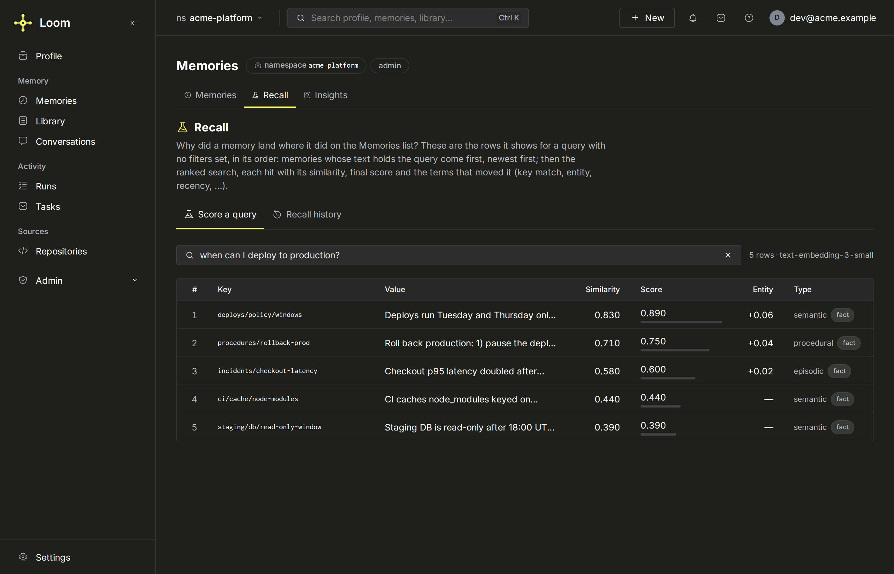
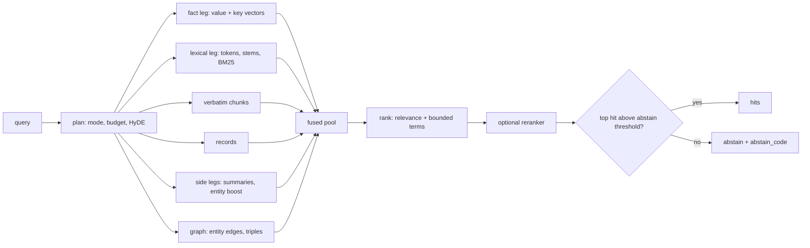

# Retrieval and ranking

This page explains how `memory.search` finds rows. It runs several retrieval legs over
the namespace at once, fuses their candidates into one pool, ranks the pool by relevance
plus bounded correction terms, and then decides whether the best hit is good enough to
answer from. A weak result is reported as **abstain** ("Loom does not know"), not as the
nearest noise. Request and response fields are in
[search and ask](../features/memory/search-and-ask.md).

## The retrieval legs

Each leg answers a failure of the others. A leg that has nothing to add returns
nothing; a leg that errors fails open and the response names it in `degraded`.

| Leg                   | Reads                                                   | Finds what the others miss                                                                                   |
| --------------------- | ------------------------------------------------------- | ------------------------------------------------------------------------------------------------------------ |
| **Fact, vector**      | `loom.memory_embeddings` value vector (exact scan)      | Paraphrases: the question and the stored claim share meaning, not words.                                     |
| **Fact, key axis**    | The same table's `memory_key` vector                    | A question that names the attribute a key encodes. Scores `least(value distance, key distance)`.             |
| **Lexical**           | Lowercased, stemmed and lemmatised excerpts and the key | Exact identifiers, numbers and rare words that embed poorly. Stemming runs in ClickHouse (`stem`).           |
| **BM25**              | Per-token IDF and corpus length roll-ups                | Rare-term weighting for `bm25_hybrid`, with a live tail so new rows count at once.                           |
| **Verbatim chunks**   | `loom.memory_chunks`                                    | A passage of a long `memory.set` value folds onto the row whose value cuts it; a transcript's is a hit.      |
| **Session digests**   | `loom.session_summaries`                                | "What happened in that session"; with digest descent the top digests pull their sessions' best facts in.     |
| **Entity**            | `loom.entity_vectors`, `loom.entity_summaries`          | Rows about an entity the query names, even when the wording differs.                                         |
| **Graph**             | `loom.entity_edges`, `loom.entity_triples`              | Rows one hop from the query's entities, and rows carrying a matching (subject, relation, object) triple.     |
| **Records**           | `loom.memory_records`                                   | Typed records whose fields match.                                                                            |
| **Key match**         | Stemmed key parts                                       | A row whose key names exactly the attribute asked for, as a tie-break (`LOOM_MEMORY_SEARCH_KEY_MATCH_MODE`). |
| **Computed evidence** | `loom.derived_facts`, event dates                       | Aggregates ("how many"), date differences and the latest value of an attribute, computed in ClickHouse.      |

**Why so many legs.** A single vector leg misses identifiers and numbers (they embed
poorly), passages deep in a long value (only the first part is embedded), and rows that
name an entity in other words. Each leg is a query over a table Loom already writes, so
adding one costs a statement, not a second system.

**The key axis** is on per namespace when its keys are reused (`LOOM_MEMORY_SEARCH_KEY_AXIS=auto`,
threshold `LOOM_MEMORY_SEARCH_KEY_AXIS_AUTO_REUSE_SHARE`): reading two vector columns
costs roughly twice the bytes, and it only helps where keys carry meaning.

**Planning and budgets.** `retrieval_budget` (`fast`, `standard`, `deep`) decides which
expensive legs run. Under `standard`, cheap recall runs first and the LLM legs
(HyDE, query decomposition, the iterative retry) spend only when the first pass is
weak, bounded by `LOOM_MEMORY_SEARCH_FALLBACK_MAX_ROUNDS` and
`LOOM_MEMORY_SEARCH_FALLBACK_MAX_WALL_MS`. Under `fast` (or the `fast` recipe) a read
makes no LLM call; it costs embeddings and ClickHouse reads. HyDE embeds an LLM-written
hypothetical answer instead of the question, which closes the gap between how questions
and stored claims are phrased; `hyde=false` forces the raw query.

## Fusion

`search_mode` picks how the fact pool is ordered.

- A request that sets neither `search_mode` nor `recipe` gets the namespace's
  `retrieval_defaults` mode, else `LOOM_MEMORY_SEARCH_DEFAULT_MODE` (`semantic`). The
  wire schema shows `rrf`; the server fills the real default.
- The planner's shape rules apply on top: an identifier in the query takes the lexical
  fusion.
- `recipe` applies a named preset (`fast`, `balanced`, `quality`, `verbatim`, `code`,
  `temporal`, `graph`) and wins over both defaults.

| Mode          | Ordering                                                                               |
| ------------- | -------------------------------------------------------------------------------------- |
| `semantic`    | Cosine similarity plus the rank terms below.                                           |
| `rrf`         | Reciprocal rank fusion of the lexical and semantic orders, `1/(k + rank)` with k = 60. |
| `hybrid`      | `alpha × lexical + (1 − alpha) × cosine`, plus the rank terms.                         |
| `bm25_hybrid` | IDF-weighted BM25 fused with cosine.                                                   |
| `lexical`     | Token overlap on content and key; no vector order.                                     |
| `graph`       | Cosine plus entity-graph signal: one-hop overlap and matched triples.                  |
| `temporal`    | Rows dated within a window of the question's resolved date, cosine within the window.  |
| `related`     | Tag and entity overlap with the request's `tags` / `entity_filter`.                    |

**Why reciprocal rank fusion exists as a mode.** Lexical overlap scores spread over 0 to
1, while cosines from a real embedder sit in a narrow band; a weighted sum of the two
under-weights one of them unless alpha is tuned per corpus. RRF combines ranks, not
scores, so it needs no tuning. Loom also lowers the lexical weight for code- or
path-shaped queries, whose shared path tokens are near-noise
(`server/memory/app/retrieval/fusion.py`, `_rrf_lexical_weight`). Ties in one order
break by the other, then by key and the row's namespace, writer and session, so two
identical searches return the same window.

## The rank expression

For the cosine-ordered modes the score of one fact row is relevance plus terms that may
reorder near-ties but are bounded so they cannot outrank relevance
(`server/memory/app/retrieval/fact_rank.py`):

| Term                      | What it adds                                                                                                                                                                                         | Controlled by                                                                                             |
| ------------------------- | ---------------------------------------------------------------------------------------------------------------------------------------------------------------------------------------------------- | --------------------------------------------------------------------------------------------------------- |
| Similarity                | `1 − cosine distance` of the best vector.                                                                                                                                                            | the embedder                                                                                              |
| Entity boost              | Up to 0.5 × the share of `entity_filter` entities the row carries; entity-vector matches from the query.                                                                                             | `entity_filter`                                                                                           |
| Recency, chronology, date | A lift on a recency-intent ("latest", "current") or ordering question, and for rows anchored near the asked date.                                                                                    | the query's own cues; the pool-level variant `LOOM_MEMORY_SEARCH_RECENCY_POOL_WEIGHT` defaults to 0 (off) |
| Prior group               | Stored `confidence` × `confidence_weight`, soft tag and category boosts, the preference boost; capped together.                                                                                      | `confidence_weight`, `tags_soft`, `prior_cap` (`LOOM_MEMORY_PRIOR_CAP`)                                   |
| Reinforcement             | Recalls and positive outcomes, decaying with a half-life; a `harm` event takes earned boost back.                                                                                                    | `LOOM_MEMORY_SEARCH_REINFORCEMENT_WEIGHT` (0.15), `…_HALF_LIFE_DAYS` (90)                                 |
| Trust                     | `+0.5` asserted or observed, `−0.25` imported, `−1` external, `+1` when attested; times the weight.                                                                                                  | `LOOM_MEMORY_SEARCH_TRUST_WEIGHT` (default 0 = off)                                                       |
| Demotions                 | `demote_tags` sinks a row to the bottom without dropping it; rows labelled `sensitivity:medium` or `:high` are lowered, except when the query asks for a contact detail or a bank account (an IBAN). | `demote_tags`, `LOOM_MEMORY_SEARCH_SENSITIVITY_DEMOTE` (0.1)                                              |

**Pinned is not a rank term.** A pin protects a row from being overwritten
([how a write is judged](memory.md#how-a-write-is-judged)); it does not make it rank
higher. A fact is returned because it answers the question.

`personalization="none"` drops every user-derived term (preference, the prior group,
reinforcement) and keeps relevance, so the two rankings can be compared on one server.
`LOOM_MEMORY_SEARCH_SOURCE_CLASS_BOOST_ELIGIBLE` limits which provenance classes may
earn those terms at all: leaving out `extracted` keeps an inference from outranking a
statement on its priors.

**Reranker.** `rerank` on the request, or the namespace's `rerank_endpoint`, sends the
pool to a reranker (`builtin:openai[:model]`, `builtin:cohere[:model]`, or the name of an
endpoint the operator configured in `LOOM_RERANK_ENDPOINTS_JSON`; a URL is refused). The pool is widened first (`LOOM_MEMORY_SEARCH_POOL_MULTIPLIER_RERANK`),
because a reranker only reorders what the first stage surfaced. It fails open and never
drops a candidate.

After ranking, the served window is shaped: `duplicate` and `superseded` rows are hidden
unless asked for, at most `LOOM_MEMORY_SEARCH_PER_KEY_CAP` rows per key are kept, and
`exclude_keys` removes rows the caller already holds.

## Abstain

Every search ends with a verdict on its own result. The response carries `abstain`,
`abstain_code` (`no_match`, `below_threshold`, `entity_absent`,
`low_calibrated_confidence`, `page_expired`), a prose `abstain_reason`, a
`retrieval_confidence` and a `retrieval_risk` of `low`, `medium`, `high` or `abstain`.
The codes are defined in [search and ask](../features/memory/search-and-ask.md).

Rows in the window whose own similarity is below the threshold carry
`below_threshold: true`, so a caller that wants "abstain means abstain" per row can
filter on it.

**Where the thresholds come from.** A fixed similarity floor is calibrated for one
embedding model; swap the model and the distribution of cosines shifts, so the same
number starts filtering good hits or stops filtering noise. With
`LOOM_ADAPTIVE_THRESHOLDS` on (the default), a probe at boot embeds three small corpora
and derives every gate from the embedder's own distribution
(`server/memory/app/embedder_calibration.py`):

| Probe corpus          | Gates derived                                                                                   |
| --------------------- | ----------------------------------------------------------------------------------------------- |
| Distractor pairs      | The noise floor (90th percentile + 0.02) and the abstain threshold (floor + 0.05).              |
| Question → fact pairs | The trigger gates: query rewrite, HyDE fallback and rerank skip (10th, 25th, 75th percentiles). |
| Paraphrase pairs      | The write-time conflict and duplicate thresholds (median, 75th percentile).                     |

A per-namespace calibration, when one is stored, overrides the cluster-wide one, and
the `recalibration` worker repeats the probe (`LOOM_RECALIBRATION_INTERVAL_SECONDS`) so
the gates follow a silently revised embedder. `calibration.get` shows which tier is in
force. The scalar settings (`LOOM_MEMORY_SEARCH_MIN_SIMILARITY` 0.22,
`LOOM_MEMORY_SEARCH_ABSTAIN_THRESHOLD` 0.30, `LOOM_MEMORY_SEARCH_HYDE_FALLBACK_THRESHOLD`
0.45, `LOOM_MEMORY_SEARCH_QUERY_REWRITE_THRESHOLD` 0.38) apply to fake embedders, a
failed probe, or adaptivity switched off; in that case you own re-benchmarking after an
embedder change.

**The trade-off.** A floor trades recall for precision. An agent given the five nearest
rows to an off-topic question will use them; an abstain tells it to ask or say it does
not know. A floor set too high hides answers phrased unlike the question. Loom's
position is that an explicit abstain an agent can act on is worth more than a filled
window, and it leaves the caller the choice per read:

- `min_similarity` sets this read's floor;
- `floor_mode` decides what happens to rows under it: `readmit` (default: appended after
  the confident rows, tagged below the floor, so `top_k` is filled), `ids_only` (appended
  with an empty body: the key says a weak match exists without putting its text in
  context) or `drop`.

An empty result from a scope with deferred extraction in flight reports
`pending_extraction`: a save is on its way, so the empty answer is not evidence of
absence.

## Why did this rank here

`explain=true` on `memory.search` attaches `score_components` to each served hit: the
ranking signals, the RRF score and weight when that mode ran, and after a reranker each
row's move (`rerank_from`, `rerank_pos`, `rerank_delta`) and, when the reranker changed
the order, its own fused score (`rank_score_pre_rerank`). `memory.search_trace` takes
the same request and scores the vector leg alone (no fusion, assembly or reranker):
every candidate with its `similarity`, `entity_boost`, `rank_score`, `rank` and the
plane it came from (`source`: `fact` or `chunk`). With
`LOOM_SEARCH_TRACE_LOG_ENABLED=true` every search also appends a row to
`loom.search_trace_log` (returned keys, scores, abstain, risk, latency), readable with
`memory.search_trace_log`; the query text is stored only when the namespace consents to
text capture. The dashboard's Recall Lab (`<server>/recall`) shows the rows the Memories
list shows for a query: keyword matches, then `memory.search` hits with their
`score_components`.

`memory.ask` retrieves the same way and then writes an answer from a narrower pool; see
[search and ask](../features/memory/search-and-ask.md). The `loom_search` MCP tool (the
`search.query` operation) and `context.pack` search several planes at once; see
[unified search](../features/unified-search.md).

## Limits

- Search reads only vectors of the live embedding model. Rows embedded by another model
  are invisible until `loom reembed` regenerates them.
- Only the first part of a long value is embedded; the chunk leg is what finds a
  passage further in. A value that is really a document belongs in knowledge.
- The abstain gate reads the rank-1 row. Under `rrf` a lexical-only match can hold rank 1
  while a better cosine sits at rank 2; `LOOM_MEMORY_SEARCH_ABSTAIN_TOP_SIM_SCOPE=window`
  reads the best cosine in the window instead.
- Calibration derives gates from small built-in probe corpora. A corpus unlike them
  (code, a single narrow domain) may want a per-namespace calibration.

## Related

- [Search and ask](../features/memory/search-and-ask.md): every request field and
  response field.
- [Unified search](../features/unified-search.md): `loom_search` and `context.pack` in
  detail.
- [Entity graph](../features/entity-graph.md): where the entity and graph legs come from.
- [Memory](memory.md): the fields ranking reads (`source_class`, `status`, time).
- [Performance tuning](../guides/performance-tuning.md).
- Operations: [memory](../reference/operations.md#memory),
  [calibration](../reference/operations.md#calibration),
  [context](../reference/operations.md#context). Settings:
  [MemorySearch](../reference/configuration.md#memorysearch),
  [MemoryAsk](../reference/configuration.md#memoryask),
  [Mcp](../reference/configuration.md#mcp).
