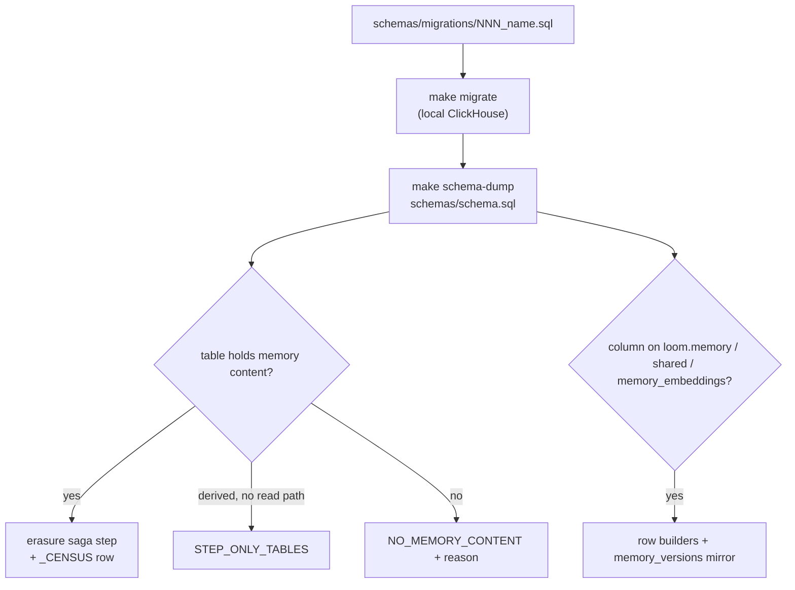

# Add a ClickHouse table or column

Loom's ClickHouse state is tables in the `loom` and `loom_telemetry` databases; under the Postgres memory authority, live memory, knowledge state and the records beside them are in Postgres. The [storage authority](../architecture/storage-authority.md#the-tables) page lists the Postgres tables. The ClickHouse schema changes only through numbered, additive migrations, because two builds serve the same schema during a deploy. Each rule below is held by a test. [ClickHouse](../architecture/clickhouse.md) explains the table families.

## 1. Write the migration and regenerate the schema

[Migrations](migrations.md) owns the rules: numbering, what counts as additive, runner directives, sort-key rebuilds, and `make schema-dump` / `make schema-check` against the pinned ClickHouse. In short:

- Add `schemas/migrations/<NNN>_<what>.sql` with the next free number. Its header comment says what the change is for and what old rows and old builds see.
- Address tables as `loom.<table>` and write `IF NOT EXISTS` / `IF EXISTS`. Telemetry derived from Loom's own tables goes in `loom_telemetry` instead ([why](../architecture/clickhouse.md)); preflight already checks its grants, and the erasure census names the table with its database.
- Never edit or delete a merged migration. Fix a mistake with a new file.
- Run `make migrate`, `make schema-dump`, then `python scripts/codegen/docs_reference.py` so the [schema reference](../reference/schema.md) lists the table.

Until a deployment applies the migration, the client's schema guard refuses a read or write naming a table a pending migration would create, with `SCHEMA_PENDING`.

## 2. Mirror every column on ReplacingMergeTree write paths

`loom.memory`, `loom.shared` and `loom.memory_embeddings` are `ReplacingMergeTree(version)` tables read with `FINAL`. Every handler that writes a new version row (set, tombstone, restore, touch, `update_by_id`, `bulk_set`, promote, demote) carries **every** persisted column forward. A column omitted on a later version row reads as zero under `FINAL`.

When you add a column to one of these tables:

1. Add it to the canonical column list in `server/memory/store/rows.py`
   (`MEMORY_PERSISTED_COLS` or `EMBEDDING_PERSISTED_COLS`).
2. Carry it in the builders there (`build_memory_version_row`, `build_revision_row`,
   `build_first_version_row`, `build_embedding_row`) and in every projection that feeds them
   (the `SELECT` that loads the existing row).
3. Never build a version row by hand in a handler; call the builders.

`tests/unit/test_memory_write_path_mirror.py` and `tests/unit/test_embedding_mirror_carry.py` check the secondary write paths.

**The history mirror.** `loom.memory_versions` is an append-only twin of `loom.memory`, filled by the `memory_versions_mv` materialized view. `memory.history`, `memory.redact` and `namespace.rollback` read it, because merges drop superseded rows from the `ReplacingMergeTree`. Add a new `loom.memory` column to `loom.memory_versions` and to the view's `SELECT` **in the same migration**. `tests/unit/test_memory_versions_schema.py` compares both column lists in `schema.sql` with `MEMORY_PERSISTED_COLS`.

Any new write path sets the server-stamped `actor` and `source_class` (`server.memory.domain.provenance`), never values from the request body.

## 3. Classify the table for erasure

Erasure is a saga (`server/erasure/app/saga.py`). Its last step is a residue census over every table the read paths touch; any live row in scope fails the saga closed. `tests/unit/test_every_table_is_classified.py` fails for any `CREATE TABLE` in `schema.sql` that is not in exactly one of three lists in `server/erasure/store/census.py`:

| List                | Put the table here when                                                                                                               | You also add                                                                                                                          |
| ------------------- | ------------------------------------------------------------------------------------------------------------------------------------- | ------------------------------------------------------------------------------------------------------------------------------------- |
| `_CENSUS`           | It can hold memory content a read path serves.                                                                                        | A saga step that removes the rows in scope, and a `Substrate(table, live, user_pred, ns_step, user_step)` naming that step per scope. |
| `STEP_ONLY_TABLES`  | A saga step mutates it but the census does not count it (derived ledgers, alias maps), with the reason in the comment above the dict. | The step, keyed by its name.                                                                                                          |
| `NO_MEMORY_CONTENT` | It holds no memory content in scope (counts, cursors, caches of public data).                                                         | A one-line reason.                                                                                                                    |

For a `_CENSUS` table:

- `live` is the predicate a live row satisfies (`tombstoned_at IS NULL`, or `"1"` when every
  row counts); `user_pred` is `user_id = {uid:String}` when the table has a user axis, `None`
  for a namespace-only table (then it is counted only in namespace-scope erasures).
- The step is a function in `server/erasure/store/steps_*.py`, listed with its step name
  in each saga table that applies (`NAMESPACE_STEPS`, `USER_STEPS` in
  `server/erasure/app/saga_steps.py`), and `final=False` on the `Substrate` for a plain
  `MergeTree` (FINAL is illegal there).
- A resumed saga re-runs the owner step of any table the last census found rows in
  (`steps_to_reopen`), so the step must be idempotent.
- A code-plane table keyed by `(org, namespace)` usually belongs in
  `CODE_INDEX_STEP_ONLY_TABLES` (removed by the saga's `code_index.purge` step); a unit test holds that tuple
  to the schema.

Test the step's statement shape with a stub client, as `tests/unit/test_erasure_repo.py` and
`tests/unit/test_erasure_late_steps.py` do.

## 4. Classify any mutation

An `ALTER TABLE loom.<t> UPDATE|DELETE` is a ClickHouse mutation: it rewrites parts asynchronously and is not transactional. `tests/unit/test_clickhouse_mutation_inventory.py` counts every visible one under `server/` against `_EXPECTED_MUTATIONS`. A new one fails until you add it there with a comment saying why.

Prefer a new version row on a `ReplacingMergeTree`, a tombstone column, or a lightweight `DELETE FROM`. Never use a mutation as a claim or lock a request waits on; the task inbox claims through a `KeeperMap` lease table instead.

## Checklist

- [ ] New `schemas/migrations/<NNN>_<what>.sql`, additive, idempotent; no merged file edited.
- [ ] `make schema-dump` against a fresh pinned ClickHouse; `make schema-check` clean.
- [ ] `python scripts/codegen/docs_reference.py` for the schema reference.
- [ ] RMT columns: `rows.py` column list, builders, projections; `memory_versions` and
      `memory_versions_mv` in the same migration.
- [ ] Erasure classification: `_CENSUS` + saga step, `STEP_ONLY_TABLES`, or
      `NO_MEMORY_CONTENT` with a reason.
- [ ] Any new mutation listed in the inventory test.
- [ ] `make test-unit` (the additive, numbering, mirror, classification and inventory tests).

## Related

- [Migrations](migrations.md)
- [ClickHouse](../architecture/clickhouse.md)
- [Retention and erasure](../features/memory/retention-and-erasure.md)
- [Upgrades](../operations/upgrades.md)
