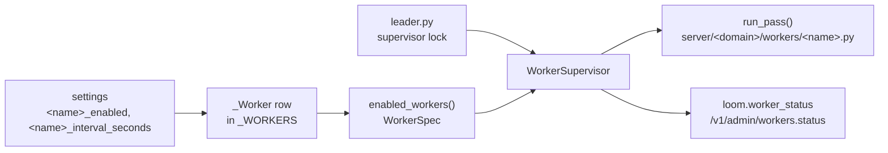

# Add a background worker

A worker is a row in `server/workers/registry.py` (`_WORKERS`) plus a module with one pass function. `enabled_workers()` turns the enabled rows into `WorkerSpec`s, and `WorkerSupervisor` (`server/workers/supervisor.py`) runs, times, backs off and drains each one. The generated [workers reference](../reference/workers.md) lists every row.



## 1. Write the pass

Create `server/<domain>/workers/<name>.py` with an `async def run_pass()`. The supervisor calls it once per interval and discards the return value. A small example is `server/tasks/workers/lease_sweep.py`:

```python
from server.workers import pass_context
from server.workers.status import record_pass


async def run_pass() -> SweepResult:
    from server.tasks.app.sweep import sweep_once

    with record_pass("task_lease_sweep") as rec:
        counts = await sweep_once()
        rec.outcome = dict(counts)
    result = SweepResult(**counts)
    if result.total == 0:
        pass_context.mark_idle()
    else:
        log.info("task_lease_sweep: expired=%d ...", result.expired)
    return result
```

The pass contract:

- **Idempotent and bounded.** A pass may be cancelled at its deadline, rerun after a crash, or run on the other colour after a deploy. Do a bounded amount of work and leave the rest for the next pass.
- **Deadline.** The default is `min(4 × interval, 900 s)`, floored at 60 s (`default_max_pass_seconds`). A pass past it is cancelled and counts as a failure. Set `max_pass_seconds` or `max_pass_setting` on the row for a longer pass.
- **Failures.** An exception fails the pass. The supervisor retries with exponential backoff (1 s doubling to 60 s) and marks the worker `degraded` after 3 consecutive failures. A pass cut at its deadline, or a worker whose interval exceeds its deadline (daily and weekly passes), waits the full interval instead (`failure_hold_seconds`), so a retry does not spend the same database time again.
- **Partial failures.** A leg that fails without failing the pass calls `pass_context.note_failure(exc, what)`. It counts toward the streak and shows in `loom.worker.partial_failures{worker}`.
- **Idle.** A pass that found nothing calls `pass_context.mark_idle()`. The supervisor then sleeps `idle_interval_seconds`.
- **Cursor.** A paging worker reads `pass_context.resume_cursor()` and calls `pass_context.set_cursor(value)` where it stopped. The cursor is stored on the pass's `loom.worker_status` row, so a restarted process resumes.
- **A broad `except` says why:** `# noqa: BLE001 — <what must not fail>`.

## 2. Attribute its queries

The supervisor tags every pass:

- ClickHouse queries carry `log_comment` `worker.<name>` (`set_worker_identity` in `server/workers/status.py`);
- provider spans carry `loom.operation=worker.<name>`;
- the pass runs in the background traffic class (`bind_background`);
- its LLM and embedder spend lands in one ledger row, `worker.<name>.pass`.

A loop **outside** the supervisor (a task, a thread, a CLI loop) tags itself, or its queries log as `untagged:<module>.<function>`:

```python
from server.core.ch import set_query_tag

set_query_tag("worker.my_loop")
```

## 3. Add its settings

Add the switch and the cadence to the area's settings mixin (`server/settings/_memory.py`, `_code.py`, `_tracker.py`, …). Each comment becomes the row's text in the generated [configuration reference](../reference/configuration.md).

```python
    # Lease sweeper: return expired leases to todo, resume deferred tasks at
    # resume_at, escalate stale triage. One read per pass.
    task_lease_sweep_enabled: bool = True
    # Seconds between passes while there is work.
    task_lease_sweep_interval_seconds: int = 60
    # Seconds between passes that found nothing.
    task_lease_sweep_idle_interval_seconds: int = 300
```

Default a worker **off** when it needs credentials, spends on a provider, or serves a plane an operator opts into. Default-on workers run on every stack, including a laptop.

## 4. Add the registry row

```python
(
    _Worker(
        "task_lease_sweep",
        "server.tasks.workers.lease_sweep",
        "task_lease_sweep_enabled",
        "task_lease_sweep_interval_seconds",
        idle_interval="task_lease_sweep_idle_interval_seconds",
    ),
)
```

| `_Worker` field                        | Meaning                                                                                                                                   |
| -------------------------------------- | ----------------------------------------------------------------------------------------------------------------------------------------- |
| `name`                                 | The worker's name: the log tag, the ledger operation, the status row.                                                                     |
| `module`                               | The full module path. Imported only when the worker is enabled, so boot stays fast and optional dependencies stay optional.               |
| `enabled`                              | The settings flag that switches it on; `None` = always on.                                                                                |
| `interval`                             | The settings field holding the cadence in seconds.                                                                                        |
| `interval_in_module`                   | `interval` names a module attribute instead of a setting.                                                                                 |
| `pass_attr`                            | The pass function's name (default `run_pass`).                                                                                            |
| `also_requires`                        | A second settings flag the worker needs (the ledger it reads, the plane it serves); off → the worker is off.                              |
| `idle_interval`                        | Settings field for the sleep after an idle pass.                                                                                          |
| `max_pass_seconds`, `max_pass_setting` | The pass deadline, pinned or read from a setting.                                                                                         |
| `first_pass_due`                       | A module attribute: an async check asked once at start; `True` runs the first pass now instead of after the boot stagger.                 |
| `owned_tables`                         | `True`: the module exports `OWNED_TABLES` and `due_scope`; the first pass is due when an owned table has no row for a namespace in scope. |

**Boot stagger.** Without a first-pass hook, the first pass waits `crc32(name) % interval`. A daily worker on processes that live hours may then never run, so declare what it fills:

```python
from server.workers.first_pass import OwnedTable

OWNED_TABLES = (OwnedTable("loom.qa_item_embeddings", namespace_column="namespace"),)


def due_scope() -> list[tuple[str, str]]: ...  # the (org, namespace) pairs this worker fills
```

That is `server/tracker/workers/embed.py`'s declaration. The check is one statement per table, bounded by `FIRST_PASS_DUE_TIMEOUT_SECONDS`. An unreadable table reads as due.

## 5. Understand where it runs

**One supervisor per deployment.** `server/workers/leader.py` elects one process across every container and host through ClickHouse: the `workers_supervisor` key in the Keeper lock table `loom._migration_lock`. The holder renews every `LOOM_SUPERVISOR_LEASE_TTL_S / 6`; a holder that loses the lease stops its workers; when the holder dies, another process takes over after `LOOM_SUPERVISOR_LEASE_TTL_S` (default 30 s).

| `LOOM_BACKGROUND_WORKERS` | Effect                                                                                                      |
| ------------------------- | ----------------------------------------------------------------------------------------------------------- |
| `auto` (default)          | Contend for the lease; run the supervisor while held. Outside the deployment (no `LOOM_DEPLOYMENT`), `off`. |
| `on`                      | Always run the supervisor.                                                                                  |
| `off`                     | Web only.                                                                                                   |

Run every replica in `auto`: any of them may become the leader. A `make server` or iso server runs no workers unless it sets `on`.

**Two copies can briefly overlap.** A holder stops its workers at T/2 without a renewal, before another process can take over at T, but a statement it already sent still lands, and an `on` process takes no lease. Make a second copy harmless: idempotent writes, leased claims, cursors in the store. A worker that spends on an LLM doubles its spend while two copies run.

**Stop between batches.** A long loop calls `pass_context.check_stop()` before each batch it writes. It raises `PassStopped` once the pass was stopped or the lease went stale, which also reaches work running in `asyncio.to_thread`. `PassBudget.exhausted()` calls it for you.

**Rolling upgrades.** An older build leaves the lease to a live newer build (see [Failure and recovery](../architecture/failure-and-recovery.md#background-workers)). The old leader releases the lease when it stops, and a newer process takes it on its next round, within seconds.

## 6. Pin it in tests

- **Registry snapshot.** `tests/unit/test_worker_registry_snapshot.py` builds the worker list under three settings profiles (`defaults`, `all_on`, `production`) and compares every `WorkerSpec` field with `tests/unit/snapshots/worker_registry.json`. Regenerate it for an intended change only:

  ```bash
  LOOM_UPDATE_WORKER_SNAPSHOT=1 python -m pytest tests/unit/test_worker_registry_snapshot.py
  ```

  If production should run the worker, add its flag to `_PRODUCTION_FLAGS` in that test.

- **Parity.** `tests/unit/test_worker_registry_parity.py` checks that `worker_meta()` (what `/v1/admin/workers.status` renders) and `enabled_workers()` list the same set with every flag on.
- **The pass itself.** A unit test calls `run_pass()` against a stub repository or a local ClickHouse. Outside a supervised pass, `pass_context` calls only log.
- **Generated docs.** `python scripts/codegen/docs_reference.py` regenerates the
  [workers reference](../reference/workers.md); `make lint` fails while it is stale.

## 7. Check it runs

- `/v1/admin/workers.status` merges this process's registry with the latest `loom.worker_status` row per worker, so the web tier shows workers running in the workers container.
- `/v1/health?include=workers` reports per-worker status and `workers_leader`: whether the answering process holds the lock, and why.
- Alert on `loom.worker.consecutive_failures{worker}` and `loom.worker.partial_failures{worker}` ([monitoring](../operations/monitoring.md)).

## Related

- [Extending Loom](extending-loom.md)
- [Workers reference](../reference/workers.md)
- [Failure and recovery](../architecture/failure-and-recovery.md)
- [Worker status](../operations/monitoring.md#worker-status)
