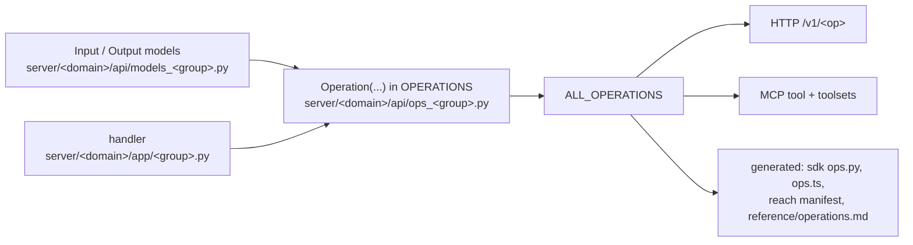

# Add an operation

An operation is declared once, in the registry. The HTTP route (`POST /v1/<op>`), the OpenAPI schema, the MCP tool (`loom_<op with dots as underscores>`), the catalogue (`/v1/operations`, `ops.capabilities`), the SDK op tables and the [operations reference](../reference/operations.md) derive from it. You write the models, handler, declaration and tests, and regenerate the rest.



The example is `calibration.get`, one of the smallest ops: `server/memory/api/models_calibration.py`, `server/memory/api/ops_calibration.py` and `server/memory/app/calibration.py`.

## 1. Define the input and output models

Put them in the group's models module, `server/<domain>/api/models_<group>.py`. A models module holds Pydantic wire models only: it imports no handler.

```python
from pydantic import BaseModel, Field


class CalibrationGetInput(BaseModel):
    org: str
    namespace: str


class CalibrationGetOutput(BaseModel):
    source: str  # "namespace" / "cluster" / "scalar"
    embedder_model: str = ""
    noise_floor: float
    ...
    similar_pairs_n: int = Field(default=0)
```

Rules for the models:

- **Identity.** A namespace-addressed op takes `org` and `namespace`. Ops that write rows take the rest of the identity tuple: `agent`, `user_id`, `session_id`, `run_id` (the last three default to `'-'`). Over MCP the server fills omitted identity fields from the connection's defaults, then authorizes the `(org, namespace)` the body names.
- **Server-stamped columns never come from the body.** A write path sets `actor` (`server.memory.app.provenance.writer_actor`) and `source_class` (`server.memory.domain.provenance.source_class_for`). A request may only declare a downgrade to `derived`, `external` or `imported`.
- **Hide agent-irrelevant fields from MCP.** Mark a ranking knob or pipeline switch with `json_schema_extra=MCP_HIDDEN` (`server/operations/base.py`). The MCP schema omits it; the op still accepts it.
- **No model-level "one of A or B" validators** on read inputs. The transport validates the body before authorization, so a raising `@model_validator` describes the op to a principal the namespace gate would refuse. Put the rule in the handler and raise `server.core.errors.ValidationError`. `tests/unit/test_op_inputs_after_gate.py` checks every registered op.
- **To retire a field**, delete it. A client that still sends it is served, with the field named in `ignored_args` ([unknown and removed fields](../reference/http-api.md#unknown-and-removed-fields)).

## 2. Write the handler

One handler module per group, under `server/<domain>/app/`. A handler is `async`, takes the input model and returns the output model. It imports the wire models at module top; the models never import a handler, so the import is acyclic:

```python
from server.memory.api.models_calibration import CalibrationGetInput, CalibrationGetOutput


async def handle_calibration_get(input: CalibrationGetInput) -> CalibrationGetOutput:
    from server.memory.app.embedder_calibration import get_calibration, get_namespace_calibration

    ns_cal = await get_namespace_calibration(input.org, input.namespace)
    ...
```

- Pure logic goes in the domain's `domain/`, SQL in its `store/`. The handler composes them.
- **Refusals** raise a `server.core.errors.LoomServerError` subclass (or an `HTTPException` with a `{"code", "message"}` detail). The transports turn it into the error envelope, and over MCP into an `isError` result. A new error code appears in the generated [errors reference](../reference/errors.md).
- **A broad `except` says why:** `except Exception as e:  # noqa: BLE001 — <what must not fail>`.
- The transport tags ClickHouse queries with `log_comment`; a handler does nothing.
- Read settings as `settings.<field>`, never `getattr(settings, ...)`.
- If the op writes `loom.memory` or `loom.shared`, build rows with the builders in
  `server/memory/store/rows.py` ([adding a table](adding-a-table.md#2-mirror-every-column-on-replacingmergetree-write-paths)).

### Ops addressed by an org-wide id

An op that takes only `(org, memory_id)` (`memory.get_by_id`, `memory.update_by_id`, `memory.redact`) gets no namespace from the transport. Declare it `row_scoped=True`, fetch the row, check its namespace and **hide** a foreign row:

```python
import server.memory.store as memory_repo
from server.auth.authz import row_in_scope

row = await memory_repo.get_by_id(input.memory_id, org=input.org, ...)
if row is None:
    return MemoryGetByIdOutput(found=False)
if not await row_in_scope(input.org, row.namespace):
    return MemoryGetByIdOutput(found=False)
```

Answer `found=False`, never 403: a 403 confirms the id exists in another tenant. Pass `required_role=Role.WRITER` to `row_in_scope` for a write.

## 3. Declare the operation

```python
from server.operations.base import Operation, Role

calibration_get = Operation(
    name="calibration.get",
    maturity="experimental",
    input_model=CalibrationGetInput,
    output_model=CalibrationGetOutput,
    handler=handle_calibration_get,
    idempotent=True,
    required_role=Role.VIEWER,
    audit=False,
)

OPERATIONS: list[Operation] = [calibration_get]
```

Its latency budget is one entry of `OP_BUDGETS_P99_MS` in `server/settings/catalog.py`, where every op's budget is set, `"calibration.get": 60,` (the op's design-target p99 in ms; a successful call over it emits a `budget.violated` event). Request shapes the handler notes at run time (`server.observability.budget_shape`) get their own budgets in `OP_SHAPE_BUDGETS_P99_MS`, and the catalogue lists them. `tests/unit/test_op_budgets.py` fails an op with no entry. A deployment tunes one op with `LOOM_LATENCY_BUDGET_OVERRIDES` and all of them with `LOOM_LATENCY_BUDGET_MULTIPLIER`.

The declaration lives in the group's ops module, `server/<domain>/api/ops_<group>.py`, which imports the models and the handler. Append it to the module's `OPERATIONS` list. A **new group module** is imported and appended to `_OPERATION_MODULES` in `server/operations/registry.py`.

| Field                         | Required | Meaning                                                                                                                                                             |
| ----------------------------- | -------- | ------------------------------------------------------------------------------------------------------------------------------------------------------------------- |
| `name`                        | yes      | Dotted `<group>.<verb>`. HTTP path `/v1/<name>`; MCP tool `loom_<name with . → _>`.                                                                                 |
| `input_model`, `output_model` | yes      | Pydantic models.                                                                                                                                                    |
| `handler`                     | yes      | Async callable: input model → output model.                                                                                                                         |
| `idempotent`                  | yes      | Safe to retry on a transient failure. The SDKs and clients rely on it.                                                                                              |
| `required_role`               | yes      | `Role.VIEWER`, `WRITER`, `ADMIN`, `ORG_ADMIN` or `PLATFORM_ADMIN`.                                                                                                  |
| `audit`                       | no       | `True`: success writes one row to `loom.audit_log`. Set it for anything that changes memory, grants, policy or configuration.                                       |
| `writes`                      | no       | The op changes stored state although a viewer may call it and a retry is safe (a feedback row, a seen-marker). A writer role or `audit=True` already says "writes". |
| `maturity`                    | no       | `stable` (default) or `experimental`. See [step 5](#5-check-reach-and-maturity).                                                                                    |
| `skip_namespace_authz`        | no       | Skip the transport's namespace check for ops that act **on** a namespace (join, leave, register); the handler enforces its own rules. The role check still runs.    |
| `deployment_scoped`           | no       | The op reads facts about the deployment (its build, its registry), not any namespace's data; a scoped token passes with its best per-namespace role.                |
| `row_scoped`                  | no       | Addressed by an org-wide id; the handler authorizes the row with `row_in_scope` and hides a foreign row as not found.                                               |

The op is **read-only** (MCP `readOnlyHint`, the `readonly` toolset) exactly when it is `idempotent`, `required_role == Role.VIEWER`, not `audit` and not `writes` (`Operation.read_only`). Clients that auto-approve read-only tools trust these flags.

## 4. Decide MCP visibility

`server/operations/toolsets.py` decides where the op is listed:

- **A curated roster** (`_MCP_CORE_OPS`, `_MCP_CODING_OPS`, `_MCP_ATOMIC_OPS`, `_MCP_TASK_OPS`, `_MCP_TRACKER_OPS`, `_MCP_CODE_CORE_OPS`) lists it on that `?toolset=`. Every listed property costs tokens on every turn, so add only what that archetype calls. `tests/unit/test_mcp_listing_budget.py` holds the listing under a token ceiling.
- **Unlisted** (most ops): callable by name through `loom_op` on any listing. `?toolset=all` lists a `stable` op, and an `experimental` op only when the core or atomic roster lists it (`listed_under_all` in `server/operations/toolsets.py`).
- **`_MCP_HIDDEN_OPS`**: not reachable over MCP. `tests/unit/test_hidden_op_says_why.py` requires a refusal that names what to call instead.

A listed op needs its description in `server/transport/mcp_descriptions.py`
(`TOOL_DESCRIPTIONS`). Write it for the model: when to call the tool, what it returns, what not to use it for. A description about a changed fact interpolates `revision_policy()` from the same module instead of stating its own. See the [MCP reference](../reference/mcp.md).

## 5. Check reach and maturity

An op's **reach** is derived (`Operation.reach`, `server/operations/reach.py`): its MCP roster membership plus a committed scan of the SDKs, `examples/`, `dev/` and `scripts/`, the plugin hooks, and the dashboard's `"/v1/<op>"` call sites. `{"http_only"}` means only a raw `/v1/*` POST reaches it.

Every op is on every surface or says why not in code. HTTP serves every op in the registry, and both SDKs are generated from it. MCP reaches it unless `_MCP_HIDDEN_OPS` keeps it for people and operators. The dashboard calls it when a person needs it: to administer, review, inspect, configure, or delete with a confirmation; a new op of that kind ships with its control. An op only an agent or a client program calls, or one the dashboard serves through another op, is named in `NOT_IN_DASHBOARD` (`server/operations/dashboard.py`) with the reason; `DASHBOARD_PENDING` there lists the ops a person needs whose control is not built yet, and only shrinks. The census's `--check` (`tests/unit/test_op_reach_census.py`) fails on an op with neither a dashboard call site nor an entry in `server/operations/dashboard.py`.

- An op whose only path is a raw HTTP POST declares `maturity="experimental"`.
- `stable` means a production caller shows in the census's 30-day call counts (`python scripts/codegen/op_reach_census.py --call-counts --days 30`). Declare a new op `experimental` unless it replaces a stable one.
- Refresh the manifest: `python scripts/codegen/op_reach_census.py --write-manifest` (writes `server/operations/reach_manifest.py`).

## 6. Write the tests

| Test                                                     | What it asks of your op                                                                                                                                                                                                                                                                                                      |
| -------------------------------------------------------- | ---------------------------------------------------------------------------------------------------------------------------------------------------------------------------------------------------------------------------------------------------------------------------------------------------------------------------- |
| A unit test under `tests/unit/`                          | Covers the handler's refusals and its happy path.                                                                                                                                                                                                                                                                            |
| `tests/integration/test_cross_principal_leakage.py`      | Every read-shaped op is driven as another tenant (a writer and a viewer on another namespace, and another org) with canary nonces; no response may contain one, and every call ends 200 (empty), 403 or 404, never 500. Payloads are synthesized from your input model, so a new read op is probed the day it is registered. |
| `tests/integration/test_restricted_namespace_leakage.py` | The same for restricted namespaces.                                                                                                                                                                                                                                                                                          |
| `tests/unit/test_op_inputs_after_gate.py`                | Your input model constructs without a model-level validation error.                                                                                                                                                                                                                                                          |
| `tests/unit/test_op_reach_census.py`                     | Reach and maturity agree, and the manifest is current.                                                                                                                                                                                                                                                                       |
| `tests/unit/test_mcp_listing_budget.py`                  | A listed op keeps the listing under budget and its description points at no tool the client cannot call.                                                                                                                                                                                                                     |

If the leakage suite cannot synthesize a body for your op, it reports it; add a hint instead of skipping. An op that mutates the caller's own namespace goes in the suite's `_SKIP_OPS`, with the writer gate covered elsewhere. Integration tests need a running server (`LOOM_BASE_URL`) and skip without one. Mint tokens with the suite's helpers, not self-signup, which CI does not enable.

## 7. Regenerate and run the gates

```bash
python scripts/codegen/sdk_py_gen.py                       # sdk/python/loom/ops.py
python scripts/codegen/sdk_py_client_gen.py                # sdk/python/loom/client.py
python scripts/codegen/sdk_ts_gen.py                       # sdk/typescript/src/generated/ops.ts
python scripts/codegen/op_reach_census.py --write-manifest # server/operations/reach_manifest.py
python scripts/codegen/docs_reference.py                   # generated regions of docs/reference/*.md
make format
make lint          # ruff, gates, every generator with --check, the reach census --check, Biome's dashboard accessibility rules
make typecheck
make test-unit     # reach census, MCP listing budget
```

CI fails when a generated file is stale. The generated SDK files give every client the op at once: `agent.call("calibration.get", {...})` in Python and TypeScript is typed against the new TypedDicts and interfaces. A hand-written method on an SDK client (`sdk/python/loom/<group>.py`) is optional; add one for a common verb. It counts as a reach path.

`python scripts/codegen/wire_changelog.py <rev_a> <rev_b>` prints what changed for clients between two revisions. The release notes are built from it.

## Before you open the PR

- [ ] Models, handler, declaration, `OPERATIONS` entry (and `_OPERATION_MODULES` for a new group).
- [ ] `required_role`, `idempotent`, `audit`, `writes`, `maturity` chosen deliberately.
- [ ] `row_scoped` ops answer `found=False` for a foreign row.
- [ ] Toolset placement and, if listed, a description.
- [ ] Tests named above pass; generated files regenerated.
- [ ] The feature page that owns the op links its anchor in the
      [operations reference](../reference/operations.md).

## Related

- [Extending Loom](extending-loom.md)
- [System overview](../architecture/system-overview.md): the gate order every op passes
- [HTTP API](../reference/http-api.md)
- [Code generation](code-generation.md)
