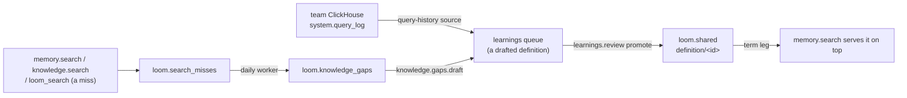

# Curation loop design

This page is the design of the curation loop, which turns what people ask into definitions
an organization stands behind. Searches that find nothing become knowledge gaps. A gap, or a
query a team runs often on its own ClickHouse, becomes a drafted definition in the learnings
queue. A definition an admin promotes into the shared layer is governed: when a query names
its term, `memory.search` serves it above every other hit, a derived aggregate's count
aside. The parts land in this order: knowledge gaps (recording, grouping and the list),
governed definitions (the shared-layer changes and the term leg), then
`knowledge.gaps.draft` and query history, which queue definition drafts and so need the
review path the second part builds. Knowledge gaps are built and described in [knowledge
gaps](../architecture/knowledge-gaps.md). A definition's write-time rules are in
[conflicts and refusal](../features/memory/conflicts-and-refusal.md); its promotion and
term-search rules are in [the shared layer](../concepts/identities-and-namespaces.md#agent-written-rows-and-the-shared-layer)
and [governed definitions in search](../concepts/identities-and-namespaces.md#governed-definitions-in-search).
Definition drafting, query-history sources and private review are described in
[definition drafts](../architecture/definition-drafts.md).

## Governed definitions

A definition is a memory row with `memory_type = 'definition'` under a `definition/` key.
The key does not encode the term: the review path picks it (below), a direct caller
chooses it, and it stays the same through every revision. At promotion, names decide
whether two definitions clash: the name check below keeps two shared definitions from
holding one name. At write time, rows stay told apart by key, as for any key-identified
type.

A name is compared in its folded form: format characters (Unicode category Cf, such as a
pasted byte-order mark) dropped, then `canonical_document_text` (`server/core/hashing.py`:
NFKC, trimmed, every run of whitespace made one space), then `str.casefold`. One helper in
`server/memory/domain/definitions.py` folds a name, and its unit tests pin each step with
a table. The folded form decides whether two names are one (`SAT`, `Sat` and `sat ` are);
matching against a query keeps the case rule of the term leg ([governed definitions in
search](../concepts/identities-and-namespaces.md#governed-definitions-in-search)).

A definition's value is a JSON object, which `memory.set` stores whole in `value` and in
`value_json` (the embedding reads its excerpt, as for any row):

| Field      | Meaning                                                                     |
| ---------- | --------------------------------------------------------------------------- |
| `term`     | The name as people write it.                                                |
| `aliases`  | Other names for the same thing (an abbreviation, an older name).            |
| `body`     | The definition's text.                                                      |
| `rests_on` | What it is based on: for query history, the SQL and its tables and columns. |

The admin who promotes a definition answers for it (`promoted_by`, stamped from the
token); the value names no owner, so it holds no person's name for an erasure to miss.

The term leg serves a definition only while it is **governed** ([the shared
layer](../concepts/identities-and-namespaces.md#agent-written-rows-and-the-shared-layer),
`server/memory/domain/definition_check.py`), checked when the leg reads it. The source is
read from the memory authority (Postgres when it holds live memory, [storage
authority](../architecture/storage-authority.md)), and a source whose head cannot be read
fails closed: the definition is not served. A read-time check covers every path into that
state that it can see, rows promoted before this design and through N-1 included; what it
cannot see is named under rolling upgrades. The shared layer already is the namespace's
admin-approved copy of a fact ([the shared
layer](../concepts/identities-and-namespaces.md#agent-written-rows-and-the-shared-layer)):
`memory.promote` and `memory.demote` need `admin`, the shared row records its source
(`promoted_from`) and the candidate it came from (`promoted_from_candidate_id`),
`memory.lineage` walks it back, and every build knows it. So governance needs no table or
state of its own. An edit, a relabel to `medium` or `high` or a tombstone of the source,
by any writer or worker on any build, ends governance while the source differs from what
the admin approved; a copy that keeps the text (the entity pass, a touch) keeps it, and a
source that returns to the approved state (a restore, an edit reverted byte for byte) is
governed again with no new promotion. Search withholds a copy whose source is gone or
labelled `medium` or `high` ([the shared
layer](../concepts/identities-and-namespaces.md#agent-written-rows-and-the-shared-layer));
a relabel back serves it again. `memory.demote` ends governance; the demoted source stays
a plain namespace-wide row, which ordinary search still serves until the admin deletes it,
and a later draft of its term is a new term under a new key. Only `memory.promote`
promotes into `loom.shared` (the op and `learnings.review`'s path through it; demote,
erasure and a redact only retire or scrub there, as the changes below say), and no worker
promotes on its own. `memory.definitions.list` shows each definition's verdict; a
definition that loses a name to another is still served for the names it keeps, and one
past the ceiling is not read. A changed text is promoted again. On N no automatic verdict
retires or marks a definition's source (the exemptions below, and the negative-outcome
quarantine of `memory.outcome`, which skips a definition's namespace-wide row as it skips
a locked one; `memory.outcome_run` records harm events and quarantines nothing), so a
source that is no longer `active` was rejected by a writer, or left that way by N-1 or
before this design. The sensitivity sweep can still relabel a source, which lapses it as a
relabel does. The admin brings it back by the way it lapsed:

- retired automatically: `memory.restore` (`memory.auto_retirements` lists such
  retirements);
- marked `conflicted`: `conflicts.resolve`;
- marked `duplicate`: `memory.dedup_resolve`;
- rejected with `memory.reject`, or replaced by a writer's `memory.copy_to` (which resets
  the row's pin and lock), a writer's explicit act like an edit: written again;
- past its `expires_at` or `valid_to` (a row written before this design, or by a writer):
  written again with `clear_expiry` and no `valid_to`, or by reviewing a pending draft of
  the term. Review uses the retained source's content hash as a write precondition;
  unpin or unlock the source before review if needed.

It is governed again when its text is the approved one, and is promoted again otherwise.

Namespace erasure reaches `loom.shared`: its `shared.tombstone` step takes every promoted
row of the namespace and its census counts them, beside the user erasure's match by
provenance.

A redact of a past version of a source (`memory.redact` refuses the live head) reaches its
shared copies: every `loom.shared` version promoted from the key whose `value` is the
version's text (by the `content_sha256` the redact keeps) is scrubbed, and the key's search
rows below the next shared version after it (all of them when the copy is the newest) are
deleted, older shared rows it replaced included. A redact that reaches a copy marks the
namespace's memory plane (`namespace_write_marks.bump`), since a mutation moves no mark. A
copy is left as it is while the live head holds the redacted text too (an edit reverted byte
for byte), as `memory.redact` leaves a live copy of a text it scrubs from history. A live
copy keeps its row, holding `"[REDACTED]"`, until an admin demotes it; a definition's copy
counts toward the ceiling until then, and the read-time check does not govern it.

A copy an earlier redact scrubbed is reached again: a run cut off part way is finished by
the next one, and each later redact of the key purges its search rows and cached answers
again and moves the mark.

Writes that race the redaction are listed on [the history
page](../features/memory/history-and-provenance.md#scrubbing-history-memoryredact).

Private definition review and candidate redaction follow [definition
drafts](../architecture/definition-drafts.md#review-and-publication).

Should two shared rows match one name despite the name check (one promoted through a build
without the check, or one whose claim on the namespace ran out), the term leg serves,
among the rows the read-time check passes, the one with the latest `promoted_at`, a tie
within its second settled by `promotion_event` (the same order picks the rows the term leg
reads past the ceiling): one fixed winner, not necessarily the later of the two. A rewrite
of a shared row that is not a promotion, such as a scrub, does not count.

A caller may already write rows of type `definition`; they are governed only once an admin
promotes them. A definition is key-identified and is judged against no row under another
key, and only a write of its namespace-wide row revises that row
([conflicts and refusal](../features/memory/conflicts-and-refusal.md)). Conflict surfacing
compares a row only with rows of its own `memory_type`, so a learned fact that contradicts
a definition is not flagged against it. The term leg serves the governed
definition above such a fact; a cross-type check would add a candidate read to every write,
and is not part of this design.

## Knowledge gaps

Recording misses, grouping them and `knowledge.gaps.list` are built: [knowledge
gaps](../architecture/knowledge-gaps.md). What the later parts add to them follows.

Once a document can be hidden from some readers (the `mirrored` access of [document
sources](../architecture/document-sources.md)), a `knowledge.search` or `loom_search` that
left out a document its reader may not see records no miss.

### Drafting, query history and review

These paths are implemented in [definition drafts](../architecture/definition-drafts.md),
which owns their access rules, durable claims, cost bounds, promotion, erasure and upgrade
requirements. The Library has a **Draft definition** action for each gap and a **Query
history** source list for namespace admins.

## Erasure and audit

Definitions follow memory and shared-layer erasure, history and audit paths. Namespace
erasure tombstones promoted rows. Historical source redaction also scrubs shared copies
of that text, unless a live source still holds it. See [the shared
layer](../concepts/identities-and-namespaces.md#agent-written-rows-and-the-shared-layer).

[Knowledge gaps](../architecture/knowledge-gaps.md#erasure) owns misses and gap builds.
[Definition drafts](../architecture/definition-drafts.md#erasure-audit-and-upgrades) owns
private candidate scrubbing, source registration erasure and review audits.

## Cost bounds

Shared-layer reads have a fixed ceiling. [Definition drafts](../architecture/definition-drafts.md#one-model-attempt)
owns model-call and query-history limits; [configuration](../reference/configuration.md)
lists their defaults.

The shared definition ceiling is `memory_shared_definitions_max` (default 500).
Term-search bounds follow [governed definitions in
search](../concepts/identities-and-namespaces.md#governed-definitions-in-search).

- A definition's promotion, through `memory.promote` or `learnings.review`, reads the
  namespace's definition rows once, at most `memory_shared_definitions_max` plus one (past
  it the promotion is refused), to check its term and aliases; the review path runs the
  read three times: at candidate selection, during preflight and at the promotion write.
- `memory.definitions.list` reads the definition rows once and returns at most twice the
  ceiling, with values for the ceiling's most recent only; it reads their sources in one
  bulk read and grades the value of each source nothing else lapses.

## Rolling upgrades

Private candidate and registration rollout and rollback follow [definition
drafts](../architecture/definition-drafts.md#erasure-audit-and-upgrades). Gap-table rollout
follows [knowledge gaps](../architecture/knowledge-gaps.md#rolling-upgrades).

Governed definitions are memory and shared rows, which
N-1 knows: it serves them as plain rows with no term leg. The read-time check grades the
source's value on every read, so a later build whose detector grades differently changes
which definitions are governed, and two builds serving side by side may disagree on one
row until the older one stops; the build that changes the detector names this in its
rollout notes, as does a build whose Python ships another Unicode version, which can
change whether two names fold to one. Keys do not depend on the fold, so no definition
lapses for it. What N-1 does to them is caught by the read-time check: a promotion from
another source, or an edit, relabel or tombstone of the source, leaves a row the term leg
does not serve, and the term leg's last-promoted rule covers a promotion that skipped the
term check. A promotion on N-1 also skips the approved-hash check and takes `promoted_by`
from the body, which no read-time check can tell. Private review uses the existing
conditional-set precondition (`if_match_sha256="absent"` or the observed source hash);
its separate fleet gate requires every replica to understand private candidates.
Direct callers rely on the approved-hash and token-stamped promotion checks only once
no N-1 replica serves. An admin then promotes again every definition promoted before then, through N-1 or
before this design (`loom.shared` rows of type `definition` by promotion time), since none
of those carried the hash check or a token-stamped `promoted_by`; that promotion on N also
moves the write mark, which N-1's promotions and demotions never move, so a stored
`memory.ask` answer from the rollout is not reused past it (until then such an answer
lives at most `memory_ask_precedents_fast_max_age_hours`, with no bound when it is 0).
N-1, which does not know `definition` as key-identified, can merge, supersede or retire
one definition's source while writing another. Once N serves, each is recovered and
promoted again:

- a source it retired (`memory.auto_retirements` reasons `conflict_resolver`,
  `newest_wins_contradiction`, `value_update` and `same_key_newest_wins`):
  `memory.restore`;
- a source it marked `conflicted`: `conflicts.resolve`; one marked `duplicate`:
  `memory.dedup_resolve`;
- a write it merged: never stored, so written again;
- a source its negative-outcome quarantine of `memory.outcome` rejected
  (`memory.outcome_run` quarantines nothing): written again;
- a source its `memory.consolidate` tombstoned: `memory.restore` within 14 days; past
  them, the definition is written again from its shared copy's text.

An N-1 relabel of a definition's namespace-wide source to `medium` or `high` leaves its
shared copy served by N-1's search; N's search leaves it out by that row's label. A copy N-1
promoted from another row, which it does not refuse (a `medium` one included), is judged by
the namespace-wide row under its key, not by the row it came from: the re-promotion step
above replaces it with one promoted from that row. N-1's redact does not reach the shared
row's text: one run during the rollout or after a rollback is run again once N serves. A
namespace erasure an older build without the shared step ran is cleared as the
rolling-upgrades rule "A namespace's promoted rows" says ([rolling
upgrades](../architecture/rolling-upgrades.md)).

## Invariants

- A gap shows only queries that at least `knowledge_gaps_min_askers` askers asked in that
  form; a draft is written from nothing but such queries, or, for query history, the
  normalised text of queries `knowledge_query_history_min_users` accounts ran.
- A definition is governed only while an admin's promotion of its namespace-wide row into
  the shared layer is live and the source still holds that text, active, live, within its
  validity and neither labelled nor graded `medium` or `high`; the term leg serves at most
  one definition per name, chosen by the rule above; only governed definitions are placed
  above the served list.
- A query naming no governed term is served exactly as without the term leg.

## Source entry points

- `server/memory/domain/memory_types.py` (`KEY_IDENTIFIED_TYPES`)
- `server/memory/app/search/handler.py` (the legs of `memory.search`)
- `server/memory/app/promote.py` (`handle_memory_promote`)
- `server/memory/app/learnings.py` (`handle_learnings_review`)
- `server/identity/domain/read_scope.py` (`honours_read_scope`)
- `server/observability/budget.py` (`namespaces_over_cap`)

## Related

- [Memory architecture](../architecture/memory-architecture.md)
- [Learnings review
  queue](../features/memory/procedures-and-learnings.md#learnings-review-queue)
- [Conflicts and refusal](../features/memory/conflicts-and-refusal.md)
- [Tracker plane](../features/tracker/overview.md)
