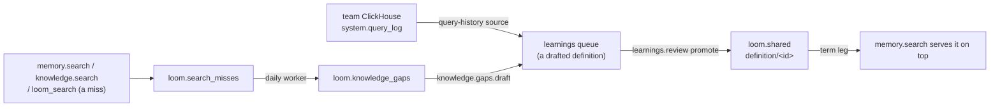

# Curation loop design

This page is the design of the curation loop, which turns what people ask into definitions
an organization stands behind; none of it is built yet. Searches that find nothing become
knowledge gaps. A gap, or a query a team runs often on its own ClickHouse, becomes a
drafted definition in the learnings queue. A definition an admin promotes into the shared
layer is governed: when a query names its term, `memory.search` serves it above every
other hit, a derived aggregate's count aside. The parts land in this order: knowledge gaps
(recording, grouping and the list), governed definitions (the shared-layer changes and the
term leg), then `knowledge.gaps.draft` and query history, which queue definition drafts
and so need the review path the second part builds. None of its ops, tables or settings
are served until the pull request that builds each part lands; that pull request moves its
part into `docs/architecture/`, written as what Loom does, and removes it here.

## Governed definitions

A definition is a memory row with `memory_type = 'definition'` under a `definition/` key.
The key does not encode the term: the review path picks it (below), a direct caller
chooses it, and it stays the same through every revision. At promotion, names decide
whether two definitions clash: the name check below keeps two shared definitions from
holding one name. At write time, rows stay told apart by key, as for any key-identified
type.

A name is compared in its folded form: format characters (Unicode category Cf, such as a
pasted byte-order mark) dropped, then `canonical_document_text` (`server/core/hashing.py`:
NFKC, trimmed, every run of whitespace made one space), then `str.casefold`. One helper in
`server/memory/domain/definitions.py` folds a name, and its unit tests pin each step with
a table. The folded form decides whether two names are one (`SAT`, `Sat` and `sat ` are);
matching against a query keeps the case rule of the term leg below.

A definition's value is a JSON object, which `memory.set` stores whole in `value` and in
`value_json` (the embedding reads its excerpt, as for any row):

| Field      | Meaning                                                                     |
| ---------- | --------------------------------------------------------------------------- |
| `term`     | The name as people write it.                                                |
| `aliases`  | Other names for the same thing (an abbreviation, an older name).            |
| `body`     | The definition's text.                                                      |
| `rests_on` | What it is based on: for query history, the SQL and its tables and columns. |

The admin who promotes a definition answers for it (`promoted_by`, stamped from the
token); the value names no owner, so it holds no person's name for an erasure to miss.

A definition is **governed** while three things hold, checked when the term leg reads it:
a live `loom.shared` row of type `definition` under a `definition/` key exists; its
provenance (`promoted_from`) names exactly one source, the namespace-wide row under that
key (`user_id`, `agent` and `session_id` all `'-'`); and that source is live (`status =
'active'`, not tombstoned, superseded, or past its `expires_at` or `valid_to`), neither
labelled nor graded `medium` or `high` (the value itself is graded, since some write paths
store the label empty), and holds the same text as the shared copy: the hash of the
source's value as read equals the hash of the shared `value`, both the canonical-JSON hash
every read and precondition compares (`served_content_sha256` in `server/core/hashing.py`,
which the approved-content check below uses too), so a store that orders an object's keys
differently is not a change. The source is read from the memory authority (Postgres when
it holds live memory, [storage authority](../architecture/storage-authority.md)), and a
source whose head cannot be read fails closed: the definition is not served. A read-time
check covers every path into that state that it can see, rows promoted before this design
and through N-1 included; what it cannot see is named under rolling upgrades. The shared
layer already is the namespace's admin-approved copy of a fact ([the shared
layer](../concepts/identities-and-namespaces.md#agent-written-rows-and-the-shared-layer)):
`memory.promote` and `memory.demote` need `admin`, the shared row records its source
(`promoted_from`) and the candidate it came from (`promoted_from_candidate_id`),
`memory.lineage` walks it back, and every build knows it. So governance needs no table or
state of its own. An edit, a relabel to `medium` or `high` or a tombstone of the source,
by any writer or worker on any build, ends governance while the source differs from what
the admin approved; a copy that keeps the text (the entity pass, a touch) keeps it, and a
source that returns to the approved state (a restore, an edit reverted byte for byte) is
governed again with no new promotion. A relabel back from `medium` or `high` does not
bring back the shared embedding it retired: the term leg serves the definition again, and
an admin promotes it again to restore the copy's search row. `memory.demote` ends
governance; the demoted source stays a plain namespace-wide row, which ordinary search
still serves until the admin deletes it, and a later draft of its term is a new term under
a new key. Only `memory.promote` promotes into `loom.shared` (the op and
`learnings.review`'s path through it; demote, erasure, a redact and a relabel to `medium`
or `high` only retire or scrub there, as the changes below say); no worker promotes on its
own. An admin read, `memory.definitions.list`, lists the namespace's shared definitions
with the read-time check's verdict on each and the reason a lapsed one lapsed (its text
changed, it is `medium` or `high`, gone, expired, past its `valid_to`, promoted from a row
that is not the namespace-wide one, or no longer `active`). A definition that passes the
check but loses one of its names to another promotion that wins it under the rule below is
`shadowed` for each name it loses, naming the winner of each; it is still served for the
names it keeps. A definition beyond the term leg's read when a namespace holds more than
the ceiling (the most recently promoted are read) is `capped`. Each entry carries its key,
term, aliases and `promoted_from_candidate_id`. A changed text is promoted again. On N no
automatic verdict retires or marks a definition's source (the exemptions below, and the
negative-outcome quarantine of `memory.outcome`, which skips a definition's namespace-wide
row as it skips a locked one; `memory.outcome_run` records harm events and quarantines
nothing), so a source that is no longer `active` was rejected by a writer, or left that
way by N-1 or before this design. The sensitivity sweep can still relabel a source, which
lapses it as a relabel does. The admin brings it back by the way it lapsed:

- retired automatically: `memory.restore` (`memory.auto_retirements` lists such
  retirements);
- marked `conflicted`: `conflicts.resolve`;
- marked `duplicate`: `memory.dedup_resolve`;
- rejected with `memory.reject`, or replaced by a writer's `memory.copy_to` (which resets
  the row's pin and lock), a writer's explicit act like an edit: written again;
- past its `expires_at` or `valid_to` (a row written before this design, or by a writer):
  written again with `clear_expiry` and no `valid_to`, or by reviewing a pending draft of
  the term, which treats such a head as no head.

It is governed again when its text is the approved one, and is promoted again otherwise.

Namespace erasure reaches `loom.shared`: its `shared.tombstone` step takes every promoted
row of the namespace and its census counts them, beside the user erasure's match by
provenance.

The shared layer needs nine changes for this, each in the pull request that adds the term
leg except where a change names another, because the term leg serves shared rows to every
reader:

- **A redact** of a past version of a definition's source (`memory.redact` refuses the
  live head) reaches two things, and no more:
  - the shared row whose `value` has the version's served hash (read from the version
    before the scrub, or, when an older build already scrubbed it, the `content_sha256`
    the redact keeps, so a redact run again still finds it): its text is scrubbed and its
    embedding retired, which a redact does not reach today;
  - every `knowledge_gap` and `query_history` candidate whose drafted value has that hash,
    or that the version's `candidate-id:` tag names, promoted or not: its text is blanked,
    since `learnings.list` shows it to admins, and a blanked candidate is not promoted
    (`learnings.review` answers it not found, as it does a blanked `assistant_turn`
    candidate today); the pull request that adds those candidate kinds adds this part;
  - nothing else: no other draft of the term, and neither the shared copy nor the drafts
    when the live head still holds the redacted text (an edit reverted byte for byte), as
    `memory.redact` leaves a live copy of a text it scrubs from history.
- **A relabel to `medium` or `high`** of a promoted definition's source, by a writer or
  the sensitivity sweep, retires that row's shared embedding, keeping the row:
  `loom.shared` has no sensitivity of its own, so the ordinary legs would otherwise keep
  serving the copy, and no sweep removes a durable row its writer did not ask to remove.
- **A promotion of a definition carries the content hash it approves**, on the review path
  the canonical-JSON hash of the candidate's drafted value, or one the caller must pass to
  `memory.promote` (a definition promotion without one is refused), and is refused when
  the source's text no longer has it, so a writer's change between the write and the
  promotion is never signed off as the admin's.
- **`promoted_from_candidate_id`** stays on the wire for other promotions; for a
  definition the wire op `memory.promote` ignores it and names it in `ignored_args`, and
  the review path sets it internally, so only a review records a candidate, and
  `memory.lineage` makes no match by key and time window for a `definition` promoted
  without one, which could name another promoted draft of the same key, such as an earlier
  revision's.
- **`promoted_by`** is stamped from the token's actor on every promotion of a definition,
  through `memory.promote` or `learnings.review`, and so are the queue row's `decided_by`
  and the audit subject on such a review, never taken from the body's `approver`, which
  both ops then name in `ignored_args`.
- **`check_against_shared`**, the promotion's conflict check, skips `definition` (only),
  so promoting `MRR` is not refused as a conflict with `ARR`; decisions keep the check.
- **`memory.promote` refuses a definition whose value is labelled or graded `medium`**, as
  it refuses `high` today, grading the value itself (`value_reads_high` and the grader the
  write path uses) rather than trusting the stored label, which an import or a restore
  leaves empty. A definition is the organization's vocabulary, served to every reader, so
  the sensitive-retention window, which would anonymize a `medium` source but not its
  shared copy, never reaches a governed definition.
- **`memory.promote` refuses a definition whose term or alias** is already another
  definition's, governed or lapsed (every live shared row of type `definition`), on every
  promotion path, so a lapsed definition that returns to its approved state never shares a
  name with one promoted meanwhile. The check reads every definition row of the namespace
  (an alias lives inside its definition's value, so no key finds it), which the ceiling
  below keeps bounded, and refuses a promotion that adds a key when it finds the ceiling
  reached; a revision of a key already governed replaces its row and is never refused by
  the ceiling. Names are compared folded, as above.
- **`memory.promote` refuses a definition** (type `definition` or a `definition/` target
  key) whose source is not the namespace-wide row, whose `target_key` differs from the
  source's key or lies outside `definition/`, so a revision always lands on the governed
  row's key. The read-time check above is what the term leg relies on; this refusal keeps
  such rows from being made.

The changes break existing callers of two ops, and the implementing pull request names
each break.

- `memory.promote` refuses a `definition` promotion without the approved hash. Today no
  hash is asked for.
- It refuses one from a row that is not namespace-wide, or whose target key is not the
  source's key or lies outside `definition/`. Today any row but a `profile` row or one
  labelled `high` is promoted, under any key.
- It refuses one whose term or alias another live shared definition already holds. Today
  only an embedding-close shared row refuses it.
- It refuses one whose value is labelled or graded `medium`. Today only a `high` label
  refuses.
- It refuses one that adds a key past the namespace's `memory_term_leg_max_definitions`.
- It ignores a definition's `promoted_from_candidate_id`.
- `learnings.review` refuses, with `VALIDATION_FAILED`, a `definition` candidate that is
  not a `knowledge_gap` or `query_history` draft. Today `memory_supporters` and
  `conversation_seeder` candidates of that type are promoted; callers write both to the
  queue with any type.
- On both ops, `approver` no longer names a definition's promoter, reviewer or audit
  subject, and the response names it in `ignored_args`.

The SDKs, the MCP schema and the dashboard's memory drawer, whose share action promotes a
row, carry the hash field. The drawer passes the `content_sha256` of the row it shows.

Should two shared rows match one name despite that refusal (two promotions racing, or one
promoted through a build without the check), the term leg serves, among the rows the
read-time check passes, the one with the latest `promoted_at`, a tie within its second
settled by `promotion_event`: one fixed winner, not necessarily the later of the two. A
rewrite of a shared row that is not a promotion, such as a scrub, does not count.

A caller may already write rows of type `definition`; they are governed only once an admin
promotes them, but their write-time verdicts change with this design: `definition` joins
`KEY_IDENTIFIED_TYPES`, as `decision` is, which switches off the merge, duplicate,
refinement and pinned-peer verdicts across keys: two rows under different keys stay two
rows however alike they read, and only the promotion's name check compares their names. A
decision is still marked `conflicted` against a close peer under another key; unlike a
decision, a definition is never judged against a close definition under another key: the
write-time check neither marks nor supersedes it (no merge, duplicate, refinement or
pinned-peer refusal, and no supersession by the value-update pass of `memory.bulk_set`,
and no fold of a `memory.bulk_set` entry into a byte-identical row under another key,
which [conflicts and refusal](../features/memory/conflicts-and-refusal.md) applies to
every other type), and the conflict resolver ([conflicts and
refusal](../features/memory/conflicts-and-refusal.md#the-conflict-resolver)) neither flags
nor retires it, and `memory.consolidate` leaves rows of type `definition` out of its
clusters (today it clusters one identity's live, unpinned, unlocked rows of one type that
are not `high`, which reaches a namespace-wide row when called under agent and user `'-'`,
by similarity and tombstones the merged keys), since a row under another key is not a
revision, and `MRR` is not a revision of `ARR`. Under `newest_wins`, the named-fact path,
which closes an older single-valued fact and retires the rows behind it across keys and
types (`newest_wins_contradiction`), never retires a definition's namespace-wide row
either. And a write of a `definition/` key by another identity (a user's own copy) does
not retire the namespace-wide row of that key, as same-key supersession does today for
every unpinned row the writer reads: only a write of the namespace-wide row itself revises
it, so no writer ends an admin's definition by writing a private copy, which the term leg
then keeps out of the served list. This is an exception to the `newest_wins` rule that a
write for a key retires every older live row with that key, whoever wrote it ([conflicts
and refusal](../features/memory/conflicts-and-refusal.md)), for a definition's
namespace-wide row only; the pinned-peer exemption above is the one `decision` already has
as a key-identified type. The implementing pull request updates the comment on
`KEY_IDENTIFIED_TYPES` (`server/memory/domain/memory_types.py`), the policy table of that
page, the memory-plane rule (`.claude/rules/memory-plane.md`), the write-time check and
consolidation in [memory architecture](../architecture/memory-architecture.md) and
[conflicts and refusal](../features/memory/conflicts-and-refusal.md). N-1 still gives the
old verdicts during a rollout. Conflict surfacing compares a row only with rows of its own
`memory_type`, so a learned fact that contradicts a definition is not flagged against it.
The term leg serves the governed definition above such a fact; a cross-type check would
add a candidate read to every write, and is not part of this design.

### The term leg

`memory.search` gains one leg, which runs wherever `memory.search` runs, inside
`memory.ask` and `context.pack` as well. It covers memory only: knowledge has its own
exact-key leg for identifiers a document defines
(`server/knowledge/domain/exact_keys.py`), and a definition's `rests_on` already points at
the documents behind it. `loom_search` serves the leg through its memory section.
`governed` and `term_leg` are added output fields, which the SDKs and the MCP schema
carry.

**What it reads.** The addressed namespace's live `loom.shared` rows of type `definition`
under a `definition/` key, from that namespace only, whatever `namespace_scope` fans out
over. It serves no definition whose source is labelled or graded `medium` or `high` (the
read-time check above). A namespace holds at most `memory_term_leg_max_definitions`
definitions: a promotion that adds a key past that ceiling is refused (a revision is not),
`memory.definitions.list` shows the count against it, and an admin demotes a definition to
make room, so the leg reads every one. `loom.shared` stores a value as one string, so the
leg reads every definition's full `value`, `rests_on` included, to match its `term` and
`aliases`; the ceiling is what bounds that read. It computes the served hash and reads the
source for the matched rows only. A read that still finds more (a race, or rows promoted
through an older build) reads the most recently promoted (by `promoted_at`) and reports
`term_leg` `capped`, which also keeps a `memory.search` from recording a miss. It runs
concurrently with the other legs under its own time bound (`memory_term_leg_timeout_ms`),
which never shortens theirs; a leg past its bound adds nothing. Its latency is measured
against the op's budget (`OP_BUDGETS_P99_MS` in `server/settings/catalog.py`) in the pull
request that adds it.

**Matching.** The query goes through `canonical_document_text` and loses its format
characters, as a name does, so `MRR` matches the full-width `什么是ＭＲＲ` and `churn rate`
matches a query that puts two spaces between the words; only case follows the per-word
rule below. Every combining mark (category M) is first joined to the letter or number
before it (with any marks already joined to that), in the term and in the query, and a
joined character takes its base's place in the rules below. A mark with no letter or
number before it joins nothing and counts as punctuation. A term or alias then matches
where it appears in the query, at whole joined characters, with no character next to it
that continues its edge:

- next to a Latin letter (accented ones included), digit, `_`, `+` or `#`: another of
  those;
- next to a letter of another script written with spaces (Cyrillic, Greek, Devanagari):
  any letter of a script other than Latin, or any decimal digit, so `मत` does not match
  inside "कीमत", `कम` not inside "कमी" (whose `म` carries a mark) and `बिक्री` not inside
  "बिक्रीकर";
- before Hangul, a Hangul syllable, so `매출` does not match inside "판매출고"; after it,
  nothing, since Korean particles attach to the word before them;
- next to a script written without spaces (Han, Kana, Thai, Lao, Khmer, Myanmar) or
  punctuation: nothing, so `ยอดขาย` matches in "ดูยอดขาย", while `ก` does not match inside
  "กิ", whose `ก` carries a mark.

So `рост` does not match inside "простой" and `café` not inside "cafés", while `MRR`
matches in "什么是MRR", `ARR` in "ARR은" and `매출` in "매출은 얼마야". Case is decided per word of
the name, a word being a run of joined letters and numbers (Unicode L and N, with their
marks): a word written all in capitals, or with a capital after its first letter, matches
only as written, and any other word matches case-folded. So `IT` does not match "what is
it" and `GitHub` stays exact, while `Churn Rate` matches "what is our churn rate" and
`ARR growth` matches "ARR Growth" but not "arr growth".

**Placement.** Matched rows go to the top of the served list with `governed = true`, in
the order their names first appear in the query. Two names that start at the same place
put the longer first, so `ARR growth` comes before `ARR` in "what drove ARR growth"; a tie
past that goes to the latest `promoted_at`, then `promotion_event`, as for one name. Any
other hit under the same key in the addressed namespace is removed, so an edited private
copy is not served beside the governed text. A derived aggregate's synthetic row
(`derived_aggregate`, an exact count over the namespace's rows) stays first, above the
governed hits, as the response documents it. No later stage or floor of `memory.search`,
`loom_search` or the ops that run `memory.search` reorders governed hits, moves one below
a hit that is not governed (that row aside), or drops one in favour of such a hit, a stage
added later included. No floor, threshold or filter removes a governed hit either: not
`min_similarity`, the precision floor, the foreign margin, a calibration drop or
`loom_search`'s `drop_loom_output`, which drops hits that read like Loom's own output,
since its score says nothing about whether the admin's definition answers the question. A
search in any op that serves a governed hit is not a miss. Governed hits count within
`top_k`, within a stage's cap on the memory section (the tracker verdict's
`verdict_leads`, which keeps `VERDICT_MEMORY_MAX` memory hits) and within the token
budgets (`body_budget_tokens`, `context.pack`'s block budget). A cap cuts governed hits
last: when more match than fit, the later ones in query order are not served. A budget may
shorten a body but never reorders the hits.

**Scores.** A governed hit's `similarity` and `distance` are its shared embedding's to the
query; when it has none, `similarity` is `0` and `distance` is `1`, since similarity is
one minus distance, and `governed` marks the hit; and its `rank_score` is above the
pool's; its `below_threshold` flag is never set. A response that serves a governed hit has
`abstain` false and no `abstain_code`; `retrieval_confidence` and `retrieval_risk`
describe the hits that are not governed.

**Pages and fields.** The leg runs only on a search's first page. The list a search parks
for its later pages is the merged one, governed hits first, so the next page starts after
the rows page one served and no ordinary hit is skipped. The leg is off when a field asks
for other content: any `memory_type` (`definition` is not one of its values); `tags` or
`category` filtering, not with `tags_soft` or `category_soft`; `as_of`; `min_body_chars`;
and `recent_first` or `anchor_first` above 0, whose rows are documented to come first. A
field that only says whose rows to read keeps it on, since a definition is the
namespace's: an `agent`, `run_id`, `session_ids`, or a `user_id` or `session_id` in the
body or pinned by the read scope, as `context.pack`'s per-prompt recall sends. So do
`scope`, `exclude_keys` and `min_similarity`, a soft tag or category and `entity_filter`,
which only boost rows. It drops any key in `exclude_keys`.

**`term_leg`** says what the leg did: `complete`; `empty` when the namespace holds no
definition; `capped` or `timed_out` past its bounds; `failed` when any of its reads failed
(the definitions, or a source that then failed closed and withheld a definition); and
`off` when a page handle or a field turned it off, or the query is not valid Unicode,
which the leg skips rather than fail the search (such a query records no miss either).

**Read scope.** Governed definitions are served through this leg under any read scope: an
admin published them for every reader of the namespace, and a user-bounded reader who
could not see one would read the term as undefined. This is an exception to the read-scope
rule that a bounded read serves no namespace-wide row ([read scope inside a
namespace](../concepts/identities-and-namespaces.md#read-scope-inside-a-namespace)), for
governed definitions through this leg only. The implementing pull request updates that
page, and in `server/identity/domain/read_scope.py` the module docstring and the comment
on `SCOPED_OPS`, which say every memory read of those ops carries the read scope.

**Memory scope.** The leg also serves shared rows to a search with `scope = "private"`,
the default, whose fact leg today reads only private rows (its key-match arm, anchor pool
and digest descent already reach shared ones): a governed definition answers every search
that names its term. This is a second exception, for governed definitions through this leg
only. The implementing pull request updates the `scope` field's description in
`server/memory/api/models_search.py`, the shared-layer section of [identities and
namespaces](../concepts/identities-and-namespaces.md#agent-written-rows-and-the-shared-layer)
and the generated operations reference.

**Stored answers.** `memory.ask`'s ordinary precedent path reruns retrieval and reuses an
answer only when its synthesis window is the same, so a governed hit entering or leaving
the window already stops the reuse. Its fast path, which the ClickHouse authority runs,
reuses an answer while the namespace's write mark has not moved, and that mark does not
cover `loom.shared` today. So every write of a definition's shared row (promote, demote, a
scrub, an embedding retired) moves the namespace's memory write mark, and no answer from
before a promotion or demotion on N is reused after it; rolling upgrades below covers
N-1's. A lapse with no write, a source passing its `expires_at` or `valid_to`, does not
move the mark, and the precedent path's evidence check compares each cited row's live hash
(catching a tombstone, a redaction or an edit), not its status or validity. An answer that
quoted such a definition is reused for up to `memory_ask_precedents_fast_max_age_hours`
(with no bound when it is 0), as for any row that expires today.

**Ranking-neutral rule:** when no governed term matches, the leg adds nothing and the
served list is exactly what it was before. The memory-plane rule asks for a paired
benchmark when a similarity gate or a rank weight moves; this leg moves neither. It
inserts rows only on a term match. So the pull request that adds it shows, on the offline
harnesses, that served keys and order are identical for every query naming no term, and
reports the gain on a small set of term queries.

## Knowledge gaps

### Recording misses

Recording is an operator opt-in (`knowledge_gaps_enabled`, off by default), and a miss
stores query text, so it reads the consent `loom.search_trace_log` reads for its query
column: the request's capture level (`current_capture_level()` in
`server/observability/genai.py`, which the transport resolves from the namespace's
`capture_generation_io`, else the operator's `langfuse_capture_io_level`, and narrows to
the most restrictive namespace a fan-out reads). A miss is recorded only when that level
is not `off`; an unreadable consent reads as `off`. A deployment that wants gaps therefore
turns on both: gaps, and capture at `query` or `all` for the namespace. The operator's
`langfuse_capture_io_level = query` is the only way to the `query` level; a namespace's
own `capture_generation_io` is a boolean that wins, `true` meaning `all`, so a namespace
that opts in that way also captures every LLM prompt and completion. Turning
`knowledge_gaps_enabled` off stops recording, the gaps pass and `knowledge.gaps.list`
(which then answers an empty list) and `knowledge.gaps.draft` (which answers not found for
any gap); the stored misses and builds expire by their TTL, and an operator who wants them
gone sooner deletes them as the rollback below does. No miss is recorded while a replica
below N serves (the rollout gate below). A gap needs several distinct askers, so a
deployment that has one identity for every caller (`effective_identity_provider()` is
`single-user`, set explicitly or inferred when `auth_required` is off and no provider is
set) records no misses, and a request without a token records no miss. A miss is a search
that found nothing a caller could use, recorded by the op the caller invoked, never by a
search another op runs on its behalf:

- `memory.search` that abstained, or answered with `retrieval_risk` `high` or `abstain`,
  and served no governed definition (before the term leg lands, nothing is governed and
  the `term_leg` condition below does not apply, so a term an admin promoted earlier can
  be recorded as a gap meanwhile; the term leg ends that), when it read the namespace-wide
  rows under a read scope of the whole namespace and no field removed candidates (for
  example a user, session, run, agent, type, filtering tag or category, scope, time, body
  length, `exclude_keys` or `min_similarity` the caller set, a namespace's retrieval
  defaults not counting; a soft tag or category and `entity_filter` only boost rows);
- `knowledge.search` with no hit as close as the close-hit threshold (`_close` in
  `server/knowledge/app/knowledge_search.py`), no exact-key hit and, in `lexical` mode, no
  hit at all, when no field removed candidates (for example `tags`, `uri_prefix`,
  `since_seconds`, `session_ids`, `source_classes`, `formats` or `block_types` away from
  its default); documents are the namespace's under any read scope today, and once a
  document can be hidden from some readers (the `mirrored` access of [document
  sources](../architecture/document-sources.md)), a search that left out a document its
  reader may not see records no miss;
- `loom_search` (`search.query`) whose every section (memory, knowledge, profile,
  conversations) came back empty, with no leg failed, no hit withheld because an answer
  led (`withheld` with reason `home_fact_leads` or `tracker_verdict_leads`; any other
  reason, such as `below_precision_floor` or `loom_output`, means nothing usable was
  found), no tracker verdict, no namespace skipped (`namespaces_skipped`), no document
  left out that its reader may not see (as for `knowledge.search`) and no `tags`, under a
  read scope of the whole namespace. Its own memory and knowledge searches record nothing,
  so a question that knowledge answers is not a gap because memory abstained.

Only a search's first page can record a miss (a call with a `page` handle never does), and
a search that could not answer for another reason is not a miss: a degraded answer whose
provider fell back, one with writes still waiting for extraction (`pending_extraction >
0`), one whose fan-out stopped short (`namespaces_skipped`), or one whose hits the memory
authority dropped (`stale_dropped > 0`), or one whose term leg did not finish (`term_leg`
anything but `complete` or `empty`, so `off` too: a field that turns the leg off, such as
`recent_first`, also keeps the search from recording a miss), so a defined term is never
recorded as a gap because its leg was cut.

**The asker** is the person the token stands for, never a body field:

- the end user of an end-user token;
- else the token's `creator` claim, the person at the root of a delegated token or service
  account ([tokens and grants](../guides/tokens-and-grants.md));
- else, for a service account's token minted without the claim, the first subject that is
  not a service account, found by walking `created_by` one hop at a time in the registry
  (`server/auth/service_accounts.py`). When a hop's row is gone, the walk takes the single
  subject in its `lineage` that is not a service account; `lineage` is a set of every
  subject above the account, not an ordered chain, so none or several there record no
  miss, as does a chain with no person. `sa_creator` answers None alike for a failed read
  and for no creator, so the implementing pull request adds a lookup that raises on a
  failed read;
- else the token's subject.

So tokens a person mints for themselves count as that person. An agent of a bot
(`sa:<bot>:<agent>`) and an agent sign-up's service account (whose `created_by` names a
namespace, not a person) stand for no person and record no miss. An asker that cannot be
resolved (the registry unreadable, or a service account with no creator) records no miss:
an unknown principal is never counted as a separate person.

The asker is stored in the form a user erasure names. An end user is stored as their id,
without the `user:` prefix. An email is lower-cased and folded onto the login handle
(`owner_email`) of the account the directory ties it to by a verified email, whether that
handle is an email or not, so one person's two spellings count once. `canonical_subject`
in `server/auth/aliases.py` keeps an email whose handle is also an email unchanged, so the
implementing pull request adds a helper beside it that returns the handle. A spelling tied
to two accounts, or a tie that cannot be read, records no miss.

**The stored row.** Each miss writes one row to `loom.search_misses` under the namespace
the search was addressed to: the identity tuple, the asker, the plane and the query's
normalised form. That form is the query folded as a name is, with every run of characters
other than joined letters and numbers (L and N with their marks, a mark with no letter or
number before it counting as punctuation, as in the term leg), `_`, `+` and `#` made one
space and a space at either end dropped, so `C++`, `C#` and `arr_v2` stay apart as the
term leg keeps them. It is still the query's words, kept as the trace of a question under
the request's capture level; only the threshold below decides what an admin sees. A query
that reads or grades as `medium` or `high` (`reads_high` and the grader in
`server/memory/domain/sensitivity.py`, as a definition's promotion grades its value)
records no miss, so a pasted credential or an email never becomes a gap head, an
embedding, an LLM prompt or a draft no promotion could accept. No memory key or document
URI is kept: one naming another user's row or document would outlive that user's erasure,
or the document's delete, in someone else's miss.

**The erasure fence.** A miss is inserted after the response, so a user erasure could run
between the search and the insert. An erasure reaches a miss when it is the namespace's
(or a list naming it), or a user erasure one of whose spellings (`aliases.spellings`, as
the user step matches them) is the miss's asker or `user_id`.

1. Before the insert, the recording reads `ledger_reads.unfinished_reaching` and records
   nothing when such an erasure was unfinished when the search began or has finished
   since.
2. It inserts the miss under an id of its own and waits until the row is visible.
3. It reads the ledger again and deletes the row when an erasure now reaches it, as other
   erasure fences check after storing.

An unreadable ledger or directory counts as reaching. An erasure that begins after the
second read finds the row and deletes it itself.

**Lifetime.** The table has a 16-day TTL: it is a trace, not memory. A pass reads the last
7 days and a build lives 7 days from its write, with two days to spare, so a miss outlives
every build that counted it and a user erasure always finds the namespaces it must clear.

Neither existing log is reused. `loom.search_trace_log` records every query rather than
misses, its `actor` is the token's principal, not the person resolved as below (an end
user, a creator), and it has no user-scope erasure step. `loom.query_nodes` keeps one row
per query text with its sessions, not its people, and only for memory searches.

### Grouping

The `knowledge_gaps` worker runs once a day for each namespace with misses or a live
build.

**Consent first.** It re-reads the namespace's capture level through an uncached read
that raises when the consent cannot be read; `capture_consent.resolve` is not that read,
since it caches and reads an unreadable consent as `off`.

- A level that cannot be read skips the namespace's pass, with no build and no delete, so
  a failed read never deletes misses.
- A level that is now `off` gets an empty build, and the namespace's earlier builds and
  stored misses are deleted, so a later consent does not count them again. The builds go
  with the misses because a user erasure finds a namespace through the user's misses.
- Otherwise the pass reads the namespace's misses of the last 7 days and groups them by
  normalised query.

**Privacy threshold.** A group with fewer than `knowledge_gaps_min_askers` distinct askers
(default three, never below three, one value for the deployment) is dropped before
anything else, so every query a gap shows was asked in that form by at least that many
askers. The threshold is as strong as the principals behind it:

- It does not bind whoever holds the signing key (`loom mint-token` mints any subject), an
  end-user issuer or a trusted caller (each names its own users), or a deployment where
  principals can be self-created (`LOOM_SELF_SIGNUP=open`), where an admin could ask from
  accounts of their own. There it limits what one ordinary caller reveals, not what an
  admin can learn.
- An admin who compares two daily builds can tell that one more asker reached a query that
  day, and in a small namespace that may say who: the threshold bounds what one build
  shows, not what a series of builds implies.
- The reading admin's own asks count toward it, so an admin who asked a query learns from
  its gap that at least `knowledge_gaps_min_askers` minus one others did, which in a small
  namespace narrows who.

**Merging.** The worker embeds the remaining groups' queries, at most
`knowledge_gaps_max_groups` of them: those with the most distinct askers, then asks, then
the latest ask, so the cut is the same for the same questions. It merges groups whose
vectors are at least `knowledge_gaps_merge_similarity` alike, counting a merged gap's
askers as the union of the distinct askers each group's query returns (`groupUniqArray`,
capped at `knowledge_gaps_max_askers_per_group` per group, beyond which a gap's count
reads as the cap), held in memory for the pass and never stored. It writes the result as a
new build of the namespace in `loom.knowledge_gaps`:

| Column              | Meaning                                                                     |
| ------------------- | --------------------------------------------------------------------------- |
| `org`, `namespace`  | The namespace the misses were recorded under (no user: a gap is counts).    |
| `build`, `built_at` | The pass that wrote it; a row with an empty `gap_id` is the build's marker. |
| `gap_id`            | A hash of the namespace and the gap's most asked query.                     |
| `head`, `samples`   | The most asked normalised query, and the others merged into it.             |
| `askers`, `asks`    | How many distinct askers, and how many times.                               |
| `last_at`           | The day it was last asked.                                                  |

**Builds.** Every build writes its gaps, then a marker row, and readers take the latest
build that has its marker, so a build with no gap left, or one whose gaps an erasure
deleted, still replaces the last one. Builds expire after 7 days, a namespace left with no
misses in the window gets an empty build, and `knowledge.gaps.list` ignores a build whose
marker is older than 7 days, so an old one is never served past its window even when
passes stop (the TTL only frees the disk).

**The pass's erasure fence.** A pass whose read raced an erasure's delete could write
erased rows back. So after writing its gaps, and before the marker, the worker reads
`ledger_reads.unfinished_reaching`, as the [erasure
saga](../architecture/memory-architecture.md#erasure-saga) fences other writers. When an
erasure that reaches a miss it read (matched as for a recording) was unfinished when the
pass read or has finished since, it deletes the gaps and writes no marker; the list then
serves the previous build, or none once the erasure deleted it. An erasure that begins
after that check deletes the gaps itself. A failed erasure holds this fence, as it holds
every writer's, until it is run again and completes. An admin who sees a namespace's gaps
go when a user's erasure deletes its builds learns that the user asked there in the last 7
days; the threshold does not hide that.

### Ops and dashboard

The parts land in the order the opening section gives: 1 knowledge gaps, 2 governed
definitions, 3 `knowledge.gaps.draft` and query history.

| Op                                                | Part | Role  | What it does                                                                                                                                                                                                                                                                                                                           |
| ------------------------------------------------- | ---- | ----- | -------------------------------------------------------------------------------------------------------------------------------------------------------------------------------------------------------------------------------------------------------------------------------------------------------------------------------------- |
| `knowledge.gaps.list`                             | 1    | admin | The namespace's gaps, most askers first.                                                                                                                                                                                                                                                                                               |
| `memory.definitions.list`                         | 2    | admin | The namespace's shared definitions, a page at a time (a limit and a cursor), each with its key, term, aliases, `promoted_from_candidate_id`, the read-time check's verdict (or `shadowed` per lost name, naming each winner, or `capped`) and the reason a lapsed one lapsed, and the count against `memory_term_leg_max_definitions`. |
| `knowledge.gaps.draft`                            | 3    | admin | Drafts a definition for one gap with the LLM from its queries alone, and queues it (`source_kind = 'knowledge_gap'`).                                                                                                                                                                                                                  |
| `knowledge.query_history.add`, `.list`, `.remove` | 3    | admin | Register, list and remove a query-history source on the namespace.                                                                                                                                                                                                                                                                     |

The `knowledge.gaps.` ops list what users asked and the `knowledge.query_history.` ops
manage a source, not documents, so none honours a read-narrowed token: the check that
admits the `knowledge.` group to such a token (`honours_read_scope` in
`server/identity/domain/read_scope.py`) refuses both prefixes first. A draft queued from a
gap holds the drafted definition and the gap's id. The LLM drafts it from nothing but the
gap's queries, each asked in that form by at least `knowledge_gaps_min_askers` askers. Its
words are the model's, but nothing else reached the model, which is why it outlives a user
erasure. The queries reach it case-folded, so the model chooses the term's capitals, and
they decide how the term leg matches it (`IT` only as written, `it` case-folded); the
reviewing admin checks them, and when they are wrong rejects the draft and writes and
promotes the definition directly (`memory.set` of the namespace-wide row, under the
governed definition's key when the term already has one, then `memory.promote`). The model
may repeat a query word for word, so `learnings.list` shows a `knowledge_gap` draft to the
namespace's admins only, the readers of the gaps list. A gap's id has at most one draft:
the candidate's id derives from the gap's id, and the draft claims that id before its LLM
call (a claim row, as `run.begin` claims a run), so a second `knowledge.gaps.draft` for
it, sent alongside or later, answers the claimed candidate, pending or decided, without an
LLM call or a new queue row, and a decision is never overwritten. The query-history turn
claims its drafts' ids the same way, so two copies of a pass running at once draft each
group once. A gap whose most asked query changes between builds gets a new id, and so may
get a second draft. The Library page shows a gaps tile for a namespace the viewer
administers, with a **Draft definition** action per gap.

## Definitions from query history

A query-history source reads `system.query_log` from a team's ClickHouse into one
namespace's learnings queue. It is off by default (`knowledge_query_history_enabled`): the
operator opts in, as for gaps. It is registered on that namespace by its admin, in a
registration of its own: not a document source, whose config never holds a host and which
writes documents, and not a tracker source, which needs the record contract and the
tracker org. It reuses the tracker's connection checks: the host vetting, a read-only user
(granted `SELECT` on `system.query_log`), the credential encrypted, a time budget and a
breaker on every read ([tracker plane](../features/tracker/overview.md)), through
`knowledge.query_history.add`, `.list` and `.remove`, as `tracker.source.*` registers a
tracker source. The registration names the databases it covers, so a source on a shared
cluster drafts only from its team's own tables. Each turn:

1. reads finished `SELECT` queries of the source's window whose `databases` are not empty
   and all lie within the registration's (a query touching any other database, or none, is
   not read), from every replica when the registration names the cluster
   (`clusterAllReplicas`) and from the node it connects to otherwise, grouped by
   `normalized_query_hash`, counting initial queries only (`is_initial_query = 1`) by
   `initial_user`, ranked by distinct users and then by recency, and drops a group that
   fewer than `knowledge_query_history_min_users` distinct users ran (a setting of its
   own, never below three, since it counts accounts, not people). A user here is a
   ClickHouse account, not a person: the threshold holds only where each person queries
   under their own account, and a shared account (a BI tool's, a service's) counts as one
   asker however many people stand behind it, while one person with several accounts
   counts once per account. The threshold is a floor against drafting from one account's
   queries, not an anonymity guarantee. Only the normalised text is read, with comments
   removed and literals replaced (`normalizeQuery`), so no user's literal values reach the
   LLM or the draft;
2. skips groups already drafted (a draft's id derives from the source and the hash);
3. asks the LLM to draft a metric definition for at most
   `knowledge_query_history_max_drafts` groups, and queues each
   (`source_kind = 'query_history'`): the metric's name is the `term`, its meaning the
   `body`, and the normalised SQL and the tables and columns it reads go in `rests_on`.

`clusterAllReplicas` is a table function: a cluster registration accepts the `REMOTE`
grant it needs beside the tracker's read-only list, which already allows `CREATE TEMPORARY
TABLE`, and the read runs under `readonly = 2`, as the tracker's `remoteSecure` reads do.
Nothing reaches search until an admin promotes a draft. Promotion publishes the whole
value, `rests_on` and its normalised SQL included, to every reader of the namespace,
read-bounded tokens too, so the reviewing admin approves that text for all of them. A
`query_history` draft holds the team's normalised SQL and the tables and columns it reads,
which the asker threshold does not cover, so `learnings.list` shows those candidates, like
`knowledge_gap` ones, to the namespace's admins only, where it shows other learnings to
every viewer.

## Promotion

`learnings.review` with `promote` on a `knowledge_gap` or `query_history` candidate first
checks the term and aliases against every other live shared row of type `definition` (the
set `memory.promote` refuses on) and the draft for a credential-shaped value
(`value_reads_high`), and the rollout gate, so a promotion these refuse writes nothing.
Then it writes the definition through `memory.set` for the whole namespace (today's seeder
path writes under the approver's `user_id`; the implementing pull request writes the
namespace-wide row), with no expiry: the write clears any `expires_at` the head carried
and takes no type retention, so a definition stays until an admin demotes it. A value that
grades `medium` is refused before the write, as the promotion would refuse it. The write
declares `source_class = derived`, the downgrade a caller may declare (an LLM drafted it;
the admin's promotion is the approval, not its authorship), so the blacklist and the
pinned-key check run as for any write. Then the review promotes that row into the shared
layer through `memory.promote`, with the reviewer's server-stamped actor as `promoted_by`
and the candidate's id ([learnings review
queue](../features/memory/procedures-and-learnings.md#learnings-review-queue)). The admin
promoting a definition is the person standing behind it. A draft for a term already
governed revises that definition: the review writes under the key of the live shared
definition whose folded term or alias equals the draft's term, and the promotion replaces
its shared row. When more than one live shared definition holds the name, the review is
refused and names them, so the admin demotes all but one. A draft for a new term is
written under the key its queue row carries (`memory_key`): `definition/` and a random id
drawn when the draft claims its candidate id, so every retry of one review uses one key,
and a draft queued again after a rollback gets a new one. `learnings.list` shows that key;
for a revision the review writes under the governed key instead, which the listed key does
not name; the admin finds it in `memory.definitions.list` by its term, and each entry
there carries the `promoted_from_candidate_id` the shared row holds. A definition promotes
to memory only; a `destination` of `knowledge` or `both` is refused for these candidates.
A draft rejected before any promotion attempt leaves nothing behind but its queue row.
Between the write and the promotion the row is an ordinary namespace-wide row, which the
ordinary legs read for those moments. A `memory.set` answering `PUBLICATION_PENDING` has
committed the write (the authority serves it), so the review carries on with the
promotion. A promotion refused after the write (a racing edit or a racing term) undoes the
review's own write, with `if_match_sha256` against the version it wrote, so a row a writer
changed since is left to that writer, and leaves the candidate pending. For a revision it
writes the previous head's text back, so the old definition is governed again with no new
promotion; for a new term it tombstones the row with `memory.delete` and `if_match_sha256`
against the version it wrote, a precondition the implementing pull request adds to
`memory.delete` as `memory.set` has it, so a writer's edit made since is never deleted.

Every attempt, the first and each retry, decides from the head it reads, checking these in
order, the first that matches deciding:

- a head that is live and `active`, carries neither `expires_at` nor `valid_to` and whose
  text hashes to the draft's is promoted without a write, pinned or locked or not, since
  nothing changes;
- such a head that carries an `expires_at` or a `valid_to` is written again without them
  (`clear_expiry`, no `valid_to`) and with `if_match_sha256` against it, unless pinned or
  locked (the next case), so neither keeps a definition from being governed; every write
  the review makes sets no `valid_to`;
- a pinned or locked head refuses the review, as a pinned key or a lock refuses a changed
  value; the admin unpins or unlocks it (`memory.unpin`, `memory.unlock`) and reviews
  again;
- a live, `active` head holding the governed shared copy's text is written with
  `if_match_sha256` against that head;
- no head is written with `if_absent`, a precondition the implementing pull request adds
  to `memory.set` that refuses the write when a live row holds the key, so a writer who
  creates the row first is never overwritten; a head past its `expires_at` or `valid_to`
  is no head here, since no read serves it;
- a live row with no governed shared copy (a caller may write `definition` rows) refuses
  it; the admin edits that row to the draft's text, with `clear_expiry`, and reviews
  again, which the no-write case then promotes;
- any other head is a writer's edit, or a head the read-time check would not serve
  (`conflicted`, `duplicate`), and the review is refused rather than overwrite or promote
  it.

A retry so completes the promotion. Rejecting the draft instead leaves any row a writer
wrote, which the admin restores from the row's history or promotes.

A review can stop between its write and its promotion, for example when its replica stops
during a rolling deploy. The drafted text is then the namespace-wide row's head and the
candidate stays pending. For a revision, the old definition stops being served at once,
since the source no longer holds the shared copy's text. `memory.definitions.list` shows
it lapsed because its text changed, and `learnings.list` still shows the pending
candidate. Reviewing the candidate again promotes the head without a write (the first
case above). Rejecting it leaves the row as it is. For a revision, the admin writes the
previous text back from the row's history, which governs the old definition again. For a
new term, the row is an ordinary namespace-wide `definition` row that the ordinary legs
serve; the admin deletes it (`memory.delete` with `if_match_sha256`) or keeps it as a
plain row.

`learnings.review` promotes a definition only from a `knowledge_gap` or `query_history`
candidate, and refuses a candidate of another kind whose type is `definition` with
`VALIDATION_FAILED`, naming `memory.promote` of the namespace-wide row as the way to
govern it. A `memory_supporters` candidate promotes a writer's own row, which the
namespace-wide rule refuses. A `conversation_seeder` candidate goes through `memory.set`
from text drawn from a conversation, which no approved-hash check covers.

## Erasure and audit

- Definitions are memory and shared-layer rows and take every path those take, with the
  shared layer's namespace erasure and the redact this design adds: tombstone, demote,
  redact, namespace erasure, history, audit. A user erasure tombstones a shared row whose
  provenance names the user (`shared.tombstone`); a definition promoted from the
  namespace-wide row names none, so erasing the admin who promoted it leaves it governed,
  and `promoted_by` on the shared row, which today holds the body's `approver` and this
  design stamps from the token, names that admin and is kept through a user erasure, as
  the audit log keeps its actor.
- A redact of a past version of a definition reaches that version, the shared row holding
  its text, and the `knowledge_gap` and `query_history` candidates whose draft is that
  text or named by its `candidate-id:` tag (the change above), not the gap it came from,
  which holds only normalised queries enough askers asked and expires after 7 days.
- `loom.search_misses` gets a namespace step, a user step and a census row.
  - The user step deletes every miss whose asker or `user_id` is the user. It matches
    every spelling the directory ties to the named subject (`spellings` in
    `server/auth/aliases.py`), unverified ties included, as a revocation does.
  - Both sides are compared lower-cased (`lower(asker)` and `lower(user_id)` against the
    lower-cased spellings), since the tie may have changed since the miss was recorded and
    a subject such as `ASmith` is stored as given.
  - A directory that cannot be read fails the step closed. A token subject spelled as the
    user's id is deleted too, which costs only a trace row.
  - The census row counts the step's own predicate, over the asker and `user_id` under
    every spelling it deletes, so a miss the step left fails the saga's verify. Today a
    census row binds only the user's id (`{uid:String}`), so the implementing pull request
    passes the spellings the step resolved to the census. The census compares them
    lower-cased and fails closed when the directory cannot be read.
  - An end user's asker is stored as their id, the form the erasure names.
- `loom.knowledge_gaps` keeps counts, not askers, so no op or page names who asked: a
  namespace step, and, inside the user's miss step before it deletes the misses, a read of
  the namespaces the user has misses in and a delete of those namespaces' builds (derived
  rows the next daily pass rebuilds without the user's misses; the cost is a day without
  gaps there). A gap names no user, so the census counts the table in the namespace scope
  only; the pass's fence keeps a raced build from coming back.
- A query-history registration (`loom.query_history_sources`) holds a host and a sealed
  credential but no memory content, so it gets no census row. A namespace erasure still
  deletes it, through the step `query_history_sources.delete`, since a registration that
  outlived its namespace would keep reading that team's queries into a namespace being
  erased. `server/erasure/store/census.py` holds the three lists: the census substrates
  (`_CENSUS`), `STEP_ONLY_TABLES` and `NO_MEMORY_CONTENT`. A step with no census row must
  be listed under its step in `STEP_ONLY_TABLES`
  (`tests/unit/test_erasure_resume_reopens_steps.py`), and no table in `_CENSUS` or
  `STEP_ONLY_TABLES` may also be in `NO_MEMORY_CONTENT`
  (`tests/unit/test_every_table_is_classified.py`), so the table goes there.
  `loom.qa_sources`, the tracker's registration, has no step and is in `NO_MEMORY_CONTENT`
  as configuration holding no memory or record content.
- A direct `memory.promote` writes its audit row; a promotion through `learnings.review`
  writes the review's row, which names the candidate, and the implementing pull request
  adds the promotion's own row there. `knowledge.gaps.draft` writes one naming the gap,
  and `knowledge.query_history.add` and `.remove` each write one whose subject is the
  registration's name and host, never its credential.

## Cost bounds

The new settings and their defaults. The implementing pull requests measure each against
the op budgets before they ship it.

| Setting                                  | Default      |
| ---------------------------------------- | ------------ |
| `knowledge_gaps_enabled`                 | off          |
| `knowledge_gaps_min_askers`              | 3, never < 3 |
| `knowledge_gaps_max_groups`              | 200          |
| `knowledge_gaps_merge_similarity`        | 0.85         |
| `knowledge_gaps_max_askers_per_group`    | 10000        |
| `knowledge_gaps_max_in_flight`           | 256          |
| `memory_term_leg_max_definitions`        | 500          |
| `memory_term_leg_timeout_ms`             | 50           |
| `knowledge_query_history_enabled`        | off          |
| `knowledge_query_history_min_users`      | 3, never < 3 |
| `knowledge_query_history_max_drafts`     | 20 per turn  |
| `knowledge_query_history_window_days`    | 7            |
| `knowledge_query_history_read_timeout_s` | 30           |

- Recording a miss is one insert and the asker's resolution, run after the response and
  off the request's path: the rollout gate's read of the live replicas, a registry read
  per hop of a service account's creator chain, a directory read for an email-shaped
  subject, and a read of the erasure ledger before and after the insert, with the
  spellings of any user erasure it finds (a delete only when an erasure began in between).
  The recordings in flight are bounded by `knowledge_gaps_max_in_flight`; past it a miss
  is dropped and counted. A hit records nothing.
- The gaps worker's grouping and its threshold run in ClickHouse (`GROUP BY` the
  normalised query, `HAVING` enough distinct askers), so at most
  `knowledge_gaps_max_groups` groups leave the store, and it embeds at most that many
  texts per namespace per day.
- `knowledge.gaps.draft` and a query-history turn make one LLM call per draft, a turn at
  most its setting's number. They and the gaps worker's embeddings honour the org's switch
  for model calls and run inside the namespace's daily cost cap
  (`server/observability/budget.py`), read fail-closed (`fail_open=False`) as the conflict
  resolver reads it: over the cap, or with the cap unreadable, a draft is refused and a
  pass or turn ends early, and the next one resumes.
- A query-history turn's read of `system.query_log` is bounded by its own window (at most
  `knowledge_query_history_window_days`) and time limit
  (`knowledge_query_history_read_timeout_s`), separate from the tracker's live-read
  budget, and a timeout counts against the source's breaker like any tracker read.
- The term leg is one bounded read of the namespace's shared definitions per search (their
  full values, `rests_on` included, at most `memory_term_leg_max_definitions`), one read
  of the matched definitions' source rows, and a grading of each matched source's value,
  on every `memory.search`, every `context.pack` turn and every `memory.ask` sub-search.
- A definition's promotion reads the namespace's definition rows, at most
  `memory_term_leg_max_definitions`, to check its term and aliases.
  `memory.definitions.list` reads every definition row of the namespace, so its count is
  exact past the ceiling, to find names held by more than one and the rows beyond the term
  leg's read, and returns a page of them, with a limit and a cursor; it reads and grades
  the source row of each listed definition and of each definition that competes for one
  of its names.

## Rolling upgrades

The tables are additive ([rolling
upgrades](../architecture/rolling-upgrades.md#the-rules)). N-1's erasure saga does not
know `loom.search_misses`, `loom.knowledge_gaps` or the query-history registration, so
none of them may hold rows while an N-1 replica serves. Every op the design adds that
writes or reads a new table (`knowledge.gaps.*`, `knowledge.query_history.*`) and a
`learnings.review` promotion of a `knowledge_gap` or `query_history` candidate answer 503
while any live replica's schema is below N, and also when no heartbeat in `loom.instances`
can be read, as `namespace.guide_set` does (the namespace-guide rule of [rolling
upgrades](../architecture/rolling-upgrades.md)). The gate fails closed: on an unreadable
heartbeat, recording stores no miss, and the gaps pass and the query-history turn write
nothing. `memory.definitions.list` reads only `loom.shared` and the source rows, which N-1
knows, so the N replicas serve it throughout and it shows the lapses N-1 causes; a call
that lands on an N-1 replica is answered as an unknown op. The operator turns
`knowledge_gaps_enabled` on only once no N-1 replica serves, as the assistant-turn
learnings rule does for `memory_extract_agent_learnings`. Governed definitions are memory
and shared rows, which N-1 knows: it serves them as plain rows with no term leg. The
read-time check grades the source's value on every read, so a later build whose detector
grades differently changes which definitions are governed, and two builds serving side by
side may disagree on one row until the older one stops; the build that changes the
detector names this in its rollout notes, as does a build whose Python ships another
Unicode version, which can change whether two names fold to one. Keys do not depend on the
fold, so no definition lapses for it. What N-1 does to them is caught by the read-time
check: a promotion from another source, or an edit, relabel or tombstone of the source,
leaves a row the term leg does not serve, and the term leg's last-promoted rule covers a
promotion that skipped the term check. A promotion on N-1 also skips the approved-hash
check and takes `promoted_by` from the body, which no read-time check can tell, and an N-1
`memory.set` ignores `if_absent`, and an N-1 `memory.delete` ignores `if_match_sha256`,
fields they do not know, so they write over or delete a live row; the review path that
sends them answers 503 while N-1 serves, and a direct caller relies on them only once no
N-1 replica serves. Once none does, an admin promotes again every definition promoted
before then, through N-1 or before this design (`loom.shared` rows of type `definition` by
promotion time), since none of those carried the hash check or a token-stamped
`promoted_by`; that promotion on N also moves the write mark, which N-1's promotions and
demotions never move, so a stored `memory.ask` answer from the rollout is not reused past
it (until then such an answer lives at most `memory_ask_precedents_fast_max_age_hours`,
with no bound when it is 0). N-1, which does not know `definition` as key-identified, can
merge, supersede or retire one definition's source while writing another. Once N serves,
each is recovered and promoted again:

- a source it retired (`memory.auto_retirements` reasons `conflict_resolver`,
  `newest_wins_contradiction`, `value_update` and `same_key_newest_wins`):
  `memory.restore`;
- a source it marked `conflicted`: `conflicts.resolve`; one marked `duplicate`:
  `memory.dedup_resolve`;
- a write it merged: never stored, so written again;
- a source its negative-outcome quarantine of `memory.outcome` rejected
  (`memory.outcome_run` quarantines nothing): written again;
- a source its `memory.consolidate` tombstoned: `memory.restore` within 14 days; past
  them, the definition is written again from its shared copy's text.

An N-1 relabel of a definition's source to `medium` or `high`, or an N-1 promotion of a
`medium` source, which N-1 does not refuse, leaves its shared copy's embedding served by
the ordinary legs: once N serves, the operator runs the retirement N's relabel performs
(the shared embedding retired, the row kept) over every definition the admin read lists as
lapsed for `medium` or `high`, an operator step the implementing pull request's rollout
section names, so a relabel back governs it again as on N. N-1's redact does not reach the
shared row's text, as today: one run during the rollout or after a rollback is run again
once N serves. A namespace erasure an older build without the shared step ran is cleared
as the rolling-upgrades rule "A namespace's promoted rows" says ([rolling
upgrades](../architecture/rolling-upgrades.md)).

A rollback to N-1 meets what N wrote. Before it, the operator turns
`knowledge_gaps_enabled` and `knowledge_query_history_enabled` off, which stop recording,
the gaps pass, drafts and query-history turns, and deletes the rows of
`loom.search_misses` and `loom.knowledge_gaps`, every query-history registration, and
every `knowledge_gap` and `query_history` row of `loom.learnings_queue` whatever its
status, as the assistant-turn learnings rule does for assistant-turn rules; a team
re-registers its source once N serves again, and the next turns draft again the groups
whose candidates were deleted, those already governed included: an admin rejects such a
draft, or promoting it revises the definition. The first N-1 replica to serve closes the
gate, so no op or turn of this design writes after it; the operator runs the same delete
once more then, for what N wrote in between.

## Invariants

- A gap shows only queries that at least `knowledge_gaps_min_askers` askers asked in that
  form; a draft is written from nothing but such queries, or, for query history, the
  normalised text of queries `knowledge_query_history_min_users` accounts ran.
- A miss is recorded only when the operator opted in and the namespace's capture level is
  not `off`; its asker comes from the token, never the body.
- A definition is governed only while an admin's promotion of its namespace-wide row into
  the shared layer is live and the source still holds that text, active, live, within its
  validity and neither labelled nor graded `medium` or `high`; the term leg serves at most
  one definition per name, chosen by the rule above; only governed definitions are placed
  above the served list.
- A query naming no governed term is served exactly as without the term leg.

## Source entry points

- `server/memory/domain/memory_types.py` (`KEY_IDENTIFIED_TYPES`)
- `server/memory/app/search/handler.py` (the legs of `memory.search`)
- `server/memory/app/promote.py` (`handle_memory_promote`)
- `server/memory/app/learnings.py` (`handle_learnings_review`)
- `server/identity/domain/read_scope.py` (`honours_read_scope`)
- `server/observability/budget.py` (`namespaces_over_cap`)

## Related

- [Memory architecture](../architecture/memory-architecture.md)
- [Learnings review
  queue](../features/memory/procedures-and-learnings.md#learnings-review-queue)
- [Conflicts and refusal](../features/memory/conflicts-and-refusal.md)
- [Tracker plane](../features/tracker/overview.md)
