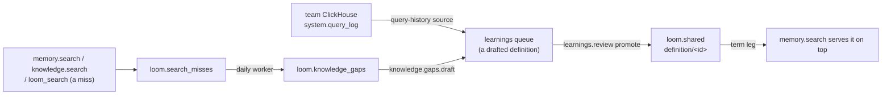

# Curation loop design

This page is the design of the curation loop, which turns what people ask into definitions
an organization stands behind. Searches that find nothing become knowledge gaps. A gap, or
a query a team runs often on its own ClickHouse, becomes a drafted definition in the
learnings queue. A definition an admin promotes into the shared layer is governed: when a
query names its term, `memory.search` serves it above every other hit, a derived
aggregate's count aside. The parts land in this order: knowledge gaps (recording, grouping
and the list), governed definitions (the shared-layer changes and the term leg), then
`knowledge.gaps.draft` and query history, which queue definition drafts and so need the
review path the second part builds. Knowledge gaps are built and described in [knowledge
gaps](../architecture/knowledge-gaps.md); the rest is not built yet, and none of its ops,
tables or settings are served until the pull request that builds each part lands. That
pull request moves its part into `docs/architecture/`, written as what Loom does, and
removes it here.

## Governed definitions

A definition is a memory row with `memory_type = 'definition'` under a `definition/` key.
The key does not encode the term: the review path picks it (below), a direct caller
chooses it, and it stays the same through every revision. At promotion, names decide
whether two definitions clash: the name check below keeps two shared definitions from
holding one name. At write time, rows stay told apart by key, as for any key-identified
type.

A name is compared in its folded form: format characters (Unicode category Cf, such as a
pasted byte-order mark) dropped, then `canonical_document_text` (`server/core/hashing.py`:
NFKC, trimmed, every run of whitespace made one space), then `str.casefold`. One helper in
`server/memory/domain/definitions.py` folds a name, and its unit tests pin each step with
a table. The folded form decides whether two names are one (`SAT`, `Sat` and `sat ` are);
matching against a query keeps the case rule of the term leg below.

A definition's value is a JSON object, which `memory.set` stores whole in `value` and in
`value_json` (the embedding reads its excerpt, as for any row):

| Field      | Meaning                                                                     |
| ---------- | --------------------------------------------------------------------------- |
| `term`     | The name as people write it.                                                |
| `aliases`  | Other names for the same thing (an abbreviation, an older name).            |
| `body`     | The definition's text.                                                      |
| `rests_on` | What it is based on: for query history, the SQL and its tables and columns. |

The admin who promotes a definition answers for it (`promoted_by`, stamped from the
token); the value names no owner, so it holds no person's name for an erasure to miss.

A definition is **governed** while three things hold, checked when the term leg reads it:
a live `loom.shared` row of type `definition` under a `definition/` key exists; its
provenance (`promoted_from`) names exactly one source, the namespace-wide row under that
key (`user_id`, `agent` and `session_id` all `'-'`); and that source is live (`status =
'active'`, not tombstoned, superseded, or past its `expires_at` or `valid_to`), neither
labelled nor graded `medium` or `high` (the value itself is graded, since some write paths
store the label empty), and holds the same text as the shared copy: the hash of the
source's value as read equals the hash of the shared `value`, both the canonical-JSON hash
every read and precondition compares (`served_content_sha256` in `server/core/hashing.py`,
which the approved-content check below uses too), so a store that orders an object's keys
differently is not a change. The source is read from the memory authority (Postgres when
it holds live memory, [storage authority](../architecture/storage-authority.md)), and a
source whose head cannot be read fails closed: the definition is not served. A read-time
check covers every path into that state that it can see, rows promoted before this design
and through N-1 included; what it cannot see is named under rolling upgrades. The shared
layer already is the namespace's admin-approved copy of a fact ([the shared
layer](../concepts/identities-and-namespaces.md#agent-written-rows-and-the-shared-layer)):
`memory.promote` and `memory.demote` need `admin`, the shared row records its source
(`promoted_from`) and the candidate it came from (`promoted_from_candidate_id`),
`memory.lineage` walks it back, and every build knows it. So governance needs no table or
state of its own. An edit, a relabel to `medium` or `high` or a tombstone of the source,
by any writer or worker on any build, ends governance while the source differs from what
the admin approved; a copy that keeps the text (the entity pass, a touch) keeps it, and a
source that returns to the approved state (a restore, an edit reverted byte for byte) is
governed again with no new promotion. A relabel back from `medium` or `high` does not
bring back the shared embedding it retired: the term leg serves the definition again, and
an admin promotes it again to restore the copy's search row. `memory.demote` ends
governance; the demoted source stays a plain namespace-wide row, which ordinary search
still serves until the admin deletes it, and a later draft of its term is a new term under
a new key. Only `memory.promote` promotes into `loom.shared` (the op and
`learnings.review`'s path through it; demote, erasure, a redact and a relabel to `medium`
or `high` only retire or scrub there, as the changes below say); no worker promotes on its
own. An admin read, `memory.definitions.list`, lists the namespace's shared definitions
with the read-time check's verdict on each and the reason a lapsed one lapsed (its text
changed, it is `medium` or `high`, gone, expired, past its `valid_to`, promoted from a row
that is not the namespace-wide one, or no longer `active`). A definition that passes the
check but loses one of its names to another promotion that wins it under the rule below is
`shadowed` for each name it loses, naming the winner of each; it is still served for the
names it keeps. A definition beyond the term leg's read when a namespace holds more than
the ceiling (the most recently promoted are read) is `capped`, and no other verdict is
computed for it. Each entry carries its key, `promoted_at`, `promoted_from_candidate_id`
and a `capped` flag; an entry that is not `capped` also carries its term, aliases, the
check's verdict with its lapse reason and a list of (name, winner) pairs for the names it
lost. A `capped` entry's source is not read. A changed text is promoted again. On N no
automatic verdict retires or marks a definition's source (the exemptions below, and the
negative-outcome quarantine of `memory.outcome`, which skips a definition's namespace-wide
row as it skips a locked one; `memory.outcome_run` records harm events and quarantines
nothing), so a source that is no longer `active` was rejected by a writer, or left that
way by N-1 or before this design. The sensitivity sweep can still relabel a source, which
lapses it as a relabel does. The admin brings it back by the way it lapsed:

- retired automatically: `memory.restore` (`memory.auto_retirements` lists such
  retirements);
- marked `conflicted`: `conflicts.resolve`;
- marked `duplicate`: `memory.dedup_resolve`;
- rejected with `memory.reject`, or replaced by a writer's `memory.copy_to` (which resets
  the row's pin and lock), a writer's explicit act like an edit: written again;
- past its `expires_at` or `valid_to` (a row written before this design, or by a writer):
  written again with `clear_expiry` and no `valid_to`, or by reviewing a pending draft of
  the term, which treats such a head as no head.

It is governed again when its text is the approved one, and is promoted again otherwise.

Namespace erasure reaches `loom.shared`: its `shared.tombstone` step takes every promoted
row of the namespace and its census counts them, beside the user erasure's match by
provenance.

The shared layer needs these changes for this, each in the pull request that adds the term
leg except where a change names another, because the term leg serves shared rows to every
reader:

- **A redact** of a past version of a definition's source (`memory.redact` refuses the
  live head) reaches two things, and no more:
  - the shared row whose `value` has the version's served hash (read from the version
    before the scrub, or, when an older build already scrubbed it, the `content_sha256`
    the redact keeps, so a redact run again still finds it): its text is scrubbed and its
    embedding retired, which a redact does not reach today;
  - every `knowledge_gap` and `query_history` candidate whose drafted value has that hash,
    or that the version's `candidate-id:` tag names, promoted or not: its text is blanked,
    since `learnings.list` shows it to admins, and a blanked candidate is not promoted
    (`learnings.review` answers it not found, as it does a blanked `assistant_turn`
    candidate today); the pull request that adds those candidate kinds adds this part;
  - nothing else: no other draft of the term, and neither the shared copy nor the drafts
    when the live head still holds the redacted text (an edit reverted byte for byte), as
    `memory.redact` leaves a live copy of a text it scrubs from history.
- **A relabel to `medium` or `high`** of a promoted definition's source, by a writer or
  the sensitivity sweep, retires that row's shared embedding, keeping the row:
  `loom.shared` has no sensitivity of its own, so the ordinary legs would otherwise keep
  serving the copy, and no sweep removes a durable row its writer did not ask to remove.
- **The promotion rules** for a definition are built: the approved hash, the source and
  key, the `medium` refusal, the name check and its ceiling, `promoted_by` from the token,
  no candidate id or approver on the wire, no `check_against_shared`, and no
  `learnings.review` promotion of a `definition` candidate ([the shared
  layer](../concepts/identities-and-namespaces.md#agent-written-rows-and-the-shared-layer)).
  The pull request that adds the `knowledge_gap` and `query_history` candidate kinds lets
  the review promote those through the path above.

Should two shared rows match one name despite that refusal (two promotions racing, or one
promoted through a build without the check), the term leg serves, among the rows the
read-time check passes, the one with the latest `promoted_at`, a tie within its second
settled by `promotion_event` (the same order picks the rows the term leg reads past the
ceiling): one fixed winner, not necessarily the later of the two. A rewrite of a shared
row that is not a promotion, such as a scrub, does not count.

A caller may already write rows of type `definition`; they are governed only once an admin
promotes them. A definition is key-identified and is judged against no row under another
key, and only a write of its namespace-wide row revises that row
([conflicts and refusal](../features/memory/conflicts-and-refusal.md)). Conflict surfacing
compares a row only with rows of its own `memory_type`, so a learned fact that contradicts
a definition is not flagged against it. The term leg serves the governed
definition above such a fact; a cross-type check would add a candidate read to every write,
and is not part of this design.

### The term leg

`memory.search` gains one leg, which runs wherever `memory.search` runs, inside
`memory.ask` and `context.pack` as well. It covers memory only: knowledge has its own
exact-key leg for identifiers a document defines
(`server/knowledge/domain/exact_keys.py`), and a definition's `rests_on` already points at
the documents behind it. `loom_search` serves the leg through its memory section.
`governed` and `term_leg` are added output fields, which the SDKs and the MCP schema
carry.

**What it reads.** The addressed namespace's live `loom.shared` rows of type `definition`
under a `definition/` key, from that namespace only, whatever `namespace_scope` fans out
over. It serves no definition whose source is labelled or graded `medium` or `high` (the
read-time check above). A namespace holds at most `memory_term_leg_max_definitions`
definitions: a promotion that adds a key past that ceiling is refused (a revision is not,
unless the namespace is already past it), `memory.definitions.list` shows the count
against it, and an admin demotes a definition to make room, so the leg reads every one.
`loom.shared` stores a value as one string, so the leg reads every definition's full
`value`, `rests_on` included, to match its `term` and `aliases`; the ceiling is what
bounds that read. It computes the served hash and reads the source for the matched rows
only. A read that still finds more (a race, or rows promoted through an older build) reads
the most recently promoted (by `promoted_at`, then `promotion_event`) and reports
`term_leg` `capped`, which also keeps a `memory.search` from recording a miss. It runs
concurrently with the other legs under its own time bound (`memory_term_leg_timeout_ms`),
which never shortens theirs; a leg past its bound adds nothing. Its latency is measured
against the op's budget (`OP_BUDGETS_P99_MS` in `server/settings/catalog.py`) in the pull
request that adds it.

**Matching.** The query goes through `canonical_document_text` and loses its format
characters, as a name does, so `MRR` matches the full-width `什么是ＭＲＲ` and `churn rate`
matches a query that puts two spaces between the words; only case follows the per-word
rule below. Every combining mark (category M) is first joined to the letter or number
before it (with any marks already joined to that), in the term and in the query, and a
joined character takes its base's place in the rules below. A mark with no letter or
number before it joins nothing and counts as punctuation. A term or alias then matches
where it appears in the query, at whole joined characters, with no character next to it
that continues its edge:

- next to a Latin letter (accented ones included), digit, `_`, `+` or `#`: another of
  those;
- next to a letter of another script written with spaces (Cyrillic, Greek, Devanagari):
  any letter of a script other than Latin, or any decimal digit, so `मत` does not match
  inside "कीमत", `कम` not inside "कमी" (whose `म` carries a mark) and `बिक्री` not inside
  "बिक्रीकर";
- before Hangul, a Hangul syllable, so `매출` does not match inside "판매출고"; after it,
  nothing, since Korean particles attach to the word before them;
- next to a script written without spaces (Han, Kana, Thai, Lao, Khmer, Myanmar) or
  punctuation: nothing, so `ยอดขาย` matches in "ดูยอดขาย", while `ก` does not match inside
  "กิ", whose `ก` carries a mark.

So `рост` does not match inside "простой" and `café` not inside "cafés", while `MRR`
matches in "什么是MRR", `ARR` in "ARR은" and `매출` in "매출은 얼마야". Case is decided per word of
the name, a word being a run of joined letters and numbers (Unicode L and N, with their
marks): a word written all in capitals, or with a capital after its first letter, matches
only as written, and any other word matches case-folded. So `IT` does not match "what is
it" and `GitHub` stays exact, while `Churn Rate` matches "what is our churn rate" and
`ARR growth` matches "ARR Growth" but not "arr growth".

**Placement.** Matched rows go to the top of the served list with `governed = true`, in
the order their names first appear in the query. Two names that start at the same place
put the longer first, so `ARR growth` comes before `ARR` in "what drove ARR growth"; a tie
past that goes to the latest `promoted_at`, then `promotion_event`, as for one name. Any
other hit under the same key in the addressed namespace is removed, so an edited private
copy is not served beside the governed text. A derived aggregate's synthetic row
(`derived_aggregate`, an exact count over the namespace's rows) stays first, above the
governed hits, as the response documents it. No later stage or floor of `memory.search`,
`loom_search` or the ops that run `memory.search` reorders governed hits, moves one below
a hit that is not governed (that row aside), or drops one in favour of such a hit, a stage
added later included. No floor, threshold or filter removes a governed hit either: not
`min_similarity`, the precision floor, the foreign margin, a calibration drop or
`loom_search`'s `drop_loom_output`, which drops hits that read like Loom's own output,
since its score says nothing about whether the admin's definition answers the question. A
search in any op that serves a governed hit is not a miss. Governed hits count within
`top_k`, within a stage's cap on the memory section (the tracker verdict's
`verdict_leads`, which keeps `VERDICT_MEMORY_MAX` memory hits) and within the token
budgets (`body_budget_tokens`, `context.pack`'s block budget). A cap cuts governed hits
last: when more match than fit, the later ones in query order are not served. A budget may
shorten a body but never reorders the hits.

**Scores.** A governed hit's `similarity` and `distance` are its shared embedding's to the
query; when it has none, `similarity` is `0` and `distance` is `1`, since similarity is
one minus distance, and `governed` marks the hit; and its `rank_score` is above the
pool's; its `below_threshold` flag is never set. A response that serves a governed hit has
`abstain` false and no `abstain_code`; `retrieval_confidence` and `retrieval_risk`
describe the hits that are not governed.

**Pages and fields.** The leg runs only on a search's first page. The list a search parks
for its later pages is the merged one, governed hits first, so the next page starts after
the rows page one served and no ordinary hit is skipped. The leg is off when a field asks
for other content: any `memory_type` (`definition` is not one of its values); `tags` or
`category` filtering, not with `tags_soft` or `category_soft`; `as_of`; `min_body_chars`;
and `recent_first` or `anchor_first` above 0, whose rows are documented to come first. A
field that only says whose rows to read keeps it on, since a definition is the
namespace's: an `agent`, `run_id`, `session_ids`, or a `user_id` or `session_id` in the
body or pinned by the read scope, as `context.pack`'s per-prompt recall sends. So do
`scope`, `exclude_keys` and `min_similarity`, a soft tag or category and `entity_filter`,
which only boost rows. It drops any key in `exclude_keys`.

**`term_leg`** says what the leg did: `complete`; `empty` when the namespace holds no
definition; `capped` or `timed_out` past its bounds; `failed` when any of its reads failed
(the definitions, or a source that then failed closed and withheld a definition); and
`off` when a page handle or a field turned it off, or the query is not valid Unicode,
which the leg skips rather than fail the search (such a query records no miss either).

**Read scope.** Governed definitions are served through this leg under any read scope: an
admin published them for every reader of the namespace, and a user-bounded reader who
could not see one would read the term as undefined. This is an exception to the read-scope
rule that a bounded read serves no namespace-wide row ([read scope inside a
namespace](../concepts/identities-and-namespaces.md#read-scope-inside-a-namespace)), for
governed definitions through this leg only. The implementing pull request updates that
page, and in `server/identity/domain/read_scope.py` the module docstring and the comment
on `SCOPED_OPS`, which say every memory read of those ops carries the read scope.

**Memory scope.** The leg also serves shared rows to a search with `scope = "private"`,
the default, whose fact leg today reads only private rows (its key-match arm, anchor pool
and digest descent already reach shared ones): a governed definition answers every search
that names its term. This is a second exception, for governed definitions through this leg
only. The implementing pull request updates the `scope` field's description in
`server/memory/api/models_search.py`, the shared-layer section of [identities and
namespaces](../concepts/identities-and-namespaces.md#agent-written-rows-and-the-shared-layer)
and the generated operations reference.

**Stored answers.** `memory.ask`'s ordinary precedent path reruns retrieval and reuses an
answer only when its synthesis window is the same, so a governed hit entering or leaving
the window already stops the reuse. Its fast path, which the ClickHouse authority runs,
reuses an answer while the namespace's write mark has not moved, and that mark does not
cover `loom.shared` today. So every write of a definition's shared row (promote, demote, a
scrub, an embedding retired) moves the namespace's memory write mark, and no answer from
before a promotion or demotion on N is reused after it; rolling upgrades below covers
N-1's. A lapse with no write, a source passing its `expires_at` or `valid_to`, does not
move the mark, and the precedent path's evidence check compares each cited row's live hash
(catching a tombstone, a redaction or an edit), not its status or validity. An answer that
quoted such a definition is reused for up to `memory_ask_precedents_fast_max_age_hours`
(with no bound when it is 0), as for any row that expires today.

**Ranking-neutral rule:** when no governed term matches, the leg adds nothing and the
served list is exactly what it was before. The memory-plane rule asks for a paired
benchmark when a similarity gate or a rank weight moves; this leg moves neither. It
inserts rows only on a term match. So the pull request that adds it shows, on the offline
harnesses, that served keys and order are identical for every query naming no term, and
reports the gain on a small set of term queries.

## Knowledge gaps

Recording misses, grouping them and `knowledge.gaps.list` are built: [knowledge
gaps](../architecture/knowledge-gaps.md). What the later parts add to them follows.

A `memory.search` that served a governed definition records no miss, and one whose term
leg did not finish (`term_leg` anything but `complete` or `empty`, so `off` too: a field
that turns the leg off, such as `recent_first`, also keeps the search from recording a
miss) records none either, so a defined term is never recorded as a gap because its leg
was cut. Once a document can be hidden from some readers (the `mirrored` access of
[document sources](../architecture/document-sources.md)), a `knowledge.search` or
`loom_search` that left out a document its reader may not see records no miss.

### Ops and dashboard

The parts land in the order the opening section gives: 1 knowledge gaps, 2 governed
definitions, 3 `knowledge.gaps.draft` and query history.

| Op                                                | Part | Role  | What it does                                                                                                                                                                                                                                                                                                                                               |
| ------------------------------------------------- | ---- | ----- | ---------------------------------------------------------------------------------------------------------------------------------------------------------------------------------------------------------------------------------------------------------------------------------------------------------------------------------------------------------- |
| `knowledge.gaps.list`                             | 1    | admin | Built: [knowledge gaps](../architecture/knowledge-gaps.md).                                                                                                                                                                                                                                                                                                |
| `memory.definitions.list`                         | 2    | admin | The namespace's shared definitions, a page at a time (a limit and a cursor), each with its key, `promoted_at`, `promoted_from_candidate_id` and a `capped` flag, and, unless `capped`, its term, aliases, the read-time check's verdict and lapse reason and its `shadowed` (name, winner) pairs; and the count against `memory_term_leg_max_definitions`. |
| `knowledge.gaps.draft`                            | 3    | admin | Drafts a definition for one gap with the LLM from its queries alone, and queues it (`source_kind = 'knowledge_gap'`).                                                                                                                                                                                                                                      |
| `knowledge.query_history.add`, `.list`, `.remove` | 3    | admin | Register, list and remove a query-history source on the namespace.                                                                                                                                                                                                                                                                                         |

The `knowledge.gaps.` ops list what users asked and the `knowledge.query_history.` ops
manage a source, not documents, so none honours a read-narrowed token: the check that
admits the `knowledge.` group to such a token (`honours_read_scope` in
`server/identity/domain/read_scope.py`) refuses both prefixes first. A draft queued from a
gap holds the drafted definition and the gap's id. With `knowledge_gaps_enabled` off,
`knowledge.gaps.draft` answers not found for any gap. The LLM drafts it from nothing but
the gap's queries, each asked in that form by at least `knowledge_gaps_min_askers` askers.
Its words are the model's, but nothing else reached the model, which is why it outlives a
user erasure. The queries reach it case-folded, so the model chooses the term's capitals,
and they decide how the term leg matches it (`IT` only as written, `it` case-folded); the
reviewing admin checks them, and when they are wrong rejects the draft and writes and
promotes the definition directly (`memory.set` of the namespace-wide row, under the key of
the live shared definition that holds the term, governed or lapsed, when one does, then
`memory.promote`). The model may repeat a query word for word, so `learnings.list` shows a
`knowledge_gap` draft to the namespace's admins only, the readers of the gaps list. A
gap's id has at most one draft: the candidate's id derives from the gap's id, and the
draft claims that id before its LLM call (a claim row, as `run.begin` claims a run), so a
second `knowledge.gaps.draft` for it, sent alongside or later, answers the claimed
candidate, pending or decided, without an LLM call or a new queue row, and a decision is
never overwritten. The query-history turn claims its drafts' ids the same way, so two
copies of a pass running at once draft each group once. A gap whose most asked query
changes between builds gets a new id, and so may get a second draft. The Library page
shows a gaps tile for a namespace the viewer administers, with a **Draft definition**
action per gap.

## Definitions from query history

A query-history source reads `system.query_log` from a team's ClickHouse into one
namespace's learnings queue. It is off by default (`knowledge_query_history_enabled`): the
operator opts in, as for gaps. It is registered on that namespace by its admin, in a
registration of its own: not a document source, whose config never holds a host and which
writes documents, and not a tracker source, which needs the record contract and the
tracker org. It reuses the tracker's connection checks: the host vetting, a read-only user
(granted `SELECT` on `system.query_log`), the credential encrypted, a time budget and a
breaker on every read ([tracker plane](../features/tracker/overview.md)), through
`knowledge.query_history.add`, `.list` and `.remove`, as `tracker.source.*` registers a
tracker source. The registration names the databases it covers, so a source on a shared
cluster drafts only from its team's own tables. Each turn:

1. reads finished `SELECT` queries of the source's window whose `databases` are not empty
   and all lie within the registration's (a query touching any other database, or none, is
   not read), from every replica when the registration names the cluster
   (`clusterAllReplicas`) and from the node it connects to otherwise, grouped by
   `normalized_query_hash`, counting initial queries only (`is_initial_query = 1`) by
   `initial_user`, ranked by distinct users and then by recency, and drops a group that
   fewer than `knowledge_query_history_min_users` distinct users ran (a setting of its
   own, never below three, since it counts accounts, not people). A user here is a
   ClickHouse account, not a person: the threshold holds only where each person queries
   under their own account, and a shared account (a BI tool's, a service's) counts as one
   asker however many people stand behind it, while one person with several accounts
   counts once per account. The threshold is a floor against drafting from one account's
   queries, not an anonymity guarantee. Only the normalised text is read, with comments
   removed and literals replaced (`normalizeQuery`), so no user's literal values reach the
   LLM or the draft;
2. skips groups already drafted (a draft's id derives from the source and the hash);
3. asks the LLM to draft a metric definition for at most
   `knowledge_query_history_max_drafts` groups, and queues each
   (`source_kind = 'query_history'`): the metric's name is the `term`, its meaning the
   `body`, and the normalised SQL and the tables and columns it reads go in `rests_on`.

`clusterAllReplicas` is a table function: a cluster registration accepts the `REMOTE`
grant it needs beside the tracker's read-only list, which already allows `CREATE TEMPORARY
TABLE`, and the read runs under `readonly = 2`, as the tracker's `remoteSecure` reads do.
Nothing reaches search until an admin promotes a draft. Promotion publishes the whole
value, `rests_on` and its normalised SQL included, to every reader of the namespace,
read-bounded tokens too, so the reviewing admin approves that text for all of them. A
`query_history` draft holds the team's normalised SQL and the tables and columns it reads,
which the asker threshold does not cover, so `learnings.list` shows those candidates, like
`knowledge_gap` ones, to the namespace's admins only, where it shows other learnings to
every viewer.

## Promotion

`learnings.review` with `promote` on a `knowledge_gap` or `query_history` candidate first
runs `memory.promote`'s name check (the count, the ceiling's two refusals, then the term
and aliases against every other live shared row of type `definition`, from which it also
takes a revision's key), checks the draft for a credential-shaped value
(`value_reads_high`), and checks the rollout gate, so a promotion these refuse writes
nothing. Then it writes the definition through `memory.set` for the whole namespace
(today's seeder path writes under the approver's `user_id`; the implementing pull request
writes the namespace-wide row), with no expiry: the write clears any `expires_at` the head
carried and takes no type retention, so a definition stays until an admin demotes it. A
value that grades `medium` is refused before the write, as the promotion would refuse it.
The write declares `source_class = derived`, the downgrade a caller may declare (an LLM
drafted it; the admin's promotion is the approval, not its authorship), so the blacklist
and the pinned-key check run as for any write. Then the review promotes that row into the
shared layer through `memory.promote`, with the reviewer's server-stamped actor as
`promoted_by` and the candidate's id ([learnings review
queue](../features/memory/procedures-and-learnings.md#learnings-review-queue)). The admin
promoting a definition is the person standing behind it. A draft for a term a live shared
definition already holds, governed or lapsed, revises that definition: the review writes
under the key of the live shared definition whose folded term or alias equals the draft's
term, and the promotion replaces its shared row. When more than one live shared definition
holds the name, the review is refused and names them, so the admin demotes all but one. A
draft for a new term is written under the key its queue row carries (`memory_key`):
`definition/` and a random id drawn when the draft claims its candidate id, so every retry
of one review uses one key, and a draft queued again after a rollback gets a new one.
`learnings.list` shows that key; for a revision the review writes under the matched shared
definition's key instead, which the listed key does not name; the admin finds it in
`memory.definitions.list` by its term, and each entry there carries the
`promoted_from_candidate_id` the shared row holds. A definition promotes to memory only; a
`destination` of `knowledge` or `both` is refused for these candidates. A draft rejected
before any promotion attempt leaves nothing behind but its queue row. Between the write
and the promotion the row is an ordinary namespace-wide row, which the ordinary legs read
for those moments. A `memory.set` answering `PUBLICATION_PENDING` has committed the write
(the authority serves it), so the review carries on with the promotion. A promotion
refused after the write (a racing edit or a racing term) undoes the review's own write,
with `if_match_sha256` against the version it wrote, so a row a writer changed since is
left to that writer, and leaves the candidate pending. For a revision it writes the
previous head's text back, so the old definition is governed again with no new promotion;
for a new term it tombstones the row with `memory.delete` and `if_match_sha256` against
the version it wrote, a precondition the implementing pull request adds to `memory.delete`
as `memory.set` has it, so a writer's edit made since is never deleted.

Every attempt, the first and each retry, decides from the head it reads, checking these in
order, the first that matches deciding:

- a head that is live and `active`, carries neither `expires_at` nor `valid_to` and whose
  text hashes to the draft's is promoted without a write, pinned or locked or not, since
  nothing changes;
- such a head that carries an `expires_at` or a `valid_to` is written again without them
  (`clear_expiry`, no `valid_to`) and with `if_match_sha256` against it, unless pinned or
  locked (the next case), so neither keeps a definition from being governed; every write
  the review makes sets no `valid_to`;
- a pinned or locked head refuses the review, as a pinned key or a lock refuses a changed
  value; the admin unpins or unlocks it (`memory.unpin`, `memory.unlock`) and reviews
  again;
- a live, `active` head holding the shared copy's text is written with `if_match_sha256`
  against that head;
- no head is written with `if_absent`, a precondition the implementing pull request adds
  to `memory.set` that refuses the write when a live row holds the key, so a writer who
  creates the row first is never overwritten; a head past its `expires_at` or `valid_to`
  is no head here, since no read serves it;
- a live row with no shared copy (a caller may write `definition` rows) refuses it; the
  admin rewrites that row with `memory.set` to the draft's text, with `clear_expiry`, and
  reviews again, which the no-write case then promotes;
- any other head is a writer's edit, or a head the read-time check would not serve
  (`conflicted`, `duplicate`), and the review is refused rather than overwrite or promote
  it; the admin rewrites the row with `memory.set` to the draft's text, with
  `clear_expiry`, and reviews again, which the no-write case then promotes (a `memory.set`
  revision clears a `conflicted` or `duplicate` mark; `memory.update` without an embedder
  keeps it), or rejects the draft and writes and promotes the definition directly.

A retry so completes the promotion. Rejecting the draft instead leaves any row a writer
wrote, which the admin restores from the row's history or promotes.

A review can stop between its write and its promotion, for example when its replica stops
during a rolling deploy. The drafted text is then the namespace-wide row's head and the
candidate stays pending. For a revision, the old definition stops being served at once,
since the source no longer holds the shared copy's text. `memory.definitions.list` shows
it lapsed because its text changed, and `learnings.list` still shows the pending
candidate. Reviewing the candidate again promotes the head without a write (the first
case above). Rejecting it leaves the row as it is. For a revision, the admin writes the
previous text back from the row's history, which governs the old definition again. For a
new term, the row is an ordinary namespace-wide `definition` row that the ordinary legs
serve; the admin deletes it (`memory.delete` with `if_match_sha256`) or keeps it as a
plain row.

`learnings.review` promotes a definition only from a `knowledge_gap` or `query_history`
candidate, and refuses a candidate of another kind whose type is `definition` with
`VALIDATION_FAILED`, naming `memory.promote` of the namespace-wide row as the way to
govern it. A `memory_supporters` candidate promotes a writer's own row, which the
namespace-wide rule refuses. A `conversation_seeder` candidate goes through `memory.set`
from text drawn from a conversation, which no approved-hash check covers.

## Erasure and audit

- Definitions are memory and shared-layer rows and take every path those take, with the
  shared layer's namespace erasure and the redact this design adds: tombstone, demote,
  redact, namespace erasure, history, audit. A user erasure tombstones a shared row whose
  provenance names the user (`shared.tombstone`); a definition promoted from the
  namespace-wide row names none, so erasing the admin who promoted it leaves it governed,
  and `promoted_by` on the shared row, which today holds the body's `approver` and this
  design stamps from the token, names that admin and is kept through a user erasure, as
  the audit log keeps its actor.
- A redact of a past version of a definition reaches that version, the shared row holding
  its text, and the `knowledge_gap` and `query_history` candidates whose draft is that
  text or named by its `candidate-id:` tag (the change above), not the gap it came from,
  which holds only normalised queries enough askers asked and expires after 7 days.
- `loom.search_misses` and `loom.knowledge_gaps`: [knowledge
  gaps](../architecture/knowledge-gaps.md#erasure).
- A query-history registration (`loom.query_history_sources`) holds a host and a sealed
  credential but no memory content, so it gets no census row. A namespace erasure still
  deletes it, through the step `query_history_sources.delete`, since a registration that
  outlived its namespace would keep reading that team's queries into a namespace being
  erased. `server/erasure/store/census.py` holds the three lists: the census substrates
  (`_CENSUS`), `STEP_ONLY_TABLES` and `NO_MEMORY_CONTENT`. A step with no census row must
  be listed under its step in `STEP_ONLY_TABLES`
  (`tests/unit/test_erasure_resume_reopens_steps.py`), and no table in `_CENSUS` or
  `STEP_ONLY_TABLES` may also be in `NO_MEMORY_CONTENT`
  (`tests/unit/test_every_table_is_classified.py`), so the table goes there.
  `loom.qa_sources`, the tracker's registration, has no step and is in `NO_MEMORY_CONTENT`
  as configuration holding no memory or record content.
- A direct `memory.promote` writes its audit row; a promotion through `learnings.review`
  writes the review's row, which names the candidate, and the implementing pull request
  adds the promotion's own row there. `knowledge.gaps.draft` writes one naming the gap,
  and `knowledge.query_history.add` and `.remove` each write one whose subject is the
  registration's name and host, never its credential.

## Cost bounds

The new settings and their defaults. The implementing pull requests measure each against
the op budgets before they ship it.

| Setting                                  | Default      |
| ---------------------------------------- | ------------ |
| `memory_term_leg_max_definitions`        | 500          |
| `memory_term_leg_timeout_ms`             | 50           |
| `knowledge_query_history_enabled`        | off          |
| `knowledge_query_history_min_users`      | 3, never < 3 |
| `knowledge_query_history_max_drafts`     | 20 per turn  |
| `knowledge_query_history_window_days`    | 7            |
| `knowledge_query_history_read_timeout_s` | 30           |

- `knowledge.gaps.draft` and a query-history turn make one LLM call per draft, a turn at
  most its setting's number. Both honour the org's switch for model calls and run inside
  the namespace's daily cost cap (`server/observability/budget.py`), read fail-closed
  (`fail_open=False`) as the conflict resolver reads it: over the cap, or with the cap
  unreadable, a draft is refused and a turn ends early, and the next one resumes.
- A query-history turn's read of `system.query_log` is bounded by its own window (at most
  `knowledge_query_history_window_days`) and time limit
  (`knowledge_query_history_read_timeout_s`), separate from the tracker's live-read
  budget, and a timeout counts against the source's breaker like any tracker read.
- The term leg is one bounded read of the namespace's shared definitions per search (their
  full values, `rests_on` included, at most `memory_term_leg_max_definitions`), one read
  of the matched definitions' source rows, and a grading of each matched source's value,
  on every `memory.search`, every `context.pack` turn and every `memory.ask` sub-search.
- A definition's promotion, through `memory.promote` or `learnings.review`, counts the
  namespace's definition rows and then reads them, at most
  `memory_term_leg_max_definitions` plus one (past it the promotion is refused), to check
  its term and aliases; the review path runs the count and the read twice, once before its
  write and once at the promotion.
- `memory.definitions.list` counts the rows (`count()`), reads the full values of at most
  the ceiling's rows, the ones the term leg reads, to find names held by more than one,
  and marks the rest `capped` from their key, `promoted_at`, `promotion_event` and
  `promoted_from_candidate_id` alone. It returns a page, with a limit and a cursor, and
  reads and grades the source row of each listed definition that is not `capped` and of
  each definition that competes for one of its names.

## Rolling upgrades

The tables are additive ([rolling
upgrades](../architecture/rolling-upgrades.md#the-rules)). N-1's erasure saga does not
know the query-history registration, so it may hold no rows while an N-1 replica serves
(the gap tables follow the same gate, [knowledge
gaps](../architecture/knowledge-gaps.md#rolling-upgrades)). Every op the design adds that
writes or reads a new table (`knowledge.gaps.*`, `knowledge.query_history.*`) and a
`learnings.review` promotion of a `knowledge_gap` or `query_history` candidate answer 503
while any live replica's schema is below N, and also when no heartbeat in `loom.instances`
can be read, as `namespace.guide_set` does (the namespace-guide rule of [rolling
upgrades](../architecture/rolling-upgrades.md)). The gate fails closed: on an unreadable
heartbeat, the query-history turn writes nothing. `memory.definitions.list` reads only
`loom.shared` and the source rows, which N-1 knows, so the N replicas serve it throughout
and it shows the lapses N-1 causes; a call that lands on an N-1 replica is answered as an
unknown op. The operator turns `knowledge_query_history_enabled` on only once no N-1
replica serves, as the assistant-turn learnings rule does for
`memory_extract_agent_learnings`. Governed definitions are memory and shared rows, which
N-1 knows: it serves them as plain rows with no term leg. The read-time check grades the
source's value on every read, so a later build whose detector grades differently changes
which definitions are governed, and two builds serving side by side may disagree on one
row until the older one stops; the build that changes the detector names this in its
rollout notes, as does a build whose Python ships another Unicode version, which can
change whether two names fold to one. Keys do not depend on the fold, so no definition
lapses for it. What N-1 does to them is caught by the read-time check: a promotion from
another source, or an edit, relabel or tombstone of the source, leaves a row the term leg
does not serve, and the term leg's last-promoted rule covers a promotion that skipped the
term check. A promotion on N-1 also skips the approved-hash check and takes `promoted_by`
from the body, which no read-time check can tell, and an N-1 `memory.set` ignores
`if_absent`, and an N-1 `memory.delete` ignores `if_match_sha256`, fields they do not
know, so they write over or delete a live row; the review path that sends them answers 503
while N-1 serves, and a direct caller relies on them only once no N-1 replica serves. Once
none does, an admin promotes again every definition promoted before then, through N-1 or
before this design (`loom.shared` rows of type `definition` by promotion time), since none
of those carried the hash check or a token-stamped `promoted_by`; that promotion on N also
moves the write mark, which N-1's promotions and demotions never move, so a stored
`memory.ask` answer from the rollout is not reused past it (until then such an answer
lives at most `memory_ask_precedents_fast_max_age_hours`, with no bound when it is 0).
N-1, which does not know `definition` as key-identified, can merge, supersede or retire
one definition's source while writing another. Once N serves, each is recovered and
promoted again:

- a source it retired (`memory.auto_retirements` reasons `conflict_resolver`,
  `newest_wins_contradiction`, `value_update` and `same_key_newest_wins`):
  `memory.restore`;
- a source it marked `conflicted`: `conflicts.resolve`; one marked `duplicate`:
  `memory.dedup_resolve`;
- a write it merged: never stored, so written again;
- a source its negative-outcome quarantine of `memory.outcome` rejected
  (`memory.outcome_run` quarantines nothing): written again;
- a source its `memory.consolidate` tombstoned: `memory.restore` within 14 days; past
  them, the definition is written again from its shared copy's text.

An N-1 relabel of a definition's source to `medium` or `high`, or an N-1 promotion of a
`medium` source, which N-1 does not refuse, leaves its shared copy's embedding served by
the ordinary legs: once N serves, the operator runs the retirement N's relabel performs
(the shared embedding retired, the row kept) over every definition the admin read lists as
lapsed for `medium` or `high`, an operator step the implementing pull request's rollout
section names, so a relabel back governs it again as on N. N-1's redact does not reach the
shared row's text, as today: one run during the rollout or after a rollback is run again
once N serves. A namespace erasure an older build without the shared step ran is cleared
as the rolling-upgrades rule "A namespace's promoted rows" says ([rolling
upgrades](../architecture/rolling-upgrades.md)).

A rollback to N-1 meets what N wrote. Before it, the operator turns
`knowledge_query_history_enabled` off, which stops drafts and query-history turns, runs
the gap tables' rollback ([knowledge
gaps](../architecture/knowledge-gaps.md#rolling-upgrades)), and deletes every
query-history registration and every `knowledge_gap` and `query_history` row of
`loom.learnings_queue` whatever its status, as the assistant-turn learnings rule does for
assistant-turn rules; a team re-registers its source once N serves again, and the next
turns draft again the groups whose candidates were deleted, those already governed
included: an admin rejects such a draft, or promoting it revises the definition. The first
N-1 replica to serve closes the gate, so no op or turn of this design writes after it; the
operator runs the same delete once more then, for what N wrote in between.

## Invariants

- A gap shows only queries that at least `knowledge_gaps_min_askers` askers asked in that
  form; a draft is written from nothing but such queries, or, for query history, the
  normalised text of queries `knowledge_query_history_min_users` accounts ran.
- A definition is governed only while an admin's promotion of its namespace-wide row into
  the shared layer is live and the source still holds that text, active, live, within its
  validity and neither labelled nor graded `medium` or `high`; the term leg serves at most
  one definition per name, chosen by the rule above; only governed definitions are placed
  above the served list.
- A query naming no governed term is served exactly as without the term leg.

## Source entry points

- `server/memory/domain/memory_types.py` (`KEY_IDENTIFIED_TYPES`)
- `server/memory/app/search/handler.py` (the legs of `memory.search`)
- `server/memory/app/promote.py` (`handle_memory_promote`)
- `server/memory/app/learnings.py` (`handle_learnings_review`)
- `server/identity/domain/read_scope.py` (`honours_read_scope`)
- `server/observability/budget.py` (`namespaces_over_cap`)

## Related

- [Memory architecture](../architecture/memory-architecture.md)
- [Learnings review
  queue](../features/memory/procedures-and-learnings.md#learnings-review-queue)
- [Conflicts and refusal](../features/memory/conflicts-and-refusal.md)
- [Tracker plane](../features/tracker/overview.md)
