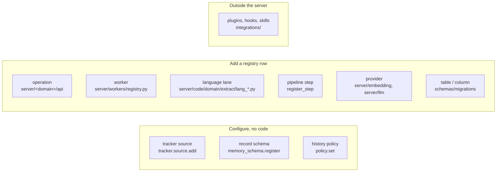

# Extend Loom

Loom has one registry per kind of thing: operations, workers, settings, providers, language lanes, extraction steps and tracker sources. To extend Loom, add a row to the right registry; HTTP, MCP, the SDKs and the generated reference follow.

Check first whether data alone does it. A tracker source, a record schema, a procedure or a history policy is configured, not programmed.

## Choose the extension point

| You want to…                                                 | Extension point               | Where                                                                                            | Guide                                                                  |
| ------------------------------------------------------------ | ----------------------------- | ------------------------------------------------------------------------------------------------ | ---------------------------------------------------------------------- |
| Expose a new capability to callers                           | An operation                  | `server/<domain>/api/ops_<group>.py`, `server/<domain>/app/<group>.py`                           | [Add an operation](adding-an-operation.md)                             |
| Do work in the background on a schedule                      | A worker                      | `server/<domain>/workers/<name>.py`, a row in `server/workers/registry.py`                       | [Add a worker](adding-a-worker.md)                                     |
| Store something new                                          | A table or column             | `schemas/migrations/<NNN>_*.sql`, `server/<domain>/store/`                                       | [Add a table](adding-a-table.md)                                       |
| Index a new programming language                             | A code-index language lane    | `server/code/domain/extract/lang_<lang>.py`, `lang_detect.py`, `server/code/app/index/ingest.py` | [Add language support](adding-language-support.md)                     |
| Change what extraction keeps for some callers                | A pipeline step               | `register_step` in `server/memory/app/pipeline.py`                                               | [Extraction pipeline](../guides/extraction-pipeline.md)                |
| Read a new issue tracker or CI history                       | A tracker source (data only)  | `tracker.source.add` + `tracker.source.set_mapping`                                              | [Tracker record contract](../features/tracker/record-contract.md)      |
| Hold facts with an identity and typed fields                 | A record schema (data only)   | `memory_schema.register`, `memory.record.write`                                                  | [Writing memory](../features/memory/writing.md)                        |
| Restrict what agents may do based on their history           | A history policy (data only)  | `policy.set`                                                                                     | [Tokens and grants](../guides/tokens-and-grants.md#add-history-policy) |
| Use another embedding or LLM provider                        | A provider client             | `server/embedding/`, `server/llm/`                                                               | [below](#add-a-provider)                                               |
| Add a setting                                                | A settings field              | The area's section of `server/settings/catalog.py`                                               | [below](#add-a-setting)                                                |
| Capture sessions from another client, or ship agent guidance | An integration, hook or skill | `integrations/`, `skills/`                                                                       | [below](#add-an-integration)                                           |

## What every extension shares

- **The code is the registry.** Transports iterate `ALL_OPERATIONS`, the supervisor iterates `_WORKERS`, and the settings reference is generated from `server/settings/`. Each registry has a snapshot or census test that fails until you regenerate it.
- **Generated files.** `make lint` runs every generator with `--check`: the SDK op tables (`scripts/codegen/sdk_py_gen.py`, `sdk_ts_gen.py`), the reach manifest (`op_reach_census.py`), the reference pages (`docs_reference.py`, `settings_reference.py`) and the Codex plugin copies (`agent_plugin_sync.py`). See [code generation](code-generation.md).
- **Maturity.** A new op declares `maturity="experimental"` unless it replaces a stable one ([adding an operation](adding-an-operation.md#5-check-reach-and-maturity)).
- **Measurement.** A change to ranking, extraction or a provider default runs the relevant bench before and after ([performance tuning](../guides/performance-tuning.md#measure-first)).
- **Foundational shapes are not extension points.** The engine (ClickHouse), the identity tuple, per-row content-hash audit and the five belief-revision operations change only with a design rationale in the PR and in the architecture docs ([system overview](../architecture/system-overview.md)).

## Add a provider

Embedders and LLMs are clients chosen by settings.

**An embedder** goes in `server/embedding/` beside `openai.py`, `gemini.py`, `local.py` and `fake.py`. It shares the HTTP plumbing in `server/embedding/_provider.py`:

- retries on retryable statuses only, three attempts;
- `EmbedderInputTooLarge` instead of a silent provider truncation;
- `MalformedEmbedding` for an empty, wrong-width or non-finite vector.

Wire it in `server/embedding/embedder.py`: provider inference from `LOOM_EMBEDDING_MODEL` (`_inferred_provider`), the `LOOM_EMBEDDING_PROVIDER` values, and the key variables in `KEY_ENVS`. A missing key falls back to the fake embedder and logs an error.

**An LLM** goes in `server/llm/` beside `openai.py`, `anthropic.py` and `fake.py` and implements `LLMClient` (`server/llm/client.py`). Wire it in `_build_llm_client` and in `DEFAULT_MODEL_BY_PROVIDER`, `KEY_ENV_BY_PROVIDER` and `resolve_llm_provider` (`server/core/llm_provider.py`).

> **Warning:** a provider changes quality. The similarity gates are calibrated to `text-embedding-3-small`. Run `make bench-quick` against a new provider before making it a default. A new embedder needs `loom reembed` on every existing namespace.

## Add a setting

A new field goes in its area's section of `server/settings/catalog.py` (`MemorySearch`, `Code`, `Tracker`, …), the one file every setting is declared in. The comment above it says what it controls and what its values mean; that comment becomes its row in the generated [configuration reference](../reference/configuration.md). The environment name is `LOOM_<FIELD>`.

Read it as `settings.<field>`, never `getattr(settings, "<field>", default)`. `tests/unit/test_settings_attribute_access.py` fails on the latter: a copied default drifts and hides the reader from whoever deletes the field. Regenerate with `python scripts/codegen/settings_reference.py` and `python scripts/codegen/settings_schema.py`.

To retire a flag, delete the setting, its branch and any per-request field that carried it. A client that still sends the field is served, with the field named in `ignored_args`.

## Add an integration

| Integration                               | Where                                                               | Notes                                                                                                                                                                                                                                                                      |
| ----------------------------------------- | ------------------------------------------------------------------- | -------------------------------------------------------------------------------------------------------------------------------------------------------------------------------------------------------------------------------------------------------------------------- |
| A coding-agent plugin hook or skill       | `integrations/claude-code-plugin/` (`hooks/`, `lib/`, `skills/`)    | The source of truth; `python scripts/codegen/agent_plugin_sync.py` copies scripts and skills into `integrations/codex-plugin/`. Wire a new hook into the Codex `hooks.json` by hand. Installed clients pick up a change when the plugin's version in its manifest changes. |
| A session-capture hook for another client | `integrations/<client>/` (`cursor/`, `generic/`)                    | Call `loom ingest-transcript` or `conversation.append`, and `memory.set_from_messages` for extraction.                                                                                                                                                                     |
| A portable agent skill                    | `skills/<name>/SKILL.md`                                            | Installed by name into any Agent-Skills client; guidance only, no hooks.                                                                                                                                                                                                   |
| A framework adapter                       | `sdk/python/loom/integrations/`, `sdk/typescript/src/integrations/` | Wrap the SDK in the framework's store or memory interface (LangGraph `LoomStore` and Strands `LoomMemoryStore` in Python, a Strands adapter in TypeScript).                                                                                                                |
| An observability backend                  | `server/observability/`                                             | Spans already carry `loom.request_id` and export through OTLP; prefer an OTLP collector over a new exporter.                                                                                                                                                               |

[Integrations](../features/integrations/index.md) describes the shipped ones. [Agent integration](../guides/agent-integration.md) covers what any new client should write and read.

## Related

- [Repository guide](repository-guide.md)
- [Testing](testing.md)
- [Contributing](../../CONTRIBUTING.md)
