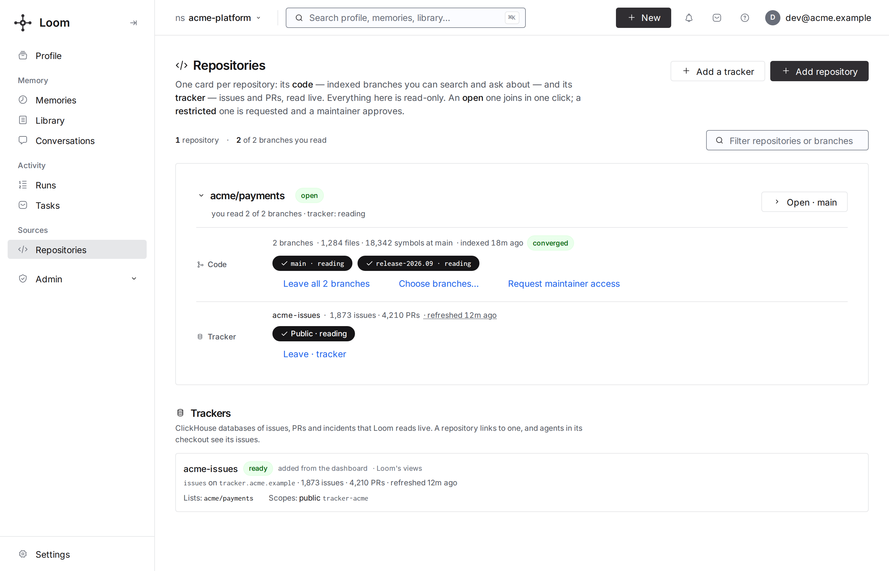
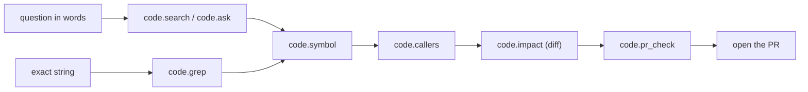

# Code index

The code workers are off by default; a deployment turns them on per repository
([repositories](repositories.md)). The default `core` MCP toolset lists no code tools
unless `LOOM_MCP_CODE_TOOLS=true`; `?toolset=coding` always does.

Loom indexes git repositories into ClickHouse and answers structure questions through
the `code.*` operations: where a symbol is defined, who calls it, what a change
reaches, which merged PR touched a line. Agents call them over MCP, HTTP
(`POST /v1/code.<op>`) or the Python SDK (`agent.code`). Every agent reads the same
rows, so a repository is parsed and embedded once per merge, not once per session. How
the index is built is in
[code index architecture](../../architecture/code-index-architecture.md).



## What it answers

| You want to know                                               | Ask                                                     |
| -------------------------------------------------------------- | ------------------------------------------------------- |
| Where is the code that does X?                                 | `code.search`, or `code.ask` for a cited answer         |
| Where is this exact string, message or identifier?             | `code.grep` (`mode: "message"` for a printed log line)  |
| What is `Foo::bar`, and what does its body say?                | `code.symbol`                                           |
| Who calls it, and what does it call?                           | `code.callers`, `code.callees`                          |
| What does my change reach, and which tests must run?           | `code.impact`, `code.test_gate`                         |
| Which merged PR touched this line, and what did reviewers say? | `code.blame_range`, `code.history`, `code.review_brief` |
| Does a PR like the one I am about to open already exist?       | `code.pr_check`                                         |
| Is the index current enough to answer?                         | `code.index_status`, the `as_of` block on every answer  |

Every op, grouped by task, is on [operations.md](operations.md).

## One namespace is one branch

A code namespace is one repository branch at one commit. Loom keeps a bare git mirror,
walks the branch's first-parent history, and stores what it extracts in `loom.code_*`
tables keyed by `(org, namespace)`.

- Nothing is read from an agent's checkout. Uncommitted and unpushed changes are never
  in the index. A feature branch is indexed only when configured as its own entry.
- Each branch is its own namespace; branches of one repository share one mirror. "Is
  this fix on the release branch?" is a question to that branch's namespace, or to
  several at once (`code.grep mode=presence namespaces=[…]`).
- Names are `[a-z0-9-]`: `code-<repo>` for the default branch,
  `code-<repo>-<branch-slug>` for others (`code-myrepo-2-4`).
- A code namespace has `kind=code`. It holds the repository's team file rules, written by
  its members, and its design decisions, and is hidden from memory pickers. Access follows
  the usual grant rules ([identities and namespaces](../../concepts/identities-and-namespaces.md)).

What the index holds, per namespace:

| Unit                                                            | Table                                                 | Produced by                                                             |
| --------------------------------------------------------------- | ----------------------------------------------------- | ----------------------------------------------------------------------- |
| files and their last parse                                      | `code_files`                                          | fast tier                                                               |
| chunks (functions, class skeletons, file headers, doc sections) | `code_chunks`                                         | fast tier; embeddings also by `code_embed_recovery`                     |
| symbols (definitions, signatures, spans)                        | `code_symbols`                                        | fast tier and compiler tier                                             |
| edges (calls, inherits, overrides, includes, …)                 | `code_edges`                                          | fast tier and compiler tier                                             |
| test → code mapping                                             | `code_test_map`                                       | `code_graph_stats` worker, `loom code crossref`, `code_coverage_import` |
| merged PRs, reviews, issues                                     | `code_pr_history`, `code_pr_reviews`, `code_gh_items` | `code_pr_history` worker                                                |
| per-PR context packs                                            | `code_context_packs`                                  | fast tier                                                               |
| watermarks and worker state                                     | `code_index_state`                                    | every code worker                                                       |
| query traces and outcomes                                       | `code_search_trace`, `code_search_outcome`            | every read op, `code.outcome`                                           |

## Two tiers

Structure is extracted twice. Each symbol and edge names its tier (`tier`: `scip` or
`treesitter`). Where both tiers hold the same row, the compiler row wins.

- **Fast tier.** The `code_ingest` worker diffs the branch from its watermark to the
  mirror's fetched tip and re-parses changed files with tree-sitter and the language
  lanes. It writes chunks, symbols and a heuristic call graph: a call bound in the same
  file has confidence 1.0, through the enclosing class 0.8, by a repository-wide name
  match 0.6. A call it cannot bind is declined, not guessed. Until
  `LOOM_CODE_READY_EMBED_COVERAGE` (0.95) of chunks carry a vector, `code.search`
  answers from its lexical legs and says so.
- **Compiler tier.** SCIP indexes from `scip-clang` (C/C++), `scip-typescript`,
  `scip-python` and `scip-go`, run by the `code_scip_*_delta` workers, with
  `code_scip_full` seeding and re-indexing C/C++ entries (see
  [code index operations](../../operations/code-index-operations.md#compiler-tier)). An
  external producer can upload with `code.scip_ingest`. It gives exact call, override
  and inheritance edges. Its C/C++, Go and TypeScript steps execute the repository's own
  build code; they run inside the
  [repository-job sandbox](../../operations/code-index-operations.md#repository-job-sandbox).

Why two: the fast tier is cheap, so a merge is searchable after one ingest pass. The
compiler tier needs a build environment and trails. Serving both, labelled, gives an
answer at once and an exact one when the compiler tier catches up.

### Workers

| Worker                                          | Default | Does                                              |
| ----------------------------------------------- | ------- | ------------------------------------------------- |
| `code_ingest`                                   | off     | fast tier, per merge; builds self-service entries |
| `code_embed_recovery`                           | off     | embeds chunks the ingest pass left unembedded     |
| `code_pr_history`                               | off     | merged PRs, reviews and issues from GitHub        |
| `code_scip_delta`, `code_scip_{ts,py,go}_delta` | on      | compiler-tier deltas per merge                    |
| `code_scip_apply`                               | off     | applies staged SCIP deltas                        |
| `code_graph_stats`                              | off     | weekly PageRank, degrees, the test map            |
| `code_summary`                                  | off     | weekly LLM file and module summary cards          |
| `code_backport_gaps`                            | on      | nightly backport report; needs `code_pr_history`  |
| `code_coverage_notify`                          | on      | delivers `code.coverage.watch` events             |

Settings and intervals are in the [workers reference](../../reference/workers.md) and
the [configuration reference](../../reference/configuration.md#code).

> **Note: the extractor stamp.** Rows are content-addressed, so an unchanged file
> re-ingests to the same rows even after the extractor code changes. A hash of the
> extractor modules and grammar versions (the stamp) closes that gap: when it moves,
> `code_ingest` re-derives the affected stage for every file in that language family,
> in paced batches. A code change to an extractor module therefore re-indexes every
> repository on the next deploy; comments and docstrings are outside the stamp. Lane
> parsers outside the stamp (TypeScript, Rust, Go, Java, …) need
> `loom code backfill --paths-file` instead. An
> hourly reconciliation also re-ingests files whose rows predate their last change.
> Details: [code index architecture](../../architecture/code-index-architecture.md).

## Language support

A file's language comes from `treesitter.lang_for_path` (C/C++, Python, shell, SQL,
docs, config), then `lang_detect.LANG_BY_EXTENSION` for the lane languages, then
shebangs and shell detection. "Edges" are what `code.callers` / `code.callees` walk.
`code.impact` adds mapped tests and co-change partners, so a language without call edges
still gets file-level impact.

| Language (extensions)                                                                  | Symbols               | Fast-tier edges                                                               | Compiler tier     |
| -------------------------------------------------------------------------------------- | --------------------- | ----------------------------------------------------------------------------- | ----------------- |
| C / C++ (`.c`, `.cc`, `.cpp`, `.cxx`, `.h`, `.hpp`, `.hxx`, `.ipp`, `.inl`)            | yes                   | calls, includes, inherits, overrides                                          | `scip-clang`      |
| Python (`.py`, `.pyi`, `.pyw`, `.ipynb` code cells, `python` shebang)                  | yes                   | calls, imports, inherits, overrides                                           | `scip-python`     |
| TypeScript / JavaScript (`.ts`, `.tsx`, `.mts`, `.cts`, `.js`, `.jsx`, `.mjs`, `.cjs`) | yes                   | calls (including `new`), imports, inherits, overrides                         | `scip-typescript` |
| Vue, Svelte, Astro components                                                          | yes                   | as TypeScript / JavaScript, from the script block                             | —                 |
| Angular component templates (`.component.html`)                                        | yes                   | the component as one unit                                                     | —                 |
| Go (`.go`)                                                                             | yes                   | calls, inherits (interface embedding, structural implementation); SQL islands | `scip-go`         |
| Rust (`.rs`)                                                                           | yes                   | calls, `use` imports, inherits (trait impls)                                  | —                 |
| Java (`.java`)                                                                         | yes                   | calls (imports bind names, no import edges); SQL islands                      | —                 |
| Shell (`.sh`, `.bash`, `.bats`, shebang, rc files)                                     | yes                   | calls (commands), `source` includes                                           | —                 |
| Prisma (`.prisma`)                                                                     | yes                   | model relations                                                               | —                 |
| Protocol Buffers (`.proto`), FlatBuffers (`.fbs`)                                      | yes                   | imports, type uses                                                            | —                 |
| Go templates and Helm charts (`.tpl`, `.tmpl`, `.gotmpl`, templated manifests)         | yes                   | template calls                                                                | —                 |
| Terraform / HCL (`.tf`, `.tfvars`, `.hcl`), Kubernetes manifests                       | yes                   | references (`reads`)                                                          | —                 |
| Jsonnet (`.jsonnet`, `.libsonnet`)                                                     | yes                   | calls, imports                                                                | —                 |
| TLA+ (`.tla`, TLC configs), CMake (`CMakeLists.txt`, `.cmake`)                         | yes                   | includes; TLA+ operators; the CMake link graph                                | —                 |
| Markdown and docs (`.md`, `.mdc`, `.mdx`, `.rst`, `.html`, `.htm`)                     | sections (`.md` only) | relative links, backticked names as `reads` to the code                       | —                 |
| SQL (`.sql`)                                                                           | with a switch         | table references, with statement records on                                   | —                 |
| Host files (Dockerfile, Makefile, Jenkinsfile, CI YAML)                                | with a switch         | invoked scripts                                                               | —                 |
| Config, CSS and other text files                                                       | no                    | none; chunked for search and grep only                                        | —                 |

Switches (all need a `loom code backfill --paths-file` of the affected tree when turned
on for an existing namespace):

| Setting                           | Default | Effect                                                            |
| --------------------------------- | ------- | ----------------------------------------------------------------- |
| `LOOM_CODE_SQL_STATEMENT_RECORDS` | off     | `.sql` as statement records instead of line windows               |
| `LOOM_CODE_PY_SQL_ISLANDS`        | off     | SQL inside Python becomes statements and table edges              |
| `LOOM_CODE_SHELL_ISLANDS`         | off     | SQL strings in shell tests become statements                      |
| `LOOM_CODE_HOST_ISLANDS`          | off     | Dockerfile, Makefile, Jenkinsfile and CI YAML jobs become symbols |

`code.coverage` reports what one namespace holds per language and tier. Read it before
trusting callers or impact for a language. Adding a language:
[adding language support](../../development/adding-language-support.md).

## How an agent uses it



1. **Find.** `code.search` for a question in words, `code.grep` for a string you hold.
   Each hit names its enclosing unit, so you rarely open the file.
2. **Pin the symbol.** `code.symbol` returns definition, signature, body, recent PRs
   and (with `uses_brief: true`) top call sites.
3. **Walk the graph.** `code.callers` with `depth` hops. Read `epistemic` to know
   whether the list is exact or a lower bound.
4. **Measure the change.** `code.impact` with `files` or a unified `diff` returns the
   touched symbols, the tests that reach them, and `co_change_missing`.
5. **Check for a duplicate.** `code.pr_check`: `verdict` is `duplicate_of`, `related`
   or `none` ([history-and-prs.md](history-and-prs.md)).

These are the ops the `coding` toolset lists. `code.callees` and `code.test_gate` are
callable by name or through `loom_op`. Report what you did with the hits through
`code.outcome` (every result carries a `trace_run_id`).

Clients:

- The Claude Code and Codex plugins ([claude-code.md](../integrations/claude-code.md),
  [codex.md](../integrations/codex.md)) resolve the checkout's remote to its code
  namespace, send `X-Loom-Code-Scope: <org>/<namespace>`, list `?toolset=coding`, and
  redirect whole-file reads and tree-wide greps in an indexed checkout to these ops.
  Files the session modified are read locally.
- The `loom-code` skill (`skills/loom-code/SKILL.md`) is the routing guide for other
  Agent-Skills clients.
- The [grep shim](../integrations/grep-shim.md) annotates `grep` / `rg` output with each
  hit's enclosing function.
- In a pipeline, call the ops at fixed steps (triage, ownership, backport presence).

If you expose `code.grep` to your own model, pass `as_of`, `abstain_code`, `note` and
`coverage_floor` with the hits. A model that sees only matches cannot tell an empty
index from an empty repository.

## Reading an answer

Every operation answers with its own typed schema, over HTTP and MCP alike, so an agent
reads fields rather than prose. A `code.search` answer, trimmed:

```json
{
  "results": [
    {
      "path": "src/quota/limiter.cpp",
      "start_line": 412,
      "end_line": 468,
      "symbol": "acme::RequestLimiter::admit",
      "kind": "function",
      "description": "Charges a request against its tenant's window and rejects it once the quota is spent.",
      "tested": true,
      "next": "code.symbol name=acme::RequestLimiter::admit"
    }
  ],
  "next_cursor": "eyJjIjoiN2Q0…",
  "has_more": true,
  "abstain": false,
  "retrieval_risk": "low",
  "retrieval_confidence": 0.71,
  "as_of": { "branch": "main", "status": "fresh", "commit": "4be19c07a" },
  "trace_run_id": "8f0e2c41…"
}
```

`code.symbol` answers definitions with their signature and index tier; `code.callers`
answers call-graph edges with `epistemic` (`exact` or `lower_bound`) and its `causes`;
`code.impact` answers the affected symbols, tests and files; `code.ask` answers prose
inside a structured response with citations. The Python and TypeScript SDKs carry types
generated from the same schemas.

- **Freshness.** Every conversational answer carries `as_of`. Gate on `as_of.stale`,
  not on whether the first build finished ([freshness.md](freshness.md#the-as_of-block)).
- **`abstain_code` before the hits.** An abstain is a statement about the question:

  | `abstain_code`                                 | Meaning                                                                               | Do                                         |
  | ---------------------------------------------- | ------------------------------------------------------------------------------------- | ------------------------------------------ |
  | `""`                                           | answered                                                                              | read the results                           |
  | `no_match`                                     | the literal occurs in no indexed chunk in the scope sent                              | widen the scope; check `coverage_floor`    |
  | `identifier_absent`                            | the identifier missed the symbol table and appears in no indexed chunk                | check the spelling and the branch          |
  | `not_covered`                                  | `path_prefix` lies outside the indexed prefixes (`note` lists them)                   | read locally                               |
  | `pattern_too_broad`                            | a `code.search pattern=` matched more than `LOOM_CODE_SEARCH_PATTERN_MAX_FILES` files | add `langs` / `path_globs` / `path_prefix` |
  | `below_threshold`, `low_calibrated_confidence` | nothing the search trusts for the question                                            | rephrase, or grep an identifier you hold   |
  | `off_domain`                                   | no file of this namespace is near the question                                        | check the namespace                        |

- **`retrieval_risk`** (`low`, `medium`, `high`, `abstain`) is the search's calibrated
  confidence. Treat `high` as leads to verify.
- **Coverage is a floor.** `coverage_floor: true` means the index holds every chunk the
  chunker admitted, not every byte. Files over `LOOM_CODE_INGEST_MAX_FILE_BYTES`,
  vendored and generated trees, and excluded paths are absent. An empty grep does not
  prove absence. A `path_prefix` naming one file asks only that file.
- **Structural ops answer with a verdict.** `code.impact`, `code.outline` (`verdict`)
  and `code.verify` (`index_verdict`) say why an empty walk is empty:

  | Verdict             | Meaning                                                              | `abstain` |
  | ------------------- | -------------------------------------------------------------------- | --------- |
  | `no_indexed_paths`  | no path in the request declares anything (tests, data, config, docs) | false     |
  | `no_seeds_in_hunks` | every hunk falls outside every function                              | false     |
  | `no_static_callers` | the seeds resolved and nothing calls, inherits or overrides them     | false     |
  | `not_covered`       | a source path the index does not hold                                | true      |
  | `no_match`          | nothing resolved and the index cannot say why                        | true      |

  The first three are answers; no fallback grep is needed.

- **`epistemic`.** `code.callers` and `code.impact` answer `exact` when the compiler
  tier covers every seed file, no call site named like a seed was declined, and no
  override seed lacks its base. Otherwise `lower_bound`, with `causes`:
  `unresolved_calls`, `ambiguous_calls`, `dispatch_seeds_missing`,
  `treesitter_only_files`, `external_calls`, `ctor_edges_absent`, `scip_stale_files`,
  `truncated`. History answers are always `lower_bound`. No static index sees dispatch
  through function pointers.
- **Enclosing unit.** Grep hits carry `scope`, `scope_start_line`, `scope_end_line`;
  search hits carry `symbol`, `start_line`, `end_line`.
- **Literal cost.** Literals are answered from a 3-gram index. A rare identifier is
  cheap; a common word or a pattern under three characters touches most of the
  namespace. Use the most specific token you hold, and `mode: "files"` first on a broad
  one.

## Limits

- Only merged code on configured branches. Your working tree is yours to grep.
- The fast-tier graph binds by name and declines ambiguous sites. Languages without a
  compiler tier never answer `exact`.
- Open pull requests are not indexed. `pr_number` on `code.callers` / `code.impact`
  overlays one open PR's post-image when the mirror holds its head
  (`git_fetch_pr_heads`); those edges carry tier `overlay`.

## Troubleshooting

Start with `code.index_status` (watermarks, lags, tiers, worker errors) and
`code.coverage` (what the namespace holds).

| Symptom                                    | Cause                                                     | Fix                                                                   |
| ------------------------------------------ | --------------------------------------------------------- | --------------------------------------------------------------------- |
| a symbol you just added is not found       | uncommitted, unpushed, or not yet ingested                | grep your tree; `code.index_status` shows the lag                     |
| `lag_commits: 0` but merges are missing    | the mirror stopped fetching                               | `clone_fetched_at` / `fetch_overdue`, then `/v1/admin/workers.status` |
| a fix you know exists is not found         | wrong branch namespace                                    | `code.grep mode=presence namespaces=[…]`                              |
| `AUTH_INSUFFICIENT` on every `code.*` call | the token does not name the code namespace                | join the repository, or mint with `--namespaces`                      |
| a call that names no namespace is refused  | no `X-Loom-Code-Scope` header and no deployment default   | pass `namespace`, or set `LOOM_CODE_ORG` / `LOOM_CODE_NAMESPACE`      |
| no code tools in the MCP list              | the `core` toolset without `LOOM_MCP_CODE_TOOLS=true`     | mount `?toolset=coding`, or set the flag                              |
| `code.search` says lexical-only            | embedding coverage below `LOOM_CODE_READY_EMBED_COVERAGE` | enable `code_embed_recovery`; watch `embedding_coverage`              |
| callers look incomplete for a language     | the language has only the fast tier                       | read `epistemic` / `causes`; `code.coverage` shows the `scip` column  |
| every namespace re-indexing after a deploy | an extractor module changed (the stamp moved)             | expected; progress is in `code_index_state`                           |
| a self-service repository stuck in `error` | clone or first index failed                               | read `stage_detail` on `code.repos`                                   |

Operator signals (tier lag, stale files, failed passes) are in
[code index operations](../../operations/code-index-operations.md).

## Related

- [operations.md](operations.md): every `code.*` op by task
- [freshness.md](freshness.md): `as_of`, commit coverage, CI refresh
- [repositories.md](repositories.md): adding a repository, branches, who can read
- [history-and-prs.md](history-and-prs.md): PR history, backports, bisect
- [tracker/overview.md](../tracker/overview.md): issue, test and incident records linked to a repository
- [operations reference](../../reference/operations.md#code): generated arguments
