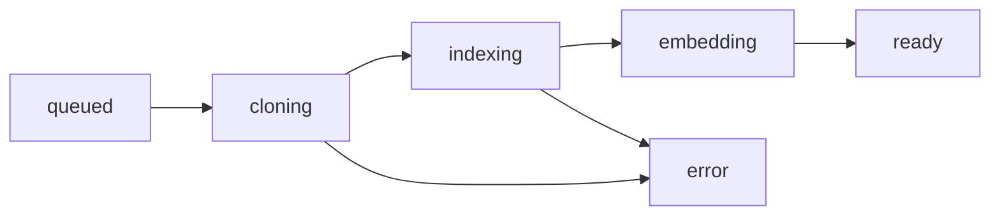

# Adding repositories

A fresh install indexes no repository. Entries come from two sources, merged: the
repositories people add themselves and the operator's configuration. When both name the
same namespace, the operator's entry wins. One code namespace is one branch
([overview](overview.md#one-namespace-is-one-branch)).

| Path                | How                                                                                                  | Built by                               | Tiers                                              |
| ------------------- | ---------------------------------------------------------------------------------------------------- | -------------------------------------- | -------------------------------------------------- |
| Self-service        | **Repositories → Add repository** in the dashboard, or **Add branch** on a card you maintain         | the `code_ingest` worker, in slices    | fast tier; optional compiler tiers                 |
| Operator-configured | an entry in `LOOM_CODE_REPOS_JSON` (or the scalar `LOOM_CODE_*` settings), then `loom code backfill` | the operator, with the `loom code` CLI | fast tier, plus the compiler tier where configured |

Self-service needs no operator or shell access for the fast tier. Compiler tiers are
optional precision upgrades and need their language toolchain in the worker image.

## Self-service repositories

Needs `LOOM_CODE_SELF_SERVICE_ENABLED` and the `code_ingest` worker. Both are enabled by
the stock development Compose deployment; custom deployments can disable either.

It also needs the [repository-job sandbox](../../operations/code-index-operations.md#repository-job-sandbox):
a repository added here gets compiler tiers that execute its own build code, and its
clone talks to a host the person chose, so without the sandbox the add is refused
(`SANDBOX_UNAVAILABLE`) and entries already added are no longer fetched or indexed.
Of the shipped Compose stacks only the blue/green one (`dev/docker-compose.colour.yml`)
runs it, on a host with the AppArmor profile loaded. On the others, the released stack
included, index a repository through `LOOM_CODE_REPOS_JSON`
([quickstart](../../getting-started/quickstart.md#optional-index-a-repository-on-the-released-stack)).

Each org holds at most `LOOM_CODE_SELF_SERVICE_MAX_REPOS` (20) entries.

Any signed-in member of an org can add a repository and becomes its first maintainer.
The remote can be `owner/name` (GitHub shorthand), an HTTPS URL, or an SSH/scp-style
Git URL. GitHub, GitLab and Bitbucket are labelled explicitly; other servers use the
generic adapter. Local paths and `file://` URLs are refused. The remote must answer
`git ls-remote`, using the optional access token for HTTPS or the worker's SSH setup.
When branch is blank, Loom follows the remote's symbolic `HEAD`; there is no `master`
assumption. The namespace is `code-<name>` for the default branch,
`code-<name>-<branch-slug>` otherwise.

The worker clones a bare mirror under `LOOM_CODE_REPOS_ROOT` (default
`var/code_repos/self`, one per Git repository, shared by its branches). It builds the
first index `LOOM_CODE_BOOTSTRAP_FILES_PER_PASS` (400) files per pass with a cursor, so a
restart resumes. `code.repos` reports progress in `stage` and `stage_detail`:



The entry stays in `embedding` until `LOOM_CODE_READY_EMBED_COVERAGE` (0.95) of its
chunks carry a vector; until then `code.search` answers lexically
([freshness](freshness.md)).

| Op                          | Role   | Does                                                                                                                                                      |
| --------------------------- | ------ | --------------------------------------------------------------------------------------------------------------------------------------------------------- |
| `code.repo.remote_branches` | viewer | what the Git remote shows before anything is written: provider, branches and heads, default branch, release-shaped branches, quota and readiness warnings |
| `code.repo.add`             | viewer | add `repo@branch` (blank discovers the remote default), optionally more `branches`; access, filters, `scip_producer`, `access_token`                      |
| `code.repo.add_branch`      | admin  | index another branch of a repository you maintain; it inherits remote, token, prefixes and access                                                         |
| `code.repo.set_access`      | admin  | set `classification` (`standard` / `restricted`) and `join_policy` (`open` / `approval` / `closed`)                                                       |
| `code.repo.set_source`      | admin  | link the tracker namespaces this repository reads, primary first ([tracker overview](../tracker/overview.md#linking-a-tracker-to-a-repository))           |
| `code.repo.remove`          | admin  | retire a self-service index; `confirm` must equal the namespace                                                                                           |

Arguments are in the [operations reference](../../reference/operations.md#code).

Rules:

- An org holds at most `LOOM_CODE_SELF_SERVICE_MAX_REPOS` (20) active self-service
  entries, branches included (`REPO_QUOTA`). A branch already indexed, under any
  namespace, or whose namespace holds data or grants you do not administer, is refused
  with `REPO_EXISTS`; join an index instead. A branch of an operator-configured entry
  with no first index yet is refused with `REPO_NOT_INDEXED` until `loom code backfill`
  has run for it.
- Admin grants flow between a repository's branches in one direction. The operator's
  entries pass their admins to every branch of the repository, and a branch added here
  passes its admins only to other branches added here.
- A revoke follows the same path. One made on an operator entry removes from a branch
  added here only a copied grant, and none while the subject holds an admin grant given
  on a branch added here.
- An operator entry that names a namespace already added here keeps that namespace's
  admins, who then reach the repository's other operator entries, and its access row,
  whose classification and join policy win over the entry's: review both before
  listing it.
- A copy on an operator namespace whose `granted_by` is `repo-maintainers:<namespace>`
  naming a branch added here, or a namespace no longer configured, stays until revoked:
  list those grants and revoke the ones that should not stand.
- While self-service is off, a revoke on an operator entry sees no branch added here,
  so a copy there of the revoked grant stays when self-service is switched back on:
  revoke it on that branch.
- A restricted repository is never `open`: `code.repo.add` sets `approval`. Widening a
  restricted index to standard needs `confirm` equal to the namespace.
- A private repository's token is stored encrypted with a key derived from
  `LOOM_JWT_SECRET` and never returned. Rotating that secret makes stored tokens
  unusable until a maintainer enters them again.
- `code.repo.remove` retires the registry rows and purges every `code_*` row of the
  namespace through a resumable erasure saga. The mirror is deleted when no other branch
  uses it. An operator-configured entry is refused with `REPO_FROM_CONFIG`.
- `LOOM_CODE_SELF_SERVICE_ENABLED=false` removes the feature (`SELF_SERVICE_OFF`).
- `LOOM_CODE_INTEL_ENABLED=false` refuses every `code.repo.*` op but `code.repo.remove`,
  with `PRECONDITION_FAILED`, as it does every other `code.*` op. A retirement with the
  switch off purges the index and this replica's mirror; the other replicas sweep their
  copy of the mirror only once code intelligence is on again.

Add a public repository and a release branch in one call:

```bash
curl -fsS -X POST "$LOOM_BASE_URL/v1/code.repo.add" \
  -H "Authorization: Bearer $LOOM_API_KEY" -H 'Content-Type: application/json' \
  -d '{"org":"acme","repo":"acme/widgets","branch":"main","branches":["release/2.4"]}'
```

The answer names each branch's namespace. Branches it could not add come back in
`skipped` with the reason.

## Repository profiles and compiler preflight

Every entry reports a `profile` and `provider` in `code.index_status`. `generic` drives
repository-neutral search, symbols, calls, impact and context packs. The `clickhouse`
profile identifies the ClickHouse-only SQL registration, error-code and stateless-test
conventions; those assumptions are not inferred merely because a project contains C++
or SQL.

`compiler_candidates` is inferred from build manifests. A candidate without a watermark
appears in `quality_warnings` with the workers to enable:

| Candidate             | Preflight in the worker environment                                                                                                                              | Worker                                       |
| --------------------- | ---------------------------------------------------------------------------------------------------------------------------------------------------------------- | -------------------------------------------- |
| C/C++                 | `scip-clang --version` (in the amd64 image); the repository's CMake configures with clang 21                                                                     | `code_scip_full`, then `code_scip_delta`     |
| TypeScript/JavaScript | Indexer and package managers included in Docker; native servers run `sh scripts/install-code-toolchains.sh`. Repository dependencies are prepared automatically. | `code_scip_ts_delta`                         |
| Go                    | `scip-go --version`; `go env` succeeds for every module                                                                                                          | `code_scip_go_delta`                         |
| Python                | `scip-python --version`; project imports resolve in its environment                                                                                              | `code_scip_py_delta`, then `code_scip_apply` |

The fast tier remains usable when compiler preflight fails. `code.index_status` and the
Health tab expose worker errors, per-language coverage, unresolved edges, embedding
coverage and freshness. PR/review history currently uses the GitHub API; other providers
still receive Git history and code intelligence, with an explicit onboarding warning.

## Operator-configured repositories

`LOOM_CODE_REPOS_JSON` holds one object per indexed branch. The entry fields,
prerequisites (image, embedder, writable mirrors, GitHub token), the first index
(`loom code init`, `backfill`, `backfill-prs`, `scripts/ops/code_intel_bootstrap.sh`),
the compiler tier and other branches are in the
[code index operations runbook](../../operations/code-index-operations.md). The worker
never starts an operator-configured entry; one without a `git_head` watermark is skipped
until `loom code backfill` runs. Every setting is in the
[configuration reference](../../reference/configuration.md#code).

## Who can read

Code namespaces follow the usual grant rules
([identities and namespaces](../../concepts/identities-and-namespaces.md),
[tokens and grants](../../guides/tokens-and-grants.md)): a token must name the code
namespace (or `*`), or the call fails with `AUTH_INSUFFICIENT`. Three switches change
that:

| Switch                                                            | Effect                                                                                                                                       |
| ----------------------------------------------------------------- | -------------------------------------------------------------------------------------------------------------------------------------------- |
| `LOOM_CODE_ORG_READABLE=true`, or the entry's `org_readable`      | every authenticated principal of the org reads without a grant (default off); writes stay grant-driven                                       |
| `LOOM_CODE_REPO_PUBLIC=true`, or the entry's `public`             | the namespace registers `join_policy=open` and discoverable, so any org member joins as a reader at once; otherwise the policy is `approval` |
| `classification: "restricted"` (entry, or `code.repo.set_access`) | never org-readable or public; a maintainer approves each reader, and every read needs a token naming the namespace plus a live direct grant  |

A `code.repo.set_access` row wins over the configured classification and join policy
and survives restarts. `code.refresh` (writer) and the admin ops always need a grant.

## Failure modes

| Symptom                                           | Cause and fix                                                                                                                                                                                                                                                          |
| ------------------------------------------------- | ---------------------------------------------------------------------------------------------------------------------------------------------------------------------------------------------------------------------------------------------------------------------- |
| A configured entry never indexes                  | no `git_head` watermark: run `loom code init` and `loom code backfill`                                                                                                                                                                                                 |
| Adding a repository answers `SANDBOX_UNAVAILABLE` | this deployment cannot run the sandbox: list the repository in `LOOM_CODE_REPOS_JSON` instead (unless `LOOM_CODE_SANDBOX_REQUIRED` is set, which skips those too), or see the [sandbox requirements](../../operations/code-index-operations.md#repository-job-sandbox) |
| A self-service card stays at `error`              | read `stage_detail` in `code.repos`; a failed clone retries next pass (timeout `LOOM_CODE_BOOTSTRAP_CLONE_TIMEOUT_S`)                                                                                                                                                  |
| A private self-service repository stops fetching  | `LOOM_JWT_SECRET` was rotated; re-enter the token                                                                                                                                                                                                                      |
| An entry is missing from `code.repos`             | check `loom.code.repos_config_errors`; `code.repos` also lists only what the caller may read                                                                                                                                                                           |
| Revoking or lowering an admin answers busy        | a revoke on a code namespace first re-reads `loom.code_repos`, so it sees the branches added here from another process, and answers busy while that read fails; retry once the read succeeds                                                                           |
| A new maintainer lacks the other branches         | the admin grant was made before this process read `loom.code_repos` (that process logs `not synced` the first time); the next admin grant or approval on a branch of the repository, or a branch added, copies it; or grant it again                                   |
| Answers are lexical only                          | the entry has not reached `LOOM_CODE_READY_EMBED_COVERAGE` ([freshness](freshness.md))                                                                                                                                                                                 |

## Related

- [Overview](overview.md) and [operations by question](operations.md)
- [Freshness](freshness.md) and [history and PRs](history-and-prs.md)
- [Code index operations runbook](../../operations/code-index-operations.md)
