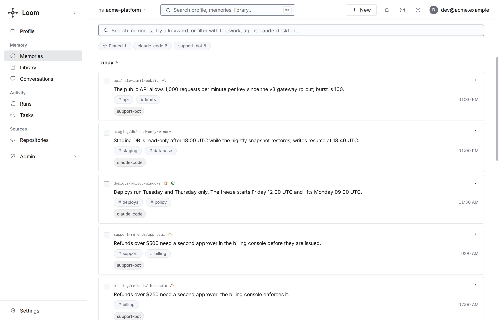

# The dashboard

The dashboard is a React single-page app the Loom server serves at its root URL. It calls the same operations agents call,
with the signed-in person's token, so it shows what that person may read and nothing more. It is where people decide
what Loom leaves to them: conflicts, proposals, triaged tasks, grant requests and policy modes.

## Serving it

The server serves the built bundle from `frontend/dist/`. Without a build, every dashboard
page answers **503** with `Dashboard not built. Run npm --prefix frontend run build or
use the published Docker image.`

The server origin is the dashboard: open `http://localhost:7777/`, and a page's URL is
the origin plus its path (`<server>/settings`). The API (`/v1/*`), MCP (`/mcp`), OAuth
(`/oauth/*`, `/.well-known/*`) and the bundle's own files (`/assets/*`) keep their paths;
no page uses them.

| How you run Loom                | What to do                                                                                     |
| ------------------------------- | ---------------------------------------------------------------------------------------------- |
| The published Docker image      | Nothing: the image's frontend stage runs `npm ci` and `npm run build`.                         |
| From a checkout (`make server`) | `make frontend-build` (or `npm --prefix frontend run build`) once, and after frontend changes. |
| Working on the frontend         | `make frontend-dev`: a Vite dev server on `:5173` that proxies `/v1` and `/mcp` to `:7777`.    |

`LOOM_DASHBOARD_REDIRECT_URL`, when set on a deployment that requires auth, makes a dashboard page load
redirect (302) to another entry point instead, for a Loom that sits behind an
aggregating front end. `/me`, where a sign-in lands with its token in the URL
fragment, is the exception: it always serves the page, so the token never
follows the redirect to another origin.

## Signing in

Sign-in depends on the deployment's identity mode:

| Deployment                                                                    | What the person sees                                                                                                                                                                                                                                       |
| ----------------------------------------------------------------------------- | ---------------------------------------------------------------------------------------------------------------------------------------------------------------------------------------------------------------------------------------------------------- |
| Auth off (`LOOM_AUTH_REQUIRED=false` or `LOOM_IDENTITY_PROVIDER=single-user`) | No sign-in. The page serves the one namespace `LOOM_DEFAULT_NAMESPACE` names (`local` by default). A laptop mode only.                                                                                                                                     |
| Auth on, password accounts                                                    | **Sign in** with an email or namespace and a password; the server mints the token and the page stores it without showing it.                                                                                                                               |
| Auth on, `LOOM_SELF_SIGNUP=open`                                              | A **Sign up** tab creates an account on a fresh namespace.                                                                                                                                                                                                 |
| Auth on, `LOOM_OAUTH_LOGIN_PROVIDER=oidc`                                     | One **Sign in with SSO** button to the identity provider ([single sign-on](../operations/sso.md)); no password or sign-up form.                                                                                                                            |
| A token minted with `loom mint-token`                                         | Open `<server>/me#token=<jwt>`, the sign-in landing page, which never redirects. The page scrubs the token from the URL and asks to confirm the account it names, unless it names the account already signed in. A `?token=` query is ignored and removed. |
| Behind a reverse proxy that adds `Authorization`                              | The page sends no token of its own; the proxy's header authenticates every call.                                                                                                                                                                           |

A `#token=` link signs this browser in as whoever the token names, so the page stores one
without asking only when it answers the SSO sign-in this tab started from the sign-in screen
within the last ten minutes, or when it names the same subject and org as the token already
held. The sign-in screen sends a nonce it keeps in the tab to `/oauth/sso?n=<nonce>`, and
the server hands it back as `/me?n=<nonce>#token=<jwt>`; a token without that nonce, such as
one from an SSO sign-in started by typing `/oauth/sso`, is not the tab's own. Any other
link's token is first asked about with whoami: one the server refuses is dropped without
asking, and one it accepts waits on a screen that names the account the server says it signs
in as, and the account the browser is signed in as: **Sign in as …** stores it, and
**Cancel** drops it and keeps the session the browser had. Until then the token is held only
in the page's memory. A same-account token is stored only once the server accepts it, so a
refused one leaves the held token as it was. `/me?sign_in=sso` opens a sign-in screen that
starts SSO by itself with a nonce of that tab's own when a Loom page sent the browser there
(the server reads the load's `Sec-Fetch-Site`, or its `Referer` from a browser that sends
none); from another site, or typed, it shows the **Sign in with SSO** button. **Sign in in a
new tab** on the session-ended card opens it, and so does **Start again** when the server
could not finish an SSO sign-in. A `#token=` link behind a proxy that adds `Authorization`,
or with auth off, is dropped without asking.

`loom init --agent NAME` signs an agent up on its own and prints a claim code a person enters
once at `/oauth/agent-claim`, with a password of their own, to claim the namespace; they then
sign in here with the namespace name and that password. The token sits in the browser's local
storage; a stored token the server refuses (expired or revoked) ends the session on the next
call, from any page, and so does another tab dropping the token; a sign-out in another tab
reloads this one to the sign-in screen instead. Mid-session a card among the toasts says so,
over any open dialog (a pointer reaches it at once; a keyboard user closes the dialog to reach
it), and the page stays as it is. **Sign in in a new tab** signs in there, and this tab uses
the new token: a token another tab stores for someone else reloads the page as soon as the tab
hears of it, and no call of this page goes out under it; for the same person, the card goes
away once the server accepts the token. **Reload** signs in in this tab instead. While the page
loads, a refused token shows the sign-in screen saying the session ended. When that token was a
sign-in session's, with SSO on, the screen starts the sign-in again by itself (once in five
minutes per tab), so a person still signed in at the identity provider returns to the page they
were on. A minted token, and a refused `#token=` link, wait for a click instead, since either
may be the way in while the identity provider is down. **Sign out** forgets the token here, and
ends the server-side session of a sign-in session's token (the dashboard's SSO token, or a
`loom login` access token opened with `#token=`). A minted token opened with `#token=` is only
forgotten here: it may be the one a CLI or CI job uses.

## The pages

The left rail groups pages into Memory, Activity and Sources. Every page has its own URL that can be shared.

| Page                         | URL              | What it is for                                                                                                                                                                                                                                                                                                                                                                                                                                                                                                                                                                                                                                                                                                                                                                                                                                                                                                                                                                                                                                                                                                                                                                                                                                                                                                                                                                                                                                                                                                                                                                                                                                                                                                                                                                                                                                                                                                                                                                                                                                                                                                                                                                                                                                                                                                                                                                                                                                                                                                                                                                                                                                                                                                                                                                                                                                                                                                                                                                                                                                                                                                                                                                                                                                                                                                                                                                                                                                                                                                                                                                                                                                                                                              |
| ---------------------------- | ---------------- | ----------------------------------------------------------------------------------------------------------------------------------------------------------------------------------------------------------------------------------------------------------------------------------------------------------------------------------------------------------------------------------------------------------------------------------------------------------------------------------------------------------------------------------------------------------------------------------------------------------------------------------------------------------------------------------------------------------------------------------------------------------------------------------------------------------------------------------------------------------------------------------------------------------------------------------------------------------------------------------------------------------------------------------------------------------------------------------------------------------------------------------------------------------------------------------------------------------------------------------------------------------------------------------------------------------------------------------------------------------------------------------------------------------------------------------------------------------------------------------------------------------------------------------------------------------------------------------------------------------------------------------------------------------------------------------------------------------------------------------------------------------------------------------------------------------------------------------------------------------------------------------------------------------------------------------------------------------------------------------------------------------------------------------------------------------------------------------------------------------------------------------------------------------------------------------------------------------------------------------------------------------------------------------------------------------------------------------------------------------------------------------------------------------------------------------------------------------------------------------------------------------------------------------------------------------------------------------------------------------------------------------------------------------------------------------------------------------------------------------------------------------------------------------------------------------------------------------------------------------------------------------------------------------------------------------------------------------------------------------------------------------------------------------------------------------------------------------------------------------------------------------------------------------------------------------------------------------------------------------------------------------------------------------------------------------------------------------------------------------------------------------------------------------------------------------------------------------------------------------------------------------------------------------------------------------------------------------------------------------------------------------------------------------------------------------------------------------- |
| **Profile**                  | `/profile`       | The always-loaded context every AI client receives (`profile.*`), which clients read it and how (`profile.activity`).                                                                                                                                                                                                                                                                                                                                                                                                                                                                                                                                                                                                                                                                                                                                                                                                                                                                                                                                                                                                                                                                                                                                                                                                                                                                                                                                                                                                                                                                                                                                                                                                                                                                                                                                                                                                                                                                                                                                                                                                                                                                                                                                                                                                                                                                                                                                                                                                                                                                                                                                                                                                                                                                                                                                                                                                                                                                                                                                                                                                                                                                                                                                                                                                                                                                                                                                                                                                                                                                                                                                                                                       |
| **Memories**                 | `/memories`      | Browse and search the namespace's memories, open its [guide](namespaces-and-sharing.md#a-namespaces-guide) from the header, with its history (who changed it, when and why); open one to see its versions, provenance and verification, add or edit, and restore a deleted one within its recovery window. Its **Insights** button opens the [assistant panel](#the-assistant-panel) on its starters, which read the namespace as a whole. For someone who can write there, an empty namespace, when the account reaches only its personal one (with auth off, any empty namespace), shows **Getting started** above the list, and it comes back on later visits, as one line with **Continue** once the namespace holds memories, until it is hidden or every step is done: connect an agent (the token form opens in place; the step ticks at the token's first call or an agent's first memory here), the first memory, and, for whoever can set them, the models while none is set (the list says all set only once they are; after both steps are done, **Settings** › **Models & keys** sets them). Each step ticks from what Loom holds; **Hide** keeps it hidden for that account and namespace in this browser.                                                                                                                                                                                                                                                                                                                                                                                                                                                                                                                                                                                                                                                                                                                                                                                                                                                                                                                                                                                                                                                                                                                                                                                                                                                                                                                                                                                                                                                                                                                                                                                                                                                                                                                                                                                                                                                                                                                                                                                                                                                                                                                                                                                                                                                                                                                                                                                                                                                                                    |
| **Recall** (tab of Memories) | `/recall`        | "Why did this rank here": the rows the Memories list shows for a query with no filters set, in its order (keyword matches newest first, then `memory.search` hits with their ranking terms), and read past searches with every key and score they returned (`memory.search_trace_log`).                                                                                                                                                                                                                                                                                                                                                                                                                                                                                                                                                                                                                                                                                                                                                                                                                                                                                                                                                                                                                                                                                                                                                                                                                                                                                                                                                                                                                                                                                                                                                                                                                                                                                                                                                                                                                                                                                                                                                                                                                                                                                                                                                                                                                                                                                                                                                                                                                                                                                                                                                                                                                                                                                                                                                                                                                                                                                                                                                                                                                                                                                                                                                                                                                                                                                                                                                                                                                     |
| **Library**                  | `/library`       | Knowledge documents: add (a file, which is uploaded for the server's extractor, badged beforehand with the format `knowledge.formats` says it is read as, and whose ingest is followed to the revision it publishes, with **Stop ingestion** while it runs, `knowledge.ingest_cancel`; several files at once, picked or dropped, each its own document followed in a list with **Retry failed** and **Stop** ([many files](knowledge.md#many-files-from-the-dashboard)); or pasted text), preview, download, edit metadata, delete (the notice it raises carries **Undo**, `knowledge.restore`, which restores the document's last deleted revision, whichever delete retired it; a bulk delete's notice has none), review the typed tables a document's file became from its preview's **Tables** and approve their column types (`knowledge.dataset_get`, `knowledge.dataset_approve`), and find a passage inside the documents (**Find a passage**, `knowledge.search`; each hit is cited by its revision and place, in lines, a key, pages or slides, or rows, and opens its document). A select above the list shows the namespace picked at the top or one of the [collections](../architecture/sharing.md) the person can read (`collection.list`), as a tree with each one's title and description (its `col-…` address in **About this place**; a title shown twice carries its address); `?collection=` names it. Beside the select, a collection's path from the top on one line: the place above, the ones above the parent folded into a dots button, and the parent, each a link (a parent the person cannot read shows as a dots button, which gives its address when tapped), and below the documents **Collections** lists the ones inside it, or, on **My files** and on a namespace, the person's own top-level ones (and their own whose parent they cannot read), with **Shared with you** below them: the collections the person reads or writes but does not administer (one inside another shared with them shows inside it), each list naming the parents of a collection inside another, in words for a parent missing from the list (`collection.list` names no owner, so one shared as admin sits with the person's own, and the role is the token's: a token capped below admin lists the person's own here too). Each list shows the first six, then fifty more at a time; on a phone the path is one back button beside the select, and the select, a tree, lists the collections inside. On a code or tracker namespace, or none, the select lists only collections; with no namespace at the top, the Library opens **My files** (a token that is not a person's has no files of its own: it stays on the top level, which lists the collections). Its menu manages the members (`grants.*`) and, for its admins, moves it under another collection or to the top (`collection.move`) and deletes it, which erases what it holds (`collection.delete`); **New collection** creates one from a title, inside the one shown when the person writes there; the server derives its address, and a title already used inside the same collection (at the top level, one of the person's own) opens that one (with **Choose the address myself**, the title is kept as given) ([names and titles](../architecture/sharing.md)). The header's **New** adds to the header's namespace, so while the Library shows a collection, or a namespace that holds no documents, it offers no **Document**: the Library's own **Add document** adds where the Library shows. The select finds a collection by its title, address or description as you type. See [knowledge](knowledge.md). |
| **Conversations**            | `/conversations` | Stored conversation threads, replayed turn by turn (a writer renames a thread, an admin deletes one), and the saved session briefs, which a writer forgets. See [conversations and sessions](conversations-and-sessions.md).                                                                                                                                                                                                                                                                                                                                                                                                                                                                                                                                                                                                                                                                                                                                                                                                                                                                                                                                                                                                                                                                                                                                                                                                                                                                                                                                                                                                                                                                                                                                                                                                                                                                                                                                                                                                                                                                                                                                                                                                                                                                                                                                                                                                                                                                                                                                                                                                                                                                                                                                                                                                                                                                                                                                                                                                                                                                                                                                                                                                                                                                                                                                                                                                                                                                                                                                                                                                                                                                                |
| **Runs**                     | `/runs`          | The run ledger: goal, how it ended, what it relied on and wrote, and in the replay what it recalled, observed and cost; a writer grades a closed run by whether it held up. See [runs](runs.md).                                                                                                                                                                                                                                                                                                                                                                                                                                                                                                                                                                                                                                                                                                                                                                                                                                                                                                                                                                                                                                                                                                                                                                                                                                                                                                                                                                                                                                                                                                                                                                                                                                                                                                                                                                                                                                                                                                                                                                                                                                                                                                                                                                                                                                                                                                                                                                                                                                                                                                                                                                                                                                                                                                                                                                                                                                                                                                                                                                                                                                                                                                                                                                                                                                                                                                                                                                                                                                                                                                            |
| **Tasks**                    | `/tasks`         | The task inbox board. Tiles count what needs a person (triage, blocked on a person, failed, leases about to end); rows group as Triage, To do, In progress, Waiting, Closed, as a list or a board, with Accept / Won't do inline; the panel's buttons or a drag onto another group move a task. See [tasks and decisions](tasks-and-decisions.md).                                                                                                                                                                                                                                                                                                                                                                                                                                                                                                                                                                                                                                                                                                                                                                                                                                                                                                                                                                                                                                                                                                                                                                                                                                                                                                                                                                                                                                                                                                                                                                                                                                                                                                                                                                                                                                                                                                                                                                                                                                                                                                                                                                                                                                                                                                                                                                                                                                                                                                                                                                                                                                                                                                                                                                                                                                                                                                                                                                                                                                                                                                                                                                                                                                                                                                                                                          |
| **Repositories**             | `/repositories`  | Indexed code repositories, each with Health, Explore, PR packs and Access tabs, and the org's trackers; a branch's admin re-indexes it after one of its commits. An opened repository lists its documents and their sources, each with its last sync; a source's name opens its settings, sync state and the documents it wrote (`knowledge.source.inspect`), and a caller with the role the [sources table](knowledge.md#document-sources) names adds, checks, syncs, rotates and retires a source there. See [code index](code-index/overview.md) and [tracker](tracker/overview.md).                                                                                                                                                                                                                                                                                                                                                                                                                                                                                                                                                                                                                                                                                                                                                                                                                                                                                                                                                                                                                                                                                                                                                                                                                                                                                                                                                                                                                                                                                                                                                                                                                                                                                                                                                                                                                                                                                                                                                                                                                                                                                                                                                                                                                                                                                                                                                                                                                                                                                                                                                                                                                                                                                                                                                                                                                                                                                                                                                                                                                                                                                                                     |
| **Settings**                 | `/settings`      | **Tokens** (one form for every token: what it reads, where it saves, its expiry; the setup for each MCP client or a script; the list, with what each token reads); **Memory** (`?tab=memory`: patterns never to save, each with a sweep of the memories it already matches, seeding memory from a document, and, for a namespace admin, the webhooks that receive its memory changes and their deliveries); **Structure** (`?tab=structure`, for a reader of a memory namespace: the record schemas, each one's records and disagreements with the record each disagreement superseded, the profile schema, the graph ontology and the categories; an admin registers and approves schemas, sets or clears the profile schema and accepts and adds ontology terms, a writer adds categories); and **Models & keys** for a platform admin.                                                                                                                                                                                                                                                                                                                                                                                                                                                                                                                                                                                                                                                                                                                                                                                                                                                                                                                                                                                                                                                                                                                                                                                                                                                                                                                                                                                                                                                                                                                                                                                                                                                                                                                                                                                                                                                                                                                                                                                                                                                                                                                                                                                                                                                                                                                                                                                                                                                                                                                                                                                                                                                                                                                                                                                                                                                                   |

Three views are reached from elsewhere rather than the rail: **Spaces** (`/spaces`,
public namespaces to browse and join, with each one's
[guide](namespaces-and-sharing.md#a-namespaces-guide) summary, and the guide itself for
a namespace you belong to, opened from the namespace picker), **Graph**
(`/graph`, the entity graph explorer, opened from an entity; see
[entity graph](entity-graph.md)) and **Help** (`/help?page=<page>#<section>`, a page of
Loom's documentation as the running build ships it, read with `help.get` under the
signed-in session, where an assistant answer's help citation leads; links between pages
stay on it).

### The assistant panel

The **Assistant** button in the header, left of the account menu (its icon, and from
1280 px its word beside it), opens the chat with the
[assistant](../architecture/assistant.md#surfaces) on every page, and so do **Ctrl /** and
**⌘ /** (listed in the keyboard shortcuts). It is never disabled; its icon and name say when
an answer is coming in, when one ended while the panel was closed (until it opens again; a
reload forgets the mark), and when the assistant cannot answer, in which case the panel
says why. The chat asks about the header's namespace
under the person's own access: the answer streams in as text with Markdown emphasis, lists,
tables and code (no HTML, images or links), then its Sources, each citation as the server
checked it, a memory, document or help citation found in Loom opening where the dashboard
shows it (a help citation on the Help page at its section) and any citation not found saying
why, and a label for the answer's [support](../architecture/assistant.md#support), none on
an answer that makes no claim, such as a greeting or an abstention. While it answers, its
working line names the latest call it made ("Read the audit"), or "Answering…" before the
first; a call that failed or was refused reads "Couldn't read …", muted. Under the finished
answer **What it read (n)** lists every call (see
[steps](../architecture/assistant.md#steps)). **Stop** ends an answer; closing the panel or
leaving the page does not. Each question goes with the conversation's newest 50 messages.

**Starters** list in an empty conversation, whether the assistant can answer or not: what the
namespace holds and who appears in it (`namespace.inventory`), how it is used (the audit over
the last 7 days, `namespace.audit`), what a user, agent or session remembers
([`memory.inspect`](namespaces-and-sharing.md#inspecting-one-user-agent-or-session), with a
form for the id that suggests the users and agents an inventory card found), what its
documents are ([`knowledge.inspect`](knowledge.md#inspecting-a-namespaces-documents)), what
Loom would advise its most active writer (`mentor.brief`), how an entity and its neighbours
relate (a link to the Graph) and what could be improved
([`namespace.tune`](namespaces-and-sharing.md#drafting-changes-to-how-memories-are-made)). A
starter reads its **card** with the person's own token, gated on that read's own role and
token scope, and shows it in the conversation: Loom's own read, so exact and with no model
call, marked "Loom's own read · <time>", with **Read again**, the audit's window and the
mentor's agent and window as selects that read again, and **Open in <page>** for the page that
owns it. A mentor hint links to the page that owns its plane, an admin page only for a
namespace admin. One line per card goes to the assistant's live region; the focus stays where
it is. With **Also ask the assistant** on (the default when the assistant can answer, kept per
browser) the starter also asks its question, naming the card's arguments, as the person's
turn, which spends a model answer; the answer's label is the one every answer gets. With it
off, or while the assistant cannot answer, the card stands alone. On a phone four starters
show, and **More starters** shows the rest. Each user and agent on an inventory card is a
button that runs the subject starter for it: it reads what that one remembers and asks as the
checkbox says, and it is off as the subject starter is (while an answer is coming in, or when
its read is refused and nothing would be asked).

**A draft's action is the person's own click** on the existing write, under their role: a
category draft is registered behind a confirmation that shows the current and proposed
description; a guide draft opens in the guide editor on top of the guide read now, on its
conflict view when the guide changed since the draft was read; any other draft is copied,
its "How to apply" saying who applies it and where. A card restored from History shows
"Read <time>", and applies nothing until it is read again. The assistant itself writes
nothing.

The Memories page's **Insights** button opens the panel on the starters, with nothing asked:
over a finished conversation it starts a new one; while an answer is coming in it opens on
that conversation and says to choose New conversation once it ends. On a phone the button is
left out, and the header's Assistant button opens the panel, which shows the starters on an
empty conversation (New conversation starts one). An old link to `/memories?section=insights`
opens the panel on the audit's card, nothing asked.

**Each question says which page it is asked from**, and shows it: a chip above the field,
"Includes: Memories", sends one leading line with the question (`Context: Memories page`),
which the transcript shows as the chip, not as text. Its remove button, **Don't include this
page**, sends nothing about the page for that question; the next question, or another page,
carries the chip again. "Your question names this page. Remove it here." shows under the
field until the chip is removed once or a first question is asked. **Ask about this** adds
the item to the chip for one question ("Includes: Memories · key user/pref/lang"; the line
names the memory's key, writer agent and the user and session it is filed under, the
document's source URI and title, or the result's rank, key and the query its rows came from,
each quoted). It is in the memory drawer's footer after Edit, in the document preview's
actions before Download, and on each Recall lab result row as **Ask**. It closes the drawer
or the preview without handing the focus back to what opened it, opens the panel in the mode
the window gives with the focus in its field, keeps the question being typed and sends
nothing. The item leaves with the chip, after the question is answered (one the route
refuses comes back to the field with its chip), and when the page, the namespace, the org or
the signed-in person changes. On a conversation about another namespace it starts a new one
in the header's namespace, the question being typed and the chip moving to it, and says "New
conversation in <namespace>; the one about <old> is in History." While an answer is still
coming in there, it starts none: the panel asks how to go on with that conversation, as
after any switch of namespace, and the chip keeps the item. The button is there for anyone
the assistant's route admits on the namespace. It is unavailable, with the reason, while the
assistant cannot answer, on a header namespace that holds no memories, on a document of a
collection linked in the Library (the answer reads only the header's namespace), and in the
drawer while an edit or a rename is open ("Save or cancel the edit first.").

One panel serves every window width:

- **Beside the page** while the page keeps 640 px: 360 to 720 px wide (420 by default, and
  narrower before it covers the page), resized by its splitter's drag or arrow keys, and not
  modal, so Tab moves between the page and the panel. A navigation leaves it open.
- **Over the page** below that: full height at the right, the page dimmed and inert, the
  focus kept inside until it closes. A navigation, Back and Forward close it.
- **Full screen** under 640 px, with a history entry of its own: Back closes it.
- **Expanded** at `/assistant`: the panel in the page's place at any width, at reading width,
  with **Expand** on the panel beside or over the page and **Collapse** (or **Ctrl /**) back to
  the page it was expanded from, or to Memories for a link opened from elsewhere, with the
  panel open and the focus in its field. It is not in the left rail.

Esc closes it from inside (after any menu or popover open in it), returning the focus to the
button; expanded at `/assistant`, where the panel is the page, Esc closes nothing. A change of
width or of the sidebar moves the panel to another mode without losing the focus or the
question being typed. It reopens on reload only where it sits beside the page.

**Why it cannot answer** is said for the person reading it, with a link only for someone who
can open the page it names: the assistant not set up, setting up or failing its setup
(`/v1/health/ready`'s `assistant` check, read when the panel opens and every 10 s while it
sets up or fails; a read that takes over 10 s counts as failed, and the chat route's
refusal then decides), and the chat route's refusals by their `detail.reason`: auth off, an
org-wide or narrowed token (also read from the token's own claims), a token that expires
before an answer could finish, and model calls switched off for the org (see
[the bridge](../architecture/assistant.md#the-bridge-each-callers-own-identity)). **Try again**
reads readiness again and asks a refused question again once nothing refuses it, with what the
chip shows then; when the chip's line would make it longer than the route accepts it sends
nothing, leaving the question in the field, which says why, or, with other text there, saying
why in the panel. **Health**
shows the same check as its Assistant row, once readiness can be read: to platform admins
always, and to anyone else who opens Health while the assistant sets up or fails.

**Conversations are kept in this browser**, never on the server: 30 days from their last use,
the newest 25 turns of each, up to 256 KB a conversation and 2 MB in all, and listed under
**History** only for the person and token scope that asked them and the namespaces their token
reads. Signing out, or another person signing in, deletes them; a session that expired only
hides them until the same person signs in again. **Delete** and **Delete all** remove them,
and no other tab can write a deleted one back.

One answer runs in a conversation at a time, across the browser's tabs. Ask in a
conversation another tab is answering in sends nothing, says so, and leaves the question in
the field; the other tab's answer appears here once it ends. Where the browser has no Web
Locks (a page served over plain HTTP, not from localhost), each tab answers on its own,
every save keeps the turns another tab finished, and an answer still unfinished an hour
after it started shows as stopped.

### A page's address and its namespace

A page's URL names the namespace it shows, first in its query
(`/memories?namespace=team-notes&memory=api%2Frate-limit`), so a reload or a shared link
shows the same namespace.

- **A link's namespace** opens in that tab when the account can read it: a namespace its
  token claims, or one it holds an active grant on. It is never saved as the picked
  namespace.
- **A namespace the account cannot read**, a pending request included, opens a page that
  says so, with the namespace picker in the header and a way to continue in the default
  namespace. Nothing of the link's namespace is read.
- **A link whose `?namespace=` is a collection** opens that collection in the Library
  (`?collection=`), on the default namespace: the header never holds a collection.
- **A URL without `?namespace=`** opens the default namespace: the saved pick while the
  account can still reach it, else a namespace it administers (its personal namespace
  first, then its oldest admin grant), else its first claimed memory namespace; a
  benchmark namespace only when nothing else is reachable, and a collection never. A token that reaches only repositories and tracker
  records opens the first of those on the pages that need no memory namespace; a memory
  page then opens on none and says so. An account that reaches no namespace but reads a
  shared collection (as `collection.list` says, or by a grant of its own when that cannot
  be read) lands on the Library; a person's own collection alone does not count.
- **When the membership read fails**, a link to the saved pick still opens, since the server
  answers its reads, and any other link opens a page that says its access could not be
  checked, with Retry and a way to continue in the default namespace. A URL without
  `?namespace=` then opens the saved pick only when the token claims it, else its first
  claimed namespace.
- **Back and Forward** never switch namespace: an entry made in another namespace opens
  nothing it names, and the address names the page's namespace. The one exception is Back
  from a tracker's Patterns board, which returns to the namespace its Open left.
- **On the bare root**, a default memory namespace opens on Memories (the landing rules
  above give the rest), and `?view=` names another page by view id or path
  (`/?view=memories`, `/?view=admin/health`) and `?memory=<key>` opens that memory on
  Memories.
- **A single sign-on** started on a page returns to it, within ten minutes.
- **The namespace picker** lists namespaces only, each with its description, and folds
  repositories, tracker records and every three or more memory namespaces whose names
  share a prefix into groups of their own. A uuid in a name counts as one part, so names
  built as `<kind>-<owner uuid>-<id>` fold per owner. A namespace someone just shared with
  you is badged **New** until you pick it there (`namespace.mark_seen`). A collection is
  never listed there, nor in header search, Spaces or the copy dialog's targets: it is
  known by its reserved `col-` name, and the picker's footer links to the Library, where
  collections are.

### The admin drawer

Admins of the current namespace get a drawer with the Review and Observe groups; org and
platform admins also get Access, and platform admins Deployment. A viewer never sees an
entry that would answer 403.

| Group   | Page             | URL                   | What it is for                                                                                                                                                                                                                                                                                                                                                                                                                                                                                                                                                                                         |
| ------- | ---------------- | --------------------- | ------------------------------------------------------------------------------------------------------------------------------------------------------------------------------------------------------------------------------------------------------------------------------------------------------------------------------------------------------------------------------------------------------------------------------------------------------------------------------------------------------------------------------------------------------------------------------------------------------ |
| Review  | **Review queue** | `/admin/review_queue` | Conflicts (pairs of memories that disagree, each with a suggested decision on request, except a sensitive one), learnings proposed for promotion, memories Loom retired on its own (Auto-resolved, each with an Undo), exceptions (the allowlist of pairs that may coexist), proposals (facts on trial, accepted or rejected), and, for admins, duplicate memories and documents with the namespace-wide repairs. Shown in the drawer only while a conflict waits or Loom retired a memory in the last 30 days; the URL always resolves. See [conflicts and refusal](memory/conflicts-and-refusal.md). |
| Review  | **Guardrails**   | `/admin/guardrails`   | Blacklist patterns: content Loom should never store, each with a sweep that deletes the stored memories it already matches; for an org admin, the org's and the namespace's extraction rules and the org's model-call switch.                                                                                                                                                                                                                                                                                                                                                                          |
| Review  | **Policies**     | `/admin/policies`     | History policy rules, a dry run of a hypothetical call, and the decision ledger.                                                                                                                                                                                                                                                                                                                                                                                                                                                                                                                       |
| Observe | **Health**       | `/admin/health`       | Worker status and how agents in the namespace spend their calls; the namespace's memory report, search gates and recent extractions; an admin's repairs (apply expiry, re-embed, remove an extractor's facts, roll back, snapshot and restore); an org admin's projection failures, retried or dismissed.                                                                                                                                                                                                                                                                                              |
| Observe | **Activity**     | `/admin/activity`     | The audit feed, one readable line per event; the Erasures tab lists erasures with each one's details and, by role, erases or exports one namespace or one user; the Exposure tab shows which readers read the namespace's memories and one user's owner report.                                                                                                                                                                                                                                                                                                                                        |
| Observe | **Flow**         | `/flow`               | Read-only: where memories flow — writes and recalls, cross-namespace reach, producer and consumer agents, memberships; collections and repositories are listed apart from the namespaces.                                                                                                                                                                                                                                                                                                                                                                                                              |
| Observe | **Usage**        | `/admin/usage`        | LLM and embedding cost by day, operation, agent or user, the namespace's daily cap, and on **Coding agents** the coding agents' own model spend.                                                                                                                                                                                                                                                                                                                                                                                                                                                       |
| Observe | **Agents**       | `/admin/agents`       | Which clients connected in a window (`agents.connected`); confirms a new MCP connection works. A namespace admin can forget every memory one agent holds there.                                                                                                                                                                                                                                                                                                                                                                                                                                        |
| Access  | **Users**        | `/admin/users`        | Org and platform admins only: every subject, their grants (namespaces, collections and repositories) and roles, last activity, and releasing a namespace whose owner lost their password.                                                                                                                                                                                                                                                                                                                                                                                                              |

Badges draw attention without a rail entry: the Review queue appears with its conflict
count, or with no count when there is no open conflict but Loom retired a memory on its
own in the last 30 days (the Auto-resolved tab), Usage warns when the namespace is over
its 24-hour cap, Agents counts clients new in the last 24 hours. The header carries a task
bell (triage and blocked-on-person items) and a pending-approvals bell (grant requests the
person can decide).

## Operations the dashboard uses

The dashboard calls public operations (`memory.*`, `conflicts.*`, `task.*`, `namespace.*`, …) with the person's own
role; an integration with the same grants can do everything it does. `ui.vitals`, the caller API (`/v1/me/*`) and the `/v1/admin/*`
routes serve the dashboard; they are not an integration surface.

- `ui.vitals` (hidden from MCP): one row per page view with
  the route, largest contentful paint, long tasks, DOM size, `/v1` call count and build,
  posted when the person leaves the view. The operation ledger row is the record;
  `loom deploy-delta` reads it per route before and after a deploy.
- The caller API's `/v1/me/*` routes (the namespace default, sharing summary, service accounts) and
  `/v1/admin/*` routes (worker status) are HTTP endpoints outside the operation registry.

## Limits

- Dashboard pages answer 503 until `frontend/dist/index.html` exists.
- In auth-off mode there is no namespace switcher: the page serves
  `LOOM_DEFAULT_NAMESPACE` only, never persists a different pick, and ignores a URL's
  `?namespace=`.
- Choosing a namespace in the picker also saves it server-side as the person's default,
  so a sign-in and a `*` token that names no namespace before `*` pick up the same
  namespace on their next call; a list token saves where its mint recorded
  ([tokens and grants](../guides/tokens-and-grants.md)). A link's namespace is never
  saved.
- A token whose namespaces claim is `*` reads namespaces the picker does not list; a link
  to one of those opens the page that says the account has no access.
- The rail's links carry no namespace: one opened in a new tab shows the saved pick.
- Admin badges poll only for a confirmed admin of a memory namespace; a code or tracker
  namespace has no conflicts or budget to count.

## Related

- [Quickstart](../getting-started/quickstart.md) — boot the stack and open the dashboard.
- [Tokens and grants](../guides/tokens-and-grants.md) — minting the token a sign-in uses.
- [Namespaces and sharing](namespaces-and-sharing.md) — roles, joining, the mentor.
- [Security architecture](../architecture/security.md) — identity modes and the proxy
  deployment.
