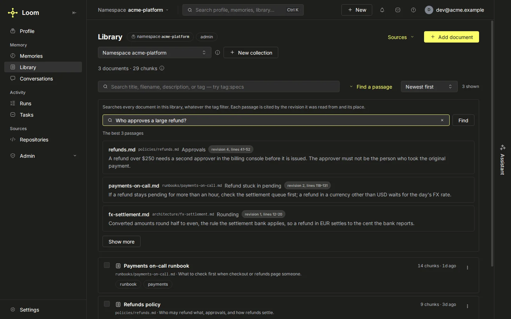

# Knowledge documents

A knowledge document is text an agent looks things up in: a runbook, a specification, a README. It is stored whole
in `loom.documents`, split into sections and windows in `loom.chunks`, and each chunk is embedded for search. A memory
is one claim under a key that Loom judges against its peers; a document is searched, outlined and cited by passage.
Put the document in knowledge and a short claim pointing at it in memory. A memory value over a couple of kilobytes
belongs here ([writing memories](./memory/writing.md)).

## What Loom does with a document

1. **Stores the text and, optionally, the original file.** `knowledge.add` takes
   `content` as a string plus a `source_uri`, which is the document's stable identity
   and the thing an agent cites. `original_bytes_b64` (with `original_filename` and
   `blob_content_type`) keeps the uploaded file beside the extracted text: a catalog row
   in `loom.document_blobs` addressed by its SHA-256, with the bytes in that row or in a
   bucket ([where originals are stored](#where-originals-are-stored)), so a person can
   download exactly what they uploaded.
2. **Chunks it on its structure.** The text is split on its headings and windowed
   inside each section (`LOOM_KNOWLEDGE_CHUNK_SIZE` characters, stepping by
   `LOOM_KNOWLEDGE_CHUNK_STRIDE`, so consecutive windows overlap). A document with no
   headings is windowed over its whole text. Headings follow CommonMark's block
   rules: `#` lines and a line over an underline of three or more `=` or `-` (a
   shorter one is text here), plus one-line `<h1>` to `<h6>`; a list item, a
   thematic break and any line inside a fenced code block or an HTML block are
   never headings.
3. **Indexes each chunk with its context.** A chunk's context is the title, the
   `description` and its heading breadcrumb ("Deploy > Rollback > Cloud"), stored
   with the chunk. The vector is computed over the context prepended to the chunk
   text, and the lexical leg scores the context's words with the text's. The stored
   chunk text stays unchanged, so snippets read naturally, while both legs know where
   the passage sits: a "Refunds" section of the "Lantern handbook" matches a query
   naming Lantern, though the section never does.
4. **Serves it through search, outline and whole-document reads**, described below.

A fixed window can cut a procedure in half and embed the second half without its heading. Chunking on headings keeps
a section the unit of retrieval, and the breadcrumb tells a hit where it came from. Chunk sizes are uneven as a result.

## Operations

All operations are in the [knowledge group](../reference/operations.md#knowledge) of
the operations reference.

| Operation                   | Role   | Does                                                                                   |
| --------------------------- | ------ | -------------------------------------------------------------------------------------- |
| `knowledge.add`             | writer | Store one document and its chunks.                                                     |
| `knowledge.bulk_add`        | writer | Store up to 500 documents in one call; the same per-document behaviour as `add`.       |
| `knowledge.upsert`          | writer | Add or replace the document at a `source_uri`; earlier chunks are superseded.          |
| `knowledge.search`          | viewer | Hybrid passage search (vector, BM25 and exact keys fused).                             |
| `knowledge.get`             | viewer | One document's full text and metadata by `source_uri`.                                 |
| `knowledge.list`            | viewer | Documents of one or more namespaces in cursor pages, filterable by tag and URI prefix. |
| `knowledge.outline`         | viewer | A document's table of contents, and optionally one section's assembled text.           |
| `knowledge.synthesize`      | viewer | Complete a task over whole documents, or calculate over datasets, with the LLM.        |
| `knowledge.update_metadata` | writer | Edit `title`, `description` or `tags`; `reindex=true` rewrites the chunks' context.    |
| `knowledge.delete`          | writer | Supersede a document and its chunks.                                                   |
| `knowledge.bulk_delete`     | writer | The same for up to 500 `source_uris`.                                                  |
| `knowledge.restore`         | writer | Undo a delete: the document's last version and its chunks are live again.              |
| `knowledge.reads`           | viewer | How often agents opened each document over the last `days` (1–30).                     |
| `knowledge.inspect`         | viewer | A report on the namespace's documents ([below](#inspecting-a-namespaces-documents)).   |
| `knowledge.dedup_list`      | admin  | Documents (and, optionally, chunks) of the namespace with identical content hashes.    |
| `knowledge.dedup_resolve`   | admin  | Supersede one side of a duplicate pair.                                                |
| `knowledge.ingest`          | writer | Extract an uploaded file and publish it as a document revision (a job).                |
| `knowledge.ingest_status`   | viewer | A job's state, stage, coverage, warnings, failure and published revision.              |
| `knowledge.ingest_cancel`   | writer | Stop a job before it publishes.                                                        |
| `knowledge.formats`         | viewer | The formats an ingest reads, the names that select each, and the upload's limits.      |
| `knowledge.gaps.list`       | admin  | Questions several users asked that nothing answered ([below](#knowledge-gaps)).        |

`knowledge.search` and `knowledge.reads` are hidden from MCP: neither is listed, and
`loom_op` refuses them too. An agent reaches the knowledge plane through
[`loom_search`](./unified-search.md), whose knowledge section is a `knowledge.search`;
both ops are callable over HTTP and the SDKs. A document's original file is served by `GET /v1/knowledge.download`
(`org`, `namespace`, `source_uri`, optional `inline`), a plain URL rather than a JSON
op so a browser download works; a document with no stored original downloads as
Markdown built from its text, and the `X-Loom-Download-Source` header says `blob` or
`text`.

## Document sources

A namespace's admins register the document sources Loom pulls the namespace's documents
from. A source lives on the namespace its documents live in, so whoever reads the
namespace sees where its documents come from, and only the namespace's admins change
that. Any shared namespace can hold sources: a team's, a shared collection, or a
repository's trunk code namespace, whose sources' documents also carry the repository's
`repo:<id>` tag so the repository's documentation legs read them. Four kinds are served:
`gdrive`, a shared folder of docs, slides, PDFs, `.pptx` decks and `.docx` documents,
read with a service account the folders are shared to read-only, whose credential is the
account's JSON key; `linear`, the documents of a project tracker's projects, read with a
read-only API key of an account that sees the projects; `notion`, a page store's pages
and databases, read with an integration that has read content access and that the pages
and databases are shared with, whose credential is the integration's token; and
`recording`, the transcripts of a meeting store's recordings
([recordings](#a-recording-source)). The `knowledge_source_sync` worker pulls each
source's files into the namespace's documents ([syncing](#syncing-a-source)); `list`
says whether this deployment runs it (`enabled`, `LOOM_KNOWLEDGE_SOURCE_SYNC_ENABLED`,
off by default). The design of connected accounts and access that follows the store's
permissions is in [document sources](../architecture/document-sources.md).

On the dashboard, an opened repository on the Repositories page shows its sources under
Sources, and the Library's **Sources** button, in the header's actions and counting them
(its icon alone on a phone), opens the sources of the shared namespace or collection in
view below the header, so a closed list takes no room from the rows. Both show each
source's kind, last sync and counts, to anyone who reads the namespace (or the
repository). The Library's button shows once the list answers; on a place that takes no
new source (a person's own, or an inactive one) its list offers no Add, and it shows
only while the place still holds a source; a reader who cannot add one sees no button on
a place that holds none, nor when the list cannot be read, where an admin sees the
error. A caller with the role the table below names gets the verbs: Add a source, Check,
Sync now, Rotate credential and Retire. Add a source takes a kind, then that kind's
`config` fields as listed below (a `gdrive` folder or a `notion` page or database may
also be given as a pasted link, a `meet` space with its `spaces/` prefix, a `zoom`
meeting id with the spaces it is shown with) and its credential. The form checks the
server's rules for those ids before Check is offered; Check sends `knowledge.source.add`
with `dry_run`, and Add stays off until the form it would send is the one that passed. A
refused check or add shows the server's error as it came back. The credential is typed
into a password field, sent with the request and never shown again; changing the kind or
the `recording` provider clears it, so it only goes to the store it was typed for, and
changing the provider also clears the ids typed for the other one.

| Operation                                                                                         | Role   | Does                                                                                                                              |
| ------------------------------------------------------------------------------------------------- | ------ | --------------------------------------------------------------------------------------------------------------------------------- |
| [`knowledge.source.list`](../reference/operations/knowledge.md#knowledgesourcelist)               | viewer | The namespace's sources, each with its items and last sync request.                                                               |
| [`knowledge.source.parse_links`](../reference/operations/knowledge.md#knowledgesourceparse_links) | viewer | Read pasted links as items, each with the kind that reads it or why it is unreadable; no store request, nothing written.          |
| [`knowledge.source.inspect`](../reference/operations/knowledge.md#knowledgesourceinspect)         | viewer | One source, its last sync request and the 200 documents the sync worker most recently wrote for it.                               |
| [`knowledge.source.add`](../reference/operations/knowledge.md#knowledgesourceadd)                 | admin  | Probe the credential, then store the source; `dry_run` only probes.                                                               |
| [`knowledge.source.update`](../reference/operations/knowledge.md#knowledgesourceupdate)           | admin  | Probe the items it adds with the stored credential, then store the source with its items added and removed and its new `include`. |
| [`knowledge.source.check`](../reference/operations/knowledge.md#knowledgesourcecheck)             | admin  | Probe a stored source with its own credential now; nothing is written.                                                            |
| [`knowledge.source.rotate`](../reference/operations/knowledge.md#knowledgesourcerotate)           | admin  | Probe a new credential, then replace the stored one.                                                                              |
| [`knowledge.source.remove`](../reference/operations/knowledge.md#knowledgesourceremove)           | admin  | Retire a source (`confirm` equals the name); `delete_documents` records a request to retire its documents.                        |
| [`knowledge.source.sync_now`](../reference/operations/knowledge.md#knowledgesourcesync_now)       | admin  | Record a request for a sync pass over this source (`full`: list every document).                                                  |

A source reads its items, of mixed types, each an object with a `type`: at most 300
(`MAX_ITEMS`) for `gdrive`, and 20 for `linear` and `notion`, whose turns read every
item on every pass with no pass-time bound on the listing. A `gdrive` turn stops at the
pass deadline between walk levels and between items and lists only what changed, but
walks its recursive folders and reads each `file` item's metadata on every pass, one
request each, so a source of many single files costs more per pass than one folder
holding them.

| Kind     | `type`             | Fields                                                                                              | Reads                                                                                                           |
| -------- | ------------------ | --------------------------------------------------------------------------------------------------- | --------------------------------------------------------------------------------------------------------------- |
| `gdrive` | `folder`           | `id`, `recursive` (default `false`)                                                                 | the folder's files; with `recursive`, every subfolder's too, to a depth of 8 and 500 subfolders per source      |
| `gdrive` | `file`             | `id`                                                                                                | one file of a kind `include` names                                                                              |
| `gdrive` | `shared_drive`     | `id`                                                                                                | every file of a shared drive                                                                                    |
| `gdrive` | `filter`           | any of `name_contains`, `kinds` (as `include`), `modified_after` (`YYYY-MM-DD`), `in` (a folder id) | the files that match every field it names; the store matches `name_contains` at the start of a word in the name |
| `notion` | `page`, `database` | `id`, 32 hex digits with or without dashes (stored dashed, lower case)                              | the page and its child pages; the database's pages                                                              |
| `linear` | `project`          | `id` (a project UUID) or `slug_id` (the 12 hex characters a project link ends with)                 | the project's documents                                                                                         |

A recursive walk cut at either bound notes `more subfolders than a walk reads`, and its
full turns then retire only a file the store reports deleted or trashed, or one of a
kind `include` no longer names, never one the listing merely lacks. A filter without
`in` searches the files shared with the service account itself, not the shared drives it
is a member of; to read one of those, name a folder of it in `in` or add the drive as a
`shared_drive` item.

`include` (any of `docs`, `slides`, `pdf`, `pptx`, `docx`; all but `docx` by default) is
the file kinds a `gdrive` source reads, and a filter's `kinds` narrows it. Every id keeps
its store's alphabet, and a filter never takes a query string: each field has its own
pattern, and the server builds the store's query from them with every value quoted, so
a filter cannot widen a listing past what its fields say. An item of the same type and
id as another counts once. `add` takes `items`, `links`, or `config` in the form that
names ids per kind, which it turns into items: `gdrive` `folder_ids` (1 to 20) with
`include`, `linear` `project_ids` (1 to 20), `notion` `page_ids` and `database_ids` (1 to
20 in all). A `recording` source takes only `config`: `provider` (`meet` or `zoom`) and
`ids` (1 to 20 meeting space ids for `meet`, numeric meeting ids for `zoom`); it has no
items. `list` and `inspect` answer `items`, `include`, and `config` in that form while
the items fit in it (only non-recursive folders, at most 20 of anything), else `{}`.

A link is read by its form alone, with no request to any store
(`server/knowledge/domain/source_links.py`):

| Link                                                                                                                                     | Item                                                              |
| ---------------------------------------------------------------------------------------------------------------------------------------- | ----------------------------------------------------------------- |
| `https://drive.google.com/drive/folders/<id>`, with or without `u/<n>/` or `mobile/`                                                     | `gdrive` `folder`                                                 |
| `https://drive.google.com/file/d/<id>/…`                                                                                                 | `gdrive` `file`                                                   |
| `https://docs.google.com/document/d/<id>/…`, `…/presentation/d/<id>/…`                                                                   | `gdrive` `file`                                                   |
| `https://www.notion.so/<slug>-<32 hex>`, `https://www.notion.so/<workspace>/<32 hex>`, `https://<workspace>.notion.site/<slug>-<32 hex>` | `notion` `page` (`database` with `?v=`, unless `p=` names a page) |
| `https://linear.app/<workspace>/project/<slug>-<id>`                                                                                     | `linear` `project`                                                |

Each link is at most 2048 characters; a longer one is refused as a request-validation
error. A link of another host, with no id, or to something the sync does not read (a
spreadsheet, a single issue) is `unreadable`, with the reason, and so is an `open?id=`
link, which names a folder or a file alike. `parse_links` answers each link of a list in
order; `add` and `update` refuse a call with any unreadable link, or a link of another
kind than the source's, naming the first 10 and counting the rest (`BAD_LINK`). A
project link carries the project's short id, which `add` and `update` resolve to its
UUID with the credential. A folder link names a folder, read without its subfolders,
even when it is a shared drive's root; a recursive folder that is a drive's root comes
back from the probe as a `shared_drive` item, which reads the same files, when the probe
checks it (one of the 20 given last).

The store's API hosts are fixed in the server, so a registered source cannot point the
server at another host. The credential is sealed at rest under its own purpose
(`loom secrets reseal` covers it), held in memory only for a probe, never returned by
any op and never written to an audit row. `add` records the namespace, name, kind,
items, `include`, config and `dry_run`; `update` the namespace, name, the items added
and removed and the new `include`; `rotate` the namespace and name; `remove` and
`sync_now` their input (namespace, name, `confirm` and `delete_documents`, or `full`).
`check` is admin-only because its probe spends the source's rate limit.

A probe checks a sample of the items: every item while there are at most 20, otherwise
the 20 given or added last, and answers `checked` and `sampled: true`; `update` probes
the items it adds and, when it changes `include`, the file items the source keeps (the
same sample of them, so a kept file outside it of a kind the new `include` drops is not
refused: the next turn notes it, and the next full listing retires its document). A
probe of a recursive folder counts its own files only and answers `more: true`. A file
item outside the sample that the store refuses is reported by the next sync turn as
`item <n>: http_404` (`<n>` counts from 0, in the order `list` answers `items`), and the
turn goes on with the rest; its document is retired by the next full listing. A shared
drive outside the sample that the account lost is noted the same way, with
`listing: an item listed nothing` ("Incomplete" on the dashboard), and a lost folder
lists nothing. Either fails every full listing (`failed`, naming the item), which keeps
the stamp, retires nothing and leaves the full request waiting, so every pass lists in
full until the item is shared again or removed. A `gdrive` probe exchanges the key for a
read-only token, checks every sampled item together (one call each: a folder, a shared
drive, a file, a filter's `in` folder) and reads the first listing page, 1000 files at
most, of the folders, of each shared drive and of each filter. A `linear` probe reads
the first page (50 documents) of every project together, so a project the key's account
cannot see refuses the probe. A `notion` probe reads each listed page and database in
turn (one in the trash refuses) and counts the listed pages and the first 100 pages of
each of up to three databases (read from each database's first data source), so a probe
of 20 ids stays well inside its bound at the store's pace; `more` says the count leaves
pages out. A `recording` probe exchanges its credential, reads each id and counts the
recordings it lists. Each is bounded as a whole by
`LOOM_KNOWLEDGE_SOURCE_PROBE_TIMEOUT_S` (default 20 s); past it `add`, `update` and
`rotate` answer `SOURCE_UNREACHABLE` and `check` answers `reachable: false`.

Every write of a namespace's sources (`add`, `update`, `rotate`, `remove`, `sync_now`,
and the retirement when the namespace goes: `code.repo.remove`, `namespace.delete`,
`collection.delete` and the erasure step `knowledge_sources.retire`) is serialized by a
lease, so a write's checks still hold when it writes; a probe runs outside it. A write
that finds the lease held past a short wait answers `OVERLOADED` and can be retried; one
whose lease store cannot answer is refused, never run unlocked. The one writer outside
the lease is `loom secrets reseal`, which writes a row it read again at that row's
version + 1, so any later write wins over it. Versions come from the ClickHouse servers'
clocks, so writes stay ordered while those clocks differ by less than the time between
them.

A removed source's row stays, inactive and with its credential cleared. With
`delete_documents`, the row also carries the request for the sync worker, even when no
document is counted yet (a sync turn running at that moment may still write one); the
worker clears it once none is left. Removing a repository (`code.repo.remove`) retires
the sources registered on its namespace the same way and names them in
`sources_deactivated`; the purge of the repository's code index that follows deletes
their sync state (it lives in `loom.code_index_state`) and the namespace's documents,
and leaves the inactive source rows. An `add` that probed while the repository was being
removed answers `NAMESPACE_INACTIVE`, or, when it lands before the namespace is deleted,
is retired with it.

A source ends with its namespace: `namespace.delete`, `collection.delete` and a
namespace erasure (`knowledge_sources.retire`, its first step) retire its sources the
same way, under the same lease, so no source keeps a credential for a namespace that is
gone. A deleted namespace's source documents stay, as a `remove` without
`delete_documents` leaves them; `knowledge.source.remove` with `delete_documents=true`
still accepts the retired source and retires them. An `add` or `update` while an erasure
that will still run covers the namespace answers `ERASURE_RUNNING` (409, retryable)
until it finishes, since the erasure may have read the sources already. The erasure step
then waits for each source's sync turn still running, so no turn writes back a document
or a mined decision after the later steps erase them.

`namespace.restore` brings the namespace back, not its sources: their credentials were
cleared, and the restored documents keep the retired source's name, so an admin removes
it with `delete_documents=true`, waits for the sync worker to retire its documents
(`add` answers `SOURCE_DELETE_PENDING` until then), and adds it again; its next sync
writes the documents back.

A person's own collection, `personal-` namespace or single sign-on `u-` namespace holds
no source (`PERSONAL_NAMESPACE`): a user erasure erases what the person wrote, and a
source's documents are the sync worker's. A namespace claimed at sign-up is refused the
same way, a person's or an agent's: its directory row's owner is the namespace itself.
The name forms are refused by form alone, so a shared namespace registered under such a
name is refused too, and so is one registered with its own name as `owner_email`.

A source whose namespace stops being the repository's trunk (a repository retired by
editing the deployment's configuration, or a branch that now outranks the trunk) keeps
syncing into its namespace, and the documents it writes from then on carry no
`repo:<id>` tag. Since that tag comes from the code repository registry, a pass stops
after its retirements (`RegistryUnread`) while the self-service registry has never been
read, for every source, and the next pass tries again.

A source's documents are the live documents of its namespace that carry the tag
`source:<name>` and that the sync worker wrote (actor `worker:knowledge-source-sync`).
No token maps to that actor, so a document a caller tags `source:<name>` is never a
source's: it is not counted, listed or retired, and it never holds a name. The
`source:*` tags of a document the worker wrote belong to the worker: a tag edit
(`knowledge.update_metadata`) or a re-save of the same text (`knowledge.add`, `upsert`,
`bulk_add`) by anyone else, which keeps the worker as the document's author, may change
its other tags but not add or drop a `source:*` one (`SOURCE_TAGS_LOCKED`). A caller
tags its own documents freely.

A name is free for `add` only while no document of an earlier source of that name is
live, since a new source of the name would take them over. A removed source whose
documents wait to be retired refuses its name with `SOURCE_DELETE_PENDING` until they
are gone; one whose documents were kept refuses it with `SOURCE_DOCUMENTS_KEPT` until
they are retired (`knowledge.source.remove` with `delete_documents=true`, which takes
the removed source). A removed source with no documents frees its name at once.

`update` takes `add_items` and `remove_items`, each also as links (`add_links`,
`remove_links`), and a new `include`. An added item of the same type and id as a stored
one replaces it, so a folder becomes recursive by adding it again with `recursive`; the
answer's `removed` names each item replaced, as it was held. A shared drive added for a
folder of its id, as a `shared_drive` item or as that folder made recursive at the
drive's root when the probe checks it (one of the 20 given last), replaces the folder. A
folder given beside a drive of its id that the source keeps or is given, to `add` or
`update`, adds nothing. It re-reads the source under the lease and writes the change at
the next version; a source another change moved during its probe answers `OVERLOADED`
(retry), and one removed and added again meanwhile answers `SOURCE_REPLACED`. An
`include` restated as it is changes nothing, and so does an added item the source
already holds as it is: such a call, as a retry sends it, answers the source as stored
with `added: []`. A retried call that removed an item answers `BAD_CONFIG` naming it,
since the first one removed it; a folder link names what the source holds at it (a
recursive folder, a shared drive), so only an item given in `add_items` changes how a
held folder is read, and an item given in the same call wins over a link to the same
thing. Removing every item is refused (`BAD_CONFIG`): `remove` ends a source. A folder
link or `remove_items` folder entry removes the shared drive of its id when the source
holds it as a drive. Every update that changes the source asks for a full listing on the
next sync turn, so an added item's files and a newly included kind's come in then, and a
removed item's documents and a dropped kind's are retired, unless a recursive walk is
cut at its bound (see above). `loom knowledge source list`, `add` and `update` call
these ops on a running server as the token's principal, with repeatable `--link` and
`--item-json` (and `--remove-link`, `--remove-item-json` for `update`); `add` reads the
credential from a file (`--credential-file`).

| Code                    | When                                                                                                                                                                                                                                                                                                                                                                                                                                                                                                                                                                                                                                                                                                                                                                                |
| ----------------------- | ----------------------------------------------------------------------------------------------------------------------------------------------------------------------------------------------------------------------------------------------------------------------------------------------------------------------------------------------------------------------------------------------------------------------------------------------------------------------------------------------------------------------------------------------------------------------------------------------------------------------------------------------------------------------------------------------------------------------------------------------------------------------------------- |
| `NAMESPACE_INACTIVE`    | `add`, `update`, `rotate` or `sync_now` names a namespace whose directory row is inactive, a collection the tree no longer holds, or a namespace deleted while the probe ran.                                                                                                                                                                                                                                                                                                                                                                                                                                                                                                                                                                                                       |
| `PERSONAL_NAMESPACE`    | `add`, `update`, `rotate` or `sync_now` names a person's own collection, `personal-` namespace, single sign-on `u-` namespace or a namespace claimed at sign-up, which holds no document source.                                                                                                                                                                                                                                                                                                                                                                                                                                                                                                                                                                                    |
| `ERASURE_RUNNING`       | `add` or `update` names a namespace an erasure that will still run may cover (409, retryable); retry once the erasure finishes.                                                                                                                                                                                                                                                                                                                                                                                                                                                                                                                                                                                                                                                     |
| `BAD_NAME`              | The name is not 2-32 lower-case letters, digits, `-` or `_`, starting with a letter.                                                                                                                                                                                                                                                                                                                                                                                                                                                                                                                                                                                                                                                                                                |
| `BAD_KIND`              | The kind is not one the server serves, or `update` names a `recording` source, which has no items.                                                                                                                                                                                                                                                                                                                                                                                                                                                                                                                                                                                                                                                                                  |
| `BAD_CONFIG`            | The config or an item has an unknown key, a malformed folder, file, drive, project, page, database, space or meeting id or filter field, an unknown `include` value or an unknown `provider`; a `notion` config has no id or more than 20; a source has more items than its kind holds (300 for `gdrive`, 20 for `linear` and `notion`); `add` takes `config` with `items` or `links`, or none of them; `update` names no item, link or `include`, removes an item the source does not hold, adds and removes the same item, or removes every item; a `file` item is of a kind `include` does not name or of a type the sync does not read, or a `filter`'s `kinds` share none with it; or any other field that does not fit the kind or the source. The message names what to fix. |
| `BAD_LINK`              | `add` or `update` was given a link that names no item, or one of another kind than the source's; the message names the first 10, each quoted to 40 characters, and counts the rest.                                                                                                                                                                                                                                                                                                                                                                                                                                                                                                                                                                                                 |
| `SOURCE_EXISTS`         | The namespace has an active source of that name.                                                                                                                                                                                                                                                                                                                                                                                                                                                                                                                                                                                                                                                                                                                                    |
| `SOURCE_QUOTA`          | The namespace has `LOOM_KNOWLEDGE_SOURCES_MAX_PER_NAMESPACE` active sources (default 8).                                                                                                                                                                                                                                                                                                                                                                                                                                                                                                                                                                                                                                                                                            |
| `NO_ROOT_SECRET`        | The deployment has no `LOOM_JWT_SECRET`, so a credential cannot be stored.                                                                                                                                                                                                                                                                                                                                                                                                                                                                                                                                                                                                                                                                                                          |
| `CREDENTIAL_REFUSED`    | The credential is empty or not of the kind's form, the store refused it, or (`update`) the stored credential no longer opens: rotate it first; nothing is stored.                                                                                                                                                                                                                                                                                                                                                                                                                                                                                                                                                                                                                   |
| `SOURCE_UNREACHABLE`    | A folder, file, shared drive, filter `in` folder, project (by id or short id), page, database, space or meeting is not visible to the account or integration, a page, database, file or folder is in the trash or an id is no folder, the store failed or rate-limited the probe, or the probe timed out; nothing is stored.                                                                                                                                                                                                                                                                                                                                                                                                                                                        |
| `SOURCE_DELETE_PENDING` | `add` names a removed source whose documents are still waiting to be retired.                                                                                                                                                                                                                                                                                                                                                                                                                                                                                                                                                                                                                                                                                                       |
| `SOURCE_DOCUMENTS_KEPT` | `add` names a removed source whose kept documents are still live; retire them first with `knowledge.source.remove` and `delete_documents=true`.                                                                                                                                                                                                                                                                                                                                                                                                                                                                                                                                                                                                                                     |
| `SOURCE_REPLACED`       | `update`, `rotate` or `sync_now`'s source was removed and added again during the call (409); act on the current source.                                                                                                                                                                                                                                                                                                                                                                                                                                                                                                                                                                                                                                                             |
| `OVERLOADED`            | Another write of the namespace's sources held the lease past a short wait; or `add` or `update` would store a source a build without items cannot read while such a build may still serve ([rolling upgrades](../architecture/rolling-upgrades.md), rule 49); or an `update` or `rotate` found the source's items, config or credential changed by another write during its probe (503, `retry_after_s`).                                                                                                                                                                                                                                                                                                                                                                           |
| `SOURCE_TAGS_LOCKED`    | A write that keeps the sync worker as a document's author changes its `source:*` tags.                                                                                                                                                                                                                                                                                                                                                                                                                                                                                                                                                                                                                                                                                              |
| `SOURCE_NOT_FOUND`      | No active source of that name in the namespace (404); for `remove` with `delete_documents=true`, no source of that name was ever registered there.                                                                                                                                                                                                                                                                                                                                                                                                                                                                                                                                                                                                                                  |
| `CONFIRM_REQUIRED`      | `remove`'s `confirm` is not the source's name.                                                                                                                                                                                                                                                                                                                                                                                                                                                                                                                                                                                                                                                                                                                                      |

A probe's error names the HTTP status (`http_403`), never the store's response text.

### Syncing a source

Every `LOOM_KNOWLEDGE_SOURCE_SYNC_INTERVAL_SECONDS` (default 900) the worker first
retires the documents of removed sources an admin asked to delete, then gives each
active source a turn: sources an admin asked for with `sync_now` first, then the
rest from where the previous pass stopped. A source whose namespace is inactive is
skipped. Each turn holds a lease of its own, so two copies of the worker never sync one
source at once.

A turn lists the source's files. Its first turn, a turn `sync_now(full=true)` or an
`update` asked for (a later `sync_now` without `full` leaves that request as it is) and
the first turn after `LOOM_KNOWLEDGE_SOURCE_SYNC_FULL_INTERVAL_SECONDS` (default a day)
since the last full listing list every file; the others list only the files changed
after the stored stamp: the newest modification time a complete turn saw, but never
later than a minute before that turn's listing started. A file added to a folder with an
older modification time (moved or copied in) is not changed after the stamp; it arrives
with the next full listing. A listed file whose stored copy has the same revision, and
whose chunks are live, is skipped without a fetch, so a write cut between its document
and its chunks is redone; a native document whose stored text still holds its pictures'
bytes is the one exception (see `docs` below). A changed file is fetched and written
with `knowledge.upsert`:

| File                             | Text                                                                                                                                                                                                                                                                                                                                                                                                                                                                                                                                                                                                                                                                                                                                                                                                              | Original                       |
| -------------------------------- | ----------------------------------------------------------------------------------------------------------------------------------------------------------------------------------------------------------------------------------------------------------------------------------------------------------------------------------------------------------------------------------------------------------------------------------------------------------------------------------------------------------------------------------------------------------------------------------------------------------------------------------------------------------------------------------------------------------------------------------------------------------------------------------------------------------------- | ------------------------------ |
| A document (`docs`)              | Exported by the store as Markdown, which holds each pasted picture as base64 text: a line of pictures becomes `> [image-only: N pictures, rationale not extracted]`, a list item, quote line or heading of pictures keeps the marker in place, and a picture inside a line of text is dropped, its alt text kept; fenced code is left as it is. A stored document whose text still holds its pictures' bytes (written by an earlier conversion) is fetched and converted again at the same revision when a full listing lists it, and mined for decisions again; one whose stored text only shows such a definition (in a code sample, which the conversion keeps) is exported once at its revision, nothing is written, and the source's sync state records it so later listings skip it until its file changes. | none                           |
| A deck (`slides`)                | One `# Slide N: <title>` section per slide, so a chunk is a slide: its shapes' text (groups read through, a table one row per line), then `> Notes: …` from the speaker notes. A run of eight or more bare numbers is dropped. A slide whose text is under 120 characters beside a picture, chart or video ends with `> [image-only: N pictures, rationale not extracted]`.                                                                                                                                                                                                                                                                                                                                                                                                                                       | none                           |
| A PDF, a `.pptx` or `.docx` file | Sent to the [extractor service](../architecture/document-extraction.md) its format is routed to; the artifact's headings become Markdown headings and its code and SQL blocks are fenced, and how much of the file it read goes in the metadata (`extraction_coverage`). With no extractor configured for the format, or one that does not declare it, the file is counted `unconverted` and not written.                                                                                                                                                                                                                                                                                                                                                                                                         | the file's bytes, downloadable |

Each document's address (`source_uri`) is the link the store reports for the file,
without its query, so a `knowledge.synthesize` citation of it reads `<link>#<chunk>`.
Its title is the file's name, its description the first paragraph, its tags
`source-kind:design_doc`, `source:<name>` and, on a repository's trunk code namespace,
the repository's `repo:<id>`, and its metadata the source's kind and name, the file's id
(`ingested_from`), its revision (`source_revision`) and the conversion
(`ingested_format`); a native document also carries a hash of its title and text
(`text_sha256`), which the [mining](#mining-decisions) step keys it by with its
revision, so a copy written again at the same revision with other text is mined again.
Every document a sync writes has the actor `worker:knowledge-source-sync` and the class
`imported`. A live document at the same address that another writer or another source
holds is never overwritten or retired. The source and the address are read again before
each write. A source removed or replaced during its turn stops the turn, which records
nothing. A file whose address another writer holds is counted `skipped`: nothing is
fetched for it when the address is held as the file is listed, and nothing is written
when it was taken during the fetch.

A document is retired only on positive evidence: its file is missing from a complete
full listing and the store, asked about that file, reports it gone, trashed or reached
by none of the source's items (a listing paged while files change can miss one; after a
walk cut at its bound, only gone, trashed or a kind `include` no longer names counts);
its document sits at an address that is no longer its file's; or an admin asked with
`remove(delete_documents=true)`. A listed file the store gives no https link for is not
written (`no_address`) and counts as missing, so its stored document stays while the
lookup still finds the file. A listing the store marks incomplete (`incompleteSearch`)
has its files written, but keeps the stamp, retires nothing and reports
`listing: incomplete search`. A folder the account no longer sees lists empty rather
than refused, so a full turn first checks every folder, shared drive and filter `in`
folder; while one fails, the turn ends `failed`, still writes the files of the folders
it sees, and retires nothing. A fetch error or a rate limit retires nothing. Each
retirement is a `knowledge.delete` with its audit row, actor
`worker:knowledge-source-sync`. Once a removed source has no documents left, its delete
request is cleared.

The stamp moves only when every listed file was handled. A turn cut short (a rate limit,
a failure, the pass bound) is listed again on the next pass, and the files it wrote are
skipped by revision. One pass fetches, writes, retires and mines at most
`LOOM_KNOWLEDGE_SOURCE_SYNC_DOCUMENTS_PER_PASS` documents (default 40) across all
sources, so a large folder's first sync spans several passes. A source with no request
waiting whose turn ran out of the pass's time before any file, on what the sources
before it left, starts the next pass; the first of those sources moves on instead, so
one slow source never holds the others back.

What fails for every file is the turn's: the token exchange, the listing, a `401` on any
request (`credential_invalid`), a rate limit, and an extractor whose capabilities cannot
be read. Such a turn keeps the stamp, so the next pass lists the same files again.

A source of any kind holds at most `LOOM_KNOWLEDGE_SOURCE_MAX_DOCUMENTS` documents
(default 50,000, at most 200,000), its stored ones plus the new ones a turn writes. At
that bound a turn tries no new file and notes `too_many_documents` with how many it held
back, and goes on updating and retiring the stored ones. Removing an item or raising the
setting brings a source back under it; a `recording` source, which retires nothing,
comes back only by raising the setting or by `knowledge.delete` of some of its
documents. A held file comes in with the next full listing once there is room (the
periodic one, or `sync_now` with `full`). The count is of the new files the turn did not
try, so it includes any that might never be written (a format no extractor reads), and
only a turn that lists them notes it, so a clean status between full listings does not
mean every file is in. The turn reads the stored copies in pages by address, so a source
over the bound (a lowered setting) still compares every file and retires as usual.

Trouble with one file is that file's:

- A file the store refuses on its own (a `403` or `404` on its export, download or deck
  read: an export over the store's limit, downloads turned off), one over
  `LOOM_KNOWLEDGE_SOURCE_SYNC_MAX_FILE_BYTES` (default 64 MiB), one the extractor
  refuses and one the write refuses are counted `unconverted` with their reason, and the
  turn goes on. Such a file is given up on at once, with the same retries as a file
  given up below, so it costs no fetch and none of the pass bound until then.
- Any other failure on one file (a `5xx` or a timeout on it, its extractor call, its
  conversion, its write) makes the file wait: the turn ends `failed` with the stamp
  kept, and the next pass tries the file again. After three passes on the same revision
  the file is counted `unconverted` instead and is given up on: it is tried again when
  it changes, once on a periodic full listing after each completed one (one more failure
  gives it up again), and on a full sync request (`sync_now(full=true)` or
  `loom knowledge sync --full`), which resets the waits once per request.

A `notion` source's turn follows the same rules, with pages for files. Its listing is
each listed page, the pages of each listed database, read through the database's data
sources (on an incremental turn, only the pages edited after the stamp), and each known
child page. Within each server process, the requests of one integration are paced to the
store's average of three a second; two integrations do not wait on each other, and a
rate limit (`429`) ends the turn, which the next pass retries. A page's revision is its
last edit time and its address the page URL the store reports, so a renamed page moves
to its new address and the document at the old one is retired. A page whose stored copy
has the listed revision is skipped only when that copy was read 90 seconds or more after
the revision; one read sooner is read and written again with its new read time, so an
edit made just before or after a read is not lost to an equal stamp or a clock skew, and
the page is skipped once its stored copy was read past the margin. The stamp trails the
listing by 150 seconds, the minute above plus the 90-second margin, so a database page
read within the margin is listed again by the next incremental turn. The rewrite embeds
the page again (the writer embeds every write), so a page read within 90 seconds of its
revision costs one more embedding, once in practice, since the next pass reads it past
the margin. A turn handles the pages that changed (no stored copy, another revision or
another address) before such re-reads, so a pass bound spent on them delays no edit. A
changed page's blocks are read, nested blocks included, at most 300 requests a page, and
turned into Markdown one to one: headings, paragraphs, bulleted and numbered lists,
to-dos (`- [x]`), quotes and callouts as `>` quotes, code fenced with its language,
tables as Markdown tables (the first row as the header row), equations as `$$` blocks,
dividers as `---`, bookmarks, embeds and link previews as links, toggles, columns and
synced blocks with their children inline, and a run of images or videos as
`> [image-only: N pictures, rationale not extracted]` followed by their captions. Left
out and counted by type in the document's metadata (`skipped_blocks`): a child database,
a file, a PDF, a link that is not an https address, a synced copy whose original is not
shared with the integration, and any type the converter does not map. `ingested_format`
is `blocks`, `read_at` is when the page was read, and `text_sha256` is an exact hash of
its title, Markdown and left-out blocks. The [mining](#mining-decisions) step keys a
page by its revision and that hash, so a copy written again with the same text is not
mined again, and one with other text at the same revision is.

A child page is a document of its own. The child pages a read page holds are kept in the
source's sync state, at most 200 per source (more are counted in their parent's
`skipped_blocks`), and each later turn reads every known child once for its revision; a
child found while a turn syncs its parent, and a grandchild found while it syncs the
child, are synced in that turn. A child page inside a column, a toggle, a list item or a
synced block belongs to the page whose blocks held it. For a page under a block that no
page of the source is known to hold, a full turn's lookup reads the block's parents up
to the page that holds it, at most four requests (each paced like the others): that page
is judged like any holder, the workspace counts as gone, and so does a block the store
answers 404 for: such a block is not shared with the integration, and every block under
the listed pages and databases is, so the page is outside the source; and a walk that
cannot tell (another failure, an unexpected parent, the bound) keeps the document. A
page found under a listed page this way is known again. A page whose blocks could not
all be read (a synced copy of an unshared original) keeps the child pages it held
before. A known child is forgotten in three ways only: its page is read and no longer
holds it; a complete full turn's lookup finds it gone, in the trash or out from under
the source (and retires its document); or a complete full turn read it as not found or
trashed and it holds no document. A failed or cut turn forgets no child it could not
read, and a child found while syncing whose read fails (other than not found) leaves the
turn failed, so it is read again next turn. A page with no text (`no_text`) and one past
the request bound or `LOOM_KNOWLEDGE_SOURCE_SYNC_MAX_FILE_BYTES` (`too_large`) are given
up on until they change. A listed page or database the integration no longer sees, or a
database in the trash, fails the turn and retires nothing, while the pages it still sees
are written. A listed page or child page in the trash is left out of the listing, so the
next full turn retires it. A refusal (`403`) is not evidence that a page is gone: a
looked-up page the store refuses keeps its document, and a known child it refuses stays
known and waits like a file's trouble, failing the turn for two passes and counted
`unconverted` (`child_http_403`) from the third, so it no longer holds back the rest of
the source; the pages under it are not taken for moved. A page is retired after a
complete full listing lacks it and a lookup finds it gone, in the trash, or under none
of the listed pages, the listed databases and the pages that listing had; a child moved
out from under them, and its own children, are retired this way. A database query the
store marks incomplete is an incomplete listing (`listing: incomplete result`).

### Mining decisions

After every source's turn, the same pass mines for decisions each of the source's
documents whose stored revision is not the one last mined for it, oldest first, with
the extraction `loom decisions extract --apply` runs
([extract decisions from a document](tasks-and-decisions.md#extract-decisions-from-a-document)).
The revision a document was mined at is recorded only once its extraction is done, so a
document written by a turn that failed or was stopped is mined on a later pass, as is
one synced while no extraction ran. The rows go to the source's namespace, each citing
its document in `source_resource_id`, written through `decision.record` as agent
`loom-decisions` with the actor `worker:knowledge-source-sync` and the audit row the
transport would write.

Nobody has to confirm a row: an unpinned extracted row is served as it is, and a later
write of the document revises or retires the extractor's own rows. A pinned or attested
row, or one with a recorded outcome, is never rewritten: it is tagged `source-changed`
and counted `flagged_pinned`, and `loom decisions extract` without `--apply` prints the
body a maintainer may record instead.

The model calls bill the source's namespace (operation `worker.knowledge_source_sync`
in `loom.agent_events`). Before each document the pass reads the namespace's spend: one
whose spend on these calls in the last 24 hours reached
`LOOM_KNOWLEDGE_SOURCE_SYNC_CAP_SHARE` (default 0.25) of its daily cost cap, or the whole
cap, is left for a later pass; a cap that cannot be read counts as reached. An org whose
model calls are switched off, a namespace whose calls the inference gateway refuses or
asks to wait, for an embedding too (left for the time the gateway names), and every org
while the switch cannot be read are left the same way, with no try counted. A deployment
with no usable model mines nothing. A source left for a later pass shows why in
`extract_error`: `over_cap`, `switched_off`, `switch_unread`, `no_model`, `held`,
`held:<code>` or `pass_bound` (the pass had no time or document left for it).

Each decision's writes run whole with their audit row: a pass cancelled mid-write
finishes the write it is in, and shutdown waits for it. Before each write the run checks
that its pass is not stopped and that it still holds the source's lease; when either
ends, it stops there, keeps what it wrote, retires nothing, and the document is mined
again on a later pass.

A document whose extraction fails stays pending for three tries on the same revision,
then is counted `unextracted` and left until the sync writes it again. The reasons:
`not_run` (it could not run on the document, such as one with no chunks for the current
embedding model), `refused` (a read or a write it needed was refused for a reason of the
moment, such as a busy key, or failed) and `failed:<error>`. A write refused for a
reason every run would meet (a blacklisted decision, a pinned peer it contradicts, a
body the op does not take) is not a failure: the document is mined with its other
decisions. A document's model reads stop 30 seconds before the pass's deadline, with
nothing written (`out_of_time`), and it goes first among its source's documents on the
next pass; one that runs out of time with three quarters of a pass's read time or more
is given up on at once (`too_large_for_pass`): the worker does not mine a document that
large, and `loom decisions extract` runs it with no deadline. A document is not started
with less than a minute of read time left. A document retired, or held by another writer
since, is not mined.

A source's `sync` in `list` and `inspect` shows what its last turn did:

| Field                    | Meaning                                                                                                                                                                                                                                                                                                                                                                                                                                                                                                                                              |
| ------------------------ | ---------------------------------------------------------------------------------------------------------------------------------------------------------------------------------------------------------------------------------------------------------------------------------------------------------------------------------------------------------------------------------------------------------------------------------------------------------------------------------------------------------------------------------------------------- |
| `requested_at`           | A `sync_now` request no turn has finished yet.                                                                                                                                                                                                                                                                                                                                                                                                                                                                                                       |
| `last_synced_at`         | When the last turn ended.                                                                                                                                                                                                                                                                                                                                                                                                                                                                                                                            |
| `status`                 | `ok`, `rate_limited` (the next pass retries), `credential_invalid` (the stored key no longer opens or is refused: rotate it) or `failed`.                                                                                                                                                                                                                                                                                                                                                                                                            |
| `documents_seen`         | Files (or a project's documents, pages, or recordings) the turn listed.                                                                                                                                                                                                                                                                                                                                                                                                                                                                              |
| `changed`, `removed`     | Documents it wrote and retired.                                                                                                                                                                                                                                                                                                                                                                                                                                                                                                                      |
| `unconverted`, `skipped` | Files it did not write: the store gave no https link, no extractor, refused or too large, a recording with no transcript yet, or given up after three passes on the same revision; another writer's document at the address.                                                                                                                                                                                                                                                                                                                         |
| `unconverted_reasons`    | Why, by count: `no_address` (the store gave no https link), `no_extractor`, `too_large`, `http_<status>`, `unreachable`, `no_text`, `child_http_403`, `extraction_failed:<code>`, `extractor_unavailable`, `fetch_failed:<error>`, `write_refused:<code>`, `write_failed:<error>`, `no_transcript` (a recording with no finished transcript), `transcript_off_host`; for a project's documents also `not_found`, `graphql_<type>` and `no_document` or `no_data` (the answer lacked the document, or any data).                                      |
| `error`                  | What failed and its HTTP status (`listing: http_500`), never the store's response text; for a turn that did not fail, what it noted: why it is incomplete (`pass bound reached`, `listing: incomplete search`, `listing: an item listed nothing`), an item or file it could not read (`item 2: http_404`), or the new files it held back at the bound (`too_many_documents: 3 new files past 50000`). The dashboard reads a turn cut short (`pass bound reached`, `listing: …`) as "Incomplete" and one with any other note as "Synced with a note". |
| `pending_extract`        | Documents whose stored revision is not yet mined for decisions, as of the last pass.                                                                                                                                                                                                                                                                                                                                                                                                                                                                 |
| `last_extracted_at`      | When the last mining turn ended.                                                                                                                                                                                                                                                                                                                                                                                                                                                                                                                     |
| `extracted`              | Documents that turn mined, each with or without a decision.                                                                                                                                                                                                                                                                                                                                                                                                                                                                                          |
| `flagged_pinned`         | Decision rows it tagged `source-changed` rather than rewriting them: pinned, attested, or with a recorded outcome.                                                                                                                                                                                                                                                                                                                                                                                                                                   |
| `unextracted`            | Documents it gave up on: three failed tries, or too large for a pass.                                                                                                                                                                                                                                                                                                                                                                                                                                                                                |
| `extract_error`          | Why an extraction failed in the last mining turn (`not_run`, `refused`, `out_of_time`, `too_large_for_pass`, `failed:<error>`), or why documents wait (`over_cap`, `switched_off`, `switch_unread`, `no_model`, `held`, `held:<code>`, `pass_bound`).                                                                                                                                                                                                                                                                                                |

### A recording source

A `recording` source reads transcripts, never audio or video, and nothing in Loom
transcribes. Neither store's listing says whether a recording has a transcript, so each
recording not stored yet costs one check. A recording without a finished transcript is
counted `unconverted` under `no_transcript`, not as an error: until a day after the
meeting it is checked again whenever a listing has it, at none of the pass bound, so
its transcript is written once the store has one; after that it is given up on, like a
refused file, and checked once more on each periodic full listing and on a full sync
request. A transcript whose download link is not on the store's own hosts is given up
on under `transcript_off_host`, and the token is never sent there.

| `provider` | `ids`               | Credential                                                                                                                                                                   | A recording                                                                                                                         |
| ---------- | ------------------- | ---------------------------------------------------------------------------------------------------------------------------------------------------------------------------- | ----------------------------------------------------------------------------------------------------------------------------------- |
| `meet`     | meeting space ids   | An OAuth `authorized_user` JSON file (`client_id`, `client_secret`, `refresh_token`) of a user who can see the spaces, granted the `meetings.space.readonly` scope only.     | One ended conference record of a space; its transcripts' entries, once every transcript's file is generated (`FILE_GENERATED`).     |
| `zoom`     | numeric meeting ids | A server-to-server app's JSON (`account_id`, `client_id`, `client_secret`), with the read-only meeting and recording scopes only (`meeting:read…`, `cloud_recording:read…`). | One ended instance of a meeting; the `TRANSCRIPT` file (WebVTT) of its cloud recording, downloaded from the store's own hosts only. |

The transcript becomes one `# mm:ss–mm:ss: <first words>` section per five minutes of
the meeting, timed from its start, so a chunk and its citation name the minute; inside a
section each speaker turn is a paragraph `<speaker>: <text>`. The document's address is
the store's API address of the recording, its title `Meeting <start time>` (`meet`) or
`Meeting <meeting id> <start time>` (`zoom`), its
`ingested_format` `transcript`, and its revision the meeting's end (`meet`) or the
instance's start (`zoom`): a stored transcript is not fetched again. An incremental
listing reaches a day behind the stamp, since a store finishes a transcript some time
after the meeting; the periodic full listing finds a later one. A `zoom` full listing
(and probe) reads the instances that started in the last 30 days, as `meet` keeps
conference records for 30 days, so the old instances of a long recurring meeting cost
no check; documents written from older instances stay. A space or meeting the
account no longer sees, or may not read, ends the turn `failed` with its status
(`space <id>: http_404` or `http_403`) and retires nothing, while the other ids'
recordings are written. A probe of such an id fails: `add` and `rotate` answer
`SOURCE_UNREACHABLE` naming it, and `check` answers `reachable: false` with that summary.

A credential whose token answer holds any scope beyond reads (for `meet`, anything but
`meetings.space.readonly`; for `zoom`, any scope that is not `<resource>:read…`), or
names no scope, is refused: `add` and `rotate` answer `CREDENTIAL_REFUSED`, `check`
answers `reachable: false` with that summary, and a turn ends `credential_invalid`, so a
stored credential can never change the store.

A recording its store no longer lists retires nothing: both stores delete recordings
and transcripts on their own retention schedule (a conference record after 30 days), so
absence is not the writer asking. A recording's document goes with
`remove(delete_documents=true)` or `knowledge.delete`; while the store still lists it, a
full listing writes it again. So a recording source only grows, and at
`LOOM_KNOWLEDGE_SOURCE_MAX_DOCUMENTS` it holds back every new recording until the
setting is raised or some of its documents are deleted.

Speaker names are text of the transcript like any other, under the same rules as every
document: the document is written as the sync worker with `user_id` `-`, so a
namespace's erasure removes it and an erasure scoped to one user does not; a speaker's
words are removed with `knowledge.delete` of the document (and at the store, or the next
full listing writes them again). Decision records mined from a transcript
(by the sync's [mining](#mining-decisions), or `loom decisions extract`) can
name or paraphrase a speaker too; deleting the transcript leaves them, and
`memory.delete` of each decision's row (which retires its record) or the
namespace's erasure removes them.

`loom knowledge sync --org O --namespace NS [--source NAME] [--full]` runs
one such pass over one namespace's sources now, in-process, and leaves a manual
`knowledge_source_sync` row in `loom.worker_status`. `--full` records a full sync
request, as `sync_now(full=true)` does; run again while that request is unfinished, it
goes on with it, so repeated runs work through a large folder rather than starting
over.

### Syncing a project's documents

A `linear` source's turn follows the rules above, with three differences. Every turn
reads each project's whole document list (ids, titles, stamps and links, 50 to a page,
every page), since a project's list is small; there is no incremental listing, and
`full` only grants given-up documents their retry. A changed document is fetched on its
own (its content is Markdown already, `ingested_format` `markdown`, with no original)
and is bounded by `LOOM_KNOWLEDGE_SOURCE_SYNC_MAX_FILE_BYTES`; its revision is its
`updatedAt` and its address its link without the query. The link carries the title, so
a renamed document is written at its new address and its old one retired.

A document is retired only when the list was read whole, every project on every page,
and the tracker, asked about that document, answers its own not-found error or reports
it trashed, archived or in none of the source's projects; an answer that only lacks the
document, or a lookup that fails, retires nothing. A project the key's account cannot
see, any other failure on a list page, an answer that carries a GraphQL error beside its
data and a page that promises another without a cursor leave the turn `failed` and
retire nothing, while the other projects' documents are still written. The API reports
most failures as GraphQL errors, often with HTTP 200 or 400, so a turn reads the errors'
type as well as the status: a `429` or an error typed `RATELIMITED` is `rate_limited`, a
`401` or an authentication error is `credential_invalid`, and either ends the turn. A
document the tracker no longer finds (`not_found`), one over the size bound and one it
refuses (`graphql_<type>` for a GraphQL error typed `FORBIDDEN`, `INVALID_INPUT`,
`FEATURE_NOT_ACCESSIBLE` or `USER_ERROR`; `http_<status>` for a `4xx` with no type)
are given up on their revision at once; any other GraphQL error, whatever its status, a
`5xx`, a timeout and an answer without the document (`no_document`) make it wait. List
pages are paced half a second apart.

## Searching



`knowledge.search` runs a vector leg and a BM25 leg per namespace, and in hybrid mode
an exact-key leg, and fuses them by reciprocal rank:

| Field               | Default    | Effect                                                                                                                                                                                                                                           |
| ------------------- | ---------- | ------------------------------------------------------------------------------------------------------------------------------------------------------------------------------------------------------------------------------------------------ |
| `search_mode`       | `hybrid`   | `semantic` (vector only) or `lexical` (BM25 only) pins one leg.                                                                                                                                                                                  |
| `lexical_weight`    | `1.0`      | The BM25 leg's weight in fusion. Lower it when the query's tokens are everywhere (paths, boilerplate).                                                                                                                                           |
| `namespace_scope`   | `all_mine` | `this` searches only `namespace`; `all_mine` fans out over the caller's namespaces.                                                                                                                                                              |
| `uri_prefix`        | `[]`       | Up to 8 prefixes (`docs/guides/`); a primary-key range on `loom.chunks`, not a post-filter.                                                                                                                                                      |
| `tags`              | `[]`       | Keep chunks carrying any of these tags.                                                                                                                                                                                                          |
| `since_seconds`     | unset      | Only chunks ingested in the window.                                                                                                                                                                                                              |
| `formats`           | `[]`       | Only chunks of documents in these formats: an ingested file's `format` (`sql`, `toml`, `markdown`, ...), or `""` for every other document, a synced one included whatever `knowledge.inspect` names it (`knowledge.get` returns null for those). |
| `block_types`       | `[]`       | Only chunks of these block types (`sql_statement`, `toml_key`, `paragraph`, `mixed`, ...).                                                                                                                                                       |
| `collapse_sections` | `true`     | One hit per (document, section); the survivor reports `siblings_folded`.                                                                                                                                                                         |
| `narrow_spans`      | `false`    | Also return the two-sentence `span` nearest the query, with its offsets and similarity.                                                                                                                                                          |
| `top_k`             | `5`        | 1–100.                                                                                                                                                                                                                                           |
| `rerank`            | `""`       | Reranker for the fused head; `""` = the deployment default, `"none"` = off.                                                                                                                                                                      |

Each hit carries `source_uri`, `chunk_idx`, `content`, `section` (the breadcrumb as
text) and `section_path`, `similarity`, `lexical_score`, `score` (the fused rank in
hybrid mode) and, on a fan-out, the `namespace` it came from. A citation names what it
read: `revision` is the document revision the chunk was written as and `format` its
document's format. A chunk of an [ingested file](#ingesting-files) also carries its
`block_type` and its `locator` (its lines, a key path, a PDF's pages or a deck's slides,
a sheet and its rows), so a caller opens the passage in the source.

**Exact keys.** An extracted file's chunks carry the names their blocks define or read
(the tables and columns a SQL statement creates and reads, a TOML key path). In hybrid
mode the query's identifiers are looked up in them, and the chunks that name the most
rank first in a third leg; a hit from it reports `keys_matched`. A term counts as an
identifier when it cannot be a plain word (an underscore, a dot, a `$` or a digit, or a
capital after a lowercase letter: `orders_daily`, `server.port`, `userId`; the acronyms
`ID` and `TTL` are not), or when it is the whole query, and a dash joins the segments of
a dotted path (`pool.max-size`) and nothing else; a plain word in a question (`status`,
`name`) is as often a column of many tables as the word the question means, and the
lexical leg matches it already. Identifiers that share their words (`orders_daily`,
`daily_orders`) read the same to BM25, and the exact-key leg tells them apart. A block
type filter leaves out text a caller extracted (it has none); a TOML table packs with
its keys, so its chunk's type is `mixed`. A chunk records the revision and format it was
written as; one written before they were recorded reads revision 0 and format `""` until
its document is written again.

**Reranking.** `rerank` names a reranker (`builtin:openai[:<model>]`,
`builtin:cohere[:<model>]` or an endpoint in `LOOM_RERANK_ENDPOINTS_JSON`; a URL is
refused), or the deployment sets `LOOM_KNOWLEDGE_SEARCH_RERANK_DEFAULT`, which the op and
`loom_search`'s knowledge section take; `memory.ask`, `context.pack` and `loom_search`'s
repository-docs leg read knowledge without a rerank call. The legs then fetch at least
`LOOM_KNOWLEDGE_SEARCH_RERANK_TOP` hits (30), and the reranker reads each one's context
(title, description, breadcrumb; at most half the excerpt) and text,
`LOOM_KNOWLEDGE_SEARCH_RERANK_EXCERPT_CHARS` characters (800), and orders them before
sections collapse and the page is cut. `reranked_by` on the response names the reranker
that produced the order; it is empty when no reranker ran, it failed (fail-open), it took
longer than `LOOM_KNOWLEDGE_SEARCH_RERANK_TIMEOUT_S` (8 s) or it kept the fused order. A
model call the gateway holds or refuses fails the search instead. An LLM-free read
(`LOOM_READS_LLM_FREE`) reranks only as its request names, never with `builtin:openai`.
A rerank is one more model call per search: `builtin:openai` adds about two seconds, so
it is off unless asked for.

**Fan-out and private-first.** Under `all_mine` the namespaces are the caller's
memory-kind namespaces (`LOOM_MEMORY_SEARCH_FANOUT_KINDS`; code and tracker indexes are
reached by name or their own tools), up to `LOOM_MEMORY_SEARCH_FANOUT_MAX_NAMESPACES`
besides the addressed one. The addressed namespace and the private ones are searched
first, whatever the addressed one's visibility; public team namespaces are searched only
when no hit in that first pass reaches a similarity of 0.30.

**Noise sections.** Each section is labelled at ingest, with no model call. A section
that records a decision ("Agreed: drop the cache, its memory cost is too high") is
content wherever it is written. Otherwise a section is noise when it lists unanswered
questions under an open-questions heading (`Open questions`, `Questions for reviewers`;
not `Questions it answers`), when it is a deck's closing "Questions?", or when its
document is meeting notes or a status report. A document is notes by its title: a
meeting or progress word, optionally followed by notes, minutes, update or report, and
a date (`2026-03-04`, `2026/03/04`, `3/4/26`, `March 4`, `4 March`) or a week after it,
as in `Storage sync 2026-03-04` or `Parser team status - week 31`; a date first with the
meeting word ending the title, as in `2026-03-04 Meeting notes`; or a meeting word in
its title and a date, with or without its year (`Aug 13, 2026`), as the top heading of
each meeting. A document with no title is named by its first heading. A title that
names a design document, a plan, a release, a migration or an incident is never notes,
as in `Calendar sync design 2026-01-15` or `Release notes 2026-03-04`, unless it is a
recording's transcript (below). In notes, a section that records no decision is noise,
its bookkeeping (attendees, an agenda, action items) included; a stated plan
(`the plan is to ...`, `we'll enable ...`) is a decision. Notes a meeting tool writes
from a recording, titled with the meeting's date and clock time and a transcript or
notes-by mark, as in `Planner sync - 2026/03/04 10:00 CET - Notes by ...`, keep their
summary and topic sections as content; there the transcript, its clock-time segments,
the template around it (the invite header, next steps, action items, attendees, the
tool's footer) and unanswered open questions are noise, each unless it records a
decision. A notes-by mark names a recording only in a title with a meeting word and none
of the words listed above; otherwise it signs a person's notes, read by the rule above. A
person's dated meeting notes signed with a clock time, as in
`Storage sync 2026-03-04 10:00 - notes by Ana`, read as a recording, so their discussion
stays content. The rules leave a section as content when unsure.

A hit reports `noise`. With `LOOM_KNOWLEDGE_NOISE_FILTER` on (the default), a noise hit
moves below the last hit close to the query (cosine similarity 0.30 or more, or the
embedder's calibrated noise floor where that is higher), among the hits the search
reads: three times `top_k` with `collapse_sections`, `top_k` without, or a reranker's
pool when larger. Every hit ranked above that one, close or not, comes before it, so a
query about the noise itself still finds it when no close hit ranks below it.
`context.pack` and `memory.stack` leave noise out, a noise hit does not end a
private-first search before its public pass, and `knowledge.get` returns the whole
document.

The label is written with the chunks: a document stored before it existed, written
through an earlier build during a rolling upgrade, or retitled by
`knowledge.update_metadata` without `reindex=true`, keeps the chunks' earlier label
(none reads as content) until its chunks are written again. Run the relabel once the
last earlier build is gone; a sync writes only the files that changed.
`loom rechunk --org O --namespace N --apply` rewrites every text document of a
namespace, a synced one included, and every ingested file too, which it turns into a
text document: in a namespace that holds ingested files, rechunk each text document
with `--source-uri`, and relabel an ingested file by a new `knowledge.ingest` of its
original. A reindex and `loom rechunk` rewrite the content they read, over its version:
under the Postgres authority a source written since refuses the rewrite (409, a rechunk
lists it under `failed`) instead of being replaced by the older text.

**Collapse and narrowing.** Collapsing keeps the best window of a long section, leaving room for another section.
`narrow_spans` returns one sentence pair instead of a whole section, for one extra batched embed call.

A lexical leg needs corpus statistics; a namespace with none yet (or a failed read)
degrades to the vector leg (and, in hybrid mode, the exact-key leg). `loom
lexical-stats-rebuild --org O --namespace N` rebuilds them. A chunk with an empty
context (one an older build wrote) is scored on its text alone until `loom rechunk`
rewrites its document; run `loom lexical-stats-rebuild` after it, since the superseded
chunks stay in the document frequencies until then. Rechunk such documents before
changing the embedding model in Settings → Models & keys too: the provider rebuild
embeds a chunk's stored context and text, and an older chunk's empty context would drop
the context its vector was written with (and a titled document with no text, which has
nothing else to embed, fails the rebuild until it is rechunked).

## Reading a document

Search finds a passage; three other reads cover the rest of the work with a long text:

- **`knowledge.outline`** returns the sections recorded at ingest (`path`, `title`,
  `depth`, `chunk_idxs`, `chars`). With `section_path` (a path from that list) it also
  returns `section_content`, the section's chunks in order, and `include_children`
  folds its subsections in. This is the reader's move with a long document: look at
  the outline, pick the section, read that. A document with no headings reports
  `structured=false`.
- **`knowledge.get`** returns the full stored text. `include_superseded=true` reads a
  deleted or replaced version.
- **`knowledge.synthesize`** answers a `task` over up to 50 whole documents: every
  live chunk is read in order in windows of `window_chars` that respect section
  boundaries, each window is noted by the LLM, and the notes are folded into one
  answer with `citations`. `max_windows` (default 64) caps the model calls; a corpus
  needing more sets `truncated`. A citation names chunks the passes read
  (`[source#idx]`, `[source#a-b]`, or a list of them separated by `,` or `;`); a
  citation of anything else (a chunk past `max_windows`, an index that does not exist,
  another document) is removed from `answer` and listed in `unsupported_citations`,
  since following it would read something the answer did not come from.
  `cited_chunks` lists each chunk the kept citations name, with the document
  `revision` the chunk was written as and, for an ingested file, its `locator`. A bracket
  holding anything else, or naming a source with a blank, comma or semicolon, is prose
  and stays as written (of nested brackets, the innermost is read). An answer that is
  empty (no letter or digit) as written or once those citations are removed abstains
  with `abstain_reason="empty_answer"`.
  With `datasets` (up to four, `source_uri`, `dataset_id` and an `alias`, as
  `knowledge.query` takes them; `source_uris` is then optional), the model reads the
  task and the datasets' schemas and proposes a `knowledge.query` plan, which the
  server checks and runs over every row; the result is a note the answer cites as
  `[knowledge.query#1]`, and `calculations` returns it with its `receipt`. The model
  never writes SQL, and a plan it proposes cannot name another dataset. It abstains
  rather than guesses: `needs_clarification` when a dataset's schema needs an answer
  (`knowledge.dataset_approve`), `ambiguous` when the model would need to ask which
  column, unit, period or relation is meant (`clarification` holds the question), and
  `invalid_plan` when no plan it proposes holds (it is told why once and tries again).
  It needs a real LLM provider.

`memory.ask` also reads knowledge: it runs one hybrid knowledge search over the same
namespace and appends the passages as a citable block (per request `knowledge=false`
opts out), and routes a summary-shaped question to `knowledge.synthesize` when the
knowledge search concentrates on a few documents. See
[search and ask](./memory/search-and-ask.md).

## Inspecting a namespace's documents

`knowledge.inspect` (viewer) reports what a namespace's documents are, which of their
versions ClickHouse reads as live, what was extracted from them, and where their
`knowledge.ingest` jobs stand. It reads what is stored, never parses a document, never
calls an extractor and writes nothing. It is in the [assistant
toolset](../reference/mcp.md#the-assistant-toolset), and the dashboard's assistant panel
shows it as the card of its "What documents does it hold?" starter. `sample_limit` (0–100,
default 20) bounds the listed documents and every finding's samples.

- **`documents`**: live and deleted (`knowledge.delete`) documents by format (the row's
  `format`, which `knowledge.ingest` sets, else the `ingested_format` a source sync
  records in its metadata (`transcript`, `markdown`, `slides`, or the extractor's `pdf`,
  `pptx` or `docx`), else the stored content type, else the extension of the original
  filename or the `source_uri` path) and by `source_uri` scheme, and the newest ingest. A
  document row holds only its current version, and its `revision` numbers it (1, 2,
  ...): `earlier_revisions` sums the revisions before each current one, and `unnumbered`
  counts rows no write numbered (`revision` 0). An earlier revision's text is known only
  through its retired chunks. `retired_versions` counts those chunk versions: the ones a
  later write or a delete replaced, and every `knowledge.ingest` attempt that inserted
  chunks and never published (failed, cancelled, or beaten by a later write), which no
  revision numbers.
- **`chunks`**: the live chunks per embedding model, how many carry a vector, and
  `searchable`, the ones under the server's model (`embedder_model`) with a vector:
  `knowledge.search` reads no others.
- **`listed`**: the newest live documents, each with its version, its `revision`, the
  `ingestion_id` of the `knowledge.ingest` job that published it (empty for a text
  write), its retired versions, its live chunks (searchable, unembedded, under another
  model, distinct versions, characters per chunk) and its decisions. `listed_complete`
  says whether the list holds every live document (under the Postgres authority, also
  that every commit was published and the listed rows were checked). Under the Postgres
  authority the document sections read ClickHouse, which can trail what Postgres
  committed: `skipped` counts the commits whose publication has not finished, and a
  listed document is kept only while `knowledge.get` serves it at that version ([storage
  authority](../architecture/storage-authority.md#knowledge-documents)).
- **`decisions`**: the live decision rows whose `source_resource_id` cites a section of
  a document (`knowledge:<namespace>/<source_uri>#<section>`, as
  `loom decisions extract` writes it), per listed document and for the namespace. A
  citation of `doc#v2#Intro` counts for the document `doc#v2`, never for `doc`. Each
  stage is counted apart: `decided`, and `proposed` (a decision recorded with
  `stage="proposed"`, tagged `decision:proposed`). Within a stage, the rows are counted
  as confirmed (pinned or attested; for a proposal that backs its wording, not a
  choice), unconfirmed, tagged `source-changed`, and with a recorded outcome. Rows the
  extractor wrote into a repository's namespace are not counted. Its `definition` says
  this in plain words, and its `refs` lists the field, citation format, command, op and
  tag the definition means.
- **`findings`**: one per check, in the shape of the [audit's
  findings](./namespaces-and-sharing.md#reading-a-namespaces-health), a clean check at
  `info` with count 0. `documents_without_chunks`, `unembedded_chunks` and
  `chunks_under_other_model` are `system_state`: the server's own state.
  `mixed_live_versions` is a `usage_heuristic`: live chunks of two versions of one
  document, which `knowledge.add` on an existing `source_uri` leaves under the
  ClickHouse authority and `knowledge.upsert` does not; a `knowledge.ingest` publish
  passes through it too, briefly, or until the job's next run when it could not confirm
  its insert. Under the Postgres authority search serves the current version alone (a
  document written before its namespace had heads excepted), and the finding counts an
  older one whose retirement is still owed. Each finding names the documents
  `knowledge.ingest` published apart (`ingested`, `ingested_samples`). A text document
  is repaired with `knowledge.upsert` or `loom rechunk --source-uri <uri>`; an ingested
  one with `knowledge.ingest` of its original (`GET /v1/knowledge.download` serves it),
  since a text write re-cuts its rendered text and clears its format, parser, coverage
  and ingestion. For `mixed_live_versions` on an ingested document, a job of the source
  still processing at its publish stage settles the state on its next run, so it is
  re-ingested only when no ingest of the source is open. Each finding's text says this
  in plain words, and its `refs` lists the exact names it means.
- **`ingestions`**: the namespace's `knowledge.ingest` jobs (their rows are kept 30
  days) by state, `stalled` for a processing job no worker has updated within its lease,
  when the oldest open job was queued, and the sources with a job and no live document (a
  first ingest, or one after a delete, queued or failed; not a source deleted after its
  last job ended), listed newest first in `without_document_listed`. `worker_enabled` and
  `extractor_configured` are this server's settings (`LOOM_KNOWLEDGE_INGEST_ENABLED`,
  `LOOM_DOCUMENT_EXTRACTOR_URL` or `LOOM_DOCUMENT_EXTRACTORS_JSON`); the jobs show what
  the deployment did. Under the Postgres authority these counts and the listed jobs read
  ClickHouse's copy of each job, and `skipped` counts the compared jobs whose latest
  state that copy does not hold yet
  ([storage authority](../architecture/storage-authority.md#ingestion-jobs)).
- **`extraction`**: the live documents an extraction published, how many are incomplete,
  and per capability the artifact's `coverage.lost` names (`sql_structure`, `exact_keys`,
  ...), the documents that lost it.
- Each listed document also carries its **`extraction`** (the coverage's `unit`,
  `total`, `extracted`, `failed` and `lost`; null for a text write) and its **`jobs`**:
  how many its `source_uri` has, the `latest`, and the `current` one, the oldest open job
  when one is (the one a worker runs next) else the latest. `open_ingestion_id` names
  that open job, so a caller that did not start the ingest can pass it to
  `knowledge.ingest_status` or `knowledge.ingest_cancel`. A job carries its state, stage,
  attempts, `error_code`, its `failure_class`, and when it was queued, last changed,
  ended and is next due; its error message is not returned. The job rows hold no start
  time. A pending job with a cancel requested reads `cancelled`, the state
  `knowledge.ingest_status` answers, though its row stays pending until a worker takes
  it; its other fields are the row's. `replaced` says no job is open and the source's
  document row was written or deleted after the newest ended: a text write and a delete
  write no job row, so that job no longer says what search serves. A metadata edit
  without `reindex` keeps the row's `ingested_at` and replaces nothing; a reindex
  rewrites the document and counts as a write.
- **`ingest_findings`**: one per check, in the same shape, each sample a `source_uri`
  with its job's id in `ingestion_ids`, and `without_document` counting the sources with
  no live document. A source is judged by its current job, and a `replaced` one by none
  (`ingestions.replaced` counts them):
  - `ingest_backlog` (`system_state`): a job pending or processing whose last attempt
    did not fail, that a store or embedder outage put back (`failure_class` `retrying`),
    or that a worker is running again after any outage. A young backlog is the queue
    working: the worker runs one job per pass.
  - `extractor_unavailable` (`system_state`): no extractor takes the format
    (`format_unavailable`), or the one routed to it is unreachable, slow past its timeout
    or failing, whether the job failed or waits to retry, or answered an artifact that
    breaks the [extractor contract](../reference/extractor-contract.md)
    (`invalid_artifact`).
  - `ingest_missing_access` (`system_state`): the stored original could not be read
    (`original_gone`), or the extractor refused the server's credential (401, 403 or
    407).
  - `ingest_content_rejected` (`contract_violation`): the extractor refused the file, or
    the server refused what it made of it (`incomplete_extraction` without
    `allow_partial`, `no_text`, `too_large`, or `unstorable_text`: under the Postgres
    authority, a source URI or writer's id holding a NUL character or a lone surrogate,
    in a job an older build queued; `knowledge.ingest` refuses such a key with 422
    `VALIDATION_FAILED` before queueing it).
    `resource_limit`: the extractor passed its own memory or output limit, or its
    artifact was over `LOOM_DOCUMENT_EXTRACTOR_MAX_ARTIFACT_BYTES`. The earlier
    revision, if any, still serves.
  - `ingest_failed_on_server` (`system_state`): the job failed on the server's side,
    neither the file's nor the extractor's fault: a store or embedder outage that used up
    `knowledge_ingest_max_attempts`, runs cut off before they finished (both
    `retries_exhausted`), or a server defect (`internal`).
  - `extraction_incomplete` (`usage_heuristic`): a live document published with less
    than its whole source, a unit failed or a capability lost.

  A revision conflict (a later write of the source landed first, or `expected_revision`
  did not hold) has no finding: it counts in `ingestions.failed`, and the revision that
  landed is what search serves. Each remedy says in plain words what clears it, and
  `refs` lists the exact names it means.
  Coverage counts pages only when an extractor reports `pages` as its unit; no field
  records an OCR fallback.

- **`memory_findings`**: `namespace.audit`'s `oversized_values` and `episodic_blobs`,
  memory rows that may belong in documents, cited by code and count. `mentor.brief`
  reports the same shape for one agent as `documents_as_memories`.
- **`skipped`**: each section that could not be read or was read in part, as
  `section: reason`; an unread section's fields are null or empty, not zero. Under the
  Postgres authority it also says what a section that was read may miss (storage authority:
  [documents](../architecture/storage-authority.md#knowledge-documents),
  [jobs](../architecture/storage-authority.md#ingestion-jobs)).

Documents and their jobs are the namespace's under any read scope, as every `knowledge.*`
read serves them (`knowledge.ingest_status` answers any job of the namespace by id).
Under a token narrowed to one user or session, the decisions count only the rows inside
that scope, and `memory_findings` is skipped, since the audit reads every user's rows.

## Replacing, editing and deleting

| You want to                            | Use                                                     | What happens                                                                                          |
| -------------------------------------- | ------------------------------------------------------- | ----------------------------------------------------------------------------------------------------- |
| Replace a changed document             | `knowledge.upsert` (same `source_uri`)                  | New chunks are written; the previous version's chunks are marked superseded and kept for history.     |
| Change the title, tags or blurb        | `knowledge.update_metadata`                             | The document row changes; chunks keep the old context in both legs unless `reindex=true` rewrites it. |
| Rename a document                      | `knowledge.delete`, then `knowledge.add` at the new URI | `source_uri` is the identity agents cite, so it is not editable.                                      |
| Remove a document                      | `knowledge.delete`                                      | Chunks and the document row are superseded; searches stop returning them at once.                     |
| Bring a deleted document back          | `knowledge.restore`                                     | The deleted version and its chunks are live again ([below](#restoring-a-deleted-document)).           |
| Move documents to another collection   | `knowledge.move`                                        | Each is written in the new place whole and deleted where it was ([below](#moving-documents)).         |
| Erase a person's or a namespace's data | [`erasure.request`](./memory/retention-and-erasure.md)  | The erasure saga deletes documents, chunks and stored originals, and cascades to external systems.    |

Under the ClickHouse authority `knowledge.add` does not retire an earlier version at
the same `source_uri`; use `knowledge.upsert` to replace one (under the Postgres authority
both retire it, see the limits below). `knowledge.upsert` also reports duplicates without
blocking: `duplicate_of_uri` names a live document under another URI with the same
title and content hash, and `duplicate_chunk_count` counts new chunks whose hash
already lives under another URI. The caller decides whether to keep both.
`knowledge.dedup_list` lists such clusters for a namespace, and `knowledge.dedup_resolve`
supersedes one side (`keep_canonical` supersedes the duplicate, `swap` the canonical);
it requires `confirm_duplicate_uri` equal to `duplicate_uri` so a mis-picked dropdown
cannot supersede the wrong document.

A delete is a soft delete: the rows stay, marked superseded, and `include_superseded`
reads them. A delete of a source with no document row retires only its chunks older than
`LOOM_KNOWLEDGE_ORPHAN_CHUNK_MIN_AGE_SECONDS` (never less than an ingest pass plus five
minutes), since every writer inserts a new source's chunks before its row: a younger
chunk may be a first write's still to commit, and keeps serving. No table TTL removes
them unless an operator configured one (`LOOM_RETENTION_CHUNKS_DAYS`,
`LOOM_RETENTION_DOCUMENTS_DAYS`, both 0 by default; the Postgres authority refuses the
second). The stored original stays until the `document_blob_gc` worker finds no live
document naming it: every `LOOM_DOCUMENT_BLOB_GC_INTERVAL_SECONDS` it removes, one
namespace at a time, the originals of deleted and re-uploaded documents and of documents
a retention TTL removed, so originals age out with their documents. It spares an
original written in the last `LOOM_DOCUMENT_BLOB_MIN_AGE_SECONDS` (3600): a concurrent
upload of the same bytes may be about to name it. A re-upload that fails after storing
its bytes keeps the document's current download: no write deletes the original a
document names. Under the Postgres authority the sweep keeps an original a committed
write names while its live document row is still owed to ClickHouse, parked included,
and a user's erasure keeps one that another user's such commit names.

With a bucket, the min age must outlast a write from the start of its upload to its row
landing, since the store may date an object from the start of its upload. The settings
refuse a min age below this floor (906 seconds at the defaults). It is a minimum, not a
bound on every path a slow write can take (it does not count the client's reconnects or
its periodic schema check one by one), so keep the min age well above it, as the 3600
default does:

- 300 seconds for the upload: a write whose upload takes longer is refused with 503, and
  its new object, which no row names, is left to the bucket walk;
- the row insert with every retry, a describe of the table and the insert each run twice;
- a minute for reconnects.

```text
floor = 300 + 2 x (1 + LOOM_CH_REPLICA_BOUND_RETRIES)
            x (LOOM_CH_TIMEOUT_READ_S + LOOM_CH_TIMEOUT_WRITE_S + 2 x LOOM_CH_POOL_WAIT_MS / 1000)
        + 60
```

They also refuse an unbounded (0) `LOOM_CH_TIMEOUT_WRITE_S`, `LOOM_CH_TIMEOUT_READ_S` or
`LOOM_CH_POOL_WAIT_MS`, which no floor can outlast.

The floor assumes the walk's catalog read sees every acknowledged row, which holds on
one server and on SharedMergeTree. On a self-managed ReplicatedMergeTree cluster with more
than one replica, a sequential read waits only for inserts written with `insert_quorum`,
which Loom's do not use, so a replica behind a write could call its object unnamed: keep
the min age well above the floor there (the 3600 default leaves about 45 minutes), or send
every Loom process to one replica. `loom doctor` warns about this topology
(`replica_consistency`).

### Restoring a deleted document

`knowledge.restore` undoes a `knowledge.delete` or `knowledge.bulk_delete`. On the
dashboard, the notice that a Library delete raises carries Undo, which calls it for the
namespace the delete ran in. A delete lists the document's live chunks as retired in
`loom.chunk_supersessions` at the time it stamps on the document row; restore removes
those rows and writes the document row back live, so the deleted revision and its chunks
are live again. `restored: true` comes with `chunks_restored`, the chunks searchable now,
and `original`: `kept` (the stored original downloads again), `gone` (the sweep had
removed it, so the restored document has none) or `none`. Otherwise `reason` says why:

| `reason`            | Meaning                                                                                                                                    |
| ------------------- | ------------------------------------------------------------------------------------------------------------------------------------------ |
| `not_found`         | The namespace holds no document at this `source_uri` (never written, or removed by a purge or a retention TTL).                            |
| `live`              | Nothing to restore. `doc_id` and `revision` name the live version, which may be a later write.                                             |
| `revision_mismatch` | The deleted document is not at `if_revision`.                                                                                              |
| `not_restorable`    | A delete did not retire it (an erasure superseded it, or it has no chunks), an erasure reached it or its original, or one still covers it. |
| `expired`           | The delete is more than 89 days old.                                                                                                       |

Restore asks for the signature a delete leaves (chunks of the document's revision,
listed as retired at the row's own `superseded_at`) and reads the erasure ledger
(`loom.erasure_requests`) before and after it writes, so it never brings back what an
erasure reached. The ledger keeps a request 90 days, so a restore reaches deletes of the
last 89. `if_revision` restores only when the deleted document is at that revision
(`knowledge.get` with `include_superseded=true` reads it). Restore takes the source's
claim, as an ingest's publish, a metadata edit and a delete of an already deleted source
do, and refuses with `PRECONDITION_FAILED` when the document changed between its read
and its write; calling it again is safe. Under the Postgres authority it also answers
503 `BACKEND_UNAVAILABLE`, and calling it again is safe too, while a publication of the
source may still land (the delete's retirement of the chunks, or any earlier write's:
until its delivery lands, a parked one until an operator retries it, and for the insert
bound after the delivery worker finished one it took over), and when a write-back that
committed could not publish and was taken back. A document whose source URI or writer's
id holds text Postgres cannot store (a NUL character, a lone surrogate) is refused there
with 422 `VALIDATION_FAILED` before anything is brought back ([storage
authority](../architecture/storage-authority.md#knowledge-documents)). Datasets
published from the document were deleted with it and stay deleted, and the sweep may
have removed its original or an ingested file's extraction artifact; ingesting the file
again brings both back. A document a source sync retired is retired again by the next
sync if the source no longer lists it. How restore orders its reads and writes against
erasures, other writes and the sweep, and the cases it cannot take back: [failure and
recovery](../architecture/failure-and-recovery.md#knowledge-restore).

### Moving documents

`knowledge.move` moves up to 50 documents a call from `namespace` to `to_namespace` in the
same org: a collection, `@me` (the caller's own) or a namespace. The caller needs writer on
both; one it cannot write answers `found: false` and moves nothing, so the answer never says
whether a collection it cannot reach exists. Each document is written in the new place with
its chunks and their vectors (nothing is embedded again), its original file and its
extraction artifact (stored again there: an original belongs to its namespace's sweep and
erasure), its tables, its title, description, tags, author and date, as the next revision of
its source there. It then takes the sharing of the place it went to. Where it was, it is
deleted as `knowledge.delete` leaves it, so `knowledge.restore` there brings it back (beside
the moved copy).

Each source answers on its own: `moved: true`, or a `reason`:

| `reason`    | Meaning                                                                                                                                                                                                                           |
| ----------- | --------------------------------------------------------------------------------------------------------------------------------------------------------------------------------------------------------------------------------- |
| `not_found` | No live document has this source in `namespace` (one already moved answers this on a retry).                                                                                                                                      |
| `exists`    | Another document with this source is live in `to_namespace`; nothing is overwritten.                                                                                                                                              |
| `synced`    | A [document source](#document-sources) wrote it, and its next sync would write it back.                                                                                                                                           |
| `busy`      | Another write of the source or the place holds it, a publication or an ingest of it is still to land, its copy did not finish and was taken back, or its delete was cut off (it may already be where it goes); try again shortly. |
| `erased`    | An erasure that has not finished may reach the document or the place it goes; the document stays where it was.                                                                                                                    |

A move takes the source's claim in both namespaces, as a restore does in one. It writes the
new place first and deletes the old one last, so a move cut off between the two leaves the
document in both places, never in neither; moving it again finds its copy there (the same
text, title, description, tags, metadata, author, ingest time and tables) and only deletes
the old one (after writing the copy again if it lacks chunks), while an edit of either since
makes the copy another document, which answers `exists`. A source whose own move fails (its
claim held or cut off, a write of it meanwhile, its original refused by the object store)
answers `busy`, and the others still move; a failure of the call itself is answered once
every source has. An erasure registered while a move runs takes the copy back before the
delete and answers `erased`: an `erased` document is always still where it was. The SDKs
retry `knowledge.move` after a lost answer with the same Idempotency-Key, and the server
replays the first answer; a retry without the key, or one the replay cache cannot answer
under the ClickHouse authority, moves again, and a document that moved the first time
answers `not_found`. Under the Postgres authority each of the two writes is its own commit.
The ordering and what a cut-off move leaves are in [failure and
recovery](../architecture/failure-and-recovery.md#knowledge-move).

## Ingesting files

`knowledge.add` takes text the caller extracted. A file Loom should extract goes in two
steps, so the bytes never travel as base64 inside JSON and extraction never holds a
request open:

1. **`POST /v1/knowledge.upload?org=&namespace=&filename=`** with the file as the raw
   body (writer role; `sha256=` and `content_type=` optional). The bytes are stored as an
   original (where originals are stored, below) and the answer is a `201` with the
   scoped `upload_id`, `sha256`, `size`, the `format` its name and `content_type` give
   and `expires_at` (`LOOM_KNOWLEDGE_UPLOAD_TTL_SECONDS`, a day by default). A body over
   `LOOM_KNOWLEDGE_UPLOAD_MAX_BYTES` (64 MiB) is `413`, bytes that do not hash to the
   `sha256` sent are `422 CHECKSUM_MISMATCH`, and a legacy Office name (`.doc`, `.xls`,
   `.ppt`) is `415 UNSUPPORTED_FILE`, before anything is stored. The server does not
   read the bytes to type them: content that is another format than its name is refused
   at ingest (`format_mismatch`).
2. **`knowledge.ingest`** with that `upload_id` and the `source_uri` to publish under
   (title, description, tags, metadata as for `knowledge.add`). Only the caller who
   uploaded the file can ingest it. Options say what a file cannot: `format`,
   `encoding`, `sql_dialect`. `expected_revision` publishes only over that revision
   (0: no live document), and `allow_partial` publishes an extraction that lost part of
   its source instead of failing it. The answer is the job's `ingestion_id`, `pending`.

The `knowledge_ingest` worker then sends the original's bytes to the extractor service
its format is routed to, which returns the extraction artifact the server checks as
untrusted input ([document extraction](../architecture/document-extraction.md)); the
server parses nothing itself. It stores the artifact, cuts structural chunks, embeds
them (an input this namespace already embedded under the same model keeps its stored
vector) and publishes the next **revision** of the source: chunks first, then the
document row, then the earlier version's chunks retired. A document row carries its
`revision`, `format`, `parser` and `coverage`, which `knowledge.get` returns; each
chunk's `chunk_metadata` carries its `locator` (line span, char span, TOML key path, PDF
page or deck slide span, sheet and row span) and block ids, and its `keys` the exact
names it defines or reads. Text writes (`knowledge.add`, `upsert`) number revisions too.
Ingests of one source run one at a time, in the order they were asked, so
`expected_revision` guards an ingest against another; a text write takes no such claim.
Under the ClickHouse authority a text write that races a write of the same source can
reuse its revision number, and the later version wins. Under the Postgres authority
each write commits over the version it read, so the later of two racing writes is
refused with 409 `PRECONDITION_FAILED` and each revision number is taken once
([storage authority](../architecture/storage-authority.md#knowledge-documents)). Either
way an ingest a later write of the source overtook (a text write, a metadata edit or a
delete) fails `revision_conflict`.

`knowledge.ingest_status` follows a job: `pending`, `processing` (with its `stage`:
`parse`, `embed`, `publish`), then `ready`, `partial`, `failed` or `cancelled`, with the
coverage, the parser's warnings, the chunks and revision published, and `retrieval`
(`ready` once the document is searchable). A job's record is kept for 30 days after its
last change, an upload's for 7 days after it expires. A failed job names why in
`error_code`:

| `error_code`            | Means                                                                                                                                   |
| ----------------------- | --------------------------------------------------------------------------------------------------------------------------------------- |
| `format_unavailable`    | no configured extractor takes the format (none routed, it does not declare it, or it answers `format_unavailable`)                      |
| `unsupported_format`    | an `options.format` Loom does not know, or bytes of no format the extractor reads                                                       |
| `format_mismatch`       | the declared or named format is not what the bytes are                                                                                  |
| `corrupt`               | the file is damaged, or the extractor's parser fails on it                                                                              |
| `timeout`               | the extraction took longer than the extractor allows                                                                                    |
| `resource_limit`        | the extraction passed the extractor's memory or output limit, or the artifact the server's `LOOM_DOCUMENT_EXTRACTOR_MAX_ARTIFACT_BYTES` |
| `encoding`              | the text is not valid in its encoding; declare it in `options.encoding`                                                                 |
| `invalid_option`        | an unknown encoding or SQL dialect                                                                                                      |
| `incomplete_extraction` | coverage is incomplete and `allow_partial` was off                                                                                      |
| `no_text`               | the file holds no text to index                                                                                                         |
| `too_large`             | the original is over the extractor's `max_bytes`, or it cut more chunks than `LOOM_KNOWLEDGE_INGEST_MAX_CHUNKS`                         |
| `revision_conflict`     | the live revision is not `expected_revision`, or a later write of the source landed after this ingest began to publish                  |
| `original_gone`         | the upload's bytes are no longer stored                                                                                                 |
| `retries_exhausted`     | the extractor, a provider or a store failed `LOOM_KNOWLEDGE_INGEST_MAX_ATTEMPTS` times (`retrying` before)                              |
| `invalid_artifact`      | the extractor answered with an artifact that breaks the contract                                                                        |
| `refused`               | the extractor refused the source with a `4xx` that names no contract code                                                               |
| `internal`              | a defect; the log line has it                                                                                                           |

A transient failure (an extractor that cannot be reached, times out, or answers a `5xx`,
`408`, `429` or another status that is neither a result nor a refusal; a provider or a
store outage) puts the job back with a doubling delay (at most an hour); a source the
extractor refuses, or an artifact that breaks the contract, fails at once with its code. A
pass runs one due job, one source's jobs in order and namespaces in turn, and is cancelled
after `LOOM_KNOWLEDGE_INGEST_MAX_PASS_SECONDS` (15 minutes); a job cut off there, or by a
process that stopped, runs again from its start and counts the attempt. A job that fails,
or is cancelled, publishes nothing, so the earlier revision keeps serving.
`knowledge.ingest_cancel` stops a pending job at once and a running one before it
publishes; a job past its publish check finishes. The reference extractor reads Markdown,
HTML, plain text, SQL, TOML, CSV, PDF (as laid out, its tables typed like a sheet's, and a
scanned page read with OCR; an extractor without OCR leaves it partial, so the job needs
`allow_partial`), DOCX, PPTX (a whiteboard photo read with OCR), XLSX (a table of
each sheet, and its rows as passages) and Parquet (a table, a decimal's digits kept; its
dataset holds them as [Datasets](#datasets) says); any unit of a tabular file the
extractor could not read, or a capability it lost, such as a table cut at its budget, a
workbook saved without its formulas' values or a Parquet column of bytes, makes the job
partial, and it needs `allow_partial`: see
[tables](../architecture/document-extraction.md#formats-in-the-reference-extractor);
another format fails `format_unavailable` until an extractor that declares it is
configured. `knowledge.formats` lists every format with the extensions and media types
that select it, `max_upload_bytes` and the extensions the upload refuses, so a client can
say before sending a file whether it will be read. A format's `available` is true when an
extractor a file of it can go to declares it, and false when none does (an ingest fails
`format_unavailable`). It is null while that service cannot be read: a listing waits at
most 5 s for each service's capabilities (cached a minute), and one it could not read is
not asked again for up to a minute, until a capabilities read of it succeeds; an ingest
sent meanwhile waits for the service and retries. `knowledge.update_metadata` with
`reindex=true` refuses an ingested document (its chunks come from the artifact): ingest it
again to re-index it. A chunk's context (the title, description and section breadcrumb
both search legs read) is filled as for `knowledge.add`.

The Python and TypeScript SDKs run the two steps (TypeScript: `loom.knowledge.upload`,
`waitForIngest` and `ingestFile`, in the [TypeScript SDK
reference](../reference/typescript-sdk.md#files)). In Python,
`agent.knowledge.upload(data, filename)` sends the bytes with their `sha256`,
`agent.knowledge.ingest(upload_id, source_uri=...)` starts the job, and
`agent.knowledge.wait_for_ingest(ingestion_id)` polls `knowledge.ingest_status` until the
job ends (a `TimeoutError` after `timeout_s`, 600 by default, with the job still running).
`agent.knowledge.ingest_file(path)` does all three for a local file, named
`file://<absolute path>` unless `source_uri` says otherwise:

```python
status = await agent.knowledge.ingest_file("specs/q3.pdf", tags=["rfc"], allow_partial=True)
print(status["state"], status["revision"], status["coverage"])
```

### Many files from the dashboard

The Library's **Add document** takes several files at once, picked together or dropped
on it, and names the place they go to. Each file is its own upload and ingest, as above,
under its file name as the source; there is no batch op. Before sending, the dialog
leaves out and lists hidden files, files an operating system or an editor leaves
(`Thumbs.db`, `desktop.ini`, `~$` lock files) and files whose name and type match no
format `knowledge.formats` lists. One upload sends at most 200 files and 1 GB, counted
over the files it sends; the rest wait in the dialog, and **Upload the next files** sends
them.

At most three of a batch's jobs are open at a time, each followed to its end: the ingest
worker takes one job per namespace in turn, so a batch that queued everything at once
would hold up every agent writing there. The dialog stays open while files are sent. A
step the server answers with `retryable: true` (a rate limit among them) is sent again
after the wait it asks for, for at most a minute; a file that fails otherwise fails
alone, and **Retry failed** sends the failed ones again. **Stop** sends no more, not
even a file waiting out a rate limit, and asks the open jobs to stop
(`knowledge.ingest_cancel`); one already publishing may still be added.

A file whose source is new is ingested with `expected_revision: 0`, so a second job for
it publishes nothing. For files whose source is already there, the person picks: replace
them, each becoming its document's next revision and keeping its title, description and
tags, or skip them (picked first when most of the files to send are already there). The
check reads the place's first 10,000 documents; past them, a file whose source exists is
skipped.

### A folder from the dashboard

A folder picked or dropped on **Add document** keeps its shape: the folder and each folder
inside it become [collections](../architecture/sharing.md), nested as the folders are,
inside the collection shown, and each file goes into its folder's collection as its own
document. Folders are taken once the Library has listed every collection the person can
read, and not while it holds too many to list.

- **Preview.** Before sending, the dialog lists the collections it will make and the ones
  the list says are there already.
- **Refusals.** It refuses folders nested deeper than collections may (at most eight
  collections above any folder's collection, the collection shown and the ones above it
  that the person can read included; a deeper tree past one they cannot read is refused
  when its collection is made), folder names that cannot be collection titles (over 200
  characters, an invisible character, or only spaces), and more than 100 collections its
  preview lists as new in one pick of folders.
- **Made by title, before the files.** A collection is made by its title
  (`collection.create` with `derive_name`), so a folder sent again reuses its collections.
  An upload makes the collections of its folders first, then sends their files: files held
  past one upload's limits, or a **Stop** while the collections are made, make none. A
  folder whose collection cannot be made fails its files with the reason, and the others go
  on.
- **My files and namespaces.** These hold no collections, so the person picks: make each
  dropped folder a top-level collection, its folders inside it (one of the person's own
  with that title is reused; a top-level collection belongs to the org, and only the members
  added read it), or add the files there with their folder paths as their sources.
- **Files already there.** Before the upload, the dialog reads the collections it expects
  the folders to reuse and offers to replace or skip the files found there. Once a
  folder's collection is made, what it holds decides: the person's choice applies to the
  files found in the collection the server answered with, which may not be the one
  expected (at the top level the server reuses only the person's own). A file found in a
  collection the check did not read for it is skipped, since no one was asked about it,
  unless the person picked Replace or Skip, which then applies. Two folders the server
  answers with one collection send a file of a name once.
- **Reading.** At most 2,000 files are read from the folders. Hidden folders are not read
  and are listed (a picked one with how many files it holds), and a browser does not read
  an empty folder. Sibling folders whose names differ only in case or spacing become one
  collection; a file whose path then repeats is skipped and listed.

[Moving documents](#moving-documents) puts one in another collection later.

## Datasets

An ingested CSV, XLSX or Parquet file's tables are also typed **datasets**: each sheet (a
CSV or Parquet file's one table) with a schema and its rows as typed values, published
with the revision that holds them. `knowledge.dataset_get` (viewer) returns the live
revision's datasets of a source (`dataset_id` for one): each with its `columns` (`name`,
the `type` its values are held as, what the extractor `inferred`, and `stored`), its
`schema_state`, the `clarifications` it needs, `row_count`, `rejected_rows` with the first
of them and why, `complete` (false unless the extraction kept every value of the table:
[datasets](../architecture/document-extraction.md#datasets)), the `snapshot_id` serving it
and, with `sample_rows` (up to 50), its first rows: those of the first 20 datasets of the
source, so a workbook of more sheets reads the others by `dataset_id`.

| `schema_state`        | Means                                                               |
| --------------------- | ------------------------------------------------------------------- |
| `inferred`            | every column took the extractor's type and nothing needs an answer  |
| `needs_clarification` | a column or the header needs an answer (below) before it is trusted |
| `approved`            | a writer approved the schema with `knowledge.dataset_approve`       |

| Clarification      | Means                                                                                                                  |
| ------------------ | ---------------------------------------------------------------------------------------------------------------------- |
| `mixed_types`      | the column holds values of more than one type; it is held as text                                                      |
| `generated_name`   | the header cell is empty, so the column is named `column N`                                                            |
| `duplicate_name`   | the header repeats a name, so the column is named `<name> (2)`, `(3)`, ...                                             |
| `header_like_data` | every column name reads as a number or a date: the first row may be data (not when `header_rows` is 0, as for Parquet) |
| `past_capacity`    | every slot of a type is taken, so the columns of it past them are not stored                                           |

A column's type is `string`, `number`, `bool`, `date`, `datetime`, `time` or `duration`
(in seconds). A row with a cell error (`#DIV/0!`) or a value its column's type cannot hold
is rejected and counted, never stored half typed. A dataset holds up to 24 text or time,
32 number or duration, 8 date or date-time and 8 boolean columns. The first 24 number or
duration columns hold a value to nine decimal places (a value with more is rounded there),
the rest a double.

`knowledge.dataset_approve` (writer, audited) approves a dataset's schema. It names the
`snapshot_id` the caller reviewed (`409 PRECONDITION_FAILED` once another serves) and, in
`columns`, the types to change (`{"amount": "number"}`); a retype types the rows again
from the stored extraction under a new snapshot, rejecting the values that do not fit, and
answers `retyped: true`. An approval answers every clarification but `past_capacity`. The
next revision of the source keeps the approval when its columns are the same names in the
same order, and is inferred again otherwise. A text write over the source, or
`knowledge.delete`, stops serving its datasets; `knowledge.update_metadata` keeps them
([datasets](../architecture/document-extraction.md#datasets)). An edit of an ingested
document takes the source's claim, so it answers `503` while an ingest's publish or an
approval of the source holds it, and `409 PRECONDITION_FAILED` when the source changed
since it was read: retry either.

`knowledge.query` (viewer) calculates over datasets with a typed plan, no model involved:
up to four datasets of the namespace (`source_uri`, `dataset_id`, an `alias`), filters
(`where`: `eq`, `ne`, `lt` to `ge`, `in`, `not_in`, `is_null`, `not_null`, `contains`,
`starts_with`), an inner join of each dataset past the first to an earlier one (`joins`),
groups (`group_by`, a date or date-time by `day`, `month` or `year`, in UTC) and
aggregates (`count`, `count_distinct`, `sum`, `avg`, `min`, `max`), or the rows themselves
(`select`, each with its `row_ids`). Every row of the live snapshots is read, never a
sample; a decimal's sum and average keep every digit a dataset holds (an average rounded
to nine places; a dataset's number columns past its first 24 number or duration columns
are doubles), and a sum of no values is null. A plan that needs more rows, time or memory
than one request may use fails with `422` rather than returning part of a total. The
response carries a `receipt` naming each snapshot read (`snapshot_id`, `revision`,
`row_count`, `rejected_rows`), the plan, the statement and its parameters; `complete` is
false, with `incomplete` saying why, when a dataset left rows out. A dataset that needs
clarification answers `422` until it is approved, and one replaced (by an ingest or a
retyping approval) while the query ran answers `409 PRECONDITION_FAILED`: run it again
([queries](../architecture/document-extraction.md#queries)).

## Where originals are stored

An original's catalog row in `loom.document_blobs` says where its bytes are. With
`LOOM_DOCUMENT_OBJECT_STORE=clickhouse` (the default) they are the row's `data`. With `s3`
(which needs boto3, the `aws` extra the Docker image installs) each upload is written as its
own object, `<LOOM_DOCUMENT_S3_PREFIX>/<org>/<namespace>/<sha256>/<write id>`, in
`LOOM_DOCUMENT_S3_BUCKET` of an S3-compatible store (`LOOM_DOCUMENT_S3_ENDPOINT_URL`,
`LOOM_DOCUMENT_S3_REGION`; credentials from the AWS credential chain), with the store's
SHA-256 check, before the row naming it is written. The org and namespace segments of a
key are percent-encoded. A row is read from wherever it says, so originals stored before
a switch keep downloading. A download over 4 MB streams from the bucket; an object
missing from the bucket answers `410 BLOB_GONE` and a bucket that fails answers
`503 BACKEND_UNAVAILABLE`, never an empty file. Each process runs at most 8 bucket
transfers (uploads, and downloads up to 4 MB) and 4 bucket streams at once; one more
waits up to `LOOM_CH_POOL_WAIT_MS` and then answers `503 OVERLOADED`.

`loom knowledge migrate-originals` moves the originals still held in ClickHouse to the
bucket (`--org`, and `--namespace` with it, narrow it; `--dry-run` counts them and their
bytes, and exits 1 when it lists a namespace a run would refuse). It refuses to move
anything unless `LOOM_DOCUMENT_OBJECT_STORE=s3` (a dry run, which only reads ClickHouse,
sizes the move before that); set that on every replica first, so no new original lands in
ClickHouse behind it, and only once every replica runs a build that reads bucket rows. It
walks one namespace at a time in key order, and moves only the originals the namespace
needs now: those a live document names, or an unexpired upload or an open ingestion holds.
The rest are counted as left to the `document_blob_gc` sweep, which deletes each once it
is older than `LOOM_DOCUMENT_BLOB_MIN_AGE_SECONDS`; one that is needed again by then moves
on a later run. For each original it checks the row's bytes against their size and sha256,
writes them to a new object with the store's SHA-256 check, reads the object back and
hashes it, and then writes the catalog row naming the object. That row switches every
document with those bytes at once. Its version is one millisecond after the row it
replaces, not the time it lands, so a write of the same bytes after the walk read the
original outranks it however the rows merge, and a moved original keeps its age for the
sweep. The ClickHouse copy stays until `loom.document_blobs` merges the two rows;
`OPTIMIZE TABLE loom.document_blobs FINAL` drops it at once. From then on a ClickHouse
backup holds no bytes of the moved originals: back the bucket up on its own ([backup and
recovery](../operations/backup-and-recovery.md)).

A move is fenced by the erasure ledger. An erasure covers an original when it is its
namespace's or any user's of the org: a user's erasure finds that user's originals through
their upload records and documents, which any write can add to, so the move does not guess
whose an original is. A namespace is not started while the ledger holds a covering erasure
that is unfinished or finished within the last minute, and an erasure registered later
ends each move it catches after that move's copy (below); run the command again once it
has finished. A failed erasure counts as unfinished: the erasure recovery worker retries
it, and one past its attempts finishes through `loom erasure-re-verify --resume`.

One registered while the object was written ends the move before its row, and the move
deletes its own object, which no row names. While the original is still held in ClickHouse
after that (the erasure has not reached it yet, or a user's erasure kept it for another
writer), it is reported, to move on a later run if it is still there. One registered as
the row lands may have deleted the original first. A namespace's erasure deletes every
original of its namespace, so the move deletes its row and object at once. A user's
erasure deletes every object of an original it takes, so the move waits for it to finish
and deletes its row when its object is gone; when the object is still there and its row
too, the erasure kept the original and the switch stands (unless a later write outranks
it, as below), and when only the row went (a replica without the bucket set deletes rows
only), the move deletes the object. The fence counts on every replica running with
`LOOM_DOCUMENT_OBJECT_STORE=s3`: a replica without the bucket that runs a user's erasure
may keep a moved row it did not see, and no check can tell that from an erasure that kept
the original. One that has not finished after 600 seconds (a failed one is waited for
too), or a check that fails after the switch, is named, and the switched row is left to
it.

The row is written only within the time an upload has to write its object, counted from
the write as an upload's is and well inside `LOOM_DOCUMENT_BLOB_MIN_AGE_SECONDS`, after
which the bucket walk may take an object no row names; a copy that takes longer deletes
its object and is reported. An original nothing needs any more by the time its row lands
(its last document went meanwhile) keeps its switched row, which the sweep deletes once it
is old enough (counted from its last upload, not the move), as any original nothing names.
When the move's last read of the row finds none (the sweep took the original, row and all,
as it landed), the move deletes its object at once; a sweep delete landing after that read
leaves the object to the bucket walk.

An original whose bytes do not hash to their sha256 or fill their size, one an erasure
held back, one whose object key would be too long, or one the bucket refused or was too
slow for is reported and stays where it was. The command exits 1 for those, and for a
switched original it could not confirm. An original uploaded again or deleted while the
command ran keeps what that write left, and the move deletes the object it wrote (or, when
the write landed after the move's last read of the row, leaves it to the bucket walk once
the rows merge). An object a crash leaves is the sweep's, as an upload's is. The command
is idempotent: run it again after a stop or a failure.

The server's credentials need `s3:PutObject`, `s3:GetObject`, `s3:DeleteObject` and
`s3:ListBucket` on the bucket and prefix. Without `s3:ListBucket`, S3 answers a read of a
missing object with `403 AccessDenied` instead of `404 NoSuchKey`, so a gone original
answers `503` rather than `410`, and the sweep's walk and every erasure of the bucket fail.

The `document_blob_gc` sweep, with a bucket:

- deletes an unreferenced original's objects with its rows, and the record of who uploaded
  it only once they are gone (when the bucket refuses, the walk drops the record with the
  last object);
- keeps a row naming an object outside the configured bucket, and records it as the
  pass's failure. A pass reads a namespace from its first original, so after a bucket
  change that leaves 20,000 or more such rows first in a namespace, the rest of that
  namespace waits until the rows are fixed;
- walks the bucket, `LOOM_DOCUMENT_BLOB_GC_OBJECT_PAGES` (20) pages of 1,000 keys per
  pass from where the last pass stopped, and deletes an object no row names (one a
  re-upload replaced, once the replaced row is merged away, a write whose row never
  landed, one a failed delete kept) once it is older than
  `LOOM_DOCUMENT_BLOB_MIN_AGE_SECONDS`. One walk takes one pass per 20,000 keys (at the
  hourly default, a day per 480,000 objects).

The bucket and prefix are this deployment's alone: two deployments sharing one prefix
delete each other's originals. Erasure does not wait for the walk: it deletes the scope's
objects before their rows ([retention and erasure](./memory/retention-and-erasure.md)).

Switch to `s3` only when every replica runs a build that reads the row's location: an
older build reads the empty `data` column and answers the download `410 BLOB_GONE`. For
the same reason, do not roll back past this build while rows name objects: an older
build's erasure deletes those rows and cannot reach their objects, and its sweep never
walks the bucket. Keep the bucket and prefix fixed while any row names an object under
them; an erasure that finds a row naming an object elsewhere fails rather than leave the
bytes. The bucket needs its own backup, and a versioned bucket keeps erased originals until
a lifecycle rule expires their noncurrent versions ([backup and recovery](../operations/backup-and-recovery.md)).

## Getting files in: the ingest CLI

For a one-off push of a local file, an `s3://` object or an `https://` page,
`dev/loom_ingest.py` uploads the bytes as they are and ingests them
([ingesting files](#ingesting-files)), so the server's extractor parses them and the CLI
parses nothing. A folder registered as a [document source](#document-sources) is pulled
by the server instead.

```bash
make ingest FILE=docs/runbook.md TAGS=ops,runbooks      # wraps dev/loom_ingest.py
python dev/loom_ingest.py --namespace project-x --title "Q3 spec" spec.pdf
python dev/loom_ingest.py --source-uri 'github://acme/spec.md' spec.md
python dev/loom_ingest.py --no-wait --allow-partial scans.pdf   # print the job id and return
python dev/loom_ingest.py s3://acme-docs/runbooks/      # every object under the prefix
python dev/loom_ingest.py https://example.com/page.html --dry-run
```

| Source                                     | Handling                                                                                                             |
| ------------------------------------------ | -------------------------------------------------------------------------------------------------------------------- |
| A local path                               | Uploaded under its file name, which names the format.                                                                |
| `s3://bucket/key` or `s3://bucket/prefix/` | One object, or one ingest per object under the prefix (boto3 credential chain, the `ingest` extra).                  |
| `https://…`                                | Fetched with a 30 s timeout and a 10 MB cap; a path with no extension names the format by the response's media type. |

It reads the token from `--token`, `LOOM_API_KEY`, `~/.loom/config.json` or `~/.loom/token`, the
server from `--base-url` or `LOOM_BASE_URL`, and defaults `--namespace` to the token's first
namespace, `--title` to the file name less its extension and `--source-uri` to `file://<absolute path>`.
Each ingest publishes the source's next revision. The CLI waits for each job (`--timeout`,
600 seconds) and prints its revision, chunks, format and warnings, or its `error_code`
when it failed; `--no-wait` prints the job's id instead. `--format` names a format the file
name does not, `--allow-partial` publishes an extraction that lost part of the file, and
`--dry-run` prints what it would upload. A format no configured extractor serves fails
`format_unavailable`. `loom demo` ingests `AGENTS.md` and asks a question of it, which is
the shortest check that the knowledge plane works on a fresh stack.

## Example

Store a runbook, find a passage and read its section (Python SDK, stock stack):

```python
from loom import Agent

async with Agent("dev", "local", "docs-bot", base_url="http://localhost:7777") as agent:
    await agent.knowledge.add(
        open("runbook.md").read(),
        source_uri="file:///srv/runbook.md",
        title="Ops runbook",
        tags=["ops"],
    )
    hits = await agent.knowledge.search("how do I roll back a deploy", top_k=3)
    for h in hits:
        print(h.source_uri, h.section, round(h.similarity, 3))
    outline = await agent.knowledge.outline("file:///srv/runbook.md")
```

The same search over HTTP:

```bash
curl -s localhost:7777/v1/knowledge.search -H "Authorization: Bearer $LOOM_API_KEY" \
  -H 'content-type: application/json' \
  -d '{"org":"dev","namespace":"local","query":"roll back a deploy","namespace_scope":"this","narrow_spans":true}'
```

## Knowledge gaps

A knowledge gap is a question several users keep asking in a namespace that no memory or
document answers. `knowledge.gaps.list` (admin) lists them, most askers first, and the
dashboard's Library shows them to the namespace's admins as **Unanswered questions**.

Needs `LOOM_KNOWLEDGE_GAPS_ENABLED=true` and capture on for the namespace: its
`capture_generation_io` set to true, or `LOOM_LANGFUSE_CAPTURE_IO_LEVEL` set to `query` or
`all` for a namespace that has not chosen
([recording misses](../architecture/knowledge-gaps.md#recording-misses)).

A search counts as a miss when the op the caller invoked found nothing to use: a
`memory.search` that abstained or answered at high retrieval risk, a `knowledge.search`
with no close or exact-key hit, or a `loom_search` whose memory section missed as
`memory.search` does, or had every hit fall below its precision floor, and whose other
sections came back empty. A memory or `loom_search` miss counts only when the search read
the namespace-wide rows, with no filter that narrows it to part of the namespace, from a
token that reads the whole namespace
([knowledge gaps](../architecture/knowledge-gaps.md#recording-misses)). A later page or a
degraded answer is not a miss. The asker is the person the token stands for (its end user,
else the person who created it), never a body field, and each miss is kept 16 days; a pass
groups the last 7. Once a day the `knowledge_gaps` worker groups a namespace's misses by
their normalised text, drops every query fewer than `LOOM_KNOWLEDGE_GAPS_MIN_ASKERS`
askers asked in that form, and merges the alike ones.

```bash
curl -s localhost:7777/v1/knowledge.gaps.list -H "Authorization: Bearer $LOOM_API_KEY" \
  -H 'content-type: application/json' -d '{"org":"dev","namespace":"local"}'
```

How misses are recorded and grouped, their erasure and their rolling-upgrade notes are in
[knowledge gaps](../architecture/knowledge-gaps.md).

## Settings

| Setting                                                                                                                                                                            | Effect                                                                                                                                                                                                                                                                                |
| ---------------------------------------------------------------------------------------------------------------------------------------------------------------------------------- | ------------------------------------------------------------------------------------------------------------------------------------------------------------------------------------------------------------------------------------------------------------------------------------- |
| `LOOM_KNOWLEDGE_CHUNK_SIZE`, `…_CHUNK_STRIDE`                                                                                                                                      | How documents are split ([Knowledge → Chunking](../reference/configuration.md#chunking)). `loom rechunk --org O --namespace N --apply` re-chunks existing documents after a change.                                                                                                   |
| `LOOM_MEMORY_SEARCH_FANOUT_KINDS`                                                                                                                                                  | Which namespace kinds an `all_mine` search spans ([MemorySearch](../reference/configuration.md#memorysearch)).                                                                                                                                                                        |
| `LOOM_MEMORY_SEARCH_FANOUT_MAX_NAMESPACES`                                                                                                                                         | How many of the caller's namespaces an `all_mine` search reads besides the addressed one ([MemorySearch](../reference/configuration.md#memorysearch)).                                                                                                                                |
| `LOOM_KNOWLEDGE_NOISE_FILTER`                                                                                                                                                      | Whether [noise sections](#searching) rank below the hits close to the query and stay out of `context.pack` and `memory.stack` ([Knowledge](../reference/configuration.md#knowledge)).                                                                                                 |
| `LOOM_MCP_LOOM_SEARCH_KNOWLEDGE_MIN_SIMILARITY`                                                                                                                                    | The floor for knowledge hits in `loom_search` ([Mcp](../reference/configuration.md#mcp)).                                                                                                                                                                                             |
| `LOOM_MEMORY_ASK_KNOWLEDGE_TOP_K`, `LOOM_MEMORY_ASK_SYNTHESIZE_ROUTE_MAX_DOCS`                                                                                                     | Whether and how `memory.ask` reads knowledge ([MemoryAsk](../reference/configuration.md#memoryask)).                                                                                                                                                                                  |
| `LOOM_KNOWLEDGE_SOURCES_MAX_PER_NAMESPACE`, `LOOM_KNOWLEDGE_SOURCE_PROBE_TIMEOUT_S`                                                                                                | How many document sources one repository namespace may register, and how long a source's probe may take ([Knowledge](../reference/configuration.md#knowledge)).                                                                                                                       |
| `LOOM_KNOWLEDGE_SOURCE_SYNC_ENABLED`, `…_INTERVAL_SECONDS`, `…_IDLE_INTERVAL_SECONDS`, `…_MAX_PASS_SECONDS`, `…_DOCUMENTS_PER_PASS`, `…_FULL_INTERVAL_SECONDS`, `…_MAX_FILE_BYTES` | Whether and how often the sync worker pulls sources, how long it sleeps when there are none, how long one pass may run, how many documents a pass handles, how often a source is listed whole and the largest file it ingests ([Knowledge](../reference/configuration.md#knowledge)). |
| `LOOM_KNOWLEDGE_GAPS_*`                                                                                                                                                            | Knowledge gaps: whether misses are recorded, the asker threshold and the daily grouping ([Knowledge](../reference/configuration.md#knowledge)).                                                                                                                                       |
| `LOOM_RETENTION_CHUNKS_DAYS`, `LOOM_RETENTION_DOCUMENTS_DAYS`                                                                                                                      | Opt-in table TTLs; 0 keeps rows forever ([Retention](../reference/configuration.md#retention)).                                                                                                                                                                                       |

## Limits

- **Embedding happens on the write.** `knowledge.add` embeds every chunk before it
  returns, in one batched provider call, so a large document costs one embed call per
  chunk and a slow provider makes the add slow.
- **Search reads only the live embedding model's vectors.** After changing
  `LOOM_EMBEDDING_MODEL`, documents are invisible to vector search until re-embedded
  (`loom rechunk --apply` re-chunks and re-embeds them).
- **A cold namespace has no lexical leg** until its statistics exist; results are
  vector-only in the meantime.
- **`bulk_add` does not supersede under the ClickHouse authority.** It behaves like
  `add` per document, and an `add` again at a source keeps its earlier text searchable
  beside the new one; use `upsert` per document to replace. A batch names each
  `source_uri` at most once; one that repeats a source is refused (422) with nothing
  written.
- **Under the Postgres authority search serves each document's current version alone.**
  An `add` or a `bulk_add` again at a source retires its earlier text, as an `upsert`
  does. A version still being retired, a deleted document whose delete is not published
  yet and a write not committed are left out, and `knowledge.search` counts them in
  `stale_dropped`. A document written before its namespace had heads serves every
  version ClickHouse holds, one hit per chunk
  ([knowledge search](../architecture/storage-authority.md#knowledge-search)).
- **Knowledge is not belief-revised.** Two documents can contradict each other; Loom
  flags identical content, not conflicting content. Claims that must be judged against
  each other belong in memory.

## Related

- [Unified search](./unified-search.md) — `loom_search`, which includes the knowledge
  section.
- [Search and ask](./memory/search-and-ask.md) — how `memory.ask` cites documents.
- [Retention and erasure](./memory/retention-and-erasure.md) — what erasure removes.
- [The dashboard](./dashboard.md) — the Library page lists, uploads and downloads
  documents, and finds a passage inside them, cited by revision and place.
- [Memory architecture](../architecture/memory-architecture.md) — the chunk and
  document tables from the inside.
