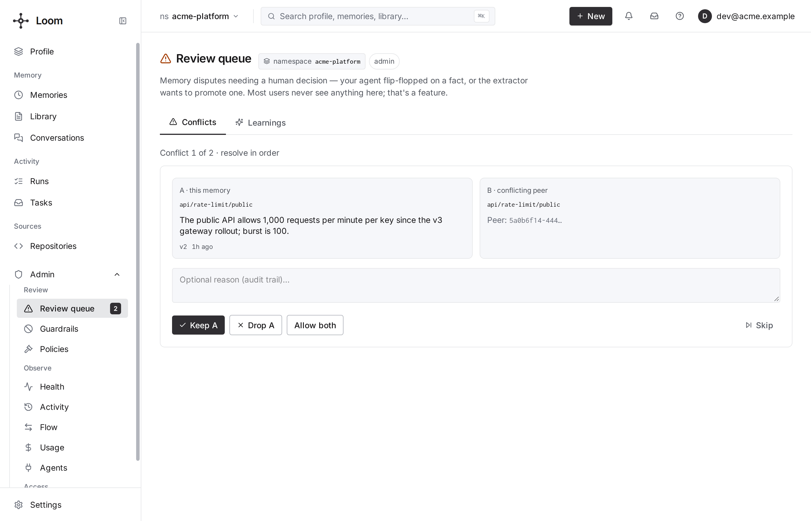

# Conflicts and refusal

Every memory write is judged against the facts the namespace already holds. A close but
different value is stored and flagged as a conflict, and the namespace owner decides
which fact stands: in the dashboard's Review queue, or with `conflicts.resolve`. Loom
picks a winner only where a policy or the conflict resolver says one row replaces another (see
[automatic retirements](#automatic-retirements)), and then records it so it can be
undone. Refusal works the other way: `blacklist.add` registers a pattern, and every
later write whose value matches it is refused. This page owns the write verdicts and the
namespace conflict policies; the model behind them is in [memory
concepts](../../concepts/memory.md).



## How a write is judged

`memory.set`, `memory.bulk_set` (and so `memory.set_from_messages`) and `memory.update`
compare the new value with the active rows of the same `memory_type` in the namespace:

- A canonical-form match is a **merge**: nothing is written.
- Cosine at or above the duplicate threshold, with the same content words and no
  differing values, is a **duplicate**; a value update falls through to the conflict check.
- Cosine at or above the conflict threshold with a different value is a **conflict**:
  the new row and each peer get `status='conflicted'` and are cross-linked through
  `conflict_with`.
- Under `newest_wins`, a value of the same shape with a different fill ("The office
  lease ends in 2025" → "... 2027") is an update: the older row retires (`refines`).

A `decision` row is identified by its key (category and scenario), not its text: in the
write-time conflict check, a peer under another key is never a merge, a duplicate, a
refinement or a pinned refusal, only a conflict ([decisions](../tasks-and-decisions.md#decisions)).
A `memory.bulk_set` entry whose value is byte-identical to a live row under another key
folds into that row whatever its type, a `decision` included.

No verdict on the write calls an LLM. The [conflict resolver](#the-conflict-resolver)
judges flagged and nearby pairs afterwards.

A pair on the namespace's allowlist is not flagged.

**Thresholds.** The conflict threshold comes from, in order: the memory type's
`dedup_threshold`, the namespace's `conflict_threshold`, the embedder calibration (with
`LOOM_ADAPTIVE_THRESHOLDS` on, the default), then `LOOM_CONFLICT_THRESHOLD` (0.85). The
duplicate threshold follows the same order without the type step, ending at
`LOOM_DUPLICATE_THRESHOLD` (0.97).

### Verdicts

Every write answers with `conflict_verdict`, the `peers` it was judged against (closest
first, at most five) and a `next` hint such as `memory.update(memory_key=<peer>, ...)`.

| Verdict     | Meaning                                                                                         | Row written                                                        |
| ----------- | ----------------------------------------------------------------------------------------------- | ------------------------------------------------------------------ |
| `clear`     | Nothing close.                                                                                  | Yes, `active`.                                                     |
| `merge`     | The same fact after canonicalisation is already stored.                                         | No. The stored row is reinforced; `noop=true`, `merged_into_key`.  |
| `duplicate` | Near-identical to a peer but not canonically equal.                                             | Yes, `status='duplicate'` with `duplicate_of`.                     |
| `conflict`  | Close to a peer but different.                                                                  | Yes; both rows `conflicted` and cross-linked.                      |
| `refines`   | Under `newest_wins`, the same statement with a different fill: an update of the peer.           | Yes; the replaced peer is superseded.                              |
| `rejected`  | Close to a pinned peer (a `decision` excepted, see above), or a changed value for a pinned key. | No. 409 `PINNED_CONFLICT` (a dry run returns the verdict instead). |

- Every verdict is deterministic and settled in the response.
- `dry_run=true` runs the whole check and writes nothing.
- The verdict is empty when no check ran: a non-searchable type or a `high` sensitivity
  row.

### Namespace conflict policy

`namespace.register` takes `default_conflict_policy`:

| Policy                     | Behaviour                                                                                                                                                                                                                  |
| -------------------------- | -------------------------------------------------------------------------------------------------------------------------------------------------------------------------------------------------------------------------- |
| `auto_reinforce` (default) | A contradiction is flagged for review; an update the conflict resolver is sure of retires the older row as `superseded` (history kept), and a less sure one is flagged. Two sessions' rows of one key are judged as peers. |
| `manual_review`            | Both stay live and the pair waits for review: the conflict resolver flags or clears, never retires.                                                                                                                        |
| `newest_wins`              | A templated substitution, or an update the conflict resolver is sure of, retires the older row as `superseded` (history kept). A write for a key retires every older live row with that key, whoever wrote it.             |
| `append_only`              | Every write is an event: no merge, duplicate or conflict verdict. A same-key rewrite stays last-writer-wins. The writer owns dedup.                                                                                        |

Superseded rows are served only to reads that pass `include_superseded=true` (or an
`as_of` read of a time they held), and a served one names its successor.

### Pinned facts

`memory.pin` writes a fact and marks it pinned. A pin is a write-time rule, not a
ranking hint:

- A close write against a pinned peer is refused with 409 `PINNED_CONFLICT` (a
  `decision` excepted, see above); `pinned_blocker_id` names the row.
- A changed value for a pinned key is refused the same way unless the write itself pins.
- A byte-identical restatement passes and keeps the pin.
- In `memory.bulk_set`, an entry for a pinned key is skipped (`skipped_pinned`); one
  close to a pinned peer is listed in `rejected_pinned` (a `decision` excepted, see
  above). Entries for one key settle in order, as separate `memory.set` calls would: an
  entry that is refused or merged leaves no value or pin for the next one, and repeating
  it gets the same verdict.

To change a pinned value, call `memory.update` (keeps the pin) or `memory.pin` (re-pins).

## Resolving conflicts

| Operation                    | Role   | Does                                                                                     |
| ---------------------------- | ------ | ---------------------------------------------------------------------------------------- |
| `conflicts.list`             | viewer | Unresolved conflicted rows with `conflict_with`; `count_only` or `keys_only` for badges. |
| `conflicts.propose_revision` | viewer | Suggestions (`revise`, `contract` or `allow`) with a rationale; changes nothing.         |
| `conflicts.resolve`          | admin  | Apply a decision to a row and its peers, or to one `peer_id`.                            |
| `conflicts.allowlist_list`   | viewer | Pairs marked as known-distinct.                                                          |
| `conflicts.allowlist_remove` | admin  | Remove a pair; it is flagged again on later writes.                                      |

These are HTTP, SDK (`agent.conflicts.*`) and dashboard operations, not MCP tools.

`conflicts.resolve(memory_id, decision)`:

| Decision   | Effect                                                                                                                |
| ---------- | --------------------------------------------------------------------------------------------------------------------- |
| `revise`   | The chosen row wins: it returns to `active` and its peers are tombstoned.                                             |
| `contract` | The chosen row is wrong: it is tombstoned and its peers return to `active`.                                           |
| `allow`    | Both are distinct: every row returns to `active` and each key pair goes on the allowlist (`loom.conflict_allowlist`). |

`reason` and `resolved_by` go to the audit trail. A resolve's tombstones are ordinary
tombstones: `memory.restore` revives them within 14 days.

```python
from loom import Agent

async with Agent(org="acme", namespace="support", agent="curator") as agent:
    page = await agent.conflicts.list(limit=20)
    for row in page["rows"]:
        print(row["memory_key"], row["value"], "vs", row["conflict_with"])
    await agent.conflicts.resolve(
        page["rows"][0]["memory_id"], "revise", reason="plan changed at renewal"
    )
```

### The conflict resolver

With `LOOM_MEMORY_CONFLICT_RESOLVER_ENABLED` on (the default wherever neither
`LOOM_LLM_PROVIDER` nor the provider of `LOOM_CONFLICT_RESOLVER_MODEL` is `fake`), a
leader-only worker judges each write that has a live peer of its type at cosine
0.60 or more, or was flagged `conflicted`, against up to eight such peers in one call to
`LOOM_CONFLICT_RESOLVER_MODEL` (`gpt-6.1-sol`). Per pair:

- an update it is sure of (confidence 0.98 or more) under `auto_reinforce` (the default)
  or `newest_wins` retires the older row, recorded for Undo (reason `conflict_resolver`),
  when the older row's value was asserted first (to the nanosecond) and the two facts are
  not dated the same day; otherwise the pair is flagged. Under `manual_review` it is
  flagged;
- a contradiction at 0.95 or more, and an update between 0.95 and 0.98, flag both rows
  for review;
- a compatible pair (elaboration, restatement, related, unrelated) at 0.90 or more has its
  flag cleared;
- anything less sure changes nothing, and so does an update or a contradiction between
  two sessions of the anonymous user `-` (an agent's sessions are separate tasks).

The judge sees when each note's statement holds and which session it comes from.

It also re-checks pairs flagged before it judged them, so a false flag is cleared once.
A pinned row is never touched, a row that changed since it was judged is left to its
next judgement, and each written version is judged once. A judgement costs about $0.005,
and the resolver spends at most a quarter of a namespace's daily cost cap
(`LOOM_MEMORY_CONFLICT_RESOLVER_CAP_SHARE`), leaving the rest for requests; past it the
namespace waits. The design is in [memory
architecture](../../architecture/memory-architecture.md#the-conflict-resolver).

### The Review queue

The dashboard's Review queue (`<server>/admin/review_queue`, `g r`) lists conflicted pairs and
applies `conflicts.resolve`. Three more tabs appear when they have content: **Learnings**
([learnings](./procedures-and-learnings.md#learnings-review-queue)), **Auto-resolved**
(below) and **Exceptions** (the allowlist). See [the dashboard](../dashboard.md).

### Automatic retirements

When Loom retires memories on its own, each path that retired rows records them as
`memory.auto_supersede` audit rows (`reason` in brackets):

- the conflict resolver, for an update it is sure of (`conflict_resolver`);
- `newest_wins` on a key written again (`same_key_newest_wins`);
- a templated substitution under `newest_wins` (`newest_wins_contradiction`);
- `newest_wins` inside one bulk batch, or behind a repaired single-valued triple
  (`newest_wins_contradiction`);
- a value update (`value_update`).

A write that retires rows through several paths leaves one record per path, and a path
that retires more than 200 rows splits them across several records. A record names each
retired memory, the row it retired behind and the reason; it holds ids, keys and
identity, never value text. On every path listed, a locked or pinned row, or one
already retired since it was read, is left as it is.

A row is listed once a re-read after the write finds its superseded version at the head;
one a later write overtook is not. One the re-read could not see is listed with
`unconfirmed`: a write's result never counts it among the rows it retired, recall is
left as it was, and `loom reconcile-status` finds and mirrors any divergence. A point
write (`memory.set`, `memory.update_by_id`) writes its record and closes the retired
rows' graph facts before it answers, and a record that fails is owed to the projection
repair, which writes it once; the conflict resolver writes its own after the retirement,
owed the same way.

[`memory.auto_retirements`](../../reference/operations/memory.md#memoryauto_retirements)
lists the records of the last 30 days (or since `since`), one row per retired memory,
newest record first: its ids, keys and identity, the reason, `unconfirmed` and the
conflict resolver's `judge_*` fields. A caller whose read is narrowed to one user or
session gets only that user's or session's rows. A page holds about `limit` rows (50 by
default): a record is never split across pages, and one whose rows the read scope leaves
out still moves `next_cursor`. `memory.statuses` reads which retirements still stand.

#### The Auto-resolved tab

The Review queue's **Auto-resolved** tab lists the last 30 days through
`memory.auto_retirements`, 50 retired memories a page. A row the re-read could not
confirm is marked "may not have taken effect". To mark rows already restored, the tab
reads up to 2,500 `memory.unsupersede` records (5 pages of 500) back to the oldest
retirement it shows. Past that, an older row still offers Undo: undoing a row an Undo
already restored shows it restored, and one written or retired since shows "Changed
since". A row shows as restored only while
`memory.statuses` reads it no longer retired behind that memory, so the record of an
Undo whose restore failed still offers Undo, and so does a row whose state could not be
read: a repeat Undo of a restored row answers restored.

#### Undo

The tab's Undo calls `memory.restore` with `if_superseded_by`: the row comes back, and
`memory.unsupersede` is recorded, only while it is still retired behind the memory the
record names; a row deleted, revived or retired again since shows "Changed since". When
the record cannot be written, the Undo fails and nothing is restored. When the restore's
answer is lost (503, outcome unknown), retrying the Undo finishes it and answers
restored. It comes back `active`, or `conflicted` when it was under review when it
retired: it still lists its peers, as they list it. A retired duplicate comes back
`duplicate` while its original is still served, and `active` once it is not.

The Undo holds the key's write lock from its read of the row to its insert, as a
conditional write (`if_match_sha256`) and every conflict resolver write do: a
conditional revision or a resolver write made meanwhile lands first and the Undo shows
"Changed since", or waits for the Undo. An unconditional write takes no lock, and the
later of the two wins. When another conditional write holds the lock past its wait, the
Undo answers 409 PRECONDITION_FAILED ("this memory is being written right now; retry the
Undo"), and while the lease store (Keeper) does not answer, 503 BACKEND_UNAVAILABLE.
Retry either.

An Undo opens again the graph facts the restored row still holds (see the
[entity graph](../entity-graph.md)). The resolver does not retire the row behind the same
memory again, or flag the pair, while the row holds the value it had at the Undo and the
other memory's value predates it; a new value of either is judged afresh.

#### Restore from the memory inspector

The memory inspector's **Restore** on a superseded row sends `only_if_superseded`, and
`if_superseded_by` when it can see the successor: a read narrowed below the namespace
shows none for a successor outside its scope, and either way a delete since is never
undone. When it finds nothing to restore, the inspector re-reads the row and shows it as
it is now. Either way the list behind the drawer is refreshed, even if the drawer has
moved to another memory; a failed re-read is reported and leaves the restore's own
message standing. A restore that answers after the drawer has moved to another memory or
closed is still reported, with its key named, and leaves the drawer on the memory it
moved to; if the drawer has come back to the restored memory, it re-reads the row.

## Duplicates

A duplicate is the same fact in other words. It is stored with `status='duplicate'` and
`duplicate_of` pointing at its canonical. `memory.search` puts the canonical in the
duplicate's slot, `memory.list` skips duplicates, and `memory.get` names the canonical in
`canonical_key` (`follow=true` serves it). `include_duplicates=true` shows them.

| Operation                          | Role   | Does                                                                                                                                                                                                      |
| ---------------------------------- | ------ | --------------------------------------------------------------------------------------------------------------------------------------------------------------------------------------------------------- |
| `memory.dedup_list`                | admin  | Clusters of one canonical and its duplicates.                                                                                                                                                             |
| `memory.dedup_resolve`             | admin  | `keep_canonical`, `keep_duplicate` or `keep_both` for one pair, named by the `canonical_id` and `duplicate_id` that `memory.dedup_list` returns; `confirm_canonical_key` repeats the canonical row's key. |
| `memory.dedup_collapse`            | writer | Every pair of a namespace (or key `prefix`) onto its canonical; no LLM; `dry_run` by default.                                                                                                             |
| `memory.resolve_orphan_duplicates` | writer | Re-activate duplicates whose canonical is gone; `dry_run` to preview.                                                                                                                                     |
| `memory.consolidate`               | writer | LLM-merge clusters of near-duplicates into one canonical each; `dry_run` to preview.                                                                                                                      |

`keep_both` only clears the duplicate's tag, so a later write can flag the pair again.
`memory.consolidate` makes one LLM call per cluster, skips rows younger than
`min_age_seconds` (default one hour), and records lineage ([history and provenance](./history-and-provenance.md#lineage)).

## Refusal: the blacklist

`blacklist.add(pattern, scope)` registers a pattern no write may store. `memory.set` and
`memory.update` answer 422 `BLACKLISTED` with the `pattern_id`, scope and reason. The
bulk and extraction paths skip the entry and count it.

| Field          | Values                                                                             |
| -------------- | ---------------------------------------------------------------------------------- |
| `pattern`      | Up to 4,096 characters.                                                            |
| `pattern_type` | `substring` (default, case-sensitive) or `regex`.                                  |
| `scope`        | `namespace` (default), `org` (needs org admin) or `global` (needs platform admin). |
| `reason`       | Stored on the pattern and returned with every refusal.                             |
| `sweep`        | Also tombstone the live rows the pattern already matches.                          |

`blacklist.add` is a writer op and an MCP tool (`loom_blacklist_add`), so an agent can
honour "never remember my home address" inside the conversation. A token bounded to one
user (`read_scope` `own_user` / `own_session`) gets `AUTH_INSUFFICIENT` on every
`blacklist.*` op: a pattern refuses every user's writes in the namespace.

A regex is at most 256 characters, is RE2 syntax (no backreferences or lookaround, `\z`
rather than `\Z`) and compiles to at most 300 RE2 instructions (a long non-ASCII literal
can exceed that: use a substring pattern for it), and a scope's regexes together compile
to at most 3,000. It runs on RE2, in time linear in the value, on writes and in the sweep
alike. On a write it runs on four threads per process of its own, off the event loop; one
org holds at most two of them at once, so one busy org leaves half the threads to the
others, and a write that waits more than 5 seconds for one is refused with 503
`OVERLOADED`, never stored unchecked. Once the bytes one request writes (a bulk write's
entries together) times the instructions of the regexes that apply pass 250 million, a
further value is refused as `BLACKLISTED` with an empty `pattern_id` and a reason saying
it is too long to check, unless a substring pattern matches it: send it in a smaller
request, or, when the value alone is past the budget (the reason says so), shorten it. In
a `memory.bulk_set`, every later entry of its key is refused the same way
(`blacklist_unchecked`), even one that would fit, so sending them again in order leaves
the key at its last value; a caller that does not send them again keeps the key's earlier
value. The server sends none again itself, since the budget bounds one request's work:
`memory.set_from_messages` lists such facts in `refused` and `memory.import` in its
results, for the caller to send again. The Python SDK sends the coalesced sets refused
this way again, in order, in batches the size of what the last request checked, and one
still unchecked at the front of a request as a `memory.set` alone.

| Operation          | Role   | Does                                                                              |
| ------------------ | ------ | --------------------------------------------------------------------------------- |
| `blacklist.add`    | writer | Register a pattern; optionally sweep existing rows.                               |
| `blacklist.list`   | viewer | Effective patterns for the namespace, including org and global, with `hit_count`. |
| `blacklist.sweep`  | writer | Continue a sweep for an existing `pattern_id`.                                    |
| `blacklist.remove` | admin  | Remove a pattern.                                                                 |

**Sweeping existing rows.** `sweep=true` tombstones matching live rows, up to 5,000 per
call; `swept_truncated=true` means call `blacklist.sweep(pattern_id)` again. Each sweep
leaves one `loom.memory_drops` row, so `loom drops` shows what it removed. The sweep runs
in ClickHouse with RE2, the engine the write path uses.

```bash
curl -sX POST http://localhost:7777/v1/blacklist.add \
  -H "Authorization: Bearer $LOOM_API_KEY" -H 'Content-Type: application/json' \
  -d '{"org":"dev","namespace":"local",
       "pattern":"\\b\\d{3}-\\d{2}-\\d{4}\\b","pattern_type":"regex",
       "reason":"never store national id numbers","sweep":true}'
```

**Across replicas.** Each replica caches the patterns in process. Adding or removing one
bumps a one-row version watermark (`loom.blacklist_version`); replicas poll it every
`LOOM_BLACKLIST_VERSION_CHECK_INTERVAL_SECONDS` (2 s), with a hard cache TTL
(`LOOM_BLACKLIST_CACHE_TTL_SECONDS`, 300 s). For up to one interval, another replica can
still accept a newly refused value.

The dashboard's Guardrails page (`<server>/admin/guardrails`) manages patterns, and each
pattern's **Delete matches** runs the sweep. Refusing is not erasing: to remove a person's
data, use [erasure](./retention-and-erasure.md#erasure).

## Settings

| Setting                                           | Default                                                               | Effect                                                                                               |
| ------------------------------------------------- | --------------------------------------------------------------------- | ---------------------------------------------------------------------------------------------------- |
| `LOOM_CONFLICT_THRESHOLD`                         | 0.85                                                                  | Fallback conflict cosine; 1.0 disables flagging.                                                     |
| `LOOM_DUPLICATE_THRESHOLD`                        | 0.97                                                                  | Fallback duplicate cosine.                                                                           |
| `LOOM_ADAPTIVE_THRESHOLDS`                        | true                                                                  | Calibrate both thresholds from the live embedder.                                                    |
| `LOOM_MEMORY_CONFLICT_RESOLVER_ENABLED`           | true unless the LLM provider or the resolver model's provider is fake | The background conflict resolver; an explicit value wins. Without its model's key, writes wait owed. |
| `LOOM_CONFLICT_RESOLVER_MODEL`                    | gpt-6.1-sol                                                           | The resolver's judge.                                                                                |
| `LOOM_MEMORY_CONFLICT_RESOLVER_MIN_SIMILARITY`    | 0.60                                                                  | Lowest cosine that marks a write and joins its cluster.                                              |
| `LOOM_MEMORY_CONFLICT_RESOLVER_RETIRE_CONFIDENCE` | 0.98                                                                  | An update retires its predecessor (`auto_reinforce`, `newest_wins`) at this confidence.              |
| `LOOM_MEMORY_CONFLICT_RESOLVER_FLAG_CONFIDENCE`   | 0.95                                                                  | An update or a contradiction flags the pair (or retires, as above) only at this confidence.          |
| `LOOM_MEMORY_CONFLICT_RESOLVER_CLEAR_CONFIDENCE`  | 0.90                                                                  | Below it nothing changes; at it a compatible pair clears.                                            |
| `LOOM_BULK_CONFLICT_CHECK_MAX_ENTRIES`            | 200                                                                   | Entries per `memory.bulk_set` checked; 0 = none.                                                     |
| `LOOM_BLACKLIST_VERSION_CHECK_INTERVAL_SECONDS`   | 2.0                                                                   | Cross-replica pattern refresh bound.                                                                 |

See the [configuration reference](../../reference/configuration.md#conflict-detection).

## Limits

- **A conflict is a flag, not a refusal.** Both rows are served until resolved. A reader
  should prefer the later `valid_at`, or ask.
- **Fake embedders give string-similarity verdicts.** The stock stack's fake embedder does
  not model meaning. With adaptivity off, re-bench the fallback thresholds after changing
  the embedder.
- **`conflicts.resolve` is admin.** A writer settles its own contradiction with
  `memory.update` on the peer the `next` hint names.
- **A pattern matches values, not keys**, and a substring pattern is case-sensitive.
