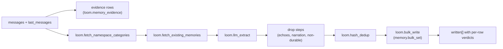

# Extraction from transcripts

`memory.set_from_messages` takes a transcript and the server decides what in it is
durable. Use it when the caller cannot decide inline what to save: raw API consumers,
batch importers, and coding-agent hooks that capture a session at its end. A caller that
already knows the fact should call `memory.set` ([writing](./writing.md)). Extraction
writes through `memory.bulk_set`, so every extracted fact meets the same blacklist, lock,
pin and conflict checks. It needs a real LLM provider; the stock fake provider extracts
nothing.

## What a call does



1. The turns are stored as evidence first (`loom.memory_evidence`), so a fact can be
   traced to its sentence (`memory.evidence`) and the raw wording stays searchable
   (`memory.recall`).
2. The default pipeline runs these steps in order:

   | Step                              | What it does                                                                                       |
   | --------------------------------- | -------------------------------------------------------------------------------------------------- |
   | `loom.fetch_namespace_categories` | Loads the namespace's categories, so extracted tags use that taxonomy.                             |
   | `loom.fetch_existing_memories`    | Shows the extractor the nearest existing memories, so it does not repeat them.                     |
   | `loom.llm_extract`                | The extraction call; long transcripts are split into segments, one call each.                      |
   | `loom.drop_recall_echoes`         | Drops facts that restate a memory the session was served (`recalled_keys`) or named.               |
   | `loom.drop_session_echoes`        | Drops facts that restate what the session's own Loom calls wrote, asked or got (`session_values`). |
   | `loom.drop_activity_narration`    | Drops narration of tool activity with no outcome ("User read lines 1-1000 of X").                  |
   | `loom.drop_non_durable`           | Coding captures only: drops status snapshots, housekeeping, first-person plans, in-batch repeats.  |
   | `loom.verify_durable`             | Coding captures only: a model pass that drops what every verifier calls non-durable. Fails open.   |
   | `loom.hash_dedup`                 | Drops facts whose canonical content hash is already stored.                                        |
   | `loom.bulk_write`                 | Writes through `memory.bulk_set`, with verdicts and one hash-only audit row per write.             |

3. The handler then links each memory to its evidence, drafts a session digest and
   projects entities.

`pipeline_steps` reorders or skips steps, or names an in-process step an operator
registered (at most 16; an HTTP `hook.*` step is refused). See the
[extraction pipeline guide](../../guides/extraction-pipeline.md).

**Keys** are minted from a fact's subject and attribute, never its value. A later
session that states the same attribute lands on the same key and revises the row. When
the user asks to forget something, the matching rows are retired and named in
`forgotten` / `forgotten_keys`.

**Coding captures** are requests whose `extra_tags` carry `source:claude-code`,
`source:codex` or `source:cursor` (the plugins tag every capture), or a trajectory replay
from the observe plane. Only these run `loom.drop_non_durable` and `loom.verify_durable`.
The rules in `server/memory/domain/durable_facts.py` match sentence shape, not topic words: what
a release changed is kept; whether its CI was green at the time is dropped.

## Rules the assistant states about itself

Experimental. A chat bot's replies carry rules about its own behaviour: "I escalate any
refund over $500 to a human", "I always answer in bullet points". With
`LOOM_MEMORY_EXTRACT_AGENT_LEARNINGS=true` for the deployment (a live setting:
`loom settings set memory_extract_agent_learnings true` turns it on without a restart,
see [runtime settings](../../operations/runtime-settings.md)), the extraction call also
returns these, marked `"about": "agent"`, at no extra model call. The setting is the
only way on: a request's `agent_learnings=false` turns it off for that call, and
`agent_learnings=true` while the setting is off is ignored and named in `ignored_args`
(and the `X-Loom-Ignored-Args` header). It is off by default: it adds a block to the
extraction prompt, and extraction quality has not been benchmarked with it on. Turn it
on only once every replica runs a build that has it. Before rolling back to a build
without it, turn it off, then delete the rows of `loom.learnings_supporters`, where
users' quotes live (an older build's erasure does not cover that table), and the
`assistant_turn` candidates
(`ALTER TABLE loom.learnings_queue DELETE WHERE source_kind = 'assistant_turn'`). An
older build lists a pending one and, on promote, writes the bot's rule as the
approver's own memory. Coding captures never use it.

Such a rule is never written as a memory. An end user can talk a bot into saying
anything, and a memory at the agent's level would reach every user of the bot. The rule
becomes a pending `assistant_turn` candidate in the
[learnings review queue](./procedures-and-learnings.md#learnings-review-queue) for the
request's `(org, namespace, agent)`:

- A candidate is keyed by the agent, the rule's memory key and its text, with only case
  and spacing folded and a trailing period dropped. A different rule under the same key
  is a separate candidate, so a first wording never collects the support of a later
  one. The same rule worded differently in another session is a separate candidate too,
  so wording drift splits its support. The extractor's key rewrites leave a rule's key
  alone.
- The candidate row holds the rule and no user's words. Each session that states it adds
  a row to `loom.learnings_supporters` with the end user, the session and that user's
  own quotes: the user turn before the cited assistant turn (up to 200 characters) and
  the rule as said, the span the extractor cited when a cited assistant turn contains
  it, else that assistant turn (up to 400). A rule whose `source_message_indices` name no
  assistant turn is not something the assistant said: it is never filed, and the drop is
  counted in `loom.memory_drops` (stage `learnings.file`, reason `no_assistant_turn`).
  A rule that matches a blacklist pattern, or reads as a credential, is never filed
  either, and a quote that does is stored blank. The supporter row is
  written first, then the candidate row again, at version 1, with every new supporter.
  So an erasure that deletes a pending candidate mid-filing never leaves that supporter
  without it. A review always writes a newer version, so the rewrite never undoes a
  decision, and a decided candidate takes no new supporters.
- `learnings.list` shows the earliest remaining supporter's quotes as the `rationale`.
  A user erasure deletes that user's supporter rows, so the next supporter's quotes
  show. A candidate left with none is deleted when pending; when decided, it keeps its
  decision with the rule blanked.
- Support never promotes a candidate. An admin's `learnings.review` does. By default
  the rule is published to the namespace's knowledge (`learning://<candidate_id>`,
  tagged `agent:<agent>`; the tag names the bot, and the document's author is the
  reviewer). The agent reads that serve knowledge serve it to that bot only, for
  every user, a user bounded to their own rows included: `context.pack` with
  `include_knowledge`, `memory.stack`, `loom_search` and `memory.ask` (its knowledge
  passages and its whole-document route). Another agent in the
  namespace is not served it, and a rule filed for every agent (`-`) carries no agent
  tag and is served to every agent. `knowledge.search` is not filtered by agent; a bot
  finds its own rules with `knowledge.search(tags=["agent:<agent>"])`.
  `destination="memory"` writes the agent's memory row instead (`user_id` `-`,
  `source_trace` `learning:<candidate_id>`), which namespace-wide reads find and a read
  bounded to one user does not.
- A token bound to one end user files for the agent it names, never the body's `agent`.
  An end-user token names the agent its issuer signed (its `agent` claim). A token Loom
  mints names no agent, so one pinned with `--read-user-id` files no bot's rule. Its
  reads are served that agent's rules the same way, and no bot's rules when it names
  none: a bot that needs its own promoted rules for a user reads with an end-user token
  signed for it, or with an unpinned token.

`learning_candidates` in the response counts the rules that wrote a new candidate or this
session's support of one. A failed queue
write is named in `pipeline_errors` and the rule is dropped.

## Echoes: `recalled_keys` and `session_values`

Most junk in session captures is the session repeating what Loom already told it. Two
fields let the pipeline drop it:

| Field            | Limit | Content                                                                                                                         |
| ---------------- | ----- | ------------------------------------------------------------------------------------------------------------------------------- |
| `recalled_keys`  | 200   | Keys the session's Loom tools served. A fact whose key carries a served key's subject words is an echo.                         |
| `session_values` | 100   | Text the session's Loom calls carried (values written, queries, results). Not in the MCP schema. A fact quoting one is an echo. |

The Claude Code and Codex plugins send both at `SessionEnd`. A custom client should too;
otherwise a session that asked "what do I drink?" writes the answer back as a new fact.
See [Claude Code](../integrations/claude-code.md).

## Fact quality on the read side

A deterministic classifier (`server/memory/domain/fact_quality.py`) runs on agent-facing reads
(`loom_search`'s memory section and `context.pack`'s memories, through the
`quality_filter` field of `memory.search`). It leaves out trajectory steps, session
narration, generic tool hints, code locations the code index answers exactly, probe or
placeholder writes, one-moment status, and restatements of a higher-ranked fact. Nothing
is deleted.

To clean stored rows, `loom demote-activity-narration` demotes (confidence × 0.25) or
labels them through `memory.apply`. It is a dry run without `--apply`;
`--classifier fact_quality` applies every junk class; keys an agent read by name in the
last `--days` are left alone. It never deletes.

## Inline or deferred

| Mode                 | Call                           | Returns                                      | Use when                                                                   |
| -------------------- | ------------------------------ | -------------------------------------------- | -------------------------------------------------------------------------- |
| Inline (default)     | `defer=false`                  | `written[]` with each row's key and verdict  | You need the keys back: typed-record extraction, tests, polling backfills. |
| Deferred             | `defer=true`                   | `deferred=true`, `queue_id`, empty `written` | The agent's hot path. Stored in `loom.memory_extraction_queue`.            |
| Deferred by operator | `LOOM_EXTRACTION_DEFER_AGENTS` | as deferred, `deferred_by="allowlist"`       | Force named agents (or `*` = every service account) onto the queue.        |

The `extraction_queue` worker replays a deferred request through the same handler. A
failed replay retries until `LOOM_EXTRACTION_QUEUE_MAX_ATTEMPTS`, then becomes `failed`
with `last_error`. `memory.extraction_status` reports batches by `queue_id` or `status`
(`pending`, `running`, `done`, `failed`); a token bounded to one user sees only that
user's batches. Until a batch runs, `memory.search` and
`memory.ask` report `pending_extraction`. With the worker off, deferred saves stay
`pending`.

## Operations

| Op                         | Role   | Does                                                                         |
| -------------------------- | ------ | ---------------------------------------------------------------------------- |
| `memory.set_from_messages` | writer | Extract facts (or one typed record) from `messages` and write them.          |
| `memory.extraction_status` | viewer | State of deferred batches. HTTP and SDK only.                                |
| `memory.recall`            | viewer | Search the raw turns behind the namespace's memories by text, time and role. |
| `memory.evidence`          | viewer | The source turns one memory was extracted from, with the supporting span.    |
| `observe.record`           | writer | Record one tool observation into the episodic plane; no model call.          |
| `observe.crystallize`      | writer | Mark a session's observations ready for the `observe_extract` worker.        |

Field lists: [operations reference](../../reference/operations.md#memory) and
[observe](../../reference/operations.md#observe).

### Request fields

| Field                          | Effect                                                                                                                                      |
| ------------------------------ | ------------------------------------------------------------------------------------------------------------------------------------------- |
| `messages`                     | 1–400 turns: `role`, `content`, optional `timestamp` (anchors facts to the turn) and `name` (speaker).                                      |
| `last_messages`                | Up to 20 earlier turns, shown for context and not re-extracted.                                                                             |
| `observation_date`             | `YYYY-MM-DD` anchor for relative dates. Unset: `LOOM_MEMORY_EXTRACT_OBSERVATION_DATE_DEFAULT` (`request_time`, today UTC).                  |
| `extra_tags`                   | Added to every extracted fact. `source:<client>` marks a coding capture.                                                                    |
| `extraction_instructions`      | A prompt suffix (up to 4,096 characters).                                                                                                   |
| `record_schema` + `memory_key` | Extract one typed record ([typed records](./writing.md#typed-records)). Never deferred by the allowlist.                                    |
| `valid_at`                     | Fallback validity time for facts the extractor did not anchor.                                                                              |
| `recalled_keys`                | Keys the session was served ([echoes](#echoes-recalled_keys-and-session_values)).                                                           |
| `defer`                        | Queue instead of extracting inline.                                                                                                         |
| `agent_learnings`              | `false` stops filing the assistant's rules for this call ([above](#rules-the-assistant-states-about-itself)); only the setting turns it on. |

### Response fields

- `written[]`: key, version, `conflict_verdict`, `peers`.
- `tokens_in`, `tokens_out`, `cached_tokens_in`: cost attribution.
- `segments`, `segmenter` (`whole` or `size`).
- `forgotten`, `forgotten_keys`, `evidence_ids`.
- `learning_candidates`: rules that wrote a new candidate or this session's support of one.
- `ignored_args`: request fields not applied: unknown keys, and `agent_learnings=true`
  while the setting is off.
- `stage_ms`: wall time per stage (`step.<step_id>`, `bulk.<phase>`).
- `observation_date_source`: `caller`, `request_time` or empty.
- `stubbed_fields`: typed-record fields written as null after validation retries.
- `pipeline_errors`: fail-open steps that were skipped, such as `unknown_step:<id>`.

## Example

Inline, with the Python SDK:

```python
from loom import Agent

async with Agent(org="acme", namespace="support", agent="triage-bot") as bot:
    out = await bot.memory.set_from_messages(
        [
            {"role": "user", "content": "I moved to Lisbon last month, please bill me in EUR."},
            {"role": "assistant", "content": "Noted, invoices will be in EUR."},
        ],
        user_id="u-42",
        observation_date="<YYYY-MM-DD>",  # the day the conversation happened
    )
    for row in out["written"]:
        print(row["memory_key"], row["conflict_verdict"])
```

Deferred, over HTTP, as a session-end hook sends it:

```bash
curl -sX POST http://localhost:7777/v1/memory.set_from_messages \
  -H "Authorization: Bearer $LOOM_API_KEY" -H "Content-Type: application/json" \
  -d '{"org":"acme","namespace":"support","agent":"triage-bot","user_id":"u-42",
       "messages":[{"role":"user","content":"Our on-call rotation changes to weekly."}],
       "recalled_keys":["team/oncall/rotation"],
       "defer":true}'
# → {"deferred": true, "queue_id": "...", "written": [], ...}
```

The SDK's `set_from_messages` does not expose `recalled_keys`, `session_values` or
`pipeline_steps`; send those over HTTP or MCP.

## Settings

See the [Extraction section](../../reference/configuration.md#extraction) unless noted.

| Setting                                                   | Effect                                                                                         |
| --------------------------------------------------------- | ---------------------------------------------------------------------------------------------- |
| `LOOM_LLM_PROVIDER`, `LOOM_LLM_MODEL`                     | The extraction model. Run `make bench-quick` before changing it.                               |
| `LOOM_MEMORY_EXTRACT_VERIFY_MODELS`                       | The models `loom.verify_durable` asks; a model whose provider key is missing is skipped.       |
| `LOOM_MEMORY_EXTRACT_VERIFY_TIMEOUT_S`                    | Per verifier call; a timeout keeps every fact.                                                 |
| `LOOM_MEMORY_EXTRACT_SIZE_SEGMENT_*`                      | When a long session is split into fixed windows, and their size.                               |
| `LOOM_MEMORY_EXTRACT_COVERAGE_SWEEP_*`                    | A second reading of turns the first pass cited nowhere (one more call).                        |
| `LOOM_MEMORY_EXTRACT_VALUE_UPDATES`                       | Off by default: supersede an older memory when a fresh one restates it with a different value. |
| `LOOM_MEMORY_EXTRACT_AGENT_LEARNINGS`                     | Experimental, off by default: file the assistant's rules about itself for review.              |
| `LOOM_EXTRACTION_QUEUE_*`, `LOOM_EXTRACTION_DEFER_AGENTS` | The deferred queue: cadence, lease, attempts, concurrency, forced deferral.                    |
| `LOOM_OBSERVE_EXTRACT_*`                                  | The observe plane's distillation worker (off by default; makes model calls).                   |
| `LOOM_MEMORY_CHUNKS_MAX_PER_CALL`                         | Verbatim chunks one call writes ([Chunking](../../reference/configuration.md#chunking)).       |

## Workers

| Worker             | Role                                                             | Default |
| ------------------ | ---------------------------------------------------------------- | ------- |
| `extraction_queue` | Replays deferred requests.                                       | on      |
| `observe_extract`  | Distils `observe.record` observations through the same pipeline. | off     |
| `entity_extractor` | Fills `entities` on rows written without them.                   | on      |
| `embedding_worker` | Embeds rows whose inline embedding failed.                       | on      |

Cadences and switches: [workers reference](../../reference/workers.md).

## Limits

- **Extraction failure is fail-closed.** An error from `loom.llm_extract` answers 502
  `EXTRACTION_FAILED` and writes nothing. Every other step fails open and is named in
  `pipeline_errors`.
- **Drops are counted, not returned.** Parse, judge, truncation and chunk-cap losses go to
  `loom.memory_drops` (kept 30 days); `loom drops --namespace NS [--hours 24]` sums them.
- **At most 400 messages and 20 `last_messages` per call.** Split longer imports.
- **Custom pipelines are global and sequential.** No per-namespace pipeline, branching or
  step retry.
- **Re-extracting a namespace** into a fresh one is
  `loom reextract --org ORG --namespace SRC --into DST`; the source is only read.

## Related

- [Writing memory](./writing.md)
- [Conflicts and refusal](./conflicts-and-refusal.md): the verdicts in `written[]`.
- [Extraction pipeline guide](../../guides/extraction-pipeline.md)
- [Conversations and sessions](../conversations-and-sessions.md)
- [Memory architecture](../../architecture/memory-architecture.md)
