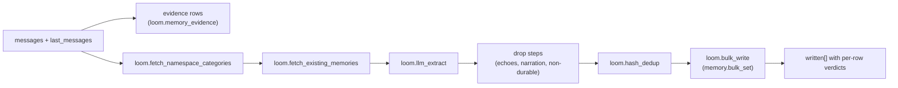

# Extraction from transcripts

`memory.set_from_messages` takes a transcript and the server decides what in it is
durable. Use it when the caller cannot decide inline what to save: raw API consumers,
batch importers, and coding-agent hooks that capture a session at its end. A caller that
already knows the fact should call `memory.set` ([writing](./writing.md)). Extraction
writes through `memory.bulk_set`, so every extracted fact meets the same blacklist, lock,
pin and conflict checks. It needs a real LLM provider; the stock fake provider extracts
nothing.

## What a call does



1. The turns are stored as evidence first (`loom.memory_evidence`), so a fact can be
   traced to its sentence (`memory.evidence`) and the raw wording stays searchable
   (`memory.recall`).
2. The default pipeline runs these steps in order:

   | Step                              | What it does                                                                                       |
   | --------------------------------- | -------------------------------------------------------------------------------------------------- |
   | `loom.fetch_namespace_categories` | Loads the namespace's categories, so extracted tags use that taxonomy.                             |
   | `loom.fetch_existing_memories`    | Shows the extractor the nearest existing memories, so it does not repeat them.                     |
   | `loom.llm_extract`                | The extraction call; long transcripts are split into segments, one call each.                      |
   | `loom.drop_recall_echoes`         | Drops facts that restate a memory the session was served (`recalled_keys`) or named.               |
   | `loom.drop_session_echoes`        | Drops facts that restate what the session's own Loom calls wrote, asked or got (`session_values`). |
   | `loom.drop_activity_narration`    | Drops narration of tool activity with no outcome ("User read lines 1-1000 of X").                  |
   | `loom.drop_non_durable`           | Coding captures only: drops status snapshots, housekeeping, first-person plans, in-batch repeats.  |
   | `loom.verify_durable`             | Coding captures only: a model pass that drops what every verifier calls non-durable. Fails open.   |
   | `loom.hash_dedup`                 | Drops facts whose canonical content hash is already stored.                                        |
   | `loom.bulk_write`                 | Writes through `memory.bulk_set`, with verdicts and one hash-only audit row per write.             |

3. The handler then links each memory to its evidence, drafts a session digest and
   projects entities.

The conversation is also kept as verbatim chunks, which search returns as `chunk` hits. A
chunk or digest whose text reads as high (a pasted API key, a `password=` assignment,
a card number, an SSN or a stated PIN) is stored as written but never embedded, so search
and `memory.ask` never serve it; `memory.get` on its `chunk:` key does, with a
`memory.sensitive_read` audit row ([sensitivity](../../architecture/security.md#sensitivity)).

`pipeline_steps` reorders or skips steps, or names an in-process step an operator
registered (at most 16; an HTTP `hook.*` step is refused). See the
[extraction pipeline guide](../../guides/extraction-pipeline.md).

**Keys** are minted from a fact's subject and attribute, never its value. A later
session that states the same attribute lands on the same key and revises the row. When
the user asks to forget something, the matching rows are retired and named in
`forgotten` / `forgotten_keys` (a window's latest 50 requests are matched by content).

**Coding captures** are requests whose `extra_tags` carry `source:claude-code`,
`source:codex` or `source:cursor` (the plugins tag every capture), or a trajectory replay
from the observe plane. Only these run `loom.drop_non_durable` and `loom.verify_durable`.
The rules in `server/memory/domain/durable_facts.py` match sentence shape, not topic words: what
a release changed is kept; whether its CI was green at the time is dropped.

## Rules the assistant states about itself

A chat bot's replies carry rules about its own behaviour: "I escalate any refund over
$500 to a human", "I always answer in bullet points". With
`LOOM_MEMORY_EXTRACT_AGENT_LEARNINGS` on (off by default; a live setting:
`loom settings set memory_extract_agent_learnings true` turns it on without a
restart, see [runtime settings](../../operations/runtime-settings.md)), the extraction
call also returns these, marked `"about": "agent"`, at no extra model call. The setting
is the only way on: a request's `agent_learnings=false` turns it off for that call, and
`agent_learnings=true` while the setting is off is ignored and named in `ignored_args`
(and the `X-Loom-Ignored-Args` header). It adds a block to the extraction prompt. Turn
it on, and review `assistant_turn` candidates, only once no replica runs a build
without it: an older build does not erase `loom.learnings_supporters`, and on promote
it writes the bot's rule as the approver's own memory
([rolling upgrades](../../architecture/rolling-upgrades.md)). Before rolling back to
such a build, turn it off, then delete the rows of `loom.learnings_supporters`, where
users' quotes live (an older build's erasure does not cover that table), and the
`assistant_turn` candidates
(`ALTER TABLE loom.learnings_queue DELETE WHERE source_kind = 'assistant_turn'`).
Coding captures never use it.

Behaviour the assistant agrees to at the user's request is the user's preference, not a
rule of the bot: "always answer me in French" answered with "I will always answer you in
French" is a memory about the user. The extraction prompt says so, and no check after
it reads the user's request: a rule the model still returns for such a request is filed,
and the reviewer rejects it.

Such a rule is never written as a memory. An end user can talk a bot into saying
anything, and a memory at the agent's level would reach every user of the bot. The rule
becomes a pending `assistant_turn` candidate in the
[learnings review queue](./procedures-and-learnings.md#learnings-review-queue) for the
request's `(org, namespace, agent)`:

- A candidate is keyed by the agent, the rule's memory key and its text, with only case
  and spacing folded and a trailing period dropped. A different rule under the same key
  is a separate candidate, so a first wording never collects the support of a later
  one. The same rule worded differently in another session is a separate candidate too,
  so wording drift splits its support. The extractor's key rewrites leave a rule's key
  alone. While a bot's rule promoted to knowledge is served, no new candidate is filed
  for that bot under that key: a promoted rule is served back to the bot, which
  restates it in its own words, and each restatement would otherwise wait for review
  again. The skip is counted in `loom.memory_drops` (stage `learnings.file`, reason
  `already_promoted`). Only a knowledge promotion stops new filings under its key: a
  rule promoted with `destination="memory"` leaves no `learning://<candidate_id>`
  document, so each restatement of it is filed as a new candidate. To revise a promoted
  rule, delete its `learning://<candidate_id>` document with `knowledge.delete`: a new
  wording under its key is then filed as a new candidate; the promoted wording itself
  stays decided and its restatements are counted under reason `decided`. Rejecting a promoted rule
  leaves its document, so the rule is still served and still stops new filings; delete
  the document to stop serving it. A rule rejected before any promotion is never served
  back, so it stops only its own wording: a different rule under its key is still filed.
- The candidate row holds the rule and no user's words. Each session that states it adds
  a row to `loom.learnings_supporters` with the end user, the session and that user's
  own quotes: the user turn before the cited assistant turn (up to 200 characters) and
  the rule as said, the span the extractor cited when a cited assistant turn contains
  it, else that assistant turn (up to 400). A rule whose `source_message_indices` name no
  assistant turn is not something the assistant said: it is never filed, and the drop is
  counted in `loom.memory_drops` (stage `learnings.file`, reason `no_assistant_turn`).
  A rule that reads as high is never filed either, and the drop is counted
  under reason `sensitive`; nor is one that matches a blacklist pattern. A quote that
  does either is stored blank. The supporter row is written first, then the candidate
  row again, at version 1, with every new supporter. So an erasure that deletes a
  pending candidate mid-filing never leaves that supporter without it. A review always
  writes a newer version, so the rewrite never undoes a decision, and a decided
  candidate takes no new supporters: its restatement is counted in `loom.memory_drops`
  under reason `decided`, so a rejected rule that keeps coming back shows there.
  A restatement after the first filing never changes the candidate's text; two
  sessions that first file the same rule at once, differing only in case or a
  trailing period, leave either wording.
- `learnings.list` shows the earliest remaining supporter's quotes as the `rationale`.
  A user erasure deletes that user's supporter rows, so the next supporter's quotes
  show. A candidate left with none is deleted when pending; when decided, it keeps its
  decision with the rule blanked.
- Support never promotes a candidate. An admin's `learnings.review` does. By default
  the rule is published to the namespace's knowledge (`learning://<candidate_id>`,
  tagged `agent:<agent>`; the tag names the bot, and the document's author is the
  reviewer). The agent reads that serve knowledge serve it to that bot only, for
  every user, a user bounded to their own rows included: `context.pack` with
  `include_knowledge`, `memory.stack`, `loom_search` and `memory.ask` (its knowledge
  passages and its whole-document route). Another agent in the
  namespace is not served it. Over HTTP, a namespace-wide read (agent `*`, the
  `memory.ask` default) spans every agent and is served every bot's rules; a read under
  no agent (`-`, the `loom_search` default) is served no rule promoted for a named bot,
  so a bot names its agent there. Over MCP an unnamed `agent` is the client's
  (`claude-code`, ...), so those reads serve that agent's rules. A rule filed for every
  agent (`-`) carries no agent tag and is served to every read. `knowledge.search` is
  not filtered by agent; a bot finds its own rules with
  `knowledge.search(tags=["agent:<agent>"])`.
  `destination="memory"` writes the agent's memory row instead (`user_id` `-`,
  `source_trace` `learning:<candidate_id>`), which namespace-wide reads find and a read
  bounded to one user does not.
- A token pinned to one end user (`read_user_id`) files for the agent it names, never the
  body's `agent`; any other token, an `own_user` token without a pin included, files for
  the body's `agent`.
  An end-user token names the agent its issuer signed (its `agent` claim). A token Loom
  mints names no agent, so one pinned with `--read-user-id` files no bot's rule. Its
  reads are served that agent's rules the same way, and no rule promoted for a named
  bot when it names none (a rule for every agent is still served): a bot that needs
  its own promoted rules for a user reads with an end-user token signed for it, or
  with an unpinned token.

`learning_candidates` in the response counts the rules that wrote a new candidate or this
session's support of one. A failed queue
write is named in `pipeline_errors` and the rule is dropped.

## Echoes: `recalled_keys` and `session_values`

Most junk in session captures is the session repeating what Loom already told it. Two
fields let the pipeline drop it:

| Field            | Limit | Content                                                                                                                         |
| ---------------- | ----- | ------------------------------------------------------------------------------------------------------------------------------- |
| `recalled_keys`  | 200   | Keys the session's Loom tools served. A fact whose key carries a served key's subject words is an echo.                         |
| `session_values` | 100   | Text the session's Loom calls carried (values written, queries, results). Not in the MCP schema. A fact quoting one is an echo. |

The Claude Code and Codex plugins send both at `SessionEnd`. A custom client should too;
otherwise a session that asked "what do I drink?" writes the answer back as a new fact.
See [Claude Code](../integrations/claude-code.md).

## Fact quality on the read side

A deterministic classifier (`server/memory/domain/fact_quality.py`) runs on agent-facing reads
(`loom_search`'s memory section and `context.pack`'s memories, through the
`quality_filter` field of `memory.search`). It leaves out trajectory steps, session
narration, generic tool hints, code locations the code index answers exactly, probe or
placeholder writes, one-moment status, and restatements of a higher-ranked fact. Nothing
is deleted.

To clean stored rows, `loom demote-activity-narration` demotes (confidence × 0.25) or
labels them through `memory.apply`. It is a dry run without `--apply`;
`--classifier fact_quality` applies every junk class; keys an agent read by name in the
last `--days` are left alone. It never deletes.

## Inline or deferred

| Mode                 | Call                           | Returns                                      | Use when                                                                   |
| -------------------- | ------------------------------ | -------------------------------------------- | -------------------------------------------------------------------------- |
| Inline (default)     | `defer=false`                  | `written[]` with each row's key and verdict  | You need the keys back: typed-record extraction, tests, polling backfills. |
| Deferred             | `defer=true`                   | `deferred=true`, `queue_id`, empty `written` | The agent's hot path. Stored in `loom.memory_extraction_queue`.            |
| Deferred by operator | `LOOM_EXTRACTION_DEFER_AGENTS` | as deferred, `deferred_by="allowlist"`       | Force named agents (or `*` = every service account) onto the queue.        |

The `extraction_queue` worker replays a deferred request through the same handler. A
failed replay waits 15 seconds, then 1, 5 and 30 minutes between attempts, and after
`LOOM_EXTRACTION_QUEUE_MAX_ATTEMPTS` (8) becomes `failed` with `last_error`. A model
provider or gateway that cannot be reached (no connection, a timeout, 502, 503 or 504)
spends no attempt. A replay whose model call is held (the org's model calls switched off,
or the enqueuer's identity refused or asked to wait by the gateway) becomes `held` with the
reason until the hold ends, also with no attempt spent; meanwhile the worker claims other
work, none of that enqueuer's requests in the namespace. A request still waiting a day
before the queue's 30-day TTL is dropped with a `loom.memory_drops` record.
`memory.extraction_status` reports batches by `queue_id` or `status` (`pending`,
`running`, `held`, `done`, `failed`); a token bounded to one user sees only that user's
batches. Until a batch runs, `memory.search` and `memory.ask` report
`pending_extraction`. With the worker off, deferred saves stay `pending`.

`memory.extraction_status` is an HTTP and SDK view, hidden from MCP. An agent follows up
on its own batches over MCP, through `loom_op`, with two ops that take the `queue_id`s
its deferred calls returned, at most 20 a call:

- `memory.extraction_status_mine` reports each batch's state, attempts, sizes and last
  error.
- `memory.extraction_retry_mine` accepts the caller's `failed` batches for one more
  attempt. `requeued` means the retry was accepted: an asynchronous in-place update
  eventually changes status to `pending`. A failed replay ends `failed` again; batches
  still waiting or done are left alone. The update targets the exact version read,
  preserving newer worker results and never restoring an erased transcript. While the
  org's model calls are switched off no new retry is accepted (`model_calls_off`); one
  accepted earlier and not yet applied stays in `requeued`. A batch queued 29 or more
  days ago is not accepted (`expired`): the queue drops it before its 30-day TTL. A
  batch dropped while model calls were off can be retried once they are back on; its
  `loom.memory_drops` record stays as the history of that drop. Asking again while an
  accepted retry is still unfinished in `system.mutations` submits no second update; two
  calls at the same moment can each submit one, and the later changes nothing.

Both answer only a batch the calling principal queued in that namespace, inside the
token's read scope; every other id comes back in `unknown`, so an agent cannot learn
whether another principal's batch exists:

- **The principal is the token's `kind:subject`**, the enqueuer a deferred call stores.
  Each token minted under Settings → Tokens and each delegated token is its own principal: a
  newly minted token, another client, or the token's creator does not see the batches
  another one queued. Subjects compare as stored, so a human subject spelled
  differently is another principal.
- **The read scope.** A token pinned to a user (`read_user_id`) sees that user's
  batches only. A token whose scope needs a session, or a user it does not pin, is
  refused: these ops take no `user_id` or `session_id` to complete it.
- **Auth off.** A call carries no principal and sees the batches queued without one.

## Operator extraction policy

An org admin can say once what extraction never stores, for the whole org or for one
namespace, and no request can drop or override it:

```bash
curl -sX POST http://localhost:7777/v1/extraction_policy.set \
  -H "Authorization: Bearer $ORG_ADMIN_TOKEN" -H "Content-Type: application/json" \
  -d '{"org":"acme","scope":"org",
       "policy":"Never store credentials, payment card data or health data."}'
```

- **Scope.** Every call names its `scope`: `org` (the org's own policy; `namespace` is
  ignored, since an MCP session fills it in) or `namespace` (rules that `namespace` adds
  to the org's). An extraction in a namespace runs under both, the org's rules first.
  The namespace is the one the request resolves to: an end user's `@me` runs under the
  policy set for their personal collection's name, and `@me` itself is refused as a scope.
  A namespace policy covers that namespace only: a child collection does not inherit its
  parent's, so a rule for a whole subtree belongs in the org's policy.
  `extraction_policy.get` returns a scope's policy and the `effective` text its
  extractions run under; for scope `org` it also lists in `namespace_policies` every
  namespace that holds a policy of its own. `extraction_policy.clear` removes one
  scope's policy: clearing a namespace's leaves the org's in force, and clearing a scope
  that holds none writes nothing. A policy is at most 4,096 characters.
- **Bound.** An org holds its own policy and at most
  [`LOOM_EXTRACTION_POLICY_MAX_NAMESPACES`](../../reference/configuration.md#extraction)
  namespace policies (1,000 by default; one more is refused). Deleting a namespace leaves
  its policy in place: it still counts toward the cap, and applies again if the name is
  registered later, until `extraction_policy.clear` removes it; the org-scope
  `extraction_policy.get` lists them. Every server holds every
  org's policies and reads them all at each refresh, so the cap bounds each org's share
  of that read (about 4 million characters at the default: about 4 MiB of ASCII text, up
  to 16 MiB of multi-byte text); the read grows with the number of orgs that
  hold a policy. A rule for every end user belongs in the org's policy, not in a policy
  per personal collection.
- **Who.** All three ops need `org_admin` of that org; setting and clearing are audited.
  A writer, a namespace admin or an end-user token can neither set, clear nor read a
  policy.
- **Precedence.** The policy ends the model's system prompt, after the request's
  `extraction_instructions`, inside an `OPERATOR EXTRACTION POLICY` block that says it
  overrides every other instruction and anything the messages say. No request field
  carries or removes it.
- **What follows it.** Every model call of the memory, knowledge and observe planes
  that writes stored text from raw text:
  `memory.set_from_messages` inline and deferred (the queue reads the policy when it
  replays the request) with its retries and its coverage sweep, the typed-record value
  stage, the session digest, observation replays from the `observe_extract` worker and
  that worker's event and hint notes, the `conversation.compact` summary, the
  `session.brief_save` rewrite, the context lines `memory.bulk_set` writes with
  `contextualize=true`, and the conversation titler. The block stays last, after any
  retry addendum. The code plane's model-written file cards and chunk descriptions
  describe indexed source, not a conversation, and do not follow it. Neither do the
  model passes over rows already stored rather than over raw text, such as period
  digests, profile consolidation, contrast reflections, `memory.consolidate` merges,
  the structured profile worker (`server/memory/workers/structured_profile.py`) and
  the entity extractor (`server/memory/workers/entity_extractor.py`). Those rows
  include `memory.set` values, which no policy filtered.
- **The trade-off.** While a policy is in force, the deterministic passes that add rows
  the model left out, or copy from the raw turns what the model did not write, do not
  run: recovered preferences, costs and ages; facts an assistant turn states as the
  user's premise; a forget request's correction kept in the user's own words; code file
  paths and concepts taken from the cited turns rather than the fact (a fact keeps those
  in its own text); a fact's `speaker:<name>` tag and name entity taken from the cited
  turns; and the action and file paths that an observe event or a hint note copies from
  the raw tool calls. The model may have left those out because of the policy, and these
  passes cannot read it. An extraction under a policy can therefore keep fewer facts
  than the same extraction without one. `session.brief_save` never runs its
  deterministic builder under a policy
  ([session briefs](../conversations-and-sessions.md#session-briefs)).
  `memory.set_from_messages` answers `under_operator_policy: true` when it ran under one
  (a deferred request answers false: its extraction runs later, under the policy then
  set).
- **Cache.** The extraction response cache keys on the whole prompt, so a changed policy
  never serves an answer cached under the old one.
- **Propagation.** Every server reads the policies at most every
  [`LOOM_MODEL_CALLS_POLICY_REFRESH_SECONDS`](../../reference/configuration.md#provider),
  and the server that took the change reads them at once. A server that cannot read them
  for [`LOOM_MODEL_CALLS_POLICY_MAX_STALE_SECONDS`](../../reference/configuration.md#provider)
  refuses inline extraction and `conversation.compact` with 503 and leaves queued requests
  and threads to title waiting, rather than call the model without the policy;
  `session.brief_save` also answers 503 (the client sends the events again), `bulk_set`
  writes its entries without context lines, and the `observe_extract` worker leaves its
  sessions to distill later. A replica of a build that predates the policy table extracts
  without it; set a policy once every replica runs a build that reads it
  ([rolling upgrades](../../architecture/rolling-upgrades.md)).

The policy is an instruction to the model, not a filter: Loom does not check a written
row against it. It does not change what is stored verbatim: evidence rows, verbatim
chunks and recorded observations keep the turns as sent, and `memory.set` and
`memory.bulk_set` write the caller's own text (`bulk_set`'s `contextualize` lines are
the one model-written part, and they follow the policy). Pair it with the
[blacklist](./conflicts-and-refusal.md) for exact patterns that must never be written.

## Operations

| Op                              | Role      | Does                                                                             |
| ------------------------------- | --------- | -------------------------------------------------------------------------------- |
| `memory.set_from_messages`      | writer    | Extract facts (or one typed record) from `messages` and write them.              |
| `memory.extraction_status`      | viewer    | State of the namespace's deferred batches. HTTP and SDK only.                    |
| `memory.extraction_status_mine` | viewer    | State of the caller's own deferred batches, by `queue_id`. Over MCP as well.     |
| `memory.extraction_retry_mine`  | writer    | Replay the caller's own failed batches once more, by `queue_id`.                 |
| `memory.recall`                 | viewer    | Search the raw turns behind the namespace's memories by text, time and role.     |
| `memory.evidence`               | viewer    | The source turns one memory was extracted from, with the supporting span.        |
| `observe.record`                | writer    | Record one tool observation into the episodic plane; no model call.              |
| `observe.crystallize`           | writer    | Mark a session's observations ready for the `observe_extract` worker.            |
| `extraction_policy.set`         | org_admin | Set the org's or a namespace's [extraction policy](#operator-extraction-policy). |
| `extraction_policy.get`         | org_admin | Read a scope's policy and the effective one.                                     |
| `extraction_policy.clear`       | org_admin | Remove a scope's policy.                                                         |

Field lists: [operations reference](../../reference/operations.md#memory),
[observe](../../reference/operations.md#observe) and
[extraction_policy](../../reference/operations/extraction_policy.md).

### Request fields

| Field                          | Effect                                                                                                                                      |
| ------------------------------ | ------------------------------------------------------------------------------------------------------------------------------------------- |
| `messages`                     | 1–400 turns: `role`, `content`, optional `timestamp` (anchors facts to the turn) and `name` (speaker).                                      |
| `last_messages`                | Up to 20 earlier turns, shown for context and not re-extracted.                                                                             |
| `observation_date`             | `YYYY-MM-DD` anchor for relative dates. Unset: `LOOM_MEMORY_EXTRACT_OBSERVATION_DATE_DEFAULT` (`request_time`, today UTC).                  |
| `extra_tags`                   | Added to every extracted fact. `source:<client>` marks a coding capture.                                                                    |
| `extraction_instructions`      | A prompt suffix (up to 4,096 characters). The [operator's policy](#operator-extraction-policy) outranks it.                                 |
| `record_schema` + `memory_key` | Extract one typed record ([typed records](./writing.md#typed-records)). Never deferred by the allowlist.                                    |
| `valid_at`                     | Fallback validity time for facts the extractor did not anchor.                                                                              |
| `recalled_keys`                | Keys the session was served ([echoes](#echoes-recalled_keys-and-session_values)).                                                           |
| `defer`                        | Queue instead of extracting inline.                                                                                                         |
| `agent_learnings`              | `false` stops filing the assistant's rules for this call ([above](#rules-the-assistant-states-about-itself)); only the setting turns it on. |

### Response fields

- `written[]`: key, version, `conflict_verdict`, `peers`.
- `tokens_in`, `tokens_out`, `cached_tokens_in`: cost attribution.
- `segments`, `segmenter` (`whole` or `size`).
- `forgotten`, `forgotten_keys`, `evidence_ids`.
- `learning_candidates`: rules that wrote a new candidate or this session's support of one.
- `ignored_args`: request fields not applied: unknown keys, and `agent_learnings=true`
  while the setting is off.
- `stage_ms`: wall time per stage (`step.<step_id>`, `bulk.<phase>`).
- `observation_date_source`: `caller`, `request_time` or empty.
- `stubbed_fields`: typed-record fields written as null after validation retries.
- `pipeline_errors`: fail-open steps that were skipped, such as `unknown_step:<id>`.

## Example

Inline, with the Python SDK:

```python
from loom import Agent

async with Agent(org="acme", namespace="support", agent="triage-bot") as bot:
    out = await bot.memory.set_from_messages(
        [
            {"role": "user", "content": "I moved to Lisbon last month, please bill me in EUR."},
            {"role": "assistant", "content": "Noted, invoices will be in EUR."},
        ],
        user_id="u-42",
        observation_date="<YYYY-MM-DD>",  # the day the conversation happened
    )
    for row in out["written"]:
        print(row["memory_key"], row["conflict_verdict"])
```

Deferred, over HTTP, as a session-end hook sends it:

```bash
curl -sX POST http://localhost:7777/v1/memory.set_from_messages \
  -H "Authorization: Bearer $LOOM_API_KEY" -H "Content-Type: application/json" \
  -d '{"org":"acme","namespace":"support","agent":"triage-bot","user_id":"u-42",
       "messages":[{"role":"user","content":"Our on-call rotation changes to weekly."}],
       "recalled_keys":["team/oncall/rotation"],
       "defer":true}'
# → {"deferred": true, "queue_id": "...", "written": [], ...}
```

The SDK's `set_from_messages` does not expose `recalled_keys`, `session_values` or
`pipeline_steps`; send those over HTTP or MCP.

## Settings

See the [Extraction section](../../reference/configuration.md#extraction) unless noted.

| Setting                                                   | Effect                                                                                         |
| --------------------------------------------------------- | ---------------------------------------------------------------------------------------------- |
| `LOOM_LLM_PROVIDER`, `LOOM_LLM_MODEL`                     | The extraction model. Run `make bench-quick` before changing it.                               |
| `LOOM_MEMORY_EXTRACT_VERIFY_MODELS`                       | The models `loom.verify_durable` asks; a model whose provider key is missing is skipped.       |
| `LOOM_MEMORY_EXTRACT_VERIFY_TIMEOUT_S`                    | Per verifier call; a timeout keeps every fact.                                                 |
| `LOOM_MEMORY_EXTRACT_SIZE_SEGMENT_*`                      | When a long session is split into fixed windows, and their size.                               |
| `LOOM_MEMORY_EXTRACT_COVERAGE_SWEEP_*`                    | A second reading of turns the first pass cited nowhere (one more call).                        |
| `LOOM_MEMORY_EXTRACT_VALUE_UPDATES`                       | Off by default: supersede an older memory when a fresh one restates it with a different value. |
| `LOOM_MEMORY_EXTRACT_AGENT_LEARNINGS`                     | Off by default: file the assistant's rules about itself for review.                            |
| `LOOM_EXTRACTION_QUEUE_*`, `LOOM_EXTRACTION_DEFER_AGENTS` | The deferred queue: cadence, lease, attempts, concurrency, forced deferral.                    |
| `LOOM_OBSERVE_EXTRACT_*`                                  | The observe plane's distillation worker (off by default; makes model calls).                   |
| `LOOM_MEMORY_CHUNKS_MAX_PER_CALL`                         | Verbatim chunks one call writes ([Chunking](../../reference/configuration.md#chunking)).       |

## Workers

| Worker             | Role                                                             | Default |
| ------------------ | ---------------------------------------------------------------- | ------- |
| `extraction_queue` | Replays deferred requests.                                       | on      |
| `observe_extract`  | Distils `observe.record` observations through the same pipeline. | off     |
| `entity_extractor` | Fills `entities` on rows written without them.                   | on      |
| `embedding_worker` | Embeds rows whose inline embedding failed.                       | on      |

Cadences and switches: [workers reference](../../reference/workers.md).

## Limits

- **Extraction failure is fail-closed.** An error from `loom.llm_extract` answers 502
  `EXTRACTION_FAILED` and writes nothing. Every other step fails open and is named in
  `pipeline_errors`.
- **Drops are counted, not returned.** Parse, judge, truncation and chunk-cap losses go to
  `loom.memory_drops` (kept 30 days); `loom drops --namespace NS [--hours 24]` sums them.
- **At most 400 messages and 20 `last_messages` per call.** Split longer imports.
- **Custom pipelines are global and sequential.** No per-namespace pipeline, branching or
  step retry.
- **Re-extracting a namespace** into a fresh one is
  `loom reextract --org ORG --namespace SRC --into DST`; the source is only read.

## Related

- [Writing memory](./writing.md)
- [Conflicts and refusal](./conflicts-and-refusal.md): the verdicts in `written[]`.
- [Extraction pipeline guide](../../guides/extraction-pipeline.md)
- [Conversations and sessions](../conversations-and-sessions.md)
- [Memory architecture](../../architecture/memory-architecture.md)
