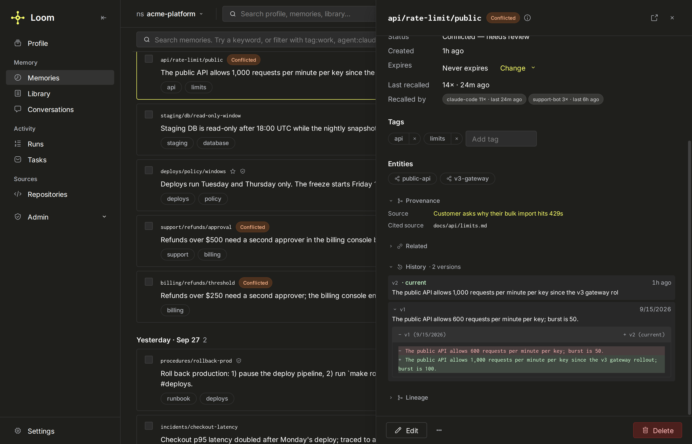

# History and provenance

Every write to memory makes a new version; nothing is edited in place. Versions are kept
in an append-only mirror, so a fact's history survives background merges. Each row
records who wrote it and how it entered memory, derived rows record their sources, and a
person can attest that a row is true. How the version mirror works is in
[memory architecture](../../architecture/memory-architecture.md).



## Operations

| Operation            | Role   | Answers                                                                                                   |
| -------------------- | ------ | --------------------------------------------------------------------------------------------------------- |
| `memory.history`     | viewer | Every version of a key, newest first, including tombstoned and redacted versions.                         |
| `memory.provenance`  | viewer | Where the live row came from: source trace, writer, source class, the conversation it was extracted from. |
| `memory.evidence`    | viewer | The source turns a fact was extracted from, with the supporting span and how each link was made.          |
| `memory.backlinks`   | viewer | What points at a row: versions, digests, typed links in and out, evidence count, entity neighbours.       |
| `memory.lineage`     | viewer | The promotion trail of a shared memory: who promoted it, from which rows, through which review.           |
| `memory.verify`      | writer | Attest that a row is true as the signed-in person or service account, or revoke the attestation.          |
| `memory.redact`      | admin  | Scrub the value of one historical version, keeping the row and its audit entry.                           |
| `namespace.rollback` | admin  | Return every memory head in a namespace to its version at a point in time.                                |
| `namespace.snapshot` | admin  | Export a namespace's curated state as a JSON payload.                                                     |
| `namespace.restore`  | viewer | Import a snapshot into a fresh namespace, or an existing one the caller administers; never a collection.  |

`namespace.snapshot` and `namespace.restore` are not MCP tools. Field lists are in the
operations reference under [memory](../../reference/operations.md#memory) and
[namespace](../../reference/operations.md#namespace).

## Versions: `memory.history`

`loom.memory` holds current state and is read with `FINAL`, so a merge keeps only the
newest version of each row. `loom.memory_versions` is an append-only mirror filled by a
materialized view on every insert; it is the history that `memory.history`,
`memory.redact` and `namespace.rollback` read.

A history row carries `version` (the write's nanosecond epoch), `written_at`, `value`,
`confidence`, `pinned`, `expires_at`, `tombstoned_at`, `redacted_at`,
`redaction_reason`, `content_sha256`, `agent`, `actor` and `source_class`. `created_at`
is the row's first write and repeats on every version. `agent="*"` spans every writer of
the key.

```python
from loom import Agent

async with Agent(org="acme", namespace="support", agent="auditor") as agent:
    for v in await agent.memory.history("customer/4812/plan", agent_id="*"):
        print(v["written_at"], v["actor"], v["source_class"], v["value"])
```

A tombstone is a version too, so a delete shows in history and `memory.restore` can
revive the key within 14 days. For point-in-time reads of current state, use `as_of` on
`memory.get`, `memory.search` and `memory.ask`
([validity time](./writing.md#validity-time-valid_at-and-valid_to)).

## Who wrote it: actor and source class

The server stamps `actor` (`human:<subject>` or `process:<subject>`) and `source_class`
on every row from the token and the operation. The `source_class` values are in
[memory concepts](../../concepts/memory.md). A request may only downgrade its class to
`external`, `imported` or `derived`.

`memory.provenance` returns both, plus:

- `source_trace` and a `source_kind` derived from it (`conversation`, `extracted`,
  `observed`, `consolidated`, `app`, `manual`, `other`);
- the `source_resource_id` the writer cited;
- the conversation `thread_id` and `thread_exists` (false when the namespace does not
  record transcripts, or the transcript is gone);
- the authored links (`memory.link`) touching the row.

Search hits carry `source_class` and `verified`, which the optional trust term
(`LOOM_MEMORY_SEARCH_TRUST_WEIGHT`) reads.

## Evidence: which turns a fact came from

Extraction links each fact to its turns in `loom.memory_belief_sources`.
`memory.evidence(memory_key)` returns those links with the turn's text (up to 600
characters), role, time, the supporting `span`, and how the link was made:

| `scope`   | `support_type`    | Meaning                                                      |
| --------- | ----------------- | ------------------------------------------------------------ |
| `cited`   | `extracted_from`  | The extractor named the supporting turn.                     |
| `lexical` | `lexical_support` | The server matched the fact to its best turn.                |
| `window`  | `window`          | Nothing matched; the whole extraction window is linked.      |
| `derived` | `derived_from`    | Consolidation lineage: the item is the source memory's text. |

The response counts links by scope, so a check can tell a cited fact from a loosely tied
one. For a conversation's exact wording, `memory.recall` searches the stored turns
([extraction](./extraction.md)).

## Lineage

- `memory.consolidate` and period digests write one `derived_from` link per source into
  `loom.memory_belief_sources`; `memory.evidence` returns them as `derived` items.
- A session digest lists the keys it compressed (`derived_from` on a `summary` hit).
- `memory.lineage` (`scope="shared"`) walks a shared memory's promotion: the event, who
  promoted it, the supporting rows, the learnings candidate it came from when one matches
  (`match_confidence` `exact` or `inferred`), and the audit events. `mechanism` is
  `review`, `import`, `auto` or `unknown`.
- `memory.backlinks` is the inverse: what points at a row.

`memory.delete` retires a consolidated summary whose sources are all gone and downgrades
one with surviving sources to `conflicted`.

## Attestation: `memory.verify`

`pinned` and `confidence` do not say who checked a fact. `memory.verify` records that: the
actor from the caller's token and the content hash they attested. Address the row by
`memory_id`, or by `namespace` and `memory_key` with the writer identity. It needs writer
on the row's namespace.

`memory.get` and `memory.get_by_id` return `verification`, derived from the stored hash
and the row's current one:

| `verification` | Meaning                                                           |
| -------------- | ----------------------------------------------------------------- |
| `human`        | A person attested and the content has not changed since.          |
| `process`      | A service account attested and the content has not changed since. |
| `stale`        | Someone attested, and the content has changed since.              |
| `none`         | Never attested, or revoked.                                       |

- An edit does not clear an attestation; it makes it `stale` until someone re-verifies.
- `revoke=true` clears it. Re-verifying an unchanged row by the same actor is a no-op
  (`changed=false`).
- The `human:` prefix comes from the token, so an agent cannot mark its own write human.
  The body's `actor` is read only in dev mode without auth.
- Snapshots and restores carry the attestation columns; a restore never strips
  `verified_by`.

## Scrubbing history: `memory.redact`

`memory.redact(memory_id, version)` scrubs one historical version's text everywhere it is
copied, and every profile version a model built from the memory. It stamps `redacted_at`
and `redaction_reason`, and keeps the rows and their audit entries. Use it for a secret or
personal detail that leaked into an earlier version.

| Where                                             | What happens                                                                                                              |
| ------------------------------------------------- | ------------------------------------------------------------------------------------------------------------------------- |
| `loom.memory`, `loom.memory_versions`             | `value` becomes `"[REDACTED]"`; `value_json`, `evidence`, `entities` and `concepts` are cleared.                          |
| `loom.memory_embeddings`, `loom.memory_chunks`    | Rows whose excerpt or chunk hash is not the live head's are deleted; the live head's rows stay.                           |
| The user's profile versions built from the memory | Every version whose trace names the memory is scrubbed the same way, the live head included, with its key's derived rows. |

Out of scope: tags, files, `content_sha256`, `loom.memory_evidence` (owned by erasure),
the lineage tables (ids and hashes only), `loom.shared` and the entity graph.

- It refuses the memory's live head (`refused_head=true`): delete or rewrite the key
  first. A scrubbed live profile is left out of renders, packs and profile search until the
  worker rebuilds it.
- Both lock modes refuse it, on the memory's own key and on any profile key it reaches.
- It deletes cached `memory.ask` and `code.ask` answers and precedents that quoted the
  key (`cache_rows_deleted`, `precedent_rows_deleted`). For a profile key it reaches, the
  deletion is org-wide: every user's profile has the same key, so it clears every cached
  answer and precedent in the org whose window held that key, in every namespace.
- The namespace is checked after the fetch; a refusal answers `redacted=false`, not 403.
- A version that does not exist answers `redacted=false` and scrubs nothing, no profile
  version included.
- It runs a synchronous `ALTER TABLE … UPDATE` on the two memory tables and a lightweight
  `DELETE` on derived rows: an administrative call.

The profile reach and its limits are in [security](../../architecture/security.md#sensitivity).
To remove a person's data everywhere, use [erasure](./retention-and-erasure.md#erasure).

## Rolling a namespace back: `namespace.rollback`

`namespace.rollback(as_of)` re-inserts, for each key, the highest version at or before
`as_of` as the new head, and tombstones keys created after it. The rollback is itself new
versions, so it can be undone the same way.

- Dry run by default, reporting `reinstate`, `remove` and `sample`; `dry_run=false`
  applies it.
- `memory_keys` (up to 500) restricts it; `max_keys` (default 5,000) bounds one call and
  `truncated` says to call again.
- The `embedding_worker` re-embeds reinstated heads.
- An `as_of` older than the namespace's history, or in the future, is refused.

```bash
curl -sX POST http://localhost:7777/v1/namespace.rollback \
  -H "Authorization: Bearer $LOOM_API_KEY" -H 'Content-Type: application/json' \
  -d '{"org":"dev","namespace":"local","as_of":"<YYYY-MM-DD>T09:00:00Z"}' \
  | jq '{reinstate, remove, truncated, sample}'
```

## Snapshots: `namespace.snapshot` and `namespace.restore`

`namespace.snapshot` exports a namespace's curated state as JSON: every memory row with
`version`, `content_sha256`, `actor`, `source_class`, validity and attestation columns,
the per-type configuration, the grants, and up to `include_audit_tail_n` recent audit
rows (default 1,000). `include_embeddings` is false by default, so the target re-embeds
under its own model.

`namespace.restore(target_namespace, payload)` writes the payload back as version rows.
It is idempotent on `snapshot_id` (a rerun answers `restored=false`). It restores into a
fresh namespace (the caller becomes admin) or one the caller administers;
`rebind_agent` reassigns every row's writer. Restored rows are `imported`.

A snapshot is not a deployment backup; see
[backup and recovery](../../operations/backup-and-recovery.md).

## The audit log

Every write that creates or changes memory leaves one hash-only row in `loom.audit_log`
(key, id, content hash, actor, source class, verdict; never the value). Hourly
checkpoints chain the log. See [audit](../observability/audit.md).

## Limits

- **Redaction of a merged-away version is best effort** in `loom.memory`; the mirror is
  scrubbed either way.
- **History is only as complete as the mirror.** A column added to `loom.memory` must be
  added to `loom.memory_versions` and its view in the same migration.
- **Validity is valid-time only.** `knowledge_time` replays `created_at` against the
  retirement (`invalid_at`) and deletion (`tombstoned_at`) stamps; there is no separate
  transaction-time table.
- **`thread_exists=false` is not an error.**
- **A rollback does not restore hard-deleted keys** (`skipped_no_head`).

## Related

- [Writing memory](./writing.md)
- [Conflicts and refusal](./conflicts-and-refusal.md)
- [Retention and erasure](./retention-and-erasure.md)
- [Audit](../observability/audit.md)
