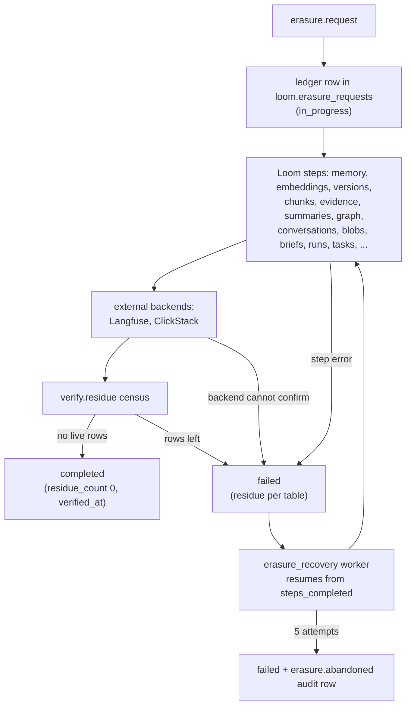

# Retention and erasure

Loom deletes no memory unless its writer, the namespace owner or the operator asks. Memory
has no default lifetime. Data leaves in three ways: a writer's expiry or delete, retention
an owner or operator configured, and an erasure that removes a scope everywhere Loom keeps
it.

## What is kept, and for how long

No memory, embedding, version-history, conversation, entity, summary, working-memory or
knowledge table has a TTL in `schemas/schema.sql`, and no worker retires rows by age. A
row leaves the served set only when:

- **its writer removes it**: `memory.delete`, a same-key rewrite that supersedes it,
  `memory.apply`, `memory.clear`, `conflicts.resolve`, `blacklist.add(sweep=true)`;
- **its writer set an expiry**: `ttl_seconds` or `valid_to` on `memory.set`,
  `memory.touch`, `run.complete(retain="expire")`, a reflection's `expires_in_days`;
- **the owner or operator configured one**: see [configured retention](#configured-retention).

Operational tables (telemetry, caches, queues) have fixed TTLs: `loom.search_trace_log`
and `loom.memory_exposures` 180 days; `loom.erasure_requests` and
`loom.policy_decisions` 90 days; `loom.memory_drops`, `loom.memory_extraction_queue`,
`loom.events` and `loom.embedding_cache` 30 days; `loom.llm_response_cache` 7 days. The
[schema reference](../../reference/schema.md) lists every table's TTL.

One worker removes data on a timer: `namespace_gc` purges namespaces of
`kind = 'bench'` (matched by `LOOM_NAMESPACE_BENCH_PREFIXES` at auto-registration) with
no write for `LOOM_NAMESPACE_GC_IDLE_HOURS`, through an erasure saga. It never touches
other kinds. See [namespaces and sharing](../namespaces-and-sharing.md).

### Delete is not erase

A tombstone is a new version with `tombstoned_at` set. Reads stop serving it at once, but
the row and its prior versions in `loom.memory_versions` stay on disk:

- `memory.restore` revives a tombstoned key within 14 days (after that it answers
  `expired=true`). It also reverses an automatic supersession.
- `memory.clear` (admin) tombstones every memory for an agent or user in a namespace;
  `confirm_subject` must repeat a scope value. Cleared keys revive the same way.

To remove the bytes, use an [erasure](#erasure). To strip one value but keep the row and
audit trail, use [`memory.redact`](./history-and-provenance.md#scrubbing-history-memoryredact).

### Writer-set expiry

A row is hidden from reads the moment its `expires_at` passes. The `memory_expiry_sweep`
worker then applies the writer's `on_expire` as a new version:

| `on_expire`           | Effect                                                                                                                       |
| --------------------- | ---------------------------------------------------------------------------------------------------------------------------- |
| `tombstone` (default) | Tombstoned, with the 14-day restore window.                                                                                  |
| `demote`              | Expiry cleared; confidence × `LOOM_MEMORY_EXPIRY_DEMOTE_FACTOR` (0.5), never below `LOOM_MEMORY_EXPIRY_DEMOTE_FLOOR` (0.05). |
| `anonymize`           | The value is replaced by a marker and embeddings dropped; the row stays as proof it existed.                                 |

`memory.touch` changes only a row's expiry, for one key or up to 1,000 (`memory_keys`): a
new `ttl_seconds`, `clear_expiry=true`, or a new `on_expire`. `memory.sweep_expired`
(admin) runs one sweep for a namespace on demand, with `dry_run`. An edit to other fields
keeps a live expiry.

### Configured retention

All off by default (0 = keep forever).

| Where                        | Set by                                                                                                     | Effect                                                                                                                                                   |
| ---------------------------- | ---------------------------------------------------------------------------------------------------------- | -------------------------------------------------------------------------------------------------------------------------------------------------------- |
| A memory type in a namespace | `retention_days` on a `tag_registry` entry of `namespace.register`                                         | New rows of that type get `expires_at = now + N days`.                                                                                                   |
| Sensitive rows               | `LOOM_MEMORY_SENSITIVE_RETENTION_DAYS`, `LOOM_MEMORY_SENSITIVE_ON_EXPIRE` (default `anonymize`)            | New `medium` / `high` sensitivity rows get an expiry; a shorter caller expiry wins.                                                                      |
| A run's own writes           | `LOOM_MEMORY_RUN_COMPLETE_RETAIN` (`keep`, `demote`, `expire`), `LOOM_MEMORY_RUN_COMPLETE_EXPIRE_DAYS` (7) | What `run.complete` does to the run's rows when the call does not say. Pinned, verified, promoted, locked, episodic and reflection rows are always kept. |
| A whole namespace            | `retention_days`, `warm_days` on `namespace.register`                                                      | A table TTL (and warm-tier move) for that namespace's rows.                                                                                              |
| The deployment               | `LOOM_RETENTION_<TABLE>_DAYS`, `LOOM_TIERING_<TABLE>_WARM_DAYS`                                            | A table TTL (and warm-tier move) on `audit_log`, `agent_events`, `memory`, `memory_embeddings`, `conversations`, `chunks`, `documents`.                  |

The `retention_reconcile` worker applies the last two rows as one idempotent
`ALTER TABLE … MODIFY TTL` per table, per `(org, namespace)` when overrides exist. On
`loom.memory` the TTL keys on `coalesce(expires_at, created_at)`, so a writer's expiry
wins.

- **A table TTL deletes physically** at the part's next merge. There is no restore
  window, and tombstones age out with the rows they hide.
- **Tiering needs a volume.** `LOOM_TIERING_WARM_VOLUME_NAME` must name a volume in the
  storage policy, and the warm age must be below the retention age.

## Erasure

`erasure.request` erases one scope everywhere Loom keeps it, and returns once it can show
nothing in scope is left.

| `scope_type`     | `scope_value`                                                               | Who may request it                           |
| ---------------- | --------------------------------------------------------------------------- | -------------------------------------------- |
| `user_id`        | The user id, across every namespace of the org                              | An org admin                                 |
| `namespace`      | One namespace                                                               | An admin of that namespace (or an org admin) |
| `namespace_list` | A JSON array of 1–500 namespaces, or `{"namespaces": [...], "purge": bool}` | An org admin                                 |

The op is callable with a writer token, but the handler requires admin on the target
(403 `AUTH_INSUFFICIENT` otherwise).

### The saga



- **Checkpointed, idempotent steps.** Each finished step is recorded in
  `steps_completed`. The `erasure_recovery` worker resumes a saga stranded
  `in_progress` or `failed` from its checkpoint. A step waits up to
  `LOOM_ERASURE_MUTATION_WAIT_S` for its mutation, then fails naming it.
- **Tombstone or purge.** By default the soft-delete tables (memory, embeddings, chunks,
  summaries, links) are tombstoned, and `memory.restore` can still revive them inside the
  window; `erasure.list` reports such revivals as `reversals_count`. `purge=true` deletes
  the rows instead (a lightweight `DELETE FROM` on the wide tables).
- **Uploaded originals** of knowledge documents are deleted from the blob store first,
  and `blob_erased_at` is stamped.

### The federated cascade

Data Loom sent elsewhere is erased in the same saga. The external steps fail closed: a
backend that cannot confirm deletion (5xx, timeout, network drop) fails the step, and the
worker retries. "Nothing to delete" (404, zero rows) counts as success.

| Backend    | Configured by                                              | Erases                                                                                            |
| ---------- | ---------------------------------------------------------- | ------------------------------------------------------------------------------------------------- |
| Langfuse   | `LOOM_LANGFUSE_URL` + `LOOM_LANGFUSE_ADMIN_TOKEN`          | Traces found by `userId` within the org's tag, or by the `org:` + `namespace:` tag pair.          |
| ClickStack | `LOOM_CLICKSTACK_DATABASE`, `LOOM_CLICKSTACK_USER_ID_KEYS` | OTel rows in the same ClickHouse service, matched on the user-id attribute keys or the namespace. |

An unconfigured backend logs the intent and deletes nothing. Only a `namespace_list`
erasure may pass `external=false`; `user_id` and `namespace` erasures always include the
backends. `LOOM_EXTERNAL_ERASURE_TIMEOUT_S` bounds each call. Setup:
[Langfuse](../integrations/langfuse.md) and [ClickStack](../integrations/clickstack.md).

### The residue census

The last step, `verify.residue`, counts live rows in scope in every table the read paths
touch. Any row left fails the saga; the terminal row carries `residue_count`, `residue`
(per table) and `verified_at`. A resumed saga re-runs the step that owns any table the
last census found rows in, even if its checkpoint says it finished.

### Abandoned sagas

After 5 attempts the worker marks the request `failed` for good and writes an
`erasure.abandoned` audit row, with `failure_reason` and `steps_completed`. A person must
then escalate. `loom erasure-re-verify` re-checks terminal sagas; `--resume` re-runs
failed ones from their checkpoint (`--skip-external` for a `namespace_list` saga whose
external step keeps failing). See [troubleshooting](../../operations/troubleshooting.md).

### Operations

| Op                | Role                         | Does                                                                                                                                                                                       |
| ----------------- | ---------------------------- | ------------------------------------------------------------------------------------------------------------------------------------------------------------------------------------------ |
| `erasure.request` | writer (admin on the target) | Run the saga for one scope. `urgency` `normal` or `urgent`; `purge`; `external`.                                                                                                           |
| `erasure.status`  | viewer                       | One request's state, current step, failure reason and census. Not listed in the MCP toolsets.                                                                                              |
| `erasure.list`    | viewer                       | Recent requests (filter by `status`), with `steps_completed_count`, `reversals_count`, `residue_count`.                                                                                    |
| `erasure.export`  | admin                        | A subject's data as JSON: `memory`, `knowledge`, `agent_events`, `audit_log`, each capped by `section_limit` (default 10,000; `truncated` when over). Includes tombstoned rows by default. |

Ledger rows are kept 90 days. Field lists:
[operations reference](../../reference/operations.md#erasure).

### Example

```python
from loom import Agent

async with Agent(org="acme", namespace="support", agent="privacy-desk") as admin:
    out = await admin.erasure.request_user_id("u-42", requester="dpo@acme.example")
    print(out["status"], out["residue_count"], out["verified_at"])
    if out["status"] != "completed":
        print(out["failure_reason"], out["residue"])
```

The SDK's `request` does not expose `purge` or `external`; send them over HTTP:

```bash
curl -sX POST "$LOOM_BASE_URL/v1/erasure.request" \
  -H "Authorization: Bearer $LOOM_API_KEY" -H "Content-Type: application/json" \
  -d '{"org":"acme","scope_type":"namespace_list",
       "scope_value":"[\"bench-a\",\"bench-b\"]",
       "requester":"ops@acme.example","purge":true,"external":false}'
```

### For contributors

A new table that can hold memory content needs a saga step and a census entry (one
`Substrate(...)` in `server/erasure/store/census.py` `_CENSUS`), or a line in
`STEP_ONLY_TABLES` with its reason; a unit test fails otherwise. The saga is
`server/erasure/app/saga.py` (`run_saga`), the backends `server/erasure/app/backends.py`,
the worker `server/erasure/workers/recovery.py`.

## Limits

- **Not a compliance guarantee.** The saga, census and audit hashes are engineering
  primitives; whether they meet an obligation is your call.
- **An erasure is slow.** Each step waits for a mutation; budget minutes on a large scope.
  The SDK waits up to 120 seconds for the first answer; poll `erasure.status` after that.
- **There is no `org` scope.** Erase an org's namespaces with `namespace_list`.
- **Table TTLs cannot be restored from.** Use writer-set expiry with `on_expire` when an
  end of life should be reversible.
- **Backups are outside the saga**; see
  [backup and recovery](../../operations/backup-and-recovery.md).

## Related

- [History and provenance](./history-and-provenance.md): `memory.history`, `memory.redact`.
- [Writing memory](./writing.md): `ttl_seconds`, `valid_to`, `on_expire` on a write.
- [Runs](../runs.md): `retain` on `run.complete`.
