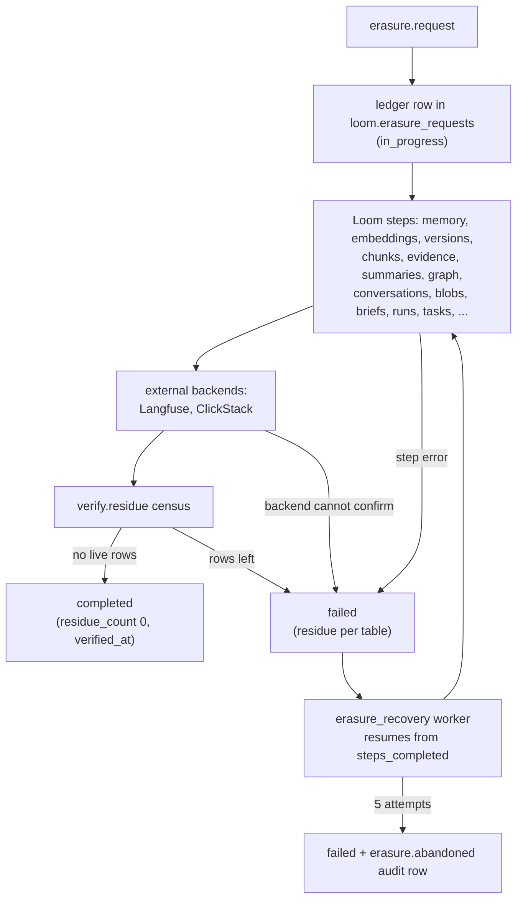

# Retention and erasure

Loom deletes no memory unless its writer, the namespace owner or the operator asks. Memory
has no default lifetime. Data leaves in three ways: a writer's expiry or delete, retention
an owner or operator configured, and an erasure that removes a scope everywhere Loom keeps
it.

## What is kept, and for how long

No memory, embedding, version-history, conversation, entity, summary, working-memory or
knowledge table has a TTL in `schemas/schema.sql`, and no worker retires rows by age.
The link tables `entity_triple_rows` and `entity_edge_rows` follow `entity_triples` and
`entity_edges`: no TTL. An erasure deletes the links of the memories it erases, and
`loom erasure-re-verify --completed-since … --resume` the orphan links an older build's
erasure left behind.
A row leaves the served set only when:

- **its writer removes it**: `memory.delete`, a same-key rewrite that supersedes it,
  `memory.apply`, `memory.clear`, `conflicts.resolve`, `blacklist.add(sweep=true)`;
- **its writer set an expiry**: `ttl_seconds` or `valid_to` on `memory.set`,
  `memory.touch`, `run.complete(retain="expire")`, a reflection's `expires_in_days`;
- **the owner or operator configured one**: see [configured retention](#configured-retention).

Operational tables (telemetry, caches, queues) have fixed TTLs: `loom.search_trace_log`
and `loom.memory_exposures` 180 days; `loom.erasure_requests` and
`loom.policy_decisions` 90 days; `loom.memory_drops`, `loom.memory_extraction_queue`,
`loom.events` and `loom.embedding_cache` 30 days; `loom.llm_response_cache` 7 days. The
[schema reference](../../reference/schema.md) lists every table's TTL.

One worker removes data on a timer: `namespace_gc` purges namespaces of
`kind = 'bench'` (matched by `LOOM_NAMESPACE_BENCH_PREFIXES` at auto-registration) with
no write for `LOOM_NAMESPACE_GC_IDLE_HOURS`, through an erasure saga. It never touches
other kinds. See [namespaces and sharing](../namespaces-and-sharing.md).

### Delete is not erase

A tombstone is a new version with `tombstoned_at` set. Reads stop serving it at once, but
the row and its prior versions in `loom.memory_versions` stay on disk:

- `memory.restore` revives a tombstoned key within 14 days (after that it answers
  `expired=true`). It also reverses an automatic supersession.
- `memory.clear` (admin) tombstones every memory for an agent or user in a namespace;
  `confirm_subject` must repeat the concrete `user_id` or `agent` (neither `'*'` nor `'-'`
  confirms). `agent="*"` with a `user_id` clears that user's rows under every agent, and
  `user_id="*"` with an `agent` that agent's rows for every user. A scope that names nobody
  but `'-'` is refused, as a namespace-wide clear is. Locked rows stay and are counted in
  `locked_skipped`. Cleared keys revive the same way.

To remove the bytes, use an [erasure](#erasure). To strip one value but keep the row and
audit trail, use [`memory.redact`](./history-and-provenance.md#scrubbing-history-memoryredact).

### Writer-set expiry

A row is hidden from reads the moment its `expires_at` passes. The `memory_expiry_sweep`
worker then applies the writer's `on_expire` as a new version:

| `on_expire`           | Effect                                                                                                                       |
| --------------------- | ---------------------------------------------------------------------------------------------------------------------------- |
| `tombstone` (default) | Tombstoned, with the 14-day restore window.                                                                                  |
| `demote`              | Expiry cleared; confidence × `LOOM_MEMORY_EXPIRY_DEMOTE_FACTOR` (0.5), never below `LOOM_MEMORY_EXPIRY_DEMOTE_FLOOR` (0.05). |
| `anonymize`           | The value is replaced by a marker and embeddings dropped; the row stays as proof it existed.                                 |

`memory.touch` changes only a row's expiry, for one key or up to 1,000 (`memory_keys`): a
new `ttl_seconds`, `clear_expiry=true`, or a new `on_expire`. `memory.sweep_expired`
(admin) runs one sweep for a namespace on demand, with `dry_run`. An edit to other fields
keeps a live expiry.

### Configured retention

All off by default (0 = keep forever).

| Where                        | Set by                                                                                                     | Effect                                                                                                                                                   |
| ---------------------------- | ---------------------------------------------------------------------------------------------------------- | -------------------------------------------------------------------------------------------------------------------------------------------------------- |
| A memory type in a namespace | `retention_days` on a `tag_registry` entry of `namespace.register`                                         | A row `memory.set` writes with no live expiry, `ttl_seconds` or `clear_expiry` gets `expires_at = now + N days`; a restated `read_only` row gets none.   |
| Sensitive rows               | `LOOM_MEMORY_SENSITIVE_RETENTION_DAYS`, `LOOM_MEMORY_SENSITIVE_ON_EXPIRE` (default `anonymize`)            | New `medium` / `high` sensitivity rows get an expiry; a shorter caller expiry wins.                                                                      |
| A run's own writes           | `LOOM_MEMORY_RUN_COMPLETE_RETAIN` (`keep`, `demote`, `expire`), `LOOM_MEMORY_RUN_COMPLETE_EXPIRE_DAYS` (7) | What `run.complete` does to the run's rows when the call does not say. Pinned, verified, promoted, locked, episodic and reflection rows are always kept. |
| A whole namespace            | `retention_days`, `warm_days` on `namespace.register`                                                      | A table TTL (and warm-tier move) for that namespace's rows.                                                                                              |
| The deployment               | `LOOM_RETENTION_<TABLE>_DAYS`, `LOOM_TIERING_<TABLE>_WARM_DAYS`                                            | A table TTL (and warm-tier move) on `audit_log`, `agent_events`, `memory`, `memory_embeddings`, `conversations`, `chunks`, `documents`.                  |

Under the Postgres authority neither of the last two rows puts a retention TTL on
`memory`, `memory_embeddings` or `documents`: it would delete ClickHouse's copy of rows
Postgres still serves, so the boot refuses `LOOM_RETENTION_MEMORY_DAYS`,
`LOOM_RETENTION_MEMORY_EMBEDDINGS_DAYS` and `LOOM_RETENTION_DOCUMENTS_DAYS`
([storage authority](../../architecture/storage-authority.md)). A namespace's
`retention_days` leaves `chunks` too, so a document that stays keeps the chunks search
finds it by; `LOOM_RETENTION_CHUNKS_DAYS` still applies.

The `retention_reconcile` worker applies the last two rows as one idempotent
`ALTER TABLE … MODIFY TTL` per table, per `(org, namespace)` when overrides exist, and
removes a table's TTL once no namespace and no deployment window is left on it. On
`loom.memory` the TTL keys on `coalesce(expires_at, created_at)`, so a writer's expiry
wins.

- **A table TTL deletes physically** at the part's next merge. There is no restore
  window, and tombstones age out with the rows they hide.
- **An Undo holds while its record does.** The conflict resolver honours a person's Undo
  of a retirement by its `memory.unsupersede` row in `audit_log`. With an `audit_log` TTL
  shorter than a pair's life, an aged-out Undo stops holding, and the resolver may judge
  and retire that pair again.
- **Tiering needs a volume.** `LOOM_TIERING_WARM_VOLUME_NAME` must name a volume in the
  storage policy, and the warm age must be below the retention age.

## Erasure

`erasure.request` erases one scope everywhere Loom keeps it, and returns once it can show
nothing in scope is left.

| `scope_type`     | `scope_value`                                                               | Who may request it                           |
| ---------------- | --------------------------------------------------------------------------- | -------------------------------------------- |
| `user_id`        | The user id, across every namespace of the org                              | An org admin                                 |
| `namespace`      | One namespace                                                               | An admin of that namespace (or an org admin) |
| `namespace_list` | A JSON array of 1–500 namespaces, or `{"namespaces": [...], "purge": bool}` | An org admin                                 |

The op is callable with a writer token, but the handler requires admin on the target
(403 `AUTH_INSUFFICIENT` otherwise).

Category links (`loom.memory_categories`) carry no user, so a `user_id` erasure leaves them
and the `memory.import` audit rows that list them. For an imported item the link's key is
`import:` and a digest of its text, which confirms a guessed text; a `namespace` erasure
removes the links.

A `user_id` erasure removes the verbatim chunks stamped with the user, and the chunks
stamped with no user (`-`) under one of the user's `(namespace, key)` pairs, whoever's
memory they belong to: a `-` chunk can hold the user's text, and the write path retires
those as the writer's too. Chunks stamped with another user stay.

A `user_id` erasure also retires the consolidated summaries built from the user's
memories, under whatever identity wrote them
([which ones](../../architecture/memory-architecture.md#background-passes)), with what
was derived from them: their version history, their verbatim chunks and entity vectors,
the graph rows extracted from them and the org-wide copies promoted from them. It
deletes the cached `memory.ask` answers and precedents that quoted them too.

### The saga



- **Checkpointed, idempotent steps.** Each finished step is recorded in
  `steps_completed`. The `erasure_recovery` worker resumes a saga stranded
  `in_progress` or `failed` from its checkpoint. A step waits up to
  `LOOM_ERASURE_MUTATION_WAIT_S` for its mutation, then fails naming it.
- **Code links wait for the link worker.** `code_links.delete` takes the code-link
  worker's queue lease, so no pass publishes a cursor it read before the erasure: across
  hosts with Keeper, within one process without it. It waits up to 15 minutes for a pass
  to finish; past that the step fails with `LeaseBusy` and `erasure_recovery` retries it.
- **Tombstone or purge.** By default the soft-delete tables (memory, embeddings, chunks,
  summaries, links) are tombstoned, and `memory.restore` can still revive them inside the
  window; `erasure.list` reports such revivals as `reversals_count`. `purge=true` deletes
  the rows instead (a lightweight `DELETE FROM` on the wide tables). A user erasure
  finds what the user's memories fed through their keys, so in a purge its `loom.memory`
  rows, and the consolidated summaries built from them, are tombstoned first and deleted
  in `memory.retire`, after every step that reads those keys; until then `memory.restore`
  can revive them (the user's own rows count as a reversal, the summaries do not), and
  `memory.retire` deletes what `memory.restore` revived.
- **Uploaded originals** of knowledge documents: the namespace's rows of
  `loom.document_blobs` are deleted first, and `blob_erased_at` is stamped. A user erasure
  deletes the originals that user uploaded and no other writer's live document shares,
  found through `loom.blob_uploads` (one row per end user's upload, since the document
  version that named an original may have been replaced and merged away) and through their
  documents; then their rows of `loom.blob_uploads` go. The census counts both tables.
  Originals kept in an S3-compatible bucket (`LOOM_DOCUMENT_OBJECT_STORE=s3`) go before
  their rows: a namespace erasure deletes every object of the scope under its prefix and
  the census counts what is left there (`objects.document_originals`); a user erasure
  deletes every object holding bytes of the user's own originals, named by a row or not,
  lists their prefixes again and fails the step if the store kept any, then deletes the
  rows, and then deletes what those prefixes still hold that no row names, so the user's
  own upload of those bytes whose row the deletion took loses its object too. An upload of
  those bytes still in flight when the step runs, by any writer (its object stored, its
  row not yet in), loses its object, and its row, once in, answers `410 BLOB_GONE`. Each
  batch of originals is read again right before it is deleted, so an original that another
  writer's document has named since stays; another writer storing the same bytes in the
  same namespace after that read can lose them, as on the ClickHouse store. A row naming
  an object while no bucket is configured, or one outside the configured bucket and
  prefix, fails the step rather than leaving the bytes. On either store, a user erasure
  deletes the rows in as few mutations as its originals fit in (each binds as many as one
  ClickHouse parameter carries). Moving originals from ClickHouse to the bucket
  (`loom knowledge migrate-originals`) is fenced by this ledger: it does not move an
  original an unfinished erasure covers, and a move an erasure overtakes ends as that
  erasure decides
  ([where originals are stored](../knowledge.md#where-originals-are-stored)).
- **Ingest cancels.** A user erasure deletes the user's ingestion rows, cancels among them.
  A cancel the user asked for on another writer's job that is still pending or processing
  is kept first as a row with no identity (`agent`, `user_id` and `session_id` `'-'`,
  `actor` empty), so that job stays cancelled.
- **Org-wide caches.** `loom.idempotency` (replayed responses) and `loom.embedding_cache`
  (query vectors, never their text) carry the org but no namespace or end user, so an
  erasure at either scope deletes all of the org's rows in both tables. The cost is cache
  misses. The census counts `loom.idempotency` org-wide but not `loom.embedding_cache`,
  which any search in the org refills; each replica's process cache of vectors expires
  within `LOOM_EMBEDDING_CACHE_TTL_S`.
- **Bot-rule learnings.** A user's words in the learnings queue live only on their rows
  of `loom.learnings_supporters`, which a user erasure deletes. A rule candidate left
  with no supporter is then deleted when pending, or keeps its decision with the rule
  blanked ([extraction](./extraction.md#rules-the-assistant-states-about-itself)). The
  census counts such unsupported candidates across the org, not only the erased user's,
  so a saga can fail on a candidate that another erasure in the org left mid-step; its
  reopened step cleans it.

### The federated cascade

Data Loom sent elsewhere is erased in the same saga. The external steps fail closed: a
backend that cannot confirm deletion (5xx, timeout, network drop, a Langfuse health answer
with no version) fails the step, and the worker retries. "Nothing to delete" (zero matching
rows, or a ClickStack table the service does not have) counts as success.

| Backend    | Configured by                                              | Erases                                                                                            |
| ---------- | ---------------------------------------------------------- | ------------------------------------------------------------------------------------------------- |
| Langfuse   | `LOOM_LANGFUSE_URL` + `LOOM_LANGFUSE_ADMIN_TOKEN`          | Traces found by `userId` within the org's tag, or by the `org:` + `namespace:` tag pair.          |
| ClickStack | `LOOM_CLICKSTACK_DATABASE`, `LOOM_CLICKSTACK_USER_ID_KEYS` | OTel rows in the same ClickHouse service, matched on the user-id attribute keys or the namespace. |

A ClickStack namespace erasure matches a `loom.namespace` row only when it carries the
erasing org's `loom.org`, so Loom's own op and domain metrics, which carry no org, keep
the namespace label ([ClickStack erasure](../integrations/clickstack.md#erasure)).

An unconfigured backend logs the intent and deletes nothing. Only a `namespace_list`
erasure may pass `external=false`; `user_id` and `namespace` erasures always include the
backends. `LOOM_EXTERNAL_ERASURE_TIMEOUT_S` bounds each call. Setup:
[Langfuse](../integrations/langfuse.md) and [ClickStack](../integrations/clickstack.md).

### The residue census

The last step, `verify.residue`, counts live rows in scope in every table the read paths
touch. Any row left fails the saga; the terminal row carries `residue_count`, `residue`
(per table), `verified_at` and `census` (every count, below). A resumed saga re-runs the
step that owns any table the last census found rows in, even if its checkpoint says it
finished, and always counts again.

### The receipt

`erasure.status` (and `erasure.request`'s answer) carries the receipt of the latest run's
census. It is absent when the latest ledger row holds no census that counted every store: a
run in progress, a census that could not run or left a store uncounted, or a row written by
a build that keeps no census:

- `census`: every substrate the census counted and its count, zeros included. Keys are table
  names, `pg:<table>` for the Postgres authority, `objects.document_originals` for the
  document bucket in a namespace scope, and `provider_rebuild_copies` summed over a provider
  rebuild's copies, 0 when none exists (counted deployment-wide when a copy has no org
  column). A count is the rows the census counts as residue in this scope: live rows, or
  every row when the saga purges or the table keeps no tombstone ([the census
  rules](../../architecture/memory-architecture.md#erasure-saga)).
  `objects.document_originals` counts a first listing page, so it reads as "at least".
- `purge`: whether the saga deletes rows or tombstones them, as it runs. A single
  namespace's saga never purges. Without purge a tombstoned row keeps its bytes in its part
  until the table merges; with purge the rows are deleted, and their bytes stay on disk
  until a merge or the reclaim worker removes them.
- The subject and the time are the status's `org`, `scope_type`, `scope_value` and
  `verified_at`.

The receipt is Loom's count. Keep the answer: `erasure.status` serves the ledger row for 89
days after the request, and the `erasure.completed` audit row, which carries the census too,
is written after the completed row on a best-effort basis and kept for
`LOOM_RETENTION_AUDIT_LOG_DAYS`. When the requester got no answer (a saga the recovery
worker finished, one run detached, a call that timed out), read `erasure.status` within 89
days.

#### Checking an erasure yourself

An operator who holds the org's SQL surface grant with `--namespaces '*'`, or `--all`
([SQL surface](../../reference/sql-surface.md#access)), can re-count three of the census's
keys: `loom.memory`, `loom.memory_versions` and `loom.conversations`. Bind the erased id and
the census time as parameters. ClickHouse still writes the bound values into
`system.query_log`, as it does for the erasure's own statements (below), so run the check
from `clickhouse-client` rather than through `pg_clickhouse`, whose pushed-down text a
Postgres statement log would keep as one more copy:

```bash
read -r uid  # the erased id, typed at the prompt so it stays out of the shell history
clickhouse-client --param_org='<org>' --param_uid="$uid" --param_at='<verified_at>' \
  --multiquery --query "
SELECT count() FROM loom.sql_v1_memories WHERE org = {org:String}
  AND user_id = {uid:String} AND created_at <= {at:DateTime64(6, 'UTC')};
SELECT count() FROM loom.sql_v1_memory_history WHERE org = {org:String}
  AND user_id = {uid:String} AND created_at <= {at:DateTime64(6, 'UTC')};
SELECT count() FROM loom.sql_v1_conversations WHERE org = {org:String}
  AND user_id = {uid:String} AND ts <= {at:DateTime64(6, 'UTC')};
SELECT count() FROM loom.sql_v1_agent_events WHERE org = {org:String}
  AND user_id = {uid:String} AND ts <= {at:DateTime64(6, 'UTC')};"
```

The `org` filter keeps a grant that covers more than one org (`--all`) to the erasure's org.
Each statement still reads the grant's whole scope before it filters ([what a read
costs](../../reference/sql-surface.md#what-a-read-costs)), so on a large org or an `--all`
grant a statement can stop at the SQL user's caps (`LOOM_CH_ANALYSIS_MAX_ROWS_TO_READ`,
`_MAX_EXECUTION_S`) with an error instead of a count; raise them for the check. For a
namespace scope, pass `--param_ns='<namespace>'` and filter the first three on `namespace =
{ns:String}` instead of `user_id`; for a `namespace_list`, run that once per name in its
`scope_value`'s `namespaces`; the `sql_v1_agent_events` statement is for a user scope only,
since a namespace erasure keeps the namespace's request ledger rows. Each count is 0 after a
completed erasure, with these differences from the census: the views leave out restricted
namespaces, `sql_v1_memories` leaves out rejected and tombstoned rows (the history keeps
tombstoned versions), and a summary consolidated from the user's memories carries another
`user_id`, which the census counts and these queries do not. The request ledger count is a
separate check outside the receipt: an erasure scrubs a user's request ledger rows to
`<erased>` rather than deleting them, and the request ledger's view reads its 31-day window.
Every other census key is Loom's count alone.

What the receipt does not cover:

- backups, point-in-time recovery, WAL and standbys of either service;
- copies made outside Loom, such as a table built in an org's own Postgres from the
  [SQL surface](../../reference/sql-surface.md);
- rows a worker writes after the census from a read it made before it
  ([storage authority](../../architecture/storage-authority.md#erasure));
- a `namespace.restore` from a snapshot taken before the erasure, which brings rows back:
  run the erasure again, and its census is the new receipt;
- for a user scope, document originals in the bucket, which the census counts for a
  namespace scope only.

The erased id stays where the proof of erasure needs it: in the ledger row (until the
table's TTL drops it, 90 days after the request), in audit, in `loom.erasure_reversals`, and
in the deployment's own logs of the statements that named it (the ClickHouse mutation log,
`system.query_log` and `system.text_log` for a statement that wrote it, and Postgres
statement logs with `log_statement` or `log_min_duration_statement` on).

### Abandoned sagas

After 5 attempts the worker marks the request `failed` for good and writes an
`erasure.abandoned` audit row, with `failure_reason` and `steps_completed`. A person must
then escalate. `loom erasure-re-verify` re-checks terminal sagas; `--resume` re-runs
failed ones from their checkpoint (`--skip-external` for a `namespace_list` saga whose
external step keeps failing). `--completed-since <ISO timestamp>` re-checks the completed
sagas verified since then instead of the failed ones, for the erasures a previous build
ran during an upgrade; with `--resume` it deletes only their orphan row links
([maintenance](../../operations/maintenance.md#erasure)). See
[troubleshooting](../../operations/troubleshooting.md).

### Operations

| Op                | Role                         | Does                                                                                                                                                                                                                                                                                                                                                        |
| ----------------- | ---------------------------- | ----------------------------------------------------------------------------------------------------------------------------------------------------------------------------------------------------------------------------------------------------------------------------------------------------------------------------------------------------------- |
| `erasure.request` | writer (admin on the target) | Run the saga for one scope. `urgency` `normal` or `urgent`; `purge`; `external`.                                                                                                                                                                                                                                                                            |
| `erasure.status`  | viewer                       | One request's state, current step, failure reason and census. A user's erasure answers only an org admin or platform admin of its org. Not listed in the MCP toolsets.                                                                                                                                                                                      |
| `erasure.list`    | viewer                       | Recent requests (filter by `status`), with `steps_completed_count`, `reversals_count`, `residue_count`.                                                                                                                                                                                                                                                     |
| `erasure.export`  | admin                        | A subject's data as JSON: `memory`, `knowledge`, `conversations` (transcript turns and saved messages), `conversation_threads`, `agent_events`, `audit_log`, each capped by `section_limit` (default 10,000; `truncated` when over), and `conversations` also by `LOOM_ERASURE_EXPORT_CONVERSATION_MAX_BYTES` of text. Includes tombstoned rows by default. |

`erasure.status` and `erasure.list` read a ledger row for 89 days; the table's TTL drops
it at 90. Field lists:
[operations reference](../../reference/operations.md#erasure).

### Example

```python
from loom import Agent

async with Agent(org="acme", namespace="support", agent="privacy-desk") as admin:
    out = await admin.erasure.request_user_id("u-42", requester="dpo@acme.example")
    print(out["status"], out["residue_count"], out["verified_at"])
    if out["status"] != "completed":
        print(out["failure_reason"], out["residue"])
```

The SDK's `request` does not expose `purge` or `external`; send them over HTTP:

```bash
curl -sX POST "$LOOM_BASE_URL/v1/erasure.request" \
  -H "Authorization: Bearer $LOOM_API_KEY" -H "Content-Type: application/json" \
  -d '{"org":"acme","scope_type":"namespace_list",
       "scope_value":"[\"bench-a\",\"bench-b\"]",
       "requester":"ops@acme.example","purge":true,"external":false}'
```

### For contributors

A new table that can hold memory content needs a saga step and a census entry (one
`Substrate(...)` in `server/erasure/store/census.py` `_CENSUS`), or a line in
`STEP_ONLY_TABLES` with its reason; a unit test fails otherwise. The saga is
`server/erasure/app/saga.py` (`run_saga`), the backends `server/erasure/app/backends.py`,
the worker `server/erasure/workers/recovery.py`.

## Limits

- **Not a compliance guarantee.** The saga, census and audit hashes are engineering
  primitives; whether they meet an obligation is your call.
- **An erasure is slow.** Each step waits for a mutation; budget minutes on a large scope.
  The SDK waits up to 120 seconds for the first answer; poll `erasure.status` after that.
- **There is no `org` scope.** Erase an org's namespaces with `namespace_list`.
- **Table TTLs cannot be restored from.** Use writer-set expiry with `on_expire` when an
  end of life should be reversible.
- **Backups are outside the saga**; see
  [backup and recovery](../../operations/backup-and-recovery.md).
- **The analytics export bucket is outside the saga.** Its files hold hashed org, namespace
  and agent names and usage counts, never memory content; see
  [hashed names](../../operations/analytics-export.md#hashed-names).

## Related

- [History and provenance](./history-and-provenance.md): `memory.history`, `memory.redact`.
- [Writing memory](./writing.md): `ttl_seconds`, `valid_to`, `on_expire` on a write.
- [Runs](../runs.md): `retain` on `run.complete`.
