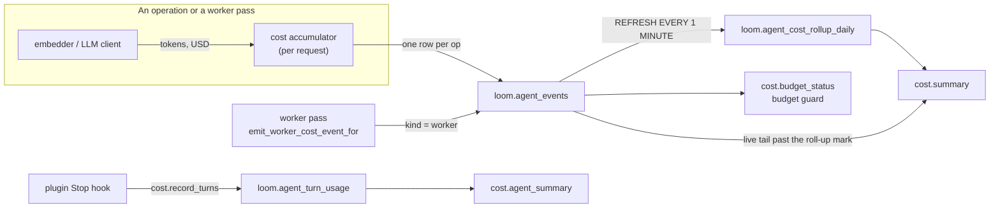

# Cost and usage

Loom records every upstream dollar it spends on embedding and LLM calls against the
operation that spent it, in the per-operation ledger `loom.agent_events`. The `cost.*` ops
read that ledger through a one-minute roll-up. A separate series, `loom.agent_turn_usage`,
holds what a coding agent spent on its own model turns. The two never overlap: one is
Loom's provider bill, the other is the agent's.

This page also covers memory **usage** (recalls, evidence, reliance), which the
`usage_fold` worker folds back into ranking.

## Where the numbers come from



1. **Accumulator.** The transport binds a cost accumulator
   (`server/observability/cost_accumulator.py`) per operation; embedders and LLM clients
   report tokens and dollars into it. Prices come from `PRICE_PER_1K_TOKENS` in the same
   module. **A model missing from the table bills $0.**
2. **Ledger row.** When the op finishes, the accumulator drains into its `agent_events`
   row: `input_tokens`, `output_tokens`, `embedding_tokens`, `upstream_cost_usd`, `model`,
   `llm_calls`, plus identity, latency and outcome ([the ledger](./telemetry.md#the-ledger)).
3. **Worker spend.** A worker pass that spent calls `emit_worker_cost_event_for`
   (`server/workers/cost_event.py`): an `agent_events` row with `kind='worker'` under the
   `(org, namespace)` the work was for, plus the `loom.cost.usd` and `loom.tokens`
   counters. `LOOM_WORKER_LEDGER_ROWS` (on) also writes a `worker.<name>.pass` row for each
   pass that spent or failed, with what the pass itself drained on the same counters.
4. **Roll-up.** A refreshable materialized view appends to `loom.agent_cost_rollup_daily`
   (`AggregatingMergeTree` on `(org, namespace, agent, day, operation)`) every minute with a
   high-water mark `ts_hwm`. `cost.summary` merges the roll-up with the live tail of
   `agent_events` past the mark, so a readout is exact. Any other dimension needs a ledger
   scan.

## `cost.summary`

| Field                                        | Meaning                                                                                                                                            |
| -------------------------------------------- | -------------------------------------------------------------------------------------------------------------------------------------------------- |
| `org`, `from_date`, `to_date`                | required; `to_date` is inclusive                                                                                                                   |
| `namespace`                                  | one namespace; omit for an org-wide roll-up across the namespaces you can read                                                                     |
| `group_by`                                   | any of `namespace`, `agent`, `day`, `operation` (the default), `memory_key`, `user_id`, `model`, `traffic_class`, `instance_label`, `build_commit` |
| `agent`, `operation`                         | filters                                                                                                                                            |
| `user_id`, `traffic_class`, `instance_label` | filters that force an events scan                                                                                                                  |
| `include_cache`                              | read the exact-prompt LLM response cache's totals (default on)                                                                                     |

Each row carries `ops`, `errors`, `tokens` (LLM input plus output), `embed_tokens`,
`cost_usd` and `latency_p50_ms` / `p95` / `p99`. The output adds `total_ops`,
`total_errors`, `total_cost_usd`, and `cache_hits` / `cache_saved_usd`: LLM calls served
from the response cache and the price-table dollars they did not spend. `total_cost_usd`
is what _was_ spent; the two never overlap.

Grouping or filtering by a dimension the roll-up lacks (`memory_key`, `user_id`, `model`,
`traffic_class`, `instance_label`, `build_commit`) switches to a scan of `agent_events`:
same shape, more reads. Per-row `cache_hits` are filled only on the scan path.

`traffic_class` is a token claim (`production`, `interactive`, `bench`); `instance_label`
is the process that wrote the row. A bench run with a service-account token is
`production` by class and a bench by label.

```bash
curl -s "$LOOM_BASE_URL/v1/cost.summary" \
  -H "Authorization: Bearer $LOOM_API_KEY" -H 'Content-Type: application/json' \
  -d '{"org": "acme", "from_date": "<YYYY-MM-DD>", "to_date": "<YYYY-MM-DD>",
       "group_by": ["namespace", "operation"]}'
```

```python
from datetime import date
from loom import Agent

async with Agent(org="acme", namespace="support", agent="ops-report") as a:
    today = date.today()
    s = await a.cost.summary(from_date=today.replace(day=1), to_date=today, group_by=["operation"])
    # namespace=None for the org-wide roll-up
```

The dashboard's **Spending** view reads `cost.summary` and `cost.budget_status`.

## Daily spend caps

Each namespace has a rolling 24-hour spend cap: its own `daily_cost_cap_usd` (set with
`namespace.register`) when above 0, else `LOOM_DEFAULT_DAILY_COST_CAP_USD` (`1.0`). 0 on
both means uncapped.

The guard (`namespace_over_cap` / `namespaces_over_cap` in
`server/observability/budget.py`) gates LLM work. Over the cap, each of these skips its
paid step:

| Where        | Gated                                                                                                                      |
| ------------ | -------------------------------------------------------------------------------------------------------------------------- |
| workers      | entity extractor, code summarizer, code ingest                                                                             |
| request path | `memory.ask` and `code.ask` synthesis (retrieval still answers), `knowledge.synthesize`, the `expand` leg of `code.search` |

Embeddings (a `memory.set`, a search) are not gated. The guard is **fail-open**: if the
spend read errors, the namespace reads as under its cap.

`cost.budget_status` reports the same computation:

| Output field             | Meaning                                                                                                     |
| ------------------------ | ----------------------------------------------------------------------------------------------------------- |
| `spent_24h_usd`          | `sum(upstream_cost_usd)` over the last day                                                                  |
| `cap_usd`, `cap_source`  | the effective cap and where it came from: `namespace`, `global`, `uncapped`, or `org` for the org-wide form |
| `over_cap`, `pct_of_cap` | whether the guard would skip; share of the cap spent (`null` when uncapped)                                 |
| `namespaces_with_spend`  | org-wide form only                                                                                          |

Omit `namespace` for the org-wide form, which is always uncapped and sums the namespaces
you can read.

The $1 default stops a runaway extraction loop on a laptop. A production namespace that
ingests heavily needs its own cap, or extraction stops partway through the day.

## The coding agent's own spend

The Claude Code plugin's `Stop` hook (`integrations/claude-code-plugin/hooks/loom-usage.mjs`)
reads the transcript tail, deduplicates assistant turns by message id (skipping
sidechains) and posts their usage counters to `cost.record_turns`. The server prices each
turn into `loom.agent_turn_usage` (`ReplacingMergeTree` on
`(org, namespace, session_id, message_id)`), so a re-sent turn overwrites itself.

A turn carries `input_tokens` (uncached), `cache_read_tokens`, `cache_creation_5m_tokens`,
`cache_creation_1h_tokens` and `output_tokens`; cache writes are split by TTL because they
price differently. Models the price table does not know are named in `unpriced_models` and
stored with `cost_usd=0`, `priced=false`: read that as unknown, not free.

`cost.agent_summary` reads the series over a date window, grouped by `namespace`,
`agent`, `day`, `model` (default), `consumer` or `session_id`. Rows carry turns, sessions,
token classes, `cost_usd` and `unpriced_turns`.

## Which agents are talking to Loom

`agents.connected` rolls `agent_events` up per agent over `window_hours` (24, up to 720):
`last_seen`, `first_seen` (within 30 days), `ops`, `namespaces_touched`,
`primary_namespace`, `cost_usd`. Use it to confirm a new client reached the server, or to
see which client drives spend.

## Memory usage counters

**Usage** is what agents did with a memory: recalled it, cited it as evidence, used it in
a run, or used it in a run that ended badly. Events land in `loom.memory_usage_events`;
`loom.memory_usage_totals` (`SummingMergeTree`) sums them per memory. The `usage_fold`
worker (every 300 s, `LOOM_USAGE_FOLD_ENABLED`, on) folds the totals onto the columns
ranking and promotion read:

- `loom.memory_reinforcement.reinforcement_count` and `last_reinforced_at`, read by the
  search leg's reinforcement boost;
- `loom.memory.evidence_count`, `recall_count` and `last_recalled_at`, read by the list
  score and the auto-promote gate.

Each target is an **absolute** value recomputed from the totals, never an increment, so
re-runs, overlapping passes and restarts do not double-count. Reliance counts more than
exposure: `used` is weighted by `LOOM_MEMORY_USED_REINFORCEMENT_WEIGHT`, `memory.ask`
citations by `LOOM_MEMORY_USED_CITED_REINFORCEMENT_WEIGHT`, and harm subtracts with
`LOOM_MEMORY_HARM_REINFORCEMENT_WEIGHT`, floored at the write-time value. See
[retrieval and ranking](../../concepts/retrieval-and-ranking.md).

`recall_count` counts **recall credits** only: a `memory.search` from a reader that closes
the loop (`server/memory/app/recall_credit.py`). Every other agent read that returns memory
writes one `served` event per key its answer returned (`server/memory/app/served_reads.py`):
an uncredited `memory.search`, `search.query`, `context.pack` (the rows its blocks cite),
`memory.ask` and `procedure.match`. A hit the op trims before answering is not counted.
Neither is a `memory.search` sent with `auto_touch: false`, a read by the dashboard or the
assistant, a measurement read (a bench label, or the `*` / `-` agent with no named
consumer), or an op that runs a search for its own use (`decision.precedents`,
`memory.apply`, the workers' passes).

Nothing ranks on `served`: the reinforcement boost decays from the last event of any other
kind, and the fold leaves `loom.memory` alone when a bump changes none of its counters.

Both kinds land on the newest live row of the key in the namespace, whichever user or
session wrote it, so a figure about whether an agent was shown a key reads every live row of
it. `memory.get` with `include_recall_breakdown` answers `served_count` and
`last_served_at` (credits and `served` events, never below `recall_count`), which the
inspector's **Last recalled** shows; a reader narrowed to one user or session gets its own
row's figures only. `memory.health` counts a key as recalled, not silent, on a recall credit
or a `served` event within `silent_after_days`.

## Settings

| Setting                           | Default | Effect                                                               |
| --------------------------------- | ------- | -------------------------------------------------------------------- |
| `LOOM_DEFAULT_DAILY_COST_CAP_USD` | `1.0`   | per-namespace 24-hour cap when the namespace sets none; 0 = uncapped |
| `LOOM_WORKER_LEDGER_ROWS`         | `true`  | a `worker.<name>.pass` ledger row per pass that spent or failed      |
| `LOOM_USAGE_FOLD_ENABLED`         | `true`  | runs `usage_fold`                                                    |

See the [configuration reference](../../reference/configuration.md#runtime) for the full list.

## Limits and failure modes

- **The price table is a table.** Provider prices change; a model missing from
  `PRICE_PER_1K_TOKENS` bills $0 on Loom's side and is `unpriced` on the agent side.
- **Telemetry is best-effort.** The ledger emitter is batched and never fails a request; a
  crash can lose the unflushed queue (`LOOM_EVENTS_STREAM_FLUSH_INTERVAL_S` bounds the
  window when the events stream is on).
- **A cap is not a hard limit.** The guard reads spend before a batch, so one batch can
  overshoot, and embeddings are not gated.
- **Failed requests can have spent.** `loom.ops.paid_errors` counts requests that failed
  after spending upstream; their cost is still on the ledger row.

## Related

- [Telemetry](./telemetry.md): the ledger's columns, `loom.cost.usd` and `loom.tokens`.
- [Audit log](./audit.md).
- [Namespaces and sharing](../namespaces-and-sharing.md): registering a namespace's cap.
- [Operations reference: cost](../../reference/operations.md#cost).
