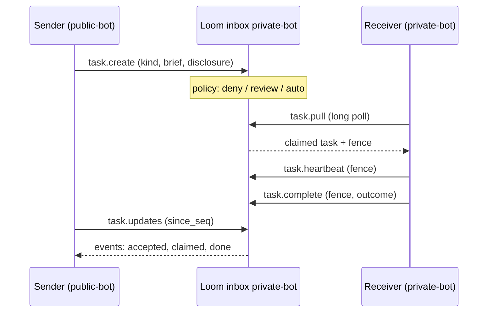
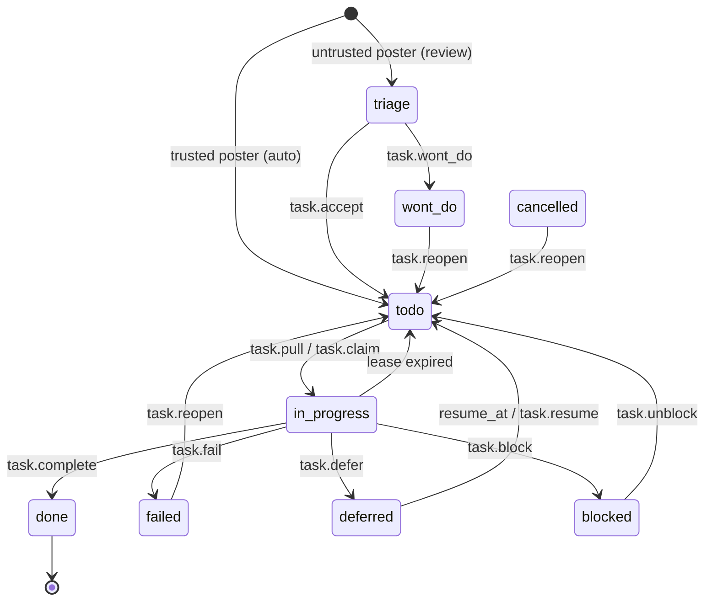

# Tasks, decisions and policies

Three planes sit beside memory for coordination between agents. Every op is callable by name on any MCP listing;
which ones the `all` listing shows is set out in [MCP toolsets](../reference/mcp.md#toolsets).

| Plane          | Answers                                                         | Ops                 |
| -------------- | --------------------------------------------------------------- | ------------------- |
| Task inbox     | "This work belongs to another agent. How do I hand it over?"    | `inbox.*`, `task.*` |
| Decisions      | "What did we decide in a case like this, why, and did it work?" | `decision.*`        |
| History policy | "May this agent do this now, given what it just did?"           | `policy.*`          |

**The owner decides.** Loom stores the mode an owner sets and applies it. It never promotes a poster to trusted, never
auto-accepts a triaged task, and never moves a policy rule from shadow to enforce. Where Loom offers evidence (a
poster's history, a rule's shadow ledger), a person or the owner agent reads it and changes the mode. An automatic
trust change would let a writer earn its way past a gate by gaming the signal it watches.

## Task inbox

Each agent has a durable queue. A poster can write into an inbox it cannot read. The inbox owner sets how far to trust
each poster. A claimed task has one owner at a time. Agents pull their work; an optional signed webhook only says
"pull now".



### Statuses



- `task.wont_do` (owner) and `task.cancel` (owner, or the poster while nobody owns the task) apply from any unfinished
  status. A finished task (`done`, `wont_do`, `failed`, `cancelled`) answers 409 `TASK_TERMINAL`.
- `task.reopen` (owner) moves `failed`, `wont_do` or `cancelled` back to `todo`.
- Every move off `triage → todo → in_progress → done` carries a `reason`.

### Register an inbox

An admin of the owner namespace registers the inbox and sets trust per `(poster, kind)`:

```python
from loom import Agent

async with Agent(org="acme", namespace="private", agent="admin", api_key=ADMIN_TOKEN) as a:
    await a.tasks.register_inbox(
        "private-bot",
        owner_agent="private-bot",
        posters=["sa:public-bot"],  # may post without holding the namespace
        accept_disclosure=["confidential", "internal"],
        default_lease_seconds=1800,
        max_attempts=3,
    )
    await a.tasks.set_policy(
        "private-bot",
        poster="sa:public-bot",
        kind="security_finding",
        mode="review",
        require_evidence=["inputs.finding_id", "inputs.test"],
    )
    await a.tasks.set_policy("private-bot", poster="sa:public-bot", kind="*", mode="deny")
```

| Mode     | A task from this poster and kind…                                           |
| -------- | --------------------------------------------------------------------------- |
| `deny`   | is refused with 403 `TASK_POSTER_DENIED`.                                   |
| `review` | lands in `triage` until the owner agent or a person accepts or declines it. |
| `auto`   | lands in `todo`, ready to pull.                                             |

- With no row, the inbox owner and a writer on the owner namespace post `auto`; anyone else posts `review`.
- A row keyed on an agent label grants `auto` only to a writer on the owner namespace, because the caller picks its
  label. Key outside posters on their service-account subject (`sa:<name>`).
- `require_evidence` names brief fields a create must carry; a 422 names the missing ones.
- Disclosure levels are `confidential`, `internal` and `public_ok`. A task with a level the inbox does not accept gets
  a 422 naming the accepted values.

`inbox.register` arguments:

| Argument                        | Default     | Meaning                                                         |
| ------------------------------- | ----------- | --------------------------------------------------------------- |
| `default_lease_seconds`         | 1800        | Lease a claim gets unless the pull asks for another.            |
| `max_attempts`                  | 3           | Expired leases before the task is blocked on a person.          |
| `max_defers`                    | 5           | Defers before the task is blocked on a person.                  |
| `triage_escalate_after_seconds` | 14400 (4 h) | Age at which an unanswered triage item is escalated, once.      |
| `webhook_url`                   | empty       | Receives a signed wake-up notice when the inbox has new events. |
| `webhook_secret_ref`            | empty       | Environment variable holding the webhook signing secret.        |

`webhook_url` is an `http` or `https` URL whose host resolves only to public addresses:
each delivery resolves it, refuses loopback, private, link-local (cloud metadata) and
multicast addresses, connects to the address it checked (the name stays the `Host`
header and TLS SNI) and follows no redirect. `webhook_secret_ref` must name one of the
inbox org's own variables, `LOOM_WEBHOOK_SECRET_<ORG>__<NAME>`: ORG is the org id
with lower-case letters upper-cased, digits kept and every other byte (upper-case
letters included) written `_` and two hex digits (org `acme-corp` →
`LOOM_WEBHOOK_SECRET_ACME_2DCORP__ALERTS`, `acme_corp` → `ACME_5FCORP`), NAME is
letters and digits.
`inbox.register` refuses any other name (422), and a row that names one is never read,
so no tenant can have Loom sign with another tenant's secret. No two org ids share an
ORG part.

### Post a task

```python
async with Agent(org="acme", namespace="public", agent="public-bot", api_key=PUBLIC_TOKEN) as a:
    out = await a.tasks.create(
        "private-bot",  # the target inbox
        kind="security_finding",
        title="Out-of-bounds read in the JSON reader",
        brief={
            "objective": "confirm and file in the private repository",
            "inputs": {"finding_id": "f-77", "test": "json_oob.sql"},
        },
        disclosure="confidential",
        idempotency_key="f-77",  # a retried create lands once
    )
    out["task"]["status"]  # "triage", or "todo" when the poster is trusted
```

Two creates with one `idempotency_key` store one task, even when they race: they run one at a time under a
lease on the key, each answers with the task, and only the one that stored it says `created=true`. A retry of
a create that was cut off after storing its task writes the `created` event it left out; its missing lease row
is the lease sweep's to write, so the task is claimable after the sweep's 60 s grace and one more pass. When the
first create's own event still lands (it was cancelled mid-insert), the two share one deduplication token and
the readers (`task.history`, `task.updates`, `/v1/task/watch`, webhooks) keep only the first, so a task is
created once in its history and in each cursor's delivery. A create that waits more than 10 s for another
with its key answers 409 `PRECONDITION_FAILED`, and 503 when the lease store (Keeper) does not answer; retry
either.

`namespace` is the poster's own; the first argument names the inbox. `create` also takes `priority` (default 3),
`deadline`, `not_before`, `origin` and `parent_task_id`. A task with `not_before` is `todo` but hidden from `pull`
until then, which is how a bot keeps its own "retry later" backlog.

| Refusal                                 | Answer                                                 |
| --------------------------------------- | ------------------------------------------------------ |
| May not post but reads the inbox        | 403 `AUTH_INSUFFICIENT`                                |
| May neither post nor read it            | 404 `RESOURCE_NOT_FOUND`, as for an unregistered inbox |
| Policy denies this poster or kind       | 403 `TASK_POSTER_DENIED`                               |
| Disclosure not accepted                 | 422, with the accepted values                          |
| Brief misses a `require_evidence` field | 422, with the missing field names                      |

### Pull, work, finish

```python
async with Agent(org="acme", namespace="private", agent="private-bot", api_key=PRIVATE_TOKEN) as a:
    async for task in a.tasks.stream("private-bot", kinds=["security_finding"]):
        fence = task["fence"]
        try:
            result = await work(
                task["brief"], heartbeat=lambda: a.tasks.heartbeat(task["task_id"], fence=fence)
            )
            await a.tasks.complete(task["task_id"], fence=fence, outcome={"issue_url": result.url})
        except Exception as e:
            await a.tasks.fail(task["task_id"], fence=fence, reason=str(e)[:500])
```

- **Long poll.** `task.pull` and `task.updates` wait up to 30 s (`wait_seconds`). A create on the same server process
  wakes a waiting pull at once; one on another replica is seen within about 2 s.
- **Leases and fences.** A claim gets a lease and a `fence` token that every owner write presents. `task.heartbeat`
  extends the lease. When a worker dies, the `task_lease_sweep` worker returns the task to `todo`, and after
  `max_attempts` expiries blocks it on a person. A stale fence gets 409 `TASK_FENCE_STALE`. A claim stands only
  when the task, read again after the claim wins its lease, is still `todo` at that fence; otherwise the claim
  gives the lease back as it found it. Each sweep also puts right a lease row a race left out of step with its
  task: a `todo` or triage task with no row gets one, an idle or expired row takes its task's fence (a claim cut
  off after winning leaves one a fence ahead), and an ended task's row goes. It skips rows written in the last
  60 s, which may belong to a create or reopen still in flight; a row the reconcile wrote back for a task a
  cancel was ending goes in the first pass after its 60 s grace. A cancel that lands between a claim's lease
  and its status write is overwritten by the claim, which leaves the task `in_progress`; this race predates
  the reconcile and is not closed by it.
- **Other moves.** `task.defer` (with `resume_at`), `task.block` (`blocked_on`: `sender`, `human`, `external`),
  `task.wont_do`, and `task.progress` (a note, no state change).
- **Triage.** `task.pull(status="triage")` returns review items unclaimed; decide with `task.accept` or
  `task.wont_do`. A poster may not accept its own task (403 `TASK_SELF_ACCEPT`). Nothing expires or auto-accepts a
  triaged task.

### Follow the outcome

The sender reads its own tasks' events with a cursor:

```python
upd = await a.tasks.updates(since_seq=cursor, wait_seconds=30)
for ev in upd["events"]:  # accepted, claimed, done, wont_do, blocked, ...
    reconcile(ev)
if upd["events"]:
    cursor = upd["next_seq"]  # save only after reconcile succeeds
```

A crash between the read and the save replays events, so `reconcile` must tolerate repeats. The cursor stays about
3 s behind the newest events so a row still landing on another replica is not skipped.

### Operations

| Group                     | Ops                                                                                                                    |
| ------------------------- | ---------------------------------------------------------------------------------------------------------------------- |
| Inbox setup (admin)       | `inbox.register`, `inbox.policy_set`, `inbox.principals`; `inbox.list`, `inbox.policy_list` (viewer)                   |
| Posting (sender)          | `task.create`, `task.updates`, `task.cancel`                                                                           |
| Working (owner)           | `task.pull`, `task.claim`, `task.heartbeat`, `task.progress`, `task.complete`, `task.fail`, `task.defer`, `task.block` |
| Triage and repair (owner) | `task.accept`, `task.wont_do`, `task.unblock`, `task.resume`, `task.reopen`, `task.update`, `task.reassign`            |
| Reading                   | `task.get`, `task.list`, `task.counts`, `task.history`                                                                 |

The Python SDK exposes them as `agent.tasks`. Over MCP, `?toolset=tasks` lists the ones a working agent uses:
`task.pull`, `task.create`, `task.complete`, `task.fail`, `task.wont_do`, `task.defer`, `task.heartbeat`,
`task.updates`, `task.list`, `task.get`, `inbox.list`.

The dashboard's **Tasks** page lists every inbox of the namespace, with tiles for what needs a person, rows grouped by
next step, Accept / Won't do inline, and a panel per task (`task.update` with `if_match_version`). A writer moves a
task through every transition the state machine has: from the panel's buttons (Start is `task.claim` under a one-day
lease held by `loom-ui`; Mark done and Fail are `task.complete` / `task.fail`, fenced with the current lease), or by
dragging a row or card onto another group, which runs the one-step move there (into To do accepts, unblocks, resumes
or reopens; into In progress starts; into Waiting blocks; into Closed marks done or won't do). Groups a task cannot
reach in one step are dimmed while it is held. Inbox settings pick posters from the identities Loom already knows in
the org (`inbox.principals`, admin).

### Settings

| Setting                             | Default | Effect                                                                                                                       |
| ----------------------------------- | ------- | ---------------------------------------------------------------------------------------------------------------------------- |
| `LOOM_TASK_LEASE_SWEEP_ENABLED`     | true    | Runs the sweeper: expired leases, deferred tasks reaching `resume_at`, stale triage, lease rows out of step with their task. |
| `LOOM_TASK_WEBHOOK_DELIVER_ENABLED` | true    | Posts one signed notice per new event batch to an inbox's `webhook_url`.                                                     |

See [configuration: task inbox](../reference/configuration.md#task-inbox).

## Decisions

A decision record holds a choice that matters later: a vendor, an architecture, a policy exception.
`decision.record` takes `category`, `scenario`, `reasoning`, `outcome`, `alternatives`, `confidence`, and the keys it
was `caused_by` or `influenced_by`. It writes:

- a typed record of the built-in `decision` schema;
- a searchable memory row of type `decision` under the same key;
- an edge from each `caused_by` / `influenced_by` key to the decision.

A decision recorded in a repository's trunk code namespace also reaches MCP `loom_search` from a checkout of that
repository, for a caller who may read the namespace ([unified search](unified-search.md#reading-the-memory-section)).

The memory row's value is one statement,
`<scenario>. Decided <outcome> because <reasoning>. Rejected: <alternative>; …`, then `Realized: …` once
`decision.outcome` has recorded one. The category is not in it: it stays on the record and in the row's
`decision:category:<category>` tag, which is what a filter by category reads. A reasoning that is the outcome word for
word (case, whitespace and the closing punctuation aside) records a ban or an invariant stated with no reason: the
statement reads `Decided <outcome>.`, the outcome keeping the reasoning's room as well, and `context.pack` gives no
`because`. Search embeds and excerpts it and `memory.for_file` shows it, so it opens with the scenario. Each part is
shortened to fit the embedded excerpt, the scenario most, because the pre-edit line shows the start of the statement
and must reach the outcome. The excerpt is measured as the value is stored, JSON-encoded, where a non-ASCII character
takes six or more, so a Cyrillic or CJK part keeps about a sixth as many characters as an ASCII one. The record keeps
every field in full except the alternatives, each kept to its first 300 characters.

- **Checks**: the blacklist reads every stored field in full; the sensitivity and the attribute labels read the stored
  category, scenario, outcome, reasoning, alternatives and realized outcome (not `decision_maker` or `run_id`, which
  the row never holds).
- **Files**: `files` sets the row's files as on `memory.set`; unset, they are detected from the stored fields, never
  from the shortened statement. `memory.for_file` serves the decision before an edit of a file it names, marked
  `(unconfirmed)` until it is pinned or attested, and `(source changed since confirmation)` or `(source changed)`
  once tagged `source-changed` ([how the block reads](../concepts/memory.md#tags-entities-and-files)).
- **Source**: `source_resource_id` and `source_class` set those columns as on `memory.set`; `source_resource_id`
  cites the document the decision was taken from.
- **Outcome**: `decision.outcome` keeps the row's files, source, declared class and the caller's tags. It sets the
  `decision` tags again and works out the server's `sensitivity:` and `attribute:` labels again.

A decision is identified by its key, not its text. The write-time conflict check never merges a decision into another
decision's row, files it as a duplicate of one, lets one replace it or lets a pinned one refuse it, however alike they
read; a close decision under another key is flagged as a conflict. The conflict resolver may later retire one of a
close pair it judges an update of the other; that is recorded as `memory.auto_supersede`, and `memory.restore` undoes
it.

`category` plus `scenario` identify a decision. Deciding the same scenario again supersedes the earlier record
(`superseded_prior=true`); history keeps it. A decision recorded again word for word writes the same statement, which
`memory.set` takes as a restatement: it reinforces the row, and a pinned decision accepts it. The restatement compares
the statement's bytes, so a row stored under another statement form is revised rather than restated by the same fields,
whether they come from `decision.record` or from `decision.outcome`, which rebuilds the statement too. A row whose value
is locked refuses either with 423 `LOCKED` until the lock ends or is released; an attested row takes the write, and its
attestation reads stale until `memory.verify` binds it again; a pinned row refuses `decision.record` until it is
unpinned, and the pin is set again only through `memory.pin`, while `decision.outcome` keeps the pin. When the writer of
a pinned decision decides it otherwise, the call is refused with 409 `PINNED_CONFLICT` and nothing is written; an admin
unpins it with `memory.unpin` first. The pin guards only its writer's row: another identity's decision on the same
scenario still supersedes the record. The new record holds only what the new decision states: fields it leaves out, and
an earlier `realized_outcome` or `success`, are not carried over, whether it is written by `decision.record` or
`memory.record.write`. A `decision.outcome` without `success` keeps the record's verdict.

The record holds the text of its last writer, the agent, user and session that recorded it, so a delete of that
writer's decision row retires it; an expired row still counts as live. Another identity's row under the same key was
superseded in the record plane and does not keep the record.

- **Retires the record**: `memory.delete` or `memory.delete_version` of the writer's decision row, including
  `memory.move` with `keep_redirect=false` and `memory.apply` with `action="delete"`, which delete through
  `memory.delete`; `conflicts.resolve` and `memory.dedup_resolve` for the side they tombstone; `blacklist.add`
  with `sweep=true` and `blacklist.sweep`. `decision.chain`, `decision.precedents` and `decision.outcome` stop
  serving it, and `memory.record.history` shows the last version with `status="tombstoned"`. Two retirements that
  race can each write a tombstoned version, so history may list the tombstone twice.
- **After a retirement**: `memory.restore`, or `namespace.rollback` past the delete, revives the row but not the
  record; call `decision.record` again. A row moved with `keep_redirect=false` is no longer a decision: its new key
  has no record, and `decision.record` with the same category and scenario records it again under its derived key.
- **Leaves the record active**: a delete of another identity's row; `memory.clear` and `namespace.rollback`, which
  tombstone rows another way; `memory.move` with `keep_redirect=true`, whose redirect row still counts as the
  writer's live row under the old key; a `memory.set` under the writer's identity that rewrites the key with another
  `memory_type`; the expiry sweep's tombstone of an expired writer row.
- **A record with no decision row**: `memory.record.write` on the `decision` schema writes the record alone.
  `decision.chain` serves it, and `decision.outcome` answers not-found for it; record decisions with `decision.record`.
- **`decision.outcome`**: writes under the record's writer, keeping a pinned row's pin, and answers not-found when
  the writer's row is not live. Its row write is conditional on the row it read: it answers 409 `PRECONDITION_FAILED`
  when the decision changes during the call or another conditional write holds the key, and 503 when the key's lease
  store is unreachable; call it again. A re-record that keeps the decision's text leaves the row's value as it was,
  so the outcome also checks the writer's record before its row write and again before its record write, and answers
  the same 409 when it moved; caught at the second check, the row holds the outcome's statement and outcome tags
  until the call is made again, and that call counts as a restatement of the row. The condition is on the row's
  value, not its pin: a `memory.unpin` that lands between the outcome's read and its write is undone, as the outcome
  writes the row pinned again.

| Operation             | Role   | Does                                                                                               |
| --------------------- | ------ | -------------------------------------------------------------------------------------------------- |
| `decision.record`     | writer | Record a decision and its causal edges.                                                            |
| `decision.precedents` | viewer | Semantic search over past decisions (at most 25), optionally by `category` or `with_outcome_only`. |
| `decision.chain`      | viewer | Walk causal edges `upstream`, `downstream` or `both`, up to 4 hops.                                |
| `decision.outcome`    | writer | Record `realized_outcome` and `success`; credit or charge the memories the deciding run relied on. |

Pass the `run_id` the decision was made under: `decision.outcome` finds the memories to credit through that run's
`memories_used` ([runs](runs.md)).

```python
rec = await agent.decision.record(
    category="storage",
    scenario="retention for raw transcripts in the support namespace",
    reasoning="Replay needs 30 days; legal hold is handled by export, not by retention.",
    outcome="keep transcripts 30 days",
    alternatives=["keep forever", "7 days"],
    confidence=0.8,
    influenced_by=["policy/legal/hold"],
)
prior = await agent.decision.precedents("how long do we keep transcripts?", category="storage")
await agent.decision.outcome(rec["memory_key"], "no replay gaps in the quarter", success=True)
```

### Extract decisions from a document

`loom decisions extract` reads one [knowledge](knowledge.md) document and records the decisions it states. It runs
in-process with no token, so it is an operator command, and it calls the configured LLM once per window of the
document's sections, twice for a window read again (below), also in a dry run. Its model calls are not gated by the
namespace's cost cap.

```bash
loom decisions extract --org O --namespace NS --source-uri URI            # dry run: prints what it would write
loom decisions extract --org O --namespace NS --source-uri URI --apply    # writes
```

- **Windows**: the document's live chunks for the current embedding model, grouped by section, at most
  `--window-chars` (default 6000) per call. A document chunked under another embedding model has none: the command
  says to run `loom rechunk` first and writes nothing. A `--source-uri` with no live document exits 1 and writes
  nothing. The prompt lists the category, scenario and outcome of up to `LOOM_MEMORY_DECISION_EXTRACT_KNOWN_MAX`
  (default 30) decisions the extractor already holds for the document, and asks the model to reuse that wording for a
  decision the text still states, so a re-run reads the same keys. Category and scenario are shown whole, since the
  key is built from them; an outcome over 160 characters is shortened and ends in `…`.
- **Prompt**: the model is asked for the reason the text gives for each choice (the cost, constraint or failure it
  avoids), never the decision restated, for nothing from a section that sums up other sections, and never to give as
  the outcome what the text marks as former, replaced or superseded (an old default, a previous behaviour). A decision
  the text gives no reason for is left out, except a ban or an invariant stated without one: the model emits it with
  `is_constraint` true and its own sentence as the reasoning, which the restatement check keeps (below). It says
  nothing about images or captions: what is image-only is the filter's call below, and a section it sends, such as a
  one-line caption over a diagram beside more text, may state a decision.
- **Second read**: a window gets at most one extra model call, reported as `read again`. When the reply holds no
  decision and the window's text is more than a caption (80 characters once images and link markup are removed), the
  window is read once more with the same prompt and the second reply is the window's. When a candidate's quote is in the
  text but its reasoning or a rejected option's reason is not (a model often joins one from two places), and no span is
  under 12 characters, and the quote is not in a recap section, the window is read once more with those spans named,
  asking for each such decision again with one contiguous span, or none; the first reply's other candidates stand, and
  the failed ones are reported as dropped. Of the second reply, a candidate is checked only when it has a failed
  decision's outcome or a reasoning none of the window's kept decisions has: a kept decision given again under a
  reworded scenario is dropped with the line `the second read repeats a decision the first reply gave`. After an empty
  reply, a second read that fails or comes back unreadable loses the window as any window is: the exit code reads the
  final outcome. After a joined reason the window is answered already: a lost second read is a `read again` line, and
  the first reply's decisions are recorded with the exit code unchanged.
- **Image-only sections**: a section whose own text has no words (a heading alone or over an image), or holds an image
  and at most 80 characters of other text (a caption), is not sent to the model and gets the line
  `image-only, rationale not extracted`; a heading alone over its subsections is not one. The text above the first
  heading, or a document with no heading, is skipped the same way when it holds an image and at most a caption; it is
  reported as `(untitled)`. An image is a Markdown image (inline, or by reference as `![diagram][fig1]`; a shortcut
  reference such as `![spill flow]` is not read, since it looks like a macro such as `vec![0; n]`), an HTML image or a
  placeholder such as `[image]`, `[Image 3]` or `[image: ...]`. The caption's characters are counted without HTML tags,
  link targets, reference labels, the empty brackets a link around an image leaves, and bare URLs, so a badge wrapped in
  a link adds none; a tag is a lower-case name on one line, so `x < 10k` and `Option<A>` stay text. Image markup inside
  code (`` or `` in a code span or block) is text. A chunk with no words is not sent either.
- **Verbatim check**: the model returns, per decision, a `quote` and a `reasoning` and a reason for each rejected
  option. A candidate is kept only when its quote, its reasoning and every reason are each a substring of one chunk,
  with every run of whitespace read as one space, letter case ignored, and up to 3 label lines read across between two
  of its words: a model copying a span drops line breaks and doubled spaces and capitalises a sentence's first word,
  and a slide or diagram converted to text puts short labels between a sentence's two halves. A label line is one to
  three words on a line of its own, with a line break before and after it (blank lines around it are read too), that
  is title-like: its first letter or digit, after any markup, is an upper-case letter or a digit ("Proxy", "API",
  "Shard A", "3 replicas"), since a lower-case line of narrow-wrapped prose continues its sentence ("We keep the / old
  / index"), and a line of a script without case (Chinese, Japanese) is never read across, the check failing closed
  where case says nothing; that does not start as a list item (`-`, `*`, `+` followed by a space, or `1.`, `1)`
  followed by a space or alone), so `**Proxy**`, `_Proxy_`, `+3 nodes` and `2.5 GB` are labels), a fence or code (a
  backtick, `~`), a table row (`|`), a heading (`#`), a heading's underline (`===`, or a line of dashes such as `-` or
  `--`) or a rule (`---`, `***`, `___`), an HTML tag (`<`), a quote (`>`) or a definition (`:`); that does not end in
  `.`, `!`, `?` or `;` (or their full-width forms), closing brackets, quotes and emphasis after the mark aside, as the
  last line of a wrapped paragraph does; and that holds none of the ban words of a reason-less ban below, nor the
  contrast words of the inverted-alternatives check, nor a word ending in `n't`: skipping `not` would read "Retries
  are / not / safe" as "Retries are safe". A fourth label line, a line of four words, a line that is no label, or a
  label inside a line ends the match. A label sits inside a sentence, so none is read after a word that ends in `.`,
  `!`, `?` or `;` (or their full-width forms), closing brackets, quotes and emphasis after the mark aside: "We cache
  plans per tenant. / Costs / Each plan expires after an hour." is two sentences with a heading between, never one
  span. Between two words, the fewest label lines that reach the next word are read, so a later line reading as that
  word is not taken for a label. Each word of the span but the last ends where a word of the text ends, so `so` does
  not take the start of a label `Something`. The word right after the whitespace is read before any label, so a label
  line whose first word reads as the next word ("The proxy" over "the nearest replica") is taken as that word and the
  span is not found. Chunk texts hold a section's body without its heading line. What is recorded is the document's
  own span on one line, its words and case, with the label lines it read across left out: the same text on every run,
  and a recorded span reads as the document's span again, across the same labels, when the retire step looks for it.
  Each is at least 12 characters long, counted on the model's span: a shorter span ("We", "the") is in every document,
  so a decision resting on it could never retire. At most `--max-per-section` (default 3) are kept per section. A
  candidate whose category or scenario holds no letter or digit from a-z, 0-9 has no key and is dropped. Of two
  candidates with one key, or with one outcome and reasoning (overlapping chunks give two windows the same text), the
  first is kept.
- **Restated reasoning**: a candidate whose reasoning has no word its outcome lacks is dropped with the line
  `reasoning only restates the outcome: it has no word the outcome lacks`. Words are compared in lower case, without
  punctuation, as their English (Snowball) stems, so `stored` meets `store` and `running` meets `run`. Filler words
  (`we`, `the`, `will`, `decided`, `chose`, `use`, `instead`, `because` and the like) are skipped in any form: "We
  decided on spilling into sorted runs." restates the outcome `spill into sorted runs`; "Sorted runs avoid random reads
  on disk." gives a reason. An outcome that carries its own reason leaves the reasoning nothing to add, so the candidate
  is dropped, which is why the prompt asks for the outcome without its reason. One exception: a ban stated with no
  reason ("Client-side retries only; no server retry setting."), a candidate the model marks `is_constraint` whose
  reasoning holds `only`, `no`, `never`, `must`, `not`, `always`, `at most` or `at least` as a word, whose reasoning
  restates its outcome or is its whole quote (an outcome shorter than the sentence), and whose reasoning fits an outcome
  (1000 characters; a longer one is judged as any other candidate), is kept with its reasoning as its outcome (a
  reasoning with fewer words than the outcome, such as "no server retry setting" of that ban, gives way to the quote
  when the quote holds a ban word too), so it is recorded with the `constraint` tag and reads `Decided <outcome>.` with
  no reason. The flag alone is not enough: models mark plain descriptions as constraints too.
- **Recaps**: a candidate whose quote is in a section with `recap`, `summary` or `background` as a word of a heading at
  any level of its breadcrumb is dropped with the line `the quote is in a recap, summary or background section`. The
  section stays in the window, since its text may give a later decision's reason.
- **Inverted alternatives**: a rejected option the candidate's own quote, the span of the chosen design, states as
  part of the choice is left out of the record and reported
  (`rejected option '<option>' left out: the quote states it as part of the choice`); the decision is kept. An option
  is such when every word of it, as the restatement check compares words, is in one sentence of the quote (a sentence
  ends at `.`, `!` or `?` before whitespace, except after `vs.`, `e.g.` or `i.e.`, at a blank line or before a list
  item; a single line break does not end one) and that sentence holds none of `not`, `no`, `never`, `cannot`, `can't`,
  `instead`, `rather`, `without`, `fail`, `reject`, `than`, `avoid`, `slow`, `over`, `against`, `versus`, `vs`,
  `unlike`, `replace` (and `replaces`, `replaced`, `replacing`), `favor`, `favour` (and `favored`, `favours` and the
  like), `prefer` (and `prefers`, `preferred`), `outperform` (and its forms), `beat`, `beats`, `compare`, `drop`, each
  of `fail`, `reject`, `avoid`, `compare` and `drop` in any form (`fails`, `rejected`, `avoids`, `compared`,
  `dropped`), so "We chose sorted runs over a plain set on disk." and "We prefer sorted runs to a plain set on disk."
  still reject the set. The list leans wide on purpose: a missed contrast word drops a true alternative's `Rejected:`
  part, while an inverted option kept would tell an agent the chosen design was rejected. The sentence that holds the
  option's own rejection reason is not read: it is the rejection. The quote is read as the document writes it, its
  line breaks kept and its label lines left out, so a label naming an option states nothing. Text outside the quote is
  not read either: a document often names an option in one sentence ("We looked at a plain set on disk.", a list item,
  "benchmarked … against …") and rejects it in the next. A quote "…; sharding by tenant is deferred to v2." states
  "Defer sharding by tenant"; "so v1 cannot evict it" still rejects "evict the largest job".
- **Write**: through `decision.record` as agent `loom-decisions` (user and session `-`), confidence 0.5,
  `source_class="derived"`, `source_resource_id` `knowledge:<namespace>/<source_uri>#<section breadcrumb>`, tags
  `source-kind:design_doc` and `constraint` for a ban or an invariant. The row's `actor` is `process:cli:decisions`.
  Each `decision.record`, and each `memory.delete_version` that deletes a row, leaves the audit row the transport
  writes for that op, with the actor `process:cli:decisions`; the tag write, `memory.update_by_id`, declares none, as
  over HTTP.
- **Files**: each backticked or qualified name and each bare class name the document text holds is looked up with
  `code.symbol` in the same namespace; exactly one defining file (a class preferred over its constructor) goes into
  `files`, several or none add nothing. A repository path the quote or the reasoning writes out
  (`src/Storages/MergeTreeData.cpp`) is added as well, as `memory.set` detects one. When the code index cannot be read
  for a name, a decision already recorded keeps the files its row has, and a new one is written with the files that
  did resolve. Pull request numbers and setting names are printed as unresolved in a dry run, for a human to add; a
  backticked snake_case name is looked up first and reported as a setting only when the index does not define it. A
  name defined in several files is printed as unresolved too, for a human to pick the file.
- **Reconcile**: the document says otherwise only when a verbatim field differs: the reasoning, or the set of rejected
  options' reasons, each matched as a prefix where `decision.record` cut a long alternative at its 300-character cap.
  The category, scenario, outcome and option wording are the model's, and a change there alone is no change. Nor is a
  change in whitespace alone (a re-wrapped line): the row keeps its stored span, which the retire step still finds,
  and `decision.record` stores rejected options' reasons on one line already. A row counts as confirmed when it is
  pinned or attested in its current form (`memory.verify`), the rule `memory.for_file` marks `(unconfirmed)` by. By
  the row the key's active record belongs to:
  - **The extractor's own, unconfirmed, from this document**: same verbatim fields and the same `files`,
    `source_resource_id` and `constraint` tag: no write. A verbatim field differs, or only those row fields do (a file
    that resolves once the code is indexed, a renamed heading): recorded again (the record is superseded, history
    keeps it).
  - **Confirmed, citing this document** (whoever wrote it): a verbatim field differs: no write; the full
    `decision.record` body is printed with the row's agent, user and session, and the row is tagged `source-changed`
    unless it already carries the tag. To accept the body, a maintainer unpins a pinned row with `memory.unpin`
    (`decision.record` on a pinned writer row answers 409 `PINNED_CONFLICT`) and sends it; an attested row takes the
    body, and its attestation then reads stale until `memory.verify` binds it again.
  - **Another writer's unconfirmed row, or a row from another document**: neither revised nor tagged; its body is
    printed.
  - **Its outcome recorded** (`decision.outcome`): never recorded again, since `decision.record` would rebuild it
    without the outcome; a verbatim field that differs tags it `source-changed`, as a confirmed row is.
  - **No record under the key**: of the `LOOM_MEMORY_DECISION_EXTRACT_RESTATEMENT_TOP_K` (default 20) decision keys
    closest to the candidate (cosine only), a confirmed one under another key that reads the same at or above the
    namespace's conflict threshold skips the candidate: `already recorded by <agent> under <key>`. The query is the
    candidate's statement, which leaves the category out, so a confirmed decision filed under another category counts.
    Otherwise the decision is recorded. The fetch is capped at 500 rows, so a large value or
    `LOOM_MEMORY_SEARCH_PER_KEY_CAP=0` can read fewer keys.
- **The tag write**: `memory.update_by_id` by the row's `memory_id`, tags only, conditional on the value read: a value
  changed since, by `decision.outcome` or a re-record, is left alone and reported as a race. It is a new version by
  the extractor: the row's pin, value and attestation stay (the value's hash does not change, so the attestation still
  binds it), and its actor and age move to it, so the pre-edit line reads `by cli:decisions, just now`. It is a full
  revision, as any `memory.update_by_id` is: the row is embedded again and meets the conflict check, so a decision
  with a close peer is marked `conflicted` (`memory.for_file` still lists it unless `include_conflicted=false`), and a
  stale conflict mark is cleared.
- **Races**: `decision.record` takes no precondition, so a `decision.outcome` that lands between the run's read and
  its re-record is replaced with the rest of the record; the tag write's precondition covers the value, not a
  tags-only change in the gap.
- **Retire**: an unconfirmed `loom-decisions` row citing the document whose reasoning is no longer in the document's
  text, read as in the verbatim check, is deleted with `memory.delete_version`, which also retires its record; a
  confirmed one, or one whose outcome `decision.outcome` recorded, is tagged `source-changed` instead. The reasoning
  read is the extractor's own record: a key whose active record another identity wrote is left alone. An unconfirmed
  row whose outcome and reasoning (whitespace and letter case aside) this run recorded under another key (the model
  worded the scenario differently) is deleted too, so the decision is not served twice, unless its realized outcome is
  recorded; another decision resting on the same reasoning has another outcome and stays. Otherwise a row whose
  reasoning is still there stays, whether or not the run emitted it again.
- **Citing the document**: a row cites it when its `source_resource_id` starts `knowledge:<namespace>/<source_uri>#`,
  so a heading holding `#` (`C# bindings`) is no obstacle, unless a document `<source_uri>#<part>` it also starts with
  was ever ingested in the namespace: `doc#v2#Intro` cites `doc#v2` once that document exists.
- **Clearing `source-changed`**: when a run's candidate for a tagged row's key has the row's verbatim fields again,
  the run drops the tag, pinned or not, as long as the row cites this document. The retire step never drops it: it
  reads the reasoning alone, and the tag may stand for a rejected option's reason the document still contradicts, or
  a tag a maintainer set.
  By hand, a maintainer drops it with `memory.update_by_id` on the row's `memory_id` with `tags` less
  `source-changed`, or re-records the decision (after `memory.unpin`) or deletes it.
- **Refusals and races**: a write the server refuses (a blacklisted decision, a row pinned during the run, a busy key,
  a store timeout) is reported with its code, and one the embedding provider's error stops (`memory.set` and
  `memory.search` embed in-process) with the error's name; a write that finds its row deleted or rewritten since the
  run read it is reported as such, a race the next run settles. Either way the run goes on with the next candidate and
  the retire step.
- **Limits**: `--max-per-section` is at least 1 and `--window-chars` at least 500; a smaller value is refused. A reply
  cut at the model's token limit is reported with the cap it hit (`decision_extract`, 4000 unless
  `LOOM_LLM_MAX_TOKENS_OVERRIDES` sets it) and the advice to lower either flag or raise that entry; a window's first
  model call, or its second after an empty reply, that fails (a provider error, a timeout) loses that window only; a
  failed second read for a joined reason loses nothing, its first reply's decisions recorded.
- **Model and exit code**: the run refuses before any model call when it would read the document with the fake model,
  whose decisions pass the verbatim check by construction: a keyed provider (`LOOM_LLM_PROVIDER=openai` or `anthropic`)
  with no API key set, or no provider configured at all. `LOOM_LLM_PROVIDER=fake` set explicitly runs on it on purpose.
  Otherwise a window the fake model answers (a fallback model, `LOOM_LLM_FALLBACK_MODEL`, with no key) is dropped as
  unread. A run whose every window's model call failed or came back unreadable, or answered nothing and failed when read
  again, reads nothing and retires nothing. The command exits 1 when it could not read the document (no document, no
  chunks, no usable model, the extractor's own rows unreadable before any model call, no window read), 2 when a write,
  or a read it needed, was refused or failed (a dry run's reads count too, and so does a window the model could not
  answer readably while others were read), else 0; a race does not change the exit code.

The reasoning is the verbatim span the retire step reads: the record has no field for the quote. To confirm an
extracted decision, a maintainer reads its identity with `memory.get` and calls `memory.pin` under it, or attests its
current value with `memory.verify`. Before an edit, `memory.for_file` marks an extracted row `(unconfirmed)` and
`(source changed …)` as it does every decision row ([Decisions](#decisions)). Extracted into a repository's trunk code
namespace, the rows also reach `loom_search` from a checkout of the repository, as every decision recorded there does
([unified search](unified-search.md#reading-the-memory-section)); that surface marks no pin state, nor whether its
source changed, so an extracted row reads there as any decision does until a maintainer confirms or deletes it.

## History policies

A role says who may call what. A history policy adds rules over the caller's own recent history in the agent event
trace (`loom.agent_events`): "only after a read", "no more than 200 writes an hour". A policy can only take permission
away; a call that fails its role check never reaches the policy gate.

A rule is `effect` + `actions` + `condition`:

- `effect`: `forbid` denies when the condition holds; `require` denies when it does not.
- `actions`: op names or globs (`memory.delete`, `memory.*`).
- `condition`: a tree of past-only leaves combined with `all`, `any` and `not`.

| Leaf             | Holds when                                                                                                   |
| ---------------- | ------------------------------------------------------------------------------------------------------------ |
| `formerly`       | A matching event happened within the window.                                                                 |
| `count_within`   | The count of matching events compares (`gt`, `gte`, `lt`, `lte`, `eq`) to `value`.                           |
| `not_since`      | An `anchor` event happened within the window and the named event has not happened since the latest anchor.   |
| `breadth_within` | The distinct keys the principal was shown compare to a `value` or a `fraction` of the namespace's live rows. |

Each leaf takes `within` (`30s`, `15m`, `1h`, `7d`; capped by `LOOM_POLICY_MAX_WINDOW_SECONDS`), `operation`, and
`key`: `agent` (default), `session` or `user` (`breadth_within` defaults to `actor`, the verified token subject). The
compiler pins the caller, so a rule never reads another principal's events. `args_equal` compares event arguments to
a literal or to `$args.<field>` of the current call.

```python
await agent.policy.set(
    "read-before-delete",
    effect="require",
    actions=["memory.delete"],
    condition={
        "op": "formerly",
        "within": "1h",
        "operation": "memory.get",
        "args_equal": {"memory_key": "$args.memory_key"},
    },
    description="An agent deletes only what it has just looked at.",
)
verdict = await agent.policy.check(
    operation="memory.delete", agent="cleanup-bot", args={"memory_key": "notes/old"}
)
# verdict: {decision, would_enforce, mode, write_shaped, determining_rules, errors, rules, latency_ms}
```

### Modes

`LOOM_POLICY_MODE` sets the deployment's mode:

| Mode            | Effect                                                                                            |
| --------------- | ------------------------------------------------------------------------------------------------- |
| `off` (default) | The gate reads and writes nothing.                                                                |
| `shadow`        | Rules run and each decision is appended to `loom.policy_decisions`; nothing blocks.               |
| `enforce`       | A denying rule answers 403 `POLICY_FORBIDDEN` with the rules and per-leaf values that decided it. |

A rule's own `mode` (`inherit`, `shadow`, `enforce`) overrides the deployment's, except when the deployment is `off`.
Moving a rule to enforce is the owner's step, taken after reading `policy.decisions`.

In `enforce`, a rule that cannot be evaluated denies a write-shaped call (writer role or above) and allows a read,
reporting the error. The gate never applies to `policy.*` or `ops.*`, so an operator can always fix a rule. A change
that widens what agents may do also writes a `policy.widened` audit row.

| Operation          | Role   | Does                                                                   |
| ------------------ | ------ | ---------------------------------------------------------------------- |
| `policy.set`       | admin  | Create or replace a rule; returns `leaf_count` and whether it widened. |
| `policy.delete`    | admin  | Remove a rule.                                                         |
| `policy.list`      | viewer | The namespace's rules and the deployment's mode.                       |
| `policy.check`     | viewer | Dry-run a call against the stored rules or against `rules` you pass.   |
| `policy.decisions` | viewer | Read the decision ledger, filtered by `allow` / `deny`.                |

The dashboard's **Policies** page (admin drawer) manages rules, dry-runs a call and reads the ledger. Settings:
`LOOM_POLICY_MODE`, `LOOM_POLICY_MAX_WINDOW_SECONDS` (default 86,400) and `LOOM_POLICY_CACHE_TTL_SECONDS` (default 30;
other replicas see a rule change within it), in [configuration: auth](../reference/configuration.md#auth).

## Limits

- Claims are exclusive but not transactional with the work. Completing a task and writing its result are two calls;
  make the result write idempotent.
- `decision.chain` stops at 4 hops; `decision.precedents` returns at most 25.
- Policy evaluation is past-only: the current call is not in the trace yet, so a witness is always an earlier event.

## Related

- [Runs](runs.md): the run ledger decisions credit through.
- [Namespaces and sharing](namespaces-and-sharing.md): owner namespaces and grants.
- [Tokens and grants](../guides/tokens-and-grants.md): service-account subjects for `posters`.
- [Headless bots](../guides/headless-bots.md).
- [The dashboard](dashboard.md): the Tasks board and the Policies page.
- [Security architecture](../architecture/security.md): where the policy gate sits.
