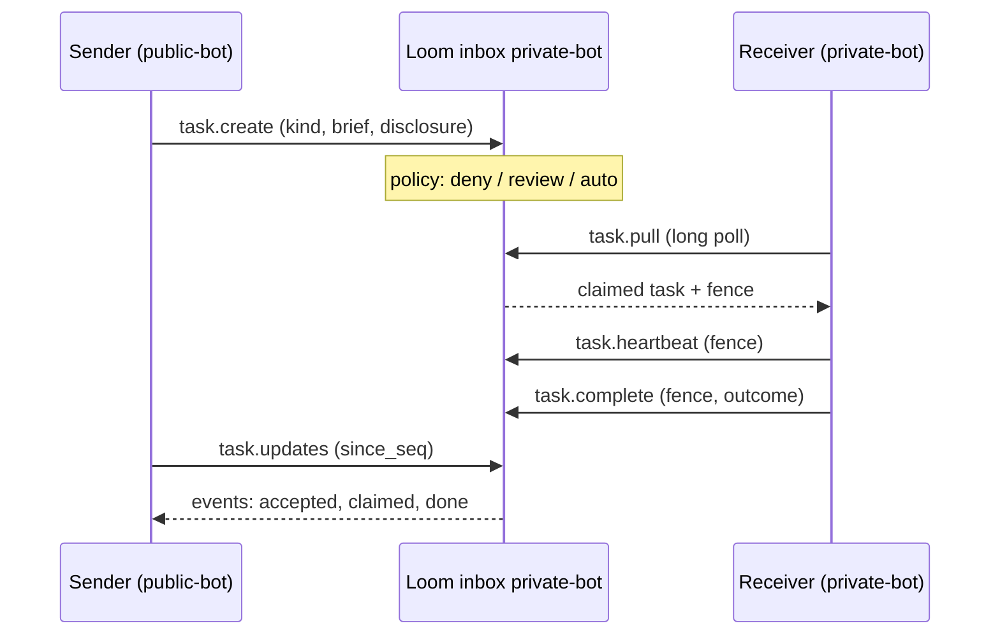
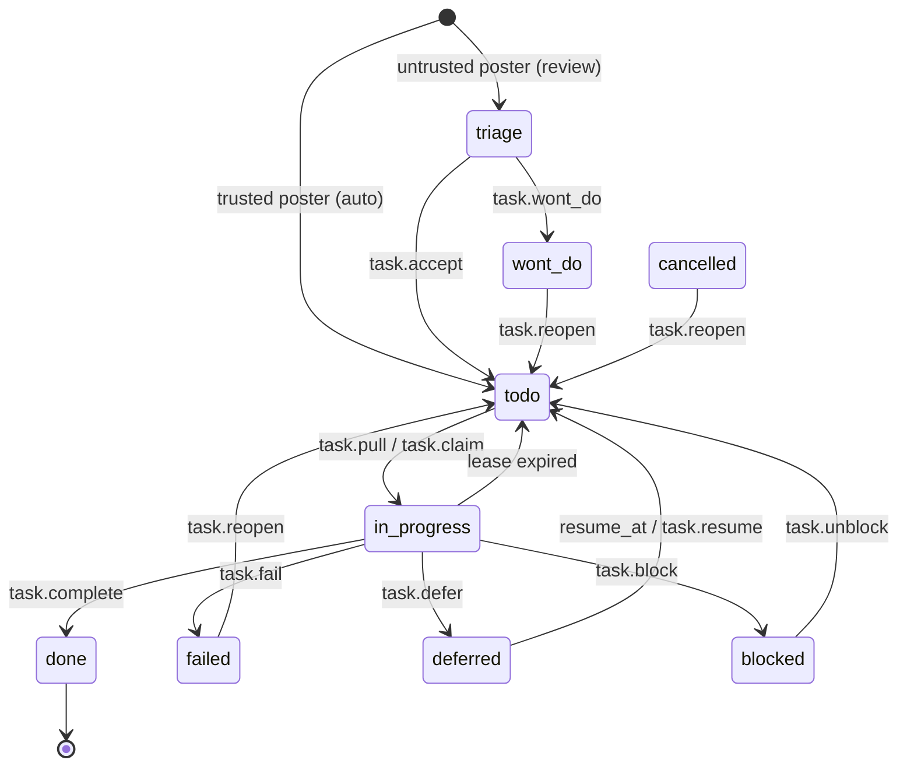

# Tasks, decisions and policies

Three planes sit beside memory for coordination between agents. Every op is callable by name on any MCP listing;
which ones the `all` listing shows is set out in [MCP toolsets](../reference/mcp.md#toolsets).

| Plane          | Answers                                                         | Ops                 |
| -------------- | --------------------------------------------------------------- | ------------------- |
| Task inbox     | "This work belongs to another agent. How do I hand it over?"    | `inbox.*`, `task.*` |
| Decisions      | "What did we decide in a case like this, why, and did it work?" | `decision.*`        |
| History policy | "May this agent do this now, given what it just did?"           | `policy.*`          |

**The owner decides.** Loom stores the mode an owner sets and applies it. It never promotes a poster to trusted, never
auto-accepts a triaged task, and never moves a policy rule from shadow to enforce. Where Loom offers evidence (a
poster's history, a rule's shadow ledger), a person or the owner agent reads it and changes the mode. An automatic
trust change would let a writer earn its way past a gate by gaming the signal it watches.

## Task inbox

Each agent has a durable queue. A poster can write into an inbox it cannot read. The inbox owner sets how far to trust
each poster. A claimed task has one owner at a time. Agents pull their work; an optional signed webhook only says
"pull now".



### Statuses



- `task.wont_do` (owner) and `task.cancel` (owner, or the poster while nobody owns the task) apply from any unfinished
  status. A finished task (`done`, `wont_do`, `failed`, `cancelled`) answers 409 `TASK_TERMINAL`.
- `task.reopen` (owner) moves `failed`, `wont_do` or `cancelled` back to `todo`.
- Every move off `triage → todo → in_progress → done` carries a `reason`.

### Register an inbox

An admin of the owner namespace registers the inbox and sets trust per `(poster, kind)`:

```python
from loom import Agent

async with Agent(org="acme", namespace="private", agent="admin", api_key=ADMIN_TOKEN) as a:
    await a.tasks.register_inbox(
        "private-bot",
        owner_agent="private-bot",
        posters=["sa:public-bot"],  # may post without holding the namespace
        accept_disclosure=["confidential", "internal"],
        default_lease_seconds=1800,
        max_attempts=3,
    )
    await a.tasks.set_policy(
        "private-bot",
        poster="sa:public-bot",
        kind="security_finding",
        mode="review",
        require_evidence=["inputs.finding_id", "inputs.test"],
    )
    await a.tasks.set_policy("private-bot", poster="sa:public-bot", kind="*", mode="deny")
```

| Mode     | A task from this poster and kind…                                           |
| -------- | --------------------------------------------------------------------------- |
| `deny`   | is refused with 403 `TASK_POSTER_DENIED`.                                   |
| `review` | lands in `triage` until the owner agent or a person accepts or declines it. |
| `auto`   | lands in `todo`, ready to pull.                                             |

- With no row, the inbox owner and a writer on the owner namespace post `auto`; anyone else posts `review`.
- A row keyed on an agent label grants `auto` only to a writer on the owner namespace, because the caller picks its
  label. Key outside posters on their service-account subject (`sa:<name>`).
- `require_evidence` names brief fields a create must carry; a 422 names the missing ones.
- Disclosure levels are `confidential`, `internal` and `public_ok`. A task with a level the inbox does not accept gets
  a 422 naming the accepted values.

`inbox.register` arguments:

| Argument                        | Default     | Meaning                                                         |
| ------------------------------- | ----------- | --------------------------------------------------------------- |
| `default_lease_seconds`         | 1800        | Lease a claim gets unless the pull asks for another.            |
| `max_attempts`                  | 3           | Expired leases before the task is blocked on a person.          |
| `max_defers`                    | 5           | Defers before the task is blocked on a person.                  |
| `triage_escalate_after_seconds` | 14400 (4 h) | Age at which an unanswered triage item is escalated, once.      |
| `webhook_url`                   | empty       | Receives a signed wake-up notice when the inbox has new events. |
| `webhook_secret_ref`            | empty       | Environment variable holding the webhook signing secret.        |

`webhook_url` is an `http` or `https` URL whose host resolves only to public addresses:
each delivery resolves it, refuses loopback, private, link-local (cloud metadata) and
multicast addresses, connects to the address it checked (the name stays the `Host`
header and TLS SNI) and follows no redirect. `webhook_secret_ref` must name one of the
inbox org's own variables, `LOOM_WEBHOOK_SECRET_<ORG>__<NAME>`: ORG is the org id
with lower-case letters upper-cased, digits kept and every other byte (upper-case
letters included) written `_` and two hex digits (org `acme-corp` →
`LOOM_WEBHOOK_SECRET_ACME_2DCORP__ALERTS`, `acme_corp` → `ACME_5FCORP`), NAME is
letters and digits.
`inbox.register` refuses any other name (422), and a row that names one is never read,
so no tenant can have Loom sign with another tenant's secret. No two org ids share an
ORG part.

### Post a task

```python
async with Agent(org="acme", namespace="public", agent="public-bot", api_key=PUBLIC_TOKEN) as a:
    out = await a.tasks.create(
        "private-bot",  # the target inbox
        kind="security_finding",
        title="Out-of-bounds read in the JSON reader",
        brief={
            "objective": "confirm and file in the private repository",
            "inputs": {"finding_id": "f-77", "test": "json_oob.sql"},
        },
        disclosure="confidential",
        idempotency_key="f-77",  # a retried create lands once
    )
    out["task"]["status"]  # "triage", or "todo" when the poster is trusted
```

Two creates with one `idempotency_key` store one task, even when they race: they run one at a time under a
lease on the key, each answers with the task, and only the one that stored it says `created=true`. A retry of
a create that was cut off after storing its task writes the `created` event it left out; its missing lease row
is the lease sweep's to write, so the task is claimable after the sweep's 60 s grace and one more pass. When the
first create's own event still lands (it was cancelled mid-insert), the two share one deduplication token and
the readers (`task.history`, `task.updates`, `/v1/task/watch`, webhooks) keep only the first, so a task is
created once in its history and in each cursor's delivery. A create that waits more than 10 s for another
with its key answers 409 `PRECONDITION_FAILED`, and 503 when the lease store (Keeper) does not answer; retry
either.

`namespace` is the poster's own; the first argument names the inbox. `create` also takes `priority` (default 3),
`deadline`, `not_before`, `origin` and `parent_task_id`. A task with `not_before` is `todo` but hidden from `pull`
until then, which is how a bot keeps its own "retry later" backlog.

| Refusal                                 | Answer                                                 |
| --------------------------------------- | ------------------------------------------------------ |
| May not post but reads the inbox        | 403 `AUTH_INSUFFICIENT`                                |
| May neither post nor read it            | 404 `RESOURCE_NOT_FOUND`, as for an unregistered inbox |
| Policy denies this poster or kind       | 403 `TASK_POSTER_DENIED`                               |
| Disclosure not accepted                 | 422, with the accepted values                          |
| Brief misses a `require_evidence` field | 422, with the missing field names                      |

### Pull, work, finish

```python
async with Agent(org="acme", namespace="private", agent="private-bot", api_key=PRIVATE_TOKEN) as a:
    async for task in a.tasks.stream("private-bot", kinds=["security_finding"]):
        fence = task["fence"]
        try:
            result = await work(
                task["brief"], heartbeat=lambda: a.tasks.heartbeat(task["task_id"], fence=fence)
            )
            await a.tasks.complete(task["task_id"], fence=fence, outcome={"issue_url": result.url})
        except Exception as e:
            await a.tasks.fail(task["task_id"], fence=fence, reason=str(e)[:500])
```

- **Long poll.** `task.pull` and `task.updates` wait up to 30 s (`wait_seconds`). A create on the same server process
  wakes a waiting pull at once; one on another replica is seen within about 2 s.
- **Leases and fences.** A claim gets a lease and a `fence` token that every owner write presents. `task.heartbeat`
  extends the lease. When a worker dies, the `task_lease_sweep` worker returns the task to `todo`, and after
  `max_attempts` expiries blocks it on a person. A stale fence gets 409 `TASK_FENCE_STALE`. A claim stands only
  when the task, read again after the claim wins its lease, is still `todo` at that fence; otherwise the claim
  gives the lease back as it found it. Each sweep also puts right a lease row a race left out of step with its
  task: a `todo` or triage task with no row gets one, an idle or expired row takes its task's fence (a claim cut
  off after winning leaves one a fence ahead), and an ended task's row goes. It skips rows written in the last
  60 s, which may belong to a create or reopen still in flight; a row the reconcile wrote back for a task a
  cancel was ending goes in the first pass after its 60 s grace. A cancel that lands between a claim's lease
  and its status write is overwritten by the claim, which leaves the task `in_progress`; this race predates
  the reconcile and is not closed by it.
- **Other moves.** `task.defer` (with `resume_at`), `task.block` (`blocked_on`: `sender`, `human`, `external`),
  `task.wont_do`, and `task.progress` (a note, no state change).
- **Triage.** `task.pull(status="triage")` returns review items unclaimed; decide with `task.accept` or
  `task.wont_do`. A poster may not accept its own task (403 `TASK_SELF_ACCEPT`). Nothing expires or auto-accepts a
  triaged task.

### Follow the outcome

The sender reads its own tasks' events with a cursor:

```python
upd = await a.tasks.updates(since_seq=cursor, wait_seconds=30)
for ev in upd["events"]:  # accepted, claimed, done, wont_do, blocked, ...
    reconcile(ev)
if upd["events"]:
    cursor = upd["next_seq"]  # save only after reconcile succeeds
```

A crash between the read and the save replays events, so `reconcile` must tolerate repeats. The cursor stays about
3 s behind the newest events so a row still landing on another replica is not skipped.

### Operations

| Group                     | Ops                                                                                                                    |
| ------------------------- | ---------------------------------------------------------------------------------------------------------------------- |
| Inbox setup (admin)       | `inbox.register`, `inbox.policy_set`, `inbox.principals`; `inbox.list`, `inbox.policy_list` (viewer)                   |
| Posting (sender)          | `task.create`, `task.updates`, `task.cancel`                                                                           |
| Working (owner)           | `task.pull`, `task.claim`, `task.heartbeat`, `task.progress`, `task.complete`, `task.fail`, `task.defer`, `task.block` |
| Triage and repair (owner) | `task.accept`, `task.wont_do`, `task.unblock`, `task.resume`, `task.reopen`, `task.update`, `task.reassign`            |
| Reading                   | `task.get`, `task.list`, `task.counts`, `task.history`                                                                 |

The Python SDK exposes them as `agent.tasks`. Over MCP, `?toolset=tasks` lists the ones a working agent uses:
`task.pull`, `task.create`, `task.complete`, `task.fail`, `task.wont_do`, `task.defer`, `task.heartbeat`,
`task.updates`, `task.list`, `task.get`, `inbox.list`.

The dashboard's **Tasks** page lists every inbox of the namespace, with tiles for what needs a person, rows grouped by
next step, Accept / Won't do inline, and a panel per task (`task.update` with `if_match_version`). A writer moves a
task through every transition the state machine has: from the panel's buttons (Start is `task.claim` under a one-day
lease held by `loom-ui`; Mark done and Fail are `task.complete` / `task.fail`, fenced with the current lease), or by
dragging a row or card onto another group, which runs the one-step move there (into To do accepts, unblocks, resumes
or reopens; into In progress starts; into Waiting blocks; into Closed marks done or won't do). Groups a task cannot
reach in one step are dimmed while it is held. Inbox settings pick posters from the identities Loom already knows in
the org (`inbox.principals`, admin).

### Settings

| Setting                             | Default | Effect                                                                                                                       |
| ----------------------------------- | ------- | ---------------------------------------------------------------------------------------------------------------------------- |
| `LOOM_TASK_LEASE_SWEEP_ENABLED`     | true    | Runs the sweeper: expired leases, deferred tasks reaching `resume_at`, stale triage, lease rows out of step with their task. |
| `LOOM_TASK_WEBHOOK_DELIVER_ENABLED` | true    | Posts one signed notice per new event batch to an inbox's `webhook_url`.                                                     |

See [configuration: task inbox](../reference/configuration.md#task-inbox).

## Decisions

A decision record holds a choice that matters later: a vendor, an architecture, a policy exception.
`decision.record` takes `category`, `scenario`, `reasoning`, `outcome`, `alternatives`, `confidence`, and the keys it
was `caused_by` or `influenced_by`. It writes:

- a typed record of the built-in `decision` schema;
- a searchable memory row of type `decision` under the same key;
- an edge from each `caused_by` / `influenced_by` key to the decision.

`category` plus `scenario` identify a decision. Deciding the same scenario again supersedes the earlier record
(`superseded_prior=true`); history keeps it. The new record holds only what the new decision states: fields it leaves
out, and an earlier `realized_outcome` or `success`, are not carried over.

The record holds the text of its last writer, the agent, user and session that recorded it, so it stays active only
while that writer's decision row is live (an expired row counts until the expiry sweep tombstones it). Another
identity's row under the same key was superseded in the record plane and does not keep the record.

- **Retires the record**: `memory.delete` or `memory.delete_version` of the writer's decision row, including
  `memory.move` with `keep_redirect=false`, which deletes through `memory.delete`. `decision.chain`,
  `decision.precedents` and `decision.outcome` stop serving it, and `memory.record.history` shows the last version
  with `status="tombstoned"`. `memory.restore` revives the row but not the record; call `decision.record` again.
  Two retirements that race can each write a tombstoned version, so history may list the tombstone twice.
- **Leaves the record active**: a delete of another identity's row; `memory.clear` and the other bulk tombstone
  paths; `memory.move` with `keep_redirect=true`, whose redirect row still counts as the writer's live row under the
  old key; a `memory.set` under the writer's identity that rewrites the key with another `memory_type`; the expiry
  sweep's tombstone of an expired writer row.
- **`decision.outcome` writes under** the record's writer, and answers not-found when the writer's row is not live.

| Operation             | Role   | Does                                                                                               |
| --------------------- | ------ | -------------------------------------------------------------------------------------------------- |
| `decision.record`     | writer | Record a decision and its causal edges.                                                            |
| `decision.precedents` | viewer | Semantic search over past scenarios (at most 25), optionally by `category` or `with_outcome_only`. |
| `decision.chain`      | viewer | Walk causal edges `upstream`, `downstream` or `both`, up to 4 hops.                                |
| `decision.outcome`    | writer | Record `realized_outcome` and `success`; credit or charge the memories the deciding run relied on. |

Pass the `run_id` the decision was made under: `decision.outcome` finds the memories to credit through that run's
`memories_used` ([runs](runs.md)).

```python
rec = await agent.decision.record(
    category="storage",
    scenario="retention for raw transcripts in the support namespace",
    reasoning="Replay needs 30 days; legal hold is handled by export, not by retention.",
    outcome="keep transcripts 30 days",
    alternatives=["keep forever", "7 days"],
    confidence=0.8,
    influenced_by=["policy/legal/hold"],
)
prior = await agent.decision.precedents("how long do we keep transcripts?", category="storage")
await agent.decision.outcome(rec["memory_key"], "no replay gaps in the quarter", success=True)
```

## History policies

A role says who may call what. A history policy adds rules over the caller's own recent history in the agent event
trace (`loom.agent_events`): "only after a read", "no more than 200 writes an hour". A policy can only take permission
away; a call that fails its role check never reaches the policy gate.

A rule is `effect` + `actions` + `condition`:

- `effect`: `forbid` denies when the condition holds; `require` denies when it does not.
- `actions`: op names or globs (`memory.delete`, `memory.*`).
- `condition`: a tree of past-only leaves combined with `all`, `any` and `not`.

| Leaf             | Holds when                                                                                                   |
| ---------------- | ------------------------------------------------------------------------------------------------------------ |
| `formerly`       | A matching event happened within the window.                                                                 |
| `count_within`   | The count of matching events compares (`gt`, `gte`, `lt`, `lte`, `eq`) to `value`.                           |
| `not_since`      | An `anchor` event happened within the window and the named event has not happened since the latest anchor.   |
| `breadth_within` | The distinct keys the principal was shown compare to a `value` or a `fraction` of the namespace's live rows. |

Each leaf takes `within` (`30s`, `15m`, `1h`, `7d`; capped by `LOOM_POLICY_MAX_WINDOW_SECONDS`), `operation`, and
`key`: `agent` (default), `session` or `user` (`breadth_within` defaults to `actor`, the verified token subject). The
compiler pins the caller, so a rule never reads another principal's events. `args_equal` compares event arguments to
a literal or to `$args.<field>` of the current call.

```python
await agent.policy.set(
    "read-before-delete",
    effect="require",
    actions=["memory.delete"],
    condition={
        "op": "formerly",
        "within": "1h",
        "operation": "memory.get",
        "args_equal": {"memory_key": "$args.memory_key"},
    },
    description="An agent deletes only what it has just looked at.",
)
verdict = await agent.policy.check(
    operation="memory.delete", agent="cleanup-bot", args={"memory_key": "notes/old"}
)
# verdict: {decision, would_enforce, mode, write_shaped, determining_rules, errors, rules, latency_ms}
```

### Modes

`LOOM_POLICY_MODE` sets the deployment's mode:

| Mode            | Effect                                                                                            |
| --------------- | ------------------------------------------------------------------------------------------------- |
| `off` (default) | The gate reads and writes nothing.                                                                |
| `shadow`        | Rules run and each decision is appended to `loom.policy_decisions`; nothing blocks.               |
| `enforce`       | A denying rule answers 403 `POLICY_FORBIDDEN` with the rules and per-leaf values that decided it. |

A rule's own `mode` (`inherit`, `shadow`, `enforce`) overrides the deployment's, except when the deployment is `off`.
Moving a rule to enforce is the owner's step, taken after reading `policy.decisions`.

In `enforce`, a rule that cannot be evaluated denies a write-shaped call (writer role or above) and allows a read,
reporting the error. The gate never applies to `policy.*` or `ops.*`, so an operator can always fix a rule. A change
that widens what agents may do also writes a `policy.widened` audit row.

| Operation          | Role   | Does                                                                   |
| ------------------ | ------ | ---------------------------------------------------------------------- |
| `policy.set`       | admin  | Create or replace a rule; returns `leaf_count` and whether it widened. |
| `policy.delete`    | admin  | Remove a rule.                                                         |
| `policy.list`      | viewer | The namespace's rules and the deployment's mode.                       |
| `policy.check`     | viewer | Dry-run a call against the stored rules or against `rules` you pass.   |
| `policy.decisions` | viewer | Read the decision ledger, filtered by `allow` / `deny`.                |

The dashboard's **Policies** page (admin drawer) manages rules, dry-runs a call and reads the ledger. Settings:
`LOOM_POLICY_MODE`, `LOOM_POLICY_MAX_WINDOW_SECONDS` (default 86,400) and `LOOM_POLICY_CACHE_TTL_SECONDS` (default 30;
other replicas see a rule change within it), in [configuration: auth](../reference/configuration.md#auth).

## Limits

- Claims are exclusive but not transactional with the work. Completing a task and writing its result are two calls;
  make the result write idempotent.
- `decision.chain` stops at 4 hops; `decision.precedents` returns at most 25.
- Policy evaluation is past-only: the current call is not in the trace yet, so a witness is always an earlier event.

## Related

- [Runs](runs.md): the run ledger decisions credit through.
- [Namespaces and sharing](namespaces-and-sharing.md): owner namespaces and grants.
- [Tokens and grants](../guides/tokens-and-grants.md): service-account subjects for `posters`.
- [Headless bots](../guides/headless-bots.md).
- [The dashboard](dashboard.md): the Tasks board and the Policies page.
- [Security architecture](../architecture/security.md): where the policy gate sits.
