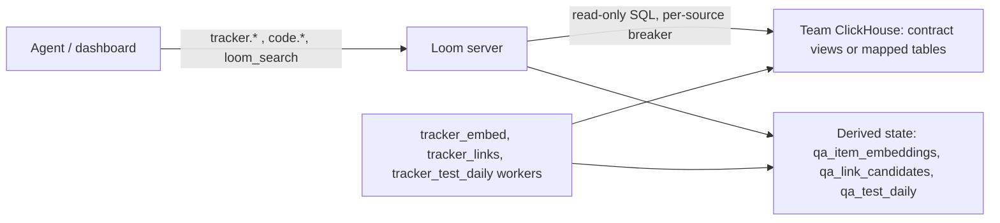

# Tracker plane

Nothing serves until `LOOM_TRACKER_ORG` is set and a source is registered.

A tracker is a team's record of issues, pull requests, incidents and CI runs, held in the
team's own ClickHouse. Loom reads it live with a read-only credential and never copies it.
Every statement is written against the [record contract](record-contract.md), so a new
tracker needs no code change: the team exposes views with the contract's names or saves a
mapping from its own tables.

Live reads keep one copy of the record under the team's access control, and the
deployment holds nothing it would have to erase. Every read has a time budget and a
circuit breaker; when the source does not answer, the result says `tracker_unavailable`.

Loom keeps only derived state: similarity embeddings (`loom.qa_item_embeddings`),
recovered issue→PR links (`loom.qa_link_candidates`), a per-test daily CI roll-up
(`loom.qa_test_daily`), the duplicate-check calibration fit, and the registered sources
(`loom.qa_sources`, credentials encrypted).



## Portability and record types

The tracker plane is repository-neutral. Jira, GitHub, GitLab, Linear, a help desk or an
internal tracker can serve the same contract through ClickHouse views or a saved mapping;
no repository name or vendor is selected in code. The required logical records are issues
and pull requests/changes. The contract's table names are `github_issues` and
`github_prs`, but mapping mode presents them in the dashboard as **items** and **changes**,
so the source's own tables and columns do not need those names.

Optional structured records enable more operations: incidents, support cases, chat
threads, component-risk snapshots, releases and release health, version history, CI
checks, cloud instances and their relationships. These are typed table records, not file
attachments. PDFs, Office files and arbitrary documents belong in the Library plane;
link their URLs from tracker rows when an issue needs to cite them.

A repository may link several tracker namespaces in order. Number lookups use the first
tracker because `#42` is ambiguous across systems. Semantic search, duplicate checking,
answer routing and bisect candidate scans read every linked tracker the caller may access,
and every returned item names its tracker namespace.

## Tracker namespaces

A tracker is read through **tracker namespaces** (directory rows of `kind = tracker`).
Each names its source and the `repos` (`Org/repo` prefixes of `source_id`) it may read; a
repository not listed is never read.

| Kind       | Reads                                                                                                         | Join policy                    |
| ---------- | ------------------------------------------------------------------------------------------------------------- | ------------------------------ |
| standard   | adds `is_private = 0` to every statement; refuses `core_incidents`, `support_cases`, `slack_threads` outright | `open` (default) or `approval` |
| restricted | private rows too; every read needs a token that names the namespace plus a live direct grant                  | `approval`                     |

Readers join with `namespace.join` (`role: "viewer"`): an open namespace admits at once,
service accounts included; a restricted one waits for its admin. Layouts and enforcement
are in [public and private](record-contract.md#public-and-private); the access model is in
[identities and namespaces](../../concepts/identities-and-namespaces.md).

## The operations

All tracker ops take `org` (default `LOOM_TRACKER_ORG`) and a required `namespace`: a
tracker namespace, or a code namespace bound to one. Over MCP each op is a `loom_<op>` tool
(`loom_tracker_duplicate_check`). The `tracker` toolset lists the question ops;
`tracker.contract` and `tracker.source.*` are callable by name.

| Op                        | Answers                                                                                                                                                |
| ------------------------- | ------------------------------------------------------------------------------------------------------------------------------------------------------ |
| `tracker.duplicate_check` | Does this draft already exist? A calibrated `duplicate_of` / `related` / `none` verdict                                                                |
| `tracker.similar`         | The reports that already say it: duplicate and related issues and PRs for pasted `text`, an `issue_number` or stack `frames`                           |
| `tracker.item`            | The record of up to ten issue or PR numbers: component, severity, bisect verdict, affected branches, tests, CI, backports, the fixes / caused-by graph |
| `tracker.links`           | Which PR probably fixed this issue (or which issue this PR fixed) when nobody wrote the link down                                                      |
| `tracker.flaky`           | Is this test a known flaky? The flaky-test issues that name it, optionally with its CI history (`include_signal`)                                      |
| `tracker.test_signal`     | Flaky, regression or infrastructure? One test's own CI history                                                                                         |
| `tracker.release`         | Release readiness for one version: blockers with status and the latest health snapshot                                                                 |
| `tracker.component`       | One component's risk snapshot and its open issues, most severe first                                                                                   |
| `tracker.answer`          | A question in prose, or an artefact's anchors, answered by named templates; says what it searched (`explain_only` returns the plan)                    |
| `tracker.binding`         | What a namespace may ask the tracker plane: its tracker namespaces, primary first, and the templates the caller may run                                |
| `tracker.contract`        | The record contract and blank view templates, before any connection                                                                                    |
| `tracker.source.*`        | Register, inspect, check, remap, rotate, list and remove sources ([record contract](record-contract.md#adding-a-tracker-source))                       |

The code plane also reads a linked tracker (`code.bisect_candidates`, `code.backport_gap`,
`code.first_build`, `code.history`, `code.context_pack`; see
[history and PRs](../code-index/history-and-prs.md#pr-and-tracker-planes)), and
[`loom_search`](../unified-search.md) runs the duplicate check as a leg for a
defect-shaped query under a code scope.

### Duplicate check

`tracker.duplicate_check` takes a draft as a reporter would file it: `title`, `body`,
`frames`, `component`, `version` (`X.Y`), the issue numbers it `mentions`, and code
`paths` and `symbols`.

```python
from loom import Agent

async with Agent(org="acme", namespace="code-widgets", agent="triage-bot") as bot:
    res = await bot.tracker.duplicate_check(
        namespace="code-widgets",
        title="Upload hangs after token refresh",
        body="Steps: … Observed: the request never returns.",
        component="upload",
        paths=["src/upload/client.py"],
    )
    print(res["verdict"], res["epistemic"], res["answer"])
```

It runs `tracker.similar`'s legs once and scores each fused candidate with the namespace's
stored logistic fit:

1. **Legs.** BM25F over title and body with component, version and error-code boosts;
   position-decayed frame IDF; the items the text names by number; a vector leg over
   Loom's own embeddings (`LOOM_TRACKER_SIMILAR_VECTOR_LEG`, recall only: it adds
   candidates, never re-ranks); and a fix-in-flight leg, the draft's paths → PRs touching
   them → the issues they fix.
2. **Verdict.** `duplicate_of` when the top candidate's calibrated probability reaches the
   duplicate threshold, `related` at the related threshold, else `none` with no items. The
   fit is refitted weekly by the `tracker_links` pass on the record's own labelled
   duplicates; each refit's suggested threshold is served, clamped to
   `LOOM_TRACKER_DUPCHECK_DUPLICATE_THRESHOLD_MIN` / `_MAX`.
3. **Judge and rerank.** On a `related` answer one LLM call may promote a same-defect
   candidate to `duplicate` (never demote); a rerank call orders the `nearest` leads but
   never changes the verdict. Both need a real LLM provider and fail open.
4. **Links.** Issue rows carry their linked PRs, the release a fix ships in and its
   backports; on `none` or `related`, `related_prs` lists PRs that may already address the
   draft ([`code.pr_check`](../code-index/history-and-prs.md#pre-pr-duplicate-check-codepr_check)).

`epistemic` says how far to trust the answer:

| Value          | Means                                                        |
| -------------- | ------------------------------------------------------------ |
| `calibrated`   | a fit is stored                                              |
| `uncalibrated` | no fit: `related` at most, confidence null                   |
| `degraded`     | a leg or a tracker did not answer; a `none` is not clearance |
| `unavailable`  | the tracker did not answer                                   |

`none` means "no calibrated evidence of a duplicate", not "not reported"; read the
`related` list anyway. Addressed to a code namespace, the check reads every tracker the
caller may read, the bound one first, up to `LOOM_TRACKER_DUPCHECK_FANOUT_NAMESPACES`
(default 4), and names each item's namespace.

### Bisect

`code.bisect_candidates` is addressed at the code namespace and reads the tracker bound to
it: previously recorded observations in the triage columns of an `issue_number`
(`triage_reproduces_on`, `triage_clean_on`) give the release window, and the tracker's PR diffs (`github_prs.diff`,
`affected_file_paths`, the contract's `bisect` feature) are scanned for the frames. With
no frame, the scan is bounded by the issue's rarest patterns
(`LOOM_TRACKER_BISECT_SCOPE_PATTERNS`) and its component's directories
(`LOOM_TRACKER_BISECT_COMPONENT_DIRS`). Without a tracker, bisect reads the repository's
own PR history. It does not reproduce the issue or verify the triage observations; it
ranks PRs for an engineer or testing agent to investigate. The full flow is in
[history and PRs](../code-index/history-and-prs.md#bisect-candidates-codebisect_candidates).

### CI test history

`tracker.test_signal` reads one test's CI runs from the `checks` table and answers
`flaky`, `regression_candidate`, `infra_candidate`, `no_signal` (silence, not health) or
`unknown_test` (with similar test names). It weighs the fail rate and its Wilson lower
bound, flips between consecutive runs, same-commit rerun flips, failure storms across many
unrelated tests (infrastructure), and churn of the test's home files. `pr_number` adds that
PR head's outcome streak; the test source is scanned for flaky-test smells.

The `tracker_test_daily` worker rolls checks into `loom.qa_test_daily` daily, so a read
fetches only the unrolled hours from the remote. The checks table comes from the source
entry's `checks.from` ([source entry options](record-contract.md#source-entry-options)),
else the source's own `checks` table, else `LOOM_TRACKER_CHECKS_FROM`; with none, the op
has nothing to read. `tracker.flaky` answers the cheaper question, whether flaky-test
issues name the test (`flaky_by_issue` or `no_flaky_signal`).

### Links to fixing PRs

Issues often close without a `fixes` edge. The daily `tracker_links` pass takes each issue
opened in the last `LOOM_TRACKER_LINKS_ISSUE_DAYS` (90), ranks the merged trunk PRs after
it (BM25F over title and body, closing keywords, stack frames in the diff, component), and
writes the top `LOOM_TRACKER_LINKS_PER_ISSUE` (20) into `loom.qa_link_candidates`.
`tracker.links` serves them in both directions. A consumer that needs one fix
(`code.backport_gap`, bisect) takes the top candidate only above
`LOOM_TRACKER_LINKS_MIN_SCORE` (1.0) and when a closing keyword names the issue.

## Linking a tracker to a repository

A code namespace reads its linked trackers in order. The first is the **primary**: its
numbers are the repository's issue and PR numbers, so lookups by number (`tracker.item`,
PR facts, blame, backports, first build) read it alone. Searches (`tracker.duplicate_check`,
`tracker.similar`, `tracker.answer`, `loom_search`'s record leg, bisect's candidate scan)
read every linked tracker and name the source of each result.

| Who        | How                                                                                                                                                                                                                                                                                                                                                                                                                                                                                                                |
| ---------- | ------------------------------------------------------------------------------------------------------------------------------------------------------------------------------------------------------------------------------------------------------------------------------------------------------------------------------------------------------------------------------------------------------------------------------------------------------------------------------------------------------------------ |
| maintainer | `code.repo.set_source` with `tracker_namespaces` (repository admin, and admin of each tracker it newly links: a linked tracker is read by every reader of the repository, so linking it is a lasting delegation; a reader of the tracker gets 403, anyone else `NOT_A_TRACKER_NAMESPACE`), or the repository card's Trackers section. Replaces the operator map for that repository within `LOOM_CODE_REPOS_REFRESH_SECONDS`. A tracker whose `repos` do not cover the repository is accepted with `not_covering`. |
| operator   | `LOOM_TRACKER_CODE_NAMESPACE_BINDINGS_JSON`: glob keys over code namespace names, each to one tracker namespace or an ordered list.                                                                                                                                                                                                                                                                                                                                                                                |

```bash
LOOM_TRACKER_CODE_NAMESPACE_BINDINGS_JSON='{"code-widgets*": ["tracker-widgets", "tracker-helpdesk"]}'
```

Links are never guessed from names. The gate runs again for the caller on the bound
namespace, so a restricted tracker bound to a public repository stays closed to anyone the
gate refuses. `tracker.binding` reports what a namespace resolves to; unbound, refused and
"no tracker" are the same answer (`kind: "none"`), so a refusal reveals nothing.

## Adding a tracker from the dashboard

Any signed-in org member can add a tracker from the Trackers list on the Repositories
page, while `LOOM_TRACKER_SELF_SERVICE_ENABLED` is on (default) and the org holds fewer
than `LOOM_TRACKER_SELF_SERVICE_MAX_SOURCES` (10). The flow shows the contract first, then
the connection (or a proposed mapping from `tracker.source.inspect`), then a
`dry_run: true` check that returns a `CREATE OR REPLACE VIEW` draft per failing table.
_Add_ stays disabled until the checked form is the one it sends. The registrant becomes
the first admin. The steps as ops, the read-only user's SQL and the operator's form are in
[adding a tracker source](record-contract.md#adding-a-tracker-source).

## Settings that change it

| Setting                                                      | Default  | Effect                                                                          |
| ------------------------------------------------------------ | -------- | ------------------------------------------------------------------------------- |
| `LOOM_TRACKER_ORG`                                           | `""`     | the org tracker namespaces belong to; empty = no tracker namespace serves       |
| `LOOM_TRACKER_LIVE_SERVE`                                    | on       | kill switch: off = every tracker read answers `tracker_unavailable`             |
| `LOOM_TRACKER_LIVE_BUDGET_MS`, `LOOM_TRACKER_LIVE_TIMEOUT_S` | 300, 1.5 | caller-side budget per read and the remote `max_execution_time`                 |
| `LOOM_TRACKER_CIRCUIT_FAILURE_THRESHOLD`, `_COOLDOWN_S`      | 3, 120   | consecutive failures that open a source's breaker, and how long it stays open   |
| `LOOM_TRACKER_EMBED_ENABLED`                                 | on       | the `tracker_embed` pass that fills the vector leg                              |
| `LOOM_TRACKER_LINKS_ENABLED`                                 | on       | the daily link-recovery pass, which also refits the duplicate-check calibration |
| `LOOM_TRACKER_TEST_DAILY_ENABLED`                            | on       | the per-test daily CI roll-up                                                   |

Thresholds, legs, judge, rerank, bisect scope and test-signal settings are in the
[configuration reference](../../reference/configuration.md#tracker).

## Limits and failure modes

- **A slow source** answers `tracker_unavailable` (or degrades one leg, named in
  `leg_status`) within its budget. Each source has its own connection, breaker and budget,
  so one team's outage never affects another's.
- **A source that fails the contract does not serve** until its views or mapping are
  fixed; a failed verdict is re-checked after 60 s
  ([checking a source](record-contract.md#checking-a-source)).
- **Uncalibrated until a fit exists.** A new tracker's duplicate check answers
  `uncalibrated` until the refit has run on its labelled duplicates; a restricted
  namespace borrows the org's standard fit.
- **The vector leg lags by at most one pass**, and a query-time catch-up embeds items
  changed since the pass within `LOOM_TRACKER_SIMILAR_CATCH_UP_BUDGET_MS`.
- **Absent tables answer `not_provided`.** Incidents, releases, CI checks and the other
  optional tables are read only when the source provides them.

## Related

- [Record contract](record-contract.md): tables, columns, aliases, mapping mode, sources
- [History and PRs](../code-index/history-and-prs.md): the code-plane ops that read a tracker
- [Adding repositories](../code-index/repositories.md)
- [The dashboard](../dashboard.md)
- [Configuration reference](../../reference/configuration.md#tracker)
- [Operations reference](../../reference/operations.md#tracker)
