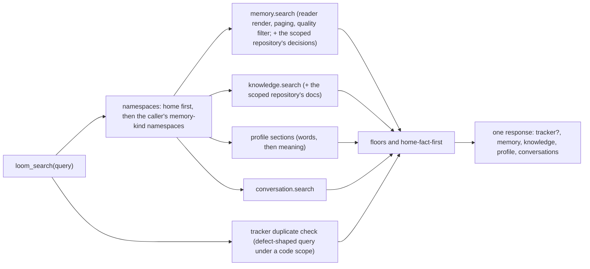

# Unified search and context packs

`loom_search` searches memory, profile, knowledge and past conversations across the caller's namespaces in one round
trip. `context.pack` builds the bounded bundle an agent loads at the start of a task. This page covers how they combine
the per-plane searches. How each plane ranks is on its own page: [search and ask](./memory/search-and-ask.md),
[knowledge](./knowledge.md), [conversations](./conversations-and-sessions.md).

## `loom_search`

`loom_search` is the MCP tool for the registry op `search.query`. It is listed in every MCP toolset. Over HTTP and the
SDKs the op returns the same sections without the MCP text summary ([below](#searchquery-over-http-and-the-sdks)).
One call runs these legs in parallel:



| Leg           | What runs                                                                                                                                                                                                                                                                                                                            | Kept when                                                                       |
| ------------- | ------------------------------------------------------------------------------------------------------------------------------------------------------------------------------------------------------------------------------------------------------------------------------------------------------------------------------------ | ------------------------------------------------------------------------------- |
| Memory        | `memory.search` over every author with `render="reader"`, `paging=true`, `quality_filter=true`; under a code scope also the `decision` memories in the scoped repository's trunk code namespace, when the caller may read it (1.5 s bound).                                                                                          | The hit clears the precision floor (below).                                     |
| Knowledge     | `knowledge.search`; under a code scope also the scoped repository's docs (1.5 s bound). Leaves out rules promoted for another agent (tagged `agent:<other>`); see [extraction](./memory/extraction.md#rules-the-assistant-states-about-itself). A [noise section](./knowledge.md#searching) ranks below the hits close to the query. | Similarity ≥ `LOOM_MCP_LOOM_SEARCH_KNOWLEDGE_MIN_SIMILARITY` (0.30).            |
| Profile       | Profile sections in scope, matched by words, then by cosine against `label` + value.                                                                                                                                                                                                                                                 | A word match, or cosine ≥ `LOOM_MCP_LOOM_SEARCH_PROFILE_MIN_SIMILARITY` (0.38). |
| Conversations | `conversation.search` over every author.                                                                                                                                                                                                                                                                                             | Cosine ≥ `LOOM_CONVERSATION_SEARCH_MIN_SIMILARITY` (0.30).                      |
| Tracker       | For a defect-shaped query (stack frame, error code, "already reported?") from an indexed checkout (`X-Loom-Code-Scope`), the tracker duplicate check (3 s).                                                                                                                                                                          | Its verdict leads the answer.                                                   |

A leg that fails returns `{"error": ...}` under its own key; the other sections still answer.

| Argument  | Meaning                                                                                              |
| --------- | ---------------------------------------------------------------------------------------------------- |
| `query`   | Required.                                                                                            |
| `top_k`   | Default 5, 1–100.                                                                                    |
| `tags`    | Keep rows carrying any of them; a coding session's rows carry `project:<folder>` and `repo:<id>`.    |
| `recipe`  | `fast`, `balanced`, `quality`, `verbatim`, `code`, `temporal`, `graph`.                              |
| `bodies`  | `excerpt` (default, 200 characters; a decision or constraint row as stored), `full`, `unit`, `none`. |
| `page`    | A `memory.next_page` handle from an earlier response.                                                |
| `explain` | A `why:` note per memory hit; nothing withheld.                                                      |

### Which namespaces it reads

The tool has no `namespace` argument; the server picks.

- **Fan-out:** the caller's namespaces of the kinds in `LOOM_MEMORY_SEARCH_FANOUT_KINDS` (default `memory`). Code and
  tracker namespaces are reached by their own tools, never swept, with two exceptions under a code scope
  (`X-Loom-Code-Scope`): the tracker duplicate check, and the scoped repository's trunk code namespace (its decision
  memories and its documents), which the memory and knowledge legs read when the caller may read that namespace. A
  namespace with no recorded kind counts as memory.
- **Home first:** the caller's own namespace leads, even when the token's first namespace is a teammate's.
- **Restricted** namespaces stay out unless the caller passes their read check.

### What it withholds

Each rule reports what it withheld in `withheld` and in the text summary, and a withheld memory row leaves the reader
block too. `explain=true` keeps everything.

1. **Precision floor.** Memory hits below the floor are withheld; hits from another namespace need
   `LOOM_MCP_LOOM_SEARCH_FOREIGN_MARGIN` (0.08) more. `LOOM_MCP_LOOM_SEARCH_PRECISION_FLOOR` below 0 (the default)
   derives the floor from the embedder's calibration; 0 turns it off.
2. **Home fact first** (`explain=true` keeps everything). When the lead memory hit is a home-namespace
   fact, or a home fact is within 0.03 similarity of the lead, that fact goes first. The response then drops foreign
   memory hits more than 0.03 below it, home hits more than 0.15 below it, quoted Loom recalls, foreign knowledge
   hits and the conversation section. At most one transcript chunk stays as evidence. The comparison uses similarity,
   not rank, because rank includes recency and reinforcement boosts.
3. **Tracker verdict first.** When the tracker leg answers, its verdict leads and Loom's own output quoted back in
   memory is dropped.

### Reading the memory section

The memory section has one paragraph per hit, `[date] [key] (type) excerpt`, in the order `memory.ask` would read
them. A decision from the scoped repository names its namespace beside its type, `(decision, <namespace>)`, and is
placed among the home hits by similarity.

The reading rule rides ahead of the block once per MCP session, then as a one-line pointer (every time for a client
that sends no session id).

- `memory.candidates_total` counts the matches, decisions merged in included. Decisions do not count against `top_k`
  (at most `top_k` of them join), so no home row is pushed out. When `memory.next_page` is set and the answer needs
  every match (a list, a count), call again with `page` = `memory.next_page`; later pages continue the home search
  alone and count its matches only. An expired handle abstains with `page_expired`.
- Repository decisions are served at the stored clip (a recorded statement fits it, reason included), or as keys
  only under `bodies=none`. `bodies_returned`, `bodies_elided` and `tokens_returned` count the home
  search's hits only.
- The home search's trace row, exposure record and recall credit describe its own results before the merge; the
  decisions merged in get one exposure record and recall credit of their own.
- `LOOM_MCP_LOOM_SEARCH_FLOOR_MODE`: `drop` (default) drops sub-floor rows, `readmit` pads `top_k` with them,
  `ids_only` pads with empty bodies.
- Score components, retrieval plans and empty fields are dropped unless `explain=true`.

Abstain codes are listed in [search and ask](./memory/search-and-ask.md).

### Example

```json
{
  "jsonrpc": "2.0",
  "id": 7,
  "method": "tools/call",
  "params": {
    "name": "loom_search",
    "arguments": { "query": "when can we deploy?", "top_k": 5 }
  }
}
```

The text block starts with a count line (`loom_search 'when can we deploy?': 1 memory, 0 profile, 0 knowledge, 0
conversation hit.`), then the sections with hits, then a clause for anything withheld.

### `search.query` over HTTP and the SDKs

`search.query` (viewer, read-only, idempotent) is served at `POST /v1/search.query` and through the SDKs' generic
call. It is the same search with the identity explicit:

| Difference                    | MCP `loom_search`                                 | `search.query` over HTTP / SDK                                                                               |
| ----------------------------- | ------------------------------------------------- | ------------------------------------------------------------------------------------------------------------ |
| Identity                      | `org` from the token; the server picks namespaces | `org` and `namespace` required; `namespace` is never rewritten                                               |
| Scope                         | the fan-out above                                 | `namespace_scope`: `all_mine` (default) adds the caller's memory-kind namespaces; `this` is `namespace` only |
| Result                        | text summary plus the lean structured result      | `memory`, `knowledge`, `profile`, `conversations`, and `tracker` / `withheld` when they fired                |
| Tracker leg                   | fires under an `X-Loom-Code-Scope` connection     | does not fire: only an MCP connection sets a code scope                                                      |
| Repository docs and decisions | read under an `X-Loom-Code-Scope` connection      | not read: only an MCP connection sets a code scope                                                           |

When the fan-out namespaces cannot be resolved, `all_mine` narrows to `namespace`; it never widens. Which namespaces
count as the caller's, and the cap on how many are read, are in
[Reading several namespaces](../concepts/identities-and-namespaces.md#reading-several-namespaces).

```bash
curl -s -X POST "$LOOM_BASE_URL/v1/search.query" \
  -H "Authorization: Bearer $LOOM_API_KEY" -H 'Content-Type: application/json' \
  -d '{"org": "acme", "namespace": "team-a", "query": "when can we deploy?", "top_k": 5}'
```

```python
out = await bot.call("search.query", {"query": "when can we deploy?", "top_k": 5})
```

## `loom_search` or `memory.search`

| You need                                        | Call                                                                          |
| ----------------------------------------------- | ----------------------------------------------------------------------------- |
| An agent answering a user's question            | `loom_search`                                                                 |
| One namespace, one plane, explicit filters      | `memory.search` (`namespace_scope` defaults to `this`), `knowledge.search`, … |
| Ranking knobs (`search_mode`, weights, `as_of`) | `memory.search`, with `explain=true` for each hit's breakdown                 |
| An answer written from memory, with citations   | `memory.ask`                                                                  |
| Code                                            | `code.search` and the other [code tools](./code-index/overview.md)            |
| The all-plane search from HTTP or an SDK        | `search.query`                                                                |

`memory.search`, `knowledge.search` and `conversation.search` are hidden from MCP: neither listed nor callable through
`loom_op`. Call them over HTTP or the SDKs. MCP serves `search.query` only as `loom_search`.

## `context.pack`

`context.pack` (viewer) builds the context an agent loads near the start of a task, within a token budget. The coding
plugins' session primer and per-prompt recall call it.

| Field                                                                          | Default     | Meaning                                                                                                                                                                                                                                                                                  |
| ------------------------------------------------------------------------------ | ----------- | ---------------------------------------------------------------------------------------------------------------------------------------------------------------------------------------------------------------------------------------------------------------------------------------- |
| `query`                                                                        | `""`        | Selects memories, decisions, knowledge and conversations.                                                                                                                                                                                                                                |
| `situation`                                                                    | `""`        | Matches procedures.                                                                                                                                                                                                                                                                      |
| `token_budget`                                                                 | `2000`      | 200–12,000; outside that range is a 422, not a clamp.                                                                                                                                                                                                                                    |
| `mode`                                                                         | `task`      | `startup`, `task`, `debug` or `handoff`: shifts each section's share of the budget.                                                                                                                                                                                                      |
| `include_knowledge`, `include_conversations`, `include_runs`, `include_chunks` | off         | Opt-in sections; `runs_limit` (12) sizes the runs manifest. The knowledge section leaves out rules promoted for another agent (tagged `agent:<other>`; see [extraction](./memory/extraction.md#rules-the-assistant-states-about-itself)) and [noise sections](./knowledge.md#searching). |
| `include_decisions`                                                            | on          | Decision-typed hits get their own `<decisions>` section.                                                                                                                                                                                                                                 |
| `only_sections`                                                                | all         | Restrict the pack, e.g. `memories`, `decisions`, `procedures` for a per-prompt call.                                                                                                                                                                                                     |
| `read_scope`                                                                   | `namespace` | `own_user` or `own_session`, capped by the token's claim.                                                                                                                                                                                                                                |

Section order: `working_memory`, `profile`, `namespace_health`, `namespace_guide`, `mentor`, `memory_stack`,
`memories`, `procedures`, `decisions`, `knowledge`, `conversations`, `runs`. The query-independent sections lead, so
the start of `rendered` is the same bytes for every question until working memory, profile, pins or the namespace's
guide change.

- `stable_sections`, `stable_prefix_chars` and `stable_hash` describe that prefix. Put a prompt-cache breakpoint at
  `stable_prefix_chars`; compare the hash to see whether the prefix moved. The Python SDK splits it as
  `pack.stable_prefix` and `pack.volatile_suffix`.
- A pack makes no LLM call in any mode; it costs embeddings and ClickHouse reads. Its memory search keeps the mode's
  recipe (`balanced` for `task` and `handoff`, `quality` for `debug`, `fast` for `startup`) for its planes and pool
  width, but runs none of the recipe's LLM steps (HyDE, graph triples, the retry judge, an LLM count intent or verb
  synonyms, a `builtin:openai` reranker). A caller that wants those steps calls `memory.search` with the recipe.
- `tokens_estimate` and `fill_ratio` report budget pressure.
- A section that fails is empty; the pack still answers.
- `mentor` and `namespace_health` render only when they have something to say
  (`LOOM_MENTOR_TTL_SECONDS=0` / `LOOM_NAMESPACE_HEALTH_TTL_SECONDS=0` turn them off), and
  `namespace_guide` only when the namespace has a
  [guide](./namespaces-and-sharing.md#a-namespaces-guide).

Section contents and limits: [working memory and profiles](./memory/working-memory-and-profiles.md),
[procedures and learnings](./memory/procedures-and-learnings.md).

```python
pack = await agent.context.pack("fix the flaky export test", mode="task", include_knowledge=True)
system_prompt = pack.stable_prefix + pack.volatile_suffix
```

## `context.offload` and `context.fetch`

`context.offload` (writer) parks a large tool result, such as a long log, in `loom.context_blobs` (ZSTD-compressed)
and returns a one-line `pointer` with the key, size and summary to put in the transcript instead. `context.fetch`
(viewer) reads it back as a character slice (`offset`, `limit` default 4,000, up to 64,000) or as the lines matching
a case-insensitive regex `pattern` with `context_lines` around them.

- An empty `blob_key` is content-addressed (`blob/<sha256 prefix>`); parking the same output twice stores one row.
- `summary` is the caller's one-liner; empty means the first 200 characters. No model call is made.
- A blob expires after `ttl_seconds` (default 7 days, 60 s to 90 days). The size cap is `LOOM_CONTEXT_OFFLOAD_MAX_BYTES`.
- Scope is the namespace: any agent in it can fetch the blob.

The SDK's `Session.offload` / `Session.fetch` wrap the pair for one session.

## Settings

| Setting                                    | Effect                                                                                                                                      |
| ------------------------------------------ | ------------------------------------------------------------------------------------------------------------------------------------------- |
| `LOOM_MCP_LOOM_SEARCH_*`                   | Legs, floors and withholding rules ([Mcp](../reference/configuration.md#mcp)).                                                              |
| `LOOM_MEMORY_SEARCH_FANOUT_KINDS`          | Namespace kinds a fan-out spans ([MemorySearch](../reference/configuration.md#memorysearch)).                                               |
| `LOOM_MEMORY_SEARCH_FANOUT_MAX_NAMESPACES` | How many of the caller's namespaces a fan-out reads besides the addressed one ([MemorySearch](../reference/configuration.md#memorysearch)). |
| `LOOM_MCP_TOOLSET`                         | Which tools `tools/list` shows ([toolsets](../reference/mcp.md#toolsets)).                                                                  |
| `LOOM_CONTEXT_OFFLOAD_MAX_BYTES`           | The largest body `context.offload` stores ([Context](../reference/configuration.md#context)).                                               |

## Limits

- **An empty `loom_search` is not "nothing in Loom".** The memory leg may have abstained or rows may have been
  withheld; the text says which.
- **Code and tracker namespaces are not in the fan-out.** Only the scoped repository's decisions and documents join
  under a code scope. Otherwise use the code tools, or `memory.search` with that namespace.
- **A decision written moments ago may be missing.** The repository's decision search keeps only the up-front
  read-your-writes check (a namespace marked as just written is read with sequential consistency). It runs no re-read
  of its own, and the home search re-reads only the home namespaces, so a decision written through another replica can
  be missed until replication catches up. Decisions are written rarely; an extra pass on every scoped search would
  cost more than it saves.
- **One call per question.** Repeating the same question repeats the ranking; call again only with `page`.
- **Paging handles expire** (`abstain_code="page_expired"`); search again.
- **Offloaded blobs expire.** A pointer in an old transcript can outlive its blob (`found: false`).

## Related

- [Search and ask](./memory/search-and-ask.md): the memory leg's modes, filters and abstain codes.
- [Retrieval and ranking](../concepts/retrieval-and-ranking.md): why a hit ranks where it does.
- [MCP reference](../reference/mcp.md): toolsets, identity defaults and the code-scope header.
- [Tracker](./tracker/overview.md): the duplicate check behind the tracker leg.
