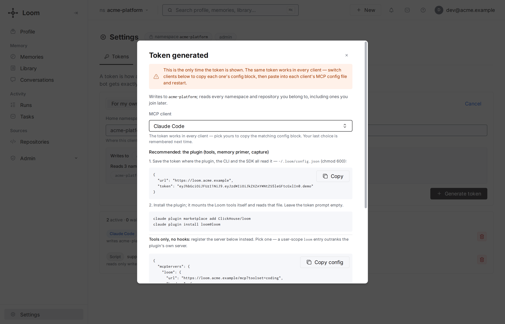

# Connect a coding agent

This page connects Claude Code, Codex, Cursor or another MCP client to a running Loom
server. Install the plugin (or wire the MCP entry), point it at the server, and work as
usual. The next session starts with what the agent saved. Recording, which keeps the
session's transcript, is off by default; the namespace's owner turns it on from the
dashboard's Conversations page
([recording](../features/conversations-and-sessions.md#recording-is-the-owners-choice)).
To run a server yourself, start with the [quickstart](quickstart.md); to have your agent
install a pinned release and prove it works, give it the latest release's
`https://github.com/ClickHouse/loom/releases/latest/download/agent-setup.txt` ([Set up
Loom with your coding agent](agent-setup.md)).

## What you need



- **The server URL**, for example `https://loom.example.com`, or `http://localhost:7777`
  for a stack started with `loom up`.
- **A writer token for your namespace**, except against a single-user server on the same
  machine: there the plugins connect without one. Create one in the dashboard at
  `<server>/settings` → **Tokens**, or ask an operator to run
  `loom mint-token --subject you --org <org> --namespaces <namespace> --roles writer`.
  On a server with self-signup open, the Claude Code plugin can sign the machine up by
  itself on the first session. See [what happens with no credential](#no-token-yet).

## Claude Code

```bash
claude plugin marketplace add ClickHouse/loom
claude plugin install loom@loom \
  --config server_url=https://loom.example.com \
  --config token=<writer JWT>
```

Both `--config` values are optional; without them Claude Code asks once. Start a new
session. Loom's session primer arrives at the top, and from then on:

- the hooks capture tool observations into Loom, and the conversation while the
  namespace's Recording is on;
- the `loom-memory`, `loom-code`, `loom-session` and other skills tell Claude when to save
  a fact, when to search, and how to use the code index;
- `loom_search`, `loom_memory_set` and the code tools are available as MCP tools.

Everything the plugin installs, and how to configure it, is on the
[Claude Code](../features/integrations/claude-code.md) page.

## Codex

```bash
codex plugin marketplace add ClickHouse/loom
codex plugin add loom@loom
```

Then run `codex` interactively once and [approve the plugin's hooks](../features/integrations/codex.md#approve-the-hooks);
until then the tools work but nothing is captured.

The plugin's MCP entry points at `http://localhost:7777`. For another server, write its URL
and your token to `~/.loom/config.json` and override the MCP entry in
`~/.codex/config.toml`, as shown in [Codex: the server](../features/integrations/codex.md#the-server).

The Codex plugin ships the same hooks and skills; the differences are on the
[Codex](../features/integrations/codex.md) page. Don't also run `codex mcp add loom` with
the plugin installed: an entry with the same name replaces the plugin's.

## Cursor and other MCP clients

In the dashboard, open **Settings → Tokens**, fill in the **New token** form (press **New
token** first if a token exists) and press **Create token**, then choose the client under
**Connect**: the dialog shows the entry for its config file, with the token in it. With
the `loom` CLI installed (`pip install -e .` from a clone of the repository), one command
writes the entry instead:

```bash
loom install --client cursor --server-url https://loom.example.com --token "$LOOM_API_KEY"
```

Restart the client afterwards. `--client` also takes `claude-desktop`, `vscode`, `cline`,
`windsurf` and `zed`; without it, `loom install` wires every client it finds. These clients
get the tools; transcript capture needs a hook, which [Cursor](../features/integrations/cursor.md)
has and the others take from a [transcript template](../features/integrations/index.md#transcript-capture-hooks).
[MCP clients](../features/integrations/mcp-clients.md) covers toolsets and the entry the
command writes.

## Check that it works

1. In Claude Code, run `/loom:loom-status`. It reports the server the plugin calls, whether
   the token is accepted and can write the namespace, and any captured batches that never
   reached the server.
2. Tell the agent something durable, for example "our deploy window is Tuesday and
   Thursday only". In a new session, ask "when can we deploy?". The answer comes from Loom.
3. Open the dashboard (`<server>/`). The saved fact is there, and the session's
   conversation too while Recording is on; you can correct or delete either.

`loom doctor --client` adds the local wiring checks when you have the CLI.

## When the code index is used

The plugin attaches the code index only when the session starts inside a git checkout of
an indexed repository:

- It reads the checkout's remotes (`origin`, then `upstream`, then the others) and looks
  them up among the repositories the server indexes. A fork with no index of its own uses
  its parent's index.
- You need read access to that repository's code namespace. The dashboard's
  **Repositories** page shows what you can read and lets you join.
- On a match, the session's code questions are scoped to that repository, and grep and
  whole-file reads of indexed paths are answered from the index as of its latest indexed
  commit.
- With no match (a directory outside git, a repository nobody indexed, or one you can't
  read), nothing changes: the agent reads local files, and memory works as usual.

To use a repository's index anyway, name it: `LOOM_CODE_REPO=<owner>/<name>` (for example
`ClickHouse/loom`, or just `loom` when one repository you can read has that name), the
Claude Code plugin's `code_repo` option, or `"code_repo"` in `~/.loom/config.json` (the
setting a Codex session reads). It is a fallback: outside any git checkout, or in a
checkout whose repository has no index (a mirror with a different URL), the primer names
that repository's namespace and every `loom_code_*` call defaults to it. Inside an indexed
checkout, the checkout's own index still wins; to search another repository, pass its
namespace to the call. `local_first` (`LOOM_CODE_LOCAL_FIRST=on`) keeps
the index out of grep and file reads, for example while you work on uncommitted changes.
Details: [Claude Code](../features/integrations/claude-code.md#the-code-shunt).

## No token yet

On a server started with `LOOM_SELF_SIGNUP=open`, the first Claude Code session that finds
no token signs the machine up. It writes the token to `~/.loom/config.json` (mode 0600)
and a claim code to `~/.loom/claim-<namespace>.txt`, and the primer says how to claim the
namespace: the code works once, at the server's `/oauth/agent-claim` page, with a password of
your own. `LOOM_AUTO_SIGNUP=off` turns this off. A server without
self-signup leaves the session without a token, and the primer says how to get one.

## Next

- [Your first agent](first-agent.md): the same memory from your own code with the SDK.
- [Agent integration](../guides/agent-integration.md): what to save, when to search, and
  mistakes to avoid.
- [Code index](../features/code-index/overview.md): ask Loom about a repository the server
  indexes.
- [Troubleshooting](../operations/troubleshooting.md), starting from `/loom:loom-status`.
