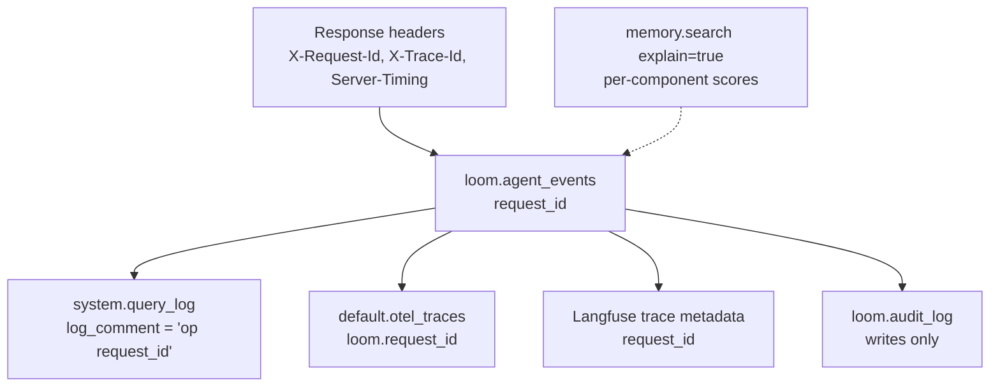

# Debug a request

Loom tags everything one request does with the same id, so tracing a request is a join.
This page follows one request from its response headers to the component that decided
the answer. When the deployment itself is unhealthy, start from
[troubleshooting](../operations/troubleshooting.md); when a worker has not run, see
[worker status](../operations/monitoring.md#worker-status).



## 1. Capture the request's ids

Every HTTP response carries:

| Header                            | Meaning                                                                                                                                                                                  |
| --------------------------------- | ---------------------------------------------------------------------------------------------------------------------------------------------------------------------------------------- |
| `X-Request-Id`                    | The request's id. Send your own (1 to 64 letters, digits, `.`, `_` or `-`) and Loom echoes it, so your log and Loom's rows share one key; any other value is replaced by a generated id. |
| `X-Trace-Id`                      | The OpenTelemetry trace id of the request's span tree.                                                                                                                                   |
| `Server-Timing`                   | `app` (handler time) and `ch` (ClickHouse time, statement count, bytes read) on success.                                                                                                 |
| `X-Loom-Hint`, `X-Loom-Hint-Code` | The mentor's hint for this call, when it has one; the SDKs log it.                                                                                                                       |

```bash
curl -si "$LOOM_BASE_URL/v1/memory.search" -H "Authorization: Bearer $LOOM_API_KEY" \
  -H 'Content-Type: application/json' -H 'X-Request-Id: dbg-0001' \
  -d '{"org":"acme","namespace":"support","agent":"bot","query":"refund window"}' \
  | grep -iE '^(x-request-id|x-trace-id|server-timing)'
```

`Server-Timing` often answers "why was it slow". A large `ch` duration or byte count
points at the query. A large `app` with a small `ch` points at a provider call
(embedding, rerank, LLM).

## 2. Join the request across systems

The same id is in `loom.agent_events.request_id`, the Langfuse trace metadata, and the
span attribute `loom.request_id` in `default.otel_traces`.

```sql
-- the ledger row: operation, identity, latency, success, error_code, tokens, cost, model
SELECT * FROM loom.agent_events WHERE request_id = 'dbg-0001';

-- every ClickHouse statement the request issued
SELECT query_duration_ms, read_rows, read_bytes, substring(query, 1, 200) AS q
FROM system.query_log
WHERE type = 'QueryFinish' AND log_comment LIKE '% dbg-0001%'
ORDER BY event_time_microseconds;

-- its spans
SELECT SpanName, Duration, SpanAttributes['loom.operation'] AS op
FROM default.otel_traces
WHERE SpanAttributes['loom.request_id'] = 'dbg-0001'
ORDER BY Timestamp;
```

The `log_comment` tags are listed in
[query attribution](../operations/monitoring.md#logs-traces-and-query-attribution).
Spans go to `default.otel_traces` (in `LOOM_CLICKSTACK_DATABASE` when it is set) when
`LOOM_OTEL_EXPORTER` resolves to `ch`, or to the OTLP endpoint. With Langfuse configured they also go to
[Langfuse](../features/integrations/langfuse.md).

> **Note:** the ledger never stores query text. `loom.agent_events` replaces every
> free-text argument with a `sha256:<16 hex>/<length>` shape. To see what was asked, use
> the search trace log below or your own client log.

## 3. Explain a search answer

**Why did this rank here?** `memory.search` with `explain=true` attaches `score_components`
to each served hit: the ranking signals and, after a reranker, its move (`rerank_from`,
`rerank_pos`, `rerank_delta`) and, when the reranker changed the order, its own fused score
(`rank_score_pre_rerank`).

```python
out = await agent.call("memory.search", {"query": "refund window", "explain": True})
for h in out["results"]:
    c = h["score_components"]
    print(
        h["memory_key"],
        h["similarity"],
        h["rank_score"],
        c.get("rerank_from"),
        c.get("rank_score_pre_rerank"),
    )
```

`memory.search_trace` takes the arguments of `memory.search` and scores the vector leg
alone (no fusion, assembly or reranker), returning, per hit, `similarity`, `distance`,
`entity_boost`, `rank_score`, `rank` and `source`.

**Why did it abstain?** Read the `memory.search` answer itself:

| Field                                     | Tells you                                                                                                      |
| ----------------------------------------- | -------------------------------------------------------------------------------------------------------------- |
| `abstain`, `abstain_code`                 | Which gate fired: `no_match`, `below_threshold`, `entity_absent`, `low_calibrated_confidence`, `page_expired`. |
| `retrieval_risk`, `retrieval_confidence`  | How far the best hit is from the gates.                                                                        |
| `calibration_explanation`                 | Which similarity gates were in force (calibrated from the embedder, or the scalar fallbacks).                  |
| `degraded`                                | Providers that fell back on this read, and what the response did instead.                                      |
| `pending_extraction`                      | Deferred `set_from_messages` batches not yet extracted; above 0, an empty answer is not proof of absence.      |
| `namespaces_searched`, `candidates_total` | Whether the search reached the namespaces and rows you expected.                                               |

`calibration.get` shows the thresholds in effect for a namespace and which tier
(namespace, cluster, scalar) produced them.
[Retrieval and ranking](../concepts/retrieval-and-ranking.md) explains each term.

**What did an agent search, over time?** Needs `LOOM_SEARCH_TRACE_LOG_ENABLED=true`
(default off). `memory.search_trace_log(since_hours=, agent=, run_id=)` returns one row
per search: `returned_keys`, `returned_scores`, `abstain`, `retrieval_risk`,
`latency_ms`, and the `query` when `LOOM_LANGFUSE_CAPTURE_IO_LEVEL` is not `off` (its
default is `off`, so by default the rows carry keys and scores without the question).

## 4. Explain a write

- **The write's own answer.** `memory.set` returns `status`, `conflict_verdict`, `peers`,
  `duplicate_of`, `merged_into_key`, `noop` and `advisories`. A write that "disappeared"
  was usually merged into a canonical match or marked a duplicate. `advisories` names a
  double-encoded or oversized value.
- **Its history.** `memory.history` lists a key's versions from `loom.memory_versions`.
  `memory.provenance` says who wrote it, from which source, session and run.
- **What extraction dropped.** `memory.extraction_status` lists deferred
  `set_from_messages` batches (`pending`, `failed`). `loom drops --namespace <ns>` prints
  what the pipeline discarded, truncated or gave up on, by stage and reason
  ([memory ingest drops](../operations/maintenance.md#memory-ingest-drops)). A
  `set_from_messages` response carries `pipeline_errors` and per-step `stage_ms`
  ([extraction pipeline](extraction-pipeline.md)).
- **The audit trail.** `audit.list(event_type=, since=)` reads `loom.audit_log`: who
  changed what, with a per-row content hash. Every write that creates or changes memory
  leaves a hash-only row ([audit](../features/observability/audit.md)).
- **A run's view.** `run.get(run_id)` returns what a run recalled (`recalled_keys`), what
  it wrote, its turns and its cost ([trace and resume](trace-and-resume.md)).

## Related

- [Troubleshooting](../operations/troubleshooting.md)
- [Monitoring](../operations/monitoring.md)
- [Telemetry](../features/observability/telemetry.md)
- [System overview](../architecture/system-overview.md)
- [Performance tuning](performance-tuning.md)
