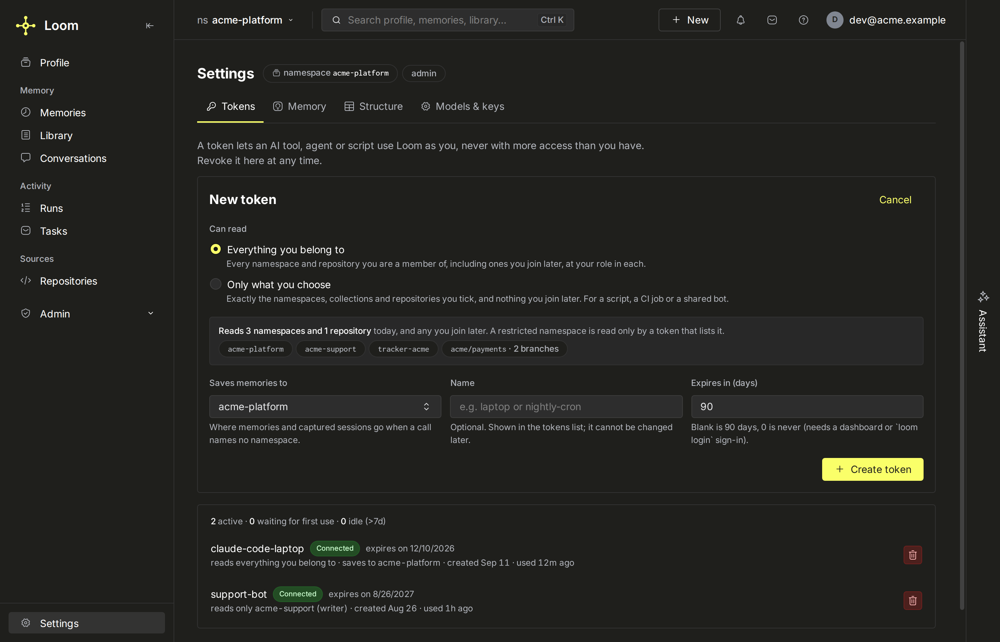

# Tokens and grants

Every call carries one JWT. The token fixes the caller (`sub`), the org, the namespaces it may
read and the roles it holds. The rest of the identity tuple (`agent`, `user_id`,
`session_id`) travels per call. Rows in `loom.namespace_grants` add per-namespace roles on top
of the token. This guide holds the procedures;
[identities and namespaces](../concepts/identities-and-namespaces.md) explains the model and
[security](../architecture/security.md) the verification.

## Mint a token

| Path                                               | Who                                                                                             | Produces                                                                                                                                                                                                                  |
| -------------------------------------------------- | ----------------------------------------------------------------------------------------------- | ------------------------------------------------------------------------------------------------------------------------------------------------------------------------------------------------------------------------- |
| `loom mint-token`                                  | an operator holding the signing key                                                             | any token, for any subject (the CLI signs locally): the way to mint in another principal's name                                                                                                                           |
| `POST /v1/admin/token.mint`                        | an `org_admin` token                                                                            | a service-account token [delegated](#delegated-tokens) from the caller's, inside the caller's own org, saved to the caller's token list; body fields `name`, `namespaces`, `roles`, `ns_roles`, `consumer`, `ttl_seconds` |
| `POST /v1/me/service_accounts.create`              | any signed-in person (**Settings → Tokens**, `loom token create`, `agent.account.create_token`) | a token [delegated](#delegated-tokens) from the person's, saved to their token list: everything they belong to (`*`) or only the namespaces listed ([one token for every use](#one-token-for-every-use))                  |
| `loom login`, `loom.login()`                       | a person, on any browser                                                                        | an hour-long user token and a rotating refresh token, stored in `~/.loom/credentials` ([below](#sign-in-from-a-terminal-or-a-notebook))                                                                                   |
| `POST /v1/auth/login`, OAuth                       | a person                                                                                        | a user token for their own subject                                                                                                                                                                                        |
| `POST /v1/auth/self-signup`                        | anyone, when `LOOM_SELF_SIGNUP=open`                                                            | a writer token on the namespace the caller claims                                                                                                                                                                         |
| `POST /v1/auth/agent-signup` (`loom init --agent`) | a bot, when `LOOM_SELF_SIGNUP=open`                                                             | a service-account writer token on `agent-<slug>` plus a claim code that works once ([headless bots](headless-bots.md))                                                                                                    |

```bash
loom mint-token --subject my-bot --org acme --namespaces support --roles writer --ttl-days 30 --save
# /home/you/.loom/token
```

`loom` ships with the server package and the Docker image, not with the SDK; in a container
run `docker exec <server-container> loom mint-token ...`. Minting needs the signing key,
`LOOM_JWT_SECRET`. A fresh clone gets a development secret from `.env.example`.
`loom mint-token` and `loom doctor` warn while it is in use, and a deployment with auth on
refuses to start with it (except the `make dev` stack).

| Flag                       | Default      | Meaning                                                                                                                                                                         |
| -------------------------- | ------------ | ------------------------------------------------------------------------------------------------------------------------------------------------------------------------------- |
| `--subject`                | _(required)_ | The principal (`sub`), recorded on every ledger row.                                                                                                                            |
| `--org`                    | _(required)_ | The org. `*` is a cross-org wildcard.                                                                                                                                           |
| `--namespaces`             | none         | Readable namespaces, space- or comma-separated; `*` reads every namespace of the org. Exclusive with `--namespace-role`.                                                        |
| `--roles`                  | `writer`     | `viewer`, `writer` and/or `admin`, applied to every namespace the token names.                                                                                                  |
| `--namespace-role NS=ROLE` | none         | Repeatable. Makes a **scoped** token: exactly these namespaces, in this order (the read priority), each with its own role (`ns_roles` claim).                                   |
| `--ttl-days N`             | none         | Lifetime. Without it the token has no `exp` and lives until revoked; use a TTL for anything that leaves your machine, and re-mint on a schedule.                                |
| `--read-scope`             | none         | `namespace`, `own_user` or `own_session`: the widest read the token may make ([read scope](#read-scope)).                                                                       |
| `--read-user-id USER_ID`   | none         | Pin every read to one end user; a request naming another user is refused.                                                                                                       |
| `--traffic-class`          | none         | `production`, `interactive` or `bench`: the rate buckets, ClickHouse priority, LLM-tier policy and cost column the token's calls use. Omitted, the namespace row decides.       |
| `--consumer NAME`          | none         | Bind the consumer tag: every call is attributed to `NAME` whatever its body says.                                                                                               |
| `--service-account`        | on           | Mark the token as a service account (`sa: true`).                                                                                                                               |
| `--user-token`             | off          | Mint a user token instead.                                                                                                                                                      |
| `--save [PATH]`            | off          | Write the token to `PATH` (default `~/.loom/token`, mode `0600`, `~/.loom` created `0700`) and print the path. The SDKs, the CLI importers and the plugin hooks read that file. |
| `--json`                   | off          | Print a JSON summary (with `jti`) instead of the bare token.                                                                                                                    |

Without `--save` stdout is the bare token, so `TOKEN=$(loom mint-token …)` works. The
[CLI reference](../reference/cli.md) lists every flag as the parser defines it.

## Sign in from a terminal or a notebook

People who never open the dashboard sign in with the OAuth device grant. It
works the same with the password form and with [single sign-on](../operations/sso.md),
and on a machine with no browser (an SSH box, a remote notebook kernel):

```console
$ loom login --server https://loom.example.com
To sign in, open https://loom.example.com/oauth/device and enter the code BCDF-GHJK
$ loom whoami
$ loom logout
```

Open the URL on any device, sign in, check that the code matches, and approve.
In Python the same flow is `loom.login("https://loom.example.com")`. With
only the SDK installed (`pip install clickhouse-loom`), the commands are
`python -m loom login`, `python -m loom whoami` and so on. The `loom` command
comes with a checkout of the server (`pip install -e .`), and it needs the
SDK beside it for these.

The session is stored in `~/.loom/credentials` (mode `0600`): a one-hour
access token and a refresh token that rotates on every use. An `Agent` given
no `api_key` and no `LOOM_API_KEY`, talking to that server (`base_url=` or
`LOOM_BASE_URL`), uses it and refreshes as it goes. If a
spent refresh token is ever presented again, the server ends the whole
session. `loom logout` revokes it on the server. `--profile NAME` (or
`LOOM_PROFILE`) keeps sessions for several servers side by side; a profile's
token is only ever sent to the server it signed in to.

**CI and services** have no one to approve a code. Give them a token that reads
only the namespaces they need instead, made under **Settings → Tokens** (_Only these
namespaces_), with `loom token create --namespace …`, or by an operator. Pass it as
`LOOM_API_KEY`, which takes precedence over a stored session:

```bash
loom mint-token --service-account --subject sa:ci --org acme \
  --namespace-role support=writer --ttl-days 30
```

## Read the claims

| Claim                                                  | Meaning                                                                                                                                                                                                                                       |
| ------------------------------------------------------ | --------------------------------------------------------------------------------------------------------------------------------------------------------------------------------------------------------------------------------------------- |
| `sub`                                                  | The principal. Service-account subjects created from the dashboard start with `sa:`.                                                                                                                                                          |
| `org`                                                  | The org; `*` reaches every org.                                                                                                                                                                                                               |
| `namespaces`                                           | The readable set, in order; `["*"]` reads every namespace of the org.                                                                                                                                                                         |
| `roles`                                                | The flat role list, applied to every readable namespace.                                                                                                                                                                                      |
| `ns_roles`                                             | Scoped tokens only: namespace → role. Authoritative: it replaces `roles` and the grant lookup for those namespaces.                                                                                                                           |
| `ns_write`                                             | Optional writable subset of `namespaces`, set through `mint_token(write_namespaces=…)` in `server/auth/jwt.py`; no CLI flag. Absent = writes follow reads.                                                                                    |
| `read_scope`, `read_user_id`                           | The read ceiling and the pinned end user.                                                                                                                                                                                                     |
| `traffic_class`, `consumer`                            | Bound traffic class and consumer tag.                                                                                                                                                                                                         |
| `sa`                                                   | `true` for a service account, `false` for a user token.                                                                                                                                                                                       |
| `jti`                                                  | The token's id: stamped on the audit and exposure ledgers as `token_id`, and the handle `loom revoke-token --jti` takes. Not a secret.                                                                                                        |
| `parents`, `parent_subjects`, `parent_iats`, `creator` | Delegated tokens only: the ids, `sub`s and `iat`s of every ancestor token (`parents` also names a third-party MCP client's session), and the person whose live grants the token is rechecked against ([delegated tokens](#delegated-tokens)). |
| `exp`                                                  | Expiry, when minted with a TTL.                                                                                                                                                                                                               |
| `iss`, `aud`, `iat`                                    | `LOOM_JWT_ISSUER` (`loom`), `LOOM_JWT_AUDIENCE` (`loom-platform`), issued-at.                                                                                                                                                                 |

The JWT header's `kid` names the signing key. `GET /v1/whoami` shows what the server
verified for a token: the first thing to check when a call is refused.

> **Warning: wildcards are wide.** `org="*"` or `namespaces=["*"]` reads everything below
> it. Mint them only for operator tooling. They never count for a
> [restricted namespace](#restricted-namespaces-classificationrestricted).

### Signing keys

`LOOM_JWT_SECRET` is the root secret. It signs and verifies as kid `default` (HS256) and
seals every stored credential and every other signing key ([Security](../architecture/security.md)).
The other keys live in `loom.signing_keys`, added by `loom signing-key rotate`
([rotate](#revoke-and-rotate)). Every process re-reads them every
`LOOM_JWT_KEYRING_REFRESH_SECONDS` and records that interval in `loom.keyring_readers`;
the newest active key signs. A PEM `LOOM_JWT_SECRET` seals, and signs RS256 as kid
`default`.

| Setting                            | Meaning                                                                                                                             |
| ---------------------------------- | ----------------------------------------------------------------------------------------------------------------------------------- |
| `LOOM_JWT_SECRET`                  | The root secret: kid `default`, and the key that seals stored credentials and keyring keys.                                         |
| `LOOM_JWT_KEYRING_REFRESH_SECONDS` | Seconds between re-reads of `loom.signing_keys` (default 30, at least 1). `rotate` waits out twice the slowest process's.           |
| `LOOM_JWT_PUBLIC_KEYS_JSON`        | `{kid: PEM public key}` of a gateway whose RS256 tokens this deployment accepts; a token without a `kid` is looked up as `default`. |
| `LOOM_JWT_TRUSTED_ISSUERS`         | Extra accepted `iss` values, for a gateway minting Loom-shaped tokens.                                                              |
| `LOOM_JWT_LEEWAY_SECONDS`          | Clock-skew tolerance on `iat` / `exp` (default 30).                                                                                 |

`/v1/.well-known/jwks.json` serves the public keys of the keyring's RS256 keys.

Verification accepts only `HS256` and `RS256`; `alg=none` is rejected. The
[configuration reference](../reference/configuration.md#auth) lists every auth setting.

## Choose roles

Roles are ordered; a higher role satisfies every check for a lower one. Each op declares its
`required_role` (`GET /v1/operations`, and the [operations reference](../reference/operations.md)).

| Role             | Grants                                                                                                                                                                                                                                             |
| ---------------- | -------------------------------------------------------------------------------------------------------------------------------------------------------------------------------------------------------------------------------------------------- |
| `viewer`         | Read.                                                                                                                                                                                                                                              |
| `writer`         | Read and write memory, knowledge and the other data planes.                                                                                                                                                                                        |
| `admin`          | Administer the namespace: grants, configuration, policy, restore into it. Not org-wide visibility.                                                                                                                                                 |
| `org_admin`      | Org-wide views (for example `cost.summary` without a namespace). A recognised gate with no in-product assignment path.                                                                                                                             |
| `platform_admin` | Cross-org operator views. Conferred at login to the handles in `LOOM_PLATFORM_ADMINS`, and to its emails only when an IdP verified them; to every token of a bot registered `--platform-admin`; minted only for a service account, with an expiry. |

Grants carry only `viewer`, `writer` or `admin`, and so do tokens, except a
`platform_admin` one: a bot's ([Bots and CI](../operations/sso.md#bots-and-ci)) or
`loom mint-token --platform-admin --subject sa:<name> --ttl-days <n>`, which refuses a token
that never expires. The role spans every org.

## Namespace access

**Membership is the read boundary.** A token that can read a namespace reads every row in
it, whichever agent wrote it; `agent` is authorship, and passing it on a read only narrows.
A call on `(org, namespace)` is allowed when:

1. the namespace is not restricted (otherwise see
   [restricted namespaces](#restricted-namespaces-classificationrestricted));
2. for a **scoped** token (`ns_roles`): its role for that namespace reaches the op's role,
   and a write also needs the namespace in `ns_write` when the token has one. Nothing else
   widens it, except that a viewer grant lets it read a code namespace;
3. for a **flat** token: the token covers the namespace (`namespaces` for reads, `ns_write`
   for writes) and a role in `roles` reaches the op's role, or a live grant on the
   namespace does.

A scoped token called without `org` and `namespace` in the body answers
400 `IDENTITY_INCOMPLETE`: its authority is per namespace. The exceptions are ops that read
no namespace (`namespace.browse`, `grants.pending_for_me`, `code.repos`, …) and ops
addressed by a row id: those pass on the token's best namespace role, inside the token's
own org only. A scoped token's `namespaces` order is the search order across tiers.

A token can read a shared namespace and write only its own:

```
namespaces = ["team-shared", "agent-private"]
ns_write   = ["agent-private"]
```

### Read scope

`read_scope` bounds how far one read reaches inside a namespace. `memory.search`,
`memory.search_trace`, `memory.ask`, `memory.recall`, `context.pack` and `profile.render`
take it in the body; a token's `read_scope` claim is a ceiling the body can narrow but not
widen.

| `read_scope`          | A read returns                                        |
| --------------------- | ----------------------------------------------------- |
| `namespace` (default) | every row of the namespace                            |
| `own_user`            | rows written under the `user_id` the request names    |
| `own_session`         | rows written under the `session_id` the request names |

Mint `own_user` (with `--read-user-id` where one token serves one end user) for an agent
that serves many users through one credential, so one user's prompt cannot pull another
user's memories:

```bash
loom mint-token --subject support-bot --org acme --namespaces support --roles writer \
  --read-scope own_user --ttl-days 30 --save
```

A scoped read without the `user_id` / `session_id` it binds to is 400
`IDENTITY_INCOMPLETE`, never silently widened. A token scoped below the namespace binds
every op's reads, not only the ones that take `read_scope` in the body: `user_id="*"` is
refused, a pinned token's write naming another user is refused, another user's
`memory_id` reads as not found, and an op that cannot bound its
answer to the user (the entity graph, conversation reads, exports, admin ops) is 403
`AUTH_INSUFFICIENT` ([read scope inside a namespace](../concepts/identities-and-namespaces.md#read-scope-inside-a-namespace)).

## Give and take away grants

`loom.namespace_grants` holds one row per `(org, namespace, subject)`: a role on one
namespace above what the token carries. Grants add; where the subject holds one, a
token's claim goes no further than it.

| Op                      | Role   | Does                                                                                                                     |
| ----------------------- | ------ | ------------------------------------------------------------------------------------------------------------------------ |
| `grants.create`         | admin  | Give `subject` a `role`. Below the subject's current role it answers 409 `GRANT_WOULD_DOWNGRADE` unless `replace: true`. |
| `grants.revoke`         | admin  | Remove it; on a restricted namespace the grants of tokens the subject minted there go too.                               |
| `grants.list`           | viewer | The namespace's grants.                                                                                                  |
| `grants.approve`        | admin  | Activate a pending join request. Below the subject's current grant it answers 409: an approval never asks to lower one.  |
| `grants.pending_for_me` | viewer | Requests waiting on the caller's approval.                                                                               |

```bash
curl -s "$LOOM_BASE_URL/v1/grants.create" -H "Authorization: Bearer $ADMIN_TOKEN" \
  -H "Content-Type: application/json" \
  -d '{"org":"acme","namespace":"team-shared","subject":"sa:triage","role":"viewer"}'
```

- **A claim goes no further than the grant.** Where the subject holds a grant row on a
  namespace the token names, of any status, the claim is capped at that grant: a
  `grants.revoke`, a `replace: true` lowering, `namespace.leave`, `loom claim-release` or
  a restore ends every older token's claim there at once in the server process that made
  it and within `LOOM_ACL_WATERMARK_POLL_SECONDS` (1 s) in every other process, on that
  server or another, and a pending or rejected request caps it at no access. A scoped
  token keeps its own role there, capped at the grant. A namespace an operator named at
  mint that was never granted to the subject keeps its claim; revoke the token for that.
- **A grant under an email reaches the account only once the email is verified.** An SSO
  account's email is verified (the identity provider vouched for it), and so is an email
  linked to a password account (`loom sso adopt`, `loom sso link`, a password link, or its
  owner proving the password from an SSO sign-in). A self-signup email is not: whoever
  typed the address first does not hold the grants written under it, which still cap
  that account's claims. Grant a self-signup account under its login handle, the namespace
  it signed up with. A `grants.revoke` of an address no verified account holds, and that
  never held a row of its own on the namespace, takes the rows stored under each
  unverified account naming it, and the grants there of the tokens those accounts made.
  When the address held a row of its own there, its revoke also takes the grants of the
  tokens those accounts made there, unless one still holds an active grant of its own.
- **Registering is owning.** `namespace.register` makes the caller the namespace's `admin`.
  With self-signup (`LOOM_IDENTITY_PROVIDER=trust-network`) the first principal to claim a
  name owns it; `loom claim-release --org <org> --namespace <ns>` revokes its grants,
  clears the owner and deactivates it. The name stays reserved
  (its memories are kept, and whoever claimed it next would own them); erasing the
  namespace removes the data but not the reservation.
- **Restoring into a namespace needs its admin.** `namespace.restore` into an existing
  namespace, active or soft-deleted, needs an admin of it. A collection name (`col-…`, or
  `@me`) is refused, as `namespace.register` refuses one.
- **Service accounts inherit.** An `sa:` subject with no grant of its own on a namespace
  uses its creator's grant there, so a token minted from the dashboard follows the person
  who made it, including into namespaces they join later. Restricted namespaces are the
  exception. Tokens minted since delegation landed do this through their `creator` claim
  ([delegated tokens](#delegated-tokens)).
- **Pending grants do nothing** until approved.

### List every grant

`grants.list` answers one row per person, newest grant first: a login handle and the
verified email tied to it fold into one row, the other spelling in `also`. A person with an
active grant reads `active` at their highest active role, with any request of theirs in
`pending_role`. A page holds up to `limit` rows (default 100, at most 500). When more people
follow, the answer carries `truncated: true` and a `next_cursor`; send it back as `cursor`,
with the same `org` and `namespace`, until `next_cursor` is null. A person is folded before
the page is cut, so no page splits one. The cursor names the namespace it was issued for
under a MAC keyed by `LOOM_JWT_SECRET`: on another namespace, edited, or after the secret is
rotated, it is refused with 422. `agent.grants.list` in the Python SDK walks every page, up
to `max_pages`.

- **A cursor is a place in the list, not a snapshot.** A grant written during a walk (a new
  grant, a role change, an approval) moves to the front of the list, which the walk has
  passed, and a revoked one drops out. A `grants.revoke` takes the person's row under
  every verified spelling, so no older spelling brings them back; a `namespace.leave`
  drops only the caller's row under their exact subject, so one under their verified
  email can. A tie between a login and an email made between pages can hide the person it
  joins, not even listed in `also`, and a tie removed can list them twice. Everyone else
  comes back exactly once; a walk started after the change sees it.
- **A failed read fails the call.** The answer is 503 `BACKEND_UNAVAILABLE` when ClickHouse
  is unreachable and 504 `BACKEND_TIMEOUT` past the read deadline, never a list with people
  unfolded. Retry with the same cursor: it holds only a position.
- **A server without paging cannot say the list is whole.** An answer without `truncated`,
  or one that names `cursor` in `ignored_args`, comes from a server that does not page
  `grants.list`; a client walking the pages stops there with an error, as the SDK does.
- **Every page reads the whole namespace.** A page groups all of the namespace's live grants
  and scans the org's account directory for their ties, so a late page costs what the first
  does.

## One token for every use



**Settings → Tokens → New token**, `loom token create` and `agent.account.create_token`
make the same token for an AI tool, an agent, a script or a CI job. One answer holds the
token, once, with the setup of every supported MCP client (`clients`) and where it saves
(`saves_to`); the same token also works as `LOOM_API_KEY`. Two choices shape it:

- **What it reads.** `namespaces: "*"` (the default) reads every namespace and repository
  the person belongs to, now and after they join more, at their own role in each; it takes
  no `role`, so for a read-only token list the namespaces with `viewer`. A namespace named
  before `*` is where it saves, when it may write there; restricted namespaces it names
  are read too, each with a
  [grant of the token's own](#restricted-namespaces-classificationrestricted) capped at the
  person's own grant there (a namespace they hold none on is refused). A restricted
  repository brings its bound restricted tracker record, read-only. A list without `*`
  reads exactly those, in that order (the read priority), each at the role given there,
  never above the person's grant.
- **Where it saves.** A call that names no namespace lands, for a `*` token, in the
  namespace named before `*` when it may write there (an `admin/token.mint` token whose
  `namespaces` start with one too); otherwise it follows the namespace the person works
  in on the dashboard, as their own sign-in does. A list token saves to that namespace
  when it lists it and may write there, else to one named after the person, else to the
  first it lists and may write. Each mint answers with the namespace (`saves_to`).

Blank names become `token-<day>-<hex>`. Every token the person made is listed with what it
reads (and, for a `*` token, where it saves), and revoking it there ends it in every tool at
once.

## Delegated tokens

`service_accounts.create` (the dashboard's **New token** form, `loom token create`, the SDKs) and
`admin/token.mint` mint a token from the caller's own, through one policy (`server/auth/delegation.py`). The child gets
what was asked for, cut to what the caller's token allows and to the caller's live grants:

- the caller's org only (an org-wide `*` token names one);
- `viewer`, `writer` or `admin` only; `org_admin` and `platform_admin` are never delegated;
- on each named namespace, at most the person's live grant; a namespace without one is
  refused (403 naming it). A per-namespace child of a sign-in token (or of a flat
  `loom mint-token` token) takes that grant, as the gate admits the token there on its
  grant alone. A flat child, a child of a delegated or per-namespace token, and a child on
  a restricted namespace also stay inside the caller's token role there;
- `*` only from a sign-in token or a delegated `*` token, and it means "wherever the person
  holds a grant", at the caller's token role; from a narrower token it becomes that token's
  own namespace list, at the lowest role the narrower token holds on it (a role per
  namespace needs a list). A namespace named beside `*` without a role does not lower that one
  role: the person's live grant caps every call there anyway;
- the caller's `read_scope`, `read_user_id` and `ns_write`; a per-namespace child asking for
  `writer` or `admin` on a namespace outside the caller's `ns_write` is refused, and the
  inherited `ns_write` binds the child's writes whatever its `ns_roles` say;
- a service-account token under its own `sa:` subject, saved to the caller's token list
  (`loom.service_accounts`), where it is revoked on its own;
- an expiry: `ttl_days`/`ttl_seconds`, 90 days when unset, `0` for never, and never past
  the caller's own token's `exp` (a longer TTL is clipped, and a token that expires cannot
  make one that never does), except from a sign-in session's hour-long token (`loom login`,
  dashboard SSO), whose children last what was asked;
- a name: unique in its org while its token lives (`409
TOKEN_NAME_TAKEN`, which does not say whose it is), free again once the token is revoked
  or has expired; names starting `agent · ` are agents' own, and a name holds no `:`;
- `parents` (every ancestor's token id, and the sign-in session of a third-party MCP
  client that minted it), `parent_subjects` (every ancestor's `sub`),
  `parent_iats` (every ancestor's `iat`) and `creator` (the person at the root).

On every request the gate rechecks a delegated token: the person's live grant must still
reach the role, inside the token's own claim (the token subject's own grants do not widen
it), and the person's account must still be active (a creator who owns namespaces, none of
them active any more, or who held grants and has none live, as after a claim release, stops
every token they delegated). An op with no namespace that writes needs the person to hold
that role on some namespace of the org. Revoking any ancestor's `jti` or `sub` (the
dashboard revokes a service account by its `sub`) or the person's `sub` kills the token, its
children and theirs. Tokens minted from a `loom login` or dashboard SSO session outlive its
logout and the end of the session for any other reason; they are revoked by subject or one
by one. Tokens a third-party MCP client's session minted end with that session. A revoke
with an issued-before cutoff judges each ancestor by its own `iat` and the person by the
root's, so a child minted after the cutoff from an older token dies with it; a delegated
token without aligned `parent_iats` is refused. `loom mint-token` signs with the key and is
not a delegation.

## Let people join a namespace

A namespace's directory row (`namespace.register`) says who may join it:

| Field               | Values                                             |
| ------------------- | -------------------------------------------------- |
| `visibility`        | `private` (default) or `public`                    |
| `join_policy`       | `open`, `approval`, `closed`, or `inherit` (unset) |
| `requires_approval` | `true` / `false`                                   |

`inherit` resolves to `open` for a public namespace that does not require approval, and to
`approval` otherwise. `namespace.join` takes a `role` (default `writer`; ask for `viewer` to
be admitted at once on an open namespace) and decides:

| Policy     | `viewer` join  | `writer` / `admin` join |
| ---------- | -------------- | ----------------------- |
| `open`     | active at once | pending                 |
| `approval` | pending        | pending                 |
| `closed`   | refused        | refused                 |

`namespace.leave`, `namespace.cancel_request`, `namespace.browse` and `namespace.list_mine`
complete the self-service surface.

**Code namespaces** (`kind=code`, one per indexed repository and branch) have readers
(`viewer`) and maintainers (`admin`). `visibility=public` makes one joinable, not readable:
reading needs a grant or a token that names it.

- `LOOM_CODE_ORG_READABLE=true` (or `"org_readable": true` on an entry of
  `LOOM_CODE_REPOS_JSON`) lets every authenticated principal of the org read every code
  namespace with the token it holds.
- Refreshing (`writer`) and administering (`admin`) always come from grants.
- An unowned code namespace is adopted with `POST /v1/admin/namespace.adopt` (or
  `loom namespaces-adopt`); a restricted one never is (below).

See [code index repositories](../features/code-index/repositories.md).

## Restricted namespaces (`classification=restricted`)

Everything above widens access. `classification` narrows it: a namespace whose
`loom.namespaces.classification` is `restricted`, or whose `LOOM_CODE_REPOS_JSON` entry says
`"classification": "restricted"` (either input restricts), switches every default off. A
read or write passes only when **all** hold:

1. the token belongs to the namespace's org (`org="*"` does not count);
2. the token names the namespace literally, in `namespaces` or `ns_roles`
   (`namespaces=["*"]` does not count);
3. the token's own role there reaches the op's role;
4. a live **direct** grant for the token's own subject reaches it (a service account does
   not inherit its creator's grant).

No org-readable rule, `visibility=public`, `org_admin` or `platform_admin` bypasses this. A
refusal is the generic "cannot access" message, so it does not reveal whether the namespace
exists. If the classification cannot be read, access is denied.

- Search fan-out, context packs and org-wide rollups skip the restricted namespaces the
  caller cannot read, and `code.repos` hides them.
- Each request admitted to the restricted namespace it names writes a
  `namespace.restricted_access` audit row before the answer
  (`LOOM_RESTRICTED_AUDIT_INLINE=false` writes it beside the request instead,
  which a killed process can lose). A [delegated](#delegated-tokens) mint
  (`POST /v1/admin/token.mint`, `POST /v1/me/service_accounts.create`) writes one
  for each restricted namespace whose direct grant it writes for the new token,
  with the minter as actor and the token's subject as `granted_to`.
  An inbox watch writes one for the inbox's owner namespace, and the MCP primer
  (audit `op` `mcp.primer`) for the default namespace whose profile it renders. A read an
  op handler admits by id, on the row's own namespace, writes none.
  Code search traces keep only the query digest.
- A restricted namespace cannot be made public; its directory row changes only for a caller
  who passes the four checks at `admin`.
- `POST /v1/admin/token.mint`, like every [delegated](#delegated-tokens) mint, names a
  restricted namespace only for a caller holding a grant there at or above the requested
  role (pass `ns_roles` for per-namespace roles).
- `POST /v1/admin/namespace.adopt` and `POST /v1/admin/claim_release` answer
  `NAMESPACE_NOT_FOUND` on a restricted namespace the restricted gate refuses the caller at
  admin (a token naming it and a direct admin grant), so an org admin cannot adopt a
  restricted namespace that has no admin. Adopting a name with no directory row, or one
  whose classification cannot be read, gets the same answer.
- `LOOM_RESTRICTED_SERVE=false` refuses every restricted read while ingest continues.

> **Warning:** `loom mint-token` signs locally and is not checked against grants. Whoever
> holds the signing key can mint any token; the direct-grant check at request time is what
> still protects a restricted namespace.

**To give a reader access, do both:** a direct grant on the subject, and a token that names
the namespace.

```bash
# as an admin of the namespace
curl -s "$LOOM_BASE_URL/v1/grants.create" -H "Authorization: Bearer $ADMIN_TOKEN" \
  -H "Content-Type: application/json" \
  -d '{"org":"acme","namespace":"incidents-private","subject":"sa:triage","role":"viewer"}'
# as the operator
loom mint-token --subject sa:triage --org acme --namespaces team-shared,incidents-private \
  --roles viewer --ttl-days 30
```

A person who holds a direct grant can also add the namespace to a token minted from the
dashboard: the mint names it in the claim and writes a direct grant for the token's own
`sa:` subject (`viewer` on a repository index, else the token's role capped at `writer`).
That grant is revoked with the token, and when the person's own grant is revoked.

## Add history policy

Enforcement is off unless `LOOM_POLICY_MODE` turns it on. `policy.set`, `policy.delete` and
`policy.decisions` are served over HTTP and the SDKs, not over MCP.

A policy rule restricts what a caller may do based on its own recent history in
`loom.agent_events`, evaluated at call time after the role check. Rules are per
`(org, namespace)` and can only take permission away.

- `effect: "forbid"` denies when the condition holds (`count_within 1h memory.set gte 200`
  is a durable, cross-replica per-agent rate limit).
- `effect: "require"` denies when it does not hold (`formerly within 1h memory.get` before
  a `memory.delete`; `args_equal: {"memory_key": "$args.memory_key"}` requires the same
  key, and `out_<field>` names what an earlier call returned).

Leaves are `formerly`, `count_within`, `not_since` and `breadth_within` (how many distinct
memory keys the verified subject was shown in the window, as a `value` or a `fraction` of
the namespace), combined with `all`, `any` and `not`. Each leaf reads only the caller's own
events, keyed by `agent` (default), `session` or `user`; windows are `<n>s|m|h|d`, capped by
`LOOM_POLICY_MAX_WINDOW_SECONDS` (default one day).

| `LOOM_POLICY_MODE` | Effect                                                                                     |
| ------------------ | ------------------------------------------------------------------------------------------ |
| `off` (default)    | No rule is evaluated and nothing is recorded, whatever a rule's own `mode` says.           |
| `shadow`           | Each decision is recorded in `loom.policy_decisions`; nothing is blocked.                  |
| `enforce`          | A denial answers 403 `POLICY_FORBIDDEN` with `decision`, `determining_rules` and `errors`. |

Under `shadow` or `enforce`, a rule's own `mode` (`inherit`, `shadow`, `enforce`) overrides
the deployment's. Under enforcement, a rule that cannot be evaluated denies a write and allows
a read. Start in `shadow`, read `policy.decisions`, then enforce.

```bash
curl -s "$LOOM_BASE_URL/v1/policy.set" -H "Authorization: Bearer $ADMIN_TOKEN" \
  -H "Content-Type: application/json" -d '{
  "org": "acme", "namespace": "team", "policy_id": "get-before-delete", "effect": "require",
  "actions": ["memory.delete"],
  "condition": {"op": "formerly", "within": "1h", "operation": "memory.get",
                "args_equal": {"memory_key": "$args.memory_key"}}}'
```

`policy.check` evaluates a hypothetical call without blocking (any role); `policy.list`,
`policy.delete` and `policy.decisions` complete the surface. `policy.set` and
`policy.delete` need `admin`, are audited, and report `widening` when a change loosens a
rule (which also writes a `policy.widened` audit row).

## Pick an identity mode, gateway or IdP

`LOOM_IDENTITY_PROVIDER` (`single-user`, `trust-network` or `gateway`) picks how people get
tokens; unset, it is inferred from `LOOM_AUTH_REQUIRED` and `LOOM_SELF_SIGNUP` at boot. The
modes are described in
[identities and namespaces](../concepts/identities-and-namespaces.md) and their settings in
[deployment](../operations/deployment.md#identity-modes).

**People through an IdP.** [Single sign-on](../operations/sso.md) has the setup.
`LOOM_OAUTH_ENABLED=true` serves an OAuth 2.1 authorization
server for MCP one-click connect (`/.well-known` discovery, `/oauth/{register,authorize,token}`;
`LOOM_OAUTH_ISSUER` is the public base URL). `LOOM_OAUTH_LOGIN_PROVIDER=oidc` sends the
sign-in to an external IdP (`LOOM_OIDC_ISSUER`, `LOOM_OIDC_CLIENT_ID`,
`LOOM_OIDC_CLIENT_SECRET`); Loom maps the verified email to an account and still mints its
own token. `LOOM_OIDC_JIT_PROVISION=true` creates a personal namespace in `LOOM_OIDC_JIT_ORG`
for a first sign-in with no account (`LOOM_OIDC_JIT_EMAIL_DOMAINS` restricts it); off, such
a sign-in is refused. A person who has an active account in that org, whatever its name, is
signed in to it and never given another. JIT never rebuilds an existing name: a released,
deleted or another account's one is skipped for the next free name, `<name>-2` and on,
then a random suffix. Two first sign-ins of one person at the same moment are kept to one
account on one server; on two servers, with every predictable name taken, each may pick a
different random name, and an operator releases the extra one.

To offboard a JIT user, revoke their subject (`loom revoke-token --subject <namespace>`)
and delete their account: JIT refuses while any inactive account in the org still naming
their email is revoked outright. Deleting alone is not offboarding (its owner can do it),
and removing the domain from `LOOM_OIDC_JIT_EMAIL_DOMAINS` stops only new accounts from it,
not the sign-in of an account that exists; removing the person at the IdP stops both. A
revocation of a subject has no undo and lasts ten years: to let an offboarded person back
in, `loom claim-release` the revoked account, which clears its contact so it names no one.
That is also what a release does to an offboarded account tidied up later: it lets the
person sign up again, under a new subject.

**An aggregator acting for its users.** A subject listed in `LOOM_TRUSTED_CALLERS` may
send `X-Loom-On-Behalf-Of: <subject>`: the call runs as that subject and every ledger row
records the real caller in `impersonated_by`. A subject spelled like a grant principal
(`user:`, `group:`, `agent:`, `everyone`, in any case, bare or after a `/`) is refused:
end users are signed in by their own issuer. A subject revoked outright
(`loom revoke-token --subject`) or deprovisioned through SCIM is not acted for (403), nor
is a bot that `loom bot disable` has disabled, or one of its agents (`sa:<bot>`,
`sa:<bot>:<agent>`): a disable leaves the agents' grants and ends the bot's tokens with a
cutoff. Revoking a bot outright refuses acting for its agents too. A cutoff
(`--issued-before`) ends that subject's own tokens but not a trusted caller's calls for
it. Empty disables the header. With self-signup open, act for email subjects (a sign-up
name cannot spell one) or grant each handle in `LOOM_SELF_SIGNUP_ORG` before acting for
it: a handle nothing reserves there is open to sign-up, and acting for it from a service
account or another org grants nothing there.

## Act for a service's end users

A service in front of Loom, whose users have no Loom account, signs a short-lived RS256
token per request for the user it serves. Register it in
`LOOM_JWT_END_USER_ISSUERS_JSON`, under its issuer: the orgs it may sign for (exact names
or `prefix*`, never `*`) and where its keys come from, a `jwks_url` (https, fetched at
boot and every `LOOM_JWT_END_USER_JWKS_REFRESH_SECONDS`) or `keys` by `kid`:

```bash
LOOM_JWT_END_USER_ISSUERS_JSON='{"chat-app": {"orgs": ["acme", "team-*"], "jwks_url": "https://chat.example.com/.well-known/jwks.json"}}'
# or, with the public keys inline:
LOOM_JWT_END_USER_ISSUERS_JSON='{"chat-app": {"orgs": ["acme"], "keys": {"chat-1": "-----BEGIN PUBLIC KEY-----\n…"}}}'
```

The service then signs, for each call, a token with `kid` in its header, `iss` its
issuer, `aud` Loom's audience (`LOOM_JWT_AUDIENCE`), `sub: user:<id>`, `org`, a fresh
`jti`, `iat` and an `exp` at most `LOOM_JWT_END_USER_MAX_TTL_SECONDS` (5 min) later, and
`agent: agent:<id>` when the call runs inside one of its agents:

```bash
curl -s "$LOOM_BASE_URL/v1/knowledge.search" -H "Authorization: Bearer $END_USER_TOKEN" \
  -H "Content-Type: application/json" \
  -d '{"org": "acme", "namespace": "@me", "query": "renewal clause"}'
```

- The request runs as `user:u-42` alone, in the token's org: an org member with no claim,
  reads pinned to that user's rows, reaching what grants give `user:u-42`, the groups that
  list it, the agent the token names, and `everyone`. A token with any other claim
  (namespaces, roles, a read scope), an org its issuer does not list, no `jti` or a longer
  life is refused, and the key verifies its own issuer's end-user tokens and nothing else.
  Until an issuer's JWKS is first fetched, its tokens are answered 503 (retry). MCP,
  `/v1/me/*` and the admin routes refuse an end-user token.
- Grants name these principals as subjects: `grants.create` with `subject: "user:u-42"`,
  `"group:finance"`, `"agent:helper"` or `"everyone"`. Groups, agents and `everyone` hold
  grants on collections only.
- Groups are pushed with a token of the org's admin to SCIM `/scim/v2/Groups` (create,
  replace, patch members, delete); a member is a user id. A removed member loses the
  group's grants within `LOOM_ACL_WATERMARK_POLL_SECONDS`.
- Ids are lowercase letters, digits and `._@-`. `namespace: "@me"` is the user's personal
  collection: only they reach it, and it takes no grant.
- Of the ops that name no namespace, an end user may call `collection.create`,
  `collection.list`, `namespace.list_mine`, `grants.pending_for_me` and `mentor.guide`, but no directory
  self-service (`namespace.register`, `namespace.join`, `namespace.browse`).
- An agent's files: a collection granted to `agent:<id>`, searched with
  `knowledge.search` and `namespaces: ["<that collection>", "@me"]`, so the search reads
  those alone. A search that names neither `namespaces` nor `namespace_scope` reads its
  `namespace` alone (`this`) for an end user; `namespace_scope: "all_mine"` widens it to
  every collection the user reaches. A document's `agent`, `session_id` and
  `source_class` come back on each hit.
- To cut off one user, revoke their tokens and grants and take them out of their groups,
  or erase them (`erasure.request` with `scope_type: user_id`, and `purge: true` to take
  the rows off disk). An end user's tokens are revoked by subject under their org,
  `loom revoke-token --subject <org>/user:<id>`, since `user:<id>` names one person per
  org. Collections, their tree and the read cost are in
  [Sharing knowledge](../architecture/sharing.md).

## Revoke and rotate

**One token or one subject.** `loom revoke-token` writes `loom.revoked_tokens` (it needs the
configured ClickHouse, `LOOM_CH_*`). Verification checks a token's `jti` and its `sub`
against the set.

```bash
loom revoke-token --jti <jti>                                    # exactly one token
loom revoke-token --subject my-bot --reason "laptop lost"        # every token for my-bot, in every org
loom revoke-token --subject my-bot --issued-before <ISO-8601>    # only tokens issued before that instant
loom revoke-token --jti <jti> --expires-at <token exp, ISO-8601> # let the row lapse with the token
loom revoke-token --list                                         # unexpired revocations
```

`--issued-before` keeps a token re-minted after a leak working. Without `--expires-at` the
row is kept for ten years. Revoking a service account from the dashboard
(`/v1/me/service_accounts.revoke`) revokes its subject the same way, along with the grants
the token held.

A `--subject` revocation with neither `--issued-before` nor `--expires-at` is for good: it
also marks revoked, in their token lists, the service accounts and MCP tokens the subject
made, directly or through its tokens, so their names come free, and it reports how many of
those tokens and of the subject's sign-in sessions it ends. Run again, it writes nothing and
says the subject is already revoked: the first revocation's reason and author stay. A
platform admin does the same from anywhere with `POST /v1/admin/revoke_subject`
([Deprovisioning without SCIM](../operations/sso.md#deprovisioning-without-scim)), and reads
the revocations with `GET /v1/admin/revocations`, narrowed to one subject with
`?subject=<subject>`.

Every process that verifies tokens keeps its own copy of the set, loaded at start-up and
refreshed every `LOOM_JWT_REVOCATION_CACHE_TTL_SECONDS` (default 30 s), so a revocation
reaches every replica within that window. Until a process has loaded the set once it
refuses tokens with 503 `AUTH_UNAVAILABLE` instead of admitting a revoked one; after that, a
ClickHouse outage keeps the last good copy.

**Every token of a key.** To rotate the signing key:

1. `loom signing-key rotate [--algorithm HS256|RS256]` writes a new key to ClickHouse. It
   starts signing `--activate-in` seconds later (300 by default). It refuses a value under
   twice the slowest `LOOM_JWT_KEYRING_REFRESH_SECONDS` a process recorded in the last two
   hours (this host's own when none did), so every process verifies the key before any
   token carries it. Old tokens still verify by their header `kid`. No restart.
2. Re-mint the tokens you want to keep.
3. `loom signing-key retire <kid>` stops the old key verifying, within one refresh
   interval. `default` can be retired too, for example in an RS256-only deployment; a
   retire that would leave no signing key is refused, and a second retire while one runs
   anywhere in the deployment is refused with "retry in a moment".

`loom signing-key list` shows the keys. Every replica reads the same table, so a rotation
needs no step on them.

Run the keyring commands with the servers' `LOOM_JWT_SECRET`. The keyring's `default`
row records an HMAC of that root secret, written by the workers leader or the first
keyring command; `rotate`, `retire` and `loom mint-token` refuse to run where
it does not match (a key sealed or a token signed there would not open on the servers),
and the keyring commands refuse when the keyring cannot be read. `/v1/health` reports a
server that never read the keyring (`keyring_not_loaded`), one whose root differs
(`keyring_root_mismatch`), keys it cannot unseal (`signing_keys_unsealable`) and a
keyring that leaves it nothing to sign with (`no_signing_key`; sign-ins answer 503
`NO_SIGNING_KEY`); `loom doctor`'s `signing_keyring` line names the kid that signs.

Replacing `LOOM_JWT_SECRET` itself re-keys everything: tokens signed as `default`, every
keyring key and every stored credential sealed with the old value stop opening. Then run
`loom signing-key record-root` with the new value, so the keyring commands accept it, and
`loom deployment publish --yes`, so the replicas on the new value are ready.

## Related

- [Identities and namespaces](../concepts/identities-and-namespaces.md)
- [Namespaces and sharing](../features/namespaces-and-sharing.md)
- [Security architecture](../architecture/security.md)
- [Audit](../features/observability/audit.md)
