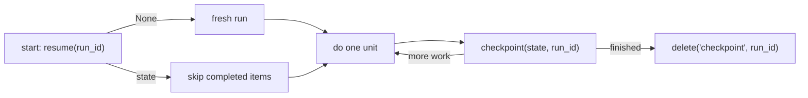

# Trace and resume long agent runs

A long run (process 300 files, crawl a repository, work through a plan) can stop part way: a
crash, a full context window, a deploy, a pause. A working-memory block keyed by the run's
`run_id` holds its progress in ClickHouse, so a new process reads it back and continues from
the last completed unit of work. No separate checkpoint store is needed.

## The pattern

1. Pick a stable `run_id` for the task: a job id, a plan id.
2. After each unit of work, `checkpoint(state, run_id=...)`. `state` is whatever a new
   process needs to continue: completed item ids, a cursor, a JSON string.
3. On start-up, `resume(run_id=...)`. `None` means a fresh run; otherwise skip what the
   checkpoint says is done.



## With the Python SDK

```python
from loom import Agent

RUN = "reindex-catalog"


async def process(agent: Agent, items: list[str]) -> None:
    done = set((await agent.working_memory.resume(run_id=RUN) or "").split())
    for item in items:
        if item in done:
            continue
        await do_work(item)
        done.add(item)
        await agent.working_memory.checkpoint(" ".join(sorted(done)), run_id=RUN)
```

`checkpoint` and `resume` are `working_memory.set` and `working_memory.get` on the block
`checkpoint` (change it with `block_key=`). Each `checkpoint` overwrites the previous one.

> **Warning:** the default `char_limit` is 4,096 characters (`DEFAULT_CHAR_LIMIT` in
> `sdk/python/loom/working_memory.py`). Keep the state small, or store a pointer to it: a
> large blob belongs in `context.offload`, with its `blob_key` in the checkpoint.

When the task finishes, clear the checkpoint:

```python
await agent.working_memory.delete("checkpoint", run_id=RUN)
```

For a progress log rather than one snapshot, `working_memory.append(..., run_id=RUN)` adds
to a block and `working_memory.render(run_id=RUN)` reads the blocks back.

## Resume an AI agent after a crash

A job that stops after committing an item's result may retry that item because
its checkpoint still points there. Save each result with a stable operation
key and have the destination accept that key once. Advance the checkpoint
only after the destination confirms the result.

Try both steps on the [single-user quickstart](../getting-started/quickstart.md#fast-path-released-image-no-clone)
with the [Python SDK](../reference/python-sdk.md). This job keeps its next input
position in Loom and saves results in a SQLite file. The input order and the
output file stay the same across both runs. Save this as `catalog.py`.

```python
import argparse
import asyncio
import sqlite3
from contextlib import closing

from loom import Agent

ITEMS = ("batch-01", "batch-02", "batch-03")


async def run(job_id: str, output: str, stop_after_save: bool) -> None:
    async with Agent(org="dev", namespace="local", agent="catalog-worker") as agent:
        state = await agent.working_memory.resume(run_id=job_id)
        start = int(state) if state is not None else 0
        print(f"Next input index: {start}")
        with closing(sqlite3.connect(output)) as results:
            results.execute("CREATE TABLE IF NOT EXISTS completed (key TEXT PRIMARY KEY)")
            for index in range(start, len(ITEMS)):
                item = ITEMS[index]
                with results:
                    results.execute(
                        "INSERT INTO completed VALUES (?) ON CONFLICT(key) DO NOTHING",
                        (f"{job_id}/{item}",),
                    )
                if stop_after_save and index == 1:
                    raise SystemExit("Stopped after committing batch-02")
                await agent.working_memory.checkpoint(str(index + 1), run_id=job_id)
            count = results.execute("SELECT count(*) FROM completed").fetchone()[0]
            print(f"Unique results: {count}")


parser = argparse.ArgumentParser()
parser.add_argument("job_id")
parser.add_argument("output")
parser.add_argument("--stop-after-save", action="store_true")
args = parser.parse_args()
asyncio.run(run(args.job_id, args.output, args.stop_after_save))
```

```bash
demo_dir=$(mktemp -d)
job_id=$(basename "$demo_dir")
LOOM_BASE_URL=http://localhost:7777 python catalog.py "$job_id" "$demo_dir/catalog.sqlite" --stop-after-save
```

The first process prints `Next input index: 0` and exits with
`Stopped after committing batch-02`. To check that the cursor survives a Loom server
restart, restart the server on this disposable stack before running the next command.
Keep the ClickHouse data volume and SQLite output file.

```bash
LOOM_BASE_URL=http://localhost:7777 python catalog.py "$job_id" "$demo_dir/catalog.sqlite"
```

The second process reads cursor `1` and retries `batch-02` with the same key. The
SQLite primary key keeps one row per input, and the process prints:

```text
Next input index: 1
Unique results: 3
```

Use a checkpoint with one active worker per job. Give a replacement the same
job ID, identity and input snapshot. Keep the destination's deduplication
keys for as long as the job can retry. On a shared deployment, configure the
[agent's own scoped credential](tokens-and-grants.md) and its namespace.
Clear the checkpoint once your scheduler has recorded the job as finished.

## Over MCP

`working_memory.set` is listed (`loom_working_memory_set`) on the `coding`, `atomic` and
`all` toolsets, and runs through `loom_op` on every other toolset except `readonly` and
`assistant`. `working_memory.get` is not listed on any toolset, including `all`; call it
through `loom_op` with `{"op": "working_memory.get", "arguments": {...}}`. An agent:

1. calls `working_memory.set` with `run_id` and `block_key="checkpoint"` after each step;
2. calls `working_memory.get` with the same `run_id` and `block_key` at start-up.

Two runs with different `run_id`s never see each other's checkpoints.

## Which plane holds a checkpoint

| State                                       | Plane                  | Why                                                                                               |
| ------------------------------------------- | ---------------------- | ------------------------------------------------------------------------------------------------- |
| A small resume cursor (done ids, an offset) | Working memory         | Read back by exact key; overwritten each step; never embedded                                     |
| A large partial result or step output       | `context.offload` blob | Holds content past the block limit, with a `summary` and `ttl_seconds`; read with `context.fetch` |
| A claim the run established                 | `memory.set`           | Durable, embedded and ranked for later recall                                                     |

The [investigation agent guide](investigation-agent-memory.md) maps every kind of agent
state to its plane.

## Trace what the run did

- `run.begin` / `run.complete` record the run itself: its goal, status, the memories it
  relied on (`memories_used`) and a reflection. `run.get` returns the run with the keys it
  recalled, the memories it wrote, its turns and cost ([runs](../features/runs.md)).
- Memories the run wrote carry its `run_id`; `memory.search(run_id=...)` narrows to them.
- `conversation.create` and `conversation.append` take a `run_id`, so the run's transcript
  is bound to it ([conversations and sessions](../features/conversations-and-sessions.md)).
- With `LOOM_SEARCH_TRACE_LOG_ENABLED=true` (default off),
  `memory.search_trace_log(run_id=...)` lists every search the run made and what it
  returned ([debugging](debugging.md)).

Loom does not snapshot in-process variables. The checkpoint holds what you put in it.

## Inspect a captured coding-agent session

Loom can keep coding-agent conversations, tool observations and run records on your
self-hosted server. These are separate records: a run summary is not a full transcript,
and tool observations are not unrestricted recordings of every tool input and output.

1. [Run Loom](../getting-started/quickstart.md) and
   [connect the coding-agent plugin](../getting-started/connect-a-coding-agent.md) to
   the intended namespace with a writer token. For Codex, approve the plugin's hooks;
   an MCP connection alone does not capture the transcript.
2. The namespace owner enables **Record conversations** on the dashboard's
   Conversations page. Recording is off by default; changing it with
   `conversation.set_logging` needs admin access. Capture hooks send new transcript
   turns when recording is enabled. Do not append the same turns manually.
3. Run an ordinary task in that coding-agent session. The run hooks record its goal
   and final response; they do not determine whether the task succeeded. Claude Code's tool hooks submit bounded, redacted observations,
   skipping Loom and harness meta tools and deduplicating repeated file reads. See
   [capture and data handling](../features/integrations/claude-code.md#data-handling).
4. Use a token with viewer access to the same namespace to list recent threads:

   ```bash
   curl --fail-with-body "$LOOM_BASE_URL/v1/conversation.threads" \
     -H "Authorization: Bearer $LOOM_TOKEN" \
     -H 'Content-Type: application/json' \
     -d '{"org":"example","namespace":"coding","agent":"*","window_days":7,"limit":5}'
   ```

   Replace the example scope with your own. Take a `thread_id` from `threads` and
   read its newest recorded turns:

   ```bash
   curl --fail-with-body "$LOOM_BASE_URL/v1/conversation.get" \
     -H "Authorization: Bearer $LOOM_TOKEN" \
     -H 'Content-Type: application/json' \
     -d '{"org":"example","namespace":"coding","agent":"*","thread_id":"<thread_id>","include_messages":true,"order":"desc","limit":20}'
   ```

   These examples show the request shapes; they are not a captured session result.
   `conversation.get` is experimental. Read the run summary with `run.get` as
   described under [Runs](../features/runs.md).

An empty thread list is not proof the agent did nothing: check the namespace, token,
hook setup and recording switch. Tool observations are stored without extraction when
`LOOM_OBSERVE_EXTRACT_ENABLED` is off (the default). Neither this workflow nor
[Loom's own request telemetry](../features/observability/telemetry.md) supplies automatic
traces of every model call in arbitrary agents. See
[conversations and sessions](../features/conversations-and-sessions.md) for storage,
search and retention limits.

## Why it holds

`loom.working_memory` is a `ReplacingMergeTree(version)` ordered by
`(org, namespace, agent, user_id, session_id, run_id, block_key)`. Each `checkpoint` writes a
new version of the row and reads collapse to the latest. `run_id` is in the sorting key, so
two runs are two rows.

## Related

- [Working memory and profiles](../features/memory/working-memory-and-profiles.md)
- [Runs](../features/runs.md)
- [Headless bots](headless-bots.md)
