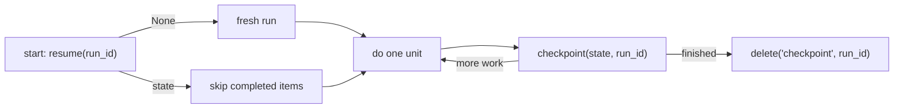

# Trace and resume long agent runs

A long run (process 300 files, crawl a repository, work through a plan) can stop part way: a
crash, a full context window, a deploy, a pause. A working-memory block keyed by the run's
`run_id` holds its progress in ClickHouse, so a new process reads it back and continues from
the last completed unit of work. No separate checkpoint store is needed.

## The pattern

1. Pick a stable `run_id` for the task: a job id, a plan id.
2. After each unit of work, `checkpoint(state, run_id=...)`. `state` is whatever a new
   process needs to continue: completed item ids, a cursor, a JSON string.
3. On start-up, `resume(run_id=...)`. `None` means a fresh run; otherwise skip what the
   checkpoint says is done.



## With the Python SDK

```python
from loom import Agent

RUN = "reindex-catalog"


async def process(agent: Agent, items: list[str]) -> None:
    done = set((await agent.working_memory.resume(run_id=RUN) or "").split())
    for item in items:
        if item in done:
            continue
        await do_work(item)
        done.add(item)
        await agent.working_memory.checkpoint(" ".join(sorted(done)), run_id=RUN)
```

`checkpoint` and `resume` are `working_memory.set` and `working_memory.get` on the block
`checkpoint` (change it with `block_key=`). Each `checkpoint` overwrites the previous one.

> **Warning:** the default `char_limit` is 4,096 characters (`DEFAULT_CHAR_LIMIT` in
> `sdk/python/loom/working_memory.py`). Keep the state small, or store a pointer to it: a
> large blob belongs in `context.offload`, with its `blob_key` in the checkpoint.

When the task finishes, clear the checkpoint:

```python
await agent.working_memory.delete("checkpoint", run_id=RUN)
```

For a progress log rather than one snapshot, `working_memory.append(..., run_id=RUN)` adds
to a block and `working_memory.render(run_id=RUN)` reads the blocks back.

## Over MCP

`working_memory.set` is listed (`loom_working_memory_set`) on the `coding`, `atomic` and
`all` toolsets; on `core` it runs through `loom_op`. `working_memory.get` is not listed on any toolset, including `all`; call it
through `loom_op` with `{"op": "working_memory.get", "arguments": {...}}`. An agent:

1. calls `working_memory.set` with `run_id` and `block_key="checkpoint"` after each step;
2. calls `working_memory.get` with the same `run_id` and `block_key` at start-up.

Two runs with different `run_id`s never see each other's checkpoints.

## Which plane holds a checkpoint

| State                                       | Plane                  | Why                                                                                               |
| ------------------------------------------- | ---------------------- | ------------------------------------------------------------------------------------------------- |
| A small resume cursor (done ids, an offset) | Working memory         | Read back by exact key; overwritten each step; never embedded                                     |
| A large partial result or step output       | `context.offload` blob | Holds content past the block limit, with a `summary` and `ttl_seconds`; read with `context.fetch` |
| A claim the run established                 | `memory.set`           | Durable, embedded and ranked for later recall                                                     |

The [investigation agent guide](investigation-agent-memory.md) maps every kind of agent
state to its plane.

## Trace what the run did

- `run.begin` / `run.complete` record the run itself: its goal, status, the memories it
  relied on (`memories_used`) and a reflection. `run.get` returns the run with the keys it
  recalled, the memories it wrote, its turns and cost ([runs](../features/runs.md)).
- Memories the run wrote carry its `run_id`; `memory.search(run_id=...)` narrows to them.
- `conversation.create` and `conversation.append` take a `run_id`, so the run's transcript
  is bound to it ([conversations and sessions](../features/conversations-and-sessions.md)).
- With `LOOM_SEARCH_TRACE_LOG_ENABLED=true` (default off),
  `memory.search_trace_log(run_id=...)` lists every search the run made and what it
  returned ([debugging](debugging.md)).

Loom does not snapshot in-process variables. The checkpoint holds what you put in it.

## Why it holds

`loom.working_memory` is a `ReplacingMergeTree(version)` ordered by
`(org, namespace, agent, user_id, session_id, run_id, block_key)`. Each `checkpoint` writes a
new version of the row and reads collapse to the latest. `run_id` is in the sorting key, so
two runs are two rows.

## Related

- [Working memory and profiles](../features/memory/working-memory-and-profiles.md)
- [Runs](../features/runs.md)
- [Headless bots](headless-bots.md)
