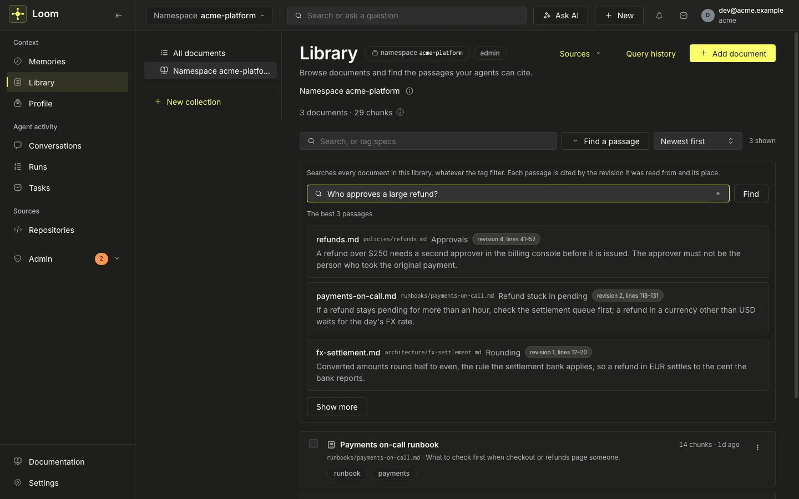

# ClickHouse Loom documentation

Loom stores memory, documents and code indexes in ClickHouse, with
[Postgres](architecture/storage-authority.md#why-two-stores) as an option for live
memory and knowledge state. Connect through a coding-agent plugin, MCP, HTTP,
the SDKs or the dashboard. Browse the [guides](guides/index.md) by task or
follow the reading order below.

<a href="https://loom.clickhouse.com/docs/es/use-cases" lang="es" hreflang="es">Casos de uso en español</a>

## Start here

| Step                     | Read                                                                                                                                                                                      |
| ------------------------ | ----------------------------------------------------------------------------------------------------------------------------------------------------------------------------------------- |
| 1. Decide                | [Overview](getting-started/overview.md) → [Evaluate Loom](getting-started/evaluate.md)                                                                                                    |
| 2. Install               | [Quickstart](getting-started/quickstart.md) → [Deployment](operations/deployment.md)                                                                                                      |
| 3. Connect agents        | [Connect a coding agent](getting-started/connect-a-coding-agent.md) → [Integrations](features/integrations/index.md)                                                                      |
| 4. SDK and API           | [Your first agent](getting-started/first-agent.md) → [Python SDK](reference/python-sdk.md) / [HTTP API](reference/http-api.md)                                                            |
| 5. Namespaces and access | [Identities and namespaces](concepts/identities-and-namespaces.md) → [Tokens and grants](guides/tokens-and-grants.md)                                                                     |
| 6. Code index            | [Code index](features/code-index/overview.md) → [Repositories](features/code-index/repositories.md) → [Code-index operations](operations/code-index-operations.md)                        |
| 7. Operate               | [Monitoring](operations/monitoring.md) · [Troubleshooting](operations/troubleshooting.md) · [Upgrades](operations/upgrades.md) · [Backup and recovery](operations/backup-and-recovery.md) |

## Use cases

One page per need, each saying what Loom does for it and where to start:
[agent memory](use-cases/agent-memory.md) ·
[document search and RAG](use-cases/document-search.md) ·
[knowledge factory for AI agents](use-cases/knowledge-factory.md) ·
[code index for coding agents](use-cases/code-intelligence.md) ·
[repository Q&A without a checkout](guides/repository-questions.md) ·
[code index by language](use-cases/code-intelligence-by-language.md) ·
[memory linked to code](use-cases/memory-linked-to-code.md) ·
[coding-agent model cost](use-cases/coding-agent-cost.md) ·
[shared memory for software factories](use-cases/multi-agent.md) ·
[autonomous agents: recall, audit, erasure](use-cases/autonomous-agents.md) ·
[runs, traces and PR history](use-cases/runs-and-pr-history.md) ·
[self-hosted agent memory with SQL](use-cases/self-hosted-clickhouse.md) ·
[all use cases](use-cases/index.md).

Watch the cited-answer demo

<video src="assets/screenshots/clip-assistant-answer.webm" controls preload="none" muted playsinline width="100%" aria-label="Ask AI answering a question about refunds, with its numbered sources checked against Loom"><a href="assets/screenshots/clip-assistant-answer.webm">Download the cited-answer clip</a></video>

## 1. Getting started

- [Overview](getting-started/overview.md): what Loom is, when it fits, prerequisites.
- [What's included](getting-started/whats-included.md): Loom's main capabilities, each with its page.
- [Quickstart](getting-started/quickstart.md): the local stack end to end.
- [Configure models and API keys](getting-started/models-and-keys.md): agent subscriptions,
  server LLMs, embeddings and single-provider setups.
- [Evaluate Loom](getting-started/evaluate.md): smoke test, workload evaluation and
  reproducible public benchmarks.
- [Connect a coding agent](getting-started/connect-a-coding-agent.md): plugin or MCP entry.
- [Set up Loom with your coding agent](getting-started/agent-setup.md): for an agent that
  installs a pinned release and proves it works, with a fixed report.
- [Your first agent](getting-started/first-agent.md): an SDK tutorial.

## 2. Install and run the server

- [Deployment](operations/deployment.md): shapes, environment, providers, identity modes,
  proxy, images, production checklist.
- [Single sign-on](operations/sso.md): an OIDC identity provider for the dashboard,
  `loom login` and MCP clients.
- [Use Loom without the dashboard](guides/without-the-dashboard.md): `loom login`, `loom call`
  and the SDK call for every dashboard view.
- [Upgrades](operations/upgrades.md) · [Supported versions](operations/supported-versions.md) ·
  [Backup and recovery](operations/backup-and-recovery.md) ·
  [Monitoring](operations/monitoring.md) · [Maintenance](operations/maintenance.md) ·
  [Runtime settings](operations/runtime-settings.md) ·
  [Troubleshooting](operations/troubleshooting.md) ·
  [Code-index operations](operations/code-index-operations.md) ·
  [Running N replicas](operations/replicas.md): identical Looms behind one URL ·
  [Postgres](operations/postgres.md): the Postgres memory authority ·
  [Kubernetes](operations/kubernetes.md): the Helm chart, with EKS and kind overlays ·
  [ClickHouse Cloud and Managed Postgres](operations/clickhouse-cloud.md): the chart over
  both managed services ·
  [Copying a namespace to another Loom](operations/okf-sync.md) ·
  [Exporting usage to a data warehouse](operations/analytics-export.md)

## 3. Connect agents

[Integrations](features/integrations/index.md) ·
[MCP clients](features/integrations/mcp-clients.md) ·
[Agent instructions](features/integrations/agent-instructions.md) ·
[Claude Code](features/integrations/claude-code.md) ·
[Codex](features/integrations/codex.md) · [Cursor](features/integrations/cursor.md) ·
[VS Code](features/integrations/vscode.md) ·
[Frameworks](features/integrations/frameworks.md) ·
[Grep shim](features/integrations/grep-shim.md) ·
[Langfuse](features/integrations/langfuse.md) ·
[ClickStack](features/integrations/clickstack.md) ·
[OKF](features/integrations/okf.md)

## 4. SDK and API

[Reference index](reference/index.md) · [HTTP API](reference/http-api.md) ·
[MCP](reference/mcp.md) · [Python SDK](reference/python-sdk.md) ·
[TypeScript SDK](reference/typescript-sdk.md) · [Go SDK](reference/go-sdk.md) ·
[Rust SDK](reference/rust-sdk.md) · [Environment](reference/environment.md) ·
[Operations](reference/operations.md) · [Configuration](reference/configuration.md) ·
[Workers](reference/workers.md) · [CLI](reference/cli.md) · [Errors](reference/errors.md) ·
[Status](reference/status.md) · [Schema](reference/schema.md) ·
[Extractor contract](reference/extractor-contract.md). Operations and fields change between releases;
[unknown and removed fields](reference/http-api.md#unknown-and-removed-fields) says how a
client sees one the server no longer reads.

## 5. Namespaces, access and the memory model

- [Identities and namespaces](concepts/identities-and-namespaces.md): the tuple, roles,
  grants and read scope.
- [Agentic memory](concepts/memory.md): working memory, long-term recall, time, history,
  provenance.
- [Retrieval and ranking](concepts/retrieval-and-ranking.md): legs, fusion, abstain,
  calibration.

## Guides

[Agent integration](guides/agent-integration.md) ·
[Headless bots](guides/headless-bots.md) ·
[Tokens and grants](guides/tokens-and-grants.md) ·
[Trace and resume long runs](guides/trace-and-resume.md) ·
[Choose AI software factory tools](guides/software-factory-tools.md) ·
[Optimize a namespace](guides/optimize-namespace.md) ·
[Investigation-agent memory](guides/investigation-agent-memory.md) ·
[Extraction pipelines](guides/extraction-pipeline.md) ·
[Performance tuning](guides/performance-tuning.md) · [Debugging](guides/debugging.md) ·
[Query Loom from Postgres](guides/query-from-postgres.md) ·
[Teaching with Loom](guides/teaching.md)

## Features

- Planes: [namespaces and sharing](features/namespaces-and-sharing.md) ·
  [unified search](features/unified-search.md) · [knowledge](features/knowledge.md) ·
  [entity graph](features/entity-graph.md) ·
  [conversations and sessions](features/conversations-and-sessions.md) ·
  [runs](features/runs.md) · [tasks and decisions](features/tasks-and-decisions.md) ·
  [dashboard](features/dashboard.md)
- Memory: [writing](features/memory/writing.md) ·
  [search and ask](features/memory/search-and-ask.md) ·
  [conflicts and refusal](features/memory/conflicts-and-refusal.md) ·
  [extraction](features/memory/extraction.md) ·
  [history and provenance](features/memory/history-and-provenance.md) ·
  [retention and erasure](features/memory/retention-and-erasure.md) ·
  [procedures and learnings](features/memory/procedures-and-learnings.md) ·
  [working memory and profiles](features/memory/working-memory-and-profiles.md)
- Observability: [audit](features/observability/audit.md) ·
  [cost and usage](features/observability/cost-and-usage.md) ·
  [telemetry](features/observability/telemetry.md)
- Tracker: [overview](features/tracker/overview.md) ·
  [record contract](features/tracker/record-contract.md)

## 6. Code index

[Overview](features/code-index/overview.md) ·
[Repositories](features/code-index/repositories.md) ·
[Freshness](features/code-index/freshness.md) ·
[History and PRs](features/code-index/history-and-prs.md) ·
[Operations](features/code-index/operations.md) ·
[Code-index operations runbook](operations/code-index-operations.md)

## Architecture

[System overview](architecture/system-overview.md) ·
[Server layout](architecture/server-layout.md) ·
[ClickHouse](architecture/clickhouse.md) ·
[Memory architecture](architecture/memory-architecture.md) ·
[Storage authority](architecture/storage-authority.md) ·
[Cells](architecture/cells.md) ·
[Storage layout](architecture/storage-layout.md) ·
[Code-index architecture](architecture/code-index-architecture.md) ·
[Document extraction](architecture/document-extraction.md) ·
[Document sources](architecture/document-sources.md) ·
[LLM and embeddings](architecture/llm-architecture.md) ·
[Security](architecture/security.md) ·
[Assistant design](architecture/assistant.md) ·
[Failure and recovery](architecture/failure-and-recovery.md) ·
[Rolling upgrades](architecture/rolling-upgrades.md)

## Benchmarks

[Overview](benchmarks/overview.md) · [Coverage](benchmarks/coverage.md) ·
[Methodology](benchmarks/methodology.md) ·
[Running](benchmarks/running.md) · [Results](benchmarks/results.md) ·
[Adding a case](benchmarks/adding-a-case.md) · [Skill eval](benchmarks/skill-eval.md)

## Development

For contributors: [repository guide](development/repository-guide.md) ·
[local development](development/local-development.md) ·
[testing](development/testing.md) · [code generation](development/code-generation.md) ·
[migrations](development/migrations.md) ·
[release process](development/release-process.md) ·
[documentation style](development/documentation-style.md) ·
[curation loop design](development/curation-loop-design.md) ·
[extending Loom](development/extending-loom.md) ·
[add an operation](development/adding-an-operation.md) ·
[add a worker](development/adding-a-worker.md) ·
[add a table](development/adding-a-table.md) ·
[add language support](development/adding-language-support.md) ·
[dashboard design](development/dashboard-design.md).
[CONTRIBUTING.md](../CONTRIBUTING.md) covers the pull-request workflow.

## Also

[Glossary](glossary.md): Loom's terms, defined once. [FAQ](faq.md): the first questions, one
paragraph each. [`llms.txt`](../llms.txt): a generated index of the docs for agents;
[`llms-full.txt`](https://loom.clickhouse.com/docs/llms-full.txt) holds, in one file, the
pages that say what Loom is and how to start.
